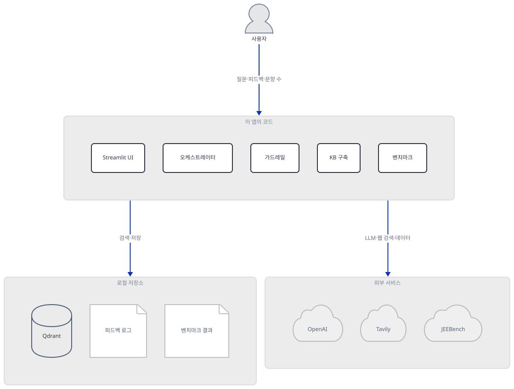
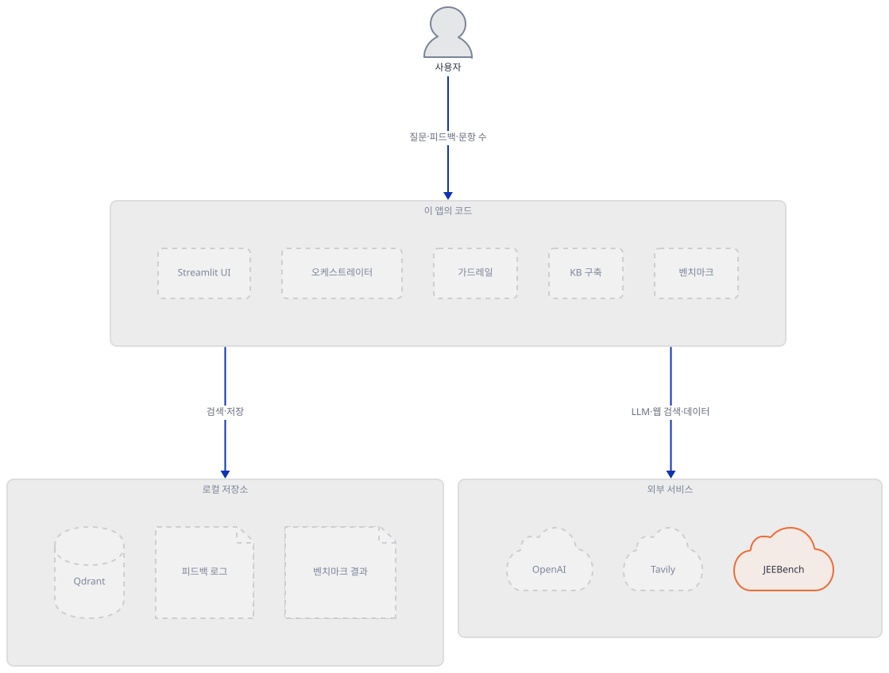
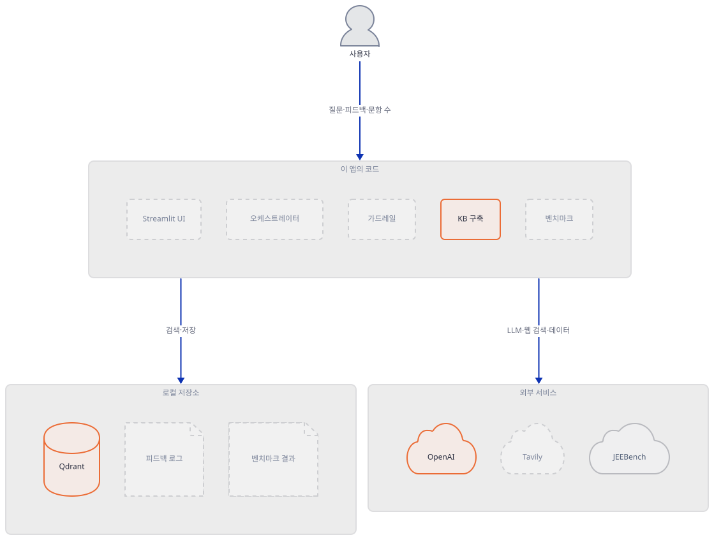
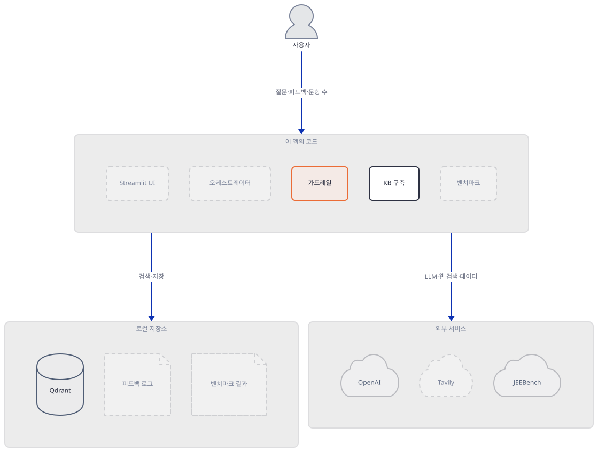
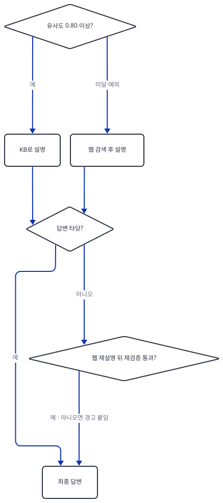
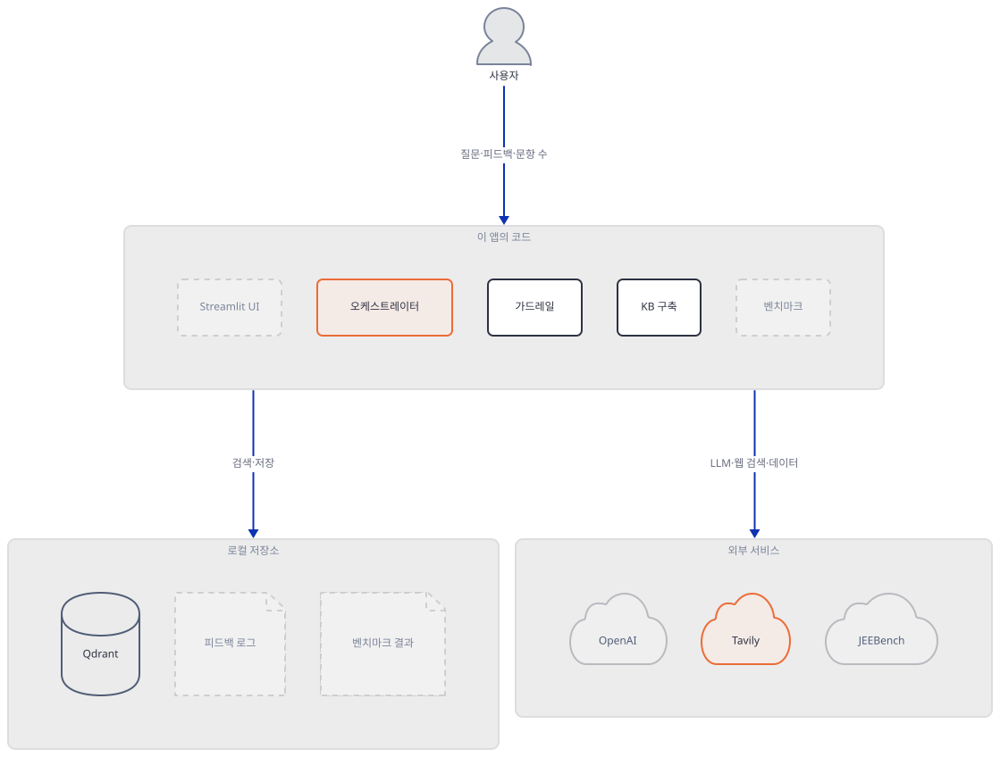
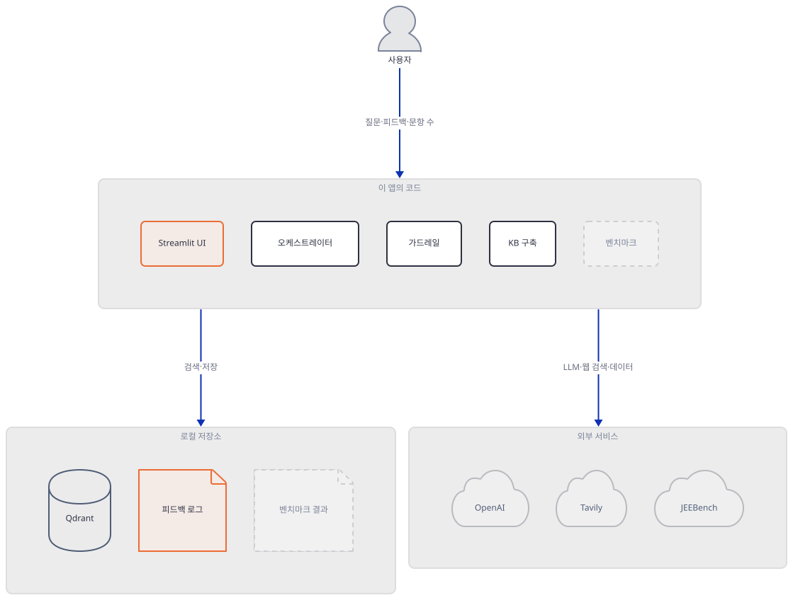
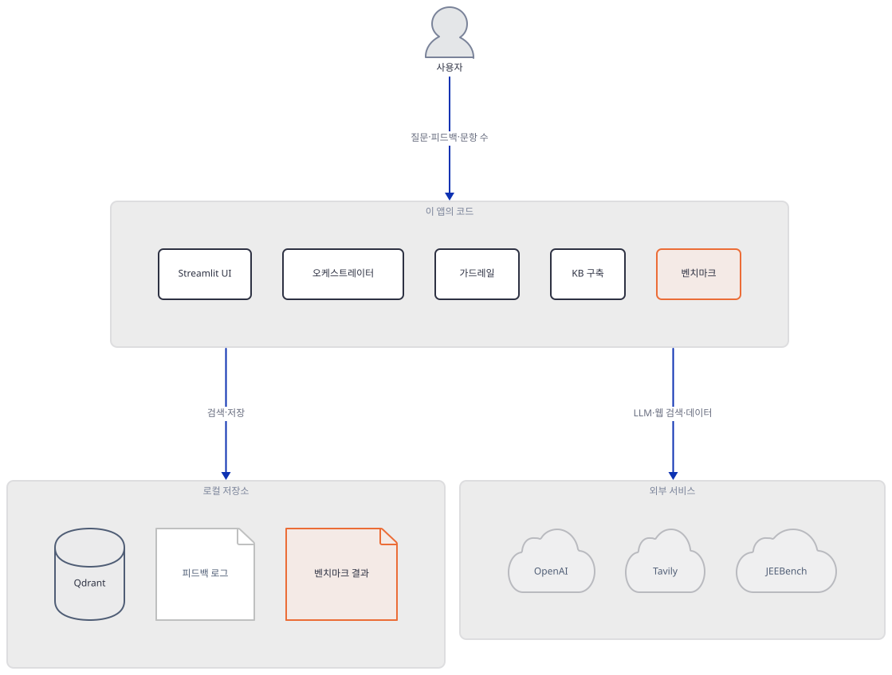
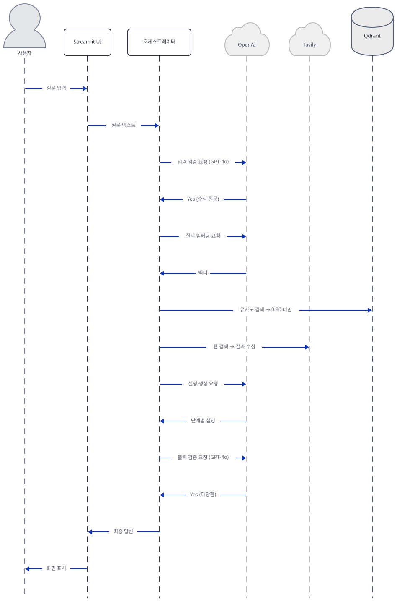

# Day 069 · 🧠 Math Tutor Agent – Agentic RAG with Feedback Loop

> 볼륨 5 📀 RAG · 난이도 ★★★ · 예상 소요 110분(Docker로 로컬 Qdrant를 띄우고 OpenAI·Tavily 키 2개를 발급받은 뒤 `rag/vector.py`로 KB를 실제로 구축하는 손 놀리는 시간이 읽는 시간보다 깁니다. 여기에 가짜 LM·가짜 `requests.post`·재채점으로 가드레일, 웹 폴백, 벤치마크를 돌려 보는 확인이 여럿 더해집니다) · API 비용 대략 질문 1건당 GPT-4o 호출 1회(수학이 아니라고 거절될 때) 또는 3~4회(입력 분류·설명 생성·출력 검증, 검증 실패 시 웹 재설명 1회와 그 재검증 1회 추가) + KB 검색마다 질의 임베딩 호출 1회 + Tavily 검색 0~2회 — KB를 처음 구축할 때 JEEBench **전체 문항**(과목 필터 없음, 소스로 확인)에 대한 OpenAI 임베딩 비용이 한 번 더 든다(문항 수는 네트워크가 없어 확인 못함) · 대략치(키가 없어 실제 과금은 확인 못함) · 원본 앱: `rag_tutorials/agentic_rag_math_agent`

## 오늘 만들 것

JEE(인도 공과대학 입시)급 수학 문제에 단계별 풀이를 내놓는 튜터 에이전트입니다. 질문이 오면 먼저 Qdrant에 저장된 JEEBench 문항·정답 벡터를 코사인 유사도로 검색하고, 확신이 없으면(Day 060·061과 같은 "낮으면 웹으로" 패턴) Tavily 웹 검색으로 넘어갑니다. 그 앞뒤로 DSPy 기반 입력·출력 가드레일이 있어 수학이 아닌 질문을 걸러내고 답변의 타당성을 한 번 더 봅니다. Streamlit 화면에서 사용자가 답변에 👍/👎를 누르면 질문·답변·평가가 로컬 JSON에 쌓이는데, 이 로그를 다시 읽어 프롬프트나 검색을 바꾸는 코드는 없습니다 — "피드백 루프"는 기록까지이고, 그 기록으로 무언가를 자동으로 개선하지는 않습니다(소스로 확인). 참고로 앱 자체 README는 설명 모델을 "GPT-4.1"이라고 적어 놓았지만, 실제 코드 세 곳(`rag_tutorials/agentic_rag_math_agent/rag/guardrails.py:13`, `rag_tutorials/agentic_rag_math_agent/rag/query_router.py:102`, `rag_tutorials/agentic_rag_math_agent/rag/query_router.py:155`) 모두 `model="gpt-4o"`를 씁니다 — 앱 README 오류입니다.

이 튜토리얼을 처음 쓴 뒤 원본이 한 번 크게 바뀌었습니다. PR #1236(커밋 `1ee4f2d`, 2026-10-18 병합)이 입력 가드레일의 예시를 실제 few-shot 데모로 붙이고, Yes/No 판정을 관대하게 읽게 하고, 웹 폴백에 시간 제한·오류 처리를 넣고, 재시도한 답을 다시 검증하게 하고, 벤치마크 채점을 독립된 토큰 일치로 바꿨습니다. 이 문서는 바뀐 뒤의 코드를 기준으로 합니다.



## 사전 준비

| 서비스/도구 | 용도 | 발급·설치 |
|---|---|---|
| OpenAI API 키 | GPT-4o(가드레일 판정·설명 생성)와 임베딩(KB 구축·검색) 호출 인증 | https://platform.openai.com/api-keys |
| Tavily API 키 | KB 유사도가 낮을 때 웹 검색 폴백 | https://tavily.com 가입 후 API 키 발급(무료 등급 있음) |
| 로컬 Qdrant 서버 | `math_agent` 컬렉션 저장 — 앱 자체 README에는 안 나오지만 코드가 `host="localhost", port=6333`을 그대로 하드코딩해 직접 띄워야 합니다(소스로 확인, `rag_tutorials/agentic_rag_math_agent/rag/vector.py:35`, `rag_tutorials/agentic_rag_math_agent/rag/query_router.py:30`) | `docker run -p 6333:6333 qdrant/qdrant` (Docker Desktop 필요) |
| 인터넷 연결 | PyPI 설치, OpenAI·Tavily API, HuggingFace Hub(JEEBench 데이터셋), GitHub(`raw.githubusercontent.com` — `dspy`가 끌고 오는 litellm이 import 시점에 모델 가격표를 받으려 시도합니다. 막혀도 내장 사본으로 넘어가 동작에는 지장이 없습니다, 소스로 확인) 접속 | 사내망이면 이 네 곳 아웃바운드 허용 필요. 끄려면 `LITELLM_LOCAL_MODEL_COST_MAP=True` |
| uv | 가상환경 생성과 패키지 설치 | [공통 사전 준비](../README.md#공통-사전-준비-한-번만) 참고 |

## 아키텍처 한눈에 보기

| 컴포넌트 | 역할 | 코드 위치 |
|---|---|---|
| 사용자 | 질문 입력, 문항 수 선택, 피드백 클릭 | 코드 없음 (브라우저) |
| Streamlit UI (3탭) | 질문·답변, 피드백 조회, 벤치마크 실행 화면 | `rag_tutorials/agentic_rag_math_agent/app/streamlit.py:1-120` |
| 질의 오케스트레이터 (`answer_math_question`) | 입력 가드레일 → KB/웹 라우팅 → 출력 가드레일(실패하면 웹 재시도 뒤 재검증)까지 한 번에 실행 | `rag_tutorials/agentic_rag_math_agent/rag/query_router.py:120-180` |
| 웹 폴백 (`query_web`, `answer_from_web`) | Tavily 검색(20초 제한, 오류는 `None`)과 설명 생성, 출처 라벨 결정 | `rag_tutorials/agentic_rag_math_agent/rag/query_router.py:52-111` |
| 입력 가드레일 (`InputValidator`) | DSPy로 수학 질문인지 분류 — 예시 35개를 `self.classifier.demos`로 붙인 few-shot, 판정은 `parse_verdict`가 관대하게 읽음(Step 3) | `rag_tutorials/agentic_rag_math_agent/rag/guardrails.py:29-98` |
| 출력 가드레일 (`OutputValidator`) | DSPy로 최종 답변의 타당성 재검증, 같은 `parse_verdict` 사용 | `rag_tutorials/agentic_rag_math_agent/rag/guardrails.py:102-123` |
| 지식 베이스 구축 (`rag/vector.py`) | JEEBench 문항을 Document화해 Qdrant에 인덱싱하는 1회성 스크립트 | `rag_tutorials/agentic_rag_math_agent/rag/vector.py:17-54` |
| 벤치마크 실행기 (`benchmark_math_agent`, `is_answer_correct`) | JEEBench N문항에 오케스트레이터를 반복 호출하고, 정답을 독립된 토큰으로 맞춰 정확도 집계 | `rag_tutorials/agentic_rag_math_agent/app/benchmark.py:13-62` |
| JEEBench 데이터 로더 | HF에서 JEEBench 중 수학 문항만 필터링 — 파일명은 `load_gsm8k_data.py`이지만 GSM8K가 아니라 JEEBench를 읽습니다(소스로 확인) | `rag_tutorials/agentic_rag_math_agent/data/load_gsm8k_data.py:1-9` |
| Qdrant (`math_agent` 컬렉션) | 문항·정답 텍스트의 OpenAI 임베딩, 코사인 유사도 검색 | `rag_tutorials/agentic_rag_math_agent/rag/vector.py:29-51`, `rag_tutorials/agentic_rag_math_agent/rag/query_router.py:29-34` |
| 피드백 로그 | 👍/👎와 질문·답변을 JSON 배열로 누적(읽어서 되먹이는 코드는 없음) | `rag_tutorials/agentic_rag_math_agent/logs/feedback_log.json` (쓰기: `rag_tutorials/agentic_rag_math_agent/app/streamlit.py:57-82`) |
| 벤치마크 결과 CSV | 문항별 정답 여부·소요 시간 | `rag_tutorials/agentic_rag_math_agent/benchmark/results_math_N.csv` (쓰기: `rag_tutorials/agentic_rag_math_agent/app/streamlit.py:111-114`) |

## 단계별 진행

### Step 1. 환경 구성과 JEEBench 데이터셋

**목적.** 의존성을 설치하고, 이 앱의 지식 베이스 재료인 JEEBench 데이터셋을 어디서 어떻게 읽어오는지 확인합니다.

**할 일.**

```bash
cd rag_tutorials/agentic_rag_math_agent
uv venv
uv pip install -r requirements.txt
```

(pip 대안: `python -m venv .venv && source .venv/bin/activate && pip install -r requirements.txt`. 이 저장소 루트에는 `pyproject.toml`이 있어 이후 모든 `uv run`에는 `--no-project`를 붙입니다.)

완전히 새 가상환경에서 이 설치 명령을 직접 돌리면 아래처럼 시작합니다(발췌 — 뒤이어 `+ 패키지==버전`이 143줄 더 나옵니다).

```
Resolved 143 packages in 138ms
Installed 143 packages in 2.63s
```

`config/.env.example`을 `config/.env`로 복사하고 두 키를 채웁니다.

`rag_tutorials/agentic_rag_math_agent/config/.env.example:1-2`

```text
OPENAI_API_KEY=""
TAVILY_API_KEY=""
```

지식 베이스의 재료는 JEEBench 데이터셋입니다. 이 파일 전체를 봅니다.

`rag_tutorials/agentic_rag_math_agent/data/load_gsm8k_data.py:1-9`

```python
import pandas as pd

def load_jeebench_dataset():
    df = pd.read_json("hf://datasets/daman1209arora/jeebench/test.json")
    df = df[df["subject"].str.lower() == "math"]
    return df[['question', 'gold']]

if __name__ == "__main__":
    load_jeebench_dataset()
```

파일명은 `load_gsm8k_data.py`지만 실제로 읽는 것은 GSM8K가 아니라 `daman1209arora/jeebench`입니다(소스로 확인) — 이름만 보고 GSM8K인 줄 알면 헷갈립니다. `hf://` 경로는 `huggingface_hub`가 등록하는 fsspec 프로토콜인데, `requirements.txt`는 이 패키지를 직접 적지 않습니다. 스크래치 가상환경에 설치해 보면(직접 확인) `dspy`가 끌고 오는 `datasets`(5.0.1)를 통해 `huggingface-hub`(1.33.0)·`fsspec`(2026.6.0)가 함께 들어와 있어 `hf://`는 정상 동작합니다.



**확인.** 위에서 이미 설치했으니, 몇 개나 깔렸는지만 셉니다(`uv pip list`는 상태 줄·구분선도 같이 나와 그대로 줄 수를 세면 틀리기 쉬우니 `uv pip freeze`를 씁니다).

```bash
uv pip freeze | wc -l
```

```
143
```

`requirements.txt`의 최상위 패키지 12개(마지막 줄 `requests==2.32.3`에는 개행이 없어 `wc -l`은 13으로 셉니다 — 실제로는 14줄, 그중 빈 줄 1개와 주석 1개를 빼면 12개)가 전이 의존성을 포함해 총 143개 패키지로 풀립니다.

```bash
uv run --no-project python -m py_compile data/load_gsm8k_data.py rag/vector.py rag/guardrails.py rag/query_router.py app/benchmark.py app/streamlit.py && echo compiled
```

```
compiled
```

### Step 2. 지식 베이스 구축 — JEEBench를 Qdrant에 인덱싱

**목적.** `rag/vector.py`가 JEEBench 문항을 어떻게 문서로 바꿔 Qdrant에 넣는지 확인합니다.

**할 일.**

`rag_tutorials/agentic_rag_math_agent/rag/vector.py:17-26`

```python
def load_jeebench_documents():
    df = pd.read_json("hf://datasets/daman1209arora/jeebench/test.json")
    documents = []
    for i, row in df.iterrows():
        q = row["question"]
        a = row["gold"]
        text = f"Q: {q}\nA: {a}"
        doc = Document(text=text, metadata={"source": "jee_bench", "index": i})
        documents.append(doc)
    return documents
```

이 함수는 데이터 로더(`data/load_gsm8k_data.py`)와 별개로 JEEBench를 다시 읽습니다 — 과목 필터(`subject == "math"`)도 없이 전체를 그대로 문서화합니다(소스로 확인, 같은 데이터셋을 두 코드 경로가 각자 읽는 중복입니다). 이렇게 만든 문서를 청크로 쪼개고 Qdrant 컬렉션을 만듭니다.

`rag_tutorials/agentic_rag_math_agent/rag/vector.py:29-51`

```python
def build_vector_index():
    documents = load_jeebench_documents()

    node_parser = SimpleNodeParser()
    nodes = node_parser.get_nodes_from_documents(documents)

    qdrant_client = QdrantClient(host="localhost", port=6333)
    collection_name = "math_agent"

    if not qdrant_client.collection_exists(collection_name=collection_name):
        qdrant_client.create_collection(
            collection_name=collection_name,
            vectors_config=VectorParams(size=1536, distance=Distance.COSINE)
        )

    vector_store = QdrantVectorStore(client=qdrant_client, collection_name=collection_name)
    embed_model = OpenAIEmbedding(api_key=OPENAI_API_KEY)
    storage_context = StorageContext.from_defaults(vector_store=vector_store)

    index = VectorStoreIndex(nodes=nodes, embed_model=embed_model, storage_context=storage_context)
    index.storage_context.persist()

    print("✅ Qdrant vector index built and saved successfully.")
```

벡터 자체는 Qdrant에, 인덱스 메타데이터(`docstore.json` 등)는 `index.storage_context.persist()`가 기본값인 로컬 `storage/` 폴더에 남깁니다 — 이 폴더는 저장소에 커밋돼 있지 않으므로, 이 스크립트를 최소 한 번 실행해야 다음 Step의 검색이 됩니다. 모든 경로가 현재 작업 디렉터리 기준 상대 경로이므로(`config/.env`·`storage/`) 앱 루트(`rag_tutorials/agentic_rag_math_agent`, Step 1에서 이미 이동)에서 실행합니다.

```bash
docker run -p 6333:6333 qdrant/qdrant   # 별도 터미널에서 먼저 띄워 둡니다
PYTHONIOENCODING=utf-8 uv run --no-project python rag/vector.py
```

(PowerShell: `$env:PYTHONIOENCODING="utf-8"; uv run --no-project python rag/vector.py`)

```
✅ Qdrant vector index built and saved successfully.
```

이 명령은 실제 `OPENAI_API_KEY`, 실행 중인 Qdrant, JEEBench 접속용 인터넷이 모두 있어야 하고 위 출력은 소스로 읽은 것이지 이번 재현에서 직접 실행한 결과는 아닙니다(키가 없어 실행하지 못했습니다) — JEEBench 전체 문항을 임베딩하므로 규모에 따라 몇 분 걸릴 수 있습니다. `PYTHONIOENCODING`을 안 붙이면 Step 3에서 다룰 것과 같은 이유로 인덱스는 다 만들어진 뒤 마지막 줄(`rag_tutorials/agentic_rag_math_agent/rag/vector.py:51`의 "✅")에서 `UnicodeEncodeError`가 납니다 — 작업 자체는 끝났는데 성공 메시지 대신 트레이스백을 보게 되는 것이니 당황하지 않습니다.



**확인.** 키 없이 이 모듈이 임포트되는지만 확인합니다(네트워크·Qdrant 접속은 하지 않습니다 — `build_vector_index()`는 `if __name__ == "__main__":` 뒤에 있어 임포트만으로는 실행되지 않습니다).

```bash
uv run --no-project python -c "import rag.vector; print(rag.vector.build_vector_index)"
```

```
<function build_vector_index at 0x...>
```

### Step 3. 가드레일 — DSPy로 입력·출력 판정하기

**목적.** 질문이 수학인지 걸러내는 입력 가드레일과, 답변이 타당한지 다시 보는 출력 가드레일이 각각 무엇을 하는지 확인합니다.

**할 일.**

`rag_tutorials/agentic_rag_math_agent/rag/guardrails.py:17-25`

```python
class ClassifyMath(dspy.Signature):
    """
    Decide if a question is related to mathematics — this includes problem-solving,
    formulas, definitions (e.g., 'what is calculus'),examples to any topic, or theoretical topics.

    Return only 'Yes' or 'No' as your final verdict.
    """
    question: str = dspy.InputField()
    verdict: str = dspy.OutputField(desc="Respond with 'Yes' if the question is related to mathematics, 'No' otherwise.")
```

예시는 모듈 최상위의 튜플 목록으로 따로 빠져 있습니다.

`rag_tutorials/agentic_rag_math_agent/rag/guardrails.py:41-45`

```python
# Few-shot examples for the input guard
MATH_CLASSIFIER_EXAMPLES = [
    ("What is the derivative of x^2?", "Yes"),
    ("Explain the chain rule in calculus.", "Yes"),
    ("Why do I need to learn algebra?", "Yes"),
```

`InputValidator.__init__`은 예시 없는 `self.classifier = dspy.Predict(ClassifyMath)` 하나만 만들고, 그 `demos`에 예시를 `dspy.Example`로 바꿔 붙입니다.

`rag_tutorials/agentic_rag_math_agent/rag/guardrails.py:81-90`

```python
# ✅ Input Validator
class InputValidator(dspy.Module):
    def __init__(self):
        super().__init__()
        self.classifier = dspy.Predict(ClassifyMath)
        # Attach the examples as demos so they are actually sent to the model
        self.classifier.demos = [
            dspy.Example(question=q, verdict=v).with_inputs("question")
            for q, v in MATH_CLASSIFIER_EXAMPLES
        ]
```

이 튜토리얼의 첫 판은 여기서 결함을 적었습니다. 예전 코드는 예시를 `dspy.ChainOfThought(ClassifyMath, examples=[...])`에 넘겼는데 그 인자는 few-shot 데모가 되지 않았고, 그렇게 만든 모듈은 `forward()`가 부르지도 않았습니다. 원본이 PR #1236(커밋 `1ee4f2d`, 2026-10-18 병합)에서 고쳤습니다. 지금 동작을 가짜 LM(`dspy.utils.dummies.DummyLM`, 모델 호출 없음)으로 확인합니다.

```bash
LITELLM_LOCAL_MODEL_COST_MAP=True PYTHONIOENCODING=utf-8 uv run --no-project python -c "
import rag.guardrails as g
iv = g.InputValidator()
ex = g.MATH_CLASSIFIER_EXAMPLES
print('examples:', len(ex), 'unique:', len({q for q, _ in ex}), 'Yes:', sum(v == 'Yes' for _, v in ex), 'No:', sum(v == 'No' for _, v in ex))
print('demos on classifier:', len(iv.classifier.demos), type(iv.classifier.demos[0]).__name__)
print('has validate_question:', hasattr(iv, 'validate_question'))
"
```

```
🔐 Loaded OPENAI_API_KEY: ❌ Missing
examples: 35 unique: 35 Yes: 33 No: 2
demos on classifier: 35 Example
has validate_question: False
```

예시는 35개(Yes 33 + No 2)이고, 이전 판의 38개에서 중복 문항이 빠진 것입니다. `validate_question`은 아예 없어졌고, 실제로 도는 `classifier`가 35개를 데모로 지닙니다. 이 데모가 요청에 실리는지는 `DummyLM`에 답을 미리 넣어 두고 `forward()`를 한 번 불러, 모델에 나간 메시지를 세어 봅니다.

```bash
LITELLM_LOCAL_MODEL_COST_MAP=True PYTHONIOENCODING=utf-8 uv run --no-project python -c "
import dspy
from dspy.utils.dummies import DummyLM
import rag.guardrails as g
lm = DummyLM([{'verdict': 'Yes.'}])
dspy.configure(lm=lm)
print('forward ->', g.InputValidator().forward('what is a cone?'))
msgs = lm.history[0]['messages']
users = [m for m in msgs if m['role'] == 'user']
print('messages:', len(msgs), 'user turns:', len(users))
print(users[0]['content'].splitlines()[1])
print(users[-1]['content'].splitlines()[1])
"
```

```
🔐 Loaded OPENAI_API_KEY: ❌ Missing
🧠 InputValidator Response: Yes.
forward -> True
messages: 72 user turns: 36
What is the derivative of x^2?
what is a cone?
```

메시지는 시스템 1개 + (질문, 답) 35쌍 + 실제 질문 1개로 모두 72개이고, 첫 사용자 턴이 예시 첫 줄, 마지막이 방금 넣은 질문입니다. 즉 이제 분류는 진짜 few-shot입니다.

`rag_tutorials/agentic_rag_math_agent/rag/guardrails.py:92-99`

```python
    def forward(self, question):
        response = self.classifier(question=question)
        print("🧠 InputValidator Response:", response.verdict)
        is_math = parse_verdict(response.verdict)
        if is_math is None:
            print(f"⚠️ InputValidator got an unclear verdict {response.verdict!r}; treating as not math.")
            return False
        return is_math
```

판정 문자열은 예전처럼 `.lower().strip() == "yes"`로 비교하지 않고 `parse_verdict`가 읽습니다. 예전 비교는 `Yes.`나 `**Yes**`, `Yes, this is math.`를 모두 "수학 아님"으로 처리했습니다.

`rag_tutorials/agentic_rag_math_agent/rag/guardrails.py:29-38`

```python
def parse_verdict(verdict) -> Optional[bool]:
    """Read a Yes/No verdict from the model.

    Accepts "Yes", "yes.", "**Yes**", "Yes, this is math." etc. Returns None
    when the reply is neither, so callers can log it instead of guessing.
    """
    match = re.match(r"\W*(yes|no)\b", str(verdict or ""), re.IGNORECASE)
    if not match:
        return None
    return match.group(1).lower() == "yes"
```

글자가 아닌 문자는 앞에서 건너뛰고, 처음 나오는 낱말이 `yes`나 `no`면 그 값을 돌려줍니다. 둘 다 아니면 `None`이고, 호출한 쪽이 경고를 찍은 뒤 입력 가드는 "수학 아님", 출력 가드는 "검증 실패"로 칩니다. 모델 호출 없이 몇 가지 응답으로 읽어 봅니다.

```bash
LITELLM_LOCAL_MODEL_COST_MAP=True PYTHONIOENCODING=utf-8 uv run --no-project python -c "
from rag.guardrails import parse_verdict
for s in ['Yes', 'yes.', '**Yes**', 'Yes, this is math.', 'No', 'no!', 'Maybe', '', None, 'Not sure', 'Yesterday']:
    print(repr(s), '->', parse_verdict(s))
"
```

```
🔐 Loaded OPENAI_API_KEY: ❌ Missing
'Yes' -> True
'yes.' -> True
'**Yes**' -> True
'Yes, this is math.' -> True
'No' -> False
'no!' -> False
'Maybe' -> None
'' -> None
None -> None
'Not sure' -> None
'Yesterday' -> None
```

`\b` 덕분에 `Not sure`나 `Yesterday`는 `no`·`yes`로 읽히지 않습니다. 반대로 `Yes ... but no`처럼 처음 낱말이 `yes`면 뒤의 말과 상관없이 참이 되므로, 이 읽기는 관대한 만큼 모델의 첫 낱말을 믿는 셈입니다. 출력 가드레일도 같은 `parse_verdict`를 씁니다.

`rag_tutorials/agentic_rag_math_agent/rag/guardrails.py:102-123`

```python
class OutputValidator(dspy.Module):
    class ValidateAnswer(dspy.Signature):
        """Check if the answer is correct, step-by-step, and relevant to the question."""
        question = dspy.InputField(desc="The original math question.")
        answer = dspy.InputField(desc="The model-generated answer.")
        verdict = dspy.OutputField(desc="Answer only 'Yes' or 'No'")

    def __init__(self):
        super().__init__()
        self.validate_answer = dspy.Predict(self.ValidateAnswer)

    def forward(self, question, answer):
        response = self.validate_answer(
            question=question,
            answer=answer
        )
        print("🧠 OutputValidator Response:", response.verdict)
        is_valid = parse_verdict(response.verdict)
        if is_valid is None:
            print(f"⚠️ OutputValidator got an unclear verdict {response.verdict!r}; treating as failed.")
            return False
        return is_valid
```

`question`/`answer` 필드에 타입 힌트(`: str`)가 없는데도(`ClassifyMath`의 필드들과 비교됩니다) DSPy 2.6.18은 문제없이 처리합니다(직접 확인, 아래). 애매한 판정(`unsure` 같은 것)을 만나면 `False`를 돌려주므로, 오케스트레이터에서는 "검증 실패"와 같은 길로 갑니다. 가짜 LM으로 세 번 불러 봅니다.

```bash
LITELLM_LOCAL_MODEL_COST_MAP=True PYTHONIOENCODING=utf-8 uv run --no-project python -c "
import dspy
from dspy.utils.dummies import DummyLM
import rag.guardrails as g
dspy.configure(lm=DummyLM([{'verdict': 'Yes, correct.'}, {'verdict': 'unsure'}, {'verdict': 'No.'}]))
for _ in range(3):
    print('->', g.OutputValidator().forward('q', 'a'))
"
```

```
🔐 Loaded OPENAI_API_KEY: ❌ Missing
🧠 OutputValidator Response: Yes, correct.
-> True
🧠 OutputValidator Response: unsure
⚠️ OutputValidator got an unclear verdict 'unsure'; treating as failed.
-> False
🧠 OutputValidator Response: No.
-> False
```



**확인.** 이 파일을 임포트만 해도 10행의 `print("🔐 Loaded OPENAI_API_KEY:", "✅ Found" if OPENAI_API_KEY else "❌ Missing")`가 곧바로 실행됩니다. 표준출력이 파이프로 나가는 터미널(Git Bash·mintty, 또는 출력을 캡처·리다이렉트하는 경우)에서는 Day 019(Step 2)에서 다룬 것과 같은 증상 — 이 이모지를 `cp949`로 인코딩하지 못해 API 키보다 먼저 나는 오류 — 가 납니다(직접 확인). 이 조건은 "한국어 Windows 콘솔"이 아니라 "표준출력이 파이프인가"입니다 — 진짜 콘솔 창(파이프가 아님)에서는 나지 않습니다.

```bash
uv run --no-project python -c "import rag.guardrails"
```

```
UnicodeEncodeError: 'cp949' codec can't encode character '\U0001f510' in position 0: illegal multibyte sequence
```

`PYTHONIOENCODING=utf-8`(또는 `PYTHONUTF8=1`)로 지나갑니다(PowerShell은 `$env:PYTHONIOENCODING="utf-8"`). `chcp 65001`은 이 경우 효과가 없습니다 — 파이프로 나가는 출력은 `chcp`를 바꿔도 여전히 `cp949`로 인코딩되기 때문입니다.

```bash
PYTHONIOENCODING=utf-8 uv run --no-project python -c "
from rag.guardrails import InputValidator
iv = InputValidator()
print(iv.classifier.signature.instructions)
"
```

```
🔐 Loaded OPENAI_API_KEY: ❌ Missing
Decide if a question is related to mathematics — this includes problem-solving,
formulas, definitions (e.g., 'what is calculus'),examples to any topic, or theoretical topics.

Return only 'Yes' or 'No' as your final verdict.
```

(Step 1에서 `config/.env`에 실제 키를 채웠다면 첫 줄은 `✅ Found`로 나옵니다 — 이 확인은 키를 아직 안 넣었거나 비워 둔 경우입니다.) `dspy.LM(...)`·`dspy.Predict(...)`·`dspy.ChainOfThought(...)` 생성 자체는 키가 없어도 예외 없이 끝납니다 — 실제 OpenAI 요청은 `.forward()`를 호출할 때 비로소 나갑니다. 그래서 위의 `.forward()` 확인들은 모두 `DummyLM`으로 `dspy.configure(lm=...)`를 바꿔 치우고 불렀고, 진짜 OpenAI에는 한 번도 닿지 않았습니다.

### Step 4. 질의 오케스트레이션 — KB 우선, 안 되면 웹 폴백

**목적.** `answer_math_question`이 입력 가드레일 → KB 검색 → (필요하면) 웹 검색 → 출력 가드레일을 어떤 순서로 엮는지, 그리고 KB 검색이 실패하면 무슨 일이 나는지 확인합니다.

**할 일.**

`rag_tutorials/agentic_rag_math_agent/rag/query_router.py:37-50`

```python
def query_kb(question: str):
    index = load_kb_index()
    nodes = index.as_retriever(similarity_top_k=1).retrieve(question)
    if not nodes:
        return "I'm not sure.", 0.0

    node = nodes[0]
    matched_text = node.get_text()
    similarity = node.score or 0.0

    print(f"🔍 Matched Score: {similarity}")
    print(f"🧠 Matched Content: {matched_text}")

    return matched_text, similarity
```

`load_kb_index()`는 Step 2가 만든 로컬 `storage/`와 Qdrant 컬렉션을 함께 읽습니다. 이 유사도값을 얼마나 믿을지가 이 앱의 핵심 판단인데, 코드에 남은 주석이 그 이유를 설명합니다.

`rag_tutorials/agentic_rag_math_agent/rag/query_router.py:114-117`

```python
# query_kb returns a cosine similarity (higher = better); with OpenAI embeddings
# almost any two English texts score well above 0, so `> 0.` accepted every query
# and served an arbitrary KB answer as authoritative. Require a real match.
KB_SIMILARITY_THRESHOLD = 0.80
```

이 저장소의 커밋 이력을 보면(`git log -p`로 확인) 문턱은 원래 `similarity > 0.`였다가, "OpenAI 임베딩은 아무 영어 문장 둘을 비교해도 코사인이 대체로 0보다 커서 사실상 모든 질문이 통과했다"는 이유로 0.80으로 올려졌습니다 — Day 060이 만난 "원점수 코사인을 문턱과 직접 비교"하는 같은 종류의 함정을, 이 앱은 이미 고친 상태로 커밋돼 있습니다. 오케스트레이터는 이 값을 이렇게 씁니다.

`rag_tutorials/agentic_rag_math_agent/rag/query_router.py:120-127`

```python
def answer_math_question(question: str):
    print(f"🔍 Query: {question}")

    if not input_validator.forward(question):
        return "⚠️ This assistant only answers math-related academic questions."

    answer = ""
    source = "KB"
```

`rag_tutorials/agentic_rag_math_agent/rag/query_router.py:129-134`

```python
    try:
        kb_answer, similarity = query_kb(question)
        print("🧪 KB raw answer:", kb_answer)

        if similarity >= KB_SIMILARITY_THRESHOLD:
            print("✅ High similarity KB match, using GPT for step-by-step explanation...")
```

`rag_tutorials/agentic_rag_math_agent/rag/query_router.py:155-158`

```python
            llm = OpenAI(api_key=OPENAI_API_KEY, model="gpt-4o")
            answer = llm.complete(prompt).text
        else:
            raise ValueError("Low similarity match or empty")
```

여기서 중요한 것은 `try` 블록 전체가 `query_kb`의 **모든** 예외를 잡는다는 점입니다 — 유사도 미달로 직접 던진 `ValueError`든, Qdrant가 꺼져 있어 나는 접속 예외든 구분하지 않습니다.

`rag_tutorials/agentic_rag_math_agent/rag/query_router.py:160-180`

```python
    except Exception as e:
        print("⚠️ Using Web fallback because:", e)
        answer, source = answer_from_web(question)

    print(f"📦 Answer Source: {source}")

    # Final Output Guardrail Check
    if not output_validator.forward(question, answer):
        print("⚠️ Final answer failed validation — retrying with web content...")
        answer, source = answer_from_web(question)
        print(f"📦 Answer Source: {source}")

        # Re-check the retry instead of returning it unvalidated
        if not output_validator.forward(question, answer):
            print("⚠️ Retried answer also failed validation.")
            answer = (
                "⚠️ This answer could not be verified by the output guardrail. "
                "Please double-check it.\n\n" + answer
            )

    return answer
```

즉 Qdrant를 아예 안 띄웠거나 Step 2를 건너뛰어 `storage/`가 없어도, `answer_math_question`은 에러 없이 웹 검색으로 계속 동작합니다 — KB가 조용히 빠져 있다는 것을 로그(`⚠️ Using Web fallback because: ...`) 말고는 알 방법이 없습니다. 출력 가드레일이 실패하면 웹 검색으로 한 번 더 설명을 만들고, 이번에는 그 재시도 결과를 출력 가드레일에 다시 통과시킵니다. 또 실패하면 답을 버리지는 않고 "검증하지 못했다"는 경고를 앞에 붙여 돌려줍니다.

이 튜토리얼의 첫 판은 이 재시도가 "검증 없는 재시도 1회"라고 적었습니다. 원본이 PR #1236(커밋 `1ee4f2d`, 2026-10-18 병합)에서 고쳤고, 웹 폴백도 같이 바뀌었습니다. 웹 검색 쪽은 이렇습니다.

`rag_tutorials/agentic_rag_math_agent/rag/query_router.py:52-82`

```python
WEB_SEARCH_TIMEOUT = 20  # seconds


def query_web(question: str) -> Optional[str]:
    """Return Tavily's answer, or None if the search failed or found nothing."""
    if not TAVILY_API_KEY:
        print("⚠️ Web search skipped: TAVILY_API_KEY is not set")
        return None

    url = "https://api.tavily.com/search"
    headers = {"Content-Type": "application/json"}
    payload = {
        "api_key": TAVILY_API_KEY,
        "query": question,
        "search_depth": "basic",
        "include_answer": True,
        "include_raw_content": False
    }
    try:
        response = requests.post(url, json=payload, headers=headers, timeout=WEB_SEARCH_TIMEOUT)
        response.raise_for_status()
        data = response.json()
    except (requests.RequestException, ValueError) as e:
        print(f"⚠️ Web search failed: {e}")
        return None

    answer = data.get("answer") if isinstance(data, dict) else None
    if not isinstance(answer, str) or not answer.strip():
        print("⚠️ Web search returned no answer")
        return None
    return answer
```

예전에는 `requests.post`에 시간 제한이 없었고, 응답을 상태 코드 확인 없이 JSON으로 읽어 `data.get("answer", "No answer found.")`를 돌려줬습니다. 이제는 키가 없거나, 요청이 실패하거나(시간 초과·상태 코드 오류·JSON 아님), 답이 비어 있으면 모두 `None`입니다. `None`을 받은 쪽은 이렇게 갈라집니다.

`rag_tutorials/agentic_rag_math_agent/rag/query_router.py:107-111`

```python
def answer_from_web(question: str):
    """Answer via the web fallback. Returns (answer, source label)."""
    web_content = query_web(question)
    source = "Web" if web_content else "Model only (web search unavailable)"
    return explain_with_openai(question, web_content), source
```

웹 내용이 없으면 `explain_with_openai`가 프롬프트의 웹 내용 자리에 `(No web content was found. Answer from your own math knowledge.)`를 채워 모델이 자기 지식으로 답하게 하고(`rag_tutorials/agentic_rag_math_agent/rag/query_router.py:84-86`), 출처 라벨은 `Model only (web search unavailable)`이 됩니다. 이 분기 전체를 그림으로 보면 다음과 같습니다.





**확인.** Qdrant를 띄우지 않은 채(그리고 `storage/`도 없는 채) `query_kb`를 직접 불러 실제로 어떤 예외가 나는지 봅니다 — `answer_math_question`이 감싸는 바로 그 호출입니다.

```bash
PYTHONIOENCODING=utf-8 uv run --no-project python -c "
from rag.query_router import query_kb
try:
    query_kb('what is a circle?')
except Exception as e:
    print(type(e).__name__, ':', e)
"
```

```
🔐 Loaded OPENAI_API_KEY: ❌ Missing
ResponseHandlingException : [WinError 10061] 대상 컴퓨터에서 연결을 거부했으므로 연결하지 못했습니다
```

(첫 줄은 `rag.query_router`가 임포트하는 `rag.guardrails`가 찍는 것입니다 — Step 3과 같은 줄입니다. 표준에러에는 pydantic의 `UnsupportedFieldAttributeWarning`도 함께 찍히는데 이 확인과는 무관합니다.) Qdrant가 없으면 `query_kb`는 이렇게 실패하고, `answer_math_question`이라면 이 예외를 그대로 삼켜 `query_web`으로 넘어갑니다.

고쳐진 웹 폴백은 진짜 Tavily 없이 `requests.post`를 가짜로 바꿔 치우고 확인합니다. 키 없음, 정상 응답, 답이 `null`, 상태 코드 500, JSON이 아닌 본문을 차례로 넣습니다.

```bash
LITELLM_LOCAL_MODEL_COST_MAP=True PYTHONIOENCODING=utf-8 uv run --no-project python -c "
import requests
import rag.query_router as qr
class Fake:
    def __init__(self, code, body):
        self.code, self.body = code, body
    def raise_for_status(self):
        if self.code >= 400:
            raise requests.HTTPError(f'{self.code} Server Error')
    def json(self):
        if isinstance(self.body, str):
            raise ValueError('Expecting value')
        return self.body
cases = {'ok': Fake(200, {'answer': 'pi r^2'}), 'null': Fake(200, {'answer': None}), '500': Fake(500, {}), 'html': Fake(200, '<html>')}
calls = []
def fake_post(url, **kw):
    calls.append((url, kw.get('timeout')))
    return cases[kw['json']['query']]
qr.requests.post = fake_post
qr.TAVILY_API_KEY = None
print('no key ->', qr.query_web('ok'), 'calls:', len(calls))
qr.TAVILY_API_KEY = 'fake'
for q in cases:
    print(q, '->', repr(qr.query_web(q)))
print(calls[0])
"
```

```
🔐 Loaded OPENAI_API_KEY: ❌ Missing
⚠️ Web search skipped: TAVILY_API_KEY is not set
no key -> None calls: 0
ok -> 'pi r^2'
⚠️ Web search returned no answer
null -> None
⚠️ Web search failed: 500 Server Error
500 -> None
⚠️ Web search failed: Expecting value
html -> None
('https://api.tavily.com/search', 20)
```

키가 없으면 요청 자체를 보내지 않고(`calls: 0`), 나머지 실패는 모두 `None`이며, 요청에는 `timeout=20`이 실립니다. 시간 초과 자체는 이 가짜로는 보이지 않아 소스로만 읽었습니다. 설치된 `requests/exceptions.py`에서 `Timeout`이 `RequestException`의 하위 클래스(71행)이므로 `except (requests.RequestException, ValueError)`에 걸립니다. 이어서 오케스트레이터 전체를 모델 없이 한 번 돌립니다. Qdrant 실패, 웹 검색 없음, 출력 가드가 두 번 모두 실패하는 가장 나쁜 길입니다.

```bash
LITELLM_LOCAL_MODEL_COST_MAP=True PYTHONIOENCODING=utf-8 uv run --no-project python -c "
import rag.query_router as qr
class Seq:
    def __init__(self, *v):
        self.v = list(v)
    def forward(self, *a):
        return self.v.pop(0)
class R:
    text = 'EXPLANATION'
class FakeLLM:
    def __init__(self, **kw):
        pass
    def complete(self, prompt):
        return R()
def no_kb(q):
    raise RuntimeError('qdrant down')
qr.query_kb = no_kb
qr.OpenAI = FakeLLM
qr.query_web = lambda q: None
qr.input_validator = Seq(True)
qr.output_validator = Seq(False, False)
print(repr(qr.answer_math_question('area?')))
"
```

```
🔐 Loaded OPENAI_API_KEY: ❌ Missing
🔍 Query: area?
⚠️ Using Web fallback because: qdrant down
📦 Answer Source: Model only (web search unavailable)
⚠️ Final answer failed validation — retrying with web content...
📦 Answer Source: Model only (web search unavailable)
⚠️ Retried answer also failed validation.
'⚠️ This answer could not be verified by the output guardrail. Please double-check it.\n\nEXPLANATION'
```

답 앞에 경고가 붙어서 나옵니다. 이 길에는 그래도 남는 약점이 둘 있습니다. 하나는 시간 제한이 Tavily에만 걸려 있다는 것입니다(소스로 확인 — 이 앱의 코드는 `OpenAI(...)` 호출과 DSPy 호출에 시간 제한을 넘기지 않습니다). 다른 하나는 경고가 붙은 답이 문자열일 뿐이라, `benchmark_math_agent`가 이 답도 그냥 응답으로 채점한다는 것입니다.

### Step 5. Streamlit UI와 피드백 로그

**목적.** 3탭 UI 중 질문 탭과 피드백 탭이 무엇을 하는지, 그리고 👍/👎가 실제로 어디에 어떤 형식으로 쌓이는지 확인합니다.

**할 일.**

`rag_tutorials/agentic_rag_math_agent/app/streamlit.py:30-42`

```python
    user_question = st.text_input("Your Question:")

    if st.button("Get Answer"):
        if user_question:
            with st.spinner("Thinking..."):
                answer = answer_math_question(user_question)
            st.session_state["last_question"] = user_question
            st.session_state["last_answer"] = answer
            st.session_state["feedback_given"] = False

    if st.session_state["last_answer"]:
        st.markdown("### ✅ Answer:")
        st.success(st.session_state["last_answer"])
```

답이 나오면 두 버튼이 뜨고, 둘 중 하나를 누르면 그 결과가 로컬 JSON 파일에 그대로 쌓입니다.

`rag_tutorials/agentic_rag_math_agent/app/streamlit.py:44-55`

```python
        if not st.session_state["feedback_given"]:
            st.markdown("### 🙋 Was this helpful?")
            col1, col2 = st.columns(2)

            with col1:
                if st.button("👍 Yes"):
                    feedback = "positive"
                    st.session_state["feedback_given"] = True
            with col2:
                if st.button("👎 No"):
                    feedback = "negative"
                    st.session_state["feedback_given"] = True
```

`rag_tutorials/agentic_rag_math_agent/app/streamlit.py:57-82`

```python
            if st.session_state["feedback_given"]:
                log_entry = {
                    "question": st.session_state["last_question"],
                    "answer": st.session_state["last_answer"],
                    "feedback": feedback
                }

                try:
                    os.makedirs("logs", exist_ok=True)
                    log_file = "logs/feedback_log.json"

                    if os.path.exists(log_file):
                        with open(log_file, "r") as f:
                            existing_logs = json.load(f)
                    else:
                        existing_logs = []

                    existing_logs.append(log_entry)

                    with open(log_file, "w") as f:
                        json.dump(existing_logs, f, indent=2)

                    st.success(f"✅ Feedback recorded as '{feedback}'")
                    st.write("📝 Log entry:", log_entry)
                except Exception as e:
                    st.error(f"⚠️ Error saving feedback: {e}")
```

이것이 "피드백 루프"의 전부입니다 — 매번 파일 전체를 읽고, 항목 하나를 추가하고, 다시 통째로 씁니다. 이 JSON을 다시 읽어 프롬프트나 KB 순위를 바꾸는 코드는 이 저장소 어디에도 없습니다(grep으로 직접 확인 — `feedback_log`를 읽는 곳은 이 파일과 피드백 조회 탭뿐입니다). 피드백 조회 탭은 그 파일을 그대로 표로 보여줄 뿐입니다.

`rag_tutorials/agentic_rag_math_agent/app/streamlit.py:85-94`

```python
with tab2:
    st.subheader("📁 View Collected Feedback")
    try:
        with open("logs/feedback_log.json", "r") as f:
            feedback_logs = json.load(f)
        st.success("Loaded feedback log.")
        st.dataframe(pd.DataFrame(feedback_logs))
    except Exception as e:
        st.warning("No feedback log found or error loading.")
        st.text(str(e))
```

여기까지 만들었으면 실제로 앱을 띄웁니다.

```bash
PYTHONIOENCODING=utf-8 uv run --no-project streamlit run app/streamlit.py --server.address localhost --server.headless true
```

(PowerShell: `$env:PYTHONIOENCODING="utf-8"; uv run --no-project streamlit run app/streamlit.py --server.address localhost --server.headless true`)

`streamlit`은 탭 3개의 본문을 매번 스크립트 전체와 함께 실행합니다 — 어떤 탭이 화면에 보이는지와 무관하게, 앱이 뜨는 순간부터 곧바로 3번째 탭 코드의 `total_math = len(load_jeebench_dataset())`(`rag_tutorials/agentic_rag_math_agent/app/streamlit.py:101`)이 실행돼 HuggingFace에 접속합니다. 이 함수에는 캐시가 없어(소스로 확인) 위젯을 하나 건드려 스크립트가 다시 돌 때마다(예: 1번 탭에 질문만 입력해도) 매번 다시 나갑니다 — 탭을 열지 않아도, 심지어 3번 탭을 한 번도 안 봐도 나갑니다. 스텁 로더로 `AppTest`를 돌려 직접 확인했습니다: 아무 탭도 고르지 않은 첫 실행에서 이미 호출 1회, 위젯 하나를 건드려 재실행하면 호출 2회.



**확인.** 이 저장소에는 이미 이전 실행이 남긴 로그가 커밋돼 있습니다. 실제 답변을 만들지 않고도 그 형식만 직접 확인합니다.

```bash
uv run --no-project python -c "
import json
logs = json.load(open('logs/feedback_log.json', encoding='utf-8'))
print(len(logs), 'entries')
print(list(logs[0].keys()))
print(sum(1 for l in logs if l['feedback'] == 'positive'), 'positive /', len(logs))
"
```

```
14 entries
['question', 'answer', 'feedback']
12 positive / 14
```

### Step 6. 벤치마킹 — JEEBench로 정확도 재기

**목적.** `benchmark_math_agent`가 정답 여부를 어떻게 판정하는지, 그리고 저장소에 이미 남아 있는 벤치마크 결과가 앱 README의 수치와 맞는지 확인합니다.

**할 일.**

`rag_tutorials/agentic_rag_math_agent/app/benchmark.py:13-20`

```python
def is_answer_correct(expected, response: str) -> bool:
    """Check that the gold answer appears as a standalone token in the response.

    A plain substring test counts gold "C" as correct for any reply containing
    the letter c, and gold "12" as correct inside "112" or "0.12".
    """
    pattern = rf"(?<![A-Za-z0-9.]){re.escape(str(expected).strip())}(?![A-Za-z0-9]|\.\d)"
    return re.search(pattern, response) is not None
```

채점 함수가 따로 생겼습니다. 정답 문자열이 응답 속에 **독립된 토큰**으로 나와야 정답입니다. 앞에는 영문자·숫자·마침표가 오면 안 되고, 뒤에는 영문자·숫자나 `.숫자`가 오면 안 됩니다. 이것이 PR #1236(커밋 `1ee4f2d`, 2026-10-18 병합)이 고친 부분입니다. 이 튜토리얼의 첫 판은 채점이 `expected.lower() in response.lower()`라는 부분 문자열 포함이어서, 정답이 `C`면 응답에 소문자 c가 하나만 있어도 정답이 된다고 적었습니다. 이 함수를 쓰는 곳은 아래입니다.

`rag_tutorials/agentic_rag_math_agent/app/benchmark.py:23-41`

```python
def benchmark_math_agent(limit: int = 10):
    # ✅ Always filter math-only questions
    df = load_jeebench_dataset()
    df = df.head(limit)  # Limit the number of questions for benchmarking

    total = len(df)
    correct = 0
    results = []

    for idx, row in df.iterrows():
        question = row["question"]
        expected = row["gold"]
        start = time.time()

        try:
            response = answer_math_question(question)
            is_correct = is_answer_correct(expected, response)
            if is_correct:
                correct += 1
```

새 채점이 옛 채점과 얼마나 다른지는, 저장소에 커밋된 50문항 응답에 새 함수를 적용해 다시 세어 봅니다. 모델은 부르지 않고, 파일에 이미 있는 응답(`Predicted`)과 정답(`Expected`)만 씁니다. 같은 응답에 옛 규칙(`expected.lower() in response.lower()`)도 다시 적용해 나란히 놓습니다.

```bash
LITELLM_LOCAL_MODEL_COST_MAP=True PYTHONIOENCODING=utf-8 uv run --no-project python -c "
import re
import sys
sys.path.insert(0, 'app')
import pandas as pd
from benchmark import is_answer_correct
df = pd.read_csv('benchmark/results_math_50.csv', dtype={'Expected': str})
old = df.apply(lambda r: r['Expected'].lower() in str(r['Predicted']).lower(), axis=1)
new = df.apply(lambda r: is_answer_correct(r['Expected'], str(r['Predicted'])), axis=1)
print('CSV의 Correct 열:', df['Correct'].sum(), '/ 옛 판정 다시 계산:', old.sum(), '/ 둘이 같은가:', bool((old == df['Correct']).all()))
kind = df['Expected'].map(lambda e: '단일 보기(A~D)' if len(e) == 1 and e.isalpha() else '정수 답' if e.isdigit() else '복수 정답')
t = pd.DataFrame({'유형': kind, '문항': 1, '옛 판정': old, '새 판정': new}).groupby('유형').sum()
print(t.to_string())
print('합계: 옛', old.sum(), '/ 새', new.sum(), '/', len(df), f'= {new.mean()*100:.1f}%')
print('옛 O -> 새 X:', int((old & ~new).sum()), '건, 옛 X -> 새 O:', int((~old & new).sum()), '건')
for i in (6, 40):
    p = str(df.loc[i, 'Predicted'])
    e = df.loc[i, 'Expected']
    m = re.search(rf'(?<![A-Za-z0-9.]){e}(?![A-Za-z0-9]|\.\d)', p)
    print(i, e, repr(p[max(0, m.start() - 25): m.end() + 15]))
"
```

```
🔐 Loaded OPENAI_API_KEY: ❌ Missing
CSV의 Correct 열: 33 / 옛 판정 다시 계산: 33 / 둘이 같은가: True
            문항  옛 판정  새 판정
유형                        
단일 보기(A~D)  18    18    12
복수 정답       22     6     2
정수 답        10     9     9
합계: 옛 33 / 새 23 / 50 = 46.0%
옛 O -> 새 X: 10 건, 옛 X -> 새 O: 0 건
6 A 's analyze each option:\n\n(A) $\\lim _{x \\ri'
40 C '+Cz=D$ is given by $(A,B,C)$. So, for the'
```

읽는 법은 이렇습니다.

- **옛 규칙을 다시 계산하면 CSV의 `Correct` 열과 50개가 모두 같습니다.** 그러므로 저장소의 CSV는 옛 채점으로 매긴 것이고, 33/50 = 66.0%는 옛 채점의 수치입니다.
- **단일 보기(A~D) 18건은 옛 규칙에서 응답이 무엇이든 전부 정답이었습니다.** 응답 속에 소문자 a·b·c·d가 있기만 하면 통과였기 때문입니다. 새 규칙에서는 12건만 남습니다. 6건은 응답이 "the correct answer is (D) 95" 같은 말로 끝나거나 "none of the options"라고 말하는 등 정답 글자가 독립된 토큰으로 나오지 않습니다.
- **복수 정답 22건은 6건에서 2건으로 줄었습니다.** `BC`처럼 보기를 합친 문자열이 응답에 그대로 붙어 나와야 하므로, "(B)와 (C)"라고 맞게 답해도 틀린 것으로 칩니다(아래 확인에서 `'answers are (B) and (C)'`는 새 규칙에서도 `False`입니다). 그러므로 복수 정답은 새 규칙에서도 모델 실력보다 답 형식에 좌우됩니다.
- **정수 답 10건은 9건 그대로입니다.** 옛 규칙에서 맞았던 정수 답이 `112`나 `0.12` 속의 `12` 같은 우연이었던 경우는 이 50건에는 없었습니다.
- **새 규칙은 옛 규칙에서 틀리던 것을 맞게 바꾸지는 않았습니다**(옛 X → 새 O가 0건). 새 규칙은 옛 규칙보다 항상 더 엄격합니다.
- **그래도 새 규칙이 통과시킨 12건 가운데 둘은 답이 아닙니다.** 6번은 "각 보기를 분석해 보자"며 보기 `(A)`를 나열한 곳이고, 40번은 정답 `C`가 문제 속 수식 `(A,B,C)`의 한 글자입니다(위 출력 마지막 두 줄, 직접 대조). 독립된 토큰이라는 조건은 "정답 글자가 답으로 쓰였는가"까지 가리지는 못합니다.

새 규칙의 경계는 작은 입력으로도 확인합니다.

```bash
LITELLM_LOCAL_MODEL_COST_MAP=True PYTHONIOENCODING=utf-8 uv run --no-project python -c "
import sys
sys.path.insert(0, 'app')
from benchmark import is_answer_correct
for e, r in [('C', 'abc cat'), ('C', 'the answer is (C).'), ('12', '0.12'), ('12', '112'), ('12', 'it is 12.5'), ('12', 'the value is 12.'), ('BC', 'answers are (B) and (C)'), ('BC', 'BC')]:
    print(repr(e), repr(r), '옛:', e.lower() in r.lower(), '새:', is_answer_correct(e, r))
"
```

```
🔐 Loaded OPENAI_API_KEY: ❌ Missing
'C' 'abc cat' 옛: True 새: False
'C' 'the answer is (C).' 옛: True 새: True
'12' '0.12' 옛: True 새: False
'12' '112' 옛: True 새: False
'12' 'it is 12.5' 옛: True 새: False
'12' 'the value is 12.' 옛: True 새: True
'BC' 'answers are (B) and (C)' 옛: False 새: False
'BC' 'BC' 옛: True 새: True
```

마지막에 정확도를 계산합니다.

`rag_tutorials/agentic_rag_math_agent/app/benchmark.py:60-62`

```python
    df_result = pd.DataFrame(results)
    accuracy = correct / total * 100
    return df_result, accuracy
```

Streamlit 쪽은 이 결과를 받아 CSV로 저장합니다.

`rag_tutorials/agentic_rag_math_agent/app/streamlit.py:105-120`

```python
    num_questions = st.slider("Select number of math questions to benchmark", min_value=3, max_value=total_math, value=10)

    if st.button("▶️ Run Benchmark Now"):
        with st.spinner(f"Benchmarking {num_questions} math questions..."):
            df_result, accuracy = benchmark_math_agent(limit=num_questions)

            # Save the result
            os.makedirs("benchmark", exist_ok=True)
            result_path = f"benchmark/results_math_{num_questions}.csv"
            df_result.to_csv(result_path, index=False)

            # Show result
            st.success(f"✅ Done! Accuracy: {accuracy:.2f}%")
            st.metric("Accuracy", f"{accuracy:.2f}%")
            st.dataframe(df_result)
            st.download_button("Download Results", data=df_result.to_csv(index=False), file_name=result_path, mime="text/csv")
```

CSV 저장은 `benchmark_math_agent` 안이 아니라 이 UI 코드에 있습니다 — 함수 자체를 스크립트로 재사용하면 결과는 반환값으로만 남습니다.



**확인.** 저장소에 커밋된 50문항 벤치마크 결과를 직접 열어 앱 README의 "정확도 66%" 주장을 검산합니다(키·네트워크 없이, 파일 하나만 읽습니다).

```bash
uv run --no-project python -c "
import pandas as pd
df = pd.read_csv('benchmark/results_math_50.csv')
correct = df['Correct'].sum()
print(f'{correct}/{len(df)} = {correct/len(df)*100:.1f}%')
"
```

```
33/50 = 66.0%
```

앱 README의 "Current Accuracy: 66%"와 일치합니다. 다만 이 66%는 옛 부분 문자열 채점의 수치이고, 앱 README(PR #1236 뒤에도 그대로, 소스로 확인)는 이 채점이 어땠는지도, 채점이 바뀌었다는 것도 적지 않습니다. 같은 50개 응답을 새 `is_answer_correct`로 다시 세면 23/50 = 46.0%입니다(위 재채점). 이 46%는 지금 앱을 다시 돌린 결과가 아니라, 옛 코드가 만든 응답을 새 규칙으로 채점한 값입니다. 지금 앱(few-shot 입력 가드, 재검증 출력 가드)이 같은 50문항에서 얼마를 내는지는 키가 없어 재 보지 못했습니다. 앱 README의 "50 random JEEBench Math Questions"도 그대로이며(아래 문제 해결), 이 CSV는 앞에서부터 50개입니다.

## 요청 한 건이 흐르는 과정



이 그림은 KB 유사도가 문턱(0.80)에 못 미쳐 웹 폴백으로 넘어가는, 가장 흔할 경로를 그린 것입니다. 오케스트레이터가 실제로 내보내는 외부 호출은 OpenAI 넷(입력 검증, 질의 임베딩, 설명 생성, 출력 검증 — 앞뒤 둘은 GPT-4o를 쓰는 DSPy 가드레일), 그리고 Qdrant·Tavily 각 한 번씩입니다. 질의 임베딩은 Qdrant 검색 전에 필요합니다 — `rag_tutorials/agentic_rag_math_agent/rag/query_router.py:39`의 `retrieve()`가 내부에서 호출합니다. 입력 가드레일을 통과한 뒤 질의를 임베딩해 Qdrant에 유사도 검색을 보내고, 0.80 미만이 나오면(또는 Qdrant 접속 자체가 실패하면, Step 4) Tavily로 웹 검색을 하고 그 결과를 GPT-4o에 넘겨 설명을 만듭니다. 다시 출력 가드레일(GPT-4o)을 통과하고 나서야 Streamlit UI로 돌아가 사용자에게 보여집니다. KB 유사도가 0.80 이상이었다면 웹 검색·Tavily 구간 없이 Qdrant가 돌려준 정답만으로 GPT-4o가 설명을 만드는 더 짧은 경로를 탑니다(Step 4의 `extra-routing.svg` 참고 — 출력 검증에 실패하면 한 번 더 웹으로 재시도하고, 그 재시도 답을 다시 검증해 또 실패하면 경고를 붙여 돌려줍니다. 이 재시도 구간은 그림으로 풀지 않았으므로 Tavily 한 번과 OpenAI 두 번(설명 생성, 재검증)이 더 나갑니다). 이 시퀀스는 키가 없어 실제로 끝까지 실행하지는 못했고, Step 3·4에서 각 구간을 개별적으로 확인한 것과 소스 읽기를 이어 붙인 것입니다.

## 실행 체크리스트

- [ ] `uv pip install -r requirements.txt`가 `hf://` 해석에 필요한 `huggingface-hub`·`datasets`까지 함께 설치한다는 것을 확인했다(143개 패키지)
- [ ] `config/.env`에 `OPENAI_API_KEY`·`TAVILY_API_KEY`를 채웠다
- [ ] Step 2에서 로컬 Qdrant(`docker run -p 6333:6333 qdrant/qdrant`)를 띄우고 `rag/vector.py`로 KB를 실제로 구축했다(Step 4의 확인은 반대로 Qdrant를 끈 채로 한다는 것에 유의)
- [ ] `rag_tutorials/agentic_rag_math_agent/rag/guardrails.py`를 임포트만 해도, 표준출력이 파이프로 나가는 터미널(Git Bash 등)에서는 `UnicodeEncodeError`가 API 키 확인보다 먼저 난다는 것을 직접 확인했다(Day 019와 같은 증상 — 한국어 Windows 콘솔 자체의 문제가 아니라 파이프 여부의 문제)
- [ ] 입력 가드레일의 예시 35개가 이제 `self.classifier.demos`로 붙어 실제 요청에 실린다는 것(`DummyLM`으로 메시지 72개 확인)과, `parse_verdict`가 `Yes.`·`**Yes**`는 읽고 `Maybe`·`Not sure`는 `None`으로 돌려 경고 후 "수학 아님"·"검증 실패"로 친다는 것을 확인했다
- [ ] Qdrant를 띄우지 않은 채 `query_kb`를 직접 호출해 `ResponseHandlingException`이 나는 것을, 그리고 `answer_math_question`은 이 예외를 삼켜 웹 검색으로 넘어간다는 것을 확인했다
- [ ] `logs/feedback_log.json`에 이미 14건의 피드백이 쌓여 있고, 이 파일을 다시 읽어 되먹이는 코드가 없다는 것을 확인했다
- [ ] `benchmark/results_math_50.csv`를 직접 집계해 옛 채점의 66.0%(33/50)가 앱 README의 "66%"와 일치한다는 것을 확인했다
- [ ] 같은 50개 응답에 새 `is_answer_correct`(독립된 토큰 일치)를 적용하면 23/50 = 46.0%이고, A~D 한 글자 정답 18건은 12건, 복수 정답 22건은 2건만 남는다는 것을 모델 호출 없이 다시 세어 확인했다
- [ ] 웹 폴백이 키 없음·500·JSON 아님·답 없음을 모두 `None`으로 돌려주고 `timeout=20`을 싣는다는 것, 그리고 출력 가드가 두 번 실패하면 "could not be verified" 경고가 답 앞에 붙는다는 것을 가짜 `requests.post`와 스텁으로 확인했다
- [ ] `streamlit run app/streamlit.py`로 실제 앱을 띄우면 3번 탭을 열지 않아도, 그리고 위젯을 건드려 재실행할 때마다 HuggingFace에 접속한다는 것을 직접 확인했다(스텁 로더 + `AppTest`)

## 문제 해결

| 증상 | 원인 | 해결 |
|---|---|---|
| `rag.guardrails`나 이를 임포트하는 아무 모듈이나 불러오면 API 키 오류보다 먼저 `UnicodeEncodeError: 'cp949' codec can't encode character '\U0001f510'...`로 멈춤 | `rag_tutorials/agentic_rag_math_agent/rag/guardrails.py:10`이 이모지가 든 `print`를 모듈 최상위에서 실행하는데, 표준출력이 파이프로 나가는 터미널(Git Bash·mintty, 출력 캡처·리다이렉트 등)에서는 이모지를 `cp949`로 인코딩하지 못함(직접 확인) — Day 019에서 다룬 것과 같은 종류. "한국어 Windows 콘솔"이 원인이 아니라 "표준출력이 파이프인가"가 원인입니다(진짜 콘솔 창에서는 나지 않습니다) | `PYTHONIOENCODING=utf-8 uv run --no-project python ...`처럼 환경변수를 지정(PowerShell은 `$env:PYTHONIOENCODING="utf-8"`)하기. `chcp 65001`은 파이프 출력에는 효과가 없습니다 |
| Qdrant를 안 띄우거나 `rag_tutorials/agentic_rag_math_agent/rag/vector.py`를 안 돌렸는데도 앱이 에러 없이 계속 답을 내놓음 | `answer_math_question`의 `try`가 `query_kb`의 모든 예외(Qdrant 접속 실패 포함)를 잡아 조용히 웹 검색으로 넘어감(소스로 확인, `rag_tutorials/agentic_rag_math_agent/rag/query_router.py:129-162`) | 콘솔 로그의 `⚠️ Using Web fallback because: ...` 줄로 KB가 실제로 쓰였는지 확인하기 |
| 앱 자체 README가 설명 모델을 "GPT-4.1"이라고 적어 헷갈림 | 코드 세 곳(`rag_tutorials/agentic_rag_math_agent/rag/guardrails.py:13`, `rag_tutorials/agentic_rag_math_agent/rag/query_router.py:102`, `rag_tutorials/agentic_rag_math_agent/rag/query_router.py:155`) 모두 `model="gpt-4o"`(앱 README 오류, 직접 확인) | 이 문서와 코드를 기준으로 삼기 |
| `data/load_gsm8k_data.py`라는 이름만 보고 GSM8K 데이터셋인 줄 알았는데 실제로는 다른 문제가 나옴 | 함수 내부는 `hf://datasets/daman1209arora/jeebench/test.json`(JEEBench)를 읽음 — 파일명과 내용이 다름(소스로 확인) | 이름 대신 `pd.read_json(...)`의 실제 경로를 본다 |
| 원본 앱 README의 `streamlit run app/streamlit.py` bash 코드 블록이 GitHub에서 이상하게 보임 | 그 코드 펜스는 여는 표시만 있고 닫는 표시가 없음(직접 확인 — 펜스 표시로 `grep -c`를 돌리면 파일 전체에서 1줄만 걸림) | 명령 자체는 정확하므로 그대로 실행하면 됨 |
| 앱 자체 README의 "50 random JEEBench Math Questions"·`benchmark/results.csv` 문구와 실제 동작이 다름 | 코드는 무작위가 아니라 `df.head(limit)`로 앞에서부터 N개를 뽑고(`rag_tutorials/agentic_rag_math_agent/app/benchmark.py:26`, 소스로 확인), 결과 파일명도 `results.csv`가 아니라 `results_math_{N}.csv`입니다(앱 README:45,47 대 `rag_tutorials/agentic_rag_math_agent/app/streamlit.py:113`) | 앱 README 대신 이 문서와 실제 파일명을 기준으로 삼기 |

## 더 해보기

- `rag_tutorials/agentic_rag_math_agent/rag/guardrails.py:81-90`의 `self.classifier.demos = [...]` 줄을 주석 처리한 판과 그대로인 판으로, 경계에 있는 질문("What is AI?"와 비슷하지만 수학과 걸친 것 등)을 실제 키로 나란히 분류해, 예시 35개가 판정을 실제로 얼마나 바꾸는지 재어보기
- 경고("could not be verified")가 붙은 답을 `benchmark_math_agent`가 일반 응답처럼 채점하고 있으니(`rag_tutorials/agentic_rag_math_agent/app/benchmark.py:38-39`), 경고가 붙은 답을 따로 세도록 고쳐 재채점 46%와 비교해보기
- `logs/feedback_log.json`의 `negative` 항목 2건(Step 5)을 읽어, 실제로 이 피드백을 KB 우선순위나 프롬프트에 반영하는 간단한 재순위화 로직을 직접 설계해보기 — 이 앱에는 없는 "진짜 피드백 루프"입니다

## 다음 날 예고

[Day 070 · 🐋 Qwen 3 Local RAG Reasoning Agent](../day070-qwen-local-rag/README.md) — 로컬 Qwen 3 추론 모델로 돌아가는 RAG 에이전트를 다룹니다.
