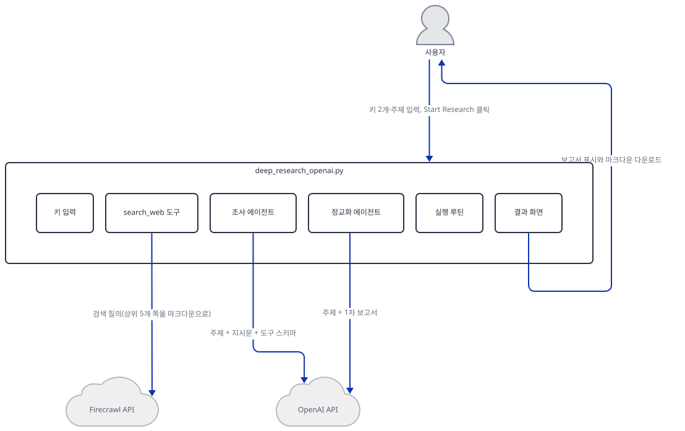
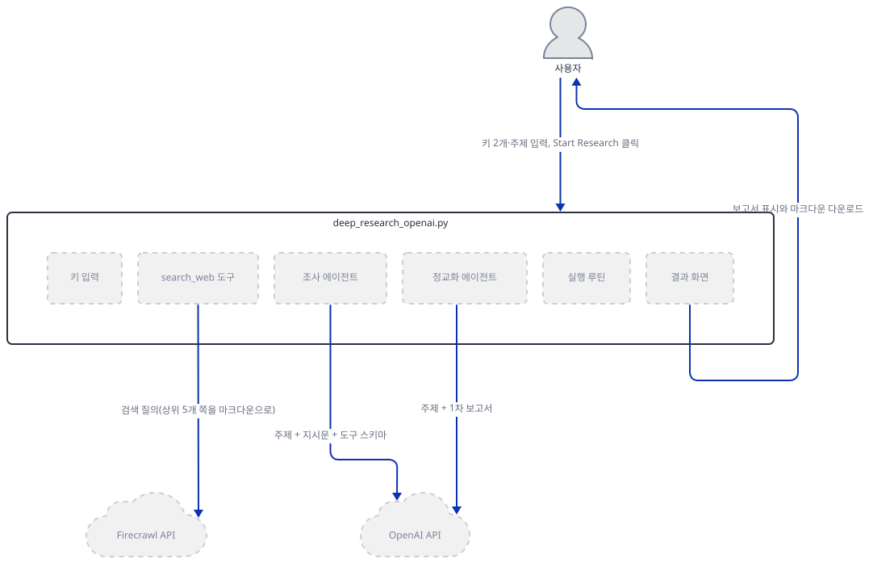
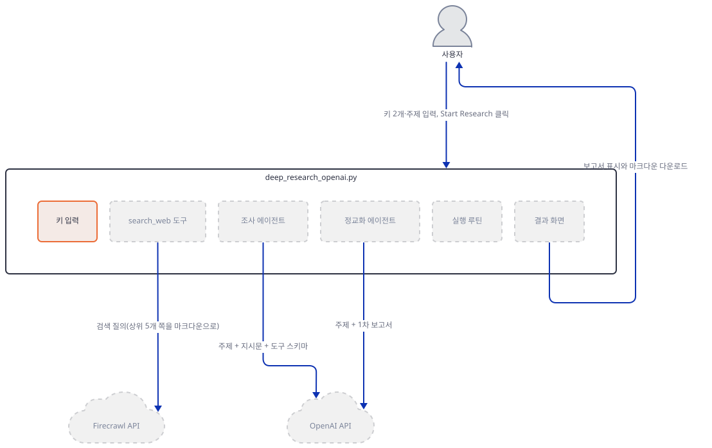
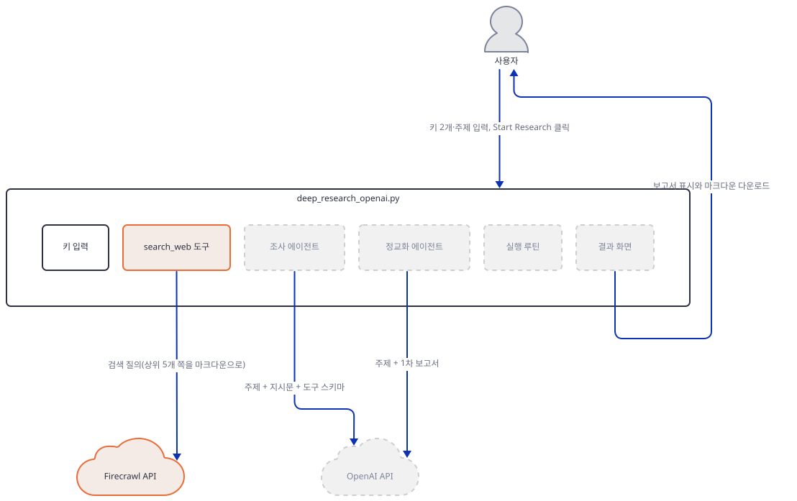
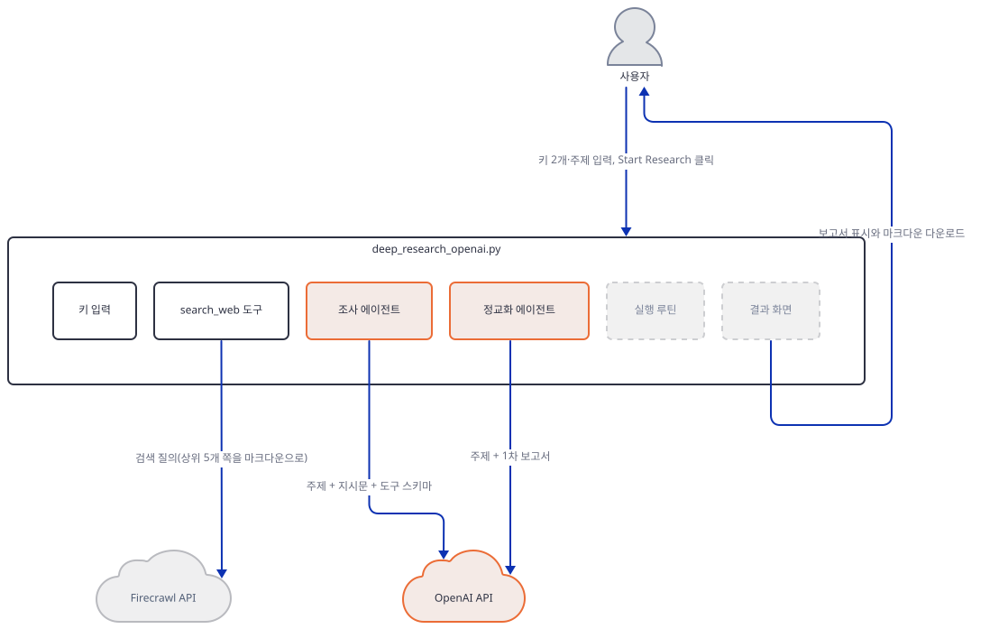
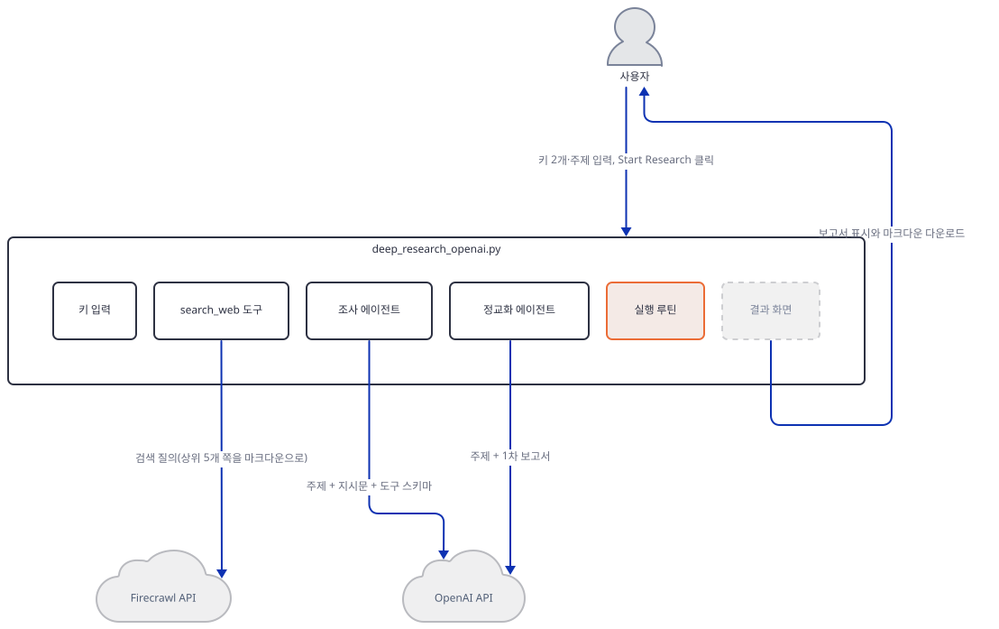
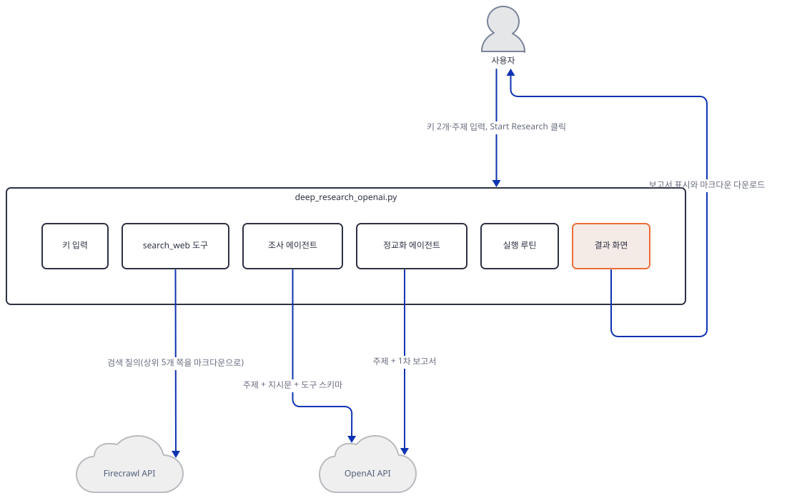
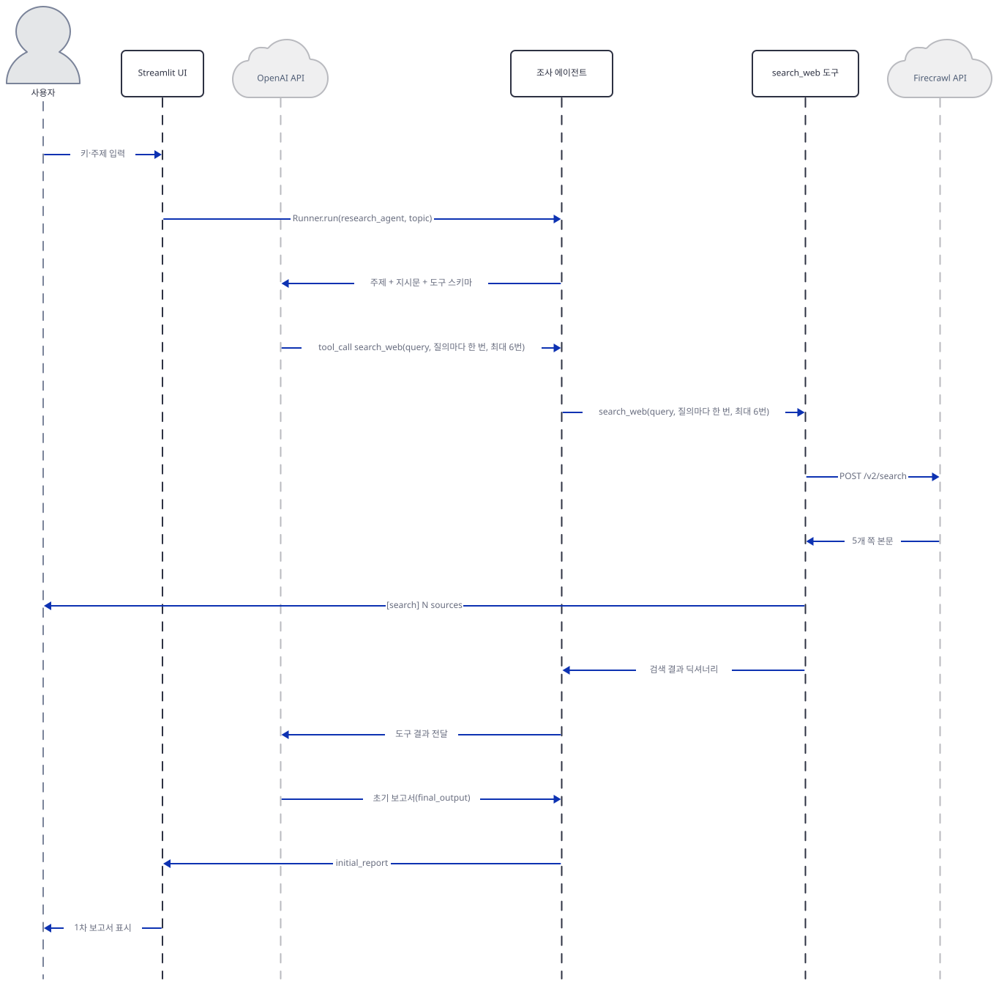
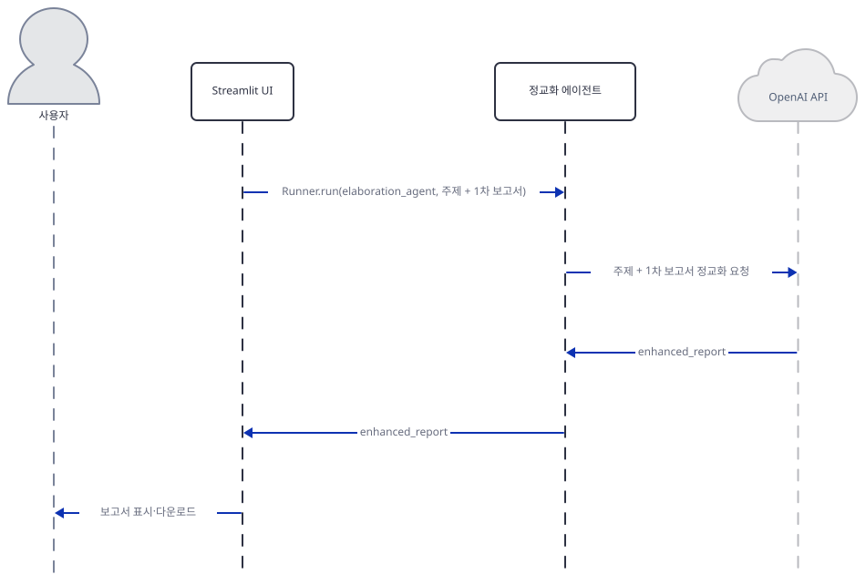

# Day 083 · 🔍 AI Deep Research Agent

> 볼륨 7 🚀 Advanced AI Agents · 난이도 ★★☆ · 예상 소요 80분(단일 파일이지만 openai-agents SDK와 firecrawl-py 패키지 소스를 직접 뒤져 확인해야 하는 명령이 여러 Step에 걸쳐 있고, 가짜 Firecrawl 서버를 세워 도구를 직접 불러 보는 실습이 들어 있어 손으로 돌려 보는 시간이 큽니다) · API 비용 대략 조사 1회에 OpenAI 공식 요금표 기준 gpt-5.6-luna 표준가 입력 $0.20/출력 $1.20(1M 토큰당, 짧은 컨텍스트 기준)로 추정하면 수십 원 이하, Firecrawl은 공식 문서 기준 검색 10결과당 2크레딧에 스크랩한 쪽마다 1크레딧이 더 붙어 검색 한 번에 최대 7크레딧, 지시문대로 3~6번 검색하면 21~42크레딧 안팎으로 추정합니다(키가 없어 실제 과금은 확인 못함) · 원본 앱: `advanced_ai_agents/single_agent_apps/ai_deep_research_agent`

## 오늘 만들 것

이 앱은 187줄(마지막 줄에 개행이 없어 `wc -l`은 186으로 세지만 편집기·GitHub에서는 187번째 줄까지 보입니다, 직접 확인) 단일 파일 Streamlit 앱으로, agno가 아니라 Day 013이 이미 배운 OpenAI 자체의 Agents SDK(`openai-agents` 패키지, import 이름은 `agents`)를 씁니다. `Agent`·`Runner.run`·`@function_tool` 같은 어휘 자체는 Day 013이 이미 다뤘으므로 여기서는 되풀이하지 않습니다. 이 앱이 다른 점은 구조가 훨씬 단순하다는 것입니다 — 에이전트는 핸드오프도 pydantic `output_type`도 없이 둘뿐이고(조사 에이전트, 정교화 에이전트), 둘 다 `model=`을 지정하지 않아 openai-agents 0.24.0이 고르는 기본값(`gpt-5.6-luna`, `agents/models/default_models.py` 103행, 소스로 확인)을 그대로 씁니다.

조사 에이전트가 쥔 도구는 `search_web` 하나입니다. 이 도구는 질의 하나를 Firecrawl 검색에 보내 상위 5개 쪽의 제목·URL·본문(마크다운, 쪽마다 4,000자까지)을 돌려줍니다. 원본은 예전에 Firecrawl의 "딥 리서치" 엔드포인트를 부르는 `deep_research` 도구를 썼고, 그 호출은 firecrawl-py 4.x에서 항상 실패했습니다. 원본이 PR #1225(커밋 `86076345`, 2026-10-18 병합)에서 이를 고쳐 도구를 `AsyncFirecrawl(...).search(...)` 호출로 다시 썼고, `requirements.txt`에서 중복이던 `firecrawl` 줄을 빼 `firecrawl-py>=4.46.0`으로 하한을 걸었습니다. 이 문서는 새 도구가 Firecrawl에 무엇을 보내고 무엇을 받는지 소스와 가짜 Firecrawl 서버로 따라갑니다(Step 3). 깊이 파고드는 일은 이제 도구가 아니라 모델이 합니다 — 지시문이 주제를 3~5개 질의로 쪼개 `search_web`을 질의마다 부르고, 빈틈이 있으면 더 검색하되 "총 6번까지"라고 적었을 뿐 코드에는 그 상한이 없습니다(Step 4).

오늘 설치한 `firecrawl-py` 4.53.2에서 도구는 실제 요청 모양대로 동작합니다(가짜 서버로 직접 확인, Step 3). 키 입력은 Day 013(환경변수)과 달리 사이드바 텍스트 입력창입니다. 4행에서 `trace`를 가져오지만 실제로 쓰는 코드는 한 줄도 없는데(그렙으로 확인), openai-agents SDK는 `Runner.run()`마다 자동으로 트레이스 컨텍스트를 열고(`agents/run.py` 802행 부근, 소스로 확인) 기본값 `tracing_disabled=False`(`agents/run_config.py` 414행, 소스로 확인)로 남아 있어, `set_default_openai_key(key)`가 기본 인자 `use_for_tracing=True`로 같은 키를 트레이싱에도 씁니다(소스로 확인) — 코드가 트레이스를 한 번도 요청한 적이 없어도 나가는 셈입니다(Step 4). 완성하면 사이드바에 키 2개, 본문에 주제 입력창과 Start Research 버튼이 뜨고, 실행하면 검색마다 `[search] 질의: N sources` 줄이 뜨고 1차 보고서 확장 패널과 정교화된 최종 보고서, 다운로드 버튼이 나타납니다. 아래는 완성된 아키텍처입니다.



## 사전 준비

| 서비스/도구 | 용도 | 발급·설치 |
|---|---|---|
| OpenAI API 키 | 두 에이전트의 gpt-5.6-luna(기본값) 호출 인증 | https://platform.openai.com/ 가입 후 발급, 사이드바 입력창에 붙여넣기 |
| Firecrawl API 키 | `search_web` 도구가 Firecrawl 검색에 인증하는 용도(검색 크레딧과 스크랩 크레딧이 든다) | https://www.firecrawl.dev 가입 후 발급, 사이드바 입력창에 붙여넣기 — 이 문서는 키 없이 진행하고 Firecrawl 자리에는 내 PC의 가짜 서버를 세웁니다 |
| uv | 가상환경 생성과 패키지 설치 | [공통 사전 준비](../README.md#공통-사전-준비-한-번만) 절 참고 |
| 인터넷 연결 | PyPI 설치, OpenAI API 호출, Firecrawl 호출, openai-agents 트레이스 업로드 | 별도 설치 없음 |

## 아키텍처 한눈에 보기

| 컴포넌트 | 역할 | 코드 위치 |
|---|---|---|
| Streamlit UI | 사이드바 키 입력, 주제 입력, 실행 버튼, 결과 표시·다운로드 | `advanced_ai_agents/single_agent_apps/ai_deep_research_agent/deep_research_openai.py:10-15`, `advanced_ai_agents/single_agent_apps/ai_deep_research_agent/deep_research_openai.py:23-48`, `advanced_ai_agents/single_agent_apps/ai_deep_research_agent/deep_research_openai.py:156-183` |
| 세션 상태 | 사이드바에 입력한 두 키를 세션 동안 보관 | `advanced_ai_agents/single_agent_apps/ai_deep_research_agent/deep_research_openai.py:17-21`, `advanced_ai_agents/single_agent_apps/ai_deep_research_agent/deep_research_openai.py:37-41` |
| search_web 도구 | AsyncFirecrawl 검색으로 상위 5개 쪽의 제목·URL·본문을 가져오는 비동기 함수 도구 | `advanced_ai_agents/single_agent_apps/ai_deep_research_agent/deep_research_openai.py:50-89` |
| 조사 에이전트 (research_agent) | 지시문에 따라 주제를 질의 3~5개로 쪼개 search_web을 부르고 1차 보고서 작성 | `advanced_ai_agents/single_agent_apps/ai_deep_research_agent/deep_research_openai.py:92-107` |
| 정교화 에이전트 (elaboration_agent) | 도구 없이 1차 보고서를 확장·보강 | `advanced_ai_agents/single_agent_apps/ai_deep_research_agent/deep_research_openai.py:109-126` |
| 연구 실행 루틴 (run_research_process) | 두 에이전트를 순서대로 Runner.run으로 호출 | `advanced_ai_agents/single_agent_apps/ai_deep_research_agent/deep_research_openai.py:128-154` |
| OpenAI API | 두 에이전트의 실제 추론(기본 모델 gpt-5.6-luna) | 코드 없음 (외부 서비스) |
| Firecrawl API | search_web이 `/v2/search`로 요청하는 대상 | 코드 없음 (외부 서비스) |

## 단계별 진행

### Step 1. 환경 만들기 — 하한만 건 firecrawl-py

**목적.** 격리된 가상환경에 `requirements.txt`를 설치하고, 오늘 어떤 판이 받아지는지 확인합니다.

**할 일.**

```bash
cd advanced_ai_agents/single_agent_apps/ai_deep_research_agent
uv venv
uv pip install -r requirements.txt
```

(pip 대안: `python -m venv .venv && source .venv/bin/activate && pip install -r requirements.txt`.) 이 저장소 루트에는 `pyproject.toml`이 있어 이후 `uv run` 명령에는 모두 `--no-project`를 붙입니다.

`advanced_ai_agents/single_agent_apps/ai_deep_research_agent/requirements.txt:1-3`

```text
openai-agents
streamlit
firecrawl-py>=4.46.0
```

`firecrawl-py`만 하한(`>=4.46.0`)이 걸려 있고 위쪽 상한은 없으며, 나머지 둘은 고정이 없습니다. 이 문서를 고치며 설치했을 때는 **openai-agents 0.24.0**, **streamlit 1.66.1**, **firecrawl-py 4.53.2**가 받아졌습니다(직접 확인, 2026-10-22 기준). 하한 4.46.0은 원본 PR이 정한 값이고, 이 문서는 4.53.2에서만 돌려 보았습니다. 예전에는 `firecrawl`과 `firecrawl-py`가 나란히 적혀 같은 파일을 두 번 설치했지만, 그 `firecrawl` 줄이 이번 PR에서 빠져 중복이 사라졌습니다.



**확인.**

```bash
uv run --no-project python -c "
from agents import Agent, Runner, trace, set_default_openai_key
from agents.tool import function_tool
from firecrawl import AsyncFirecrawl
from firecrawl.types import Document, ScrapeOptions
print('ALL IMPORTS OK')
"
uv run --no-project python -m py_compile deep_research_openai.py && echo OK
```

직접 확인한 출력:

```
ALL IMPORTS OK
OK
```

### Step 2. 세션 상태와 사이드바 키 입력

**목적.** 세션 상태 초기화와 사이드바의 두 키 입력창이 어떻게 이어지는지 확인합니다.

**할 일.**

`advanced_ai_agents/single_agent_apps/ai_deep_research_agent/deep_research_openai.py:17-21`

```python
# Initialize session state for API keys if not exists
if "openai_api_key" not in st.session_state:
    st.session_state.openai_api_key = ""
if "firecrawl_api_key" not in st.session_state:
    st.session_state.firecrawl_api_key = ""
```

`advanced_ai_agents/single_agent_apps/ai_deep_research_agent/deep_research_openai.py:37-41`

```python
    if openai_api_key:
        st.session_state.openai_api_key = openai_api_key
        set_default_openai_key(openai_api_key)
    if firecrawl_api_key:
        st.session_state.firecrawl_api_key = firecrawl_api_key
```

Day 013은 `OPENAI_API_KEY` 환경변수를 요구하고 없으면 `st.stop()`으로 멈췄지만, 이 앱은 사이드바 텍스트 입력창(`type="password"`)에서 직접 받습니다. `set_default_openai_key(key)`는 기본 인자 `use_for_tracing=True`를 가진 함수라(소스로 확인), 이 키를 모델 호출뿐 아니라 트레이스 업로드에도 그대로 씁니다 — 이 사실은 Step 4에서 다시 다룹니다. Firecrawl 키는 세션 상태에만 저장되고 별도 함수 호출 없이 Step 3의 도구가 직접 읽습니다.



**확인.** 네트워크를 막은 채 Streamlit `AppTest`로 키·주제를 채우지 않은 첫 화면을 확인합니다.

```bash
uv run --no-project python -c "
from streamlit.testing.v1 import AppTest
at = AppTest.from_file('deep_research_openai.py')
at.run(timeout=30)
print('exception:', list(at.exception))
print('button disabled:', [(b.label, b.disabled) for b in at.button])
"
```

직접 확인한 출력:

```
exception: []
button disabled: [('Start Research', True)]
```

### Step 3. search_web 도구 — 가짜 Firecrawl 서버로 따라가기

**목적.** `search_web`이 Firecrawl에 무엇을 보내고 응답을 어떻게 추리는지, 실패하면 어떻게 되는지 직접 확인합니다.

**할 일.**

`advanced_ai_agents/single_agent_apps/ai_deep_research_agent/deep_research_openai.py:50-89`

```python
# Firecrawl search tool: finds sources and returns each page as markdown
@function_tool
async def search_web(query: str) -> Dict[str, Any]:
    """
    Search the web with Firecrawl and return the title, URL and page content of the top 5 results.
    """
    try:
        # Initialize Firecrawl with the API key from session state
        firecrawl_app = AsyncFirecrawl(api_key=st.session_state.firecrawl_api_key, origin="awesome-llm-apps")

        # Search and scrape the result pages in one call
        with st.spinner(f"Searching: {query}"):
            results = await firecrawl_app.search(
                query,
                limit=5,
                scrape_options=ScrapeOptions(formats=["markdown"], only_main_content=True)
            )

        sources = []
        for result in results.web or []:
            if isinstance(result, Document):  # page was scraped
                meta = result.metadata
                title = meta.title if meta else None
                url = (meta.url or meta.source_url) if meta else None
                content = result.markdown or ""
            else:  # page could not be scraped, keep the search snippet
                title, url, content = result.title, result.url, result.description or ""
            if url:
                # Truncate each page so the agent's context stays bounded
                sources.append({"title": title, "url": url, "content": content[:4000]})

        st.write(f"[search] {query}: {len(sources)} sources")
        return {
            "success": True,
            "sources_count": len(sources),
            "sources": sources
        }
    except Exception as e:
        st.error(f"Search error: {str(e)}")
        return {"error": str(e), "success": False}
```

`@function_tool`이 비동기 함수를 도구로 감싸 JSON 스키마를 만드는 메커니즘은 Day 013이 이미 다뤘으므로 되풀이하지 않습니다. 여기서 새로 볼 것은 세 가지입니다.

첫째, 요청입니다. 도구는 호출될 때마다 `AsyncFirecrawl`을 새로 만들고 `search(query, limit=5, scrape_options=...)`를 `await`합니다. firecrawl-py 소스(`firecrawl/v2/methods/aio/search.py`)를 따라가면 이 호출은 `POST /v2/search`이고, 본문에 `limit`·`scrapeOptions`(`formats: ["markdown"]`, `onlyMainContent: true`)와 `origin: "awesome-llm-apps"`가 실립니다(소스로 읽고, 아래 확인에서 본문을 직접 봅니다). 인증은 `Authorization: Bearer <키>` 머리글입니다. 검색과 스크랩이 한 요청에 묶여 있어 결과 쪽 본문까지 한 번에 옵니다.

둘째, 응답을 추리는 규칙입니다. SDK는 결과 항목에 `markdown` 같은 본문 필드가 있으면 `Document`로, 없으면 `SearchResultWeb`(제목·URL·설명만)으로 만듭니다(`_transform_array`, 소스로 확인). 도구는 `Document`면 메타데이터의 제목과 `url`(없으면 `source_url`)과 마크다운을, 스크랩되지 못한 항목이면 검색 설명을 본문 자리에 씁니다. URL을 못 찾은 항목은 버리고, 본문은 쪽마다 앞 4,000자로 자릅니다. 5쪽 × 4,000자 × 검색 6번이면 컨텍스트에 쌓이는 쪽 본문은 최대 12만 자입니다(곱셈으로 어림). 결과가 모두 버려지거나 0건이면 오류가 아니라 `sources_count: 0`의 `success: True`가 돌아갑니다(소스로 읽어 판단, 실행으로는 확인하지 않음).

셋째, 실패입니다. SDK는 200이 아닌 응답을 예외로 바꾸고, 도구의 넓은 `try/except`가 이를 잡아 먼저 `st.error(...)`로 화면에 빨간 오류 상자를 그린 뒤 `{"error": ..., "success": False}`를 돌려줍니다. 모델은 예외가 아니라 평범한 값으로 실패를 받습니다. 이 도구는 Streamlit 스크립트와 같은 스레드의 `asyncio.run(...)` 안에서 돌기 때문에 `st.spinner`·`st.write`·`st.error`가 그대로 그려집니다 — 아래 확인에서 AppTest로 `st.error`와 `st.write`가 실제로 잡히는 것을 봅니다(다만 이 확인은 도구를 직접 불렀고, `Runner.run`을 거친 실제 화면은 키가 없어 보지 못했습니다).



**확인.** SDK는 주소를 바꿀 환경변수를 읽지 않지만 `AsyncFirecrawl(api_url=...)` 인자를 받습니다(`firecrawl/client.py`, 소스로 확인). 앱이 `from firecrawl import AsyncFirecrawl`을 실행하기 전에 `firecrawl.AsyncFirecrawl`을 `api_url`이 내 PC인 판으로 바꿔 두고, 같은 PC에 가짜 `/v2/search` 서버를 세웁니다. 포트(48010)는 자기 PC에서 비어 있는 것으로 바꿔도 됩니다. 이름 조회 가드가 루프백 밖을 막으므로, 바꿔치기가 빠져도 진짜 Firecrawl에는 닿지 않습니다. 앱 폴더에 `probe_search.py`를 만듭니다.

```python
import asyncio, json, socket, sys, threading
from http.server import BaseHTTPRequestHandler, HTTPServer

PORT = 48010  # 포트는 자기 대역에서 고른다
SEEN = []

_orig = socket.getaddrinfo
def _guard(host, *a, **k):
    assert host in ("127.0.0.1", "localhost"), f"blocked {host}"
    return _orig(host, *a, **k)
socket.getaddrinfo = _guard  # 루프백 밖으로는 이름 조회부터 막는다

class Fake(BaseHTTPRequestHandler):
    def log_message(self, *a): pass
    def do_POST(self):
        body = json.loads(self.rfile.read(int(self.headers["Content-Length"])))
        SEEN.append((self.path, self.headers.get("Authorization"), body))
        if "fail" in body["query"]:
            out, code = {"success": False, "error": "Insufficient credits"}, 402
        else:
            out, code = {"success": True, "data": {"web": [
                {"markdown": "# A\n" + "x" * 5000, "metadata": {"title": "Page A", "url": "https://a.example/doc"}},
                {"title": "Snippet B", "url": "https://b.example/", "description": "only a snippet"},
                {"markdown": "no url", "metadata": {"title": "No URL"}},
                {"markdown": "src only", "metadata": {"title": "Page D", "sourceURL": "https://d.example/"}},
            ]}}, 200
        raw = json.dumps(out).encode()
        self.send_response(code)
        self.send_header("Content-Type", "application/json")
        self.send_header("Content-Length", str(len(raw)))
        self.end_headers()
        self.wfile.write(raw)

HTTPServer.allow_reuse_address = True
srv = HTTPServer(("127.0.0.1", PORT), Fake)
threading.Thread(target=srv.serve_forever, daemon=True).start()

import firecrawl
real = firecrawl.AsyncFirecrawl
if "--no-redirect" not in sys.argv:
    firecrawl.AsyncFirecrawl = lambda *a, **kw: real(*a, api_url=f"http://127.0.0.1:{PORT}", **kw)

from streamlit.testing.v1 import AppTest
script = (
    "import asyncio, json, streamlit as st\n"
    "from agents.tool_context import ToolContext\n"
    "exec(compile(open('deep_research_openai.py', encoding='utf-8').read(), 'deep_research_openai.py', 'exec'))\n"
    "def call(q):\n"
    "    args = json.dumps({'query': q})\n"
    "    ctx = ToolContext(context=None, tool_name='search_web', tool_call_id='c1', tool_arguments=args)\n"
    "    return asyncio.run(search_web.on_invoke_tool(ctx, args))\n"
    "st.session_state['ok'] = call('topic ok')\n"
    "st.session_state['fail'] = call('topic fail')\n"
)
at = AppTest.from_string(script)
at.session_state["firecrawl_api_key"] = "fc-fake-key"
at.run(timeout=60)
print("exception:", [e.value for e in at.exception])
ok = at.session_state["ok"]
print("success:", ok["success"], "sources_count:", ok.get("sources_count"), ok.get("error"))
for s in ok.get("sources", []):
    print("source:", s["title"], s["url"], len(s["content"]))
print("fail:", at.session_state["fail"])
print("st.error:", [e.value for e in at.error])
print("st.write:", [m.value for m in at.markdown if m.value.startswith("[search]")])
print("requests:", len(SEEN))
path, auth, body = SEEN[0] if SEEN else (None, None, {})
print(path, auth)
print({k: body.get(k) for k in ("query", "limit", "origin", "timeout")}, body.get("scrapeOptions", {}).get("formats"), body.get("scrapeOptions", {}).get("onlyMainContent"))
```

```bash
uv run --no-project python probe_search.py
```

직접 확인한 출력(Streamlit의 `missing ScriptRunContext` 경고 줄은 뺐습니다):

```
exception: []
success: True sources_count: 3 None
source: Page A https://a.example/doc 4000
source: Snippet B https://b.example/ 14
source: Page D https://d.example/ 8
fail: {'error': 'Payment Required: Failed to search. Insufficient credits - No additional error details provided.', 'success': False}
st.error: ['Search error: Payment Required: Failed to search. Insufficient credits - No additional error details provided.']
st.write: ['[search] topic ok: 3 sources']
requests: 2
/v2/search Bearer fc-fake-key
{'query': 'topic ok', 'limit': 5, 'origin': 'awesome-llm-apps', 'timeout': 300000} ['markdown'] True
```

가짜 서버가 4개를 돌려줬는데 3개가 남았습니다. URL이 없는 항목은 버려졌고, `sourceURL`만 있는 항목(Page D)은 `source_url`로 살아났으며, 5,009자짜리 Page A 본문은 4,000자로 잘렸습니다. 402 응답은 SDK가 `Payment Required: ...`라는 예외로 바꿔, 도구가 `st.error`를 그리고 `success: False` 딕셔너리를 돌려줬습니다(402가 재시도 없이 요청 1건으로 끝난 것도 `requests: 2`로 보입니다). 이 출력의 오류 문구는 내가 만든 가짜 응답에 SDK가 붙인 것이고, 진짜 Firecrawl의 문구는 다를 수 있습니다.

바꿔치기를 빼고 돌리면 가드가 막는지도 봅니다.

```bash
uv run --no-project python probe_search.py --no-redirect
```

직접 확인한 출력(앞 두 줄):

```
exception: []
success: False sources_count: None blocked b'api.firecrawl.dev'
```

도구가 진짜 `api.firecrawl.dev`로 가려다 가드에 막혔고, 그 오류가 위와 같은 길로 `success: False`가 됐습니다.

### Step 4. 두 에이전트 정의 — 모델을 지정하지 않고, 트레이스는 기본으로 나간다

**목적.** research_agent·elaboration_agent의 지시문 차이와, 둘 다 `model=`을 지정하지 않았을 때 무엇이 실행되는지 확인합니다.

**할 일.**

`advanced_ai_agents/single_agent_apps/ai_deep_research_agent/deep_research_openai.py:92-107`

```python
research_agent = Agent(
    name="research_agent",
    instructions="""You are a research assistant that can perform deep web research on any topic.

    When given a research topic or question:
    1. Break the topic into 3 to 5 focused search queries that cover different angles
    2. Use the search_web tool for each query
       - Each result includes the page title, URL and page content
       - Run follow-up searches if the first results leave gaps
       - Run at most 6 searches in total
    3. Read and compare the sources, then organize the findings into a well-structured report
    4. Include proper citations (title and URL) for all sources
    5. Highlight key findings and insights
    """,
    tools=[search_web]
)
```

`advanced_ai_agents/single_agent_apps/ai_deep_research_agent/deep_research_openai.py:109-126`

```python
elaboration_agent = Agent(
    name="elaboration_agent",
    instructions="""You are an expert content enhancer specializing in research elaboration.

    When given a research report:
    1. Analyze the structure and content of the report
    2. Enhance the report by:
       - Adding more detailed explanations of complex concepts
       - Including relevant examples, case studies, and real-world applications
       - Expanding on key points with additional context and nuance
       - Adding visual elements descriptions (charts, diagrams, infographics)
       - Incorporating latest trends and future predictions
       - Suggesting practical implications for different stakeholders
    3. Maintain academic rigor and factual accuracy
    4. Preserve the original structure while making it more comprehensive
    5. Ensure all additions are relevant and valuable to the topic
    """
)
```

Day 013의 세 에이전트는 `output_type=` pydantic 모델로 출력 구조를 못박고 핸드오프를 선언했지만, 이 둘은 그런 장치가 전혀 없습니다 — 둘 다 자유 형식 텍스트를 돌려주고, `elaboration_agent`는 `tools=`조차 없어 1차 보고서를 확장할 때 어떤 외부 정보도 새로 가져오지 못하고 모델 자신의 사전 지식에만 기댑니다. 두 에이전트의 일 나눔이 여기서 갈립니다 — 근거 수집은 조사 에이전트만 하고, 정교화 에이전트는 그 결과를 글로 부풀립니다. 조사의 "깊이"를 정하는 것도 코드가 아니라 지시문 텍스트입니다. 질의를 3~5개로 쪼개고 총 6번까지 검색하라는 문장은 모델이 따라 주기를 바라는 부탁일 뿐이고, 코드가 거는 한도는 `Runner.run`의 기본 `max_turns=10`(`agents/run_config.py` 45행, 소스로 확인)뿐입니다. 모델이 도구를 부르고 결과를 받는 한 바퀴가 한 턴이라 도구를 아주 많이 부르게 되면 이 한도에 먼저 걸립니다. 두 `Agent(...)` 모두 `model=`을 넘기지 않으므로 openai-agents 0.24.0의 기본값을 그대로 씁니다 — 소스(`agents/models/default_models.py`, 103행)를 보면 `get_default_model()`은 환경변수 `OPENAI_DEFAULT_MODEL`이 없으면 `"gpt-5.6-luna"`를 돌려줍니다.

4행에서 가져온 `trace`는 이 파일 어디에서도 불리지 않습니다(그렙으로 확인, `trace(` 매치 0건). 그런데도 `Runner.run(...)`은 호출마다 내부적으로 트레이스 컨텍스트를 엽니다 — 소스(`agents/run.py`, `_run_impl` 안 802행 부근)를 보면 `run_config.tracing_disabled`(기본값 `False`, `agents/run_config.py` 414행)가 거짓일 때 `TraceCtxManager`를 열 뿐, 사용자가 `trace()`를 명시적으로 불렀는지는 보지 않습니다. Step 2의 `set_default_openai_key(key)`도 기본 인자 `use_for_tracing=True`라 이 트레이스 업로드에 같은 키를 씁니다. 즉 이 코드는 트레이스를 한 번도 요청하지 않았지만, 매 실행마다 OpenAI 트레이스 대시보드로 스팬이 올라갈 수 있습니다.



**확인.** 키 없이 두 에이전트 객체가 만들어지는지, 도구 스키마에는 `query`만 있는지, 그리고 오늘 버전의 기본 모델 이름을 직접 확인합니다.

```bash
uv run --no-project python -c "
from agents import Agent
from agents.tool import function_tool
from agents.models.default_models import get_default_model

@function_tool
async def search_web(query: str):
    return {'success': True}

print('tool name:', search_web.name)
print('tool params:', list(search_web.params_json_schema['properties']))
research_agent = Agent(name='research_agent', instructions='test', tools=[search_web])
elaboration_agent = Agent(name='elaboration_agent', instructions='test')
print('research_agent model:', research_agent.model)
print('elaboration_agent model:', elaboration_agent.model)
print('default model:', get_default_model())
"
```

직접 확인한 출력:

```
tool name: search_web
tool params: ['query']
research_agent model: None
elaboration_agent model: None
default model: gpt-5.6-luna
```

도구가 모델에 내보이는 인자는 `query` 하나입니다. 예전 `deep_research`는 `max_depth` 등 숫자 인자를 모델이 채우게 했지만, 이제 `limit=5`와 4,000자는 모델이 못 바꾸는 코드 상수입니다. `model: None`은 `Agent`가 실행 시점까지 기본 모델 선택을 미룬다는 뜻입니다(`agents/agent.py` 360행, 소스로 확인) — 실제로 어떤 모델이 불리는지는 `get_default_model()`이 답한 이름으로 확인합니다. 위 확인은 앱의 도구를 가져온 것이 아니라 같은 모양(`query: str`)의 대역을 만든 것이므로, 앱의 `search_web` 스키마 자체는 Step 3의 `search_web.on_invoke_tool` 호출과 소스로 읽은 시그니처로 갈음합니다.

### Step 5. 연구 실행 루틴 — 두 단계 Runner.run과 중간 결과 노출

**목적.** `run_research_process`가 두 에이전트를 어떤 순서로 부르고, 1차 보고서를 어떻게 화면에 노출하는지 확인합니다.

**할 일.**

`advanced_ai_agents/single_agent_apps/ai_deep_research_agent/deep_research_openai.py:128-154`

```python
async def run_research_process(topic: str):
    """Run the complete research process."""
    # Step 1: Initial Research
    with st.spinner("Conducting initial research..."):
        research_result = await Runner.run(research_agent, topic)
        initial_report = research_result.final_output
    
    # Display initial report in an expander
    with st.expander("View Initial Research Report"):
        st.markdown(initial_report)
    
    # Step 2: Enhance the report
    with st.spinner("Enhancing the report with additional information..."):
        elaboration_input = f"""
        RESEARCH TOPIC: {topic}
        
        INITIAL RESEARCH REPORT:
        {initial_report}
        
        Please enhance this research report with additional information, examples, case studies, 
        and deeper insights while maintaining its academic rigor and factual accuracy.
        """
        
        elaboration_result = await Runner.run(elaboration_agent, elaboration_input)
        enhanced_report = elaboration_result.final_output
    
    return enhanced_report
```

첫 번째 `Runner.run(research_agent, topic)`의 결과(`final_output`)를 `st.expander`로 즉시 노출한 뒤, 그 텍스트를 그대로 f-string에 박아 두 번째 `Runner.run(elaboration_agent, elaboration_input)`의 입력으로 씁니다 — Day 013의 `triage_result.to_input_list()`처럼 대화 이력 객체를 넘기는 것이 아니라, 완성된 보고서 문자열 하나만 새 프롬프트에 이어 붙이는 더 단순한 방식입니다. 이 함수 자체는 이번 PR로 바뀌지 않았지만 그 안에서 일어나는 일은 달라졌습니다. 첫 `Runner.run` 하나 안에서 모델이 `search_web`을 여러 번 부르고(질의마다 한 번), 그때마다 도구 결과가 모델에 돌아가며, 모델이 더 부르지 않기로 한 순간의 글이 `final_output`이 됩니다. 도구가 실패해도 이 함수는 멈추지 않습니다 — `search_web`이 예외 대신 `{"success": False, ...}` 딕셔너리를 돌려주므로 `Runner.run`은 정상적으로 끝나고, 그 실패를 본 모델이 보고서에 무엇을 쓰는지는 키가 없어 확인하지 못했습니다.



**확인.** 파일 안에 정의된 비동기 함수 목록을 확인해, `search_web`과 `run_research_process`가 이 실행 경로의 유일한 async 함수임을 봅니다.

```bash
uv run --no-project python -c "
import ast
tree = ast.parse(open('deep_research_openai.py', encoding='utf-8').read())
funcs = [n.name for n in ast.walk(tree) if isinstance(n, ast.AsyncFunctionDef)]
print('async functions:', funcs)
"
```

직접 확인한 출력:

```
async functions: ['search_web', 'run_research_process']
```

### Step 6. 실행 화면 — 버튼 활성화 조건과 다운로드

**목적.** Start Research 버튼이 언제 눌리는지, 결과가 어떻게 표시·다운로드되는지 확인합니다.

**할 일.**

`advanced_ai_agents/single_agent_apps/ai_deep_research_agent/deep_research_openai.py:156-183`

```python
# Main research process
if st.button("Start Research", disabled=not (openai_api_key and firecrawl_api_key and research_topic)):
    if not openai_api_key or not firecrawl_api_key:
        st.warning("Please enter both API keys in the sidebar.")
    elif not research_topic:
        st.warning("Please enter a research topic.")
    else:
        try:
            # Create placeholder for the final report
            report_placeholder = st.empty()
            
            # Run the research process
            enhanced_report = asyncio.run(run_research_process(research_topic))
            
            # Display the enhanced report
            report_placeholder.markdown("## Enhanced Research Report")
            report_placeholder.markdown(enhanced_report)
            
            # Add download button
            st.download_button(
                "Download Report",
                enhanced_report,
                file_name=f"{research_topic.replace(' ', '_')}_report.md",
                mime="text/markdown"
            )
            
        except Exception as e:
            st.error(f"An error occurred: {str(e)}")
```

버튼 자체는 두 키와 주제가 모두 채워져야 눌리게 되어 있지만(`disabled=`), 안쪽의 경고문 두 줄은 버튼이 이미 눌린 뒤(즉 셋이 모두 채워진 뒤)에만 평가되므로 실제로는 걸릴 일이 없는 죽은 방어 코드입니다(읽기로 확인). `asyncio.run(...)`이 동기 Streamlit 스크립트 안에서 새 이벤트 루프를 만들어 두 번의 `await Runner.run(...)`을 순서대로 끝내고, 결과는 `report_placeholder`에 표시된 뒤 `st.download_button`으로 `{주제}_report.md` 파일이 됩니다.

이 앱을 실제로 띄우려면 앱 폴더에서 다음을 실행합니다.

```bash
uv run --no-project streamlit run deep_research_openai.py
```

확인용으로 헤드리스 실행만 해 본다면 외부 IP 조회 요청을 막기 위해 `--server.address`를 함께 붙입니다.

```bash
uv run --no-project streamlit run deep_research_openai.py --server.headless true --server.address localhost
```



**확인.** 두 키와 주제를 모두 채웠을 때 버튼이 활성화되는 것만 확인합니다(실제 클릭은 OpenAI에 요청을 보내므로 이 문서는 하지 않습니다).

```bash
uv run --no-project python -c "
from streamlit.testing.v1 import AppTest
at = AppTest.from_file('deep_research_openai.py')
at.run(timeout=30)
at.sidebar.text_input[0].set_value('sk-fake-openai-key')
at.sidebar.text_input[1].set_value('fc-fake-firecrawl-key')
at.text_input[0].set_value('Latest developments in AI')
at.run(timeout=30)
print('exception:', list(at.exception))
print('button disabled:', [(b.label, b.disabled) for b in at.button])
"
```

직접 확인한 출력:

```
exception: []
button disabled: [('Start Research', False)]
```

## 요청 한 건이 흐르는 과정

한 번의 조사 요청은 실제로 `run_research_process` 안의 두 구간(1차 조사, 정교화)을 거칩니다 — 아래 두 그림은 그 순서 그대로입니다.



1단계는 Start Research 클릭부터 1차 보고서가 화면에 뜨기까지입니다. Streamlit UI는 `Runner.run(research_agent, topic)`으로 조사 에이전트를 시작시키고, 조사 에이전트는 주제와 지시문, `search_web` 도구 스키마를 OpenAI API에 보냅니다. 모델이 `tool_call search_web(query)`를 요청하면 도구가 실행되어 Firecrawl `/v2/search`로 질의를 보내고(`tool -> firecrawl`), 받은 쪽 제목·URL·본문을 추려 화면에 `[search] 질의: N sources` 줄을 쓴 뒤(`tool -> 사용자`) `success`·`sources_count`·`sources`를 조사 에이전트에 되돌립니다(Step 3에서 가짜 서버로 직접 확인). 조사 에이전트는 이 결과를 다시 OpenAI에 보내고, 모델은 질의를 바꿔 같은 도구를 또 부르거나 보고서를 씁니다 — 그림은 한 바퀴만 그렸지만 지시문대로면 3~6바퀴입니다(그 횟수는 모델이 정하며 코드가 강제하지 않습니다). 보고서가 나오면 Streamlit UI가 그 텍스트를 `initial_report`로 넘겨받아 `st.expander`로 화면에 표시합니다. 검색이 실패하면 `tool -> 사용자` 자리에 빨간 `Search error` 상자가 그려지고 도구는 `success: False`를 돌려줍니다.



2단계는 주제와 1차 보고서를 담은 `elaboration_input`을 `Runner.run(elaboration_agent, ...)`으로 정교화 에이전트에 넘기는 부분입니다. 정교화 에이전트는 도구 없이 같은 데이터를 OpenAI에 다시 보내 확장된 보고서(`enhanced_report`)를 받고, Streamlit UI에 돌려주면 UI는 이를 화면에 표시하고 다운로드 버튼을 띄웁니다. 이 그림들은 실제 모델이 어떤 질의를 만들고 어떤 보고서를 쓰는지까지는 보여주지 않습니다 — 키가 없어 실행으로 확인하지 못했습니다.

## 실행 체크리스트

- [ ] 격리된 가상환경에 `requirements.txt`를 설치했고, `firecrawl-py`가 하한(`>=4.46.0`)만 걸려 있어 오늘 받아지는 판(이 문서는 4.53.2)을 확인했다
- [ ] 가짜 Firecrawl 서버를 세워 `search_web`을 직접 불러, 요청이 `POST /v2/search`에 `limit: 5`·`scrapeOptions.formats: ["markdown"]`·`origin: "awesome-llm-apps"`로 나가고 `Authorization: Bearer` 머리글이 붙는 것을 확인했다
- [ ] URL 없는 항목은 버려지고, `sourceURL`만 있는 항목은 살아나며, 쪽 본문이 4,000자로 잘리는 것을 확인했다
- [ ] 검색이 실패하면 `st.error`로 `Search error: ...` 상자가 그려지고 도구가 예외 대신 `success: False`를 돌려주는 것을 확인했다
- [ ] 조사의 깊이(질의 3~5개, 총 6번)는 지시문일 뿐 코드가 강제하는 한도가 아니라는 것, 코드의 한도는 `Runner.run` 기본 `max_turns=10`이라는 것을 소스로 확인했다
- [ ] 두 에이전트 모두 `model=`을 지정하지 않아 openai-agents 0.24.0의 기본값(`gpt-5.6-luna`)을 쓴다는 것을 소스와 실행으로 확인했다
- [ ] `trace`를 가져오기만 하고 부르지 않아도 `Runner.run()`마다 트레이스가 기본으로 열리고, `set_default_openai_key`가 같은 키를 트레이싱에도 쓴다는 것을 소스로 확인했다
- [ ] 두 키와 주제를 모두 채워야 Start Research 버튼이 활성화된다는 것을 `AppTest`로 확인했다
- [ ] (키가 있다면) 실제로 조사를 실행해, 모델이 실제로 몇 번 검색하고 1차 보고서에 어떤 출처가 담기는지 확인했다

## 문제 해결

| 증상 | 원인 | 해결 |
|---|---|---|
| 조사를 시작하면 화면에 빨간 "Search error: ..." 오류 상자가 뜸(가짜 402 응답으로 직접 확인) | Firecrawl이 200이 아닌 응답(키 오류, 크레딧 부족 등)을 주면 SDK가 예외를 던지고, `search_web`이 그 문구를 `st.error`로 먼저 그린 뒤 `{"success": False, ...}`를 돌려줌 | 오류 문구의 원인(키 값, 크레딧 잔액)을 Firecrawl 대시보드에서 확인 — 에이전트는 실패를 값으로 받아 이어가므로 보고서가 근거 없이 나올 수 있음(리포 코드는 고치지 않음) |
| 보고서의 출처가 적거나 본문이 짧음 | 도구가 검색마다 상위 5개 쪽만 가져오고 쪽마다 앞 4,000자로 자름(직접 확인). 스크랩되지 못한 쪽은 검색 설명만 남음 | 질의를 더 나누도록 지시문을 고치거나 `limit`·`content[:4000]` 상수를 바꿈. 크레딧은 쪽 수에 비례해 늘어남(리포 코드는 고치지 않음) |
| 질의 횟수가 지시문의 "최대 6번"보다 많거나 적음 | 6번은 지시문 문장일 뿐 코드에 한도가 없음. 코드의 한도는 `Runner.run` 기본 `max_turns=10`(`agents/run_config.py` 45행, 소스로 확인) | 한도를 강제하려면 `Runner.run(..., max_turns=N)`으로 호출을 바꿔야 함(리포 코드는 고치지 않음) |
| Start Research 버튼이 계속 비활성 | `disabled=not (openai_api_key and firecrawl_api_key and research_topic)`이 셋 모두를 요구함(직접 확인) | 사이드바에 키 2개, 본문에 주제를 모두 입력 |
| `trace()`를 한 번도 부르지 않았는데 OpenAI 트레이스 대시보드에 실행 기록이 남을 수 있음 | openai-agents가 `Runner.run()`마다 자동으로 트레이스 컨텍스트를 열고(`agents/run.py`, 소스로 확인) 기본값 `tracing_disabled=False`로 남아 있으며, `set_default_openai_key(key)`도 기본 `use_for_tracing=True`라 같은 키를 트레이싱에 씀(소스로 확인) | `OPENAI_AGENTS_DISABLE_TRACING=true` 환경변수를 설정하거나 `Runner.run(..., run_config=RunConfig(tracing_disabled=True))`로 호출을 바꿔야 함(리포 코드는 고치지 않음) |

## 더 해보기

- `search_web`의 `limit=5`와 `content[:4000]`을 바꿔 보고, 같은 가짜 서버로 요청 본문의 `limit`이 따라 바뀌는지, 크레딧(검색 + 쪽마다 스크랩)과 컨텍스트 길이가 어떻게 달라질지 따져 보기
- `Runner.run(research_agent, topic, run_config=RunConfig(tracing_disabled=True))`처럼 트레이스를 꺼 보고, `OPENAI_AGENTS_DISABLE_TRACING=true`와 비교해 두 방법이 같은 효과인지 확인해보기
- `elaboration_agent`에 `tools=[search_web]`을 추가해 정교화 단계도 새 정보를 검색할 수 있게 바꿔보고, 지시문을 어떻게 고쳐야 하는지 생각해보기

## 다음 날 예고

[Day 084 · 📑 AI Meeting Agent](../day084-ai-meeting-agent/README.md) — CrewAI 에이전트 여럿이 Anthropic Claude와 Serper 웹 검색으로 회의 준비 자료(맥락 분석·업계 동향·전략·브리핑)를 만듭니다.
