# Day 127 · 📑 Notion MCP Agent

> 볼륨 9 ♾️ MCP AI Agents · 난이도 ★★☆ ⚠ `requirements.txt`만 설치하면 앱이 import되지 않고, 고쳐도 `fastmcp`와 `enable_user_memories`에서 차례로 막힙니다(Step 1·3). 앱이 쓰는 `gpt-4o`의 기본 스냅숏 `gpt-4o-2024-08-06`은 2027-01-14에 종료될 예정입니다(사전 준비) · 예상 소요 115분(앱은 124줄이지만 가짜 MCP 서버와 가짜 OpenAI 서버를 직접 저장해 터미널 둘로 돌리고, 서버를 늦게 띄우거나 키를 빼 가며 같은 앱을 여러 번 돌려 봐야 해서 읽는 시간보다 손으로 돌려 보는 시간이 큽니다) · API 비용 대략 한 턴에 수 센트(⚠ 추정입니다. 이 문서는 OpenAI와 Notion을 한 번도 부르지 않았습니다. 모델 호출은 한 턴에 셋이고, `gpt-4o` 표준 요금은 입력 $2.50·출력 $10.00/백만 토큰입니다. 진짜 Notion 서버의 도구 목록이 입력에 얼마나 실리는지는 재지 못했습니다) · 원본 앱: `mcp_ai_agents/notion_mcp_agent`

## 오늘 만들 것

Notion 페이지 ID 하나를 주고 터미널에서 "이 페이지 읽어 줘", "문단 하나 추가해 줘"처럼 말하면, `gpt-4o`가 Notion 쪽 MCP 서버의 도구를 골라 부르는 대화형 에이전트입니다. 앱은 파이썬 파일 하나(`notion_mcp_agent.py`, 124줄이고 마지막 줄에 개행이 없어 `wc -l`은 123)이고, agno의 `Agent`에 `MCPTools`를 붙이고 `mcp`의 `StdioServerParameters`로 서버 실행 명령을 적습니다(Day 126의 다음 날 예고가 소스의 import로 확인한 그대로입니다). 오늘부터 일곱 날 볼륨의 이름이 "MCP AI Agents"입니다. MCP는 앞에서 두 번 나왔습니다. Day 017이 `4_4_mcp_tools`에서 ADK의 `MCPToolset`으로 별도 프로세스의 MCP 서버를 붙였고, Day 125가 Firecrawl 서버를 `npx -y firecrawl-mcp`로 붙이면서 그 서버가 첫 에이전트의 첫 모델 호출을 만드는 순간에 뜬다고 확인했습니다(그 날 README). 둘 다 Google ADK였고, 오늘은 agno의 `MCPTools`입니다. 새로운 점은 서버가 뜨는 때입니다. 이 앱은 `async with MCPTools(...)` 줄에 들어서는 순간 띄웁니다. 모델도, 에이전트도, 데이터베이스도 그보다 뒤입니다.

이 문서는 `npx`를 한 번도 실행하지 않았고 OpenAI와 Notion에 요청을 보내지 않았습니다. `npx` 자리에는 파이썬으로 쓴 가짜 MCP 서버를, OpenAI 자리에는 `OPENAI_BASE_URL`로 돌린 가짜 서버를 두었습니다. 그래서 아래 도구 이름(`read_page`, `append_paragraph`)과 답은 모두 내가 지은 대본이고, 진짜 Notion 서버가 어떤 도구를 내놓는지와 진짜 `gpt-4o`가 도구를 어떻게 고르는지는 확인하지 못했습니다. 그래도 서버를 띄우고, 도구 목록을 받고, 모델 요청을 만들고, 대화를 저장하는 부분은 agno와 `mcp`가 진짜로 돌았습니다. 직접 돌려 알게 된 것이 여섯입니다.

1. `requirements.txt`만 설치하면 `notion_mcp_agent.py:10`의 `from agno.db.sqlite import SqliteDb`에서 `greenlet`이 없다는 `ImportError`로 멈춥니다. Day 112가 본 것과 같은 오류입니다(Step 1).
2. 그걸 고쳐도 `fastmcp`가 없습니다. 오늘 풀리는 agno 3.1.3의 `MCPTools`는 연결을 `fastmcp`로 만드는데 `requirements.txt`에는 `mcp`뿐이라서, `async with` 줄에서 `ImportError`가 납니다. 이때 서버는 아직 뜨지 않았습니다(Step 1).
3. `enable_user_memories=True`(104행)는 agno 3.1.3의 `Agent`에 없는 인자입니다. Day 108이 확인한 이름 변경이며, 복사본에서 `update_memory_on_run=True`로 바꿉니다(Step 3).
4. 서버는 `async with` 줄에서 뜨고, 서버 프로세스가 받는 환경은 셸 전체가 아니라 허용 목록 열두 개 남짓과 `OPENAPI_MCP_HEADERS` 하나입니다. Notion 키를 안 주면 헤더에 `Bearer None`이 들어갑니다(Step 4).
5. 한 턴의 모델 호출은 셋입니다. 채팅 둘(도구 호출 하나, 최종 답 하나)과 메모리 관리자 하나입니다. 실행할 때마다 세션 ID가 새로 만들어져서, 앱 README가 말하는 "재시작 뒤에도 이어짐"은 코드와 맞지 않습니다(Step 5·6).
6. 서버가 10초 안에 `initialize`에 답하지 못하면 앱이 `Request 'initialize' timed out`으로 죽습니다. 처음 `npx -y`로 내려받는 시간이 길면 같은 일이 생길 수 있습니다(Step 6, 추정).

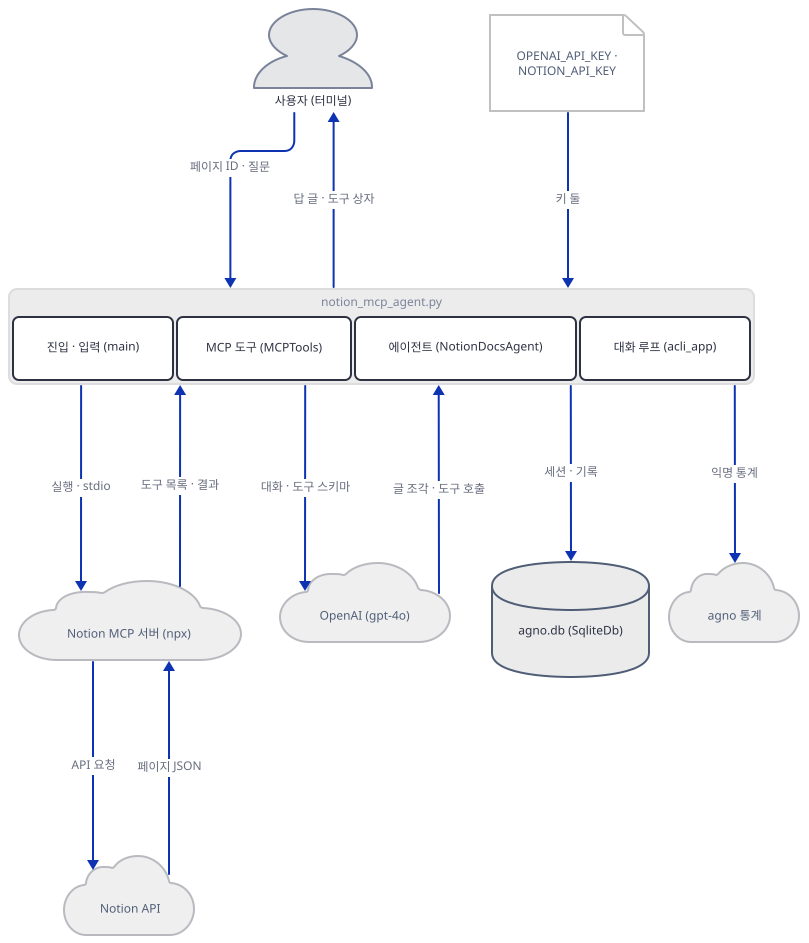

## 사전 준비

| 서비스/도구 | 용도 | 발급·설치 |
|---|---|---|
| uv | 가상환경 생성과 패키지 설치 | [공통 사전 준비](../README.md#공통-사전-준비-한-번만) 절 참고 |
| Python | 이 문서는 3.13.3으로 확인했다. 앱 README는 3.10 이상을 적는다 | 공통 사전 준비와 같음 |
| OpenAI API 키 (`OPENAI_API_KEY`) | `gpt-4o` 호출(77행). 이 문서는 가짜 값으로 진행한다 | https://platform.openai.com/api-keys |
| Notion 통합 토큰 (`NOTION_API_KEY`) | Notion MCP 서버가 Notion API에 보낼 `Authorization` 헤더. 페이지를 그 통합에 공유해야 한다. 이 문서는 가짜 값으로 진행한다 | https://www.notion.so/my-integrations |
| Node.js (`npx`) | 진짜로 쓸 때 `npx -y @notionhq/notion-mcp-server`를 내려받아 실행. 이 문서의 실습은 쓰지 않는다 | https://nodejs.org/ |
| 인터넷 연결 | PyPI 설치. 실제로 쓸 때는 OpenAI, npm, Notion, agno 통계 서버에 접속한다 | 별도 설치 없음 |

⚠ **모델.** 앱은 `gpt-4o`를 씁니다(`notion_mcp_agent.py:77`). OpenAI 모델 페이지(https://developers.openai.com/api/docs/models/gpt-4o, 2026-10-14 확인)는 이 모델의 "Default snapshot"을 `gpt-4o-2024-08-06`이라고 적습니다. 공식 폐기 문서(https://developers.openai.com/api/docs/deprecations, 같은 날)에는 `gpt-4o`라는 id 자체의 종료 행이 없지만, 그 기본 스냅숏 `gpt-4o-2024-08-06`(과 `gpt-4o-2024-11-20`)이 2027-01-14에 종료된다는 행이 있습니다. 별칭 `gpt-4o`가 그 뒤 어떻게 되는지는 두 문서 어디에도 적혀 있지 않아 이 문서도 확인하지 못했습니다. 2027-01-14 이후에 호출이 실패하면 `OpenAIChat(id=...)`(77행)을 새 모델로 바꿔야 할 수 있습니다.

⚠ **서버.** 진짜 서버 `@notionhq/notion-mcp-server`의 공개 README(https://github.com/makenotion/notion-mcp-server, 같은 날 읽음)는 맨 위에 "This repository is a separate, self-hosted MCP server implementation that is no longer actively maintained or supported."라고 적고 호스팅형 Remote Notion MCP(https://developers.notion.com/docs/mcp)를 권합니다. 이 앱이 `npx`로 붙이는 것이 바로 그 자체 호스팅 서버입니다. 같은 README의 `Notion-Version` 예는 `2025-09-03`과 `2026-03-11`뿐이고 앱이 고정한 `2022-06-28`은 없습니다.

이 문서의 스크립트와 앱은 한글을 출력합니다. 한국어 Windows에서 출력을 파이프나 파일로 받으면 기본 인코딩이 모자랄 수 있으니 셸을 먼저 맞춰 두세요.

```bash
export PYTHONIOENCODING=utf-8
```

```powershell
$env:PYTHONIOENCODING = "utf-8"
```

## 아키텍처 한눈에 보기

| 컴포넌트 | 역할 | 코드 위치 |
|---|---|---|
| 키 읽기 | `load_dotenv()`가 `.env`를 읽고 두 키를 모듈 변수에 담는다. 없어도 검사하지 않는다 | `mcp_ai_agents/notion_mcp_agent/notion_mcp_agent.py:15-18` |
| 진입·입력 (`main`) | 페이지 ID를 첫 인자나 입력으로 받고, 사용자·세션 ID를 새로 만든다 | `mcp_ai_agents/notion_mcp_agent/notion_mcp_agent.py:20-55` |
| 서버 실행 명령 | `npx -y @notionhq/notion-mcp-server`와 환경변수 `OPENAPI_MCP_HEADERS`(토큰과 Notion-Version) | `mcp_ai_agents/notion_mcp_agent/notion_mcp_agent.py:59-68` |
| MCP 도구 묶음 (`MCPTools`) | `async with`에 들어설 때 서버를 띄우고, 연결하고, 도구 목록을 받는다 | `mcp_ai_agents/notion_mcp_agent/notion_mcp_agent.py:71` |
| 저장소 (`SqliteDb`) | 작업 폴더의 `agno.db`. 파일은 첫 저장 때 생긴다 | `mcp_ai_agents/notion_mcp_agent/notion_mcp_agent.py:73` |
| 에이전트 (`NotionDocsAgent`) | `gpt-4o`, 지시문 속 페이지 ID, 재시도 3번, 메모리, 기록 5회 | `mcp_ai_agents/notion_mcp_agent/notion_mcp_agent.py:75-107` |
| 대화 루프 (`acli_app`) | 입력 한 줄마다 답을 스트리밍으로 찍고 `exit` 등에서 끝낸다 | `mcp_ai_agents/notion_mcp_agent/notion_mcp_agent.py:113-121` |
| Notion MCP 서버 | 별도 Node 프로세스. Notion API 요청을 만든다 | 코드 없음 (외부 npm 패키지) |
| OpenAI 모델 | 대화, 도구 호출, 메모리 관리 (`gpt-4o`) | `mcp_ai_agents/notion_mcp_agent/notion_mcp_agent.py:77` |
| agno 익명 통계 | 성공한 실행마다 한 건 | 코드 없음 (agno 소스 `agno/agent/_telemetry.py`) |

첫 그림에서 앱 묶음에 단 화살표는 묶음 전체에 단 것입니다. 예컨대 통계로 가는 화살표가 대화 루프 상자 아래에서 나가 보여도 보내는 것은 에이전트 쪽입니다. 묶음 안의 호출은 아래 두 그림이 화살표로 그렸고, 호출 순서는 요청 시퀀스가 맡습니다. 첫 그림이 만드는 쪽(진입이 서버 매개변수, 저장소, 에이전트, 대화 루프를 차례로 만든다)이고 둘째가 도는 쪽입니다.

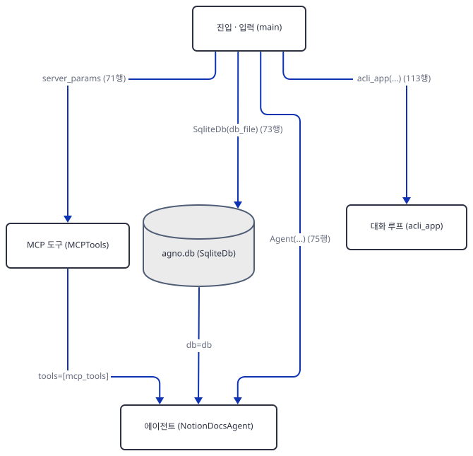

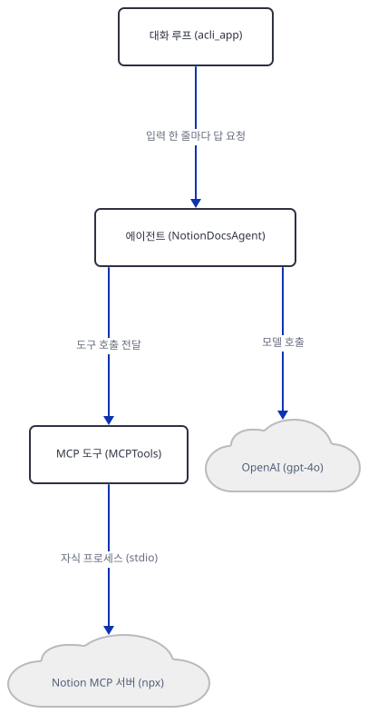

## 단계별 진행

### Step 1. 환경 만들기 — 막히는 둘

**목적.** 앱 파일을 작업 폴더로 복사해 독립 가상환경에 설치하고, `requirements.txt`대로만 설치하면 어디서 멈추는지 봅니다.

**할 일.** 저장소 루트에서 시작합니다. 원본 폴더에서 import하면 `__pycache__`가 생기니 복사본으로만 작업합니다. 이 명령들은 앱을 실행하지 않고 import만 합니다.

```bash
mkdir -p ../notion-lab
cp mcp_ai_agents/notion_mcp_agent/notion_mcp_agent.py mcp_ai_agents/notion_mcp_agent/requirements.txt ../notion-lab/
cd ../notion-lab
uv venv --python 3.13
uv pip install -r requirements.txt
```

```powershell
New-Item -ItemType Directory -Force ..\notion-lab
Copy-Item mcp_ai_agents\notion_mcp_agent\notion_mcp_agent.py, mcp_ai_agents\notion_mcp_agent\requirements.txt ..\notion-lab\
Set-Location ..\notion-lab
uv venv --python 3.13
uv pip install -r requirements.txt
```

(PowerShell 줄은 실행해 보지 못했습니다. pip 대안은 `python -m venv .venv`로 만들고 활성화한 뒤 `pip install -r requirements.txt`입니다.) 이후 `uv run`에는 모두 `--no-project`를 붙입니다. 이유는 공통 사전 준비에 있습니다.

`mcp_ai_agents/notion_mcp_agent/requirements.txt:1-5`

```text
agno>=2.2.10
python-dotenv
mcp
openai
sqlalchemy
```

버전이 거의 없어서 오늘 풀리는 버전이 곧 내 환경입니다.

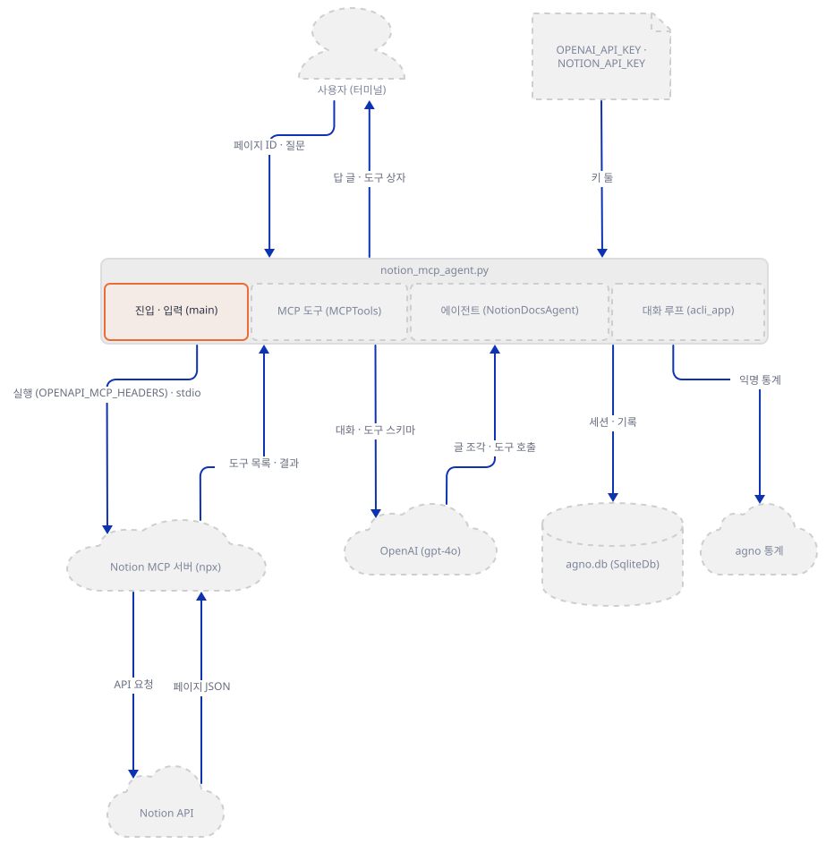

**확인.** 버전을 보고 앱 파일을 import합니다. import는 `main()`을 부르지 않으므로 서버는 뜨지 않습니다.

```bash
uv run --no-project python -c "import importlib.metadata as m; print('agno', m.version('agno')); print('mcp', m.version('mcp')); print('openai', m.version('openai'))"
uv run --no-project python -c "import notion_mcp_agent"
```

기대 출력(오늘 기준, 뒤 명령은 끝 부분):

```text
agno 3.1.3
mcp 2.3.0
openai 3.31.0
    raise ImportError(_ERROR_MESSAGE) from e
ImportError: The SQLAlchemy asyncio module requires that the Python 'greenlet' library is installed.  In order to ensure this dependency is available, use the 'sqlalchemy[asyncio]' install target:  'pip install sqlalchemy[asyncio]'
```

`requirements.txt`의 `sqlalchemy`는 비동기용 `greenlet`을 끌어오지 않습니다. agno의 선택 항목으로 설치하면 해결되는데, 같은 명령에 `mcp` 항목도 붙입니다. 왜 붙이는지는 바로 아래 관찰에 있습니다.

```bash
uv pip install "agno[mcp,sqlite]"
uv run --no-project python -c "import notion_mcp_agent; print('import ok')"
```

새로 설치되는 것은 서른둘이고(`fastmcp==4.1.0`, `greenlet==3.5.6`, `aiosqlite==0.22.1` 포함, 버전은 설치 시점에 따라 다릅니다) 마지막 줄은 `import ok`입니다(직접 확인).

**왜 `mcp` 항목인가.** 이 문서는 `agno[sqlite]`만 설치한 환경에서 원본을 한 번 돌려 봤습니다. `PATH`에서 Node와 Docker 폴더를 뺀 셸에서, 프로세스를 만드는 호출(`subprocess.Popen`)이 파이썬 실행 파일이 아니면 명령을 기록하고 거부하는 하네스 안에서였습니다(`which npx docker`는 둘 다 못 찾았습니다). `Connecting to Notion MCP server...`가 찍히고 곧 이렇게 끝났고, 기록된 프로세스 생성 시도는 없었습니다.

```text
ImportError: `fastmcp` not installed. MCPTools builds its connections with it. Please install using `pip install 'fastmcp>=4.0.0,<5'`
```

`async with MCPTools(...)`가 부르는 `_connect()`가 연결을 만들기 전에 `fastmcp`를 import하는데(agno 3.1.3 소스, `agno/tools/mcp/mcp.py`의 `_import_fastmcp`·`_connect`·`__aenter__`), `fastmcp`는 agno의 `mcp` 선택 항목에만 있습니다. `agno[mcp,sqlite]`로 설치한 환경에서 같은 원본을 같은 하네스로 돌리면 하네스의 거부 메시지 `PermissionError: harness refuses to spawn 'npx'`에서 멈추고, 기록된 명령은 정확히 이것이었습니다.

```text
["npx", "-y", "@notionhq/notion-mcp-server"]
```

즉 서버를 띄우려는 시도는 `async with` 줄(71행)에서, 위 명령으로 일어납니다. 이 문서의 나머지는 그 명령 자리에 가짜 서버를 둡니다.

### Step 2. 입력과 키 — MCP보다 앞에서 끝나는 것

**목적.** 서버가 뜨기 전에 앱이 하는 일(키 읽기, 페이지 ID 받기, ID 만들기)을 확인합니다.

**할 일.** 키는 `load_dotenv()` 뒤 모듈 변수 둘이 읽습니다.

`mcp_ai_agents/notion_mcp_agent/notion_mcp_agent.py:15-18`

```python
load_dotenv()

NOTION_TOKEN = os.getenv("NOTION_API_KEY")
OPENAI_API_KEY = os.getenv("OPENAI_API_KEY")
```

값이 없어도 오류가 나지 않습니다. 페이지 ID는 첫 명령줄 인자가 있으면 그것을 쓰고(31~34행), 없으면 한 줄을 입력받고(41행), 입력이 비면 오류를 찍고 `main()`을 끝냅니다(47~49행). 그다음 `user_`와 `session_` 뒤에 `uuid4` 앞 여덟 글자를 붙여 ID 둘을 만듭니다(52~53행). 앱 README는 `NOTION_PAGE_ID` 환경변수와 "빈 입력이면 기본 페이지 ID" 동작을 적지만, 소스에는 `NOTION_PAGE_ID`라는 글자가 없습니다(`grep`으로 확인).

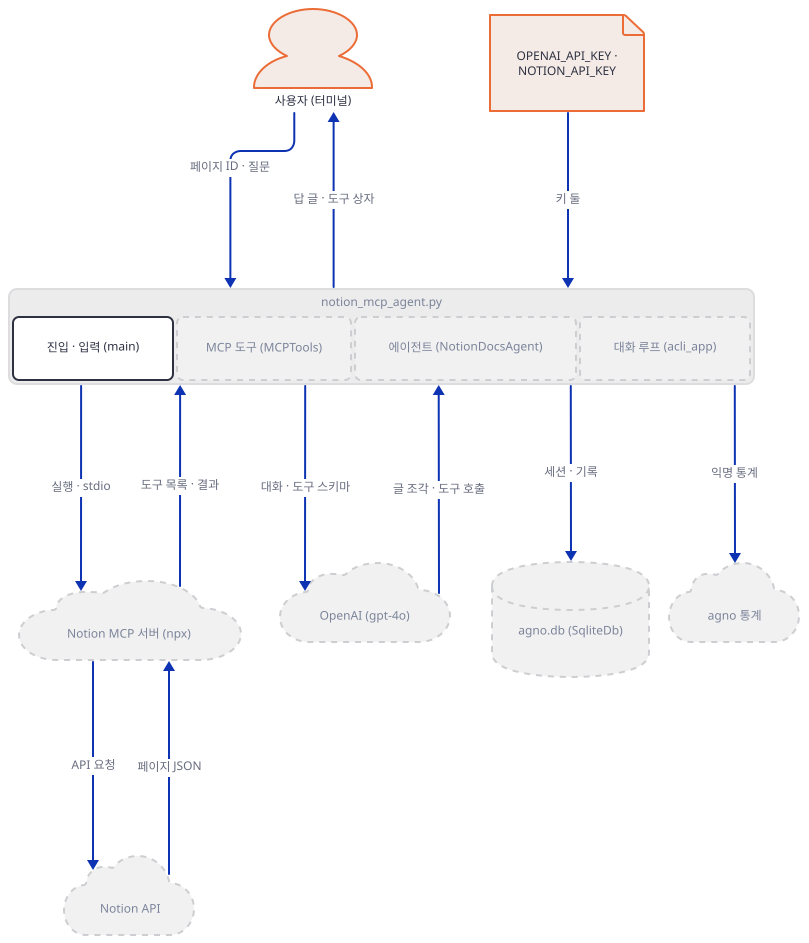

**확인.** 빈 줄을 입력해 봅니다. 서버를 띄우는 71행보다 앞에서 끝나므로 이 명령은 `npx`에 닿지 않습니다.

```bash
printf '\n' | uv run --no-project python notion_mcp_agent.py
```

```text
========================================
      Notion MCP Terminal Agent
========================================

Please enter your Notion page ID:
(You can find this in your page URL, e.g., https://www.notion.so/workspace/Your-Page-1f5b8a8ba283...)
The ID is the part after the last dash and before any query parameters
> ❌ Error: Page ID is required. Please provide a Notion page ID.
```

PowerShell은 `"" | uv run --no-project python notion_mcp_agent.py`로 해 볼 수 있지만 실행해 보지 못했습니다.

### Step 3. 서버 자리에 가짜를 두고, 복사본을 고치기

**목적.** 앱의 서버 명령을 가짜 MCP 서버로 바꾸고 모델 주소를 가짜 서버로 돌려서, 바깥으로 아무것도 나가지 않는 실습장을 만듭니다.

**할 일.** 먼저 가짜 MCP 서버를 `notion-lab/fake_notion_mcp.py`로 저장합니다. 도구 둘은 이 문서가 지은 것입니다. 진짜 서버의 공개 README(2026-10-14에 읽음)는 `retrieve-page-markdown`, `update-page-markdown`, `query-data-source` 같은 이름을 들고 도구가 모두 22개라고 하는데, 이 문서는 그 이름과 인자 모양을 실행해 보지 못했습니다. 서버는 시작할 때 자기가 받은 환경 키 목록과 `OPENAPI_MCP_HEADERS`의 구조를 파일에 적습니다(`mcp` 2.x에서는 `FastMCP`가 `MCPServer`로 바뀌었습니다).

`notion-lab/fake_notion_mcp.py`

```python
import json, os, sys, time
from mcp.server.mcpserver import MCPServer

LOG = sys.argv[1]
if len(sys.argv) > 2:  # optional: wait this many seconds before answering (Step 6)
    time.sleep(float(sys.argv[2]))


def log(rec):
    with open(LOG, "a", encoding="utf-8") as f:
        f.write(json.dumps(rec, ensure_ascii=False) + "\n")


hdr = json.loads(os.environ.get("OPENAPI_MCP_HEADERS", "{}"))
log({"event": "start", "env_keys": sorted(os.environ),
     "header_keys": sorted(hdr), "authorization": hdr.get("Authorization", "")[:11],
     "notion_version": hdr.get("Notion-Version")})

mcp = MCPServer("fake-notion")


@mcp.tool()
def read_page(page_id: str) -> str:
    """Read one page (this tool is made up for the tutorial)."""
    log({"event": "read_page", "page_id": page_id})
    return "# 회의록\n- 안건 1 (가짜 서버가 돌려준 대본)"


@mcp.tool()
def append_paragraph(page_id: str, text: str) -> str:
    """Append a paragraph (made up for the tutorial)."""
    log({"event": "append_paragraph", "page_id": page_id, "text": text})
    return "ok"


mcp.run("stdio")
```

다음은 가짜 OpenAI 서버 `notion-lab/fake_openai.py`입니다. 도구가 보이면 `read_page`를 부르고, 도구 결과가 오면 짧은 답을 하고, 메모리 관리자의 요청(다른 도구들)에는 평범한 글로 답합니다. 요청 요약을 파일에 적어, 모델이 무엇을 받았는지 나중에 볼 수 있게 합니다.

`notion-lab/fake_openai.py`

```python
import json, re, sys, threading
from http.server import BaseHTTPRequestHandler, ThreadingHTTPServer

PORT, LOG = int(sys.argv[1]), sys.argv[2]
LOCK = threading.Lock()


def log(rec):
    with LOCK, open(LOG, "a", encoding="utf-8") as f:
        f.write(json.dumps(rec, ensure_ascii=False) + "\n")


class Handler(BaseHTTPRequestHandler):
    protocol_version = "HTTP/1.1"

    def log_message(self, *args):
        pass

    def do_POST(self):
        body = json.loads(self.rfile.read(int(self.headers["content-length"])))
        msgs = body["messages"]
        tools = [t["function"]["name"] for t in body.get("tools") or []]
        log({"path": self.path, "model": body["model"], "stream": bool(body.get("stream")),
             "tools": tools, "roles": [m["role"] for m in msgs]})
        if msgs[-1]["role"] == "tool":
            msg = {"role": "assistant", "content": "페이지를 읽었습니다. (가짜 서버의 대본)"}
        elif "read_page" in tools:
            page_id = re.search(r"ALWAYS use the page ID: (\S+) for", json.dumps(msgs)).group(1)
            msg = {"role": "assistant", "content": None, "tool_calls": [{
                "id": "call_1", "type": "function",
                "function": {"name": "read_page", "arguments": json.dumps({"page_id": page_id})}}]}
        else:  # the memory manager's call has other tools: answer in plain text
            msg = {"role": "assistant", "content": "알겠습니다. (가짜 서버의 대본)"}
        if body.get("stream"):
            self.send_response(200)
            self.send_header("content-type", "text/event-stream")
            self.send_header("transfer-encoding", "chunked")
            self.end_headers()
            base = {"id": "c1", "object": "chat.completion.chunk", "created": 0, "model": body["model"]}
            delta = {"role": "assistant"}
            if msg.get("tool_calls"):
                delta["tool_calls"] = [{"index": 0, **msg["tool_calls"][0]}]
                finish = "tool_calls"
            else:
                delta["content"] = msg["content"]
                finish = "stop"
            events = [{**base, "choices": [{"index": 0, "delta": delta, "finish_reason": None}]},
                      {**base, "choices": [{"index": 0, "delta": {}, "finish_reason": finish}]}]
            for e in events + ["[DONE]"]:
                data = ("data: " + (e if isinstance(e, str) else json.dumps(e)) + "\n\n").encode()
                self.wfile.write(f"{len(data):x}\r\n".encode() + data + b"\r\n")
            self.wfile.write(b"0\r\n\r\n")
        else:
            out = {"id": "c1", "object": "chat.completion", "created": 0, "model": body["model"],
                   "choices": [{"index": 0, "message": msg, "finish_reason": "stop"}],
                   "usage": {"prompt_tokens": 10, "completion_tokens": 5, "total_tokens": 15}}
            data = json.dumps(out).encode()
            self.send_response(200)
            self.send_header("content-type", "application/json")
            self.send_header("content-length", str(len(data)))
            self.end_headers()
            self.wfile.write(data)


class Server(ThreadingHTTPServer):
    allow_reuse_address = False
    daemon_threads = True


Server(("127.0.0.1", PORT), Handler).serve_forever()
```

이제 복사본 `notion_mcp_agent.py`의 세 줄을 편집기로 바꿉니다. 원본 폴더의 파일은 건드리지 않습니다.

| 줄 | 원본 | 복사본 |
|---|---|---|
| 61 | `command="npx",` | `command=sys.executable,` |
| 62 | `args=["-y", "@notionhq/notion-mcp-server"],` | `args=["fake_notion_mcp.py", "mcp.jsonl"],` |
| 104 | `enable_user_memories=True, # This enables Memory for the Agent` | `update_memory_on_run=True, # This enables Memory for the Agent` |

`enable_user_memories`는 agno 2.2.10과 2.9.0의 `Agent`에는 있었고 3.0.0 이후에는 없으며 새 이름이 `update_memory_on_run`이라는 것은 Day 108이 버전별로 설치해 확인했습니다. 이 문서는 3.1.3에서 원본 그대로는 `TypeError: Agent.__init__() got an unexpected keyword argument 'enable_user_memories'`가 75행에서 나는 것을 직접 봤습니다(서버는 그 전에 이미 떠 있었습니다).

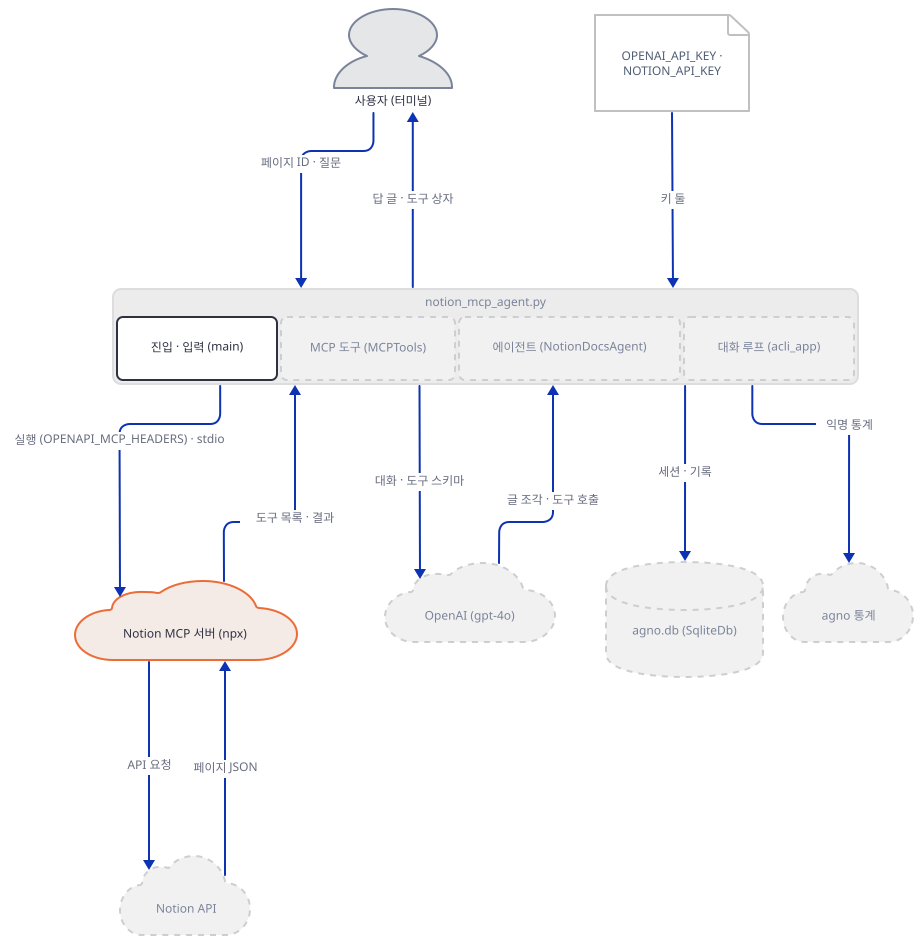

**확인.** 원본과의 차이가 정확히 세 줄이고, 복사본에 `npx`가 더 이상 없는지 봅니다. 이 확인이 끝나기 전에는 앱을 실행하지 마세요. `npx`가 `PATH`에 있는 PC(이 문서를 쓴 머신이 그랬습니다)에서는 원본 명령이 실제로 실행됩니다.

```bash
diff <저장소 경로>/mcp_ai_agents/notion_mcp_agent/notion_mcp_agent.py notion_mcp_agent.py
grep -n "npx" notion_mcp_agent.py
```

(`<저장소 경로>`는 저장소를 받은 위치로 바꿉니다. 이 문서는 절대 경로로 같은 명령을 돌렸습니다.) 기대 출력은 아래 둘이고, `grep`은 아무것도 찍지 않고 종료 코드 1로 끝납니다(직접 확인).

```text
61,62c61,62
<         command="npx",
<         args=["-y", "@notionhq/notion-mcp-server"],
---
>         command=sys.executable,
>         args=["fake_notion_mcp.py", "mcp.jsonl"],
104c104
<             enable_user_memories=True, # This enables Memory for the Agent
---
>             update_memory_on_run=True, # This enables Memory for the Agent
```

### Step 4. 서버가 뜨는 순간, 그리고 서버가 받는 환경

**목적.** `async with MCPTools(...)`가 서버를 언제 띄우는지, 서버 프로세스가 무엇을 받는지 가짜 서버가 적은 파일로 봅니다.

**할 일.** 서버 매개변수는 명령과 환경 하나를 담습니다. 환경의 `OPENAPI_MCP_HEADERS`는 `Authorization`과 `Notion-Version` 헤더를 JSON 글자로 만든 값입니다.

`mcp_ai_agents/notion_mcp_agent/notion_mcp_agent.py:59-71`

```python
    # Configure the MCP Tools
    server_params = StdioServerParameters(
        command="npx",
        args=["-y", "@notionhq/notion-mcp-server"],
        env={
            "OPENAPI_MCP_HEADERS": json.dumps(
                {"Authorization": f"Bearer {notion_token}", "Notion-Version": "2022-06-28"}
            )
        }
    )
    
    # Start the MCP Tools session
    async with MCPTools(server_params=server_params) as mcp_tools:
```

`StdioServerParameters`를 만드는 것만으로는 아무 일도 없습니다. `async with`가 `__aenter__`를 부르고, 그것이 `_connect()`로 연결과 `initialize`, 그리고 도구 목록 받기까지 합니다(agno 3.1.3 소스, `agno/tools/mcp/mcp.py`의 `__aenter__`·`_connect`·`initialize`). `transport`를 주지 않아서 `None`인데, 연결을 만드는 함수는 URL이 아니면 모두 표준 입출력으로 취급합니다(소스로 확인). 이 때문에 `with` 블록이 끝나면 자식 프로세스도 끝납니다(같은 파일 `_build_fastmcp_client`의 `keep_alive=False`. 실행 뒤 가짜 서버 프로세스가 남지 않은 것도 확인했습니다).

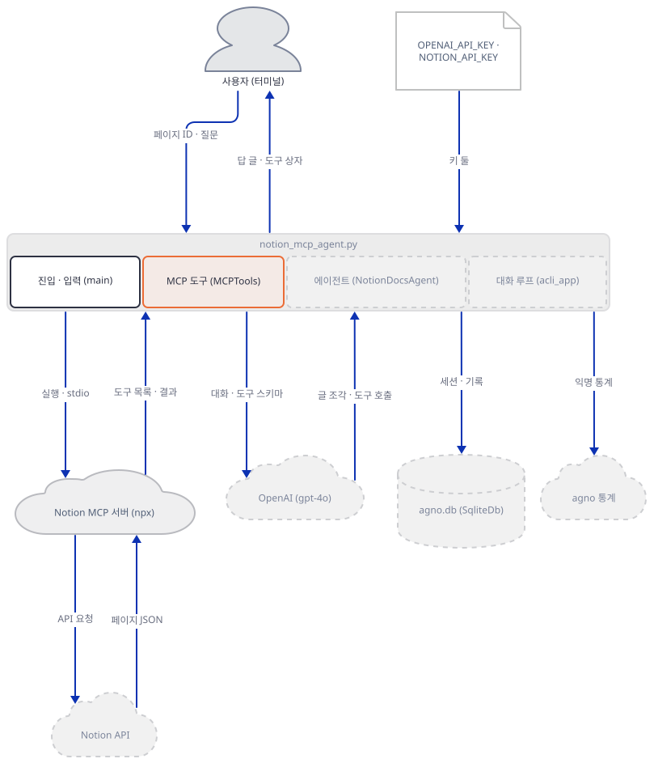

**확인.** 가짜 키를 걸고 페이지 ID만 주고 바로 `exit` 합니다. 모델은 한 번도 부르지 않는 실행입니다. 가짜 OpenAI 주소도 함께 걸어 두면 실수로 모델이 불려도 로컬로 갑니다.

```bash
export PORT=54321
export OPENAI_BASE_URL=http://127.0.0.1:$PORT/v1 OPENAI_API_KEY=sk-fake NOTION_API_KEY=ntn_fake AGNO_TELEMETRY=false
printf 'exit\n' | uv run --no-project python notion_mcp_agent.py abc123pageid
cat mcp.jsonl
```

```powershell
$env:PORT = "54321"
$env:OPENAI_BASE_URL = "http://127.0.0.1:$($env:PORT)/v1"; $env:OPENAI_API_KEY = "sk-fake"; $env:NOTION_API_KEY = "ntn_fake"; $env:AGNO_TELEMETRY = "false"
"exit" | uv run --no-project python notion_mcp_agent.py abc123pageid
Get-Content mcp.jsonl
```

(포트는 49152~65535 안에서 아무 수나 고르되 이 터미널에서 계속 같은 값을 씁니다. 54321은 예시입니다. PowerShell 줄은 실행해 보지 못했습니다. `AGNO_TELEMETRY=false`는 Step 6에서 설명합니다.) 앱 출력은 `Connecting to Notion MCP server...`, 빈 줄, `Connected to Notion MCP server successfully!`, 그리고 `🤖 You :` 프롬프트까지이고, `mcp.jsonl`에는 서버가 시작할 때 적은 줄이 하나 있습니다(Windows에서 직접 확인, 줄바꿈은 읽기 쉽게 넣었습니다).

```text
{"event": "start",
 "env_keys": ["APPDATA", "HOMEDRIVE", "HOMEPATH", "LOCALAPPDATA", "OPENAPI_MCP_HEADERS", "PATH", "PATHEXT",
              "PROCESSOR_ARCHITECTURE", "SYSTEMDRIVE", "SYSTEMROOT", "TEMP", "USERNAME", "USERPROFILE"],
 "header_keys": ["Authorization", "Notion-Version"],
 "authorization": "Bearer ntn_", "notion_version": "2022-06-28"}
```

서버 프로세스가 받은 환경 키는 열세 개이고, 셸에 걸어 둔 `OPENAI_API_KEY`는 없습니다. 이 키들은 `mcp` 패키지가 정해 둔 허용 목록(`mcp` 패키지 `client/stdio.py`의 `DEFAULT_INHERITED_ENV_VARS`)에 `OPENAPI_MCP_HEADERS` 하나를 더한 것입니다. 목록은 Windows에서 위의 열두 개이고, 그 밖의 운영체제에서는 `HOME`, `LOGNAME`, `PATH`, `SHELL`, `TERM`, `USER`입니다(소스로 확인, 다른 운영체제는 실행해 보지 못했습니다). 이 앱은 셸의 `os.environ` 전체를 넘기지 않습니다.

가짜 `Authorization`은 앞 열한 글자만 적게 했습니다. Notion 키를 빼고 같은 명령을 돌리면 이 줄이 바뀝니다.

```bash
(unset NOTION_API_KEY; rm -f mcp.jsonl; printf 'exit\n' | uv run --no-project python notion_mcp_agent.py abc123pageid >/dev/null; cat mcp.jsonl)
```

```text
...  "authorization": "Bearer None", "notion_version": "2022-06-28"}
```

키가 없으면 앱은 오류 없이 `Bearer None`이라는 글자를 서버에 넘깁니다(직접 확인). 진짜 서버 쪽은 이 헤더를 Notion에 그대로 보낼 것이므로 첫 도구 호출이 Notion의 인증 오류로 끝날 텐데, 이 문서는 진짜 서버를 돌리지 않았습니다. 진짜 서버의 공개 README는 토큰을 `NOTION_TOKEN`으로 주는 방법을 권하고, 헤더에 `Notion-Version`을 직접 주면 그 값이 모든 도구의 기본값을 덮어쓴다고 적습니다. 이 앱이 `2022-06-28`을 고정하는 것이 오늘의 서버 도구에 어떤 영향을 주는지는 확인하지 못했습니다.

### Step 5. 에이전트와 한 턴

**목적.** 서버가 뜬 뒤 에이전트가 만들어지는 과정과, 질문 한 줄이 모델 호출 몇 번이 되는지 가짜 OpenAI 서버의 기록으로 봅니다.

**할 일.** 에이전트는 `async with` 안에서 만들어집니다. 도구는 `MCPTools` 객체 하나이고, 서버가 알려 준 도구가 모델에게 갑니다. 지시문은 f-string이라 페이지 ID가 글자로 들어갑니다.

`mcp_ai_agents/notion_mcp_agent/notion_mcp_agent.py:73-79`

```python
        db = SqliteDb(db_file="agno.db") # SQLite DB for memory
        # Create the agent
        agent = Agent(
            name="NotionDocsAgent",
            model=OpenAIChat(id="gpt-4o", api_key=openai_api_key),
            tools=[mcp_tools],
            description="Agent to query and modify Notion docs via MCP",
```

`mcp_ai_agents/notion_mcp_agent/notion_mcp_agent.py:101-107`

```python
            markdown=True,
            retries=3,
            db=db,
            enable_user_memories=True, # This enables Memory for the Agent
            add_history_to_context=True,  # Include conversation history
            num_history_runs=5,  # Keep track of the last 5 interactions
        )
```

`OpenAIChat`에 `base_url`을 주지 않으므로 OpenAI SDK가 `OPENAI_BASE_URL`을 읽어 가짜 서버로 갑니다(직접 확인, 요청이 가짜 서버의 기록에 남았습니다). 페이지 ID는 지시문의 85행과 99행에 글자로만 들어갑니다. 코드가 도구 인자를 강제하지 않으니 어떤 ID로 도구를 부를지는 모델이 정합니다. `retries=3`은 모델 오류 때 세 번 더 시도한다는 뜻이고(Step 6), `update_memory_on_run=True`는 매 실행마다 메모리 관리자 호출을 하나 더 만듭니다.

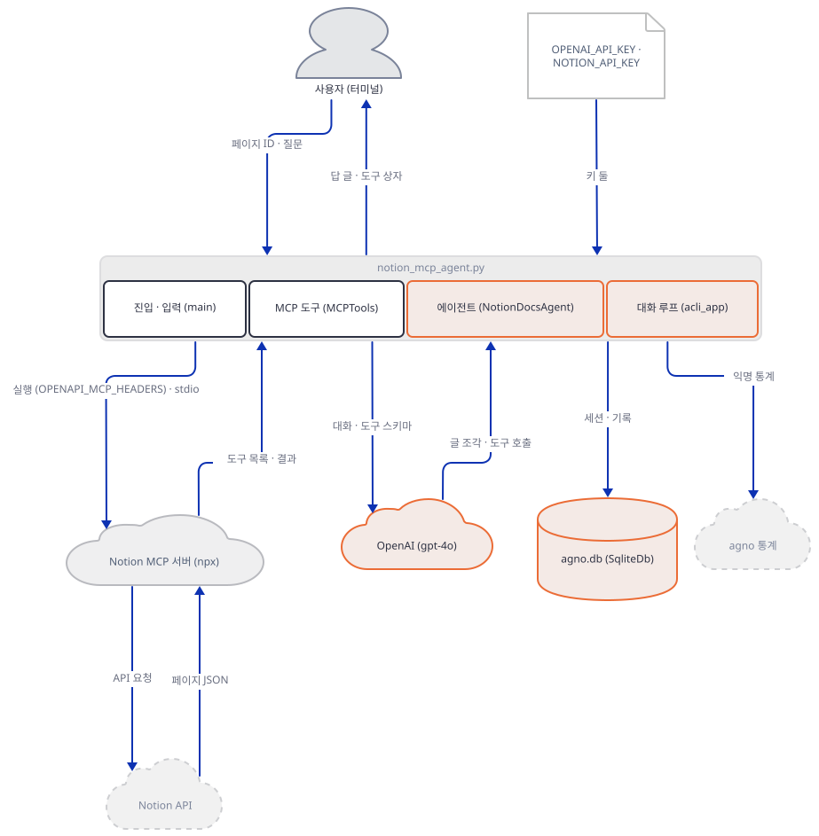

**확인.** 터미널 둘로 합니다. 먼저 **새 터미널**을 하나 열고 `notion-lab`으로 가서 가짜 OpenAI 서버를 띄웁니다. 이 터미널에는 키나 `OPENAI_BASE_URL`을 걸지 않고, 포트 숫자(Step 4의 값)만 씁니다.

```bash
uv run --no-project python fake_openai.py 54321 openai.jsonl
```

```powershell
uv run --no-project python fake_openai.py 54321 openai.jsonl
```

앱은 Step 4에서 쓰던 터미널에서 돌립니다. 새로 연 터미널이라면 아래 환경변수를 먼저 다시 걸고, 첫 줄로 가짜 주소가 걸렸는지 확인합니다. 앱은 `load_dotenv()`(15행)를 부르는데, python-dotenv는 스크립트 폴더에서 위로 올라가며 `.env`를 찾습니다. `notion-lab`의 상위 폴더에 진짜 키가 든 `.env`가 있어도 셸에 이미 걸린 값이 이기지만, 셸에 값이 없으면 그 파일의 진짜 키로 OpenAI를 부르니 `OPENAI_BASE_URL`이 걸렸는지 꼭 봅니다.

```bash
export PORT=54321
export OPENAI_BASE_URL=http://127.0.0.1:$PORT/v1 OPENAI_API_KEY=sk-fake NOTION_API_KEY=ntn_fake AGNO_TELEMETRY=false
echo "$OPENAI_BASE_URL"
rm -f mcp.jsonl openai.jsonl agno.db
printf '페이지를 읽어줘\n고마워\nexit\n' | uv run --no-project python notion_mcp_agent.py abc123pageid
```

```powershell
$env:PORT = "54321"
$env:OPENAI_BASE_URL = "http://127.0.0.1:$($env:PORT)/v1"; $env:OPENAI_API_KEY = "sk-fake"; $env:NOTION_API_KEY = "ntn_fake"; $env:AGNO_TELEMETRY = "false"
echo $env:OPENAI_BASE_URL
```

(PowerShell 줄은 실행해 보지 못했습니다. 첫 줄 `echo`가 `http://127.0.0.1:...`이 아니면 멈춥니다.) 앱은 질문마다 `Message` 상자, `Tool Calls` 상자(`read_page(page_id=abc123pageid)`), `Response` 상자를 찍습니다. 가짜 모델은 도구가 보이면 늘 `read_page`를 부르는 대본이라 둘째 질문 "고마워"에도 도구를 부릅니다. 모델이 받은 요청의 요약을 봅니다.

```bash
uv run --no-project python -c "import json; [print(d['path'], 'stream=%s' % d['stream'], d['tools'], d['roles']) for d in map(json.loads, open('openai.jsonl', encoding='utf-8'))]"
```

```text
/v1/chat/completions stream=True ['append_paragraph', 'read_page'] ['developer', 'user']
/v1/chat/completions stream=False ['add_memory', 'delete_memory', 'update_memory'] ['developer', 'user']
/v1/chat/completions stream=True ['append_paragraph', 'read_page'] ['developer', 'user', 'assistant', 'tool']
/v1/chat/completions stream=True ['append_paragraph', 'read_page'] ['developer', 'user', 'assistant', 'tool', 'assistant', 'user']
/v1/chat/completions stream=False ['add_memory', 'delete_memory', 'update_memory'] ['developer', 'user']
/v1/chat/completions stream=True ['append_paragraph', 'read_page'] ['developer', 'user', 'assistant', 'tool', 'assistant', 'user', 'assistant', 'tool']
```

세 가지를 읽습니다. 첫째, 모델에게 가는 도구는 서버가 알려 준 이름 그대로입니다(접두사가 붙지 않습니다). 둘째, 한 턴은 모델 호출 셋입니다. 스트리밍 채팅 둘(도구를 부르게 하는 것, 결과를 받아 답하게 하는 것)과, 도구가 `add_memory`·`delete_memory`·`update_memory`뿐인 비스트리밍 호출 하나입니다. 이 셋째가 `update_memory_on_run=True`의 몫입니다. 메모리 작업은 비동기 작업으로 모델 호출과 나란히 시작되고(agno 소스, `agno/agent/_managers.py`의 `astart_memory_task`), 이 문서에서 여섯 번 돌려 본 순서는 늘 채팅, 메모리, 채팅이었습니다. 가짜 모델은 메모리를 한 번도 쓰지 않으므로 메모리 표는 만들어지지 않았습니다. 이 인자를 `False`로 바꾼 복사본은 같은 한 턴에 채팅 둘만 불렀습니다(직접 확인). 셋째, 둘째 턴의 첫 요청에는 앞 턴의 `assistant`·`tool`·`assistant`가 그대로 실려 있습니다. `add_history_to_context`의 몫입니다.

### Step 6. 실패 둘, 재시작, 통계, 진짜로 붙이기

**목적.** 키가 없을 때, 서버가 느릴 때, 앱을 다시 켰을 때, 통계가 나갈 때 무엇이 일어나는지 봅니다.

**할 일.** 먼저 OpenAI 키가 없는 경우입니다. 같은 서버와 주소에서 키만 뺍니다. `unset`이 아니라 빈 값으로 덮어쓰는 이유는 `load_dotenv()`가 셸에 없는 변수를 상위 폴더 `.env`의 진짜 키로 채울 수 있기 때문입니다(Step 5). 셸에 이미 있는 변수는 덮어쓰지 않으므로 빈 값은 그대로 남습니다(직접 확인: 가짜 키가 든 `.env`를 실습 폴더에 두면 `unset`한 실행은 그 키로 모델에 연결을 시도했고, 빈 값 실행은 `OPENAI_API_KEY not set`으로 끝났습니다). 키 검사는 첫 모델 호출 때 일어나고, 그 전에 서버는 이미 떠 있습니다.

```bash
(export OPENAI_API_KEY=""; printf '안녕\nexit\n' | uv run --no-project python notion_mcp_agent.py abc123pageid)
```

```text
ERROR   Model authentication error from OpenAI API: OPENAI_API_KEY not set. Please set the OPENAI_API_KEY environment variable.
WARNING Attempt 1/4 failed. Retrying in 1s...: OPENAI_API_KEY not set. Please set the OPENAI_API_KEY environment variable.
ERROR   Model authentication error from OpenAI API: OPENAI_API_KEY not set. Please set the OPENAI_API_KEY environment variable.
Task exception was never retrieved
future: <Task finished name='Task-6' coro=<amake_memories() done, defined at ...
```

(중간 줄은 줄였습니다.) `retries=3`이라 시도는 네 번(`Attempt 1/4`…)이고, 가짜 서버에는 요청이 하나도 오지 않았습니다. 같은 실행에서 메모리 작업이 던진 오류가 `Task exception was never retrieved`와 긴 트레이스백으로 따로 찍힙니다. 질문 하나에 `OPENAI_API_KEY not set`이 들어간 줄이 열일곱 줄 나왔습니다(`grep -c`로 센 값).

둘째는 느린 서버입니다. 복사본 62행의 `args`에 세 번째 값을 더해 가짜 서버가 응답하기 전에 기다리게 합니다. 서버 파일은 이미 그 인자를 받습니다.

```python
        args=["fake_notion_mcp.py", "mcp.jsonl", "15"],
```

```bash
printf 'exit\n' | uv run --no-project python notion_mcp_agent.py abc123pageid
```

```text
mcp.shared.exceptions.MCPError: Request 'initialize' timed out
```

15초를 기다리게 하면 위 오류로 죽고, 8초면 연결됐고 12초면 죽었습니다(직접 확인). 기준은 `MCPTools`의 생성자 인자 `timeout_seconds=10`입니다(소스, `agno/tools/mcp/mcp.py`의 `MCPTools.__init__` 시그니처). 71행을 `MCPTools(server_params=server_params, timeout_seconds=30)`으로 바꾸면 12초 지연에서 연결됐습니다(직접 확인). 실제 `npx -y`가 처음 패키지를 내려받는 데 얼마나 걸리는지는 `npx`를 실행하지 않아 재지 못했으니, 10초를 넘기면 같은 증상일 것이라는 것은 추정입니다.

**확인이 끝나면 복사본을 되돌립니다.** 62행을 `args=["fake_notion_mcp.py", "mcp.jsonl"],`로 되돌리고, 71행에 `timeout_seconds=30`을 넣었다면 `MCPTools(server_params=server_params)`로 되돌립니다. 되돌리지 않으면 아래 재시작 확인은 두 번 모두 같은 `timed out`으로 죽고 `agno.db`는 빈 파일로 남아 `no such table: agno_sessions`로 끝납니다(직접 확인). 되돌렸는지는 `grep -n 'args=\|MCPTools(' notion_mcp_agent.py`로 봅니다. 62행에 `"15"`가 없고 71행에 `timeout_seconds`가 없어야 합니다.

셋째는 재시작입니다. 같은 폴더에서 앱을 두 번 실행하고 `agno.db`를 열어 봅니다.

```bash
rm -f agno.db
for i in 1 2; do printf '페이지를 읽어줘\nexit\n' | uv run --no-project python notion_mcp_agent.py abc123pageid > /dev/null; done
uv run --no-project python -c "import sqlite3; c = sqlite3.connect('agno.db'); print([r[0] for r in c.execute(\"select name from sqlite_master where type='table'\")]); [print(r) for r in c.execute('select session_id, user_id from agno_sessions')]"
```

```text
['agno_sessions', 'agno_schema_versions', 'agno_runs']
('session_9cb3eccb', 'user_4fde97b2')
('session_9f470bf9', 'user_a4ccf5a5')
```

(ID는 실행마다 다릅니다.) 두 번의 실행이 서로 다른 세션과 사용자로 쌓였습니다. 52~53행이 켤 때마다 새 ID를 만들기 때문에, 앱 README의 "재시작 뒤에도 같은 대화를 이어 간다"는 이 코드에서는 일어나지 않습니다. 기록 5회와 메모리는 한 번의 실행 안에서만 이어집니다.

넷째는 통계입니다. 이 에이전트는 `telemetry`를 끄지 않았으므로 agno의 기본값 `True`입니다. 그래서 `run()`이 성공할 때마다 `POST /telemetry/runs`가 나갑니다. agno가 통계를 보내는 방식과 끄는 법은 Day 047 Step 5가 이미 로컬 수신기로 확인했으므로 되풀이하지 않습니다. 이 앱에서 달라진 것은 본문뿐입니다. 이 문서는 통계 주소를 가짜 서버로 돌려 두고 `AGNO_TELEMETRY`를 끄지 않은 채 한 턴을 돌려 받은 본문의 키를 읽었습니다.

```text
agent_id, db_type, model_provider, model_name, model_id, parser_model, output_model, has_tools, has_memory,
has_learnings, has_reasoning, has_knowledge, has_input_schema, has_output_schema, has_team  (+ session_id, run_id, sdk_version)
```

값은 `agent_id: "notiondocsagent"`, `db_type: "SqliteDb"`, `model_id: "gpt-4o"`, `has_tools: true`, `has_memory: true` 등이고 질문이나 페이지 내용은 없었습니다. 두 턴이면 두 건이 갔습니다. 앞의 실패한 실행(키 없음)은 한 건도 보내지 않았습니다. 이 문서의 명령이 `AGNO_TELEMETRY=false`를 거는 것은 가짜 서버만 있는 환경에서도 독자 PC에서 `os-api.agno.com`으로 나가는 길을 막아 두려는 것입니다.

**진짜로 붙이려면.** 이 문서는 아래를 실행하지 않았습니다. 가짜 값이 아닌 키를 쓰는 단계라서 직접 하실 때 신중히 하세요.

1. 위 설치 명령으로 `agno[mcp,sqlite]`까지 설치하고, 원본 파일을 새 폴더에 **새로 복사해** 104행만 `update_memory_on_run=True`로 바꿉니다. 지금의 복사본은 61·62행이 가짜 서버로 바뀌어 있고 `"15"`나 `timeout_seconds=30`이 남아 있을 수 있으니 쓰지 않습니다. 공개 README가 이 서버를 더 이상 유지하지 않는다고 적은 것(사전 준비)도 먼저 읽어 두세요.
2. `OPENAI_API_KEY`와 `NOTION_API_KEY`를 진짜 값으로 걸고 `OPENAI_BASE_URL`은 지웁니다. `AGNO_TELEMETRY=false`는 둘 수도 지울 수도 있는데, 지우면 성공한 턴마다 통계 한 건이 `os-api.agno.com`으로 나갑니다(Step 6). 페이지를 통합에 공유하고, Node.js가 있어야 `npx`가 돕니다.
3. `uv run --no-project python notion_mcp_agent.py <페이지 ID>`. 첫 실행은 `npx -y`가 서버를 내려받는 시간이 들고, 그 시간이 10초를 넘으면 위 `timed out`을 만날 수 있습니다.

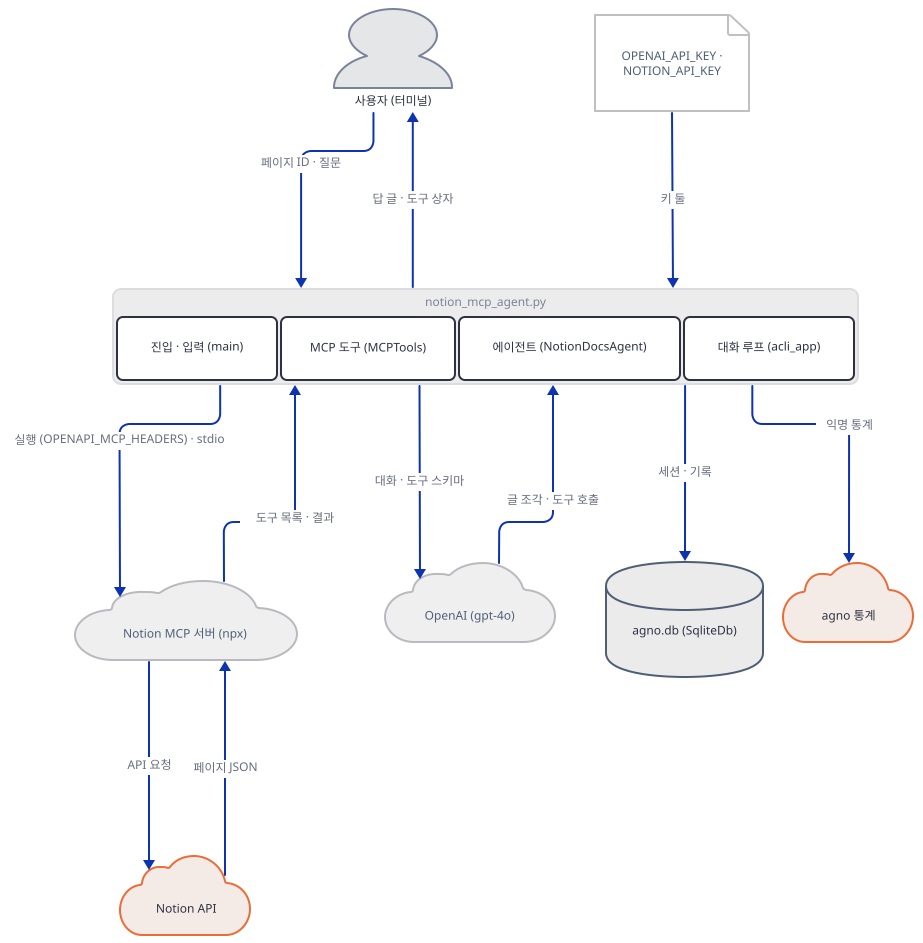

## 요청 한 건이 흐르는 과정

시퀀스는 다섯 시점으로 나눴습니다. 첫째 그림은 기동입니다. 페이지 ID를 받고, `async with`에서 서버가 뜨고 도구 목록이 오고, 에이전트가 만들어져 대화 루프로 들어갑니다.

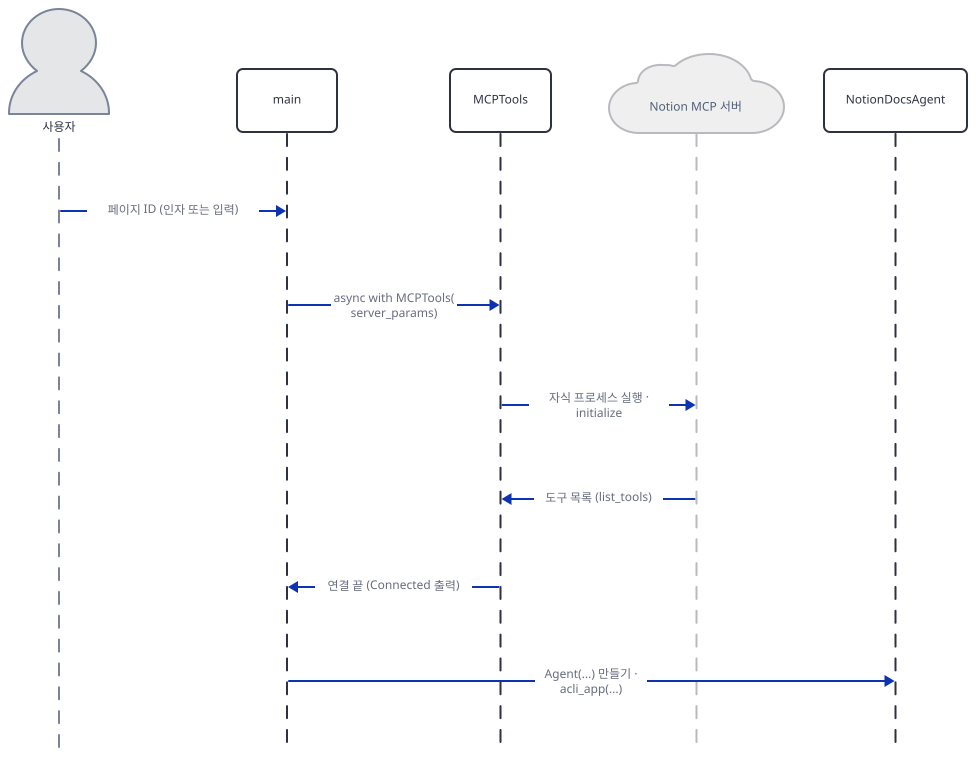

둘째는 질문 한 줄입니다. 에이전트가 대화와 도구 스키마를 스트림으로 보내고, 같은 시점에 메모리 호출이 나란히 나가고(위 여섯 번의 로그 순서), 모델이 `read_page`를 부르라고 답합니다.

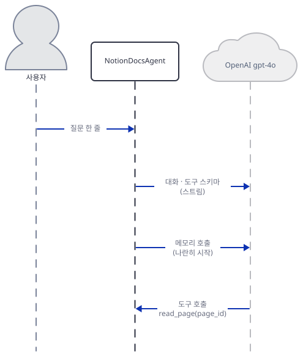

셋째는 도구 호출입니다. 에이전트가 `MCPTools`에 호출을 넘기면 서버가 Notion API에 요청을 보내고 결과가 돌아옵니다. 이 문서의 실습에서는 서버가 가짜라서 Notion API 구간은 일어나지 않았고, 소스의 흐름 그대로 그렸습니다.

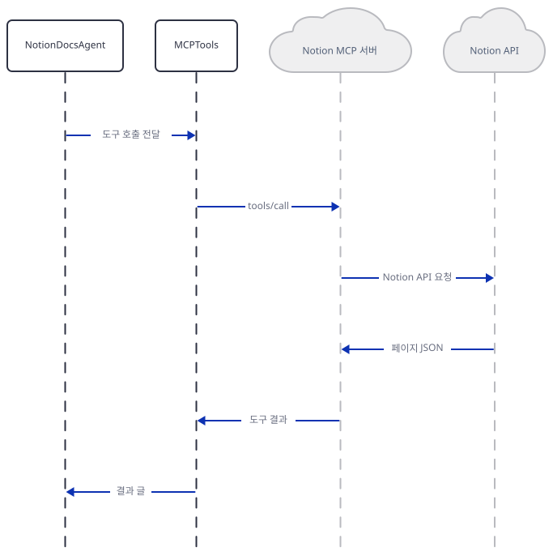

넷째는 답입니다. 도구 결과를 실은 두 번째 채팅 호출이 가고, 답 글 조각이 스트림으로 오고 터미널에 찍힙니다. 메모리 호출의 답은 그 뒤에 도착한 것으로 그렸는데, 에이전트가 메모리 작업을 끝까지 기다린 뒤 저장하는 흐름(`agno/agent/_run.py`의 스트림 경로)을 소스로 읽은 것이지 도착 시각을 재지는 않았습니다.

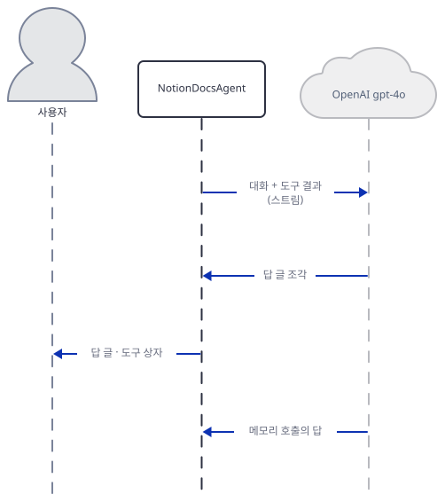

다섯째는 저장과 통계입니다. 실행이 끝나면 세션과 실행 기록이 `agno.db`에 저장되고, 통계가 켜져 있으면 한 건이 나갑니다.

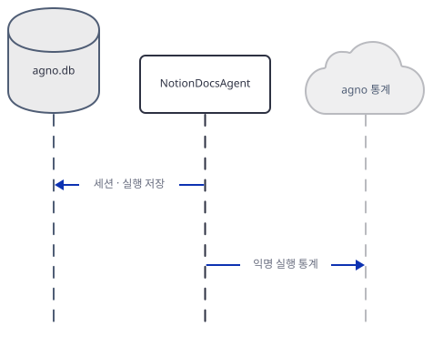

## 실행 체크리스트

- [ ] `uv pip install -r requirements.txt` 뒤 import가 `greenlet` 오류로 멈추는 것을 봤다
- [ ] `agno[mcp,sqlite]`를 설치하고 `import ok`를 봤다
- [ ] 빈 입력이 `Page ID is required`로 끝나는 것을 봤다(서버가 뜨기 전)
- [ ] 복사본의 세 줄을 바꿨고, `diff`가 정확히 세 군데이고 `grep -n "npx"`가 비어 있다
- [ ] `mcp.jsonl`에서 서버가 받은 환경 키가 허용 목록과 `OPENAPI_MCP_HEADERS`뿐임을 봤다
- [ ] `NOTION_API_KEY`를 빼면 `Bearer None`이 되는 것을 봤다
- [ ] `openai.jsonl`에서 한 턴이 모델 호출 셋임을 봤다
- [ ] 서버를 15초 늦추면 `initialize`가 타임아웃으로 죽는 것을 봤고, 62행과 71행을 되돌렸다
- [ ] 두 번 실행한 `agno.db`에 세션이 둘 있는 것을 봤다
- [ ] 가짜 서버(`fake_openai.py`)를 `Ctrl+C`로 끄고 포트가 비었는지 확인했다

## 문제 해결

| 증상 | 원인 | 해결 |
|---|---|---|
| `ImportError: The SQLAlchemy asyncio module requires that the Python 'greenlet' library is installed`가 `notion_mcp_agent.py:10`에서 | `requirements.txt`의 `sqlalchemy`가 `greenlet`을 끌어오지 않는다 | `uv pip install "agno[mcp,sqlite]"` |
| ``ImportError: `fastmcp` not installed. MCPTools builds its connections with it.``가 71행(`async with`)에서 | agno 3.1.3의 `MCPTools`는 `fastmcp`로 연결을 만들고 `fastmcp`는 agno의 `mcp` 선택 항목에만 있다 | 같은 명령으로 `agno[mcp,sqlite]` |
| `TypeError: Agent.__init__() got an unexpected keyword argument 'enable_user_memories'`가 75행에서 | agno 3.0.0부터 인자 이름이 `update_memory_on_run`으로 바뀌었다(Day 108) | 104행을 `update_memory_on_run=True`로 |
| `mcp.shared.exceptions.MCPError: Request 'initialize' timed out`가 71행에서 | 서버가 10초(`timeout_seconds` 기본값) 안에 응답하지 못했다. 이 문서는 느린 가짜 서버로 재현했다 | `MCPTools(server_params=server_params, timeout_seconds=30)`. 진짜 서버가 첫 실행에 느린 것이 원인인지는 확인하지 못했다 |
| `ModuleNotFoundError: No module named 'mcp.server.fastmcp'`가 가짜 서버에서 | `mcp` 2.x에서 `FastMCP`가 `MCPServer`(`mcp.server.mcpserver`)로 바뀌었다 | 이 문서의 `fake_notion_mcp.py`처럼 `MCPServer`를 쓴다 |
| 키를 안 줬는데 서버가 뜨고 모델 호출에서 `OPENAI_API_KEY not set`이 네 번 시도 뒤에 난다 | 키 검사는 첫 모델 호출 때 일어난다. 서버는 그 전에 이미 떠 있다 | 키를 걸고 다시 실행 |
| `Notion-Version`·`Authorization`이 Notion 오류로 끝나는 것으로 보인다 | 키가 없으면 헤더가 `Bearer None`이고, `2022-06-28`이 고정되어 있다 | 키를 건다. 버전 고정이 오늘의 서버와 맞는지는 이 문서가 확인하지 못했다 |
| 2027-01-14 이후 `gpt-4o` 호출이 실패한다 | 기본 스냅숏 `gpt-4o-2024-08-06`이 그날 종료 예정이다(폐기 문서). 별칭의 동작은 문서에 없다 | 77행의 `OpenAIChat(id="gpt-4o", ...)`를 새 모델 id로 바꿔 시험한다(이 문서는 시험하지 못했다) |
| 진짜 서버가 더 이상 갱신되지 않아 도구가 달라지거나 사라진다 | 공개 README가 이 서버를 "no longer actively maintained or supported"라고 적고 Remote Notion MCP를 권한다 | 호스팅형으로 옮길 때는 서버 명령(61·62행)이 아니라 연결 방식 자체를 바꿔야 한다. 이 문서는 시험하지 못했다 |
| 앱을 다시 켰더니 앞 대화를 기억하지 못한다 | 켤 때마다 사용자·세션 ID가 새로 만들어진다(52~53행) | ID를 파일이나 인자로 고정하도록 코드를 고친다(더 해보기) |
| 앱 README의 `NOTION_PAGE_ID`와 기본 페이지 ID가 먹지 않는다 | 소스에 그 변수가 없고 빈 입력은 오류로 끝난다(47~49행) | 페이지 ID를 첫 인자로 준다 |

## 더 해보기

- 사용자·세션 ID를 고정해 봅니다. `mcp_ai_agents/notion_mcp_agent/notion_mcp_agent.py:52-53`의 `uuid`를 환경변수나 두 번째 인자로 바꾸고, 두 번 실행한 뒤 Step 6의 `agno_sessions` 조회가 한 줄이 되는지, 둘째 실행의 첫 모델 요청에 앞 실행의 대화가 실리는지(`openai.jsonl`의 `roles`) 보세요.
- 메모리를 꺼 봅니다. 복사본의 `update_memory_on_run=True`를 `False`로 바꾸고 Step 5를 다시 돌려, 한 턴의 모델 호출이 둘로 줄고 `add_memory` 도구를 가진 요청이 사라지는지 확인하세요.
- 서버가 환경으로 받는 것을 늘려 봅니다. `StdioServerParameters`의 `env`에 `"MY_FLAG": "1"`을 더하고 `mcp.jsonl`의 `env_keys`에 나타나는지 보세요. 안 더한 키(`OPENAI_API_KEY`)가 끝까지 나타나지 않는 것도 다시 확인하세요.

## 다음 날 예고

[Day 128 · 🐙 GitHub MCP Agent](../day128-github-mcp-agent/README.md) — 같은 `MCPTools`와 `StdioServerParameters` 조합이지만 `github_agent.py`(150줄, Streamlit 앱)가 서버를 `npx` 대신 `command="docker"`(75행)로 띄웁니다(소스로 확인). 서버를 띄우는 줄이 `async with MCPTools(...)`(89행)인 것은 오늘과 같습니다.