# Day 128 · 🐙 GitHub MCP Agent

> 볼륨 9 ♾️ MCP AI Agents · 난이도 ★★☆ · 예상 소요 90분(앱은 150줄이지만 가짜 docker·MCP 서버·OpenAI 서버를 직접 저장하고, 서버를 늦게 띄우거나 docker를 실패시켜 가며 같은 호출을 여러 번 돌려 보는 시간이 읽는 시간보다 큽니다) · API 비용 대략 질문 한 건에 $0.05~0.15(⚠ 추정입니다. 이 문서는 OpenAI를 한 번도 부르지 않았고 GitHub MCP 서버의 실제 도구 선언 크기도 재지 못했습니다. 기본 모델 `gpt-5.4`의 요금 입력 $2.5·출력 $15/백만 토큰(OpenAI 모델 페이지, 2026-10-14)에 도구 선언 1만 토큰 안팎으로 2~4번 부른다고 어림했습니다) · 원본 앱: `mcp_ai_agents/github_mcp_agent`

## 오늘 만들 것

Streamlit 화면에 저장소(`owner/repo`)와 질문을 적으면, agno `Agent`가 GitHub 공식 MCP 서버를 도구로 삼아 이슈·PR·저장소 정보를 가져와 마크다운으로 답하는 앱입니다. 볼륨 9 "♾️ MCP AI Agents"의 둘째 날입니다. MCP 서버를 별도 프로세스로 띄워 붙이는 모양은 앞에서 나왔습니다. Day 125는 Google ADK의 `MCPToolset`으로 `npx -y firecrawl-mcp`를 붙였고, 그 서버가 에이전트를 만들 때가 아니라 첫 요청에서 모델 호출을 만드는 순간에 뜬다는 것을 확인했습니다. 바로 앞 날 Day 127의 원본 앱(`notion_mcp_agent.py`)은 오늘과 같은 agno `MCPTools`와 `StdioServerParameters`를 쓰고 서버를 `npx`로 띄웁니다(원본 소스로 확인). 오늘 새로운 것은 서버를 `npx`가 아니라 `docker run`으로 띄운다는 점입니다.

직접 돌려 알게 된 것이 다섯입니다.

1. `requirements.txt`만 설치하면 `fastmcp`가 없어서, 화면에는 `Error: ... fastmcp not installed ...`가 뜨고 docker는 실행되지도 않습니다(Step 1·4).
2. 에이전트에 `model=`이 없어서 어느 모델을 쓰는지는 agno 버전이 정합니다. 오늘 설치되는 3.1.3은 OpenAI Responses의 `gpt-5.4`이고, 하한인 2.2.10은 `gpt-4o`입니다(Step 5).
3. `docker run`에는 `-e` 둘만 이름으로 주지만, 앱은 셸 환경 전체를 docker 프로세스에 넘깁니다. 내 셸에서는 115개였습니다(Step 4).
4. 120초 제한은 에이전트 실행만 감쌉니다. 서버가 10초 안에 답하지 않으면 120초를 기다리지 않고 `initialize` 시간 초과로 끝납니다. 진짜 docker라면 첫 실행의 이미지 내려받기가 여기에 걸릴 수 있습니다(Step 4·6).
5. 키는 `os.environ`에 쓰여 서버 프로세스에 남고, 결과는 화면의 다른 위젯을 건드리면 사라집니다(Step 2·7).

이 문서는 docker와 GitHub, OpenAI, agno의 통계 서버 어디에도 요청을 보내지 않습니다. docker 자리에는 파이썬으로 쓴 가짜 `docker`를, GitHub MCP 서버 자리에는 가짜 MCP 서버를, OpenAI 자리에는 `127.0.0.1`의 가짜 서버를 두었으므로 아래 답은 모두 내가 쓴 대본입니다. 진짜 모델이 도구를 어떻게 고르는지, 진짜 서버가 무엇을 돌려주는지, 이미지를 내려받는 데 얼마나 걸리는지는 확인하지 못했습니다. 아래는 완성된 아키텍처입니다.

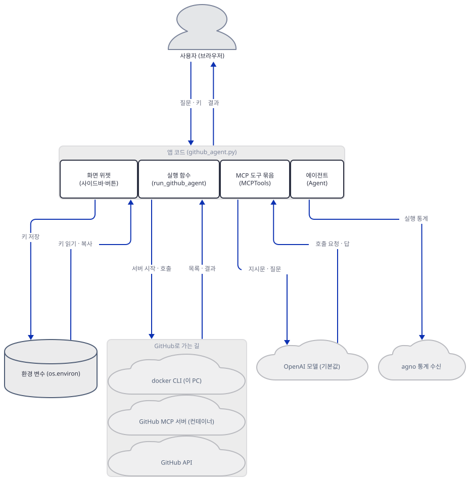

## 사전 준비

| 서비스/도구 | 용도 | 발급·설치 |
|---|---|---|
| uv | 가상환경 생성과 패키지 설치 | [공통 사전 준비](../README.md#공통-사전-준비-한-번만) 참고 |
| Python | 이 문서는 3.13.3으로 확인했다. 앱 README는 3.8 이상이라고 적는다 | 공통 사전 준비와 같음 |
| Docker | 진짜로 쓸 때 GitHub MCP 서버 이미지(`ghcr.io/github/github-mcp-server`)를 내려받아 컨테이너로 띄운다. 이 문서의 실습은 쓰지 않는다 | https://www.docker.com/get-started |
| OpenAI API 키 | 진짜로 쓸 때만 필요하다. 이 문서는 가짜 값 `sk-fake`로 진행한다 | https://platform.openai.com/api-keys |
| GitHub 토큰 | 진짜로 쓸 때만 필요하다. 앱 안내는 `repo` 범위이고, GitHub의 MCP 서버 README는 최소 범위로 `repo`·`read:packages`·`read:org`를 적는다(2026-10-14에 읽음). 이 문서는 가짜 값 `ghp_FAKE1234`로 진행한다 | https://github.com/settings/tokens |
| 터미널 둘 | 하나는 가짜 OpenAI 서버, 하나는 앱 | 별도 설치 없음 |

기본 모델이 설치 버전에 달린 만큼 종료 예정도 둘로 봅니다. OpenAI 폐기 문서(https://developers.openai.com/api/docs/deprecations, 2026-10-14 확인)에는 `gpt-5.4`가 없습니다(`gpt-5.4-nano`와 `gpt-5.4-cyber`만 있습니다). 하한 버전의 `gpt-4o`도 그 이름으로는 없고, 날짜가 붙은 스냅숏 `gpt-4o-2024-08-06`·`gpt-4o-2024-11-20`이 2027-01-14 종료로 올라 있습니다. 그래서 ⚠ 경고는 달지 않습니다.

## 아키텍처 한눈에 보기

| 컴포넌트 | 역할 | 코드 위치 |
|---|---|---|
| 사이드바 | 키 두 개를 받아 `os.environ`에 저장 | `mcp_ai_agents/github_mcp_agent/github_agent.py:15-44` |
| 저장소·질문 위젯 | 저장소, 질문 종류, 질문 글 | `mcp_ai_agents/github_mcp_agent/github_agent.py:46-64` |
| 실행 함수 (`run_github_agent`) | 키 확인, 서버 인자, 서버 연결, 에이전트 실행, 오류를 글로 돌려줌 | `mcp_ai_agents/github_mcp_agent/github_agent.py:66-109` |
| 서버 인자 | `docker run -i --rm -e ...`와 환경 | `mcp_ai_agents/github_mcp_agent/github_agent.py:74-87` |
| MCP 도구 묶음 (`MCPTools`) | `async with`로 서버에 연결하고 도구 목록을 얻음 | `mcp_ai_agents/github_mcp_agent/github_agent.py:89` |
| 에이전트 (`Agent`) | 지시문과 도구를 쥐고 120초 안에 답을 만듦 | `mcp_ai_agents/github_mcp_agent/github_agent.py:90-104` |
| 실행 버튼 | 빈 칸 검사, 질문 만들기, 결과 표시 | `mcp_ai_agents/github_mcp_agent/github_agent.py:111-128` |
| 안내 상자 | 결과가 없을 때 쓰는 법을 보여 줌 | `mcp_ai_agents/github_mcp_agent/github_agent.py:130-150` |
| docker CLI와 GitHub MCP 서버 | 앱 밖 프로세스. 서버가 GitHub API를 부름 | 코드 없음 (외부 이미지) |

앱 코드의 연결은 두 곳입니다. 서버 쪽은 `docker` 프로세스의 표준 입출력이고, 모델 쪽은 `Agent`가 기본 모델을 부르는 것입니다. 앱에 `requests`·`httpx` 같은 직접 호출은 없습니다. 아래 두 그림은 앱 안의 호출과 서버 쪽 사슬입니다. docker 데몬은 그리지 않았고, 서버가 GitHub를 부르는 화살표는 GitHub의 README를 읽은 것이지 실행해 본 것이 아닙니다.

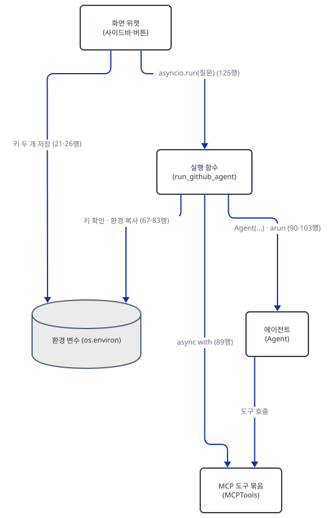

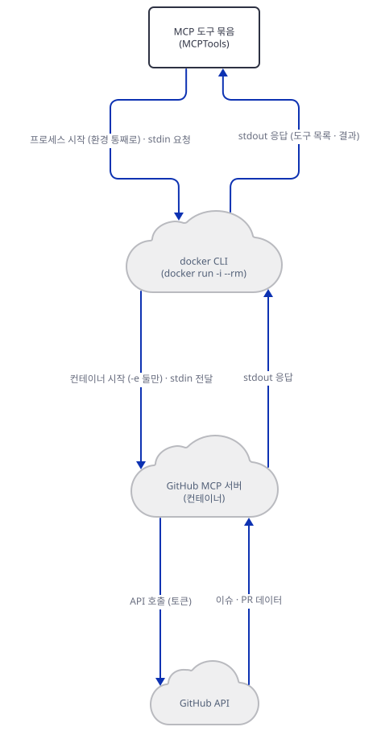

## 단계별 진행

### Step 1. 환경 만들기 — `requirements.txt`만으로는 `fastmcp`가 빠집니다

**목적.** 원본을 건드리지 않도록 복사본과 가상환경을 만들고, 이 앱이 무엇을 설치하는지 봅니다.

**할 일.** `<저장소>`는 이 저장소를 받은 경로입니다.

```bash
mkdir github-lab
cd github-lab
cp <저장소>/mcp_ai_agents/github_mcp_agent/github_agent.py .
cp <저장소>/mcp_ai_agents/github_mcp_agent/requirements.txt .
uv venv
uv pip install -r requirements.txt
```

(pip 대안: `python -m venv .venv`로 만들고 활성화한 뒤 `pip install -r requirements.txt`.) 아래 PowerShell 줄은 실행해 보지 못했습니다(이 문서를 쓴 하네스가 PowerShell 실행을 막습니다).

```powershell
mkdir github-lab
cd github-lab
Copy-Item <저장소>\mcp_ai_agents\github_mcp_agent\github_agent.py .
Copy-Item <저장소>\mcp_ai_agents\github_mcp_agent\requirements.txt .
uv venv
uv pip install -r requirements.txt
```

이 저장소는 루트에 `pyproject.toml`이 있어 저장소 안에서 `uv run`은 루트 환경을 쓰려 하므로, 이후 `uv run`에는 모두 `--no-project`를 붙입니다. 의존성은 네 줄입니다.

`mcp_ai_agents/github_mcp_agent/requirements.txt:1-4`

```text
streamlit>=1.28.0
agno>=2.2.10
mcp>=0.1.0
openai>=1.0.0
```

**확인.**

```bash
uv run --no-project python -m py_compile github_agent.py && echo compiled
uv run --no-project python -c "import agno.tools.mcp; print('agno.tools.mcp ok')"
uv run --no-project python -c "import fastmcp"
```

(PowerShell 5.1에는 `&&`가 없으므로 첫 줄은 `uv run --no-project python -m py_compile github_agent.py; if ($?) { echo compiled }`로 씁니다. 실행해 보지 못했습니다.)

직접 확인한 결과입니다. 2026-10-14에 78개가 설치됐고 agno 3.1.3, mcp 2.3.0, openai 3.31.0, streamlit 1.65.0이 풀렸습니다. 세 줄은 이렇게 끝납니다.

```text
compiled
agno.tools.mcp ok
ModuleNotFoundError: No module named 'fastmcp'
```

agno 3.1.3의 `MCPTools`는 연결을 `fastmcp`로 만듭니다. 설치된 agno의 메타데이터에서 `fastmcp<5,>=4.0.0`은 `mcp` 추가 항목(`agno[mcp]`) 뒤에만 있고, 앱의 `agno>=2.2.10`에는 그 항목이 없으므로 `fastmcp`는 들어오지 않습니다. `agno.tools.mcp`를 불러오는 것은 `mcp`만 있으면 되기 때문에 두 번째 줄은 통과하고, 빠진 것은 서버에 연결하는 순간에야 드러납니다(Step 4).

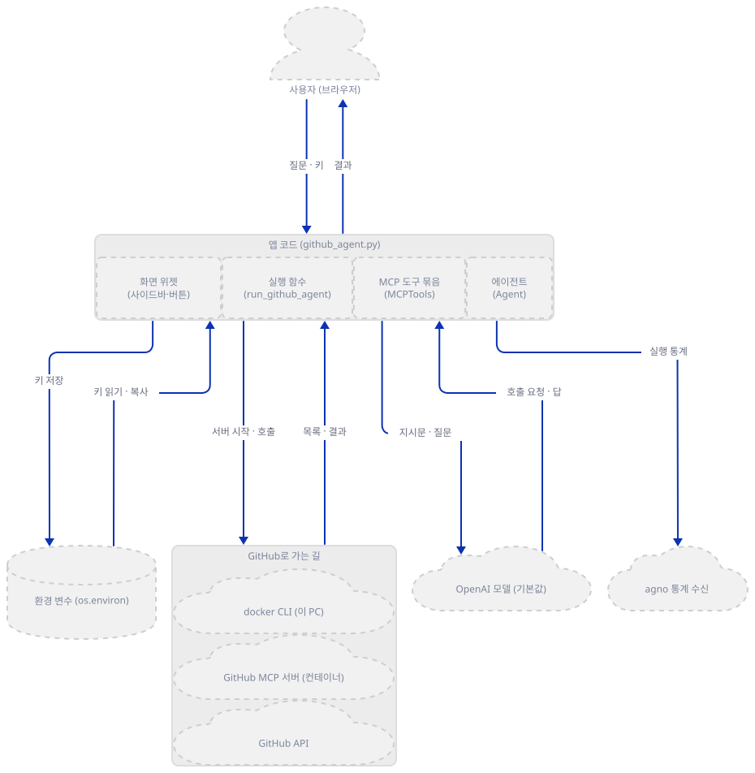

### Step 2. 화면과 키 — 키는 프로세스 환경 변수로 들어갑니다

**목적.** 사이드바가 키를 어디에 두는지, 질문 글이 어떻게 만들어지는지 봅니다.

**할 일.**

`mcp_ai_agents/github_mcp_agent/github_agent.py:15-26`

```python
with st.sidebar:
    st.header("🔑 Authentication")

    openai_key = st.text_input("OpenAI API Key", type="password",
                              help="Required for the AI agent to interpret queries and format results")
    if openai_key:
        os.environ["OPENAI_API_KEY"] = openai_key

    github_token = st.text_input("GitHub Token", type="password",
                                help="Create a token with repo scope at github.com/settings/tokens")
    if github_token:
        os.environ["GITHUB_TOKEN"] = github_token
```

입력 칸의 값을 `os.environ`에 씁니다. 화면이 다시 그려질 때마다 이 줄이 돌므로, 키는 이 Streamlit 프로세스의 환경에 계속 남습니다(소스로 확인). 같은 서버에 붙은 다른 세션도 같은 프로세스의 환경을 봅니다. 질문 칸은 이렇게 채워집니다.

`mcp_ai_agents/github_mcp_agent/github_agent.py:54-64`

```python
if query_type == "Issues":
    query_template = f"Find issues labeled as bugs in {repo}"
elif query_type == "Pull Requests":
    query_template = f"Show me recent merged PRs in {repo}"
elif query_type == "Repository Activity":
    query_template = f"Analyze code quality trends in {repo}"
else:
    query_template = ""

query = st.text_area("Your Query", value=query_template,
                     placeholder="What would you like to know about this repository?")
```

질문 종류를 고르면 칸의 기본값이 바뀝니다. "Repository Activity"는 사이드바 예시("activity patterns")와 달리 "Analyze code quality trends"로 채워집니다.

**확인.**

```bash
grep -n "os.environ" github_agent.py
```

(PowerShell: `Select-String -Pattern "os.environ" github_agent.py`. 실행해 보지 못했습니다.)

```text
21:        os.environ["OPENAI_API_KEY"] = openai_key
26:        os.environ["GITHUB_TOKEN"] = github_token
83:                **os.environ,
```

83행은 Step 4의 서버 환경입니다. 화면이 실제로 어떻게 반응하는지는 Step 7에서 봅니다.

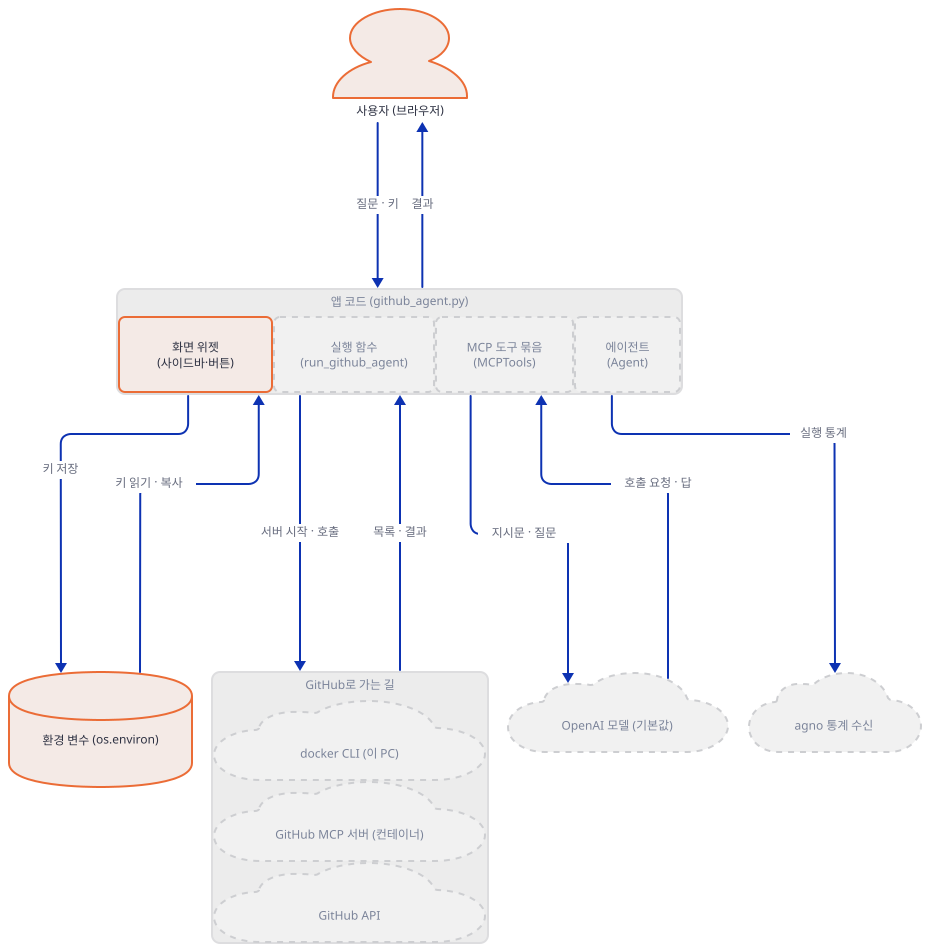

### Step 3. 가짜 서버 셋 놓기 — 진짜 docker·GitHub·OpenAI 없이

**목적.** 이 앱이 부르는 바깥 셋을 내 PC의 파이썬 파일로 바꿉니다. 이 단계가 끝나기 전에는 앱을 한 번도 돌리지 않습니다.

**할 일.** 먼저 가짜 GitHub MCP 서버입니다. 도구 이름 셋(`list_issues`·`list_pull_requests`·`get_file_contents`)과 `list_issues`의 인자 이름은 GitHub의 MCP 서버 README에서 읽은 것(2026-10-14)이고, 응답 글과 나머지 모양은 내가 지은 것입니다. 진짜 서버의 응답은 모릅니다. `shim` 폴더에 `fake_github_mcp.py`로 저장합니다.

```python
"""내 PC에서만 도는 가짜 GitHub MCP 서버. 진짜 github-mcp-server가 아니라 아래 대본을 돌려준다."""
import os
import sys
from datetime import datetime

from mcp.server.mcpserver import MCPServer

LOG = os.environ.get("FAKE_LOG", "fake.log")


def log(msg):
    with open(LOG, "a", encoding="utf-8") as f:
        f.write(f"{datetime.now():%H:%M:%S} [mcp] {msg}\n")


server = MCPServer("fake-github")


@server.tool(structured_output=False)
def list_issues(owner: str, repo: str, state: str = "OPEN", labels: list[str] | None = None, perPage: int = 30) -> str:
    """Fake issue list (a script)."""
    log(f"call list_issues owner={owner} repo={repo} state={state} labels={labels} perPage={perPage}")
    return "#101 [bug] fake issue one\n#102 [bug] fake issue two"


@server.tool(structured_output=False)
def list_pull_requests(owner: str, repo: str, state: str = "open", perPage: int = 30) -> str:
    """Fake pull request list (a script)."""
    log(f"call list_pull_requests owner={owner} repo={repo} state={state}")
    return "#201 fake PR (merged)"


@server.tool(structured_output=False)
def get_file_contents(owner: str, repo: str, path: str = "/") -> str:
    """Fake file contents (a script)."""
    log(f"call get_file_contents owner={owner} repo={repo} path={path}")
    return "fake file"


log("server started")
server.run(transport="stdio")
```

둘째는 가짜 `docker`입니다. 받은 인자와 환경을 `fake.log`에 적고 가짜 MCP 서버를 같은 프로세스에서 돌립니다. 키 값은 적지 않고 있는지만 적습니다. `shim/docker_shim.py`:

```python
"""진짜 docker 대신 PATH 맨 앞에 둘 가짜 'docker'. 받은 인자와 환경을 적고 가짜 MCP 서버를 같은 프로세스에서 돌린다."""
import os
import runpy
import sys
import time
from datetime import datetime

env = os.environ
with open(env.get("FAKE_LOG", "fake.log"), "a", encoding="utf-8") as f:
    f.write(f"{datetime.now():%H:%M:%S} [docker] argv={sys.argv[1:]}\n")
    f.write(f"  env keys: {len(env)}\n")
    for name in ("GITHUB_PERSONAL_ACCESS_TOKEN", "GITHUB_TOKEN", "OPENAI_API_KEY"):   # 값은 적지 않고 있는지만
        f.write(f"  {name}: {'set' if name in env else 'unset'}\n")
    f.write(f"  PAT == GITHUB_TOKEN: {env.get('GITHUB_PERSONAL_ACCESS_TOKEN') == env.get('GITHUB_TOKEN')}\n")
    f.write(f"  GITHUB_TOOLSETS = {env.get('GITHUB_TOOLSETS')!r}\n")
if env.get("FAKE_DOCKER_FAIL"):                       # 연습용: docker가 곧바로 실패하는 경우
    sys.stderr.write(env["FAKE_DOCKER_FAIL"] + "\n")
    sys.exit(1)
time.sleep(float(env.get("FAKE_START_DELAY", "0")))   # 연습용: 이미지를 내려받느라 늦게 뜨는 경우
runpy.run_path(os.path.join(os.path.dirname(os.path.abspath(__file__)), "fake_github_mcp.py"), run_name="__main__")
```

앱은 `docker`라는 이름을 PATH에서 찾으므로, 같은 폴더에 실행 파일 이름 `docker`를 만듭니다. Windows는 `shim/docker.cmd`, macOS·Linux는 `shim/docker`(`chmod +x shim/docker`)입니다. 둘 다 `github-lab/.venv`의 파이썬으로 위 파일을 돌립니다. POSIX 쪽은 실행해 보지 못했습니다.

```bat
@"%~dp0..\.venv\Scripts\python.exe" "%~dp0docker_shim.py" %*
```

```sh
#!/bin/sh
exec "$(dirname "$0")/../.venv/bin/python" "$(dirname "$0")/docker_shim.py" "$@"
```

셋째는 가짜 OpenAI 서버입니다. Responses API 한 곳(`/v1/responses`)에 첫 호출에는 `list_issues`를 부르라고, 도구 결과가 돌아온 둘째 호출에는 글을 답합니다. `fake_openai.py`:

```python
"""내 PC에서만 도는 가짜 OpenAI 서버. Responses API(/v1/responses) 한 곳만 대본대로 답한다."""
import json
import os
import sys
import time
from http.server import BaseHTTPRequestHandler, HTTPServer

PORT = int(sys.argv[1])
LOG = sys.argv[2]


def log(msg):
    with open(LOG, "a", encoding="utf-8") as f:
        f.write(f"{time.strftime('%H:%M:%S')} {msg}\n")


class Handler(BaseHTTPRequestHandler):
    def log_message(self, *args):
        pass

    def do_POST(self):
        body = json.loads(self.rfile.read(int(self.headers.get("content-length", 0))) or b"{}")
        items = body.get("input", [])
        kinds = [i.get("type") or i.get("role") for i in items]
        user = [i["content"] for i in items if i.get("role") == "user"]
        tools = [t.get("name") for t in body.get("tools", [])]
        log(f"POST {self.path} model={body.get('model')} auth={self.headers.get('authorization', '')[:9]}... "
            f"input={kinds} prev={body.get('previous_response_id')} store={body.get('store')} user={user} tools={tools}")
        time.sleep(float(os.environ.get("FAKE_DELAY", "0")))                # 연습용: 모델이 느린 경우
        status = int(os.environ.get("FAKE_STATUS", "200"))                      # 연습용: 모델 API가 오류를 돌려주는 경우
        if status != 200:
            data = json.dumps({"error": {"message": "fake error", "type": "fake", "code": "fake"}}).encode()
            self.send_response(status)
            self.send_header("content-type", "application/json")
            self.send_header("content-length", str(len(data)))
            self.end_headers()
            self.wfile.write(data)
            return
        if self.path != "/v1/responses":
            self.send_response(404)
            self.end_headers()
            return
        if any(i.get("type") == "function_call_output" for i in items):      # 도구 결과가 돌아온 두 번째 호출
            out = [{"type": "message", "id": "msg_1", "role": "assistant", "status": "completed",
                    "content": [{"type": "output_text", "annotations": [],
                                 "text": "FAKE ANSWER: two bug issues, #101 and #102 (a script, not a model)"}]}]
        else:                                                                 # 첫 호출: list_issues를 부르라고 답한다
            args = {"owner": "Shubhamsaboo", "repo": "awesome-llm-apps", "labels": ["bug"]}
            out = [{"type": "function_call", "id": "fc_1", "call_id": "call_1", "name": "list_issues",
                    "status": "completed", "arguments": json.dumps(args)}]
        resp = {"id": "resp_1", "object": "response", "created_at": int(time.time()), "status": "completed",
                "model": body.get("model"), "output": out, "parallel_tool_calls": True, "tool_choice": "auto",
                "tools": [], "usage": {"input_tokens": 10, "output_tokens": 5, "total_tokens": 15,
                                       "input_tokens_details": {"cached_tokens": 0},
                                       "output_tokens_details": {"reasoning_tokens": 0}}}
        data = json.dumps(resp).encode()
        self.send_response(200)
        self.send_header("content-type", "application/json")
        self.send_header("content-length", str(len(data)))
        self.end_headers()
        self.wfile.write(data)


class Server(HTTPServer):
    allow_reuse_address = False


log(f"listening 127.0.0.1:{PORT}")
Server(("127.0.0.1", PORT), Handler).serve_forever()
```

마지막은 앱을 스트림릿 밖에서 불러 실행 함수만 한 번 돌리는 `drive.py`입니다. 불러오기만으로 화면 호출이 경고를 쏟아내므로 숨깁니다.

```python
"""앱을 스트림릿 밖에서 불러 run_github_agent를 한 번 돌린다. 화면 호출이 쏟아내는 경고는 숨긴다."""
import asyncio
import logging
import time

logging.disable(logging.WARNING)        # 스트림릿 밖에서 불러서 생기는 경고 수십 줄을 숨긴다
import github_agent as app  # noqa: E402

started = time.time()
answer = asyncio.run(app.run_github_agent("Find issues labeled as bugs in Shubhamsaboo/awesome-llm-apps"))
print(f"{time.time() - started:.1f}s", answer)
```

이제 환경을 맞춥니다. 터미널 하나에서 가짜 OpenAI 서버를 띄웁니다. 포트는 49152~65535에서 아무 번호나 쓰고 이미 쓰이면 바꿉니다.

```bash
uv run --no-project python fake_openai.py 54321 fake_openai.log
```

다른 터미널(앱을 돌릴 터미널)에서는 아래를 모두 설정합니다. 가짜 `docker`가 진짜 docker보다 앞서도록 `shim`을 PATH 맨 앞에 두는 줄과, 모델 주소를 가짜 서버로 돌리는 줄이 중요합니다.

```bash
export PATH="$PWD/shim:$PATH"
export OPENAI_API_KEY=sk-fake GITHUB_TOKEN=ghp_FAKE1234
export OPENAI_BASE_URL=http://127.0.0.1:54321/v1
export AGNO_TELEMETRY=false
export FAKE_LOG="$PWD/fake.log"
```

```powershell
$env:PATH = "$PWD\shim;$env:PATH"
$env:OPENAI_API_KEY = "sk-fake"; $env:GITHUB_TOKEN = "ghp_FAKE1234"
$env:OPENAI_BASE_URL = "http://127.0.0.1:54321/v1"
$env:AGNO_TELEMETRY = "false"
$env:FAKE_LOG = "$PWD\fake.log"
```

PowerShell 줄은 실행해 보지 못했습니다. `AGNO_TELEMETRY=false`는 Step 6에서 다룰 agno의 익명 통계를 막습니다.

**확인.** 앱을 돌리기 전에 이 셋이 맞는지 봅니다.

```bash
command -v docker
echo "$OPENAI_BASE_URL"
cat fake_openai.log
```

`docker`가 `shim` 안의 파일을 가리키고, 주소가 `127.0.0.1`이고, 로그에 `listening 127.0.0.1:54321`이 있어야 합니다. 하나라도 어긋나면 멈춥니다. PowerShell에서는 `Get-Command docker`, `$env:OPENAI_BASE_URL`, `Get-Content fake_openai.log`입니다(실행해 보지 못했습니다). 직접 확인한 결과는 이 순서로 `.../shim/docker`, `http://127.0.0.1:54321/v1`, `listening 127.0.0.1:54321`이었습니다.

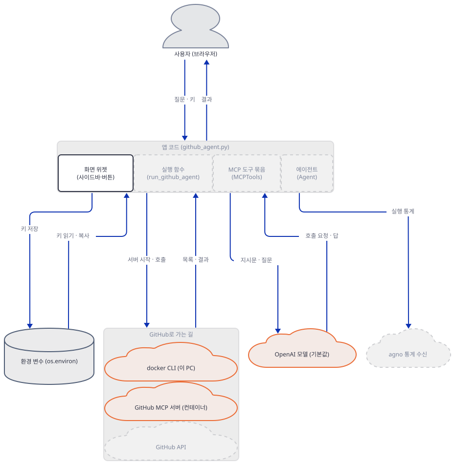

### Step 4. 서버를 띄우는 순간 — `async with`에서 연결됩니다

**목적.** 서버 인자와 환경이 어디까지 가는지, 서버가 언제 뜨는지 봅니다.

**할 일.** 실행 함수의 앞부분입니다.

`mcp_ai_agents/github_mcp_agent/github_agent.py:66-87`

```python
async def run_github_agent(message):
    if not os.getenv("GITHUB_TOKEN"):
        return "Error: GitHub token not provided"

    if not os.getenv("OPENAI_API_KEY"):
        return "Error: OpenAI API key not provided"

    try:
        server_params = StdioServerParameters(
            command="docker",
            args=[
                "run", "-i", "--rm",
                "-e", "GITHUB_PERSONAL_ACCESS_TOKEN",
                "-e", "GITHUB_TOOLSETS",
                "ghcr.io/github/github-mcp-server"
            ],
            env={
                **os.environ,
                "GITHUB_PERSONAL_ACCESS_TOKEN": os.getenv('GITHUB_TOKEN'),
                "GITHUB_TOOLSETS": "repos,issues,pull_requests"
            }
        )
```

`-e GITHUB_PERSONAL_ACCESS_TOKEN`처럼 값 없이 이름만 주면, Docker 문서(`docker container run` 참고서, 2026-10-14)는 "the Docker CLI client checks the value the variable has in your local environment"라고 합니다. 값이 명령줄에 실리지 않고 docker 프로세스의 환경에서 컨테이너로 건너갑니다. 그런데 `env=`는 `os.environ` 전체에 토큰과 툴셋 둘을 얹은 것이라 docker 프로세스는 셸의 모든 변수를 받습니다. `OPENAI_API_KEY`도 그 안에 있습니다. `mcp`는 `env=`를 따로 주면 `PATH` 같은 안전한 몇 개만 물려주도록 되어 있어서(`mcp` 2.3.0의 `get_default_environment`를 소스로 확인) 전부 넘기는 것은 앱이 `**os.environ`을 직접 넣었기 때문입니다. 컨테이너에는 `-e`로 이름을 준 둘만 들어가는 것이 `docker run`의 정의지만, 이 문서는 진짜 docker를 실행하지 않아 컨테이너 안의 환경은 보지 못했습니다. `GITHUB_TOOLSETS`는 GitHub README가 `--toolsets`의 환경 변수판이라고 적는 값이고, 기본값(`context`·`repos`·`issues`·`pull_requests`·`users`)에서 `context`와 `users`가 빠집니다.

서버는 89행의 `async with MCPTools(server_params=server_params) as mcp_tools:`에서 뜹니다. `MCPTools(...)`를 만드는 것으로는 아무것도 실행되지 않고, `async with`에 들어가면서 연결이 만들어집니다(agno 3.1.3의 `MCPTools._connect`를 소스로 확인).

**확인.** 먼저 `fastmcp`가 없는 상태로 한 번 돌립니다.

```bash
uv run --no-project python drive.py
ls fake.log
```

```text
0.0s Error: `fastmcp` not installed. MCPTools builds its connections with it. Please install using `pip install 'fastmcp>=4.0.0,<5'`
ls: cannot access 'fake.log': No such file or directory
```

앱의 `except Exception`이 오류를 글로 돌려주고, `fake.log`가 없으므로 `docker`(가짜)도 불리지 않았습니다. 여기에 29개가 더 설치됩니다(`fastmcp` 4.1.0). 다시 돌립니다.

```bash
uv pip install "fastmcp>=4.0.0,<5"
uv run --no-project python drive.py
cat fake.log
```

```text
2.7s FAKE ANSWER: two bug issues, #101 and #102 (a script, not a model)
22:20:39 [docker] argv=['run', '-i', '--rm', '-e', 'GITHUB_PERSONAL_ACCESS_TOKEN', '-e', 'GITHUB_TOOLSETS', 'ghcr.io/github/github-mcp-server']
  env keys: 115
  GITHUB_PERSONAL_ACCESS_TOKEN: set
  GITHUB_TOKEN: set
  OPENAI_API_KEY: set
  PAT == GITHUB_TOKEN: True
  GITHUB_TOOLSETS = 'repos,issues,pull_requests'
22:20:40 [mcp] server started
22:20:41 [mcp] call list_issues owner=Shubhamsaboo repo=awesome-llm-apps state=OPEN labels=['bug'] perPage=30
```

인자에 토큰이 없고, 환경 키가 115개이며(내 셸 기준이고 독자 PC에서는 다릅니다), `OPENAI_API_KEY`와 `GITHUB_TOKEN`이 둘 다 docker 프로세스에 도착했습니다.

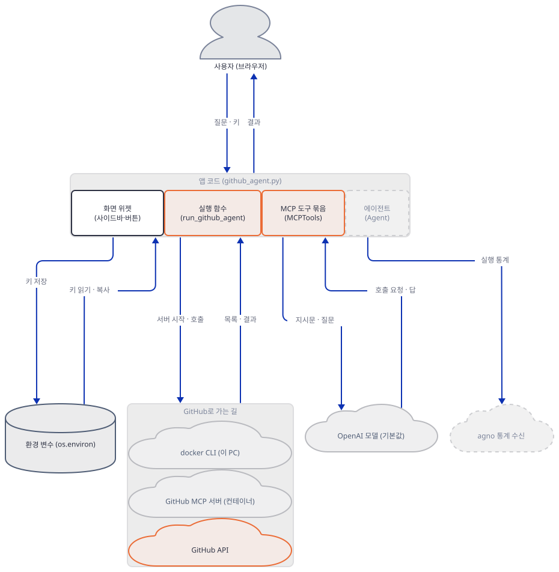

### Step 5. 에이전트와 기본 모델 — `model=`이 없습니다

**목적.** `Agent`가 어떤 모델을 쓰는지, 지시문이 어떻게 가는지 봅니다.

**할 일.**

`mcp_ai_agents/github_mcp_agent/github_agent.py:90-104`

```python
            agent = Agent(
                tools=[mcp_tools],
                instructions=dedent("""\
                    You are a GitHub assistant. Help users explore repositories and their activity.
                    - Provide organized, concise insights about the repository
                    - Focus on facts and data from the GitHub API
                    - Use markdown formatting for better readability
                    - Present numerical data in tables when appropriate
                    - Include links to relevant GitHub pages when helpful
                """),
                markdown=True,
            )

            response: RunOutput = await asyncio.wait_for(agent.arun(message), timeout=120.0)
            return response.content
```

`Agent(...)`에 `model`이 없습니다. 모델이 비어 있으면 agno가 채웁니다. 설치된 agno 3.1.3의 `set_default_model`(`agent/_init.py`)은 이렇습니다.

```python
def set_default_model(agent: Agent) -> None:
    # Use the default Model (OpenAIResponses) if no model is provided
    if agent.model is None:
        ...
        log_info("Setting default model to OpenAI Responses")
        agent.model = OpenAIResponses(id="gpt-5.4")
```

하한인 2.2.10에서 같은 자리(`agent/agent.py` 718-719행)는 `OpenAIChat(id="gpt-4o")`입니다(PyPI의 2.2.10을 따로 내려받아 소스로 확인). 앱은 `base_url`을 넘기지 않으므로 OpenAI 라이브러리가 `OPENAI_BASE_URL`을 따릅니다. 아래 로그가 그 증거입니다.

**확인.** Step 4의 같은 실행이 가짜 OpenAI 서버에 남긴 기록입니다.

```bash
cat fake_openai.log
```

```text
22:20:41 POST /v1/responses model=gpt-5.4 auth=Bearer sk... input=['developer', 'user'] prev=None store=True user=['Find issues labeled as bugs in Shubhamsaboo/awesome-llm-apps'] tools=['get_file_contents', 'list_issues', 'list_pull_requests']
22:20:41 POST /v1/responses model=gpt-5.4 auth=Bearer sk... input=['function_call_output'] prev=resp_1 store=True user=[] tools=['get_file_contents', 'list_issues', 'list_pull_requests']
```

모델 호출은 두 번입니다. 첫 호출에는 지시문(`developer` 역할)과 질문이 가고, MCP 서버에서 받은 도구(가짜 서버의 셋)가 `tools`로 선언됩니다. 둘째 호출은 도구 결과(`function_call_output`)만 보내고 앞 응답을 `previous_response_id`로 잇습니다. 요청에는 `store=True`가 실려 갑니다(관찰한 값이며 OpenAI 쪽에서 무슨 뜻인지는 확인하지 않았습니다).

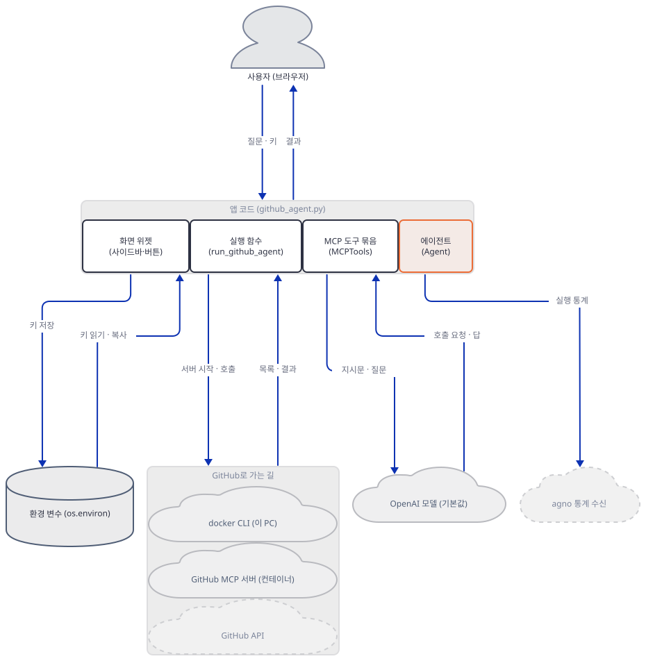

### Step 6. 끝나는 길 다섯과 agno의 통계

**목적.** 오류가 화면에 어떤 글로 나오는지, 120초가 무엇을 감싸는지, agno가 무엇을 보내는지 봅니다.

**할 일.** 실패는 모두 같은 자리에서 글이 됩니다.

`mcp_ai_agents/github_mcp_agent/github_agent.py:106-109`

```python
    except asyncio.TimeoutError:
        return "Error: Request timed out after 120 seconds"
    except Exception as e:
        return f"Error: {str(e)}"
```

`asyncio.wait_for(..., timeout=120.0)`는 103행에서 `agent.arun`만 감쌉니다. 서버 연결(89행)은 그 바깥이고, 연결에는 `MCPTools`의 `timeout_seconds` 기본값 10초가 `fastmcp` 클라이언트의 요청 제한이 됩니다(소스로 확인). 가짜 `docker`가 늦게 뜨거나 실패하게 해 봅니다.

**확인.** 앞의 셋은 앱 터미널에서 돌립니다. PowerShell에서는 `$env:FAKE_START_DELAY = "12"`처럼 먼저 설정하고 명령을 돌린 뒤 `Remove-Item Env:FAKE_START_DELAY`로 지웁니다(아래 `FAKE_DOCKER_FAIL`·`FAKE_DELAY`·`FAKE_STATUS`도 같고, 실행해 보지 못했습니다).

```bash
FAKE_START_DELAY=4 uv run --no-project python drive.py
FAKE_START_DELAY=12 uv run --no-project python drive.py
FAKE_DOCKER_FAIL="docker: Cannot connect to the Docker daemon (fake message)" uv run --no-project python drive.py
```

```text
6.7s FAKE ANSWER: two bug issues, #101 and #102 (a script, not a model)
12.6s Error: Request 'initialize' timed out
docker: Cannot connect to the Docker daemon (fake message)
0.7s Error: Connection closed
```

서버가 4초 늦게 뜨는 것은 통과하고 12초는 시간 초과입니다. 같은 하네스에서 8초는 통과(10.8초)하고 10초는 실패(12.3초)했습니다. 서버 자신이 뜨는 데 드는 1~2초가 이 열 안에 들어가므로 경계는 10초에서 조금 앞입니다. docker가 곧바로 실패하면 화면에는 `Connection closed`만 보이고, docker의 메시지는 Streamlit을 띄운 터미널에 나옵니다. `docker`가 PATH에 아예 없으면 이렇게 됩니다(Windows에서 본 글이고 다른 OS는 다릅니다).

```text
0.6s Error: Client failed to connect: [WinError 2] 지정된 파일을 찾을 수 없습니다
```

120초 쪽은 가짜 OpenAI를 한 대 더 띄워 130초 늦게 답하게 하고(`FAKE_DELAY`는 그 서버를 띄우는 터미널의 변수입니다), 모델 오류 쪽은 `401`로 답하게 합니다.

```bash
FAKE_DELAY=130 uv run --no-project python fake_openai.py 54323 slow.log
FAKE_STATUS=401 uv run --no-project python fake_openai.py 54324 s401.log
```

앱 터미널에서 `OPENAI_BASE_URL`을 `http://127.0.0.1:54323/v1`로 바꾸고 `uv run --no-project python drive.py`를 돌리면 122.3초 뒤 `Error: Request timed out after 120 seconds`가 나옵니다. 54324로 바꾸고 돌리면 이렇게 됩니다.

```text
ERROR   API status error from OpenAI API: Error code: 401 - {'error': {'message': 'fake error', 'type': 'fake', 'code': 'fake'}}
ERROR   Non-retryable model provider error: fake error
ERROR   Error in Agent run: fake error
2.5s fake error
```

모델 API의 오류는 예외가 되지 않습니다. 오류 문구가 `response.content`가 되어 `Error:` 접두사 없이 Results 자리에 나오고(본문이 없는 404에서는 빈 글이었습니다), 자세한 줄은 터미널에 `ERROR`로 찍힙니다. 진짜 OpenAI가 잘못된 키에 돌려주는 문구는 보지 못했습니다. 확인이 끝나면 `OPENAI_BASE_URL`을 54321로 되돌리고 추가한 서버 둘을 멈춥니다.

이제 agno의 통계입니다. Day 047의 Step 5가 다룬 agno의 익명 사용 통계가 이 앱에도 있습니다. `AGNO_TELEMETRY`를 정하지 않으면 `Agent`의 실행이 끝날 때 통계를 `os-api.agno.com`으로 보내려 합니다(소스로 확인). 보내는 자리를 가로채 내용만 찍는 `telemetry_peek.py`를 돌립니다. 이 파일은 아무 데도 보내지 않습니다.

```python
"""agno가 실행 뒤에 보내려는 통계를 보낼 자리에서 가로채 화면에 찍는다(실제로는 아무 데도 보내지 않는다)."""
import asyncio
import json
import logging

logging.disable(logging.WARNING)
import agno.api.api as agno_api

agno_api.api.post_in_background = lambda route, payload: print("TELEMETRY", route, json.dumps(payload))
import github_agent as app  # noqa: E402

print(asyncio.run(app.run_github_agent("Find issues labeled as bugs in Shubhamsaboo/awesome-llm-apps")))
```

```bash
unset AGNO_TELEMETRY
uv run --no-project python telemetry_peek.py
export AGNO_TELEMETRY=false
uv run --no-project python telemetry_peek.py
```

(PowerShell: `Remove-Item Env:AGNO_TELEMETRY`와 `$env:AGNO_TELEMETRY = "false"`. 실행해 보지 못했습니다.) 첫 실행에서 가로챈 내용은 이렇습니다.

```text
TELEMETRY /telemetry/runs {"session_id": "289d8d42-...", "run_id": "00ebb7cf-...", "data": {"agent_id": "bold-ohm-0dbe9734", "db_type": null, "model_provider": "OpenAI", "model_name": "OpenAIResponses", "model_id": "gpt-5.4", "parser_model": null, "output_model": null, "has_tools": true, "has_memory": false, "has_learnings": false, "has_reasoning": false, "has_knowledge": false, "has_input_schema": false, "has_output_schema": false, "has_team": false}, "sdk_version": "3.1.3", "type": "agent"}
FAKE ANSWER: two bug issues, #101 and #102 (a script, not a model)
```

질문 글과 저장소 이름은 들어 있지 않습니다. `AGNO_TELEMETRY=false`이면 `TELEMETRY` 줄이 나오지 않습니다.

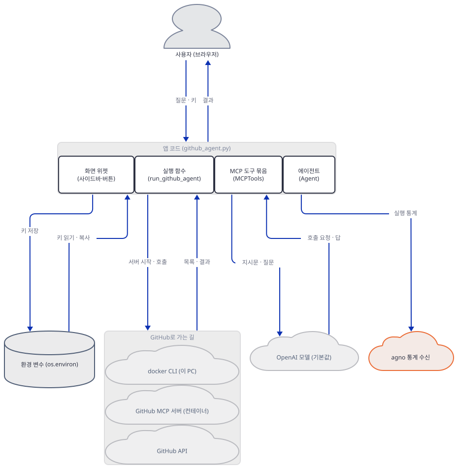

### Step 7. 화면으로 — 버튼 하나가 모든 것을 부릅니다

**목적.** 지금까지 본 흐름이 화면의 버튼 한 번에 이어지는 것과, 결과가 화면에 얼마나 오래 남는지 봅니다.

**할 일.**

`mcp_ai_agents/github_mcp_agent/github_agent.py:111-128`

```python
if st.button("🚀 Run Query", type="primary", use_container_width=True):
    if not openai_key:
        st.error("Please enter your OpenAI API key in the sidebar")
    elif not github_token:
        st.error("Please enter your GitHub token in the sidebar")
    elif not query:
        st.error("Please enter a query")
    else:
        with st.spinner("Analyzing GitHub repository..."):
            if repo and repo not in query:
                full_query = f"{query} in {repo}"
            else:
                full_query = query

            result = asyncio.run(run_github_agent(full_query))

        st.markdown("### Results")
        st.markdown(result)
```

검사는 위젯의 값으로 합니다(`os.environ`이 아닙니다). 질문에 저장소 이름이 없으면 ` in <저장소>`를 덧붙입니다. 실행 중에는 스피너가 돌고, `result`는 이 한 번의 실행 안에서만 정해지는 변수라 다음 실행(위젯을 건드릴 때마다)에는 없습니다. 브라우저로 직접 보려면 가짜 서버와 같은 환경에서 띄웁니다.

```bash
uv run --no-project streamlit run github_agent.py --server.headless true --server.address localhost --server.port 54322
```

브라우저에서 `http://localhost:54322`를 열고 사이드바에 가짜 키 둘을 넣어 **Run Query**를 누르면 됩니다. 이 문서는 브라우저를 열지 않고, 같은 클릭을 Streamlit의 `AppTest`로 대신했습니다. 템플릿 질문에는 저장소 이름이 이미 들어 있어 덧붙지 않습니다. `Custom`에서 "What PRs need review?"만 적으면 모델에는 `What PRs need review? in Shubhamsaboo/awesome-llm-apps`가 갑니다(`AppTest`로 돌린 실행에서 가짜 서버의 기록으로 확인). 아래 `ui_check.py`는 시나리오마다 새 앱을 만들어 키 칸을 채우고 버튼을 누릅니다.

```python
"""브라우저 대신 Streamlit의 AppTest로 같은 클릭을 한다. 시나리오마다 새 앱 인스턴스를 만든다."""
import logging
import os

from streamlit.testing.v1 import AppTest

logging.disable(logging.WARNING)

for name in ("OPENAI_API_KEY", "GITHUB_TOKEN"):
    os.environ.pop(name, None)


def new_app(openai_key="", github_token=""):
    at = AppTest.from_file("github_agent.py", default_timeout=60).run()
    box = {t.label: t for t in at.text_input}
    if openai_key:
        box["OpenAI API Key"].set_value(openai_key)
    if github_token:
        box["GitHub Token"].set_value(github_token)
    return at.run()


def has_results(at):
    return any(m.value.startswith("### Results") for m in at.markdown)


at = new_app()
at.button[0].click().run()
print("1) 키 둘 다 비움 ->", [e.value for e in at.error], "| Results:", has_results(at))

at = new_app("sk-fake")
at.button[0].click().run()
print("2) OpenAI 키만   ->", [e.value for e in at.error], "| Results:", has_results(at))
print("   os.environ에 남은 것:", "OPENAI_API_KEY" in os.environ, "GITHUB_TOKEN" in os.environ)

at = new_app("sk-fake", "ghp_FAKE1234")
at.button[0].click().run()
print("3) 키 둘 다      ->", [e.value for e in at.error], "| Results:", has_results(at))
at.selectbox[0].select("Pull Requests").run()
print("4) 선택 상자만 바꿈 | Results:", has_results(at), "| 질문 칸:", at.text_area[0].value)
```

**확인.**

```bash
uv run --no-project python ui_check.py
```

```text
1) 키 둘 다 비움 -> ['Please enter your OpenAI API key in the sidebar'] | Results: False
2) OpenAI 키만   -> ['Please enter your GitHub token in the sidebar'] | Results: False
   os.environ에 남은 것: True False
INFO    Setting default model to OpenAI Responses
3) 키 둘 다      -> [] | Results: True
4) 선택 상자만 바꿈 | Results: False | 질문 칸: Show me recent merged PRs in Shubhamsaboo/awesome-llm-apps
```

둘째 줄에서 OpenAI 키만 넣고 눌러도 `os.environ`에는 이미 그 키가 들어가 있습니다(앱이 검사보다 먼저 저장합니다). 넷째 줄은 선택 상자만 바꿔도 결과가 사라지고 질문 칸이 새 기본값으로 바뀌는 것을 보입니다. `streamlit run`으로 띄운 서버가 `localhost`에서 `/_stcore/health`에 `ok`로 답하는 것도 확인했습니다. 끝나면 Streamlit과 가짜 OpenAI 서버를 멈춥니다.

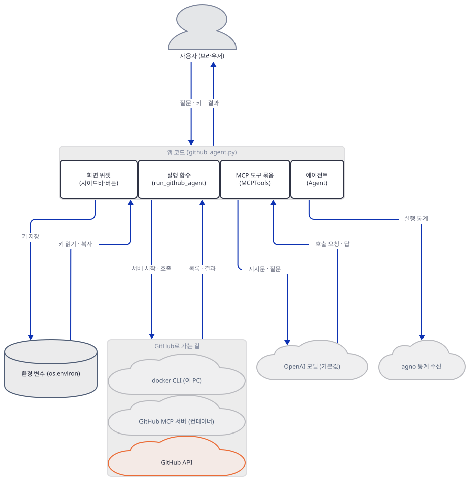

## 요청 한 건이 흐르는 과정

버튼을 누른 순간부터 서버가 뜨고 도구 목록을 받기까지입니다. 서버와의 표준 입출력은 `docker run -i`가 이어 주므로(Docker 문서: `-i`는 컨테이너의 STDIN을 열어 둡니다) 메시지가 docker CLI를 한 번씩 지나는 것으로 그렸습니다. `github_agent.py` 위의 자기 화살표는 모두 그 파일 안의 일입니다.

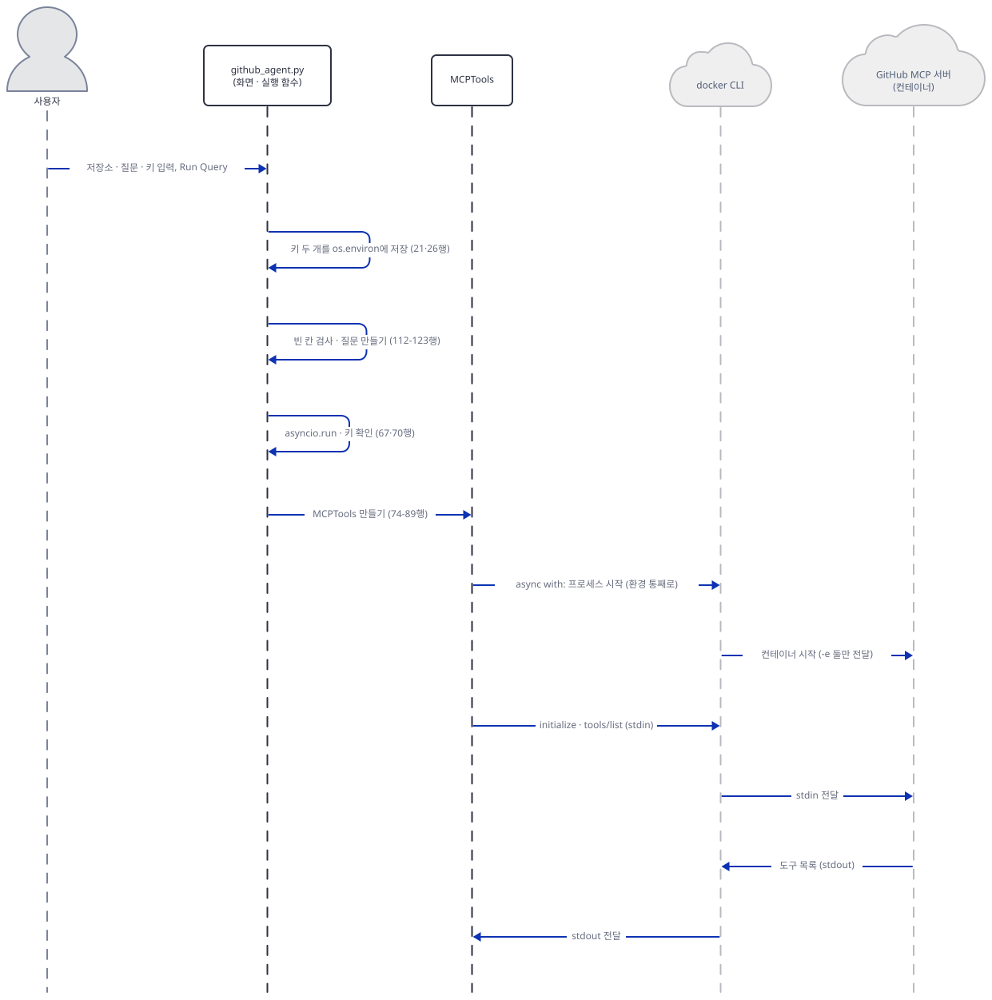

이어서 `Agent`를 만들고 모델에게 묻는 부분입니다. 모델이 도구를 몇 번 부를지는 모델이 정하며, 이 그림은 한 번 부르는 경우(가짜 서버의 대본)입니다.

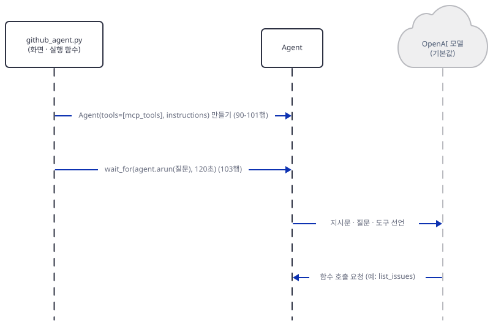

도구 호출 하나가 서버와 GitHub를 지나 돌아오는 길입니다. GitHub API를 부르는 두 화살표는 GitHub README를 읽은 것이고 이 문서는 지나 보지 못했습니다(가짜 서버는 대본만 돌려줍니다).

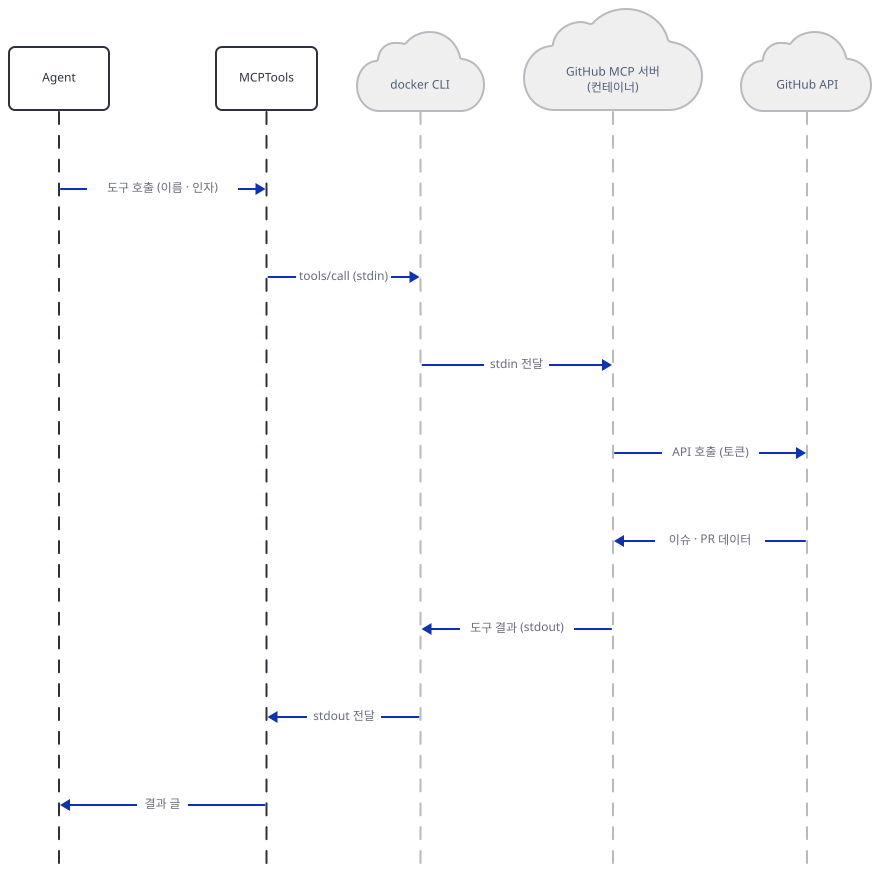

도구 결과를 받은 모델이 최종 글을 쓰고, agno가 통계를 큐에 올립니다(`AGNO_TELEMETRY=false`이면 이 화살표는 없습니다).

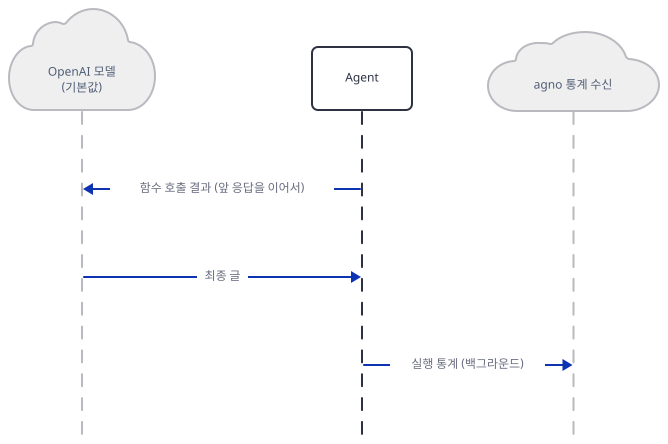

마지막으로 `async with`를 나가며 연결을 닫고 결과가 화면에 찍힙니다. 가짜 서버로는 서버 프로세스가 사라지는 것까지 봤고, 진짜 docker 컨테이너가 어떻게 끝나는지는 보지 못했습니다.

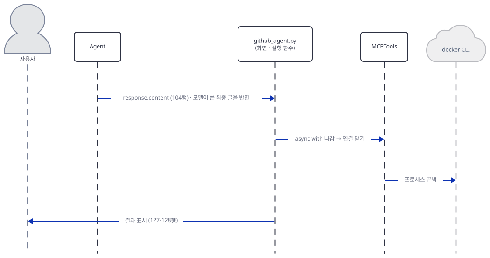

## 실행 체크리스트

- [ ] `uv pip install -r requirements.txt`에 이어 `fastmcp>=4.0.0,<5`를 설치했다 (`import fastmcp`가 됨)
- [ ] 가짜 OpenAI 서버가 `listening 127.0.0.1:<포트>`를 찍었다
- [ ] 앱 터미널에서 `command -v docker`가 `shim` 안을 가리키고, `OPENAI_BASE_URL`이 `127.0.0.1`이다
- [ ] `AGNO_TELEMETRY=false`와 가짜 키만 설정했다
- [ ] `drive.py`가 `FAKE ANSWER ...`를 찍고 `fake.log`에 `argv=['run', '-i', '--rm', ...]`가 남았다
- [ ] `fake_openai.log`에 `model=gpt-5.4`(또는 설치한 agno의 기본 모델)와 `store=True`가 보인다
- [ ] 서버를 12초 늦게 띄우면 `Request 'initialize' timed out`이 나온다
- [ ] 가짜 OpenAI가 401을 주면 Results 자리에 오류 문구가 나온다
- [ ] 띄운 가짜 서버와 Streamlit을 모두 멈췄고 포트가 비었다

## 문제 해결

| 증상 | 원인 | 해결 |
|---|---|---|
| 화면에 ``Error: `fastmcp` not installed. ...`` | `requirements.txt`가 `fastmcp`를 설치하지 않는다. agno 3.1.3의 `MCPTools`가 요구한다 (Step 1·4) | `uv pip install "fastmcp>=4.0.0,<5"` |
| `Error: Request 'initialize' timed out` | 서버가 약 10초 안에 첫 답을 못 한다 (`MCPTools`의 `timeout_seconds` 기본값). 가짜 서버로 재현했고, 진짜 docker라면 첫 실행의 이미지 내려받기가 늦는 흔한 원인이라고 짐작하지만 보지는 못했다 | 먼저 터미널에서 `docker pull ghcr.io/github/github-mcp-server`로 이미지를 받아 두고 다시 누른다(실행해 보지 못했다). 앱에서는 `MCPTools(..., timeout_seconds=...)`로 늘릴 수 있는지 시험한다(더 해보기) |
| `Error: Connection closed` | docker가 시작하자마자 끝났다. 가짜 `docker`가 1로 끝나게 해서 재현했다. 메시지는 앱을 띄운 터미널에 나온다 | 그 터미널의 docker 메시지를 읽는다. 데몬이 떠 있는지 본다 |
| `Error: Client failed to connect: ...` (Windows는 `[WinError 2]`) | PATH에 `docker`가 없다 | Docker를 설치하거나 PATH를 고친다. 이 문서의 실습이라면 `shim`이 PATH 맨 앞에 있는지 본다 |
| `Error: Request timed out after 120 seconds` | `agent.arun`이 120초 안에 끝나지 않았다 (103행) | 질문을 좁힌다. 연결 단계의 시간 초과와는 다른 글이다 |
| Results 자리에 `fake error` 같은 문구가 나오거나 빈 글이다 | 모델 API의 오류는 예외가 아니라 `response.content`가 된다. 가짜 서버의 401은 오류 문구가, 본문 없는 404는 빈 글이 되었고 터미널에는 `ERROR` 줄이 찍혔다 (Step 6). 진짜 OpenAI의 문구는 보지 못했다 | 앱을 띄운 터미널의 `ERROR` 줄을 읽는다. 키와 모델 이름을 본다 |
| 결과가 갑자기 사라지고 질문 칸이 바뀐다 | `result`가 한 번의 실행 안에서만 있는 변수이고, 질문 종류를 바꾸면 칸의 기본값이 바뀐다 (Step 7) | 결과를 따로 복사해 둔다 |
| 이미지를 내려받다 인증 오류 | 만료된 토큰이 남은 `ghcr.io` 로그인. GitHub README가 `docker logout ghcr.io`를 권한다(읽기만 했고 재현하지 못했다) | `docker logout ghcr.io` 후 다시 시도 |

## 더 해보기

- 연결 제한을 바꿔 봅니다. `mcp_ai_agents/github_mcp_agent/github_agent.py:89`의 `MCPTools(server_params=server_params)`에 `timeout_seconds=30`을 넣은 복사본으로 `FAKE_START_DELAY=12`를 다시 돌려, Step 6의 시간 초과가 사라지는지 봅니다.
- 모델을 고정합니다. `Agent(...)`에 `model=`로 모델 객체를 넘겨(예: `agno.models.openai`의 `OpenAIChat`) `fake_openai.log`의 `model=`이 바뀌는지 봅니다. `OpenAIChat`은 `/v1/chat/completions`로 요청하고 가짜 서버는 `/v1/responses`만 받으므로 404를 줍니다. 이렇게 고친 복사본으로 돌렸더니 `fake_openai.log`에 `POST /v1/chat/completions model=gpt-4o`가 남고 Results는 빈 글이었으며 터미널에 `ERROR`가 찍혔습니다.
- 서버에 넘기는 환경을 줄입니다. `mcp_ai_agents/github_mcp_agent/github_agent.py:82-86`의 `env`에서 `**os.environ`을 뺀 복사본으로 돌립니다. 이 문서의 하네스에서는 `env keys: 16`, `OPENAI_API_KEY: unset`이 찍히고 서버는 그대로 떴습니다(Windows). 진짜 docker가 그 환경에서도 도는지는 확인하지 못했으니 직접 봅니다.

## 다음 날 예고

[Day 129 · ♾️ Browser MCP Agent](../day129-browser-mcp-agent/README.md) — 같은 Streamlit 앱이지만 agno가 아니라 `mcp-agent` 라이브러리(`MCPApp`·`OpenAIAugmentedLLM`을 `main.py`에서 가져옴)를 쓰고, MCP 서버는 파이썬 코드가 아니라 `mcp_agent.config.yaml`의 `npx @playwright/mcp@latest`로 정해집니다(원본 소스로 확인). 오늘의 `docker run`이 코드에 박혀 있던 것과 달리 서버를 설정 파일로 고르는 모양입니다.
