# Day 129 · ♾️ Browser MCP Agent

> 볼륨 9 ♾️ MCP AI Agents · 난이도 ★★☆ ⚠ `requirements.txt`만 설치하면 앱이 import되지 않습니다(`mcp` 2.x가 깔림, Step 1) · 앱의 `gpt-4o-mini`는 스냅샷이 2027-01-14 종료 예정입니다 · 예상 소요 145분(앱은 `main.py` 180줄 하나지만, 저장할 파일 다섯 개를 만들고 폴더·키·`npx` 상태를 바꿔 가며 같은 명령을 여러 번 돌려 보는 손 시간이 읽는 시간만큼 듭니다) · API 비용 대략 재지 못함(이 문서는 키 없이 가짜 서버로만 돌렸습니다. 실제로는 명령 하나에 모델 요청이 최대 10번이고 도구 결과와 대화가 매번 다시 실립니다. Step 6) · 원본 앱: `mcp_ai_agents/browser_mcp_agent`

## 오늘 만들 것

자연어로 "github.com/Shubhamsaboo/awesome-llm-apps로 가서 스크롤해 읽어 줘"라고 쓰면 에이전트가 브라우저를 움직여 답하는 Streamlit 앱입니다. 앱 코드는 `main.py` 한 파일(180줄)과 설정 파일 둘이 전부입니다. 브라우저를 직접 조작하는 코드는 없습니다. `mcp-agent` 라이브러리의 `Agent`가 설정 파일에 적힌 Playwright MCP 서버(`npx @playwright/mcp@latest`)를 자식 프로세스로 띄워 도구를 받아 오고, `gpt-4o-mini`가 그 도구를 골라 부릅니다. 오늘 배우는 것은 MCP 서버를 코드가 아니라 YAML에 적는 방식, 그 서버가 뜨는 정확한 시점, 그리고 이 앱이 실패를 화면에 알리지 않는다는 사실입니다.

Day 125가 같은 모양을 먼저 보였습니다. 그 날의 ADK 앱은 `MCPToolset(...)`을 코드에서 만들어 `npx -y firecrawl-mcp`를 띄웠고, 서버는 앱을 불러올 때가 아니라 첫 모델 요청이 도구를 모을 때 떴습니다(그 날 Step 3). 오늘 앱도 서버가 처음 뜨는 때를 따로 봅니다. 다른 점은 서버 선언의 위치입니다. 오늘은 `main.py`에 `npx`라는 글자가 한 번도 나오지 않고 `mcp_agent.config.yaml`에만 있습니다. Day 127·128의 원본 앱(`notion_mcp_agent.py`, `github_agent.py`)은 오늘 앱과 달리 agno의 `MCPTools`와 `mcp`의 `StdioServerParameters`를 코드 안에서 만들어 `npx`와 `docker`를 적습니다(두 파일의 import와 `command=`로 확인).

직접 돌려 알게 된 것이 넷입니다. 첫째, `requirements.txt` 그대로 설치하면 오늘은 `mcp` 2.3.0이 깔리고 `mcp-agent`가 import 단계에서 죽습니다(Step 1). 둘째, 설정 파일은 앱 폴더가 아니라 **명령을 실행한 폴더에서 위로 올라가며** 찾고, 못 찾아도 오류 없이 빈 설정으로 갑니다(Step 2·7). 셋째, 화면을 띄우는 것만으로는 서버도 로그 폴더도 생기지 않고 **첫 명령**이 둘 다 만듭니다(Step 4·5). 넷째, 서버를 못 띄움·모델 오류·설정을 못 찾음은 화면에 아무것도 내지 않거나 도구 없는 답으로 끝나고, 화면에 오류 문장이 나오는 길은 키가 없을 때와 예외가 난 때뿐입니다(Step 7).

이 문서는 `npx`를 한 번도 실행하지 않았고 OpenAI와 Playwright가 여는 어떤 사이트에도 요청을 보내지 않았습니다. 앱을 돌린 셸은 PATH에서 Node와 Docker 폴더를 뺐고(`which npx docker`가 아무것도 찾지 못함), `npx` 자리에는 파이썬으로 쓴 가짜 MCP 서버를, OpenAI 자리에는 localhost 가짜 서버를 두었습니다. 그래서 아래의 답과 "페이지 내용"은 모두 내가 쓴 대본이고, 가짜 서버의 도구 셋(`browser_navigate`·`browser_snapshot`·`browser_click`)은 내가 고른 것입니다. 이름과 인자는 Playwright MCP 공개 README(https://github.com/microsoft/playwright-mcp, 2026-10-14 확인)에 있는 것을 따랐지만 응답 모양과 진짜 서버가 내놓는 도구 전체는 확인하지 못했습니다. 화면은 브라우저 없이 Streamlit의 `AppTest`로 돌렸습니다. 아래는 완성된 아키텍처입니다.

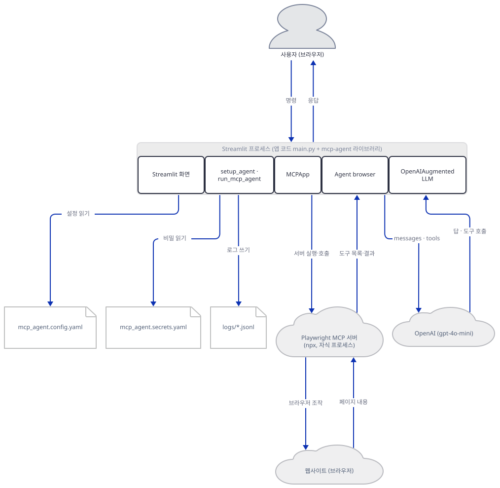

## 사전 준비

| 서비스/도구 | 용도 | 발급·설치 |
|---|---|---|
| uv · Python | 가상환경과 패키지 설치. 이 문서는 Python 3.13.3으로 확인했다. 앱 README는 3.8 이상이라고 적지만 `mcp-agent` 0.2.6의 패키지 메타데이터는 3.10 이상을 요구한다 | [공통 사전 준비](../README.md#공통-사전-준비-한-번만) 참고 |
| OpenAI API 키 | 실제로 쓸 때만 필요하다. 설정 파일 `mcp_agent.secrets.yaml`의 `openai.api_key` 또는 환경변수 `OPENAI_API_KEY`. 이 문서는 가짜 값 `sk-fake-day129`와 가짜 서버로 확인한다 | https://platform.openai.com/api-keys |
| Node.js (`npx`) | 진짜로 쓸 때 `npx @playwright/mcp@latest`를 내려받아 실행하고 브라우저를 띄운다. 이 문서의 실습은 쓰지 않는다 | https://nodejs.org/ |
| 터미널 둘 | 하나는 가짜 OpenAI 서버, 하나는 앱 | 별도 설치 없음 |
| 빈 포트 하나 | 가짜 OpenAI 서버용. 이 문서는 58231을 쓴다. 아무 높은 번호면 되고 겹치면 바꾼다 | 별도 설치 없음 |

이 문서의 확인 명령은 한글을 출력하고 그 출력을 파이프(`| grep`)나 파일(`> run.out`)로 받습니다. 한국어 Windows에서는 이때 Python의 기본 인코딩이 `cp949`라, `| grep 모델`은 아무 줄도 찾지 못하고 `grep "^##" run.out`은 `Binary file run.out matches` 한 줄만 냅니다(직접 확인). 셸을 먼저 이렇게 맞춰 두세요. 이 문서의 명령은 모두 이 설정을 건 상태에서 돌려 출력을 얻었습니다. 가짜 MCP 서버가 받는 환경은 열두 이름뿐이라(Step 5) 이 변수는 서버로 넘어가지 않습니다. PowerShell 줄은 실행해 보지 못했습니다.

```bash
export PYTHONIOENCODING=utf-8
```

```powershell
$env:PYTHONIOENCODING = "utf-8"
[Console]::OutputEncoding = [System.Text.Encoding]::UTF8
```

또 하나, 이 시리즈를 따라온 셸에는 진짜 `OPENAI_API_KEY`가 걸려 있을 수 있습니다. `mcp-agent`는 이 환경변수를 `openai.api_key`로 읽고, 설정 파일에 `base_url`이 없으면 `OPENAI_BASE_URL`과 기본 주소 `https://api.openai.com/v1`로 갑니다. 이 문서는 키가 새어 나가지 않도록 `show_settings.py`가 키의 앞 일곱 글자만 찍게 했고, 설정 파일을 일부러 못 찾게 하는 Step 7의 두 경우는 `env -u OPENAI_API_KEY -u OPENAI_BASE_URL`로 두 변수를 지우고 돌립니다. 나머지 단계는 설정 복사본의 `base_url`이 가짜 서버를 가리키고 비밀 파일의 가짜 키가 셸의 키를 이깁니다(직접 확인).

앱의 모델 `gpt-4o-mini`(`mcp_ai_agents/browser_mcp_agent/mcp_agent.config.yaml:20`)를 2026-10-14에 OpenAI 폐기 표(https://developers.openai.com/api/docs/deprecations)에서 찾았습니다. 별칭 `gpt-4o-mini`는 표에 올라 있지 않고, 스냅샷 `gpt-4o-mini-2024-07-18`이 2027-01-14 종료(대체 `gpt-6-luna`)로 올라 있습니다. 모델 페이지(https://developers.openai.com/api/docs/models/gpt-4o-mini, 같은 날 확인)는 기본 스냅샷을 `gpt-4o-mini-2024-07-18`로 적고, 폐기 문서는 별칭이 종료 뒤 어떻게 되는지 말하지 않습니다. 모델 이름은 설정 파일 한 줄이라 바꾸기 쉽습니다. 설정 파일의 주석은 `http://localhost:11434/v1`의 Ollama를 권하지만 이 문서는 11434에 묻지 않았습니다. 같은 `base_url` 칸에 가짜 서버 주소를 넣어 같은 경로를 확인합니다.

## 아키텍처 한눈에 보기

| 컴포넌트 | 역할 | 코드 위치 |
|---|---|---|
| Streamlit 화면 | 제목, 사이드바의 예시 명령, 명령 입력창, 실행 버튼, 응답 표시, 도움말 박스 | `mcp_ai_agents/browser_mcp_agent/main.py:11-38`, `mcp_ai_agents/browser_mcp_agent/main.py:120-180` |
| 세션 상태 | `MCPApp`을 만들고 이벤트 루프 하나를 세션에 보관 | `mcp_ai_agents/browser_mcp_agent/main.py:40-50` |
| 첫 명령 준비 (`setup_agent`) | 앱 시작, `Agent` 만들기와 초기화, LLM 붙이기, 도구 목록 로그 | `mcp_ai_agents/browser_mcp_agent/main.py:53-87` |
| 명령 실행 (`run_mcp_agent`) | 키 확인 뒤 `generate_str`로 한 건 실행 | `mcp_ai_agents/browser_mcp_agent/main.py:90-118` |
| 설정 파일 | MCP 서버(`playwright`), 모델 이름, 로거 설정 | `mcp_ai_agents/browser_mcp_agent/mcp_agent.config.yaml:1-31` |
| 비밀 파일 예시 | `openai.api_key` 자리 | `mcp_ai_agents/browser_mcp_agent/mcp_agent.secrets.yaml.example:1-7` |
| 의존성 | `streamlit`, `mcp-agent`, `openai` | `mcp_ai_agents/browser_mcp_agent/requirements.txt:1-3` |
| mcp-agent 라이브러리 | `MCPApp`·`Agent`·`OpenAIAugmentedLLM`. 설정 읽기, 서버 실행, 도구 루프 | 코드 없음 (외부 패키지 0.2.6) |
| Playwright MCP 서버 | `npx`로 뜨는 자식 프로세스. 브라우저를 조작하는 도구를 내놓는다 | 코드 없음 (외부 npm 패키지, 선언은 `mcp_ai_agents/browser_mcp_agent/mcp_agent.config.yaml:11-15`) |
| OpenAI API | 모델 `gpt-4o-mini`의 채팅 호출 | 코드 없음 (설정 `mcp_ai_agents/browser_mcp_agent/mcp_agent.config.yaml:18-20`) |

완성 그림은 프로세스 하나를 묶음으로 그리고 바깥으로 나가는 화살표만 달았습니다. 그 화살표는 묶음 전체에 닿는 것이고, 칸 아래에서 나가는 것처럼 보이는 위치는 의미가 없습니다. 어느 객체가 어디에 닿는지는 아래 두 그림이 말합니다. 묶음 안에서 누가 누구를 부르는지는 두 그림이 화살표로 그렸습니다. 먼저 `main.py`의 `setup_agent`가 라이브러리 객체 셋을 어떻게 부르는지입니다. `attach_llm`은 `Agent`의 메서드이므로 `Agent` 쪽 화살표에 있습니다.

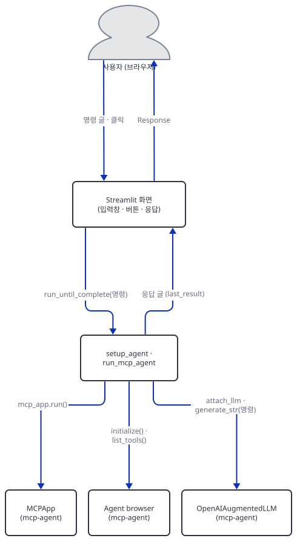

그리고 화면 모듈이 `MCPApp`을 만드는 곳(`main.py:43`)과 라이브러리 객체가 파일과 바깥 서비스에 닿는 곳입니다. 설정·비밀·로그는 `MCPApp`이, 서버는 `Agent`가, 모델은 `OpenAIAugmentedLLM`이 맡고, `OpenAIAugmentedLLM`은 `Agent`가 만들어 줍니다.

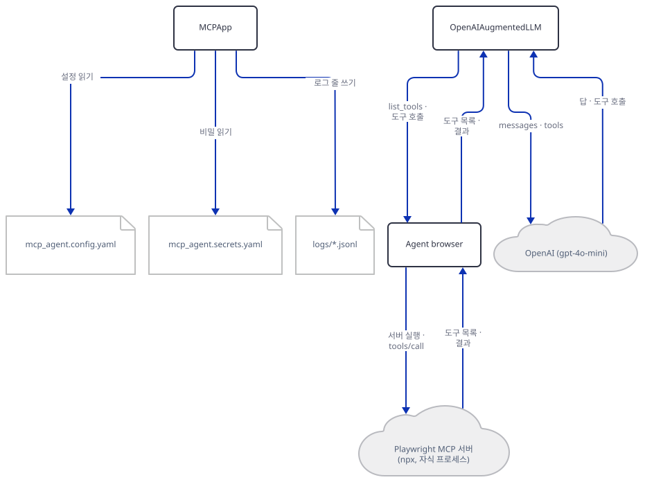

## 단계별 진행

### Step 1. 환경 만들기 — `requirements.txt` 그대로는 import가 안 됩니다

**목적.** 원본을 건드리지 않도록 작업 폴더에 복사본과 가상환경을 만들고, 오늘 실제로 어떤 버전이 깔리는지 확인합니다.

**할 일.** `<저장소>`는 이 저장소를 받은 경로입니다.

```bash
mkdir browser-work
cd browser-work
cp <저장소>/mcp_ai_agents/browser_mcp_agent/main.py .
cp <저장소>/mcp_ai_agents/browser_mcp_agent/mcp_agent.config.yaml .
cp <저장소>/mcp_ai_agents/browser_mcp_agent/mcp_agent.secrets.yaml.example .
cp <저장소>/mcp_ai_agents/browser_mcp_agent/requirements.txt .
uv venv
uv pip install -r requirements.txt
```

(pip 대안: `python -m venv .venv`로 만들고 활성화한 뒤 `pip install -r requirements.txt`.) 아래 PowerShell 줄은 실행해 보지 못했습니다(이 문서를 쓴 하네스가 PowerShell 실행을 막습니다). 이 문서의 PowerShell 줄은 모두 같습니다.

```powershell
mkdir browser-work
cd browser-work
Copy-Item <저장소>\mcp_ai_agents\browser_mcp_agent\main.py .
Copy-Item <저장소>\mcp_ai_agents\browser_mcp_agent\mcp_agent.config.yaml .
Copy-Item <저장소>\mcp_ai_agents\browser_mcp_agent\mcp_agent.secrets.yaml.example .
Copy-Item <저장소>\mcp_ai_agents\browser_mcp_agent\requirements.txt .
uv venv
uv pip install -r requirements.txt
```

의존성은 세 줄입니다. 버전 하한뿐이고 상한은 없습니다.

`mcp_ai_agents/browser_mcp_agent/requirements.txt:1-3`

```text
streamlit>=1.28.0
mcp-agent>=0.0.14
openai>=1.0.0
```

앱이 부르는 `mcp-agent`의 이름은 파일 맨 위에 있습니다. 브라우저·MCP 서버를 직접 다루는 import는 하나도 없습니다.

`mcp_ai_agents/browser_mcp_agent/main.py:1-9`

```python
import asyncio
import os
import streamlit as st
from textwrap import dedent

from mcp_agent.app import MCPApp
from mcp_agent.agents.agent import Agent
from mcp_agent.workflows.llm.augmented_llm_openai import OpenAIAugmentedLLM
from mcp_agent.workflows.llm.augmented_llm import RequestParams
```

**확인.** 설치된 버전을 보고 앱의 import 줄을 그대로 불러 봅니다. 이 저장소는 루트에 `pyproject.toml`이 있어 `uv run`이 루트 환경을 쓸 수 있으므로 `--no-project`를 붙입니다. 이 옵션을 줘도 uv는 현재 폴더와 위쪽에서 `.venv`를 찾아 쓰므로 방금 만든 환경이 잡힙니다(`sys.prefix`로 확인).

```bash
uv pip list | grep -E "^(mcp|mcp-agent|mcp-types|openai|streamlit) "
uv run --no-project python -c "from mcp_agent.app import MCPApp"
```

(PowerShell은 첫 줄의 `grep -E "..."`를 `Select-String -Pattern "^(mcp|mcp-agent|mcp-types|openai|streamlit) "`로 씁니다.)

직접 확인한 결과입니다. 2026-10-14에 103개가 설치됐습니다(`uv`가 `Installed 103 packages`라고 보고).

```text
mcp                                      2.3.0
mcp-agent                                0.2.6
mcp-types                                2.3.0
openai                                   3.31.0
streamlit                                1.65.0
```

두 번째 명령은 다음 오류로 끝납니다.

```text
    from mcp.server.fastmcp import FastMCP
  File ".../mcp/server/fastmcp.py", line 16, in <module>
    raise ModuleNotFoundError(_MESSAGE, name=__name__)
ModuleNotFoundError: No module named 'mcp.server.fastmcp'. This is mcp 2.x, where FastMCP was renamed to MCPServer (from mcp.server.mcpserver import MCPServer) and other APIs changed; see the migration guide at https://py.sdk.modelcontextprotocol.io/v2/migration/#fastmcp-renamed-to-mcpserver or pin 'mcp<2' to keep running v1 code.
```

`mcp-agent` 0.2.6의 `app.py` 25행이 `from mcp.server.fastmcp import FastMCP`를 부르는데(트레이스백으로 확인), 이 패키지의 메타데이터는 `mcp>=1.20.0`으로 상한 없이 적혀 있어 uv가 2.3.0을 골랐습니다. 오류 문구가 일러 주는 대로 `mcp`를 1.x로 고정합니다.

```bash
uv pip install "mcp<2"
uv run --no-project python -c "from mcp_agent.app import MCPApp; from mcp_agent.agents.agent import Agent; from mcp_agent.workflows.llm.augmented_llm_openai import OpenAIAugmentedLLM; from mcp_agent.workflows.llm.augmented_llm import RequestParams; print('imports ok')"
```

```text
 + httpx-sse==0.4.3
 - mcp==2.3.0
 + mcp==1.30.0
imports ok
```

앱의 import 넷이 모두 됩니다. 이후 이 문서의 `mcp`는 1.30.0입니다.

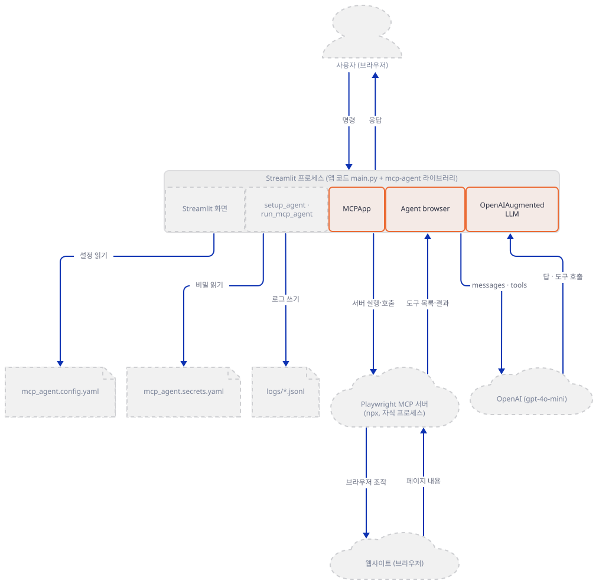

### Step 2. 설정 파일 — 어디서 찾고 무엇이 합쳐지나

**목적.** 서버와 모델이 코드가 아니라 설정에 있으므로, 설정을 어디서 어떻게 읽는지 앱을 돌리기 전에 확인합니다. 이 앱의 가장 조용한 실패가 여기서 나옵니다.

**할 일.** 설정 파일 전문입니다. 서버(11-15행)와 모델(18-20행), 로거(2-9행)가 한 파일에 있습니다.

`mcp_ai_agents/browser_mcp_agent/mcp_agent.config.yaml:1-31`

```yaml
execution_engine: asyncio
logger:
  transports: [console, file]
  level: debug
  progress_display: true
  path_settings:
    path_pattern: "logs/mcp-agent-{unique_id}.jsonl"
    unique_id: "timestamp" # Options: "timestamp" or "session_id"
    timestamp_format: "%Y%m%d_%H%M%S"

mcp:
  servers:
    playwright:
      command: "npx"
      args: ["@playwright/mcp@latest"]


openai:
  # Secrets (API keys, etc.) are stored in an mcp_agent.secrets.yaml file which can be gitignored
  default_model: "gpt-4o-mini"

# To run against a local Ollama (or any OpenAI-compatible) server, override
# the `openai` block above with the commented example below and put a dummy
# api_key (e.g. "ollama") in mcp_agent.secrets.yaml. Ollama exposes an
# OpenAI-compatible endpoint at /v1, so no framework changes are needed —
# this was confirmed by the mcp-agent maintainer in issue #329.
#
# openai:
#   base_url: "http://localhost:11434/v1"
#   default_model: "llama3.2"

```

비밀 파일 예시는 키 하나입니다.

`mcp_ai_agents/browser_mcp_agent/mcp_agent.secrets.yaml.example:1-7`

```yaml
openai:
  api_key: YOUR_OPENAI_API_KEY

# For a local Ollama backend, any non-empty api_key works because Ollama
# doesn't authenticate; the important part is the base_url in config.yaml.
# openai:
#   api_key: "ollama"
```

읽는 규칙은 `mcp-agent` 0.2.6의 `config.py`에서 소스로 확인했습니다. 설정 파일은 명령을 실행한 폴더부터 루트까지 올라가며 `mcp_agent.config.yaml`(또는 `mcp-agent.config.yaml`)과 각 폴더의 `.mcp-agent/` 아래를 찾고, 마지막에 `~/.mcp-agent/`를 봅니다. 설정 파일을 찾은 뒤에야 비밀 파일을 찾는데, 먼저 설정 파일과 같은 폴더에서 찾고 없으면 같은 방식으로 찾아 설정에 덧씌웁니다. 설정을 아무데서도 못 찾으면 비밀 파일은 찾아보지도 않고 오류 없이 기본 설정을 씁니다. 현재 폴더의 `.env`도 설정으로 읽고, `OPENAI_API_KEY`·`OPENAI_BASE_URL` 같은 환경변수가 `openai` 칸의 값으로 들어갑니다. 앱의 키 확인(`main.py:95-97`)은 이와 다르게 **`main.py`가 있는 폴더**에서 `mcp_agent.secrets.yaml`을 찾습니다. 두 폴더가 같지 않으면 둘의 판단이 갈립니다.

설정을 읽어 요약하는 `show_settings.py`를 작업 폴더에 저장합니다. 서버를 띄우거나 바깥에 요청하지 않고 파일만 읽습니다.

`show_settings.py`

```python
import os
from mcp_agent.config import Settings, get_settings

print("cwd:", os.getcwd())
print("설정 파일:", Settings.find_config())
print("비밀 파일:", Settings.find_secrets())
s = get_settings()
print("서버:", {k: (v.command, v.args) for k, v in s.mcp.servers.items()})
key = s.openai.api_key
print("모델:", s.openai.default_model, "| base_url:", s.openai.base_url, "| api_key:", key and key[:7] + "…")
print("로거:", s.logger.transports, s.logger.level, getattr(s.logger.path_settings, "path_pattern", None))
print("otel:", s.otel.enabled, "| usage_telemetry:", s.usage_telemetry.enabled)
```

**확인.** 비밀 파일이 없는 상태에서 먼저 돌립니다. 둘째는 하위 폴더에서 같은 파일을 돌려 위로 올라가며 찾는지 봅니다. 셋째는 설정이 없는 폴더에서 돌립니다. 이때 `uv run`은 그 폴더에서 `.venv`를 못 찾으므로 가상환경의 파이썬을 직접 부릅니다(macOS·Linux는 `.venv/bin/python`).

```bash
uv run --no-project python show_settings.py
mkdir sub
cd sub
uv run --no-project python ../show_settings.py
cd ..
mkdir ../elsewhere
cd ../elsewhere
../browser-work/.venv/Scripts/python ../browser-work/show_settings.py
cd ../browser-work
```

경로는 `<작업 폴더>`로 줄였습니다. 첫째는 설정 파일을 현재 폴더에서, 둘째는 위쪽 폴더에서 찾고, 둘 다 같은 출력이며 키는 `None`입니다(셸에 `OPENAI_API_KEY`가 걸려 있으면 `None` 자리에 그 키의 앞 일곱 글자와 `…`가 나옵니다).

```text
설정 파일: <작업 폴더>/mcp_agent.config.yaml
비밀 파일: None
서버: {'playwright': ('npx', ['@playwright/mcp@latest'])}
모델: gpt-4o-mini | base_url: None | api_key: None
로거: ['console', 'file'] debug logs/mcp-agent-{unique_id}.jsonl
otel: False | usage_telemetry: True
```

둘째 실행은 `cwd:` 줄만 `<작업 폴더>/sub`로 다릅니다. 셋째는 아무것도 못 찾고도 오류 없이 끝납니다.

```text
cwd: <스크래치>/elsewhere
설정 파일: None
비밀 파일: None
서버: {}
모델: None | base_url: None | api_key: None
로거: [] info None
otel: False | usage_telemetry: True
```

서버가 `{}`, 모델이 `None`입니다. 이 설정으로 앱을 돌리면 어떻게 되는지는 Step 7에서 봅니다. 이제 가짜 키를 비밀 파일로 넣고, `OPENAI_BASE_URL`이 `openai` 칸으로 들어오는지 봅니다.

```bash
printf 'openai:\n  api_key: sk-fake-day129\n' > mcp_agent.secrets.yaml
OPENAI_BASE_URL=http://127.0.0.1:9/v1 uv run --no-project python show_settings.py | grep 모델
```

(PowerShell은 `@("openai:", "  api_key: sk-fake-day129") | Set-Content mcp_agent.secrets.yaml`, 환경변수는 `$env:OPENAI_BASE_URL="http://127.0.0.1:9/v1"`입니다.)

```text
모델: gpt-4o-mini | base_url: http://127.0.0.1:9/v1 | api_key: sk-fake…
```

설정 파일에 `base_url`이 없으면 환경변수가 그 자리를 채웁니다(포트 9는 아무도 듣지 않는 주소이고 이 줄은 설정만 읽을 뿐 요청하지 않습니다). 비밀 파일의 키도 `api_key`로 들어왔고(앞 일곱 글자만 찍습니다), 셸에 다른 키가 있어도 비밀 파일의 키가 이겼습니다(직접 확인).

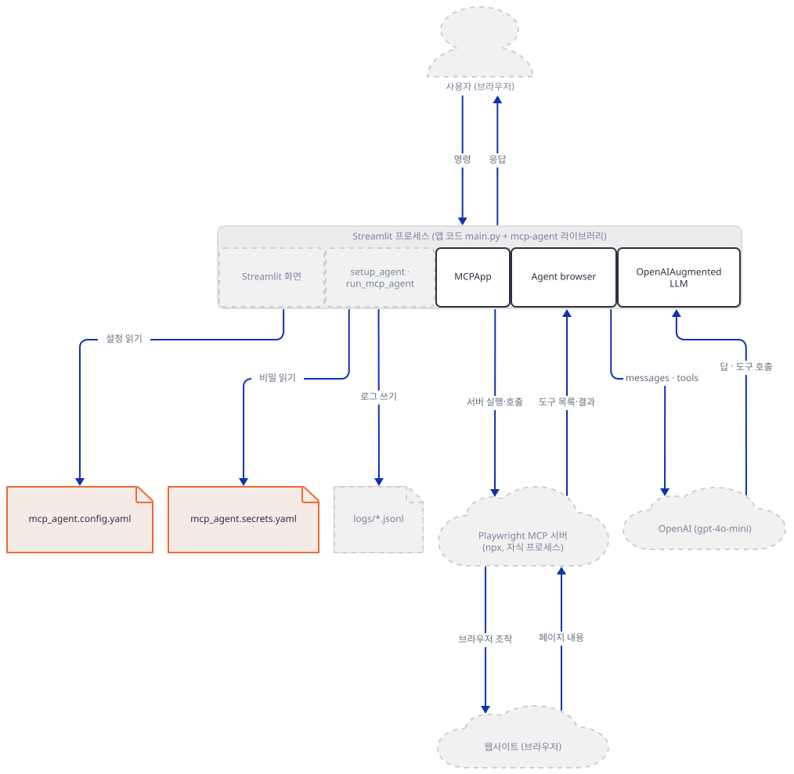

### Step 3. 가짜 서버 둘 — `npx` 자리에는 파이썬, OpenAI 자리에는 localhost

**목적.** 실제 브라우저와 OpenAI 없이 앱의 전체 경로를 돌릴 수 있도록, MCP 서버와 모델 서버를 내 PC의 파이썬으로 세우고 설정 복사본을 그쪽으로 돌립니다.

**할 일.** 세 파일을 `browser-work`에 저장합니다. 첫째는 가짜 Playwright MCP 서버입니다. 시작할 때와 도구가 불릴 때 `mcp.log`에 한 줄씩 남기고, 시작할 때 자기가 받은 환경변수 이름들도 적습니다. 도구 셋은 앞에서 밝힌 대로 내가 고른 것이고, 브라우저는 열지 않습니다.

`fake_playwright.py`

```python
"""내 PC에서만 도는 가짜 Playwright MCP 서버. 브라우저를 열지 않고 대본을 돌려준다."""
import os
import sys
from datetime import datetime

from mcp.server.fastmcp import FastMCP

LOG = sys.argv[1] if len(sys.argv) > 1 else "mcp.log"


def log(msg: str) -> None:
    with open(LOG, "a", encoding="utf-8") as f:
        f.write(f"{datetime.now():%H:%M:%S.%f} [MCP pid={os.getpid()}] {msg}\n")


log(f"시작 argv={sys.argv[1:]} 환경 키={sorted(os.environ)}")

server = FastMCP("fake-playwright")


@server.tool()
def browser_navigate(url: str) -> str:
    """Navigate to a URL"""
    log(f"호출 browser_navigate url={url}")
    return f"### Page state\n- Page URL: {url}\n- Page Title: Fake page"


@server.tool()
def browser_snapshot() -> str:
    """Capture accessibility snapshot of the current page"""
    log("호출 browser_snapshot")
    return '- heading "Fake page" [level=1]\n- link "mcp_ai_agents" [ref=e7]\n- paragraph: 가짜 서버가 돌려주는 대본입니다.'


@server.tool()
def browser_click(target: str) -> str:
    """Perform click on a web page"""
    log(f"호출 browser_click target={target}")
    return f"clicked {target}"


if __name__ == "__main__":
    server.run()
```

둘째는 가짜 OpenAI 서버입니다. 요청이 올 때마다 모델·`max_tokens`·도구 수·메시지 역할 순서·인증 머리말의 앞부분을 `openai.log`에 적습니다. 첫 요청에는 `browser_navigate`를, 도구 결과가 하나 쌓이면 `browser_snapshot`을 부르고, 둘이 쌓이면 글로 답합니다. 명령에 `LOOP`이 들어 있으면 끝없이 도구만 부르고, 인증이 예제의 `YOUR_OPENAI_API_KEY`이면 401을 돌려줍니다(Step 6·7에서 씁니다). `allow_reuse_address = False`는 다른 프로세스가 이미 쓰는 포트에 오류 없이 겹쳐 뜨는 Windows의 동작을 막습니다.

`fake_openai.py`

```python
"""내 PC에서만 도는 가짜 OpenAI 서버. /v1/chat/completions 한 곳만 대본으로 답한다."""
import json
import sys
import time
from http.server import BaseHTTPRequestHandler, ThreadingHTTPServer

PORT = int(sys.argv[1])
LOG = sys.argv[2] if len(sys.argv) > 2 else "openai.log"


def tool_named(tools, suffix):
    for t in tools or []:
        if t["function"]["name"].endswith(suffix):
            return t["function"]["name"]
    return None


def call(name, args):
    return {"role": "assistant", "content": None, "tool_calls": [{
        "id": f"call_{time.time_ns()}", "type": "function",
        "function": {"name": name, "arguments": json.dumps(args)}}]}


class Handler(BaseHTTPRequestHandler):
    def log_message(self, *args):
        pass

    def reply(self, status, body):
        data = json.dumps(body).encode()
        self.send_response(status)
        self.send_header("Content-Type", "application/json")
        self.send_header("Content-Length", str(len(data)))
        self.end_headers()
        self.wfile.write(data)

    def do_POST(self):
        body = json.loads(self.rfile.read(int(self.headers["Content-Length"])))
        msgs, tools = body["messages"], body.get("tools")
        auth = self.headers.get("Authorization", "")
        last_user = max(i for i, m in enumerate(msgs) if m["role"] == "user")
        done = sum(1 for m in msgs[last_user + 1:] if m["role"] == "tool")  # 이번 명령에서 받은 도구 결과 수
        with open(LOG, "a", encoding="utf-8") as f:
            f.write(f"{time.strftime('%H:%M:%S')} {self.path} auth={auth[:20]!r} model={body.get('model')} "
                    f"max_tokens={body.get('max_tokens')} tools={len(tools or [])} 도구결과={done} "
                    f"roles={','.join(m['role'] for m in msgs)}\n")
        if "YOUR_OPENAI_API_KEY" in auth:  # 예제 비밀 파일을 고치지 않은 경우를 흉내 낸다
            return self.reply(401, {"error": {"message": "Incorrect API key provided: YOUR_OPE*****_KEY.",
                                              "type": "invalid_request_error", "code": "invalid_api_key"}})
        nav, snap = tool_named(tools, "browser_navigate"), tool_named(tools, "browser_snapshot")
        if "LOOP" in str(msgs[last_user]["content"]) and snap:  # 끝없이 도구만 부르는 모델
            msg, finish = call(snap, {}), "tool_calls"
        elif done == 0 and nav:
            msg, finish = call(nav, {"url": "https://github.com/Shubhamsaboo/awesome-llm-apps"}), "tool_calls"
        elif done == 1 and snap:
            msg, finish = call(snap, {}), "tool_calls"
        else:
            msg, finish = {"role": "assistant", "content": f"가짜 모델의 답: 이번 명령에서 도구 결과 {done}개를 읽었습니다."}, "stop"
        self.reply(200, {"id": "chatcmpl-fake", "object": "chat.completion", "created": 0, "model": body["model"],
                         "choices": [{"index": 0, "message": msg, "finish_reason": finish}],
                         "usage": {"prompt_tokens": 10, "completion_tokens": 5, "total_tokens": 15}})


class Server(ThreadingHTTPServer):
    allow_reuse_address = False


server = Server(("127.0.0.1", PORT), Handler)  # 포트를 못 잡으면 여기서 OSError로 끝난다
print("listening", PORT, flush=True)
server.serve_forever()
```

셋째는 설정 복사본을 만드는 스크립트입니다. 원본 설정의 `npx` 두 줄을 가짜 서버로, `default_model` 아래에 `base_url`을 더합니다. 다시 돌려도 원본에서 새로 만듭니다.

`prepare_lab.py`

```python
"""원본 설정 파일에서 npx 줄을 가짜 서버로, 모델 주소를 가짜 OpenAI로 바꾼 복사본을 쓴다.
쓰는 법: python prepare_lab.py <원본 설정 경로> <가짜 OpenAI 포트>"""
import pathlib
import sys

src, port = sys.argv[1], sys.argv[2]
s = pathlib.Path(src).read_text(encoding="utf-8")
py = pathlib.Path(sys.executable).as_posix()
fake = pathlib.Path("fake_playwright.py").resolve().as_posix()
old1 = '      command: "npx"\n      args: ["@playwright/mcp@latest"]\n'
new1 = f"      command: '{py}'\n      args: ['{fake}', 'mcp.log']\n"
old2 = '  default_model: "gpt-4o-mini"\n'
new2 = f'  default_model: "gpt-4o-mini"\n  base_url: "http://127.0.0.1:{port}/v1"\n'
assert s.count(old1) == 1 and s.count(old2) == 1, "바꿀 줄을 찾지 못했습니다"
pathlib.Path("mcp_agent.config.yaml").write_text(s.replace(old1, new1).replace(old2, new2), encoding="utf-8")
print("wrote mcp_agent.config.yaml")
```

한 터미널에서 가짜 OpenAI 서버를 띄우고 다른 터미널에서 설정을 바꿉니다.

```bash
uv run --no-project python fake_openai.py 58231
```

```bash
uv run --no-project python prepare_lab.py <저장소>/mcp_ai_agents/browser_mcp_agent/mcp_agent.config.yaml 58231
diff --strip-trailing-cr <저장소>/mcp_ai_agents/browser_mcp_agent/mcp_agent.config.yaml mcp_agent.config.yaml
OPENAI_BASE_URL=http://127.0.0.1:9/v1 uv run --no-project python show_settings.py | grep -E "서버|모델"
```

**확인.** 첫 터미널에는 `listening 58231`이 찍혀 있어야 하고 그 아래에 `OSError`가 없어야 합니다(`fake_openai.py`는 포트를 잡은 뒤에 이 줄을 찍습니다. 같은 포트를 다른 프로그램이 쥐고 있으면 `listening` 없이 `OSError: [WinError 10048]`로 끝납니다). 설정 복사본에서 바뀐 곳은 세 줄입니다. 경로는 줄였고, `--strip-trailing-cr`는 Windows에서 `prepare_lab.py`가 줄 끝을 CRLF로 써서 모든 줄이 달라 보이는 것을 막습니다.

```text
14,15c14,15
<       command: "npx"
<       args: ["@playwright/mcp@latest"]
---
>       command: '<작업 폴더>/.venv/Scripts/python.exe'
>       args: ['<작업 폴더>/fake_playwright.py', 'mcp.log']
20a21
>   base_url: "http://127.0.0.1:58231/v1"
```

Step 2와 달리 이번에는 `OPENAI_BASE_URL`을 줘도 설정 파일의 값이 이깁니다. 서버 줄에 가짜 서버가 보이는 것도 같은 출력에서 확인합니다.

```text
서버: {'playwright': ('<작업 폴더>/.venv/Scripts/python.exe', ['<작업 폴더>/fake_playwright.py', 'mcp.log'])}
모델: gpt-4o-mini | base_url: http://127.0.0.1:58231/v1 | api_key: sk-fake…
```

설정 파일의 값이 환경변수를 이기므로, 독자가 `OPENAI_BASE_URL`로 주소를 바꾸려면 설정 파일에 `base_url`이 없어야 합니다. 앱이 실제로 요청을 보낼 주소는 Step 6에서 `openai.log`에 요청이 도착하는 것으로 다시 확인합니다.

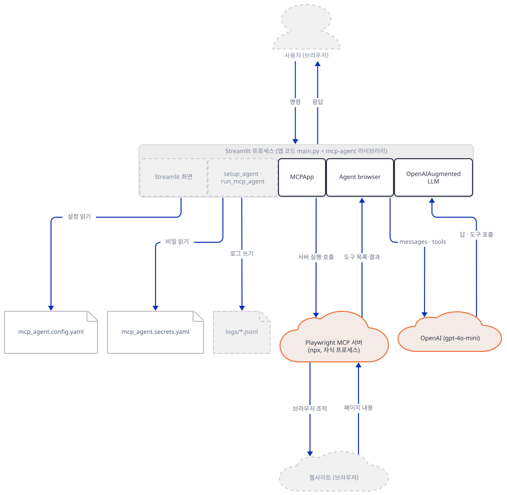

### Step 4. 화면만 띄우면 — 아무것도 시작되지 않습니다

**목적.** 앱의 첫 화면이 그려지는 것만으로 무엇이 만들어지는지 봅니다.

**할 일.** 세션이 처음 열릴 때 한 번 도는 블록입니다.

`mcp_ai_agents/browser_mcp_agent/main.py:40-50`

```python
# Initialize app and agent
if 'initialized' not in st.session_state:
    st.session_state.initialized = False
    st.session_state.mcp_app = MCPApp(name="streamlit_mcp_agent")
    st.session_state.mcp_context = None
    st.session_state.mcp_agent_app = None
    st.session_state.browser_agent = None
    st.session_state.llm = None
    st.session_state.loop = asyncio.new_event_loop()
    asyncio.set_event_loop(st.session_state.loop)
    st.session_state.is_processing = False
```

`MCPApp(name="streamlit_mcp_agent")`이 설정을 읽는 순간입니다. `mcp-agent`의 `MCPApp.__init__`이 `get_settings()`를 부르는 것은 소스로 확인했고, 이때 Step 2의 탐색이 일어납니다. 서버를 띄우는 `run()`은 아직 아닙니다. 이벤트 루프는 `asyncio.new_event_loop()`로 따로 만들어 세션에 보관합니다. 이후 모든 명령은 이 루프에서 돌아갑니다(`main.py:141`).

화면을 브라우저 없이 돌리는 확인용 파일 `check_app.py`를 저장합니다. 명령을 인자로 받아 입력창에 쓰고 버튼을 누르고, 화면에 남은 응답과 작업 폴더에 생긴 `mcp.log`·`logs/` 파일 목록을 찍습니다. 마지막의 3초는 `mcp-agent`의 로거가 모아 둔 줄을 터미널로 내보낼 시간입니다.

`check_app.py`

```python
"""main.py를 브라우저 없이 Streamlit의 AppTest로 돌린다. 명령을 인자로 준다."""
import glob
import sys
import time

from streamlit.testing.v1 import AppTest


def help_box():
    return any("How to use this app" in m.value for m in at.markdown)


def files(label):
    names = sorted(p.replace("\\", "/") for p in glob.glob("logs/*") + glob.glob("mcp.log"))
    print("##", label, "| 파일:", names)


at = AppTest.from_file("main.py", default_timeout=120).run()
print("## 첫 화면 예외:", [e.value for e in at.exception], "| 도움말 박스:", help_box())
files("화면만 그린 뒤")
for cmd in sys.argv[1:]:
    at.text_area[0].input(cmd)
    at.button[0].click().run(timeout=120)
    print("##", repr(cmd), "-> 화면 응답:", repr(at.session_state["last_result"])[:70], "| 도움말 박스:", help_box())
    files("이 명령 뒤")
time.sleep(3)  # 로거가 모아 둔 줄을 내보낼 시간
```

**확인.** 명령 없이 화면만 그립니다. `mcp-agent`의 디버그 로그가 터미널을 가득 채우므로 파일로 돌려 내 줄(`##`)만 봅니다.

```bash
uv run --no-project python check_app.py > run.out 2>&1
grep "^##" run.out
```

(PowerShell은 `uv run --no-project python check_app.py *> run.out`, `Select-String "^##" run.out`입니다.)

```text
## 첫 화면 예외: [] | 도움말 박스: True
## 화면만 그린 뒤 | 파일: []
```

화면이 그려졌는데 `mcp.log`도 `logs/`도 없습니다. 가짜 서버가 뜨지 않았고 로거 파일도 만들어지지 않았다는 뜻입니다.

도움말 박스(`How to use this app`)는 맨 처음에 보입니다. 이 박스는 응답이 나온 뒤에도 남습니다. 박스를 보이는 조건이 `if 'result' not in locals():`인데(`main.py:157`), 모듈 맨 위에서 `locals()`는 전역이고, `result`는 처리 중인 실행에서만 만들어지는데 바로 `st.rerun()`이 그 실행을 끊기 때문에, 끝까지 도는 실행에는 `result`가 늘 없습니다. Step 5의 출력에서 응답 뒤에도 `도움말 박스: True`입니다.

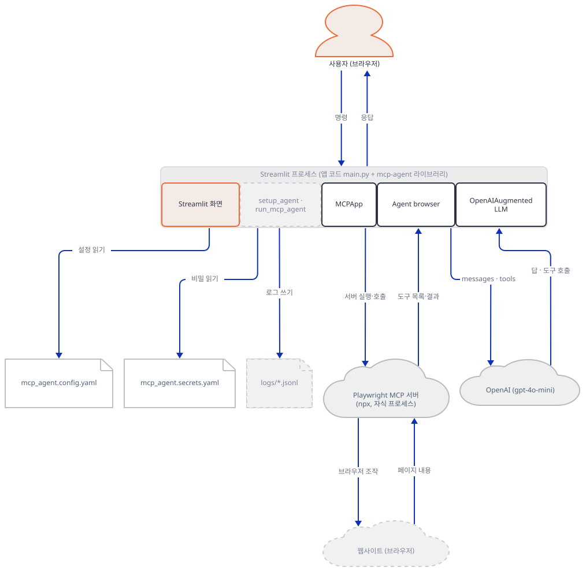

### Step 5. 첫 명령 — `setup_agent`가 서버를 띄웁니다

**목적.** 첫 명령에서 서버가 뜨는 정확한 지점과, 서버가 받는 환경을 확인합니다.

**할 일.** 첫 명령에서 한 번만 도는 준비 함수입니다.

`mcp_ai_agents/browser_mcp_agent/main.py:53-87`

```python
async def setup_agent():
    if not st.session_state.initialized:
        try:
            # Create context manager and store it in session state
            st.session_state.mcp_context = st.session_state.mcp_app.run()
            st.session_state.mcp_agent_app = await st.session_state.mcp_context.__aenter__()
            
            # Create and initialize agent
            st.session_state.browser_agent = Agent(
                name="browser",
                instruction="""You are a helpful web browsing assistant that can interact with websites using playwright.
                    - Navigate to websites and perform browser actions (click, scroll, type)
                    - Extract information from web pages 
                    - Take screenshots of page elements when useful
                    - Provide concise summaries of web content using markdown
                    - Follow multi-step browsing sequences to complete tasks
                    
                Respond back with a status update on completing the commands.""",
                server_names=["playwright"],
            )
            
            # Initialize agent and attach LLM
            await st.session_state.browser_agent.initialize()
            st.session_state.llm = await st.session_state.browser_agent.attach_llm(OpenAIAugmentedLLM)
            
            # List tools once
            logger = st.session_state.mcp_agent_app.logger
            tools = await st.session_state.browser_agent.list_tools()
            logger.info("Tools available:", data=tools)
            
            # Mark as initialized
            st.session_state.initialized = True
        except Exception as e:
            return f"Error during initialization: {str(e)}"
    return None
```

순서는 이렇습니다. `mcp_app.run()`은 비동기 컨텍스트 매니저를 만들고(57행), `__aenter__`가 설정·로거·실행기를 준비합니다(58행). 그다음 `Agent`를 만들고(61-72행) `initialize()`(75행)를 부릅니다. `mcp-agent` 0.2.6의 `agents/agent.py`와 `mcp/mcp_aggregator.py`를 읽으면, `Agent.initialize()`는 집계기를 만들고, 기본값 `connection_persistence=True` 때문에 연결 관리자가 서버마다 `stdio_client`로 자식 프로세스를 띄워 도구 목록을 받아 옵니다(소스로 확인). 서버가 뜨는 곳은 75행이고 `initialized`가 거짓인 첫 명령에서만 이 줄에 닿습니다. 서버별 로딩은 `asyncio.gather(..., return_exceptions=True)`라서 한 서버가 실패해도 오류를 로그에 남기고 계속 갑니다(Step 7). `attach_llm`(76행)은 `llm_factory(agent=self)`로 `OpenAIAugmentedLLM`을 만들어 돌려줍니다. 80행의 `list_tools()`는 결과를 로그로만 씁니다. 끝으로 이 컨텍스트 매니저는 `__aenter__`만 있고 `__aexit__`가 앱 어디에도 없습니다(`grep -n "__aexit__" main.py`가 아무것도 찍지 않음). 서버를 앱이 끄는 코드가 없다는 뜻입니다.

**확인.** 가짜 OpenAI 서버가 떠 있는 상태에서 명령 하나를 줍니다. 앞의 `run.out`·`mcp.log`·`logs/`·`openai.log`는 지우고 시작합니다. 같은 셸에 `OPENAI_API_KEY`와 아무 이름의 변수를 두어 서버가 받는지 봅니다.

```bash
rm -rf logs mcp.log
: > openai.log
OPENAI_API_KEY=sk-env-fake DAY129_TOKEN=abc uv run --no-project python check_app.py "Go to github.com/Shubhamsaboo/awesome-llm-apps" > run.out 2>&1
grep "^##" run.out
head -1 mcp.log
grep -o '"namespace":"[^"]*","message":"[^"]*"' logs/*.jsonl | sed 's/.*"namespace":"mcp_agent\.//; s/","message":"/ | /; s/"$//' | grep -nE "Initializing agent|Up and running|Tools available|Completion request"
```

(`rm -rf`는 `browser-work` 안에서만 쓰세요. PowerShell은 `Remove-Item -Recurse -Force logs, mcp.log`, `Set-Content openai.log ""`, 환경변수는 `$env:OPENAI_API_KEY="sk-env-fake"; $env:DAY129_TOKEN="abc"`로 씁니다.)

직접 확인한 결과입니다.

```text
## 첫 화면 예외: [] | 도움말 박스: True
## 화면만 그린 뒤 | 파일: []
## 'Go to github.com/Shubhamsaboo/awesome-llm-apps' -> 화면 응답: '가짜 모델의 답: 이번 명령에서 도구 결과 2개를 읽었습니다.' | 도움말 박스: True
## 이 명령 뒤 | 파일: ['logs/mcp-agent-20261014_233105.jsonl', 'mcp.log']
23:31:06.637047 [MCP pid=19960] 시작 argv=['mcp.log'] 환경 키=['APPDATA', 'HOMEDRIVE', 'HOMEPATH', 'LOCALAPPDATA', 'PATH', 'PATHEXT', 'PROCESSOR_ARCHITECTURE', 'SYSTEMDRIVE', 'SYSTEMROOT', 'TEMP', 'USERNAME', 'USERPROFILE']
10:agents.agent | Initializing agent browser...
13:mcp.mcp_connection_manager | playwright: Up and running with a persistent connection!
27:streamlit_mcp_agent | Tools available:
29:workflows.llm.augmented_llm_openai.browser | Completion request arguments:
39:workflows.llm.augmented_llm_openai.browser | Completion request arguments:
47:workflows.llm.augmented_llm_openai.browser | Completion request arguments:
```

줄 번호는 실행마다 한두 줄 달라집니다(같은 명령을 다시 돌리면 `9·12·26·28·38·47`로도 나옵니다). 순서가 요점입니다.

세 가지가 보입니다. 첫째, 파일 두 개가 이 명령 뒤에야 생깁니다. Step 4의 빈 목록과 비교됩니다. 로그 파일 이름은 `logs/mcp-agent-<시각>.jsonl`이라 **실행한 폴더 아래**에 생깁니다. 둘째, 로그의 순서가 서버 연결(13번째 줄) → 도구 목록(27) → 첫 모델 요청(29)이고, 요청은 한 명령에 세 번(29·39·47) 나갑니다. 서버는 첫 모델 요청보다 앞에 뜹니다. 진짜 `npx`라면 내려받기와 브라우저 시작이 여기서 첫 명령의 시간이 되지만 재지 못했습니다. 셋째, 서버가 받은 환경은 열두 개의 이름뿐입니다. 셸에 둔 `OPENAI_API_KEY`와 `DAY129_TOKEN`은 서버에 넘어가지 않았고(`mcp.log`에 두 이름이 없음, 직접 확인), `mcp` 1.30.0의 `stdio_client`가 쓰는 기본 환경은 안전하다고 본 이름 목록(`mcp/client/stdio/__init__.py`의 `DEFAULT_INHERITED_ENV_VARS`, 소스로 확인)만 상속합니다. 이 목록에 `PATH`가 있어서 `npx`를 찾을 수 있습니다. 설정 파일의 서버 칸에 `env:`를 쓰면 그 값이 더해집니다(`mcp_connection_manager.py`의 `{**get_default_environment(), **(config.env or {})}`, 소스로 확인).

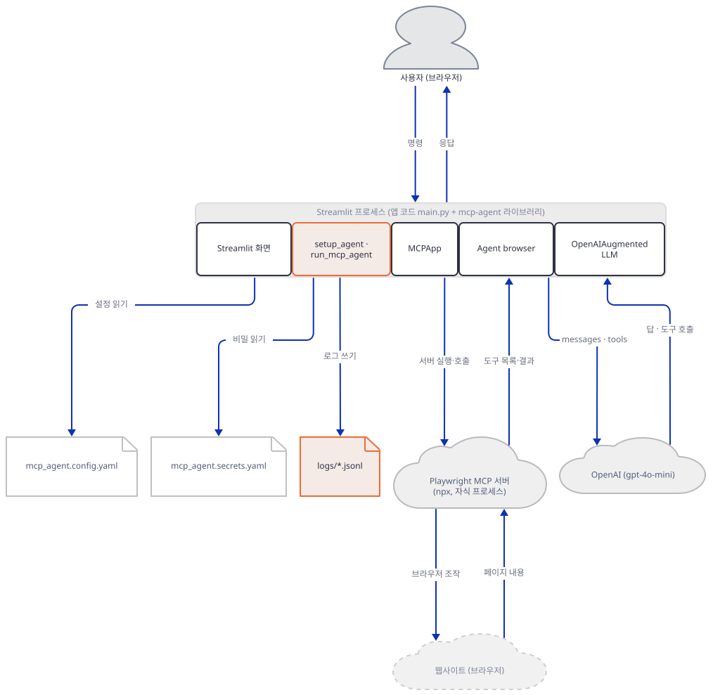

### Step 6. 명령 한 건 — 모델이 받는 것과 도구 루프

**목적.** 한 명령이 모델에게 어떤 요청으로 나가는지, 도구를 얼마나 부를 수 있는지, 대화가 쌓이는 방식을 봅니다.

**할 일.** 명령 한 건을 돌리는 함수입니다. 키 확인이 앞에 있고, 실제 일은 `generate_str` 한 줄(112-115행)입니다.

`mcp_ai_agents/browser_mcp_agent/main.py:90-118`

```python
async def run_mcp_agent(message):
    # Credentials come from mcp_agent.secrets.yaml (api_key) and
    # mcp_agent.config.yaml (base_url, default_model). Both OpenAI and any
    # OpenAI-compatible server (e.g. Ollama at http://localhost:11434/v1)
    # are supported via the same `openai:` config section — see README.
    if not os.getenv("OPENAI_API_KEY") and not os.path.exists(
        os.path.join(os.path.dirname(__file__), "mcp_agent.secrets.yaml")
    ):
        return (
            "Error: no LLM credentials found. Either set OPENAI_API_KEY in "
            "your environment, or create mcp_agent.secrets.yaml from the "
            "provided example (works for OpenAI and local Ollama)."
        )

    try:
        # Make sure agent is initialized
        error = await setup_agent()
        if error:
            return error
        
        # Generate response without recreating agents
        # Switch use_history to False to reduce the passed context
        result = await st.session_state.llm.generate_str(
            message=message, 
            request_params=RequestParams(use_history=True, maxTokens=10000)
            )
        return result
    except Exception as e:
        return f"Error: {str(e)}"
```

`RequestParams(use_history=True, maxTokens=10000)`은 두 가지를 정합니다. `mcp-agent` 0.2.6의 `OpenAIAugmentedLLM.generate`(`workflows/llm/augmented_llm_openai.py`, 소스로 확인)는 요청 인자에서 `maxTokens`를 `max_tokens`로 싣고(추론 모델이면 `max_completion_tokens`), 도구 목록을 `agent.list_tools()`로 새로 받아 `tools`로 싣고, 모델 이름은 설정의 `default_model`을 씁니다. 반복은 `RequestParams.max_iterations`의 기본값 10번까지입니다(`augmented_llm.py`의 `max_iterations: int = 10`). `use_history=True`이면 한 명령이 끝날 때 쌓인 메시지 전체를 기억해 다음 명령의 앞에 붙입니다. 앱의 111행 주석("Switch use_history to False to reduce the passed context")은 이 값을 꺼 보라고 합니다. 시스템 프롬프트는 `Agent`의 `instruction`이고 메시지가 비어 있을 때만 붙습니다.

**확인.** 명령 둘과 빈 명령을 줍니다. 가짜 서버는 도구 결과가 쌓인 수를 보고 답을 고르므로 한 명령에 요청이 세 번 나갑니다.

```bash
rm -rf logs mcp.log
: > openai.log
uv run --no-project python check_app.py "Go to github.com/Shubhamsaboo/awesome-llm-apps" "now click on mcp_ai_agents" "" > run.out 2>&1
grep "^##" run.out
sed 's/auth=.* model/model/' openai.log
grep -c "시작" mcp.log
```

직접 확인한 결과입니다. 화면 응답 세 줄은 첫 명령과 같고 둘째와 셋째 명령에서도 도움말 박스는 `True`입니다. 요청 기록은 아홉 줄이고(셋째 명령은 비어 있는 명령입니다) 앞의 여섯 줄입니다. 각 줄 앞의 시각과 경로는 줄였습니다.

```text
model=gpt-4o-mini max_tokens=10000 tools=3 도구결과=0 roles=system,user
model=gpt-4o-mini max_tokens=10000 tools=3 도구결과=1 roles=system,user,assistant,tool
model=gpt-4o-mini max_tokens=10000 tools=3 도구결과=2 roles=system,user,assistant,tool,assistant,tool
model=gpt-4o-mini max_tokens=10000 tools=3 도구결과=0 roles=system,user,assistant,tool,assistant,tool,assistant,user
model=gpt-4o-mini max_tokens=10000 tools=3 도구결과=1 roles=system,user,assistant,tool,assistant,tool,assistant,user,assistant,tool
model=gpt-4o-mini max_tokens=10000 tools=3 도구결과=2 roles=system,user,assistant,tool,assistant,tool,assistant,user,assistant,tool,assistant,tool
```

마지막 `grep -c`는 `1`을 찍습니다. 일곱째부터 아홉째 줄은 셋째 명령의 요청이고 같은 모양으로 `roles`가 더 길어집니다.

여기서 다섯 가지를 읽습니다. 요청이 가짜 서버(58231)에 도착했으니 설정 파일의 `base_url`이 실제로 이겼습니다. 모델은 `gpt-4o-mini`, `max_tokens`는 앱이 준 10000, 도구는 셋입니다. 도구 이름은 서버 이름이 앞에 붙은 `playwright_browser_navigate`·`playwright_browser_snapshot`·`playwright_browser_click`로 나갑니다(`mcp-agent`의 이름 구분자는 `_`, 소스로 확인). 서버는 세 명령에 한 번만 시작했습니다(`grep -c "시작"`이 1). 둘째 명령의 첫 요청은 첫 명령의 메시지 전부에 새 `user`를 붙인 모양이라, 도구 결과(페이지 스냅샷)는 한 번 받으면 이후 모든 요청에 다시 실립니다. 비어 있는 명령도 앱이 거르지 않고 비어 있는 `user` 메시지로 모델까지 갔습니다(셋째 명령의 요청들). 진짜 OpenAI가 빈 메시지를 어떻게 받는지는 확인하지 못했습니다.

반복 한도는 `LOOP`로 봅니다. 가짜 모델이 도구만 끝없이 부르는 상황입니다.

```bash
rm -rf logs mcp.log
: > openai.log
uv run --no-project python check_app.py "LOOP forever" > run.out 2>&1
grep "^##" run.out
wc -l openai.log
grep -c "browser_snapshot" mcp.log
```

```text
## 첫 화면 예외: [] | 도움말 박스: True
## 화면만 그린 뒤 | 파일: []
## 'LOOP forever' -> 화면 응답: '' | 도움말 박스: True
## 이 명령 뒤 | 파일: ['logs/mcp-agent-20261014_223508.jsonl', 'mcp.log']
10 openai.log
10
```

모델 요청이 정확히 10번, 도구 호출도 10번이고 화면 응답은 빈 문자열입니다. 마지막 응답이 도구 호출이라 글이 없기 때문입니다. 반복 한도에 닿았다고 알리는 줄은 화면에도 터미널에도 없었습니다.


### Step 7. 실패는 화면에 안 나옵니다 — 키가 없을 때만 빼고

**목적.** 독자가 가장 먼저 만나는 실패 넷이 화면에 어떻게 나타나는지 봅니다.

**할 일.** 코드의 길은 이렇습니다. 화면에 오류 문장이 나오는 길은 셋입니다. `run_mcp_agent`의 키 확인(95-102행), `setup_agent`의 `except`(85-86행, `Error during initialization: ...`을 돌려주고 106-108행이 그대로 화면에 올립니다), `run_mcp_agent`의 `except`(117-118행)입니다. 아래에서 만드는 서버 연결 실패와 모델 오류는 `mcp-agent` 안에서 잡혀 로그로만 가고, `generate_str`는 예외가 아니라 빈 글을 돌려주므로 이 길에 닿지 않습니다.

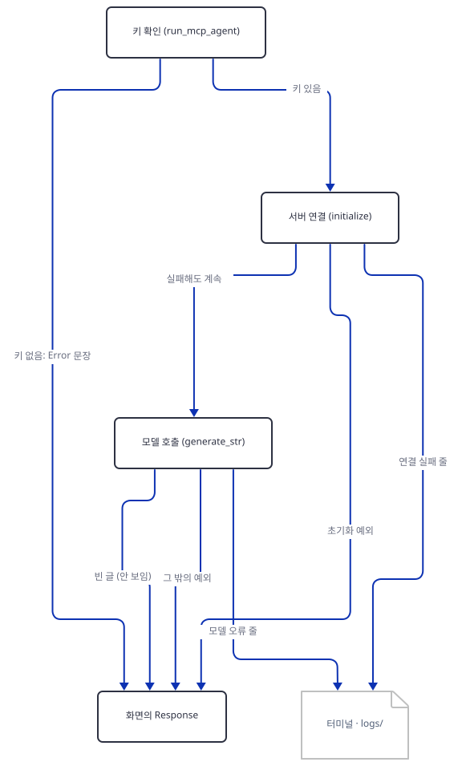

넷을 차례로 만들어 봅니다. 가짜 서버(58231)는 계속 떠 있어야 합니다. 첫째는 키가 없는 경우입니다. 비밀 파일이 없는 폴더에서 `OPENAI_API_KEY`도 없이 돌립니다. 셸에 키가 걸려 있어도 없는 상태가 되도록 두 환경변수를 지우고 돌립니다.

```bash
cd ..
mkdir case-nokey
cd case-nokey
cp ../browser-work/main.py ../browser-work/check_app.py ../browser-work/mcp_agent.config.yaml ../browser-work/fake_playwright.py .
env -u OPENAI_API_KEY -u OPENAI_BASE_URL ../browser-work/.venv/Scripts/python check_app.py "hello" > run.out 2>&1
grep "^##" run.out
```

(PowerShell은 `Remove-Item Env:OPENAI_API_KEY, Env:OPENAI_BASE_URL -ErrorAction SilentlyContinue`로 두 변수를 지운 셸에서 `../browser-work/.venv/Scripts/python check_app.py "hello"`를 돌립니다. 이 셸의 변수는 이후 단계에도 지워진 채로 남습니다.)

```text
## 첫 화면 예외: [] | 도움말 박스: True
## 화면만 그린 뒤 | 파일: []
## 'hello' -> 화면 응답: 'Error: no LLM credentials found. Either set OPENAI_API_KEY in your en | 도움말 박스: True
## 이 명령 뒤 | 파일: []
```

이 경우만 화면에 문장이 나옵니다. 서버도 로그 폴더도 만들어지지 않았고(`파일: []`) 가짜 OpenAI 서버에도 요청이 가지 않았습니다. 앱이 `setup_agent` 앞에서 돌려보낸 것입니다.

둘째는 설정을 못 찾는 경우입니다. **`env -u`를 빼면 안 됩니다.** 셸에 진짜 `OPENAI_API_KEY`가 있으면 서버 없이(`not found in registry`) 모델 호출이 그대로 나가고, `base_url`이 없으므로 진짜 `https://api.openai.com/v1`로 갑니다(이 문서의 확인에서는 차단한 프록시 뒤에서 `Connection error`로 끝났고, `env -u`를 주면 요청이 0건이었습니다. 직접 확인). `check_app.py`는 `browser-work/main.py`를 쓰되 실행 폴더만 설정이 없는 곳으로 합니다. 키 확인은 `main.py` 폴더의 비밀 파일을 보므로 통과합니다.

```bash
cd ..
mkdir -p elsewhere
cd elsewhere
: > ../browser-work/openai.log
env -u OPENAI_API_KEY -u OPENAI_BASE_URL ../browser-work/.venv/Scripts/python ../browser-work/check_app.py "hello" > run.out 2>&1
grep "^##" run.out
grep -n -o "Server 'playwright' not found in registry\|Missing credentials" run.out
wc -l < ../browser-work/openai.log
```

```text
## 'hello' -> 화면 응답: '' | 도움말 박스: True
## 이 명령 뒤 | 파일: []
20:Server 'playwright' not found in registry
31:Missing credentials
0
```

화면 응답은 빈 문자열이고 오류 문장이 없습니다. 터미널 오류는 두 줄뿐입니다. 서버 이름을 설정에서 못 찾았다는 줄(뒤에 `Attempting to continue`가 붙습니다)과 `Missing credentials`(뒤 문장은 `Please pass an api_key, ...`)입니다. 설정을 못 찾았으니 비밀 파일은 찾아보지도 않았고(Step 2), `openai` 칸이 비어 `OPENAI_API_KEY` 환경변수도 없어서 키가 없습니다. 가짜 서버에는 요청이 하나도 오지 않았고(`0`), 로거 설정도 없어 `logs/`가 생기지 않았습니다. 같은 폴더에서 `streamlit run`을 해도 이렇게 됩니다. 앱 폴더로 가서 실행해야 합니다. 셸에 `OPENAI_API_KEY`가 있으면 이 경우는 위와 달리 서버 없이 실제 OpenAI로 요청이 나가 도구 없는 답이 옵니다.

셋째는 비밀 파일 예시를 고치지 않고 복사한 경우입니다. 가짜 서버는 `YOUR_OPENAI_API_KEY`가 오면 401을 돌려줍니다.

```bash
cd ..
mkdir case-key
cd case-key
cp ../browser-work/main.py ../browser-work/check_app.py ../browser-work/mcp_agent.config.yaml ../browser-work/fake_playwright.py .
cp ../browser-work/mcp_agent.secrets.yaml.example mcp_agent.secrets.yaml
../browser-work/.venv/Scripts/python check_app.py "hello" "second" > run.out 2>&1
grep -n -o "^##.*\|Error: Error code: 401" run.out | cut -c1-170
```

```text
4:## 첫 화면 예외: [] | 도움말 박스: True
5:## 화면만 그린 뒤 | 파일: []
522:## 'hello' -> 화면 응답: '' | 도움말 박스: True
523:## 이 명령 뒤 | 파일: ['logs/mcp-agent-20261014_223423.jsonl', 'mcp.log']
540:Error: Error code: 401
649:Error: Error code: 401
650:## 'second' -> 화면 응답: '' | 도움말 박스: True
651:## 이 명령 뒤 | 파일: ['logs/mcp-agent-20261014_223423.jsonl', 'mcp.log']
```

요청은 `YOUR_OPENAI_API_KEY`를 `Bearer`로 달고 갔고(`browser-work/openai.log`에 `auth='Bearer YOUR_OPENAI_A'`가 찍힘, 직접 확인), 화면은 빈 채입니다. 오류 줄은 터미널에 나오는데 `hello`가 끝난 직후가 아니라 **다음 명령이 돌 때** 나옵니다. 540행과 649행 둘 다 `## 'hello'` 줄(522행) 뒤, `## 'second'` 줄(650행) 앞입니다(두 번 찍히는 까닭은 확인하지 못했습니다. 행 번호는 실행마다 조금 달라지고 순서가 요점입니다). `mcp-agent`의 로거가 이벤트 루프 위에서 줄을 모아 내보내고, 앱은 명령이 끝나면 루프를 세워 두기 때문으로 보입니다(원인은 소스로 읽지 않았고 순서만 직접 확인했습니다). 이 확인은 `AppTest`로 한 것이라 진짜 브라우저로 열었을 때 줄이 찍히는 시각은 확인하지 못했습니다.

넷째는 `npx`가 없는 경우입니다. 이 PC에서는 PATH에서 Node를 뺀 셸이라 원본 설정의 `command: "npx"`가 그대로 실패합니다(`which npx`가 찾지 못함). 독자의 PC에서 같은 상태를 만들려면 `command`를 없는 이름으로 바꾸면 됩니다.

```bash
cd ..
mkdir case-npx
cd case-npx
cp ../browser-work/main.py ../browser-work/check_app.py ../browser-work/mcp_agent.secrets.yaml .
cp ../browser-work/mcp_agent.config.yaml .
sed -i 's#command: .*python.exe.*#command: "npx-not-installed"#' mcp_agent.config.yaml
: > ../browser-work/openai.log
../browser-work/.venv/Scripts/python check_app.py "Go to github.com/Shubhamsaboo/awesome-llm-apps" > run.out 2>&1
grep "^##" run.out
grep -n "WinError\|Attempting to continue" run.out | cut -c1-140 | head -3
sed 's/auth=.* model/model/' ../browser-work/openai.log
```

(`sed` 줄은 이 폴더에 복사한 설정 파일의 `command` 줄을 바꿉니다. 저장소의 원본이 아닙니다.)

```text
## 'Go to github.com/Shubhamsaboo/awesome-llm-apps' -> 화면 응답: '가짜 모델의 답: 이번 명령에서 도구 결과 0개를 읽었습니다.' | 도움말 박스: True
## 이 명령 뒤 | 파일: ['logs/mcp-agent-20261014_223433.jsonl']
76:Lifecycle task encountered an error: [WinError 2] 지정된 파일을 찾을 수 
87:'[WinError 2] 지정된 파일을 찾을 수 없습니다'. Check mcp_agent.config.yaml. 
88:Attempting to continue
22:34:33 /v1/chat/completions model=gpt-4o-mini max_tokens=10000 tools=0 도구결과=0 roles=system,user
```

이 경우는 **응답이 옵니다.** 서버를 못 띄운 오류가 로그에 남고 앱은 도구 없이(`tools=0`) 모델에게만 묻습니다. 진짜 모델이라면 "브라우저를 쓸 수 없다"고 답하거나 아는 대로 지어낼 텐데, 어느 쪽인지는 확인하지 못했습니다. 화면에는 오류가 없고, `mcp.log`도 안 생겼습니다(`파일:`에 `logs/...`만 있음). 한국어 Windows의 `[WinError 2]` 문구는 영어 Windows에서 다르고 macOS·Linux는 `FileNotFoundError`로 나올 텐데 그쪽은 확인하지 못했습니다. 원본 `npx` 설정 그대로 같은 명령을 돌려도 같은 줄이 나왔습니다(직접 확인).

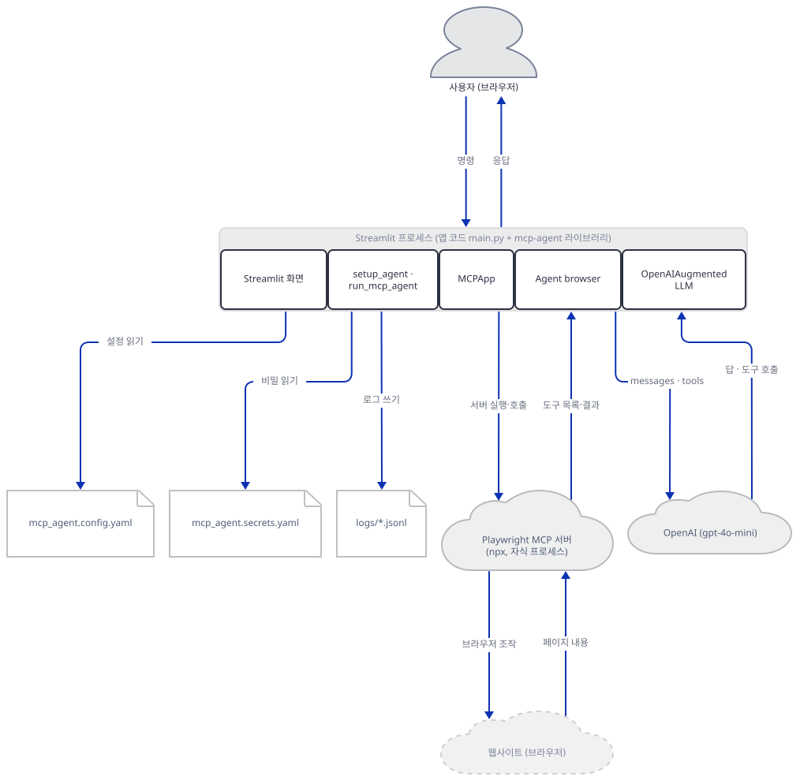

### Step 8. 로그와 바깥으로 나가는 것, 그리고 진짜로 띄우기

**목적.** 앱이 남기는 파일과 바깥으로 나가는 연결을 정리하고, 진짜 키와 `npx`로 돌릴 때 달라지는 점과 주의를 확인합니다.

**할 일.** 로거 설정은 설정 파일 2-9행입니다. 콘솔과 파일 둘 다, 수준은 `debug`, 파일 이름은 `logs/mcp-agent-<시각>.jsonl`입니다. Step 6의 `LOOP` 실행이 만든 로그 파일로 내용을 봅니다.

```bash
cd ../browser-work
wc -c logs/*.jsonl
grep -c "Fake page" logs/*.jsonl
grep -c "sk-fake" logs/*.jsonl run.out
cd <저장소>
git check-ignore -v mcp_ai_agents/browser_mcp_agent/mcp_agent.secrets.yaml mcp_ai_agents/browser_mcp_agent/logs/x.jsonl
```

앞의 셋은 `browser-work`에서, 마지막은 저장소 루트에서 돌립니다.

```text
77542 logs/mcp-agent-20261014_223508.jsonl
28
logs/mcp-agent-20261014_223508.jsonl:0
run.out:0
```

`git check-ignore`는 이 저장소에서 아무것도 찍지 않고 종료 코드 1로 끝납니다. `mcp_agent.secrets.yaml`도 `logs/`도 `.gitignore`에 없습니다. 설정 파일 주석은 비밀 파일을 "gitignored"로 둘 수 있다고만 말합니다. 앱 폴더에서 진짜 키를 넣어 쓰면 `git status`에 비밀 파일이 보이니 올리지 않도록 조심하세요.

로그 파일은 10번 요청한 한 명령으로 약 77KB였고 가짜 페이지의 글(`Fake page`)이 28번 들어 있었습니다. 디버그 수준이라 요청 메시지 전체와 도구 결과 전문이 기록됩니다. 진짜 브라우저라면 방문한 페이지의 내용이 파일로 남습니다. 키는 로그에도 터미널 출력에도 없었습니다(`sk-fake`가 0번).

바깥으로 나가는 연결은 소스와 실행으로 셋입니다. OpenAI(설정의 `base_url`, 없으면 기본 주소), MCP 서버 자식 프로세스, 그리고 그 서버가 여는 웹사이트입니다. `mcp-agent`의 사용 통계는 설정 값이 `usage_telemetry: True`로 켜져 있지만, 그것을 설정하는 함수 `configure_usage_telemetry`의 본문은 `pass`이고 보내는 코드는 주석입니다(`core/context.py`와 `telemetry/usage_tracking.py`, 소스로 확인). OpenTelemetry는 설정 기본값이 `otel: False`입니다(Step 2의 출력). `otel.enabled`가 꺼져 있으면 `configure_otel`이 바로 `None`을 돌려주므로 트레이서도, `tracing/tracer.py`에 있는 OpenAI SDK 계측도 설정되지 않습니다(`core/context.py`, 소스로 확인). agno를 쓰지 않으므로 Day 047의 agno 사용 통계는 상관이 없습니다.

가짜 서버 없이 진짜로 돌릴 때는 설정이 원본이어야 합니다. 작업 폴더의 설정 복사본을 원본으로 되돌리고 진짜 키를 비밀 파일에 넣습니다(`prepare_lab.py`를 거치지 않은 원본 복사본이면 됩니다). Node가 있으면 앱을 이 명령으로 띄웁니다.

```bash
uv run --no-project streamlit run main.py --server.address localhost
```

이 문서는 이 명령을 진짜 설정으로 실행하지 않았습니다. 브라우저가 열리고 사이트에 접속하기 때문입니다. 대신 가짜 설정으로 서버가 뜨는지만 봤습니다.

```bash
uv run --no-project streamlit run main.py --server.headless true --server.address localhost --server.port 53902 --browser.gatherUsageStats false
curl --noproxy "*" http://localhost:53902/_stcore/health
```

```text
ok
```

(서버는 Ctrl+C로 끕니다. 이 확인에서 브라우저로 접속하지 않았으므로 스크립트는 한 번도 돌지 않았습니다. 그러면 `mcp.log`도 `logs/`도 생기지 않는다는 Step 4의 사실과 맞습니다. 끈 뒤 `netstat -ano | grep :53902`로 포트가 비었는지 봅니다.)

진짜로 쓸 때 달라지는 점은 소스와 공개 문서로만 확인했습니다. Playwright MCP README(2026-10-14)는 브라우저가 기본으로 화면이 보이는 창으로 뜨고 `--headless`를 주면 숨긴다고 적고, "Playwright MCP is not a security boundary"라고 밝힙니다. 앱 README는 헤드리스라고 적지만 설정 파일의 서버 줄에는 `--headless`가 없으므로 README와 달리 창이 뜰 것입니다(실행해 보지 못했습니다). 인자를 더하려면 설정 파일 15행의 `args`에 넣으면 되고, 가짜 서버에서는 `mcp.log` 첫 줄의 `argv`에 보입니다(더 해보기).

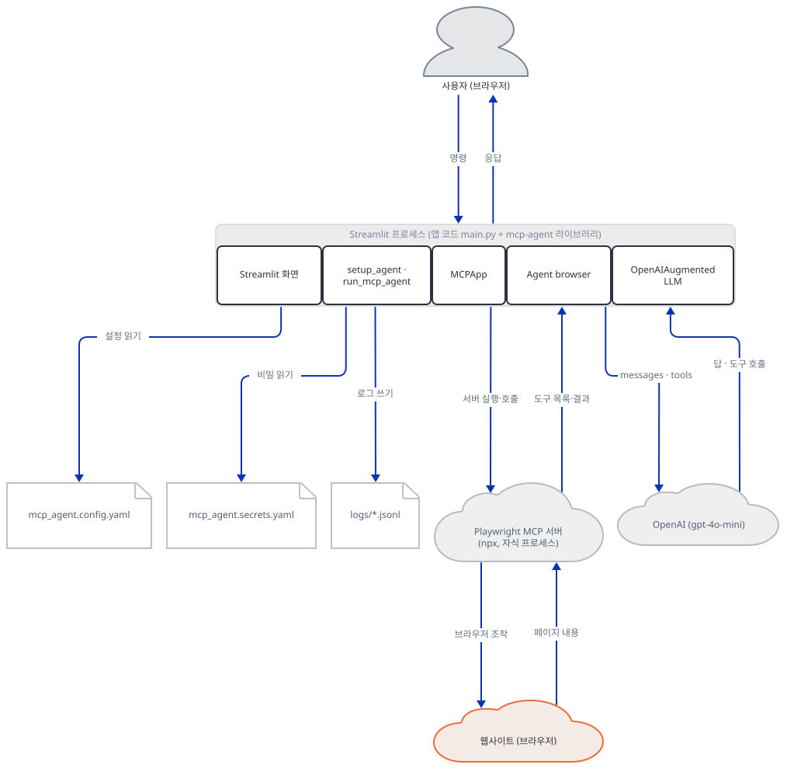

## 요청 한 건이 흐르는 과정

첫 명령 하나의 흐름입니다. 먼저 화면이 `MCPApp`을 시작하고 `Agent`를 초기화하는 앞부분입니다. 서버는 여기서 처음 뜹니다.

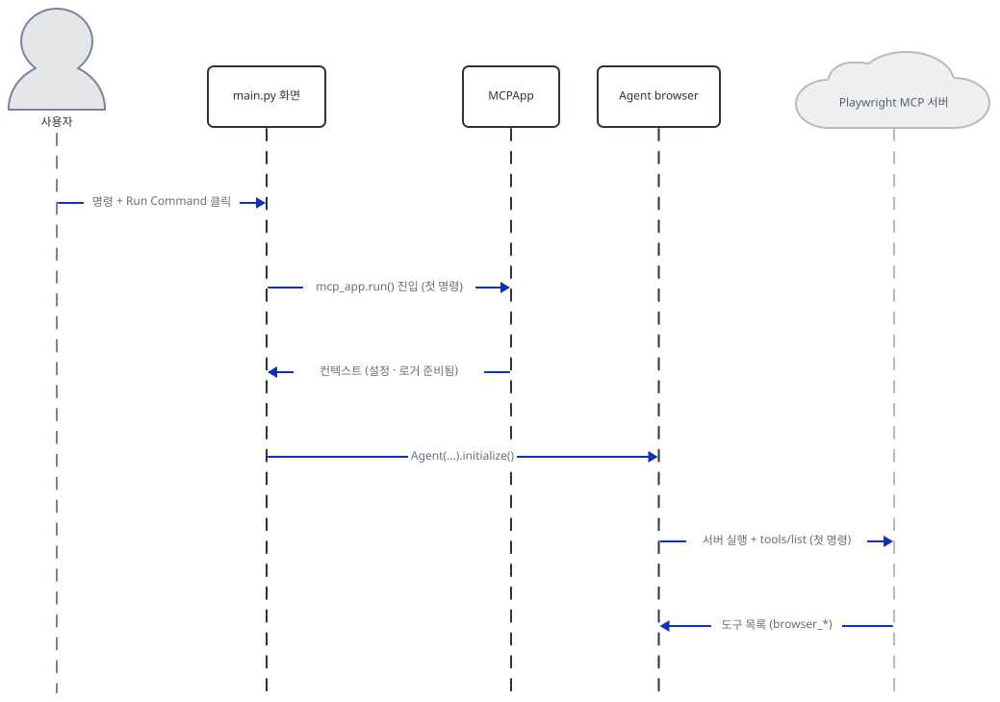

그다음은 LLM을 붙이고 도구 목록을 로그에 쓰는 부분입니다. `attach_llm`은 `Agent`에 있는 함수이고 LLM 객체는 `Agent`가 만듭니다.

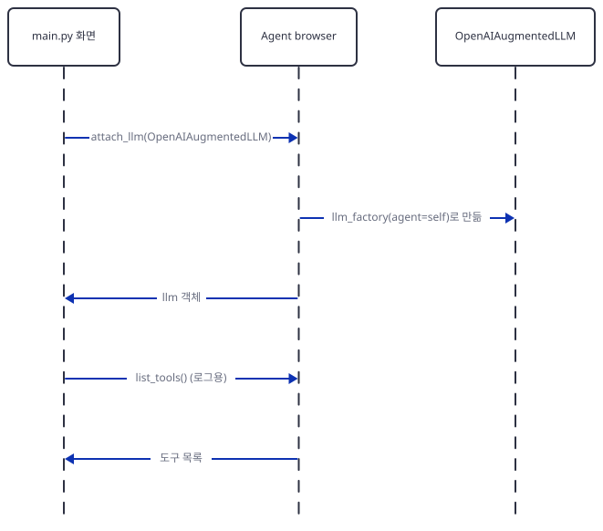

이제 `generate_str`입니다. 모델이 도구를 부르면 `OpenAIAugmentedLLM`이 `Agent`를 거쳐 서버에 `tools/call`을 보내고, 서버가 브라우저를 움직여 얻은 페이지 내용이 도구 결과로 돌아옵니다. 결과를 메시지에 더해 모델에 다시 묻습니다. 도구가 더 필요하면 이 순환이 최대 10번까지 반복됩니다(아래 그림은 한 번입니다).

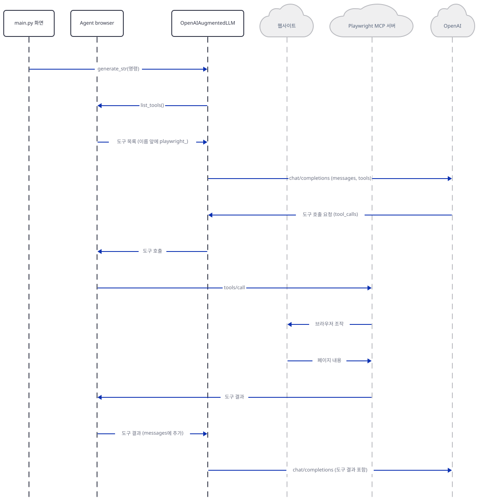

모델이 글로 답하면(`stop`) 응답이 화면으로 올라가고 `st.rerun()`으로 `Response`가 그려집니다.

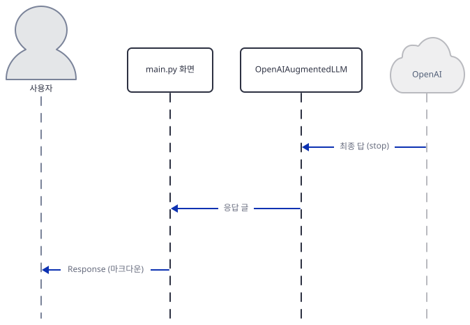

## 실행 체크리스트

- [ ] `PYTHONIOENCODING=utf-8`을 걸었고 `grep`이 한글 줄을 읽는다
- [ ] `uv pip install -r requirements.txt` 뒤 `mcp`를 `<2`로 고정하고 `imports ok`가 나왔다
- [ ] `show_settings.py`가 설정 파일을 위쪽 폴더에서 찾고, 설정 없는 폴더에서는 `서버: {}`를 낸다
- [ ] `fake_openai.py`가 `listening 58231`로 떠 있고 `prepare_lab.py`가 세 줄만 바꿨다
- [ ] 화면만 그린 뒤에는 `mcp.log`도 `logs/`도 없다
- [ ] 첫 명령 뒤 `mcp.log`와 `logs/mcp-agent-*.jsonl`이 생기고 서버의 환경 키가 열두 개뿐이다
- [ ] `openai.log`에서 `max_tokens=10000`, `tools=3`이 보이고 둘째 명령의 `roles`가 첫 명령 것을 포함한다
- [ ] `LOOP` 명령이 요청 10번과 빈 응답으로 끝난다
- [ ] 키 없음은 화면에 `Error:`가, 설정 못 찾음·401은 빈 응답이, `npx` 없음은 `tools=0` 답이 나온다
- [ ] Step 7의 첫째·둘째 명령에 `env -u OPENAI_API_KEY -u OPENAI_BASE_URL`을 붙였다
- [ ] 가짜 서버를 끄고 `netstat -ano | grep :58231`이 비었다

## 문제 해결

| 증상 | 원인 | 해결 |
|---|---|---|
| `grep`이 아무것도 안 내거나 `Binary file run.out matches`만 나온다 | 한국어 Windows에서 Python의 출력 인코딩이 `cp949`라 UTF-8 `grep`이 한글 줄을 못 읽는다(직접 확인) | `export PYTHONIOENCODING=utf-8`을 걸고 다시 돌린다(사전 준비) |
| `ModuleNotFoundError: No module named 'mcp.server.fastmcp'. This is mcp 2.x ...` | `requirements.txt`가 `mcp`를 고정하지 않아 2.3.0이 깔리고, `mcp-agent` 0.2.6은 1.x의 `FastMCP`를 부른다 | `uv pip install "mcp<2"` |
| 화면에 아무것도 안 나오고 터미널에 `Server 'playwright' not found in registry`와 `Missing credentials` | 앱을 실행한 폴더에서 위로 `mcp_agent.config.yaml`을 못 찾아 빈 설정으로 돌았다. 키 확인은 `main.py` 폴더를 봐서 통과한다 | 설정 파일이 있는 폴더(위쪽 포함)에서 실행한다. `show_settings.py`로 `설정 파일:` 줄을 본다. 셸에 `OPENAI_API_KEY`가 있으면 이 경우는 서버 없이 실제 OpenAI(`gpt-5-mini-2025-08-07`)로 요청이 나가 도구 없는 답이 온다 |
| 응답은 오는데 브라우저를 안 쓰고, 터미널에 `[WinError 2]`와 `Attempting to continue` | MCP 서버 명령(`npx`)을 PATH에서 못 찾아 서버 없이 모델에게만 물었다 | Node.js를 설치하고 PATH에 `npx`가 있는지 본다 |
| 화면 응답이 비어 있고 터미널에 `Error: Error code: 401` (다음 명령 때 나올 수 있다) | 비밀 파일이 예제의 `YOUR_OPENAI_API_KEY` 그대로이거나 키가 틀렸다 | `mcp_agent.secrets.yaml`의 `openai.api_key`를 진짜 키로 고친다 |
| `Error: no LLM credentials found. Either set OPENAI_API_KEY ...` | 환경변수도 `main.py` 폴더의 비밀 파일도 없다. 이것만 화면에 나온다 | 키를 환경변수로 주거나 `main.py` 폴더에 비밀 파일을 만든다 |
| 화면 응답이 빈 문자열인데 모델 요청이 10번 | 모델이 도구만 부르다 반복 한도(10)에 닿았다. 마지막 응답에 글이 없다 | 명령을 더 구체적으로 쓴다. 한도는 `main.py`의 `RequestParams`에 `max_iterations`로 줄일 수 있다(더 해보기) |
| 응답 뒤에도 "How to use this app" 박스가 남는다 | `if 'result' not in locals():`가 `st.rerun()` 뒤에는 항상 참이다(`main.py:157`) | 동작에는 영향이 없다. 조건을 고치거나 박스를 지운다 |
| 끝낼 때 `Failed to detach context`와 `ValueError: ... was created in a different Context`가 터미널에 나온다 | `main.py:57-58`이 `__aenter__`만 부르고 `__aexit__`를 부르지 않아, 프로세스가 끝날 때 컨텍스트 매니저가 한쪽에서 닫히며 OpenTelemetry 컨텍스트를 풀지 못하는 것으로 보인다(원인은 추정이고 `check_app.py` 끝에서만 직접 봤다) | 동작에는 영향이 없다 |
| `OSError: [WinError 10048]` | 가짜 OpenAI 서버의 포트를 다른 프로그램이 이미 쓴다. `allow_reuse_address = False`이니 겹쳐 뜨지 않고 오류로 끝나는 것이 정상이다(직접 확인) | 49152~65535에서 다른 포트를 고르고 `prepare_lab.py`에도 같은 번호를 준다 |
| 2027-01-14 이후 요청이 모델 오류로 끝날 수 있다(이 문서는 종료 뒤를 확인할 수 없다) | `gpt-4o-mini`의 스냅샷 `gpt-4o-mini-2024-07-18`이 OpenAI 폐기 표에서 2027-01-14 종료로 올라 있다(2026-10-14 확인) | 설정 파일 20행의 `default_model`을 표의 대체 모델로 바꾼다. 도구 호출을 잘하는 모델인지 먼저 확인한다 |

## 더 해보기

- 설정으로 서버 인자를 바꿔 봅니다. 작업 폴더의 설정 복사본 `args`에 `'--headless'`를 하나 더하고 `check_app.py`로 명령 하나를 돌린 뒤 `mcp.log` 첫 줄의 `argv`에 들어갔는지 보세요. 진짜 서버에서 창이 안 뜨는지는 이 문서가 확인하지 못했으니 직접 확인해야 합니다.
- 대화가 쌓이는 비용을 줄여 봅니다. 복사본 `main.py`에서 원본 `mcp_ai_agents/browser_mcp_agent/main.py:114`의 `RequestParams(use_history=True, maxTokens=10000)`를 `RequestParams(use_history=False, maxTokens=10000, max_iterations=3)`으로 바꿔 `check_app.py`로 `"Go to x" "LOOP now" "Go to y"`를 돌려 보세요. 이 문서는 이렇게 바꾼 복사본에서 `LOOP`가 요청 3번에서 멈추고, 셋째 명령의 첫 요청이 `roles=system,user`로 다시 시작하는 것을 확인했습니다(`openai.log`).
- 실패를 화면에 보이게 해 봅니다. `generate_str`가 빈 글을 돌려줄 때 `main.py:112-116`의 결과가 `''`이면 `"응답이 비었습니다. 터미널 로그를 보세요"`를 돌려주게 고치고, Step 7의 설정 못 찾음·401 사례가 화면에 문장을 내는지 확인하세요.

## 다음 날 예고

[Day 130 · 🔌 OpenAI Remote MCP Tool Bridge](../day130-openai-remote-mcp-bridge/README.md) — 오늘은 `mcp-agent`가 MCP 서버 실행과 도구 루프를 맡았습니다. 내일 원본 앱 `openai_remote_mcp_bridge.py`(269줄)는 모듈 설명이 "raw OpenAI function-calling loop"라고 밝히는 대로 라이브러리의 에이전트 없이 `mcp`의 `ClientSession`·`streamable_http_client`와 `openai`의 `AsyncOpenAI`를 직접 불러 도구 호출 루프를 손으로 짭니다(소스의 import와 첫 줄로 확인). 기본 MCP 서버 주소는 `https://search.parallel.ai/mcp`입니다. 오늘 `mcp-agent`가 해 주던 일을 코드로 보게 됩니다.
