# Day 130 · 🔌 OpenAI Remote MCP Tool Bridge

> 볼륨 9 ♾️ MCP AI Agents · 난이도 ★★☆ ⚠ 앱의 기본 모델 `gpt-4o-mini`는 모델 페이지의 기본 스냅숏 `gpt-4o-mini-2024-07-18`이 2027-01-14 종료 예정입니다(사전 준비) · 예상 소요 100분(앱은 파일 하나 269줄이지만 가짜 원격 MCP 서버와 가짜 OpenAI 서버를 직접 저장해 띄우고, 서버 쪽 기록과 앱 출력을 맞대어 보는 시간이 읽는 시간보다 큽니다) · API 비용 대략 한 건에 $0.002~0.015(⚠ 추정입니다. 이 문서는 OpenAI를 한 번도 부르지 않았습니다. 단가는 모델 페이지(https://developers.openai.com/api/docs/models/gpt-4o-mini, 2026-10-14)의 표준 요금 입력 $0.15/백만 토큰, 출력 $0.60/백만 토큰입니다. 도구를 한 번 쓰면 모델 호출이 두 번이고 입력은 도구 정의 전부와 결과(한 번에 12,000자까지)가 쌓여 수천~1만 토큰이면 $0.002 안팎, 예산 6을 다 쓰고 결과가 모두 12,000자면 입력 누계 10만 토큰 안팎으로 어림해 $0.015 안팎입니다. 기본 원격 서버 Parallel Search MCP는 키 없이 쓰는 무료 주소입니다) · 원본 앱: `mcp_ai_agents/openai_remote_mcp_bridge`

## 오늘 만들 것

볼륨 9 "♾️ MCP AI Agents"의 넷째 날입니다. Day 127~129의 원본 앱 소스를 읽어 보면 MCP 서버가 모두 내 PC에서 자식 프로세스로 뜹니다. `mcp_ai_agents/notion_mcp_agent/notion_mcp_agent.py:60-62`는 `StdioServerParameters(command="npx", …)`, `mcp_ai_agents/github_mcp_agent/github_agent.py:74-75`는 `command="docker"`, `mcp_ai_agents/browser_mcp_agent/mcp_agent.config.yaml:13-14`는 `command: "npx"`입니다(셋 다 소스로 확인했고 실행하지 않았습니다). 오늘 앱은 다릅니다. `streamable_http_client(server_url)`에 주소 하나를 주면 끝이고(`openai_remote_mcp_bridge.py:123`), 내 PC에는 아무 프로세스도 뜨지 않습니다. 에이전트 프레임워크도 없습니다. `requirements.txt`는 `openai>=1.40.0`과 `mcp>=1.28.1` 두 줄이고, 도구를 모델에게 보여 주고 부름을 받아 전달하는 반복문을 파일 하나가 직접 짭니다. 흐름은 이렇습니다. 원격 MCP 서버에 연결해 도구를 쪽(page)마다 모두 모으고, 각 도구를 OpenAI 함수 도구로 바꿔 모델에게 주고, 모델이 `tool_calls`를 내면 MCP로 전달하고, 결과를 12,000자로 자른 `tool` 메시지로 돌려줍니다. 도구 부름은 `--max-tool-calls`(기본 6)까지만 받습니다.

직접 돌려 알게 된 것이 넷입니다. 첫째, 오늘 `requirements.txt`를 그대로 설치하면 `mcp` 1.30.0이 깔리고 앱이 돕니다. 원본이 PR #1214(커밋 `938be235`, 2026-10-18 병합)에서 `mcp>=1.28.1,<2`로 상한을 박았기 때문입니다. 그 전에는 `mcp` 2.3.0이 풀려, 이 앱이 세 군데가 맞지 않아 첫 연결에서 죽었습니다(Step 1, Step 3). 둘째, `--list-tools`는 OpenAI 키가 없어도 되지만 원격 서버에는 바로 붙고, 기본 주소는 실제 `https://search.parallel.ai/mcp`입니다. 그래서 이 문서의 모든 명령은 `--server-url`을 루프백 가짜 서버로 줍니다(Step 3). 셋째, 서버가 도구 하나라도 OpenAI가 받지 못하는 모양이면 그 한 개 때문에 모델 호출 전에 전체가 멈추고, `--tools`로 골라 빼야 합니다(Step 4). 넷째, 터미널의 `[truncated N characters]` 숫자는 모델이 받은 글의 숫자가 아닙니다(Step 7).

이 문서는 Parallel에도 OpenAI에도 요청을 보내지 않습니다. 두 서버를 모두 이 PC의 임의 포트에 띄운 가짜로 대신하고, 가짜 서버의 도구와 답은 제가 지어낸 대본입니다. 진짜 Parallel Search MCP의 도구는 `web_search`와 `web_fetch` 둘이고 키 없이 쓸 수 있다고 Parallel 문서(https://docs.parallel.ai/integrations/mcp/search-mcp, 2026-10-14 확인)에 적혀 있지만, 그 서버에 붙어 보지는 않았으므로 도구의 인자 모양은 모릅니다. 아래는 완성된 아키텍처입니다. 일곱 칸은 한 파일 안의 함수들이고 번호는 코드가 실행되는 순서입니다. 화살표는 칸이 아니라 파일 전체에 닿습니다. 칸 사이의 호출 순서는 아래 "요청 한 건이 흐르는 과정"이 맡고, 어느 칸이 바깥과 이야기하는지는 이렇습니다. 사용자의 인자와 환경변수 셋(`OPENAI_API_KEY`·`MCP_SERVER_URL`·`OPENAI_MODEL`)은 1번이, `initialize`와 그 답은 2번이, `tools/list`와 도구 쪽은 3번이, `messages · tools`와 `tool_calls`는 5번이, `tools/call`과 `CallToolResult`는 6번이 주고받고(결과는 7번이 글로 만듭니다), `OPENAI_BASE_URL`은 5번의 SDK가 읽습니다. 터미널로 가는 출력 화살표는 `run_bridge` 안의 `print`들이라 `[connect]`(122행)는 2번, `[discover]`(131행)는 3번, `[tools]`·`[convert]`(145-146행)는 4번, `[final]`(174행)은 5번, `[openai -> mcp]`와 `[mcp -> openai]`(181-183행, 207행)는 6번에서 나갑니다(코드 위치는 아래 표). 4번 칸은 아래 표의 두 행(`select_tools`와 `mcp_tool_to_openai`)을 한 칸에 담았습니다.

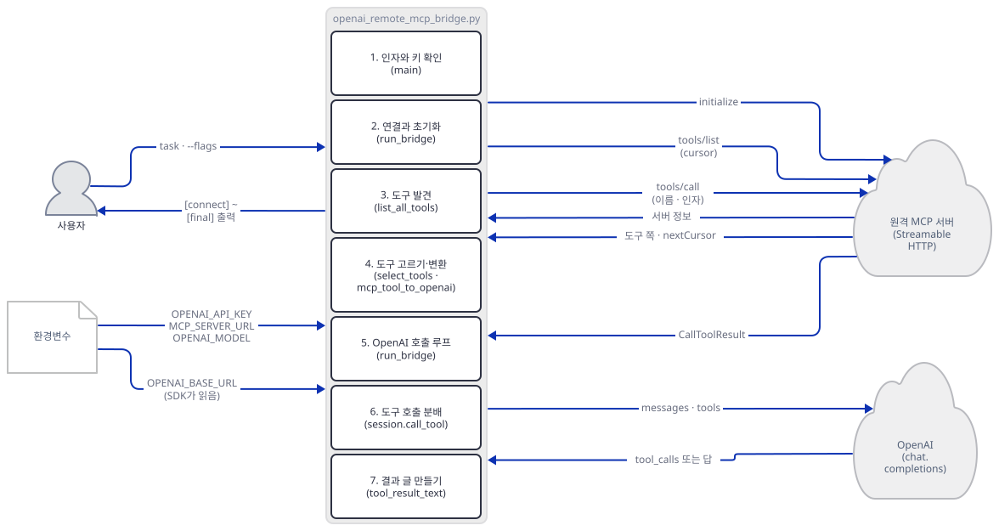

## 사전 준비

| 서비스/도구 | 용도 | 발급·설치 |
|---|---|---|
| uv | 가상환경 생성과 패키지 설치 | [공통 사전 준비](../README.md#공통-사전-준비-한-번만) 참고 |
| Python | 이 문서는 3.13.3으로 확인했다. 앱 README는 3.11 이상이라고 적고, `mcp`는 3.10 이상을 요구한다 | 공통 사전 준비와 같음 |
| OpenAI API 키 | 실제로 쓸 때만 필요하다. 앱은 `OPENAI_API_KEY` 환경변수를 읽는다. 이 문서는 가짜 값 `sk-fake`와 가짜 서버로 확인한다 | https://platform.openai.com/api-keys |
| 원격 MCP 서버 | 앱의 기본값은 `https://search.parallel.ai/mcp`. 이 문서는 쓰지 않고 가짜 서버로 대신한다 | 별도 설치 없음 |
| 터미널 넷 | 가짜 MCP 서버, 가짜 OpenAI 서버, 앱, (Step 4의) 두 번째 가짜 MCP 서버 | 별도 설치 없음 |

앱의 기본 모델은 `gpt-4o-mini`입니다(`mcp_ai_agents/openai_remote_mcp_bridge/openai_remote_mcp_bridge.py:18`). OpenAI 모델 페이지(https://developers.openai.com/api/docs/models/gpt-4o-mini, 2026-10-14에 내려받아 읽음)는 "Default snapshot: `gpt-4o-mini-2024-07-18`"이라고 적고, 폐기 문서(https://developers.openai.com/api/docs/deprecations, 같은 날 읽음)는 "2026-10-14: GPT-4 series model deprecations" 아래에 "January 14, 2027 | GPT-4o mini (`gpt-4o-mini-2024-07-18`) | `gpt-6-luna`"를 올려 두었습니다. 별칭 `gpt-4o-mini` 자체는 폐기 표에 없고 종료 뒤 별칭이 어떻게 되는지는 폐기 문서가 말하지 않습니다. 그래서 머리말에 ⚠를 달았습니다. 2027-01-14 전에 `--model`이나 `OPENAI_MODEL`로 다른 모델을 줘야 할 수 있고, 도구 호출을 지원하는 모델이어야 합니다.

## 아키텍처 한눈에 보기

| 컴포넌트 | 역할 | 코드 위치 |
|---|---|---|
| 인자·키 확인 (`main`) | 인자 읽기, 키와 `--tools` 검사, `asyncio.run`, 실패를 한 줄로 | `mcp_ai_agents/openai_remote_mcp_bridge/openai_remote_mcp_bridge.py:228-265` |
| 상수 | 기본 주소, 모델, 예산 6, 읽기 제한 120초, 12,000자, trace 500자, 이름 정규식 | `mcp_ai_agents/openai_remote_mcp_bridge/openai_remote_mcp_bridge.py:17-23` |
| 연결과 초기화 (`run_bridge`) | 원격 연결을 열고 세션을 초기화. 이 함수가 연결의 주인이다 | `mcp_ai_agents/openai_remote_mcp_bridge/openai_remote_mcp_bridge.py:113-129` |
| 도구 발견 (`list_all_tools`) | `nextCursor`가 없어질 때까지 `list_tools`를 부름 | `mcp_ai_agents/openai_remote_mcp_bridge/openai_remote_mcp_bridge.py:43-52` |
| 도구 고르기 (`select_tools`) | `--tools`를 검사해 부분집합을 돌려줌 | `mcp_ai_agents/openai_remote_mcp_bridge/openai_remote_mcp_bridge.py:99-110` |
| 도구 변환 (`mcp_tool_to_openai`) | 이름과 스키마를 검사하고 OpenAI 함수 도구로 | `mcp_ai_agents/openai_remote_mcp_bridge/openai_remote_mcp_bridge.py:55-79` |
| OpenAI 호출 루프 (`run_bridge` 안) | 메시지를 쌓고 `chat.completions.create`, 예산 검사 | `mcp_ai_agents/openai_remote_mcp_bridge/openai_remote_mcp_bridge.py:147-175, 216-225` |
| 도구 호출 분배 (`run_bridge` 안) | 예산·이름·인자 검사 뒤 `session.call_tool` | `mcp_ai_agents/openai_remote_mcp_bridge/openai_remote_mcp_bridge.py:177-214` |
| 결과 글 만들기 | `tool_result_text`가 글을 뽑고 `limit_text`가 자름 | `mcp_ai_agents/openai_remote_mcp_bridge/openai_remote_mcp_bridge.py:26-31, 82-96` |
| 오류 풀기 (`explain_error`) | 여러 오류가 묶인 예외를 한 문장으로 | `mcp_ai_agents/openai_remote_mcp_bridge/openai_remote_mcp_bridge.py:34-40` |
| 원격 MCP 서버 | 앱 밖. 기본 `https://search.parallel.ai/mcp`, 이 문서는 가짜 | `mcp_ai_agents/openai_remote_mcp_bridge/openai_remote_mcp_bridge.py:17` |
| OpenAI | 앱 밖. SDK의 기본 주소, 이 문서는 `OPENAI_BASE_URL`로 가짜 | `mcp_ai_agents/openai_remote_mcp_bridge/openai_remote_mcp_bridge.py:159` |

앱이 밖으로 여는 연결은 둘뿐입니다. MCP 서버로 가는 HTTP(`streamable_http_client`)와 OpenAI로 가는 HTTP(`AsyncOpenAI`). `mcp` 1.30.0과 `openai` 3.31.0 소스에서 `posthog`·`sentry`·`analytics`를 grep하면 두 패키지 모두 0건이었습니다(검색어에 `segment`를 더하면 `openai`의 음성 받아쓰기 파일만 걸립니다). 에이전트 프레임워크가 없으니 Day 047의 agno 익명 사용 통계도 이 앱과 상관없습니다.

## 단계별 진행

각 Step 그림에서 주황으로 칠해진 칸이 그 Step에서 다루는 함수입니다. 화살표는 칸이 아니라 파일 전체에 닿으므로, 어느 칸이 보내는지는 위 "오늘 만들 것"의 대응을 보세요.

### Step 1. 환경 만들기 — `requirements.txt`가 `mcp` 1.x로 묶입니다

**목적.** 원본을 건드리지 않도록 작업 폴더에 복사본과 가상환경을 만들고, 키 없이 어디까지 가는지 봅니다.

**할 일.** `<저장소>`는 이 저장소를 받은 경로입니다.

```bash
mkdir bridge-work
cd bridge-work
cp <저장소>/mcp_ai_agents/openai_remote_mcp_bridge/openai_remote_mcp_bridge.py .
cp <저장소>/mcp_ai_agents/openai_remote_mcp_bridge/requirements.txt .
uv venv
uv pip install -r requirements.txt
```

(pip 대안: `python -m venv .venv`로 만들고 활성화한 뒤 `pip install -r requirements.txt`.) 아래 PowerShell 줄은 실행해 보지 못했습니다(이 문서를 쓴 하네스가 PowerShell 실행을 막습니다).

```powershell
mkdir bridge-work
cd bridge-work
Copy-Item <저장소>\mcp_ai_agents\openai_remote_mcp_bridge\openai_remote_mcp_bridge.py .
Copy-Item <저장소>\mcp_ai_agents\openai_remote_mcp_bridge\requirements.txt .
uv venv
uv pip install -r requirements.txt
```

이 저장소는 루트에 `pyproject.toml`이 있어 저장소 안에서 `uv run`은 루트 환경을 쓰려 하므로, 이후 `uv run`에는 모두 `--no-project`를 붙입니다. 복사한 `requirements.txt`는 지금 이렇습니다.

`mcp_ai_agents/openai_remote_mcp_bridge/requirements.txt:1-2`

```text
openai>=1.40.0
mcp>=1.28.1,<2
```

`mcp`에 상한 `<2`가 있어 2.x가 풀리지 않습니다. 이 상한은 PR #1214(커밋 `938be235`, 2026-10-18 병합) 전에는 없었고, 그때는 `requirements.txt`만 설치하면 `mcp` 2.3.0이 깔려 앱이 첫 연결에서 죽어서 `"mcp<2"`를 따로 더해야 했습니다(Step 3에 그 실패를 남겼습니다). 파일 맨 위의 가져오기는 이렇습니다.

`mcp_ai_agents/openai_remote_mcp_bridge/openai_remote_mcp_bridge.py:3-14`

```python
import argparse
import asyncio
import builtins
import json
import os
import re
from datetime import timedelta
from typing import Any

from mcp import ClientSession
from mcp.client.streamable_http import streamable_http_client
from openai import AsyncOpenAI
```

표준 라이브러리 여덟 줄과 `mcp`·`openai` 둘입니다. `streamable_http_client`는 설치된 `mcp` 1.30.0에 있습니다(Step 3에서 쓰입니다).

**확인.** 이 단계의 명령은 모두 `--server-url http://127.0.0.1:9/mcp`를 줍니다. 아직 가짜 서버가 없으니 아무도 듣지 않는 루프백 포트로 보내, 혹시 키가 설정된 셸이어도 기본 주소로 나가지 않게 합니다.

```bash
uv run --no-project python -m py_compile openai_remote_mcp_bridge.py && echo compiled
uv run --no-project python -c "import mcp.client.streamable_http, openai; from importlib.metadata import version; print('mcp', version('mcp'), 'openai', version('openai'))"
uv run --no-project python openai_remote_mcp_bridge.py --server-url http://127.0.0.1:9/mcp
uv run --no-project python openai_remote_mcp_bridge.py --server-url http://127.0.0.1:9/mcp --max-tool-calls 0 hi
env -u OPENAI_API_KEY uv run --no-project python openai_remote_mcp_bridge.py --server-url http://127.0.0.1:9/mcp hi
OPENAI_API_KEY=sk-fake uv run --no-project python openai_remote_mcp_bridge.py --server-url http://127.0.0.1:9/mcp --list-tools
```

(PowerShell 5.1에는 `&&`와 `env -u`가 없습니다. 첫 줄은 `uv run --no-project python -m py_compile openai_remote_mcp_bridge.py; if ($?) { echo compiled }`로, 다섯째 줄은 `Remove-Item Env:OPENAI_API_KEY -ErrorAction SilentlyContinue` 다음 줄에 앱 명령을, 여섯째 줄은 `$env:OPENAI_API_KEY="sk-fake"` 다음 줄에 앱 명령을 씁니다. 실행해 보지 못했습니다.)

직접 확인한 결과입니다. 2026-10-22에 `requirements.txt`만으로 설치된 것은 `mcp` 1.30.0, `openai` 3.36.0 등 36개였습니다(Python 3.12.10). 아래 Step 2 이후는 2026-10-14에 `openai` 3.31.0으로 돌렸고, 그 값은 그대로 적습니다. 오늘 위 명령들의 출력은 `openai` 줄 말고 같았습니다.

```text
compiled
mcp 1.30.0 openai 3.36.0
...
openai_remote_mcp_bridge.py: error: provide a task or use --list-tools
...
openai_remote_mcp_bridge.py: error: --max-tool-calls must be at least 1
OPENAI_API_KEY is required when running a task.
[connect] http://127.0.0.1:9/mcp
Bridge failed: All connection attempts failed
```

셋째·넷째 명령의 `usage:` 줄들(터미널 폭에 따라 한 줄에서 다섯 줄)은 `...`로 줄였고 종료 코드는 2입니다. 다섯째 명령은 키가 없다고 종료 코드 1로 끝나고 `[connect]`도 찍지 않습니다. 키 검사(`:246-248`)가 연결(`:122`)보다 앞이기 때문입니다. 여섯째는 키 없이 되는 `--list-tools`가 연결을 시도해, 듣는 이가 없어 실패한 것입니다. 인자 검사와 키 검사는 네트워크에 닿기 전에 끝납니다.

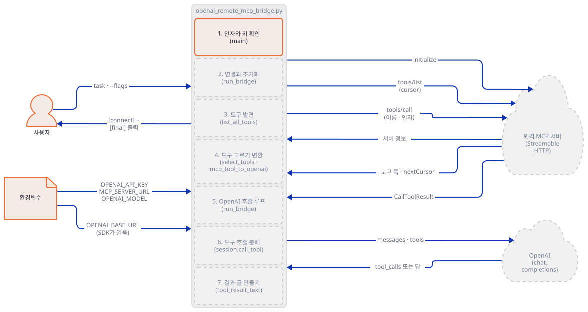

### Step 2. 가짜 원격 MCP 서버와 가짜 OpenAI 서버 만들기

**목적.** 진짜 서버 없이 앱의 두 바깥 연결을 모두 루프백으로 돌립니다. 두 서버는 이 문서가 지어낸 것이고, 서버 쪽에도 기록을 남겨 앱 출력과 맞댈 수 있게 합니다.

**할 일.** 아래 두 파일을 `bridge-work`에 저장합니다. 가짜 MCP 서버는 `mcp`의 저수준 `Server`를 Streamable HTTP로 서빙하고, 도구 다섯을 지어 냅니다. 일부러 이런 도구들입니다. `web_search`는 `structuredContent`를, `fetch_page`는 3만 자 글을, `screenshot`은 이미지 블록을, `flaky`는 `isError` 결과를 돌려줍니다. `tools/list`는 한 쪽에 두 개씩(`FAKE_PAGE`) 나눠 줍니다. 두 서버 모두 49152~65535의 임의 포트를 고르고, Windows에서 남의 포트에 겹쳐 뜨지 않도록 포트 재사용을 막습니다.

`fake_mcp.py`

```python
"""가짜 원격 MCP 서버(Streamable HTTP, 루프백). 도구는 이 튜토리얼이 지어낸 것이다."""
import contextlib
import base64
import json
import os
import random
import socket

import uvicorn
from mcp import types
from mcp.server.lowlevel import Server
from mcp.server.streamable_http_manager import StreamableHTTPSessionManager
from starlette.applications import Starlette
from starlette.responses import PlainTextResponse
from starlette.routing import Mount

LOG = os.environ.get("FAKE_MCP_LOG", "fake_mcp.log.jsonl")
BAD = os.environ.get("FAKE_BAD") == "1"       # OpenAI가 못 받는 도구 둘을 더한다 (Step 4)
PAGE = int(os.environ.get("FAKE_PAGE", "2"))  # tools/list 한 쪽에 담을 도구 수 (Step 3)


def log(**kw):
    with open(LOG, "a", encoding="utf-8") as f:
        f.write(json.dumps(kw, ensure_ascii=False) + "\n")


def schema(props, required):
    return {"type": "object", "properties": props, "required": required}


TOOLS = [
    types.Tool(name="web_search", description="Search the invented index.\nSecond line is not shown by --list-tools.",
               inputSchema=schema({"query": {"type": "string"}, "max_results": {"type": "integer"}}, ["query"])),
    types.Tool(name="fetch_page", description="Return a very long page (30,000 characters).",
               inputSchema=schema({"url": {"type": "string"}}, ["url"])),
    types.Tool(name="screenshot", description="Return an image block plus a caption.",
               inputSchema=schema({"url": {"type": "string"}}, ["url"])),
    types.Tool(name="flaky", description="Always fails with isError=true.",
               inputSchema=schema({"x": {"type": "integer"}}, ["x"])),
    types.Tool(name="no_args", description="Has no input schema fields.", inputSchema={"type": "object"}),
]
if BAD:
    TOOLS += [
        types.Tool(name="search.web", description="Dotted name (legal in MCP, illegal for OpenAI).",
                   inputSchema={"type": "object"}),
        types.Tool(name="list_input", description="Array input schema.", inputSchema={"type": "array"}),
    ]

server = Server("fake-remote-mcp")


@server.list_tools()
async def list_tools(req: types.ListToolsRequest) -> types.ListToolsResult:
    cursor = req.params.cursor if req and req.params else None
    start = int(cursor) if cursor else 0
    chunk = TOOLS[start:start + PAGE]
    nxt = str(start + PAGE) if start + PAGE < len(TOOLS) else None
    log(ev="list_tools", cursor=cursor, returned=[t.name for t in chunk], next=nxt)
    return types.ListToolsResult(tools=chunk, nextCursor=nxt)


PNG = base64.b64encode(bytes.fromhex("89504e470d0a1a0a")).decode()


@server.call_tool(validate_input=False)
async def call_tool(name: str, arguments: dict):
    log(ev="call_tool", name=name, arguments=arguments)
    if name == "web_search":  # dict를 돌려주면 structuredContent가 된다
        return {"query": arguments.get("query"),
                "results": [{"title": "Invented result", "url": "https://example.invalid/1"}]}
    if name == "fetch_page":
        return [types.TextContent(type="text", text="0123456789" * 3000)]
    if name == "screenshot":
        return [types.ImageContent(type="image", data=PNG, mimeType="image/png"),
                types.TextContent(type="text", text="caption")]
    if name == "flaky":
        raise ValueError("flaky tool failed on purpose")
    return [types.TextContent(type="text", text=f"{name} ok")]


manager = StreamableHTTPSessionManager(app=server, json_response=False, stateless=False)


class Spy:
    """HTTP 요청마다 한 줄을 남긴다(본문은 JSON-RPC 메서드 이름만, 헤더는 값이 아니라 있고 없음만)."""

    def __init__(self, app):
        self.app = app

    async def __call__(self, scope, receive, send):
        if scope["type"] != "http":
            return await self.app(scope, receive, send)
        chunks = []
        while True:
            m = await receive()
            chunks.append(m)
            if m["type"] != "http.request" or not m.get("more_body"):
                break
        body = b"".join(c.get("body", b"") for c in chunks if c["type"] == "http.request")
        rpc = None
        with contextlib.suppress(Exception):
            rpc = json.loads(body).get("method")
        h = {k.decode(): v.decode() for k, v in scope["headers"]}
        log(ev="http", method=scope["method"], path=scope["path"], rpc=rpc,
            has_session="mcp-session-id" in h, has_auth="authorization" in h)
        it = iter(chunks)

        async def replay():
            try:
                return next(it)
            except StopIteration:
                return await receive()

        await self.app(scope, replay, send)


@contextlib.asynccontextmanager
async def lifespan(app):
    async with manager.run():
        yield


async def handle(scope, receive, send):
    if scope["path"] != "/mcp":
        return await PlainTextResponse("not found", status_code=404)(scope, receive, send)
    await manager.handle_request(scope, receive, send)


app = Starlette(routes=[Mount("/", app=handle)], lifespan=lifespan)


def bind():
    """49152~65535에서 임의의 포트를 고른다. Windows에서는 포트 재사용을 막아야 남의 포트에 겹쳐 뜨지 않는다."""
    s = socket.socket()
    if hasattr(socket, "SO_EXCLUSIVEADDRUSE"):
        s.setsockopt(socket.SOL_SOCKET, socket.SO_EXCLUSIVEADDRUSE, 1)
    for _ in range(200):
        port = random.randint(49152, 65535)
        try:
            s.bind(("127.0.0.1", port))
            s.listen()
            return s, port
        except OSError:
            continue
    raise SystemExit("빈 포트를 찾지 못했습니다")


if __name__ == "__main__":
    sock, port = bind()
    print(f"PORT {port}", flush=True)
    log(ev="start", port=port, bad=BAD, page=PAGE)
    uvicorn.Server(uvicorn.Config(Spy(app), log_level="warning")).run(sockets=[sock])
```

가짜 OpenAI 서버는 질문 맨 앞의 `S:<이름>`으로 시나리오를 고릅니다. 도구가 요청에 없으면 항상 최종 답을 내고, 있으면 시나리오대로 `tool_calls`를 냅니다.

`fake_openai.py`

```python
"""가짜 OpenAI chat.completions 서버(루프백). 시나리오는 질문 글자 맨 앞의 'S:<이름>'으로 고른다."""
import json
import os
import random
import re
import socket
from http.server import BaseHTTPRequestHandler, HTTPServer

LOG = os.environ.get("FAKE_OPENAI_LOG", "fake_openai.log.jsonl")


def log(**kw):
    with open(LOG, "a", encoding="utf-8") as f:
        f.write(json.dumps(kw, ensure_ascii=False) + "\n")


def call(i, name, args):
    return {"id": f"call_{i}", "type": "function", "function": {"name": name, "arguments": args}}


FIRST_TURN = {
    "once": lambda: [call(1, "web_search", json.dumps({"query": "top story"}))],
    "big": lambda: [call(1, "fetch_page", json.dumps({"url": "https://example.invalid/long"}))],
    "image": lambda: [call(1, "screenshot", json.dumps({"url": "https://example.invalid/"}))],
    "flaky": lambda: [call(1, "flaky", json.dumps({"x": 1}))],
    "badjson": lambda: [call(1, "web_search", "{not json")],
    "array": lambda: [call(1, "web_search", "[1, 2]")],
    "empty": lambda: [call(1, "no_args", "")],
    "unknown": lambda: [call(1, "nonexistent_tool", "{}")],
    "multi": lambda: [call(i, "web_search", json.dumps({"query": q})) for i, q in ((1, "a"), (2, "b"), (3, "c"))],
}


def decide(req):
    msgs = req["messages"]
    user = next(m["content"] for m in msgs if m["role"] == "user")
    scen = (re.match(r"S:(\w+)", user) or [None, "once"])[1]
    has_tools = "tools" in req
    n_tool = sum(m["role"] == "tool" for m in msgs)
    final = {"role": "assistant",
             "content": f"FINAL[{scen}] after {n_tool} tool message(s); tools offered={has_tools}"}
    if not has_tools:
        return final
    if scen == "loop":  # 도구가 주어지는 한 계속 부른다
        q = json.dumps({"query": f"again {n_tool + 1}"})
        return {"role": "assistant", "content": None, "tool_calls": [call(n_tool + 1, "web_search", q)]}
    if scen in FIRST_TURN and n_tool == 0:
        return {"role": "assistant", "content": None, "tool_calls": FIRST_TURN[scen]()}
    return final


class Handler(BaseHTTPRequestHandler):
    def log_message(self, *a):
        pass

    def do_POST(self):
        body = json.loads(self.rfile.read(int(self.headers["content-length"])))
        msg = decide(body)
        auth = self.headers.get("authorization", "")
        log(path=self.path, model=body.get("model"), keys=sorted(body),
            tools=[t["function"]["name"] for t in body.get("tools", [])],
            tool_choice=body.get("tool_choice"), parallel=body.get("parallel_tool_calls"),
            roles=[m["role"] for m in body["messages"]],
            msg_keys=[sorted(m) for m in body["messages"]],
            lens=[len(m.get("content") or "") for m in body["messages"]],
            auth=auth[:10] + "...", ua=self.headers.get("user-agent"), host=self.headers.get("host"),
            reply_tool_calls=[c["function"]["name"] for c in msg.get("tool_calls", [])])
        out = {"id": "chatcmpl-fake", "object": "chat.completion", "created": 0, "model": body.get("model"),
               "choices": [{"index": 0, "message": msg,
                            "finish_reason": "tool_calls" if msg.get("tool_calls") else "stop"}],
               "usage": {"prompt_tokens": 1, "completion_tokens": 1, "total_tokens": 2}}
        data = json.dumps(out).encode()
        self.send_response(200)
        self.send_header("content-type", "application/json")
        self.send_header("content-length", str(len(data)))
        self.end_headers()
        self.wfile.write(data)


class Server(HTTPServer):
    allow_reuse_address = False

    def server_bind(self):
        if hasattr(socket, "SO_EXCLUSIVEADDRUSE"):
            self.socket.setsockopt(socket.SOL_SOCKET, socket.SO_EXCLUSIVEADDRUSE, 1)
        super().server_bind()


if __name__ == "__main__":
    for _ in range(200):
        port = random.randint(49152, 65535)
        try:
            server = Server(("127.0.0.1", port), Handler)
            break
        except OSError:
            continue
    print(f"PORT {port}", flush=True)
    server.serve_forever()
```

**확인.** 터미널 둘에서 각각 띄우고, 찍힌 포트를 적어 둡니다. 이 문서의 예는 MCP가 53707, OpenAI가 56005였고 실행마다 다릅니다.

```bash
uv run --no-project python fake_mcp.py
uv run --no-project python fake_openai.py
```

```text
PORT 53707
PORT 56005
```

앱을 돌리는 셋째 터미널에서 두 주소를 변수로 잡습니다. 이 터미널에서만 `OPENAI_BASE_URL`이 가짜 서버를 가리킵니다.

```bash
export M=http://127.0.0.1:53707/mcp
export OPENAI_BASE_URL=http://127.0.0.1:56005/v1
export OPENAI_API_KEY=sk-fake
```

(PowerShell: `$M="http://127.0.0.1:53707/mcp"`, `$env:OPENAI_BASE_URL="http://127.0.0.1:56005/v1"`, `$env:OPENAI_API_KEY="sk-fake"`. 이후 명령의 `$M`은 그대로 쓰면 됩니다. 실행해 보지 못했습니다.) 실제 OpenAI를 쓰려면 이 터미널에서 두 변수를 지우고 진짜 키를 넣는 것이 전부입니다. 그 이유는 Step 5에서 소스로 봅니다.

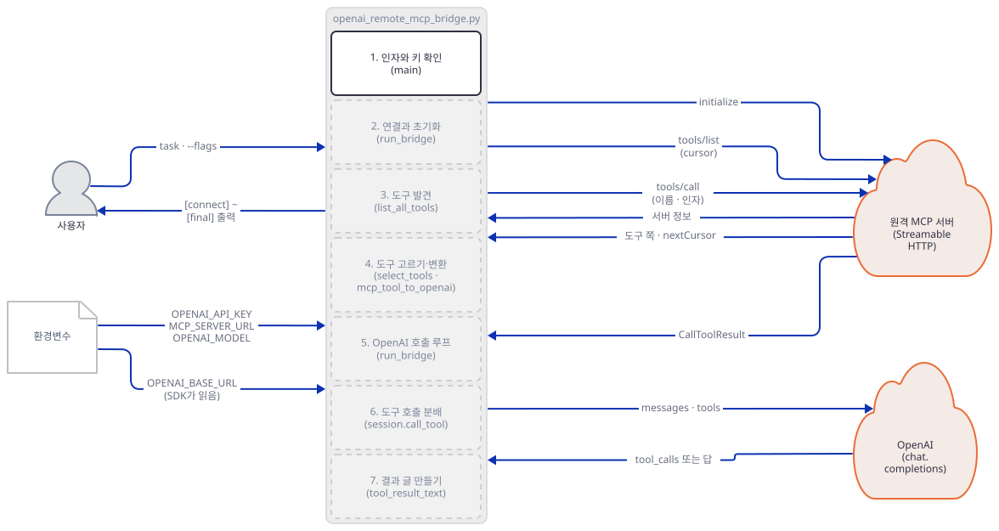

### Step 3. 연결하고 도구 찾기 — `--list-tools`

**목적.** 원격 연결을 열고, 세션을 초기화하고, 도구를 쪽마다 모읍니다. 이 단계가 키 없이 되는 부분입니다.

**할 일.** `run_bridge`는 연결과 세션을 `async with` 둘로 엽니다.

`mcp_ai_agents/openai_remote_mcp_bridge/openai_remote_mcp_bridge.py:122-137`

```python
    print(f"[connect] {server_url}")
    async with streamable_http_client(server_url) as (read_stream, write_stream, _):
        async with ClientSession(
            read_stream,
            write_stream,
            read_timeout_seconds=timedelta(seconds=READ_TIMEOUT_SECONDS),
        ) as session:
            await session.initialize()
            discovered = await list_all_tools(session)
            print(f"[discover] {len(discovered)} tool(s)")

            if task is None:
                for tool in discovered:
                    description = (tool.description or "No description").splitlines()[0]
                    print(f"- {tool.name}: {description}")
                return None
```

도구 목록은 쪽 단위입니다.

`mcp_ai_agents/openai_remote_mcp_bridge/openai_remote_mcp_bridge.py:43-52`

```python
async def list_all_tools(session: ClientSession) -> list[Any]:
    """Collect every page returned by MCP tool discovery."""
    tools: list[Any] = []
    cursor = None
    while True:
        page = await session.list_tools(cursor=cursor)
        tools.extend(page.tools)
        cursor = getattr(page, "nextCursor", None)
        if not cursor:
            return tools
```

`task`가 `None`이면(`--list-tools`) 도구 이름과 설명 첫 줄만 찍고 `return None`으로 끝납니다. 이 아래의 OpenAI 쪽 코드에는 닿지 않습니다. `print`가 `[connect]`를 연결보다 먼저 찍는 것도 눈여겨보세요.

**확인.** 키를 지우고 가짜 서버에 `--list-tools`를 돌립니다. 항상 `--server-url`을 줍니다. 이 인자를 빼면 같은 명령이 기본 주소로 나갑니다.

```bash
env -u OPENAI_API_KEY uv run --no-project python openai_remote_mcp_bridge.py --server-url $M --list-tools
cat fake_mcp.log.jsonl
```

```text
[connect] http://127.0.0.1:53707/mcp
[discover] 5 tool(s)
- web_search: Search the invented index.
- fetch_page: Return a very long page (30,000 characters).
- screenshot: Return an image block plus a caption.
- flaky: Always fails with isError=true.
- no_args: Has no input schema fields.
```

서버 기록에서 `ev`가 `http`인 줄을 순서대로 줄이면 이렇습니다(직접 확인). `POST initialize`, `POST notifications/initialized`, `GET`, `POST tools/list` 셋, `DELETE`. `list_tools` 줄은 `cursor`가 없음 → `"2"` → `"4"`로 이어지고 돌려준 도구는 2개, 2개, 1개이며 마지막 `next`가 `null`입니다. 쪽을 따라가는 반복문이 실제로 세 번 돈 것입니다. 모든 요청에서 `has_auth`는 `false`였습니다. 앱은 MCP 서버에 어떤 인증 헤더도 보내지 않습니다. `DELETE`는 `with` 블록이 끝날 때 세션을 닫는 요청이고, 기본값이 켜져 있기 때문입니다(`streamable_http_client`의 `terminate_on_close=True`, 서명으로 확인).

실패 모양도 봅니다. 서버 경로를 틀리면 `Bridge failed: Session terminated`, 듣는 서버가 없으면 `Bridge failed: All connection attempts failed`입니다(둘 다 직접 확인, 종료 코드 1). 뒤쪽 메시지는 내부 예외가 `ExceptionGroup`(`unhandled errors in a TaskGroup (1 sub-exception)`)으로 오는 것을 `explain_error`(`:34-40`)가 풀어 쓴 결과입니다.

`requirements.txt`의 `<2` 상한이 필요한 까닭도 여기서 보입니다. 상한이 생기기 전(PR #1214 전)의 `requirements.txt`만으로 깐 환경(`mcp` 2.3.0)에서 같은 파일을 돌리면 다음과 같이 죽었습니다(2026-10-14에 직접 확인, 오늘은 상한 때문에 이 판이 풀리지 않아 다시 돌리지 않았습니다).

```text
[connect] http://127.0.0.1:53707/mcp
Bridge failed: not enough values to unpack (expected 3, got 2)
```

2.3.0의 `streamable_http_client`는 읽기·쓰기 스트림 둘만 내놓습니다(`:123`은 셋을 기대). 그 한 줄을 고쳐도 `read_timeout_seconds`에 `timedelta`를 주는 `:127` 때문에 `unsupported operand type(s) for +: 'float' and 'datetime.timedelta'`로 죽고, 그것도 고치면 `ClientSession.list_tools() got an unexpected keyword argument 'cursor'`로 죽습니다(`:48`). 세 군데를 차례로 돌려 확인했습니다.

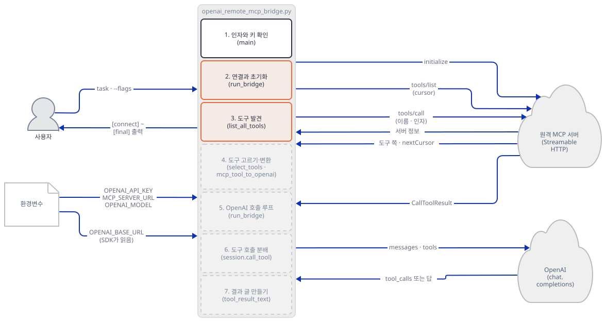

### Step 4. MCP 도구를 OpenAI 도구로 바꾸기 — 하나라도 안 맞으면 전부 멈춥니다

**목적.** 이름·스키마 검사와 `--tools` 부분집합이 실제로 어떻게 걸리는지 봅니다.

**할 일.** 변환 함수와 고르기 함수입니다.

`mcp_ai_agents/openai_remote_mcp_bridge/openai_remote_mcp_bridge.py:55-79`

```python
def mcp_tool_to_openai(tool: Any) -> dict[str, Any]:
    """Convert one compatible MCP tool definition to OpenAI's format."""
    name = getattr(tool, "name", "")
    if not OPENAI_FUNCTION_NAME.fullmatch(name):
        raise ValueError(
            f"MCP tool name {name!r} is not a valid OpenAI function name "
            "(use 1-64 letters, numbers, underscores, or hyphens)."
        )

    input_schema = getattr(tool, "inputSchema", None)
    if input_schema is None:
        input_schema = {}
    if not isinstance(input_schema, dict) or input_schema.get("type", "object") != "object":
        raise ValueError(f"MCP tool {name!r} must have an object input schema.")

    parameters = dict(input_schema)
    parameters.setdefault("type", "object")
    return {
        "type": "function",
        "function": {
            "name": name,
            "description": getattr(tool, "description", "") or "",
            "parameters": parameters,
        },
    }
```

`mcp_ai_agents/openai_remote_mcp_bridge/openai_remote_mcp_bridge.py:99-110`

```python
def select_tools(tools: list[Any], selected_names: list[str] | None) -> list[Any]:
    """Return all discovered tools or a validated caller-selected subset."""
    if not selected_names:
        return tools
    if len(selected_names) != len(set(selected_names)):
        raise ValueError("--tools contains duplicate names.")

    by_name = {tool.name: tool for tool in tools}
    missing = [name for name in selected_names if name not in by_name]
    if missing:
        raise ValueError("Unknown MCP tool(s): " + ", ".join(missing))
    return [by_name[name] for name in selected_names]
```

이름은 정규식 `^[A-Za-z0-9_-]{1,64}$`를 통과해야 하고(`:23`), 입력 스키마는 최상위가 `object`여야 합니다. 둘 다 고치지 않고 `ValueError`로 멈춥니다. 호출하는 쪽은 도구 전부를 한꺼번에 변환합니다.

`mcp_ai_agents/openai_remote_mcp_bridge/openai_remote_mcp_bridge.py:139-146`

```python
            exposed = select_tools(discovered, selected_names)
            openai_tools = [mcp_tool_to_openai(tool) for tool in exposed]
            if not openai_tools:
                raise ValueError("The MCP server did not expose any selected tools.")

            tool_names = {tool.name for tool in exposed}
            print("[tools] " + ", ".join(sorted(tool_names)))
            print("[convert] MCP inputSchema -> OpenAI function parameters")
```

네 번째 터미널에서 두 번째 가짜 MCP 서버를 환경변수 둘과 함께 띄웁니다. 이 서버는 앞의 다섯에 더해 이름에 점이 있는 `search.web`(MCP 이름 규칙에서는 되지만 OpenAI 함수 이름으로는 안 됩니다)과, 스키마 최상위가 `array`인 `list_input`을 내놓습니다. 도구가 일곱이라 한 쪽에 다 담도록 `FAKE_PAGE=10`을 줍니다. 두 서버는 로그 파일 이름이 겹치지 않게 `FAKE_MCP_LOG`도 다르게 줍니다.

```bash
FAKE_BAD=1 FAKE_PAGE=10 FAKE_MCP_LOG=fake_mcp_bad.log.jsonl uv run --no-project python fake_mcp.py
```

(PowerShell: `$env:FAKE_BAD="1"; $env:FAKE_PAGE="10"; $env:FAKE_MCP_LOG="fake_mcp_bad.log.jsonl"` 다음 줄에 `uv run --no-project python fake_mcp.py`. 실행해 보지 못했습니다.)

**확인.** 찍힌 포트를 `$B`로 잡고(이 문서의 예는 55525) 앱 터미널에서 돌립니다.

```bash
export B=http://127.0.0.1:55525/mcp
uv run --no-project python openai_remote_mcp_bridge.py --server-url $B --list-tools
uv run --no-project python openai_remote_mcp_bridge.py --server-url $B "S:once hi"
uv run --no-project python openai_remote_mcp_bridge.py --server-url $B --tools list_input "S:once hi"
uv run --no-project python openai_remote_mcp_bridge.py --server-url $B --tools web_search,fetch_page "S:once hi"
```

직접 확인한 결과입니다. 첫 명령은 `[discover] 7 tool(s)`와 일곱 줄을 찍고 `search.web: Dotted name (legal in MCP, illegal for OpenAI).`가 그 안에 있습니다. 둘째는 도구 전체를 변환하다 첫 불량에서 멈춥니다.

```text
[connect] http://127.0.0.1:55525/mcp
[discover] 7 tool(s)
Bridge failed: MCP tool name 'search.web' is not a valid OpenAI function name (use 1-64 letters, numbers, underscores, or hyphens).
```

셋째는 `Bridge failed: MCP tool 'list_input' must have an object input schema.`입니다(종료 코드는 둘 다 1). 이 두 실행에서 가짜 OpenAI 서버의 기록에는 요청이 한 줄도 없었습니다. 검사는 모델 호출 전에 끝납니다. 넷째는 둘로 좁혀 통과합니다.

```text
[tools] fetch_page, web_search
[convert] MCP inputSchema -> OpenAI function parameters
[openai -> mcp] web_search {"query": "top story"}
```

`[tools]`는 이름을 정렬해서 찍습니다(`sorted`, `:145`). 부분집합 검사도 봅니다. 첫 서버(`$M`)에 `--tools web_search,nope`를 주면 `Bridge failed: Unknown MCP tool(s): nope`, `--tools web_search,web_search`는 `Bridge failed: --tools contains duplicate names.`입니다. 둘 다 `[connect]`와 `[discover]`를 찍은 다음에 나옵니다. 서버에 붙고 나서야 이름을 대조할 수 있기 때문이고, `--tools "web_search,"`처럼 빈 이름은 연결 전에 `--tools must be a comma-separated list of non-empty names.`와 종료 코드 1로 거절됩니다(`:249-251`, 직접 확인).

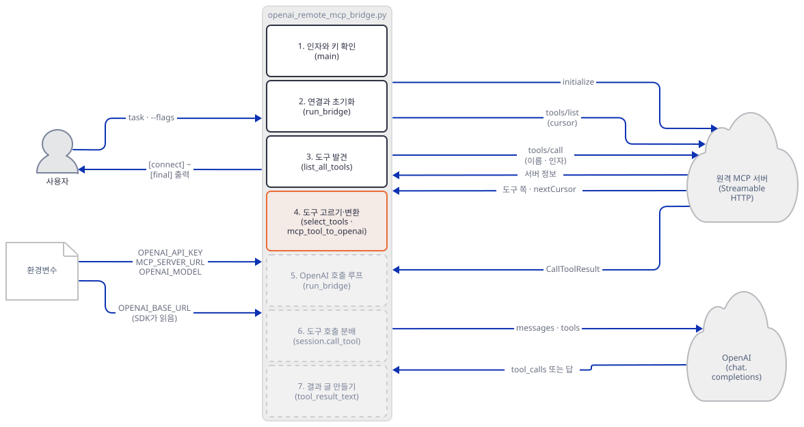

### Step 5. OpenAI 호출 루프 — 키는 앱이, 주소는 SDK가

**목적.** 메시지를 쌓고 모델을 부르는 루프의 첫 바퀴를 봅니다. 그리고 가짜 OpenAI 서버로 가는 길이 소스에서 어디를 지나는지 확인합니다.

**할 일.** 시스템 메시지와 첫 요청입니다.

`mcp_ai_agents/openai_remote_mcp_bridge/openai_remote_mcp_bridge.py:147-175`

```python
            messages: list[dict[str, Any]] = [
                {
                    "role": "system",
                    "content": (
                        "Use the available tools when needed to complete the task. "
                        "Ground factual claims in tool results and never invent tool output."
                    ),
                },
                {"role": "user", "content": task},
            ]
            requested_calls = 0

            async with AsyncOpenAI(api_key=api_key) as client:
                while True:
                    request: dict[str, Any] = {"model": model, "messages": messages}
                    if requested_calls < max_tool_calls:
                        request.update(
                            tools=openai_tools,
                            tool_choice="auto",
                            parallel_tool_calls=False,
                        )
                    response = await client.chat.completions.create(**request)
                    message = response.choices[0].message
                    messages.append(message.model_dump(exclude_none=True))
                    tool_calls = message.tool_calls or []
                    if not tool_calls:
                        answer = message.content or "No final answer was returned."
                        print(f"[final] {answer}")
                        return answer
```

`AsyncOpenAI(api_key=api_key)`에는 주소 인자가 없습니다(159행). 설치된 `openai` 3.31.0의 `AsyncOpenAI`는 `base_url`이 `None`이면 `OPENAI_BASE_URL` 환경변수를 읽습니다(`_client.py`의 1073~1074행, 소스로 확인). 그래서 변수를 건 터미널의 앱은 가짜 서버로, 변수를 지운 터미널의 앱은 `https://api.openai.com/v1`로 갑니다. 요청에는 `parallel_tool_calls=False`가 붙어, 모델에게 한 번에 도구 하나만 부르라고 청합니다. 응답 메시지는 `model_dump(exclude_none=True)`로 사전이 되어 `messages`에 그대로 쌓입니다.

**확인.** 이 명령부터 OpenAI 쪽도 가짜 서버입니다. 앱 터미널에서 `OPENAI_BASE_URL`이 걸려 있는지 먼저 봅니다(`echo $OPENAI_BASE_URL`).

```bash
uv run --no-project python openai_remote_mcp_bridge.py --server-url $M "S:once What is the top story?"
```

```text
[connect] http://127.0.0.1:53707/mcp
[discover] 5 tool(s)
[tools] fetch_page, flaky, no_args, screenshot, web_search
[convert] MCP inputSchema -> OpenAI function parameters
[openai -> mcp] web_search {"query": "top story"}
[mcp -> openai] {"query": "top story", "results": [{"title": "Invented result", "url": "https://example.invalid/1"}]}
[final] FINAL[once] after 1 tool message(s); tools offered=True
```

가짜 OpenAI 서버의 기록(`fake_openai.log.jsonl`)에는 요청이 두 줄이고 다음을 직접 확인했습니다. 두 요청 모두 경로가 `/v1/chat/completions`, 모델이 `gpt-4o-mini`, 본문 키가 `messages`·`model`·`parallel_tool_calls`·`tool_choice`·`tools`, `tool_choice`가 `auto`, `parallel_tool_calls`가 `false`이고, 도구 이름 다섯이 다 실려 갑니다. 첫 요청의 역할은 `system`, `user`, 둘째는 `system`, `user`, `assistant`, `tool`입니다. 모델이 돌려준 `assistant` 메시지는 키가 `role`과 `tool_calls` 둘뿐이고(`content`가 `None`이라 `exclude_none`에 빠짐), `tool` 메시지는 `content`·`role`·`tool_call_id`입니다. `User-Agent`는 `AsyncOpenAI/Python 3.31.0`, 키는 `Bearer sk-...`로 가짜 값만 들어갔습니다.

모델 이름은 `--model`이 `OPENAI_MODEL`을 이깁니다. `OPENAI_MODEL=model-from-env`만 주면 서버 기록에 `model-from-env`, `--model model-from-flag`를 같이 주면 `model-from-flag`가 찍혔습니다(직접 확인, `:235`). 서버 주소는 `MCP_SERVER_URL`이 기본값을 대신합니다(`:234`, `--server-url` 없이 변수만 준 실행으로 확인).

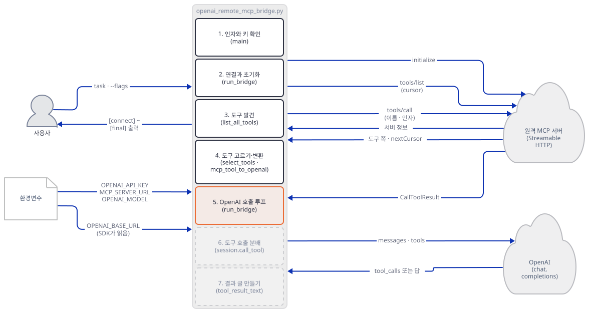

### Step 6. 도구 부름을 MCP로 넘기기 — 네 겹의 검사

**목적.** 모델이 내놓은 `tool_calls`가 MCP 서버에 닿기 전에 무엇을 통과하는지 봅니다.

**할 일.**

`mcp_ai_agents/openai_remote_mcp_bridge/openai_remote_mcp_bridge.py:177-214`

```python
                    for tool_call in tool_calls:
                        requested_calls += 1
                        name = tool_call.function.name
                        raw_arguments = tool_call.function.arguments or "{}"
                        print(
                            f"[openai -> mcp] {name} {limit_text(raw_arguments, MAX_TRACE_CHARS)}"
                        )

                        if requested_calls > max_tool_calls:
                            result_text = "Skipped: the MCP tool-call budget is exhausted."
                        elif name not in tool_names:
                            result_text = f"Error: unknown MCP tool {name!r}."
                        else:
                            try:
                                arguments = json.loads(raw_arguments)
                                if not isinstance(arguments, dict):
                                    raise ValueError("tool arguments must be a JSON object")
                            except (json.JSONDecodeError, ValueError) as exc:
                                result_text = f"Error: invalid tool arguments: {exc}"
                            else:
                                try:
                                    result = await session.call_tool(name, arguments)
                                    result_text = tool_result_text(result)
                                    if getattr(result, "isError", False) or getattr(
                                        result, "is_error", False
                                    ):
                                        result_text = "MCP tool error: " + result_text
                                except Exception as exc:
                                    result_text = f"Error calling MCP tool: {explain_error(exc)}"

                        print(f"[mcp -> openai] {limit_text(result_text, MAX_TRACE_CHARS)}")
                        messages.append(
                            {
                                "role": "tool",
                                "tool_call_id": tool_call.id,
                                "content": result_text,
                            }
                        )
```

한 번의 부름은 순서대로 이 검사를 거칩니다. 예산을 넘었는가(`:185`), 노출한 도구 이름인가(`:187`), 인자가 JSON 객체인가(`:191-195`), 그리고 부름 자체가 예외를 내지 않는가(`:204-205`). 어느 경우든 `tool` 메시지는 하나씩 반드시 만들어 `messages`에 붙입니다(`:208-214`). 모델이 `tool_call_id`에 답을 받지 못한 채 남는 일이 없게 하려는 것입니다. 인자가 빈 문자열이면 `"{}"`로 바꿔 읽습니다(`:180`).

**확인.** 가짜 OpenAI에게 나쁜 부름을 내게 하는 시나리오들입니다.

```bash
for s in badjson array unknown empty flaky; do uv run --no-project python openai_remote_mcp_bridge.py --server-url $M "S:$s x"; done
uv run --no-project python openai_remote_mcp_bridge.py --server-url $M --tools no_args "S:once x"
```

(PowerShell: `foreach ($s in "badjson","array","unknown","empty","flaky") { uv run --no-project python openai_remote_mcp_bridge.py --server-url $M "S:$s x" }`. 실행해 보지 못했습니다.) 직접 확인한 `[mcp -> openai]` 줄만 모으면 이렇습니다.

```text
Error: invalid tool arguments: Expecting property name enclosed in double quotes: line 1 column 2 (char 1)
Error: invalid tool arguments: tool arguments must be a JSON object
Error: unknown MCP tool 'nonexistent_tool'.
no_args ok
MCP tool error: flaky tool failed on purpose
Error: unknown MCP tool 'web_search'.
```

앞 셋은 `{not json`, `[1, 2]`, 없는 이름이고 모두 MCP 서버에 요청이 가지 않았습니다. 가짜 MCP 서버 기록의 `call_tool`은 통과한 부름만 찍혀 있었습니다. 넷째는 `arguments`가 빈 문자열이었는데 서버가 `no_args ok`로 답했습니다. 다섯째는 서버가 `isError`로 답한 것을 앱이 `MCP tool error: `를 앞에 붙여 모델에게 알린 것입니다. 마지막이 눈여겨볼 점입니다. `--tools no_args`로 도구 하나만 노출했는데 모델이 서버에 실제로 있는 `web_search`를 불렀고, 앱은 "노출한 이름이 아니다"라고 돌려보냈으며 MCP 서버에는 그 요청이 가지 않았습니다. 노출 목록이 모델에게 보이는 목록일 뿐 아니라 분배 때의 검문도 겸합니다. 다만 이것은 이 앱 안의 검문일 뿐이고, 서버가 그 도구를 계속 내놓는 한 서버 쪽 권한을 대신하지 못합니다(앱 README도 `--tools`는 권한 경계가 아니라고 적습니다).

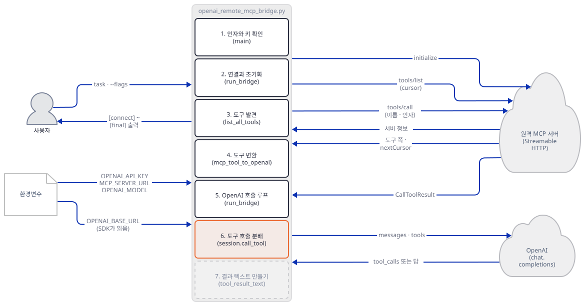

### Step 7. 결과 글과 호출 예산 — 숫자의 두 번 자름

**목적.** 결과를 모델에게 줄 글로 줄이는 규칙과 `--max-tool-calls`가 반복을 끊는 방식을 봅니다.

**할 일.** 먼저 결과 글입니다.

`mcp_ai_agents/openai_remote_mcp_bridge/openai_remote_mcp_bridge.py:26-31`

```python
def limit_text(text: str, max_chars: int = MAX_TOOL_RESULT_CHARS) -> str:
    """Bound text before it enters model context or the terminal trace."""
    if len(text) <= max_chars:
        return text
    omitted = len(text) - max_chars
    return f"{text[:max_chars]}\n[truncated {omitted} characters]"
```

`mcp_ai_agents/openai_remote_mcp_bridge/openai_remote_mcp_bridge.py:82-96`

```python
def tool_result_text(result: Any) -> str:
    """Extract bounded model-safe text without copying binary payloads."""
    structured = getattr(result, "structuredContent", None)
    if structured is not None:
        return limit_text(json.dumps(structured, ensure_ascii=False, default=str))

    parts: list[str] = []
    for block in getattr(result, "content", None) or []:
        block_type = getattr(block, "type", block.__class__.__name__)
        text = getattr(block, "text", None)
        if block_type == "text" and isinstance(text, str):
            parts.append(text)
        else:
            parts.append(f"[{block_type} content omitted]")
    return limit_text("\n\n".join(parts) or "(no text result)")
```

`structuredContent`가 있으면 그것을 JSON 글로 쓰고, 없으면 `text` 블록을 `"\n\n"`으로 잇고 나머지 블록은 `[image content omitted]` 같은 표지로 바꿉니다. 둘 다 `limit_text`가 12,000자로 자릅니다(길이는 토큰이 아니라 글자 수입니다). 그리고 터미널 trace는 이미 줄인 글을 500자로 한 번 더 줄입니다(`:207`). 예산은 아래 두 곳입니다.

`mcp_ai_agents/openai_remote_mcp_bridge/openai_remote_mcp_bridge.py:157-167`

```python
            requested_calls = 0

            async with AsyncOpenAI(api_key=api_key) as client:
                while True:
                    request: dict[str, Any] = {"model": model, "messages": messages}
                    if requested_calls < max_tool_calls:
                        request.update(
                            tools=openai_tools,
                            tool_choice="auto",
                            parallel_tool_calls=False,
                        )
```

`mcp_ai_agents/openai_remote_mcp_bridge/openai_remote_mcp_bridge.py:216-225`

```python
                    if requested_calls >= max_tool_calls:
                        messages.append(
                            {
                                "role": "user",
                                "content": (
                                    "The tool-call budget is exhausted. Answer using only "
                                    "the results already returned."
                                ),
                            }
                        )
```

**확인.**

```bash
uv run --no-project python openai_remote_mcp_bridge.py --server-url $M "S:image x"
uv run --no-project python openai_remote_mcp_bridge.py --server-url $M "S:big x"
uv run --no-project python openai_remote_mcp_bridge.py --server-url $M --max-tool-calls 3 "S:loop x"
uv run --no-project python openai_remote_mcp_bridge.py --server-url $M --max-tool-calls 2 "S:multi x"
```

직접 확인한 결과입니다. `image`는 이미지 블록이 표지로 바뀌고 캡션이 `"\n\n"` 뒤에 붙습니다.

```text
[mcp -> openai] [image content omitted]

caption
```

`big`의 `fetch_page`는 3만 자를 돌려주는데, 터미널에는 첫 줄의 숫자 500자 뒤에 `[truncated 11529 characters]`가 찍혔습니다. 가짜 OpenAI 서버의 기록으로 보면 모델이 받은 `tool` 메시지의 길이는 12,029자였습니다. 12,000자에 `\n[truncated 18000 characters]` 29자가 붙은 것입니다. 터미널의 11,529는 그 12,029자에서 500자를 뺀 값이라, 도구가 실제로 버린 18,000과 다릅니다. `[truncated N characters]`를 보고 "N자를 잃었다"고 읽으면 안 됩니다.

`loop`는 가짜 모델이 도구가 주어지는 한 계속 부르는 시나리오입니다. 예산 3에서 도구를 부른 것은 `again 1`·`again 2`·`again 3` 셋이고, OpenAI 요청은 모두 4건이었습니다. 앞 세 건에는 도구 다섯이 실려 있었고(`tool_choice`는 `auto`), 네 번째 요청의 역할 순서는 `system, user, assistant, tool, assistant, tool, assistant, tool, user`로 마지막이 예산 소진을 알리는 `user` 메시지이고 `tools`가 아예 없었습니다. 도구를 끊는 방법이 모델에게 말로 부탁하는 것이 아니라 도구 목록을 빼 버리는 것입니다. `multi`는 한 응답에 `tool_calls` 셋이 오는 경우입니다. 예산 2에서 `a`·`b`는 MCP로 갔고 `c`는 `Skipped: the MCP tool-call budget is exhausted.`로 돌려졌으며 MCP 서버 기록에는 `c`가 없습니다. 세 번 모두 `tool` 메시지가 달려 응답이 닫혔고, 다음 요청은 `tools` 없이 나갔습니다. `parallel_tool_calls=False`는 부탁일 뿐이고, 모델이 어겨도 이 반복문은 한 응답의 부름을 전부 한 건씩 세어 처리합니다.

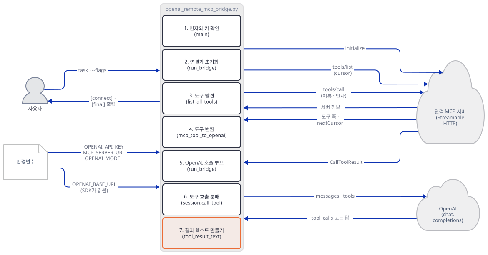

## 요청 한 건이 흐르는 과정

`python openai_remote_mcp_bridge.py --server-url <주소> "<질문>"` 한 번의 흐름입니다. 그림 셋으로 나눴고 메시지는 모두 코드 순서입니다. 먼저 인자를 읽고 연결해 도구를 모으는 부분입니다. `--list-tools`는 `[discover]` 줄 뒤에 도구 목록을 찍고 여기서 끝납니다.

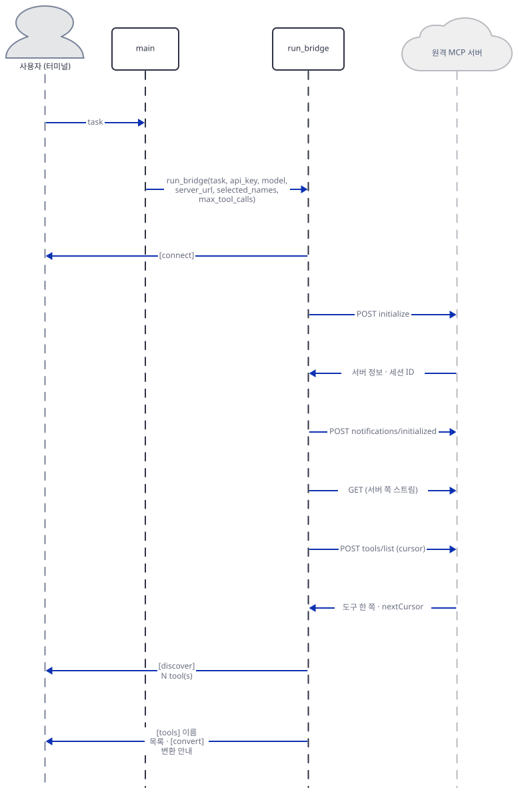

다음은 모델을 부르고 도구를 MCP로 넘기는 한 바퀴입니다. 도구가 둘 이상 필요하면 이 바퀴를 `--max-tool-calls`까지 되풀이합니다.

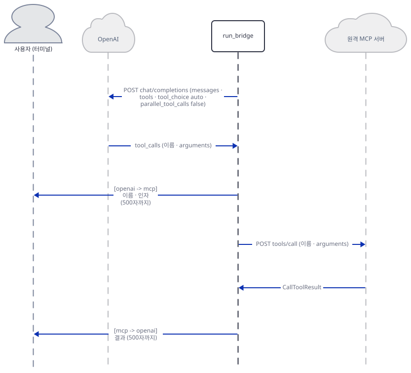

마지막은 도구 결과를 받은 모델이 답을 내고 세션을 닫는 부분입니다. `[final]` 뒤에 `DELETE`가 가는 순서는 `return`이 `async with` 안에 있기 때문입니다(소스로 확인, 이 순서를 서버 기록으로 직접 맞춰 보지는 않았습니다).

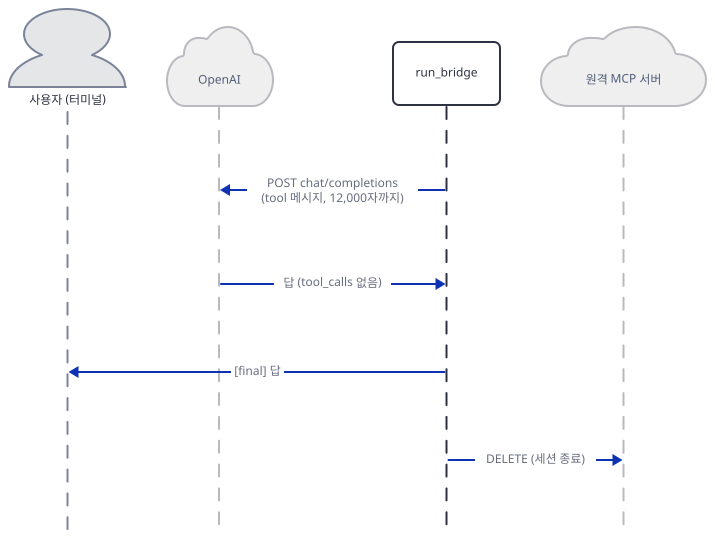

## 실행 체크리스트

- [ ] `uv pip install -r requirements.txt`만으로 `mcp` 1.30.0이 설치됐다(`requirements.txt`의 `<2` 상한)
- [ ] 키 없이 task를 주면 `OPENAI_API_KEY is required when running a task.`와 종료 코드 1이고 `[connect]`가 찍히지 않는다
- [ ] 두 가짜 서버가 임의 포트에 떠 있고 `OPENAI_BASE_URL`이 앱 터미널에 걸려 있다
- [ ] 모든 앱 명령에 `--server-url`이 있다(`--list-tools`도)
- [ ] `--list-tools`의 서버 기록에 `tools/list`가 세 번, `cursor`가 없음·`"2"`·`"4"`다
- [ ] `search.web`이 있는 서버에서 `Bridge failed: MCP tool name 'search.web' is not a valid OpenAI function name`이고 OpenAI 서버 기록에 요청이 없다(파일이 아직 없을 수 있다)
- [ ] OpenAI 요청에 `tool_choice: auto`, `parallel_tool_calls: false`가 있다
- [ ] 나쁜 인자·없는 이름 세 경우 모두 MCP 서버 기록에 `call_tool`이 없다
- [ ] 모델이 받은 `tool` 메시지 길이가 12,029자이고 터미널은 `[truncated 11529 characters]`다
- [ ] 예산 3의 `loop`는 OpenAI 요청 4건이고 마지막 요청에 `tools`가 없다

## 문제 해결

| 증상 | 원인 | 해결 |
|---|---|---|
| `Bridge failed: not enough values to unpack (expected 3, got 2)` | `mcp` 2.x가 깔린 환경. 2.x는 `streamable_http_client`가 스트림 둘만 내놓음. 오늘의 `requirements.txt`(`mcp>=1.28.1,<2`)는 2.x를 풀지 않지만, PR #1214 전의 사본이나 `mcp`를 따로 올린 환경에서 난다 | `uv pip install -r requirements.txt`로 다시 깔거나 `"mcp<2"`를 더한다. 고쳐 보면 `timedelta`와 `cursor` 인자도 2.x와 맞지 않음(Step 3) |
| `AsyncClient.__init__() got an unexpected keyword argument 'proxies'` | 하한 `openai==1.40.0`을 `httpx` 0.28과 함께 깔면 남(`openai==1.40.0`, `mcp==1.28.1`로 확인) | `openai`를 새 판으로 둔다. 하한 버전에 고정하지 않는다 |
| `OPENAI_API_KEY is required when running a task.`와 종료 코드 1 | task를 줬는데 환경변수가 없음. 연결보다 앞에서 검사함 | 가짜 서버로는 `sk-fake`. `--list-tools`는 키가 필요 없음 |
| `Bridge failed: All connection attempts failed` | 그 주소·포트에서 듣는 서버가 없음. 안쪽 예외는 `ExceptionGroup`이고 `explain_error`가 풀어 줌 | `--server-url`의 포트와 `fake_mcp.py`가 찍은 포트를 맞춘다 |
| `Bridge failed: Session terminated` | 서버는 있는데 경로가 `/mcp`가 아님. 가짜 서버가 404로 답한 경우로 확인 | 주소 끝을 `/mcp`로 맞춘다. 진짜 서버가 같은 문구를 낸다고는 확인하지 않았다 |
| `Bridge failed: Unknown MCP tool(s): …` 또는 `--tools contains duplicate names.` | `--tools`의 이름이 서버에 없거나 겹침. 서버에 붙은 뒤에 대조함 | 같은 `--server-url`로 `--list-tools`를 돌려 이름을 복사한다 |
| `Bridge failed: MCP tool name '…' is not a valid OpenAI function name` 또는 `… must have an object input schema.` | 서버의 도구 하나가 OpenAI 함수로 바꿀 수 없는 모양. 전체를 바꾸다 멈추므로 모델 호출은 한 번도 없음 | `--tools`로 쓸 수 있는 도구만 고른다 |
| 모델이 부른 도구가 `Error: unknown MCP tool '…'`로 돌아옴 | `--tools`로 노출하지 않은 이름. 서버에 있어도 막힘 | 필요한 도구를 `--tools`에 넣는다 |
| `[truncated N characters]`의 N이 도구 결과의 실제 초과량과 다름 | 12,000자로 자른 글을 trace가 500자로 한 번 더 자르며 센 값 | 모델이 받은 길이는 12,000자에 표지 29자다(Step 7) |
| `--server-url` 없이 돌렸더니 `https://search.parallel.ai/mcp`에 붙음 | 기본값이 실제 Parallel 주소이고 `--list-tools`도 키 없이 바로 붙음 | 실습할 때는 항상 루프백 `--server-url`을 준다 |
| 2027-01-14 이후 모델 오류(그날 이후 실제로 어떤 문구가 나오는지는 보지 못했다) | 앱 기본 모델 `gpt-4o-mini`의 기본 스냅숏 `gpt-4o-mini-2024-07-18`이 그날 종료 예정(사전 준비) | `--model <대체 모델>` 또는 `OPENAI_MODEL`. 대체 모델이 도구 호출을 지원하는지 먼저 확인한다 |
| 키를 넣고 task를 돌렸는데 가짜가 아니라 실제 OpenAI로 감 | `OPENAI_BASE_URL`이 그 터미널에 없으면 SDK가 `https://api.openai.com/v1`을 씀(소스로 확인, 이 경로는 돌려 보지 않았다) | 가짜 서버 실습은 변수를 건 터미널에서만 한다 |

## 더 해보기

- `mcp` 2.x로 옮겨 봅니다(원본은 지금 `mcp`를 `<2`로 막아 두었으므로, `uv pip install "mcp>=2"`로 따로 올려야 합니다). 이 문서가 돌려 본 어긋남은 세 곳입니다. `:123`의 스트림이 둘이라는 것, `:127`의 `read_timeout_seconds`가 `timedelta`가 아니라 숫자라는 것, `:48`의 `list_tools`가 `cursor` 키워드 대신 `params=`를 받는다는 것(서명으로 확인, `types.PaginatedRequestParams(cursor=…)`를 넘기게 됩니다). 고친 파일이 `mcp` 2.3.0에서 `--list-tools`와 Step 3의 서버 기록 세 번을 그대로 내는지 보세요. 이 문서는 세 번째 고침까지 해 보지 않았습니다.
- trace의 `[truncated …]`를 바로잡아 봅니다. `:207`의 `limit_text(result_text, MAX_TRACE_CHARS)`를 그대로 두되, 이미 12,000자로 줄었는지 알 수 있게 모델이 받은 길이를 같이 찍도록 고치고, `big` 시나리오에서 두 숫자가 맞는지 보세요.
- `READ_TIMEOUT_SECONDS`(`mcp_ai_agents/openai_remote_mcp_bridge/openai_remote_mcp_bridge.py:20`, 120초)를 직접 시험해 봅니다. `fake_mcp.py`에 `asyncio.sleep`을 도는 도구를 더하고 상수를 2로 줄여 그 도구를 부르게 하면 어떤 문구로 끝나는지, `[mcp -> openai]`가 찍히는지 보세요. 이 문서는 해 보지 않았습니다.

## 다음 날 예고

[Day 131 · 🌍 AI Travel Planner MCP Agent](../day131-ai-travel-planner-mcp-agent-team/README.md) — 오늘은 원격 서버 하나에 URL로 붙었지만 다음 앱은 다시 자식 프로세스입니다. 원본 앱 `app.py`(320줄)는 agno의 `MultiMCPTools`에 `npx` 명령 둘(`@openbnb/mcp-server-airbnb`, `@gongrzhe/server-travelplanner-mcp`)을 한 번에 줍니다(`mcp_ai_agents/ai_travel_planner_mcp_agent_team/app.py:72-76`, 소스로 확인).
