# Day 131 · 🌍 AI Travel Planner MCP Agent

> 볼륨 9 ♾️ MCP AI Agents · 난이도 ★★☆ ⚠ `requirements.txt`만 설치하면 앱이 import되지 않고(오늘은 agno 3.1.3이 풀려 `MultiMCPTools`와 `GoogleSearchTools`가 둘 다 없음, Step 1), 앱이 쓰는 모델 `gpt-4o`의 스냅샷은 OpenAI 폐기 문서에 종료일 2027-01-14로 올라 있습니다(오늘 2026-10-14에 공지됨, Step 4) · 예상 소요 160분(앱은 파일 하나 320줄이지만, 읽을 산문이 3,100낱말쯤이고 실습 파일 열 개를 저장해 터미널 둘에 가짜 서버를 띄운 채 실패 경로 넷을 일부러 일으켜 서버 쪽 기록과 앱 출력을 맞대어 보는 시간이 더해집니다) · API 비용 대략 한 건에 $0.05~0.15(⚠ 추정입니다. 이 문서는 OpenAI를 한 번도 부르지 않았습니다. 모델 호출은 도구를 쓰면 두 번 이상이고, 입력은 지시문 약 2,500자와 도구 정의 일곱, Airbnb 목록 같은 도구 결과가 쌓여 1만~3만 토큰, 출력은 "아주 자세한 일정"이라 3천~6천 토큰으로 어림했습니다. `gpt-4o` 요금은 OpenAI 모델 페이지에서 2026-10-14에 읽은 입력 $2.50·출력 $10.00 / 1M 토큰입니다. Google Maps API의 요금은 확인하지 못했습니다) · 원본 앱: `mcp_ai_agents/ai_travel_planner_mcp_agent_team`

## 오늘 만들 것

볼륨 9 "♾️ MCP AI Agents"의 다섯째 날입니다. Streamlit 화면에서 OpenAI 키와 Google Maps 키, 목적지·일수·예산·취향을 받아, 에이전트 하나가 도구를 써서 여행 일정을 마크다운으로 만들고 `.ics` 달력 파일로 내려받게 하는 앱입니다. 도구는 둘로 나뉩니다. 하나는 `MultiMCPTools`가 `npx`로 내 PC에 띄우는 MCP 서버 둘(Airbnb 검색, 장소·경로 조회)이고, 다른 하나는 같은 프로세스 안의 구글 검색 도구입니다.

앞 날들과 이어지는 점부터 적습니다. Day 127~129의 원본 앱은 MCP 서버를 자식 프로세스로 띄우고(`mcp_ai_agents/notion_mcp_agent/notion_mcp_agent.py:60-62`의 `command="npx"`, `mcp_ai_agents/github_mcp_agent/github_agent.py:74-75`의 `command="docker"`, `mcp_ai_agents/browser_mcp_agent/mcp_agent.config.yaml:13-14`의 `command: "npx"` — 셋 다 소스로 확인했고 실행하지 않았습니다), Day 130은 원격 주소 하나에 붙었습니다. 오늘은 서버 둘을 `MultiMCPTools` 하나에 한꺼번에 줍니다. `npx` 자리에 파이썬 가짜 서버를 두고 돌리는 방식은 Day 125와 같고, `mcp`를 `<2`로 묶어야 한다는 점은 Day 130과 같은 뿌리입니다. 이름이 비슷한 Day 124(볼륨 8)의 "AI Travel Planner Agent Team"은 다른 앱입니다. 그쪽은 `backend/`와 `client/`로 나뉜 웹 앱이고 agno 에이전트를 차례로 부르지만, 오늘 앱은 폴더 이름과 앱 README 제목에 "Agent Team"이 들어 있어도 `app.py`가 `Team`을 import하지 않고 `Agent` 하나만 만듭니다(소스로 확인, `app.py:4-8`).

직접 돌려 알게 된 것이 일곱입니다. 첫째, `requirements.txt`만으로는 앱이 import되지 않습니다. agno는 3.1.3으로 풀리는데 그 판에는 앱이 쓰는 `MultiMCPTools`도 `GoogleSearchTools`도 없고, `mcp`는 requirements에 아예 없습니다(Step 1). 둘째, "Google Maps MCP"는 두 서버 가운데 `@gongrzhe/server-travelplanner-mcp`이고, Google Maps 키는 앱의 `env=`를 통해 **두 서버 모두**에게 전달됩니다(Step 3). 셋째, 구글 검색 도구는 requirements에 적힌 `google-search-results`(SerpApi)와 상관없이 `googlesearch-python`이 google.com/search를 직접 긁는 것이고, 설치해도 `google_search`는 `'str' object has no attribute 'url'`이라는 오류 글을 모델에 돌려줍니다(Step 4). 넷째, 시작일은 모델에게 가지 않고 달력 파일에만 쓰입니다(Step 5). 다섯째, 화면의 "Airbnb 데이터를 썼다"는 안내는 도구를 썼는지가 아니라 **모델이 쓴 글에 낱말이 있는지**로 정해집니다(Step 6). 여섯째, 달력 변환은 모델이 일정 제목을 어떻게 쓰느냐에 따라 하루짜리 이벤트가 하나로 뭉치기도 합니다(Step 7). 일곱째, MCP 서버 연결이 실패해도 예외가 나지 않고 로그 두 줄만 남으며, 서버 둘 가운데 하나만 죽어도 **살아 있는 서버의 도구까지** 모델에게 가지 않습니다(Step 8).

이 문서는 `npx`·`docker`를 한 번도 실행하지 않았습니다. 앱 코드를 돌린 셸은 PATH에서 Node와 Docker 폴더를 뺐고(`npx`·`docker`·`node`를 찾는 `shutil.which`가 모두 `None`), MCP 서버 자리에는 파이썬으로 쓴 가짜 서버를, OpenAI 자리에는 루프백의 가짜 서버를 두었습니다. 구글 검색은 `googlesearch` 라이브러리가 쓰는 HTTP 호출(`requests.get`)만 가짜 HTML로 바꾸고, 루프백 밖으로 나가는 이름 조회와 연결을 막는 가드를 걸어 두었는데 기록은 0건이었습니다. 그래서 Airbnb·Google Maps·Google 검색·OpenAI로 간 요청은 없고, 문서의 일정·목록은 모두 내가 쓴 대본입니다. 진짜 MCP 서버의 응답 모양, 진짜 `gpt-4o`가 도구를 고르는 모습, 진짜 Airbnb·Google 응답, `npx`가 Windows에서 실제로 서버를 띄우는 과정은 확인하지 못했습니다. 아래는 완성된 아키텍처입니다.

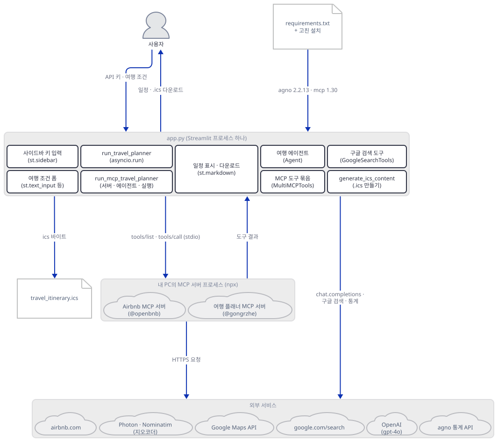

## 사전 준비

| 서비스/도구 | 용도 | 발급·설치 |
|---|---|---|
| uv | 가상환경 생성과 패키지 설치 | [공통 사전 준비](../README.md#공통-사전-준비-한-번만) 참고 |
| Python 3.10 이상 | 앱 README는 3.8 이상이라 했지만 오늘 설치되는 `mcp` 1.30.0과 `streamlit` 1.65.0이 모두 `Requires-Python: >=3.10`입니다(패키지 메타데이터로 확인). 이 문서는 3.13.3으로 확인했습니다 | 공통 사전 준비와 같음 |
| OpenAI API 키 | 원본 그대로 쓰려면 화면의 키 칸에 넣습니다. 이 문서의 확인에는 필요 없습니다(가짜 서버가 대신) | https://platform.openai.com/api-keys (앱이 화면에 알려 주는 주소, 열어 보지 못했음) |
| Google Maps API 키 | 화면에 키 칸이 있고 서버에 `GOOGLE_MAPS_API_KEY`로 전달됩니다. 서버 README는 Places·Directions·Geocoding·Time Zone API를 켜라고 합니다. 이 문서의 확인에는 필요 없습니다 | https://console.cloud.google.com/apis/credentials (앱이 알려 주는 주소, 열어 보지 못했음) |
| Node.js (`npx`) | 진짜 MCP 서버 둘을 내려받아 실행. **이 문서는 쓰지 않았습니다** | https://nodejs.org/ |
| 인터넷 연결 | PyPI 설치. 앱을 실제로 쓸 때는 OpenAI, npm 레지스트리, airbnb.com, 지오코더 둘, Google Maps API, google.com, agno 통계 서버(`os-api.agno.com`)에 접속합니다 | 별도 설치 없음 |

이 문서의 스크립트는 한글을 출력합니다. 한국어 Windows에서 출력을 파이프나 파일로 받으면 기본 인코딩(`cp949`)이 막힐 수 있으니 셸을 먼저 이렇게 맞춰 두세요.

```bash
export PYTHONIOENCODING=utf-8
```

```powershell
$env:PYTHONIOENCODING = "utf-8"
```

## 아키텍처 한눈에 보기

| 컴포넌트 | 역할 | 코드 위치 |
|---|---|---|
| 키 입력 사이드바 | OpenAI·Google Maps 키를 받는 칸 둘. 둘 다 채워져야 아래 폼이 나온다 | `mcp_ai_agents/ai_travel_planner_mcp_agent_team/app.py:200-221` |
| 여행 조건 폼과 버튼 | 목적지·일수·예산·시작일·취향. 버튼이 `run_travel_planner`를 부르고 결과를 `session_state`에 둔다 | `mcp_ai_agents/ai_travel_planner_mcp_agent_team/app.py:222-302` |
| `run_travel_planner` | 비동기 함수를 `asyncio.run`으로 감싼 동기 함수 | `mcp_ai_agents/ai_travel_planner_mcp_agent_team/app.py:179-181` |
| `run_mcp_travel_planner` | 키를 환경변수에 두고, `MultiMCPTools`를 만들어 연결하고, 에이전트를 만들어 한 번 돌리고, 끝에 연결을 닫는다 | `mcp_ai_agents/ai_travel_planner_mcp_agent_team/app.py:64-177` |
| `MultiMCPTools` | 서버 둘을 자식 프로세스로 띄우고 도구 6개를 모은다 | `mcp_ai_agents/ai_travel_planner_mcp_agent_team/app.py:72-84` |
| 여행 에이전트 (`Agent`) | `gpt-4o`, 지시문, 도구 둘(`mcp_tools`, `GoogleSearchTools()`) | `mcp_ai_agents/ai_travel_planner_mcp_agent_team/app.py:87-125` |
| 프롬프트와 실행 | 조건을 끼운 긴 요청 글을 만들어 `arun`에 준다 | `mcp_ai_agents/ai_travel_planner_mcp_agent_team/app.py:128-174` |
| 일정 표시와 다운로드 | 결과 마크다운을 그리고 `.ics` 다운로드 버튼을 단다 | `mcp_ai_agents/ai_travel_planner_mcp_agent_team/app.py:304-320` |
| `generate_ics_content` | 일정 글에서 "Day N"을 찾아 하루짜리 종일 이벤트로 바꾼다 | `mcp_ai_agents/ai_travel_planner_mcp_agent_team/app.py:15-62` |
| Airbnb MCP 서버 (`@openbnb/mcp-server-airbnb`) | 내 PC의 자식 프로세스. airbnb.com을 긁고 지오코더에 위치 문자열을 보낸다(서버 README) | 코드 없음 (외부 패키지, 이 문서는 실행하지 않음) |
| 여행 플래너 MCP 서버 (`@gongrzhe/server-travelplanner-mcp`) | 내 PC의 자식 프로세스. Google Maps API로 장소·경로·시간대를 조회한다(서버 README) | 코드 없음 (외부 패키지, 이 문서는 실행하지 않음) |
| OpenAI·구글 검색·agno 통계 | 모델 응답, `google.com/search` 긁기, 실행이 끝날 때의 익명 통계 | 코드 없음 (외부 서비스) |

위 그림은 에이전트와 도구를 한 상자(`app.py`) 안에 두었습니다. 에이전트가 어느 도구를 갖고 무엇이 외부로 나가는지는 아래 두 그림에 화살표로 있습니다. 첫 그림은 에이전트와 도구 묶음, 모델, 통계 API 사이입니다. `MultiMCPTools`가 내놓는 도구는 6개이고 `google_search`와 합쳐 모델에게 7개가 갑니다.

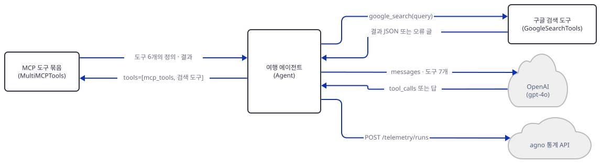

둘째 그림은 도구 쪽 외부 연결입니다. 두 MCP 서버는 서로 다른 외부 서비스에 닿고, 구글 검색 도구는 서버 없이 같은 프로세스에서 google.com으로 나갑니다.

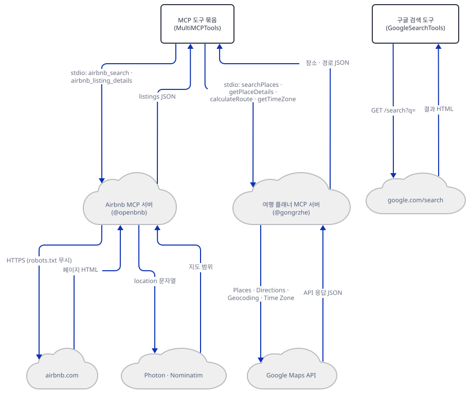

## 단계별 진행

### Step 1. 환경 만들기 — requirements.txt만으로는 import되지 않는다

**목적.** 앱이 import되는 가상환경을 만듭니다. 이 문서의 파일은 모두 원본 폴더 밖의 `travel-lab` 폴더에 둡니다(원본에는 아무것도 쓰지 않습니다).

**할 일.** 저장소 루트에서 시작합니다.

```bash
APP="$PWD/mcp_ai_agents/ai_travel_planner_mcp_agent_team"
mkdir ../travel-lab && cd ../travel-lab
uv venv
uv pip install -r "$APP/requirements.txt" "agno>=2.2.10,<2.3" "mcp<2" googlesearch-python pycountry
cp "$APP/app.py" app.py
```

```powershell
$APP = "$PWD\mcp_ai_agents\ai_travel_planner_mcp_agent_team"
mkdir ..\travel-lab; cd ..\travel-lab
uv venv
uv pip install -r "$APP\requirements.txt" "agno>=2.2.10,<2.3" "mcp<2" googlesearch-python pycountry
Copy-Item "$APP\app.py" app.py
```

(PowerShell 줄은 실행해 보지 못했습니다. pip 대안은 `python -m venv .venv`로 만들고 활성화한 뒤 같은 패키지 목록으로 `pip install`입니다.) 이 저장소는 루트에도 `pyproject.toml`이 있어서, 앞으로의 `uv run`에는 모두 `--no-project`를 붙이고 `travel-lab` 폴더 안에서 실행합니다.

원본 `requirements.txt`는 다섯 줄(`streamlit`, `agno>=2.2.10`, `openai`, `icalendar`, `google-search-results`)입니다. 이것만 설치하고 `import app`을 해 보면, 패키지를 하나 보탤 때마다 다음 오류가 이어집니다. 이 문서의 환경 만들기에서 직접 확인한 순서입니다(각 줄은 `uv run --no-project python -c "import app"`의 끝 줄).

| 설치된 것 | `import app`의 끝 줄 | 까닭 |
|---|---|---|
| requirements만 (agno 3.1.3) | `` ImportError: `mcp` not installed. Please install using `pip install 'mcp>=2.1.0,<3.0.0'` `` | requirements에 `mcp`가 없다 |
| + `mcp` 2.3.0 | `ImportError: cannot import name 'MultiMCPTools' from 'agno.tools.mcp'` | agno 3.x에는 `MultiMCPTools`가 없다 (`app.py:6`) |
| agno 2.2.13 + `mcp` 2.3.0 | `` ImportError: `mcp` not installed. Please install using `pip install mcp` `` | mcp가 설치돼 있는데도 이 문구가 나온다. agno 2.2.13이 불러오는 `streamablehttp_client`가 `mcp` 2.3.0에 없다 |
| agno 2.2.13 + `mcp` 1.30.0 | `` ImportError: `googlesearch-python` not installed. Please install using `pip install googlesearch-python` `` | `GoogleSearchTools`가 필요로 한다 (`app.py:7`) |
| + `googlesearch-python` | `` ImportError: `pycountry` not installed. Please install using `pip install pycountry` `` | 같은 파일의 두 번째 import |
| + `pycountry` | (import 성공) | |

`agno<2.3`을 붙인 까닭은 두 가지입니다. 첫째, `agno.tools.googlesearch` 모듈은 agno 2.2.13의 휠에는 있고 2.3.0의 휠에는 없습니다(휠의 파일 목록으로 확인). 둘째, `MultiMCPTools`는 agno 2.5.17의 `agno/tools/mcp/__init__.py`에 있고 3.0.0에는 없습니다(휠 소스로 확인). 오늘 `agno>=2.2.10`은 3.1.3으로 풀립니다. `mcp<2`는 Day 130에서도 필요했던 것과 같은 묶음입니다. 마지막 줄의 설치 결과는 `agno 2.2.13`, `mcp 1.30.0`, `openai 3.31.0`, `streamlit 1.65.0`, `icalendar 7.3.0`, `googlesearch-python 1.3.0`, `pycountry 26.2.16`이었습니다. `google-search-results`도 설치되지만 앱도 agno의 `GoogleSearchTools`도 쓰지 않습니다(`app.py`에 `serpapi`가 없고, 이 도구는 `googlesearch`를 import함 — Step 4).

이 단계의 코드는 앱의 맨 위 import입니다.

`mcp_ai_agents/ai_travel_planner_mcp_agent_team/app.py:1-13`

```python
import re
import asyncio
from textwrap import dedent
from agno.agent import Agent
from agno.run.agent import RunOutput
from agno.tools.mcp import MultiMCPTools
from agno.tools.googlesearch import GoogleSearchTools
from agno.models.openai import OpenAIChat
from icalendar import Calendar, Event
from datetime import datetime, timedelta
import streamlit as st
from datetime import date
import os
```

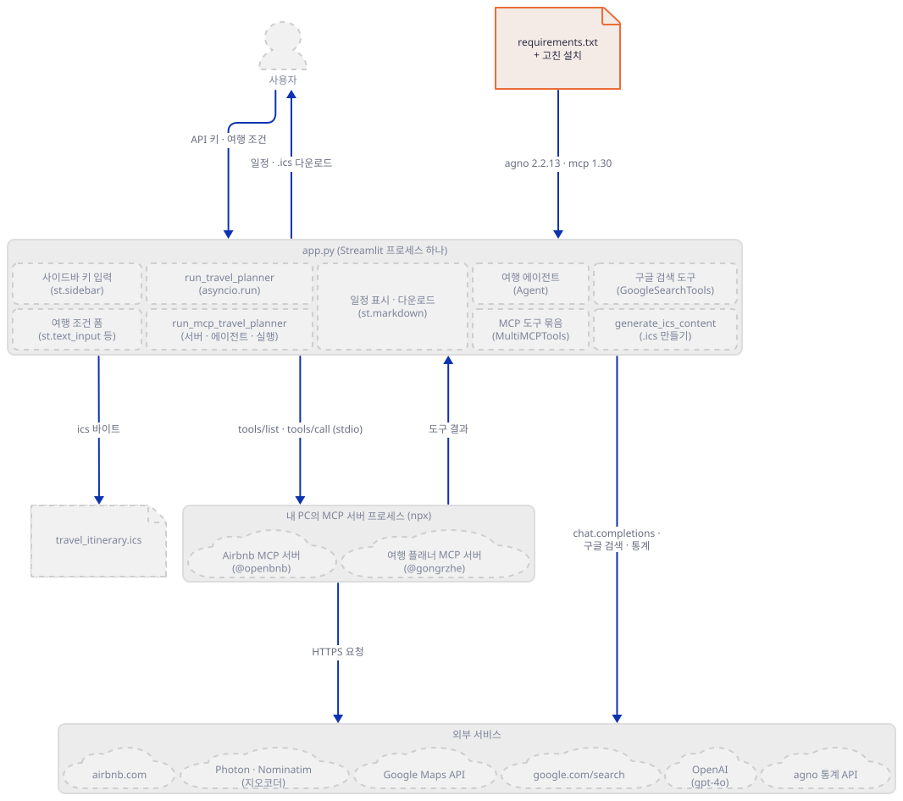

**확인.**

```bash
uv run --no-project python -c "import app; print('import ok')" 2>/dev/null
```

기대 출력은 `import ok`입니다. (`import app`은 Streamlit 스크립트를 그냥 실행하므로 `2>/dev/null` 없이 보면 "missing ScriptRunContext" 경고가 여러 줄 나옵니다. 앱은 키가 없으면 폼을 그리지 않고 끝나서 해로운 일은 없습니다. PowerShell은 `2>$null`.)

### Step 2. 가짜 MCP 서버 둘 — 진짜 서버가 뭘 하는지 먼저 읽는다

**목적.** `npx` 자리에 둘 가짜 서버를 만들고, 진짜 서버 둘이 무엇을 하는지 README로 확인해 둡니다.

**할 일.** 앱이 띄우려는 진짜 서버 둘의 공개 README를 읽었습니다(2026-10-14, GitHub의 README 원문. 서버는 실행하지 않았습니다).

- **Airbnb 서버(`@openbnb/mcp-server-airbnb`).** 도구는 `airbnb_search`와 `airbnb_listing_details` 둘입니다. 앱이 주는 `--ignore-robots-txt`는 README에서 "Bypass robots.txt restrictions when making requests to Airbnb", 권고는 "Keep disabled unless needed for testing purposes"입니다. 서버는 기본으로 airbnb.com의 robots.txt를 따르고, 이 플래그를 켜면 따르지 않습니다. 앱은 이 플래그를 항상 켭니다(`app.py:74`). 이 서버는 Airbnb의 공식 API가 아니라 airbnb.com의 페이지를 긁는 도구입니다(README의 "Efficient HTML parsing with Cheerio", "Respect Airbnb's Terms of Service"). 또 README의 "External Services"에 따르면 `placeId` 없이 `location` 문자열만 주면 서버가 그 문자열을 지오코더 둘(`photon.komoot.io`, 실패하면 `nominatim.openstreetmap.org`)에 보냅니다. 끄려면 환경변수 `DISABLE_GEOCODING=true`인데 앱은 주지 않습니다. 이 서버의 README에는 Google Maps 키가 필요하다는 말이 없습니다.
- **여행 플래너 서버(`@gongrzhe/server-travelplanner-mcp`).** 이것이 앱 지시문이 말하는 "Google Maps MCP"입니다(8곳: `app.py:97`, `101`, `110`, `111`, `139`, `152`, `168`, `274`). 도구는 `searchPlaces`, `getPlaceDetails`, `calculateRoute`, `getTimeZone` 넷이고, 환경변수 `GOOGLE_MAPS_API_KEY`가 필수입니다(Places·Directions·Geocoding·Time Zone API를 켜야 함). 앱 README가 말하는 "Custom Google Maps MCP"는 앱이 만든 것이 아니라 이 외부 패키지입니다.
- 앱의 둘째 명령 `npx @gongrzhe/server-travelplanner-mcp`에는 `-y`가 없습니다(첫째는 `npx -y`). npm 문서는 설치되지 않은 패키지에 대해 `npx`가 설치 전에 묻고 `-y`가 그 질문을 막는다고 합니다. 그 질문이 MCP 통신선(표준 입력·출력)에서 어떻게 되는지는 `npx`를 실행하지 않아 확인하지 못했습니다.

이제 가짜 서버를 저장합니다. 도구 이름 여섯은 위 README에서 가져왔고, 인자는 줄였고, 돌려주는 내용은 내가 지었습니다. 진짜 서버의 응답 모양은 모릅니다. 서버는 시작할 때 받은 환경변수 **이름**(값은 적지 않음)과 도구 호출을 `mcp.log`에 한 줄씩 남깁니다.

`travel-lab/fake_mcp.py`

```python
"""가짜 MCP 서버(파이썬). 도구 이름은 두 서버의 README에 적힌 것이고, 돌려주는 내용은 내가 지은 것이다."""
import json, os, sys, time
from mcp.server.fastmcp import FastMCP

which = sys.argv[1]  # airbnb 또는 maps
LOG = os.path.join(os.path.dirname(os.path.abspath(__file__)), "mcp.log")

def log(**kw):
    with open(LOG, "a", encoding="utf-8") as f:
        f.write(json.dumps({"server": which, "pid": os.getpid(), **kw}, ensure_ascii=False) + "\n")

# 시작할 때 받은 환경변수 이름(값은 적지 않는다)과 인자를 남긴다
log(event="start", argv=sys.argv[2:], env_keys=sorted(os.environ),
    has_maps_key="GOOGLE_MAPS_API_KEY" in os.environ)

import atexit
atexit.register(lambda: log(event="exit"))
app = FastMCP(which)

if which == "airbnb":
    @app.tool()
    def airbnb_search(location: str, checkin: str = "", checkout: str = "", maxPrice: int = 0) -> str:
        """Search Airbnb listings."""
        log(event="call", tool="airbnb_search", args={"location": location, "maxPrice": maxPrice})
        return json.dumps({"listings": [
            {"id": "L1", "name": "가짜 숙소 A", "pricePerNight": "$90", "url": "https://example.invalid/rooms/L1"},
            {"id": "L2", "name": "가짜 숙소 B", "pricePerNight": "$120", "url": "https://example.invalid/rooms/L2"}]})

    @app.tool()
    def airbnb_listing_details(id: str) -> str:
        """Get details of one listing."""
        log(event="call", tool="airbnb_listing_details", args={"id": id})
        return json.dumps({"id": id, "amenities": ["Wifi"]})
else:
    @app.tool()
    def searchPlaces(query: str, radius: int = 0) -> str:
        """Search for places using Google Places API."""
        log(event="call", tool="searchPlaces", args={"query": query})
        return json.dumps({"places": [{"name": "가짜 장소", "placeId": "P1"}]})

    @app.tool()
    def getPlaceDetails(placeId: str) -> str:
        """Get place details."""
        log(event="call", tool="getPlaceDetails", args={"placeId": placeId})
        return json.dumps({"placeId": placeId})

    @app.tool()
    def calculateRoute(origin: str, destination: str, mode: str = "driving") -> str:
        """Calculate route between two locations."""
        log(event="call", tool="calculateRoute", args={"origin": origin, "destination": destination, "mode": mode})
        return json.dumps({"distance": "3.2 km", "duration": "12 mins"})

    @app.tool()
    def getTimeZone(location: str) -> str:
        """Get timezone information."""
        log(event="call", tool="getTimeZone", args={"location": location})
        return json.dumps({"timeZone": "Asia/Tokyo"})

if __name__ == "__main__":
    app.run()
```

**확인.** 서버를 단독으로 한 번 띄웠다가 입력을 닫아 끝냅니다.

```bash
uv run --no-project python fake_mcp.py maps < /dev/null
uv run --no-project python -c "import json;d=json.loads(open('mcp.log',encoding='utf-8').readline());print(len(d['env_keys']),d['has_maps_key'])"
rm mcp.log
```

(PowerShell은 `uv run --no-project python fake_mcp.py maps < NUL`이 안 되므로 첫 줄을 `"" | uv run --no-project python fake_mcp.py maps`로 쓰고 마지막은 `Remove-Item mcp.log`로 씁니다. 실행해 보지 못했습니다.) 내 셸에서는 `112 False`였습니다. 셸에 환경변수가 112개 있었고 `GOOGLE_MAPS_API_KEY`는 없었다는 뜻이며, 개수는 사람마다 다릅니다. 이 숫자를 기억해 두세요. Step 3에서 같은 서버가 받는 환경변수와 비교합니다.

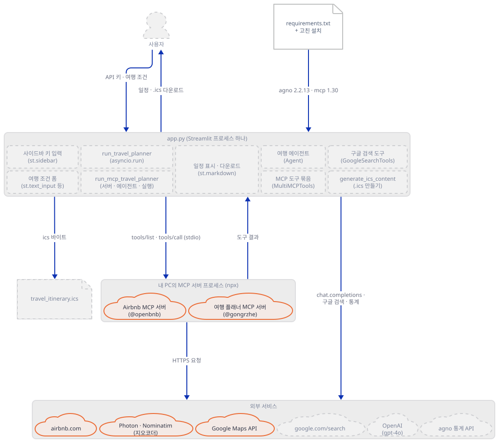

### Step 3. 서버 둘 붙이기 — `MultiMCPTools`와 키의 행방

**목적.** `app.py:64-84`가 서버를 언제 띄우고, 어떤 환경변수를 넘기고, 실패하면 어떻게 되는지 봅니다.

**할 일.** 먼저 소스입니다.

`mcp_ai_agents/ai_travel_planner_mcp_agent_team/app.py:64-84`

```python
async def run_mcp_travel_planner(destination: str, num_days: int, preferences: str, budget: int, openai_key: str, google_maps_key: str):
    """Run the MCP-based travel planner agent with real-time data access."""

    try:
        # Set Google Maps API key environment variable
        os.environ["GOOGLE_MAPS_API_KEY"] = google_maps_key

        # Initialize MCPTools with Airbnb MCP
        mcp_tools = MultiMCPTools(
            [
            "npx -y @openbnb/mcp-server-airbnb --ignore-robots-txt",
            "npx @gongrzhe/server-travelplanner-mcp",
            ],      
            env={
                "GOOGLE_MAPS_API_KEY": google_maps_key,
            },
            timeout_seconds=60,
        )   

        # Connect to Airbnb MCP server
        await mcp_tools.connect()
```

소스로 확인한 것은 이렇습니다(설치된 agno 2.2.13의 `agno/tools/mcp/multi_mcp.py`와 `agno/utils/mcp.py`).

- **명령은 문자열 하나씩입니다.** `commands`의 각 문자열을 `prepare_command`(`agno/utils/mcp.py`의 131번째 줄)가 `shlex`로 쪼개고 셸 메타문자(`&`, `|`, `;`, 백틱, `$`, 괄호)가 있으면 거부합니다(`ValueError`). 첫 낱말이 PATH에도 현재 폴더에도 없고 허용 목록(`python`·`uv`·`npx`·`node`·`docker` 등)에도 없으면 역시 `ValueError`입니다. 이 검사는 **만들 때**(`MultiMCPTools(...)` 줄) 일어나고, 서버는 아직 뜨지 않습니다.
- **서버는 `connect()`에서 뜹니다**(`multi_mcp.py`의 156번째 줄, `_connect` 210-264). 서버를 **차례로** 띄우며 각각 `initialize`를 하고, 마지막에 모든 세션에서 `tools/list`를 불러 도구를 모읍니다(`build_tools`, 300-). 하나라도 실패하면 `ValueError("MCP connection failed")`를 던지고 그 뒤 서버는 시도하지 않지만, `connect()`는 그 예외를 잡아 `log_error`만 합니다(`multi_mcp.py`의 169-172번째 줄). 앱은 `connect()`의 반환값이나 도구 수를 확인하지 않습니다(Step 8).
- **서버가 받는 환경변수.** `env=`로 준 것을 그대로 주지 않고 `mcp`의 `get_default_environment()`(Windows에서는 `APPDATA`·`PATH`·`TEMP`·`USERPROFILE` 등 열두 개이고, macOS·Linux는 `HOME`·`LOGNAME`·`PATH`·`SHELL`·`TERM`·`USER`)와 합칩니다(`multi_mcp.py`의 99-105번째 줄). 그러니 `OPENAI_API_KEY` 같은 다른 비밀은 서버로 가지 않고, `GOOGLE_MAPS_API_KEY`는 **두 서버 모두**에 갑니다(`env`가 `commands` 전체에 한 벌로 쓰이므로). Airbnb 서버는 그 키가 필요 없습니다(Step 2).
- `app.py:69`의 `os.environ["GOOGLE_MAPS_API_KEY"] = google_maps_key`는 키를 이 앱 프로세스의 환경변수로도 올립니다. 서버로 가는 값은 위 발췌의 `env=`가 이미 주므로 이 줄이 하는 일은 확인하지 못했고, 같은 프로세스에서 이후에 부르는 다른 코드가 이 값을 볼 수 있다는 점만 사실입니다.
- `timeout_seconds=60`은 서버 세션이 응답을 기다리는 시간(`ClientSession`의 `read_timeout_seconds`, `multi_mcp.py`의 224번째 줄)입니다. 앱 전체의 시간 제한이 아닙니다. 앱 README가 말하는 "60-second timeout"은 이 뜻입니다.

이 단계의 확인을 위해 앱 복사본을 만듭니다. 원본 `app.py`를 읽어 두 명령 줄만 가짜 서버로 바꾸고, 맨 위에 `import lab_patch`를 한 줄 더합니다(`lab_patch`는 Step 4에서 저장합니다). 같은 스크립트가 Step 8의 실패 실험용 복사본도 만듭니다.

`travel-lab/make_app.py`

```python
"""원본 app.py를 복사해 MCP 서버 명령 두 줄만 바꾼다. 원본은 건드리지 않는다.
사용: python make_app.py <원본 app.py> <모드>
  lab      가짜 서버(파이썬)를 쓴다                      -> app_lab.py
  nonode   npx를 ./npx(이 폴더에 없는 파일)로 바꾼다. Node가 없는 PC와 같은 실패를 낸다 -> app_nonode.py
  badcmd   실행 파일 이름을 허용 목록에 없는 npx-missing으로 바꾼다 -> app_badcmd.py
  mapsdown 두 번째 서버만 없는 파일을 가리키게 한다         -> app_mapsdown.py
  airbnbdown 첫 번째 서버만 없는 파일을 가리키게 한다       -> app_airbnbdown.py
"""
import pathlib, sys

A = '"npx -y @openbnb/mcp-server-airbnb --ignore-robots-txt",'
B = '"npx @gongrzhe/server-travelplanner-mcp",'
FAKE_A = '"python fake_mcp.py airbnb --ignore-robots-txt",'
FAKE_B = '"python fake_mcp.py maps",'
BAD = '"python no_such_server.py",'

src = pathlib.Path(sys.argv[1]).read_text(encoding="utf-8")
mode = sys.argv[2]
assert A in src and B in src, "원본의 서버 명령 두 줄을 찾지 못했습니다"
new_a, new_b = {
    "lab": (FAKE_A, FAKE_B),
    "nonode": ('"./npx -y @openbnb/mcp-server-airbnb --ignore-robots-txt",', '"./npx @gongrzhe/server-travelplanner-mcp",'),
    "badcmd": ('"npx-missing -y @openbnb/mcp-server-airbnb --ignore-robots-txt",', '"npx-missing @gongrzhe/server-travelplanner-mcp",'),
    "mapsdown": (FAKE_A, BAD),
    "airbnbdown": (BAD, FAKE_B),
}[mode]
out = "import lab_patch\n" + src.replace(A, new_a).replace(B, new_b)
pathlib.Path(f"app_{mode}.py").write_text(out, encoding="utf-8", newline="\n")
print(f"wrote app_{mode}.py")
```

```bash
uv run --no-project python make_app.py app.py lab
diff app.py app_lab.py
```

```text
0a1
> import lab_patch
74,75c75,76
<             "npx -y @openbnb/mcp-server-airbnb --ignore-robots-txt",
<             "npx @gongrzhe/server-travelplanner-mcp",
---
>             "python fake_mcp.py airbnb --ignore-robots-txt",
>             "python fake_mcp.py maps",
```

(PowerShell의 `diff`는 다른 명령(`Compare-Object`)이라 출력 모양이 다릅니다. `git diff --no-index app.py app_lab.py`를 쓰세요. 실행해 보지 못했습니다.) 바뀐 것은 이 세 군데뿐입니다. 이제 `app.py:72-84`와 같은 인자로 연결만 해 보는 스크립트를 저장합니다.

`travel-lab/probe.py`

```python
import asyncio
from agno.tools.mcp import MultiMCPTools

async def main():
    t = MultiMCPTools(["python fake_mcp.py airbnb --ignore-robots-txt", "python fake_mcp.py maps"],
                      env={"GOOGLE_MAPS_API_KEY": "fake-maps-key-not-real"}, timeout_seconds=60)
    await t.connect()
    print(sorted(t.functions))
    await t.close()

asyncio.run(main())
```

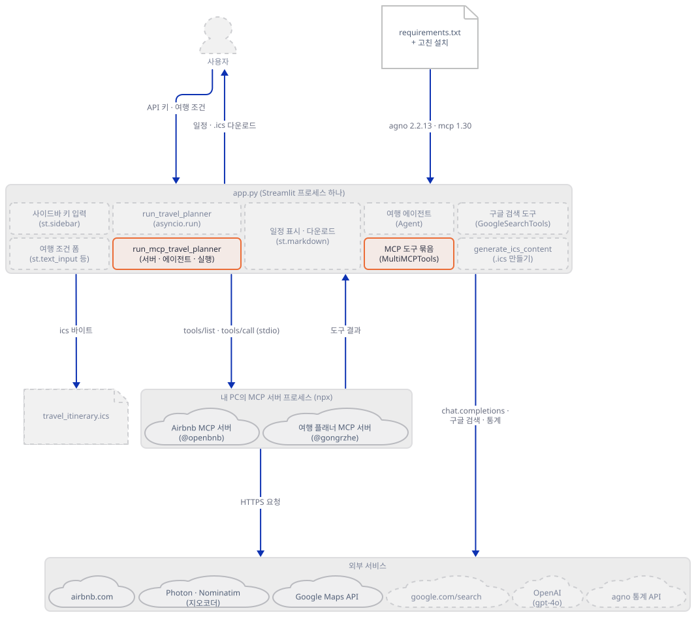

**확인.**

```bash
uv run --no-project python probe.py 2>/dev/null
```

```text
['airbnb_listing_details', 'airbnb_search', 'calculateRoute', 'getPlaceDetails', 'getTimeZone', 'searchPlaces']
```

도구 여섯이 한 묶음으로 모였습니다. 두 서버의 도구에 이름이 같은 것이 있으면 어느 쪽이 이기는지는 이 가짜 서버로는 확인하지 못했습니다(이름이 겹치지 않음). `mcp.log`를 봅시다. 환경변수 이름 열세 개가 서버마다 찍혀 있고(`APPDATA`, `GOOGLE_MAPS_API_KEY`, `HOMEDRIVE`, `HOMEPATH`, `LOCALAPPDATA`, `PATH`, `PATHEXT`, `PROCESSOR_ARCHITECTURE`, `SYSTEMDRIVE`, `SYSTEMROOT`, `TEMP`, `USERNAME`, `USERPROFILE`), Airbnb 서버에도 `GOOGLE_MAPS_API_KEY`가 있습니다. Step 2의 112개와 비교하세요.

```bash
rm mcp.log
```

### Step 4. 에이전트와 도구 — 가짜 OpenAI와 구글 검색의 정체

**목적.** `Agent`가 어떤 모델·지시문·도구로 만들어지는지 보고, 모델과 구글 검색이 가짜 서버로 가도록 장치를 합니다.

**할 일.** 에이전트 정의 앞뒤입니다.

`mcp_ai_agents/ai_travel_planner_mcp_agent_team/app.py:87-90`

```python
        travel_planner = Agent(
            name="Travel Planner",
            role="Creates travel itineraries using Airbnb, Google Maps, and Google Search",
            model=OpenAIChat(id="gpt-4o", api_key=openai_key),
```

`mcp_ai_agents/ai_travel_planner_mcp_agent_team/app.py:121-125`

```python
            tools=[mcp_tools, GoogleSearchTools()],
            add_datetime_to_context=True,
            markdown=True,
            debug_mode=False,
        )
```

- **모델.** `OpenAIChat(id="gpt-4o", api_key=openai_key)`에는 `base_url`이 없습니다. openai SDK가 `OPENAI_BASE_URL`을 읽어 주는지는 아래 확인에서 직접 봅니다. ⚠ **`gpt-4o`는 내려갑니다.** OpenAI 폐기 문서(https://developers.openai.com/api/docs/deprecations, 2026-10-14에 읽음)에 "2026-10-14에 공지, 2027-01-14에 API에서 제거"로 `GPT-4o (gpt-4o-2024-08-06, gpt-4o-2024-11-20)`가 올라 있고 권장 대체는 `gpt-6-luna`입니다. 별칭 `gpt-4o` 자체는 이 표의 행이 아니지만, `gpt-4o` 모델 페이지의 스냅샷 목록에는 `gpt-4o-2024-08-06`·`gpt-4o-2024-11-20`·`gpt-4o-2024-05-13`이 모두 Deprecated로 적혀 있습니다. 별칭이 어느 스냅샷을 가리키는지, 종료일 뒤에 호출하면 어떤 오류가 나는지, `gpt-6-luna`로 바꾸면 이 앱이 도는지는 확인하지 못했습니다.
- **지시문.** 지시문·프롬프트·화면 문구에 "Google Maps MCP"가 8번 나오지만, 모델이 보는 도구 이름은 `searchPlaces`·`calculateRoute` 같은 것뿐이고 "Google Maps"라는 이름의 도구는 없습니다. `add_datetime_to_context=True`는 현재 시각을 지시문 끝에 붙입니다(Step 5에서 확인).
- **도구 둘.** `tools=[mcp_tools, GoogleSearchTools()]`. 구글 검색은 `agno.tools.googlesearch`(2.2.13의 `GoogleSearchTools`)이고 소스(`agno/tools/googlesearch.py`)를 읽으면 `from googlesearch import search`, 곧 `googlesearch-python` 라이브러리를 씁니다. 이 라이브러리는 API가 아니라 `https://www.google.com/search`를 `requests.get`으로 긁습니다. requirements의 `google-search-results`는 SerpApi용 패키지이고 이 경로와 관계가 없습니다.

이제 장치입니다. 가짜 OpenAI 서버와, `googlesearch`의 HTTP 호출만 가짜 HTML로 바꾸는 `lab_patch.py`를 저장합니다. 가짜 OpenAI는 도구가 있으면 한 번 부르게 하고(`airbnb_search`, `calculateRoute`, `google_search`), 도구 결과가 오면 짧은 일정 글을 돌려줍니다. 모든 요청의 요약을 `openai.log`에, 본문을 `bodies.log`에 남깁니다. `plan.txt`가 있으면 그 글을 답으로 씁니다.

`travel-lab/fake_openai.py`

```python
"""가짜 OpenAI 서버: 도구가 있으면 한 번 부르게 하고, 도구 결과가 오면 일정 글을 돌려준다."""
import json, os, sys, time
from http.server import BaseHTTPRequestHandler, HTTPServer

HERE = os.path.dirname(os.path.abspath(__file__))
LOG = os.path.join(HERE, "openai.log")
PLAN = [  # (도구 이름, 인자)
    ("airbnb_search", {"location": "Tokyo", "maxPrice": 150}),
    ("calculateRoute", {"origin": "Shinjuku", "destination": "Asakusa", "mode": "transit"}),
    ("google_search", {"query": "Tokyo weather in April"}),
]

class H(BaseHTTPRequestHandler):
    def log_message(self, *a): pass
    def do_POST(self):
        body = json.loads(self.rfile.read(int(self.headers.get("content-length", 0))) or b"{}")
        rec = {"path": self.path, "auth_present": bool(self.headers.get("authorization")),
               "model": body.get("model"), "roles": [m.get("role") for m in body.get("messages", [])],
               "tools": sorted(t["function"]["name"] for t in body.get("tools", [])),
               "chars": len(json.dumps(body))}
        if not self.path.endswith("/chat/completions"):
            rec["body"] = body  # 통계 같은 다른 요청은 본문도 남긴다
        with open(os.path.join(HERE, "bodies.log"), "a", encoding="utf-8") as f:
            f.write(json.dumps(body, ensure_ascii=False) + "\n")
        with open(LOG, "a", encoding="utf-8") as f:
            f.write(json.dumps(rec, ensure_ascii=False) + "\n")
        if not self.path.endswith("/chat/completions"):
            out = {}
        else:
            names = set(rec["tools"])
            has_result = "tool" in rec["roles"]
            calls = [] if has_result else [(n, a) for n, a in PLAN if n in names]
            if calls:
                msg = {"role": "assistant", "content": None, "tool_calls": [
                    {"id": f"call_{i}", "type": "function", "function": {"name": n, "arguments": json.dumps(a)}}
                    for i, (n, a) in enumerate(calls)]}
                fin = "tool_calls"
            else:
                plan = os.path.join(HERE, "plan.txt")  # 있으면 그 글을 답으로 쓴다
                default = "Trip Overview: 가짜 계획\n\nDay 1: 신주쿠 출발, 아사쿠사 관광\nDay 2: 시부야 산책\n"
                text = open(plan, encoding="utf-8").read() if os.path.exists(plan) else default
                msg = {"role": "assistant", "content": text}
                fin = "stop"
            out = {"id": "x", "object": "chat.completion", "created": int(time.time()), "model": rec["model"],
                   "choices": [{"index": 0, "message": msg, "finish_reason": fin}],
                   "usage": {"prompt_tokens": 10, "completion_tokens": 10, "total_tokens": 20}}
        data = json.dumps(out).encode()
        self.send_response(200); self.send_header("content-type", "application/json")
        self.send_header("content-length", str(len(data))); self.end_headers(); self.wfile.write(data)

class S(HTTPServer):
    allow_reuse_address = False

if __name__ == "__main__":
    S(("127.0.0.1", int(sys.argv[1])), H).serve_forever()
```

`travel-lab/lab_patch.py`

```python
"""앱 복사본이 맨 위에서 불러오는 대역. googlesearch 라이브러리의 HTTP 호출(requests.get)만 가짜 HTML로 바꾸고 기록한다."""
import json, os, types
import googlesearch

LOG = os.path.join(os.path.dirname(os.path.abspath(__file__)), "search.log")
HTML = ('<div class="ezO2md"><a href="/url?q=https://example.invalid/w&sa=U">'
        '<span class="CVA68e">가짜 결과</span></a><span class="FrIlee">맑음</span></div>')

def fake_get(url, **kw):
    with open(LOG, "a", encoding="utf-8") as f:
        f.write(json.dumps({"url": url, "q": kw["params"]["q"]}, ensure_ascii=False) + "\n")
    return types.SimpleNamespace(text=HTML, raise_for_status=lambda: None)

googlesearch.get = fake_get

if os.environ.get("LAB_AGNO_URL"):  # agno 통계 주소를 가짜 서버로 돌린다(선택)
    from agno.api.settings import agno_api_settings
    agno_api_settings.api_url = os.environ["LAB_AGNO_URL"]
```

터미널을 둘 씁니다. 첫째에서 가짜 OpenAI를 띄웁니다(`59612`는 예시이고 49152~65535의 다른 번호도 됩니다).

```bash
uv run --no-project python fake_openai.py 59612
```

둘째 터미널은 `travel-lab`에서 시작해 환경을 맞추고, **앱 코드를 돌리기 전에** SDK가 가짜 주소를 보는지 확인합니다.

```bash
export OPENAI_BASE_URL=http://127.0.0.1:59612/v1
export AGNO_TELEMETRY=false
uv run --no-project python -c "import openai; print(openai.AsyncOpenAI(api_key='x').base_url)"
```

```powershell
$env:OPENAI_BASE_URL = "http://127.0.0.1:59612/v1"
$env:AGNO_TELEMETRY = "false"
uv run --no-project python -c "import openai; print(openai.AsyncOpenAI(api_key='x').base_url)"
```

(PowerShell 줄은 실행해 보지 못했습니다.) 출력은 `http://127.0.0.1:59612/v1/`이어야 합니다. 앱은 `base_url`을 주지 않으므로 `OPENAI_BASE_URL`이 그대로 이깁니다. 이 줄이 다른 주소를 찍으면 이후를 돌리지 마세요. `AGNO_TELEMETRY=false`는 Step 5에서 설명하는 통계 전송을 끕니다.

이제 구글 검색 도구를 따로 한 번 돌립니다. `search_probe.py`는 `lab_patch`를 불러 `googlesearch`의 `requests.get`을 가짜로 바꾼 뒤 앱이 쓰는 그 도구를 부릅니다.

`travel-lab/search_probe.py`

```python
import lab_patch  # googlesearch의 HTTP 호출을 가짜 HTML로 바꾼다
from agno.tools.googlesearch import GoogleSearchTools

try:
    print(GoogleSearchTools().google_search("Tokyo weather"))
except Exception as e:
    print(type(e).__name__, e)
```

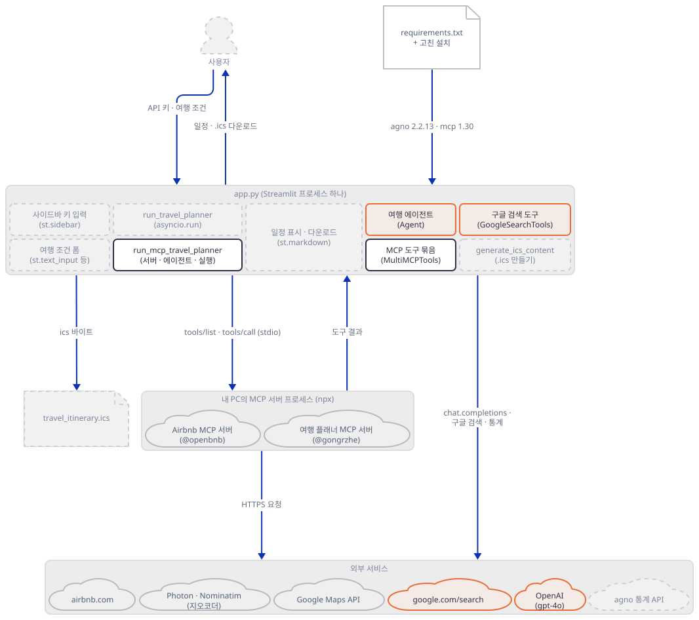

**확인.**

```bash
uv run --no-project python search_probe.py
uv run --no-project python -c "print(len(open('search.log',encoding='utf-8').readlines()))"
rm search.log
```

```text
AttributeError 'str' object has no attribute 'url'
5
```

도구가 예외를 냅니다. 까닭은 소스에 있습니다. `agno/tools/googlesearch.py`의 85번째 줄이 `list(search(query, num_results=max_results, lang=language))`로 부르는데 `googlesearch`의 `search`는 `advanced=True`를 주지 않으면 결과 객체가 아니라 **주소 문자열**을 내놓고, 93번째 줄이 `result.url`을 읽습니다. `googlesearch-python`은 휠이 있는 여섯 판(1.0.0, 1.0.1, 1.1.0, 1.2.4, 1.2.5, 1.3.0)의 소스가 모두 `advanced`를 주지 않으면 `yield link`(주소 문자열)였고, agno 2.2.10의 같은 줄도 `advanced`를 주지 않았습니다(휠 소스로 확인). 실제 호출이 지나갔다면 이 예외는 Google에서 결과를 받은 **뒤에** 납니다(`search.log`의 5줄은 가짜 `requests.get`에 온 시도로, 한 페이지에 결과가 하나뿐인 가짜 HTML이라 5페이지를 요청한 것입니다. 진짜 Google이 몇 번 요청받는지는 확인하지 못했습니다). agno는 이 예외를 도구 결과 글로 바꿔 모델에게 돌려줍니다(Step 5).

### Step 5. 한 번 돌리기 — 프롬프트, 모델 두 번, 도구 셋, 통계

**목적.** `run_mcp_travel_planner` 한 번이 모델과 서버에 무엇을 보내는지 서버 쪽 기록으로 봅니다.

**할 일.** 프롬프트와 실행 부분입니다.

`mcp_ai_agents/ai_travel_planner_mcp_agent_team/app.py:127-136`

```python
        # Create the planning prompt
        prompt = f"""
        IMMEDIATELY create an extremely detailed and comprehensive travel itinerary for:

        **Destination:** {destination}
        **Duration:** {num_days} days
        **Budget:** ${budget} USD total
        **Preferences:** {preferences}

        DO NOT ask any questions. Generate a complete, highly detailed itinerary now using all available tools.
```

`mcp_ai_agents/ai_travel_planner_mcp_agent_team/app.py:173-181`

```python
        response: RunOutput = await travel_planner.arun(prompt)
        return response.content

    finally:
        await mcp_tools.close()

def run_travel_planner(destination: str, num_days: int, preferences: str, budget: int, openai_key: str, google_maps_key: str):
    """Synchronous wrapper for the async MCP travel planner."""
    return asyncio.run(run_mcp_travel_planner(destination, num_days, preferences, budget, openai_key, google_maps_key))
```

프롬프트에는 목적지·일수·예산·취향만 들어갑니다. 화면의 **시작일**(`start_date`)은 `run_travel_planner`의 인자에 없고(`app.py:280-287`), 달력 파일을 만들 때만 쓰입니다(`app.py:307`). 모델이 아는 날짜는 `add_datetime_to_context`가 붙인 "현재 시각"뿐입니다. 호출은 `call_plan.py`가 앱 복사본의 `run_travel_planner`를 직접 부릅니다(화면 없이, 가짜 키로).

`travel-lab/call_plan.py`

```python
import sys, importlib
app = importlib.import_module(sys.argv[1] if len(sys.argv) > 1 else "app_lab")
plan = app.run_travel_planner("Tokyo", 2, "food", 1500, "sk-fake-not-real", "fake-maps-key-not-real")
print("=== 계획 ===")
print(plan)
```

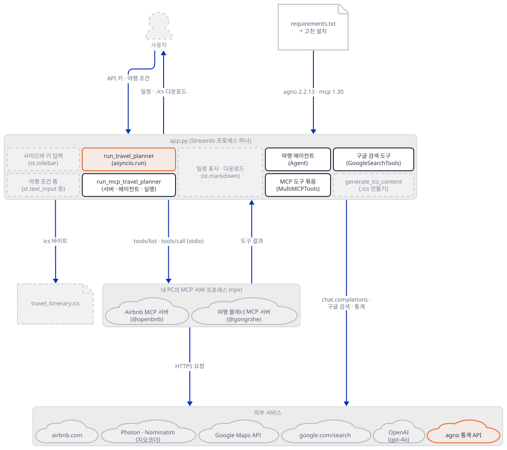

**확인.** 둘째 터미널에서(Step 4의 환경변수를 둔 채로) 실행합니다. 이후의 bash 줄(`printf`·`grep`·`rm`·`: >`)은 PowerShell에서 `Set-Content`·`Select-String`·`Remove-Item`·`Clear-Content`로 바꿔 써야 하고 실행해 보지 못했습니다. 출력에는 agno의 로그와 `mcp`의 서버 로그가 섞여 나오므로 앱 출력은 "=== 계획 ===" 아래입니다.

```bash
uv run --no-project python call_plan.py
```

로그 가운데 이 두 줄이 보여야 합니다(뒤에 파이썬 추적이 길게 이어집니다). 나머지는 서버 로그와 Streamlit 경고입니다.

```text
WARNING  Could not run function google_search(query=Tokyo weather in April)
ERROR    'str' object has no attribute 'url'
```

```text
=== 계획 ===
Trip Overview: 가짜 계획

Day 1: 신주쿠 출발, 아사쿠사 관광
Day 2: 시부야 산책
```

이제 서버 쪽 기록을 봅니다. 가짜 OpenAI가 받은 요청 둘입니다.

```bash
uv run --no-project python -c "
import json
for l in open('openai.log', encoding='utf-8'):
    d = json.loads(l); print(d['roles'], d['chars'], d['tools'])
"
```

```text
['developer', 'user'] 7968 ['airbnb_listing_details', 'airbnb_search', 'calculateRoute', 'getPlaceDetails', 'getTimeZone', 'google_search', 'searchPlaces']
['developer', 'user', 'assistant', 'tool', 'tool', 'tool'] 9029 ['airbnb_listing_details', 'airbnb_search', 'calculateRoute', 'getPlaceDetails', 'getTimeZone', 'google_search', 'searchPlaces']
```

- **모델 호출 두 번.** 첫 요청은 지시문(`developer`)과 프롬프트(`user`)와 도구 정의 일곱이고, 둘째 요청은 거기에 `assistant`의 `tool_calls`와 도구 결과 셋을 더한 것입니다. 모델이 도구를 더 부르면 호출이 더 늘어납니다. 이 가짜 모델은 한 번만 부릅니다. 요청 글자 수 7,968과 9,029는 가짜 도구 결과(255·45·35자)가 짧아서 작은 값입니다. 진짜 Airbnb 목록은 훨씬 클 것입니다(확인하지 못했습니다).
- **도구 결과가 오류여도 일은 계속됩니다.** `bodies.log`를 읽으면 세 번째 `tool` 메시지가 `'str' object has no attribute 'url'` 그대로입니다. 모델이 그 글을 읽고 다음을 정합니다.
- **지시문 끝에 현재 시각이 붙습니다.** `bodies.log`의 `developer` 메시지(2,466자)는 `<additional_information>` 안에 "The current time is …"로 끝납니다.

```bash
uv run --no-project python -c "
import json
for l in open('mcp.log', encoding='utf-8'):
    d = json.loads(l); print(d['server'], d['event'], d.get('tool', ''))
"
```

```text
airbnb start 
maps start 
airbnb call airbnb_search
maps call calculateRoute
maps exit 
airbnb exit 
```

서버가 둘 다 이 한 번의 호출마다 새로 뜨고, `finally`의 `close()`로 끝납니다(둘 다 `exit`). 화면에서 버튼을 누를 때마다 서버 프로세스 둘이 새로 뜹니다. 도구 부름의 도착 순서는 실행마다 달랐습니다. `airbnb call`이 먼저인 실행도, `maps call`이 먼저인 실행도 봤습니다. 도구들이 겹쳐서 실행된다는 뜻으로 읽을 수 있지만, 같은 요청 안에서 동시에 실행되는지는 소스로 확인하지 않았습니다.

**통계.** 에이전트 실행이 끝나면 `_alog_agent_telemetry`가 불립니다(agno 2.2.13의 `agent/agent.py`의 1966번째 줄, `arun`의 비스트리밍 경로). `AGNO_TELEMETRY`를 `false`로 하지 않으면 `os-api.agno.com`에 `POST /telemetry/runs`를 보냅니다. 앱은 `telemetry=False`를 주지 않습니다. 보내는 내용을 보려고 가짜 서버로 돌려 봤습니다. 통계 주소는 환경변수로 바꾸기 어렵습니다(소스로 확인: `agno/api/settings.py`의 검증기가 들어온 값을 쓰지 않고 `api_runtime`으로만 주소를 정합니다). 그래서 `lab_patch`가 `LAB_AGNO_URL`이 있을 때만 파이썬에서 주소를 바꿉니다.

```bash
env -u AGNO_TELEMETRY LAB_AGNO_URL=http://127.0.0.1:59612 uv run --no-project python call_plan.py > /dev/null 2>&1
uv run --no-project python -c "
import json
for l in open('openai.log', encoding='utf-8'):
    d = json.loads(l)
    if 'telemetry' in d['path']: print(d['path']); print(json.dumps(d['body']['data'], ensure_ascii=False)); print(d['body']['sdk_version'], d['body']['type'])
"
```

```text
/telemetry/runs
{"agent_id": "travel-planner", "db_type": null, "model_provider": "OpenAI", "model_name": "OpenAIChat", "model_id": "gpt-4o", "parser_model": null, "output_model": null, "has_tools": true, "has_memory": false, "has_culture": false, "has_reasoning": false, "has_knowledge": false, "has_input_schema": false, "has_output_schema": false, "has_team": false}
2.2.13 agent
```

(`env -u AGNO_TELEMETRY`는 이 한 줄에서만 변수를 지워 통계를 켜고, 가짜 서버로 가는 것은 `LAB_AGNO_URL` 덕분입니다. `AGNO_TELEMETRY=`처럼 빈 값을 주면 소스(`agent.py`의 `_set_telemetry`)가 `"".lower() == "true"`로 읽어 꺼집니다. PowerShell은 `$env:LAB_AGNO_URL = "http://127.0.0.1:59612"`와 `Remove-Item Env:AGNO_TELEMETRY`를 먼저 하고 같은 `uv run`을 부르세요. 실행해 보지 못했습니다. 끝나면 `$env:AGNO_TELEMETRY = "false"`로 되돌립니다.) 질문 글·답·키는 들어 있지 않고 에이전트 id·모델·도구 유무 같은 필드뿐입니다. Day 047 Step 5가 다룬 agno 3.0.10의 통계와 필드 구성이 같지는 않을 수 있습니다. 이 문서는 2.2.13에서만 확인했습니다.

**`finally`의 함정.** `app.py:176-177`의 `finally: await mcp_tools.close()`는 `try` 안에서 `mcp_tools`가 만들어지기 전에 예외가 나면 `close()`를 부르다가 `UnboundLocalError`를 냅니다. `try`의 첫 줄(`os.environ[...] = google_maps_key`)이 `None` 키로 `TypeError`를 내는 경우로 직접 확인합니다(화면의 버튼은 키가 둘 다 있어야 눌리므로 원본 그대로는 이 경로에 닿기 어렵습니다).

`travel-lab/unbound_probe.py`

```python
import app_lab

try:
    app_lab.run_travel_planner("Tokyo", 2, "food", 1500, "sk-fake-not-real", None)
except BaseException as e:
    print(type(e).__name__, "|", e)
    print("원인:", type(e.__context__).__name__, "|", e.__context__)
```

```bash
uv run --no-project python unbound_probe.py 2>/dev/null
```

```text
UnboundLocalError | cannot access local variable 'mcp_tools' where it is not associated with a value
원인: TypeError | str expected, not NoneType
```

진짜 원인(`TypeError`)은 `__context__`로 밀려납니다. 이 경로는 Step 8에서 다른 방법으로 한 번 더 만납니다.

### Step 6. 화면 — 키 입력, 폼, 그리고 틀릴 수 있는 안내 문구

**목적.** Streamlit 화면의 흐름과 결과 안내 문구가 어떻게 정해지는지 봅니다.

**할 일.** 화면은 위에서 아래로 한 번 흐릅니다. 사이드바(`app.py:200-219`)가 키 둘을 받고, 둘 다 있을 때만 폼(`222-260`)과 버튼(`266-302`)이 그려집니다. 결과 안내 문구는 이 몇 줄이 정합니다.

`mcp_ai_agents/ai_travel_planner_mcp_agent_team/app.py:289-298`

```python
                        # Store the response in session state
                        st.session_state.itinerary = response

                        # Show MCP connection status
                        if "Airbnb" in response and ("listing" in response.lower() or "accommodation" in response.lower()):
                            st.success("✅ Your travel itinerary is ready with Airbnb data!")
                            st.info("🏨 Used real Airbnb listings for accommodation recommendations")
                        else:
                            st.success("✅ Your travel itinerary is ready!")
                            st.info("📝 Used general knowledge for accommodation suggestions (Airbnb MCP may have failed to connect)")
```

문구는 도구가 실제로 쓰였는지가 아니라 **응답 글에 "Airbnb"가 있고 "listing"이나 "accommodation"이 있는지**로 정합니다. 프롬프트가 "3 specific Airbnb options"를 요구하므로(`app.py:148`) 모델은 도구 없이도 "Airbnb"와 "accommodation"을 쓸 수 있습니다. 반대로 도구를 잘 썼어도 글에 이 낱말이 없으면 "일반 지식을 썼다"고 나옵니다.

화면을 브라우저 없이 한 번 돌려 확인합니다. Streamlit의 `AppTest`가 스크립트를 실제로 실행하고 위젯에 값을 넣고 버튼을 누릅니다.

`travel-lab/apptest.py`

```python
"""Streamlit이 제공하는 AppTest로 화면 스크립트를 브라우저 없이 한 번 돌린다.
사용: python apptest.py <앱 파일>   (키 칸 둘과 목적지 칸을 채우고 버튼을 한 번 누른다)"""
import sys
from streamlit.testing.v1 import AppTest

at = AppTest.from_file(sys.argv[1], default_timeout=60).run()
print("키를 넣기 전 헤더:", [h.value for h in at.header])

at.sidebar.text_input[0].set_value("sk-fake-not-real")
at.sidebar.text_input[1].set_value("fake-maps-key-not-real").run()
print("키를 넣은 뒤 헤더:", [h.value for h in at.header])

at.text_input[0].set_value("Tokyo")  # Destination
at.button[0].click().run()
print("success:", [x.value for x in at.success])
print("info:", [x.value for x in at.info])
print("error:", [x.value for x in at.error])
print("다운로드 버튼:", len(at.get("download_button")), "| 저장된 일정 글자 수:", len(at.session_state.itinerary or ""))
```

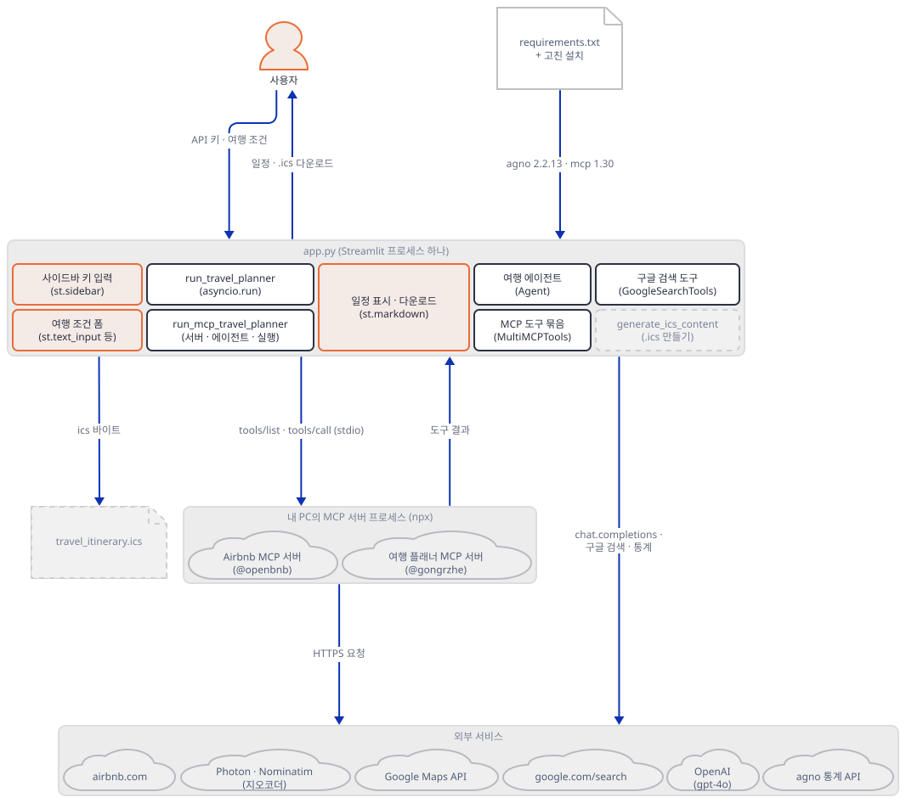

**확인.** 가짜 서버 앱(`app_lab.py`)으로 기본 글을 받습니다.

```bash
uv run --no-project python apptest.py app_lab.py 2>/dev/null
```

```text
키를 넣기 전 헤더: ['🔑 API Keys Configuration']
키를 넣은 뒤 헤더: ['🌍 Trip Details', '🔑 API Keys Configuration']
success: ['Your travel itinerary is ready!', 'All API keys configured!']
info: ['Used general knowledge for accommodation suggestions (Airbnb MCP may have failed to connect)']
error: []
다운로드 버튼: 1 | 저장된 일정 글자 수: 59
```

`airbnb_search`가 실제로 불렸는데도(`mcp.log`) 화면은 "일반 지식을 썼다(Airbnb MCP가 연결에 실패했을 수 있다)"고 합니다. 이제 가짜 모델의 답을 "Airbnb"와 "accommodation"이 든 글로 바꿉니다.

```bash
printf 'Trip Overview\nAccommodation: Airbnb listing near Shinjuku, $90 per night.\nDay 1: 도착\nDay 2: 관광\n' > plan.txt
uv run --no-project python apptest.py app_lab.py 2>/dev/null | grep -E "^(success|info)"
```

```text
success: ['Your travel itinerary is ready with Airbnb data!', 'All API keys configured!']
info: ['Used real Airbnb listings for accommodation recommendations']
```

같은 서버, 같은 호출이고 글만 바뀌었는데 문구가 "진짜 Airbnb 목록을 썼다"로 바뀌었습니다. Step 8에서 서버가 아예 안 뜬 상태로 이 글을 받아도 같은 문구가 나옵니다. 마지막으로 앱을 실제로 띄우는 명령입니다. 화면은 `app_lab.py`로 띄우고 키 칸에는 아무 값이나 넣습니다(서버 둘과 모델이 모두 가짜이므로). 이 문서는 이 명령을 띄워 상태 확인 주소(`/_stcore/health`)가 `ok`를 돌려주는 것까지만 확인했고, 브라우저로 화면을 열어 보지는 않았습니다.

```bash
rm plan.txt
uv run --no-project streamlit run app_lab.py --server.headless true --server.address localhost --server.port 59613 --browser.gatherUsageStats false
```

`--server.address localhost`를 빼면 Streamlit이 시작하며 외부 IP를 알아내려고 바깥에 요청을 보낼 수 있고(Day 060에서 확인), `--browser.gatherUsageStats false`는 Streamlit 자신의 통계를 끕니다. 확인이 끝나면 Ctrl+C로 끝냅니다. **원본 `app.py`를 `streamlit run`하면 Node가 있는 PC에서는 버튼을 누르는 순간 진짜 `npx`가 실행됩니다. 이 문서는 하지 않았습니다.**

### Step 7. 달력 파일 — "Day N"을 찾는 정규식

**목적.** `.ics`를 만드는 `generate_ics_content`가 모델의 글을 어떻게 나누는지 봅니다. 이 함수는 로컬 함수라 직접 돌려도 됩니다.

**할 일.** 핵심은 두 곳입니다.

`mcp_ai_agents/ai_travel_planner_mcp_agent_team/app.py:33-35`

```python
    # Split the plan into days
    day_pattern = re.compile(r'Day (\d+)[:\s]+(.*?)(?=Day \d+|$)', re.DOTALL)
    days = day_pattern.findall(plan_text)
```

`mcp_ai_agents/ai_travel_planner_mcp_agent_team/app.py:51-60`

```python
            # Create a single event for the entire day
            event = Event()
            event.add('summary', f"Day {day_num} Itinerary")
            event.add('description', day_content.strip())

            # Make it an all-day event
            event.add('dtstart', current_date.date())
            event.add('dtend', current_date.date() + timedelta(days=1))
            event.add("dtstamp", datetime.now())
            cal.add_component(event)
```

`Day (\d+)[:\s]+(.*?)(?=Day \d+|$)`는 "Day" 다음 숫자, 그다음 콜론이나 공백, 그다음 **다음 "Day 숫자"가 나오기 전까지**를 한 이벤트로 잡습니다. `Day N`을 못 찾으면 글 전체를 "Travel Itinerary" 이벤트 하나로 만듭니다. 이벤트 날짜는 `start_date + (N-1)일`이고 종일 이벤트(`DTSTART;VALUE=DATE`)입니다. 시작일은 화면의 날짜 칸 값입니다(`app.py:307`).

`travel-lab/ics_check.py`

```python
from datetime import datetime
from icalendar import Calendar
import app_lab

CASES = {
    "Day N:": "Overview\nDay 1: 도착\nDay 2: 관광\n",
    "### Day N:": "## Trip\n### Day 1: Arrival\nwalk\n### Day 2: Museum\n",
    "**Day N**:": "**Day 1**: Arrival\n**Day 2**: Museum\n",
    "Day N -": "Day 1 - Arrival\nDay 2 - Museum\n",
    "본문 속 Day 2": "Day 1: Arrival. Return by Day 2 evening.\nDay 2: Museum\n",
    "Day 없음": "아무 일정이나\n",
}
for label, text in CASES.items():
    cal = Calendar.from_ical(app_lab.generate_ics_content(text, datetime(2027, 3, 1)))
    events = list(cal.walk("VEVENT"))
    print(f"[{label}] 이벤트 {len(events)}개")
    for e in events:
        print("  ", e["summary"], e["dtstart"].dt, "->", e["dtend"].dt, "|", repr(str(e["description"])[:30]))
```

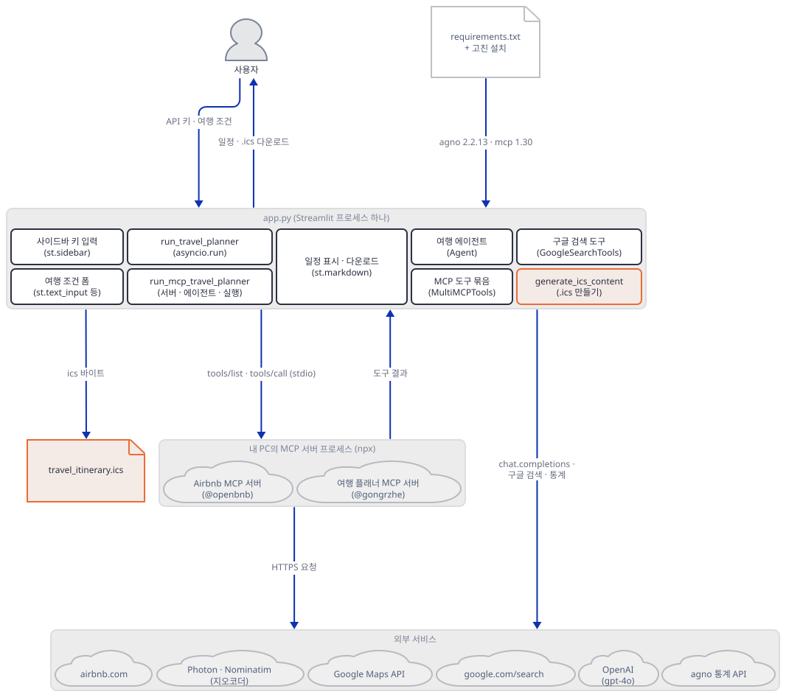

**확인.**

```bash
uv run --no-project python ics_check.py 2>/dev/null
```

```text
[Day N:] 이벤트 2개
   Day 1 Itinerary 2027-03-01 -> 2027-03-02 | '도착'
   Day 2 Itinerary 2027-03-02 -> 2027-03-03 | '관광'
[### Day N:] 이벤트 2개
   Day 1 Itinerary 2027-03-01 -> 2027-03-02 | 'Arrival\nwalk\n###'
   Day 2 Itinerary 2027-03-02 -> 2027-03-03 | 'Museum'
[**Day N**:] 이벤트 1개
   Travel Itinerary 2027-03-01 -> 2027-03-02 | '**Day 1**: Arrival\n**Day 2**: '
[Day N -] 이벤트 2개
   Day 1 Itinerary 2027-03-01 -> 2027-03-02 | '- Arrival'
   Day 2 Itinerary 2027-03-02 -> 2027-03-03 | '- Museum'
[본문 속 Day 2] 이벤트 3개
   Day 1 Itinerary 2027-03-01 -> 2027-03-02 | 'Arrival. Return by'
   Day 2 Itinerary 2027-03-02 -> 2027-03-03 | 'evening.'
   Day 2 Itinerary 2027-03-02 -> 2027-03-03 | 'Museum'
[Day 없음] 이벤트 1개
   Travel Itinerary 2027-03-01 -> 2027-03-02 | '아무 일정이나\n'
```

- `Day N:`·`### Day N:`·`Day N -`는 하루에 이벤트 하나로 잘 나뉩니다. 그러나 `### Day 1:` 꼴에서는 설명 끝에 다음 제목의 `###`가 따라 들어갑니다(`'Arrival\nwalk\n###'`). 마크다운의 `#`이 다음 날 제목의 앞부분인데 정규식이 `Day`부터 끊기 때문입니다.
- `**Day 1**: …`처럼 굵게 쓰고 숫자 뒤에 `*`가 오면 `Day (\d+)[:\s]+`가 맞지 않아 하루도 못 찾고 글 전체가 이벤트 하나가 됩니다.
- 본문 문장 속의 "Day 2"("Return by Day 2 evening")도 새 하루로 쪼개서 이벤트가 셋이 됩니다. 모델이 일정 안에서 다른 날을 언급하면 일어납니다.
- 요약: 모델이 제목을 어떤 모양으로 쓰는지에 따라 달력이 달라집니다. 진짜 `gpt-4o`가 어떤 모양으로 쓰는지는 확인하지 못했습니다.

만들어진 파일의 모양은 이렇습니다(시작일 2027-03-01로 만든 두 이벤트의 앞부분). `DTSTAMP`는 파이썬이 `datetime.now()`(지역 시각)를 시간대 없이 넘긴 값인데 끝에 `Z`(UTC)가 붙어 나옵니다. 내 PC는 한국 시간이라 실제 UTC와 9시간 어긋났습니다.

```text
BEGIN:VCALENDAR
VERSION:2.0
PRODID:-//AI Travel Planner//github.com//
BEGIN:VEVENT
SUMMARY:Day 1 Itinerary
DTSTART;VALUE=DATE:20270301
DTEND;VALUE=DATE:20270302
DTSTAMP:20261014T230321Z
DESCRIPTION:arrive
END:VEVENT
```

### Step 8. 서버가 안 뜰 때 — 로그 두 줄과 조용한 도구 상실

**목적.** MCP 서버가 안 뜨는 경우 앱이 어떻게 반응하는지 네 가지 실패를 일부러 일으켜 봅니다.

**할 일.** Step 3의 `make_app.py`로 복사본 넷을 더 만듭니다. 모두 가짜 서버 시나리오이고 진짜 `npx`는 실행되지 않습니다.

```bash
for m in nonode badcmd mapsdown airbnbdown; do uv run --no-project python make_app.py app.py $m; done
```

```powershell
foreach ($m in "nonode","badcmd","mapsdown","airbnbdown") { uv run --no-project python make_app.py app.py $m }
```

(PowerShell 줄은 실행해 보지 못했습니다.)

| 복사본 | 바꾼 것 | 흉내 내는 상황 |
|---|---|---|
| `app_nonode.py` | 두 명령의 `npx`를 `./npx`로 | Node가 없는 PC. 이 폴더에 `./npx`가 없으므로 PATH와 상관없이 실행 파일을 못 찾는다 |
| `app_badcmd.py` | 두 명령의 `npx`를 `npx-missing`으로 | 명령 이름이 허용 목록에 없음(오타 등) |
| `app_mapsdown.py` | 둘째 서버를 `python no_such_server.py`로 | 서버 둘 가운데 둘째만 시작 직후 죽음 |
| `app_airbnbdown.py` | 첫째 서버를 `python no_such_server.py`로 | 첫째만 죽음 |

각각 `call_plan.py`로 한 번씩 돌리고 가짜 OpenAI가 받은 도구 이름과 서버 기록을 봅니다(Step 5의 환경 그대로, 실행마다 `openai.log`와 `mcp.log`를 비웁니다).

```bash
for m in nonode mapsdown airbnbdown; do
  : > openai.log; : > mcp.log
  echo "## $m"; uv run --no-project python call_plan.py app_$m 2>&1 | grep -E "Failed to|MCP connection failed" | cut -c1-100
  uv run --no-project python -c "
import json
for l in open('openai.log', encoding='utf-8'): print('모델에게 간 도구', json.loads(l)['tools'])
for l in open('mcp.log', encoding='utf-8'): d = json.loads(l); print('서버', d['server'], d['event'])
"
done
```

```text
## nonode
ERROR    Failed to connect to <MultiMCPTools name=MultiMCPTools functions=[]>: 
         MCP connection failed: [WinError 2] 지정된 파일을 찾을 수 없습니다    
ERROR    Failed to connect to <MultiMCPTools name=MultiMCPTools functions=[]>: 
         MCP connection failed: [WinError 2] 지정된 파일을 찾을 수 없습니다    
모델에게 간 도구 ['google_search']
모델에게 간 도구 ['google_search']
## mapsdown
ERROR    Failed to get MCP tools: Connection closed                            
ERROR    Failed to connect to <MultiMCPTools name=MultiMCPTools functions=[]>: 
         MCP connection failed: Connection closed                              
모델에게 간 도구 ['google_search']
모델에게 간 도구 ['google_search']
서버 airbnb start
서버 airbnb exit
## airbnbdown
ERROR    Failed to get MCP tools: Connection closed                            
ERROR    Failed to connect to <MultiMCPTools name=MultiMCPTools functions=[]>: 
         MCP connection failed: Connection closed                              
ERROR    Failed to get MCP tools: Connection closed                            
ERROR    Failed to connect to <MultiMCPTools name=MultiMCPTools functions=[]>: 
         MCP connection failed: Connection closed                              
모델에게 간 도구 ['google_search']
모델에게 간 도구 ['google_search']
```

(PowerShell은 `: > file` 대신 `Clear-Content`, 파이프 뒤 `grep`·`cut` 대신 `Select-String`을 써야 하므로 실행해 보지 못했습니다.)

- **`nonode`.** 같은 `ERROR Failed to connect … [WinError 2]`(한국어 Windows 문구) 줄이 **두 번** 나옵니다. 앱의 `connect()` 한 번, 그리고 `arun`이 도구가 연결되지 않은 것을 보고 다시 시도한 한 번입니다(`agent.py`의 5424번째 줄의 `_connect_mcp_tools`). 이후에도 앱은 멈추지 않고, 모델에게는 `google_search` 하나만 갑니다. 화면은 오류를 보여 주지 않고 일정을 그립니다. 이어서 Step 6의 "Airbnb" 글로 `app_nonode.py`를 돌리면 `success: ['Your travel itinerary is ready with Airbnb data!', …]`와 `info: ['Used real Airbnb listings for accommodation recommendations']`가 나옵니다. 서버가 하나도 안 떴는데도 화면은 진짜 Airbnb 목록을 썼다고 말합니다(직접 확인).
- **`mapsdown`.** 첫째 서버(Airbnb)는 시작해서 `initialize`까지 하고, 둘째가 죽으면 예외가 나서 `build_tools`가 불리지 않습니다. 그래서 Airbnb 서버는 떴다가 `close()`로 끝나기만 하고 **Airbnb 도구도 모델에게 가지 않습니다.** 서버 하나가 죽으면 서버 둘의 도구가 모두 사라집니다. 이때 `ERROR` 줄은 한 번입니다(첫 `connect()`에서 첫째 세션이 이미 `initialized`로 표시되므로 `arun`이 다시 연결하지 않음).
- **`airbnbdown`.** 첫째가 죽으면 둘째는 **시작조차 하지 않습니다**(`mcp.log`에 서버 기록이 없음). 예외가 나면 루프가 끝나기 때문입니다(`multi_mcp.py`의 217-251번째 줄). 이때는 `ERROR` 줄이 두 번입니다.
- **`badcmd`.** 허용 목록에 없는 이름은 서버를 띄우기 전, `MultiMCPTools(...)`를 **만드는 줄에서** `ValueError`가 납니다. 그러면 `finally`의 `mcp_tools.close()`가 `UnboundLocalError`를 내고, 화면에는 이 문구가 나옵니다(직접 확인).

```bash
uv run --no-project python apptest.py app_badcmd.py 2>/dev/null | grep -E "^(error|다운)"
```

```text
error: ["Error: cannot access local variable 'mcp_tools' where it is not associated with a value"]
다운로드 버튼: 0 | 저장된 일정 글자 수: 0
```

원본의 `npx`는 허용 목록에 있어서 이 경로는 명령 이름을 바꿨을 때 닿습니다. 진짜 원인(`ValueError: MCP command needs to use one of the following executables`)은 가려지고 사용자에게는 `mcp_tools`라는 낯선 변수 이름만 보입니다.


**확인.** 위 `mapsdown` 결과에서 모델에게 간 도구가 `['google_search']` 하나뿐이고 Airbnb 서버가 `start`와 `exit`만 한 것이 보이면 됩니다. 이 앱에서 서버 연결이 성공했는지 믿을 수 있는 신호는 화면의 안내 문구가 아니라 도구 수입니다. `MultiMCPTools(..., allow_partial_failure=True)`를 주면 서버 하나가 죽어도 나머지 도구를 쓰는지는 "더 해보기"에서 해 봅니다.

## 요청 한 건이 흐르는 과정

버튼을 한 번 누르면 아래 여덟 그림이 차례로 일어납니다. 전부 한 번의 `run_travel_planner` 호출입니다. 첫 그림은 클릭에서 연결 시작까지입니다. `MultiMCPTools`를 만드는 줄은 서버를 띄우지 않고 `connect()`가 띄웁니다.

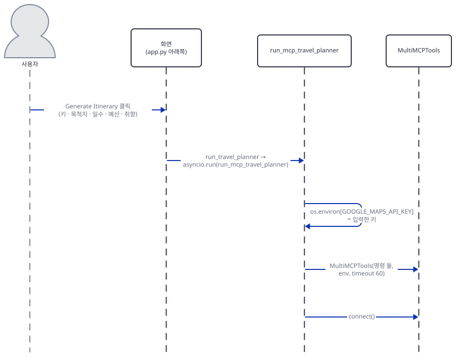

둘째는 `connect()` 안입니다. 서버를 차례로 띄워 `initialize`하고, 둘 다 끝나면 도구 목록을 받습니다. Airbnb 서버에만 `--ignore-robots-txt`가 붙고 둘째 명령에는 `-y`가 없습니다.

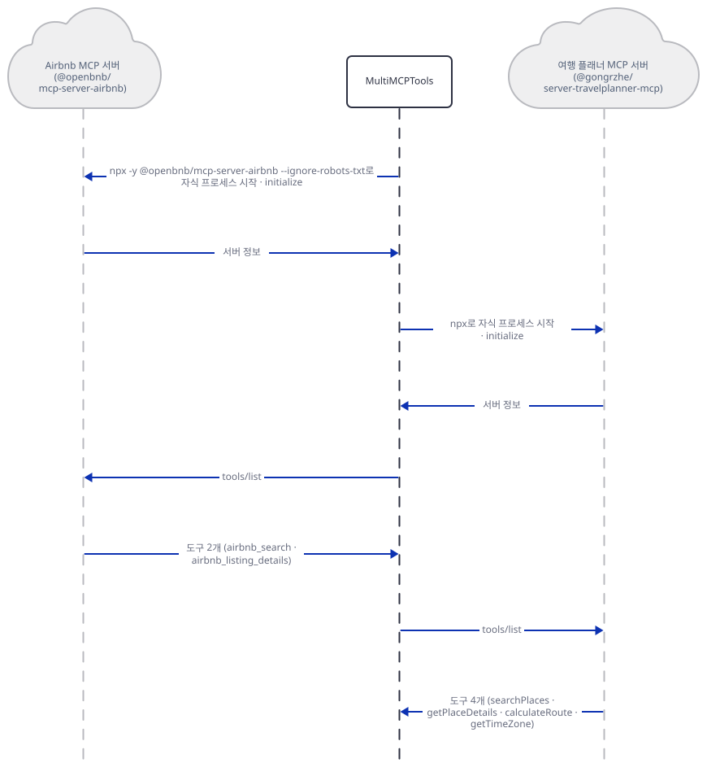

셋째는 모델에게 처음 묻는 부분입니다. 에이전트는 이미 연결된 도구를 다시 연결하지 않고 도구 일곱(MCP 6 + 구글 검색 1)을 모아 모델에게 줍니다.

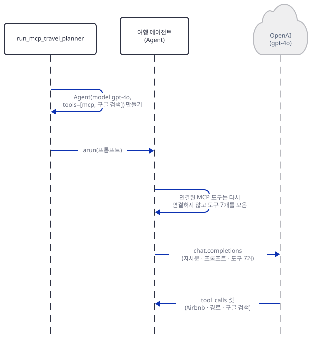

넷째는 모델이 부른 도구 가운데 MCP 둘입니다. 서버는 자기 외부 서비스로 나갔다 돌아옵니다. 그림의 순서는 모델이 낸 `tool_calls` 순서이고, 실제 도착 순서는 실행마다 달랐습니다.

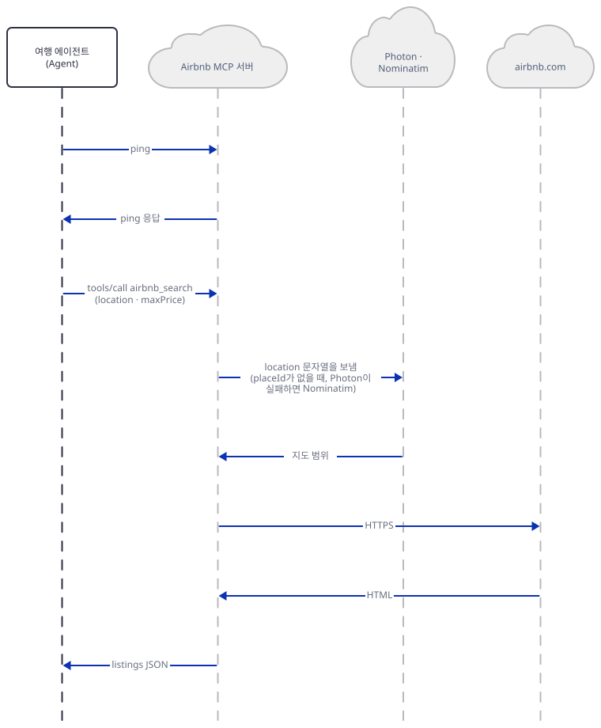

다섯째는 구글 검색입니다. 서버 없이 같은 프로세스에서 google.com으로 나가고, 오늘의 환경에서는 오류 글이 돌아옵니다.

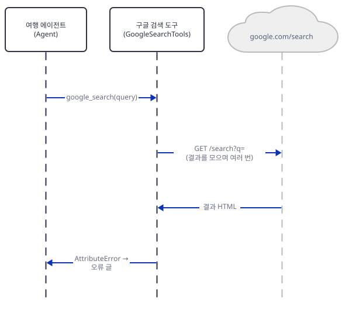

여섯째는 도구 결과를 받은 모델의 답과 통계입니다. 모델이 도구를 더 부르면 둘째~여섯째가 되풀이됩니다. 이 문서의 가짜 모델은 한 번만 불러서 되풀이를 보지 못했습니다.

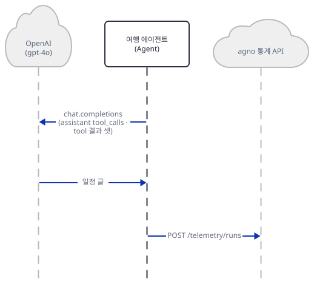

일곱째는 `finally`입니다. `close()`는 `AsyncExitStack`을 닫는데(`multi_mcp.py`의 272번째 줄) 나중에 연 것부터 닫혀서, Step 5의 `mcp.log`에서도 둘째 서버(`maps`)가 먼저 `exit`했습니다. `mcp`는 표준 입력을 닫아 종료를 기다리고, 2초 안에 안 끝나면 강제로 끝냅니다(`mcp/client/stdio/__init__.py`의 종료 순서 주석).

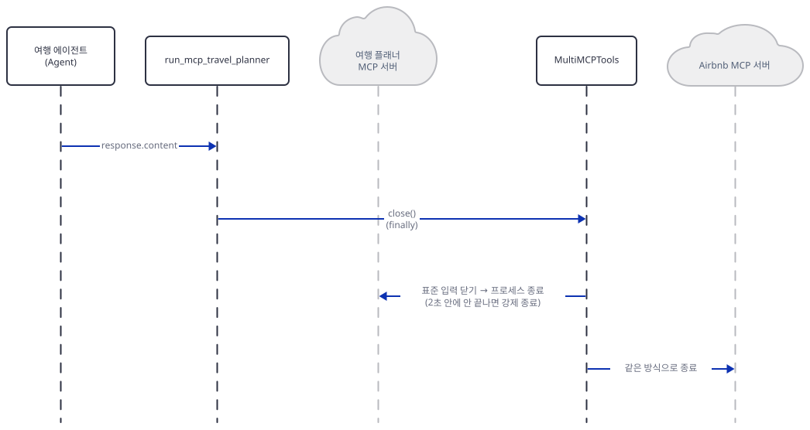

마지막은 화면으로 돌아와 일정을 저장하고 `.ics`를 만들어 버튼을 다는 부분입니다. 이 가운데 `generate_ics_content`는 화면이 다시 그려질 때마다 불립니다(`app.py:307`은 버튼 옆 칸에서 `session_state.itinerary`가 있으면 매번 실행됨).

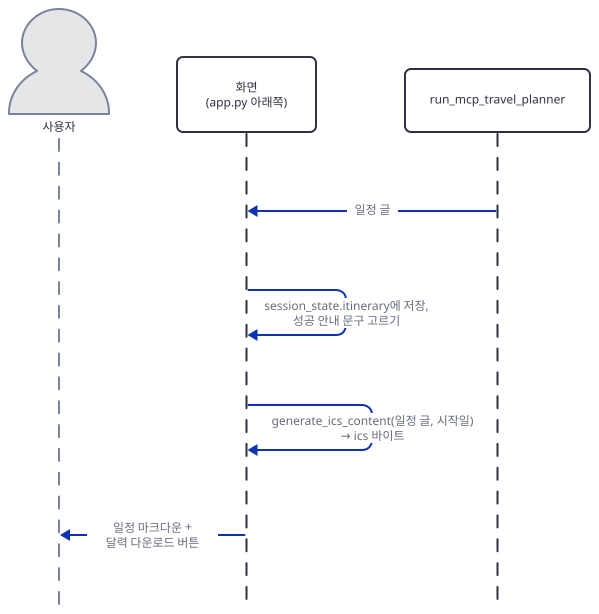

## 실행 체크리스트

- [ ] `uv pip install`에 `"agno>=2.2.10,<2.3" "mcp<2" googlesearch-python pycountry`를 더했고 `import ok`가 나온다
- [ ] 앱 코드를 돌리기 전에 `OPENAI_BASE_URL`을 가짜 서버로 걸었고 `AsyncOpenAI(...).base_url`이 `http://127.0.0.1:…`를 찍는다
- [ ] `AGNO_TELEMETRY=false`를 걸었다(통계를 일부러 볼 때만 뺀다)
- [ ] 앱 복사본의 두 서버 명령이 `python fake_mcp.py …`이고 맨 위에 `import lab_patch`가 있다(`diff`로 세 군데뿐)
- [ ] `call_plan.py`의 `openai.log`에 요청 둘, `mcp.log`에 `airbnb_search`·`calculateRoute` 호출이 있다
- [ ] `google_search`가 `'str' object has no attribute 'url'`을 내는 것을 확인했다
- [ ] 실패 복사본 넷에서 모델에게 간 도구 수가 달라지는 것을 봤다
- [ ] 원본 `app.py`를 `streamlit run`하지 않았다(Node가 있으면 진짜 `npx`가 실행됨)
- [ ] 띄운 가짜 서버(`fake_openai.py`)를 끝내고 포트가 비었다(`netstat`로 확인)

## 문제 해결

| 증상 | 원인 | 해결 |
|---|---|---|
| ``ImportError: `mcp` not installed. Please install using `pip install 'mcp>=2.1.0,<3.0.0'` `` | `requirements.txt`에 `mcp`가 없고 agno 3.1.3이 설치됨 | agno를 `<2.3`으로 묶고 `"mcp<2"`를 더한다 (Step 1) |
| `ImportError: cannot import name 'MultiMCPTools'` | agno 3.x에는 `MultiMCPTools`가 없음 | `agno>=2.2.10,<2.3` (Step 1) |
| ``ImportError: `mcp` not installed. Please install using `pip install mcp` `` — 설치돼 있는데도 | agno 2.2.13이 `mcp` 2.x에 없는 `streamablehttp_client`를 불러옴(문구가 거짓) | `"mcp<2"` |
| `` ImportError: `googlesearch-python` not installed `` 또는 `pycountry` | requirements에 빠진 `GoogleSearchTools`의 의존성 | 둘을 설치 (Step 1) |
| (아직 보지 못함) 종료일 뒤 `gpt-4o` 호출이 거부됨 | `gpt-4o`가 2027-01-14에 제거 예정 ⚠ | 오류 문구는 확인하지 못했다. OpenAI 폐기 문서의 권장 대체 `gpt-6-luna`로 바꿔도 이 앱이 도는지는 확인하지 못했다 (Step 4) |
| 로그에 `'str' object has no attribute 'url'` | `GoogleSearchTools`가 `googlesearch`의 주소 문자열을 객체로 읽음 | 도구를 `advanced=True`로 부르는 자체 도구로 바꾼다("더 해보기"). 이 문서는 고쳐 보지 못했다 (Step 4) |
| `ERROR Failed to connect to <MultiMCPTools …>: MCP connection failed: [WinError 2]`가 두 번 | Node(`npx`)가 없거나 PATH에 없음. 앱은 도구 없이 계속 진행 | Node를 설치하거나 PATH를 고친다. 일정이 그려져도 도구는 쓰이지 않았다 (Step 8) |
| `ERROR Failed to get MCP tools: Connection closed` | 서버 프로세스가 시작 직후 끝남. 앞선 서버가 죽으면 뒤 서버는 시작도 안 함, 뒤가 죽으면 앞 서버의 도구도 사라짐 | 서버 명령을 터미널에서 따로 돌려 보고, 원인을 고친 뒤 다시 (Step 8) |
| 화면에 `Error: cannot access local variable 'mcp_tools' …` | `MultiMCPTools(...)` 생성에서 예외 후 `finally`가 `UnboundLocalError`를 냄 | 진짜 원인은 `__context__`에 있다. 명령 이름이나 키 값을 확인 (Step 5·8) |
| "Used real Airbnb listings" 문구인데 서버는 안 떴다 | 문구는 응답 글에 "Airbnb"·"listing/accommodation"이 있는지로 정해짐 | 문구를 믿지 말고 도구 수·서버 로그를 본다 (Step 6) |
| 달력에 이벤트가 하나뿐이거나 하루가 둘로 쪼개짐 | 모델의 제목 모양(`**Day 1**:`) 또는 본문 속 "Day 2"가 정규식에 걸림 | 프롬프트에 제목 형식을 못 박거나 정규식을 고친다 (Step 7) |
| Python 3.8·3.9에서 `mcp`·`streamlit`을 설치할 수 없을 것(예상, 3.9에서 해 보지 못했다) | `mcp` 1.30.0과 `streamlit` 1.65.0이 `Requires-Python >=3.10` | Python 3.10 이상 (앱 README의 "3.8+"는 오늘 기준으로 틀렸다) |

## 더 해보기

- **서버 하나가 죽어도 나머지를 쓰기.** 복사본의 `MultiMCPTools(...)` 인자에 `allow_partial_failure=True`를 더합니다. `app_mapsdown.py`에 이 줄을 더해 돌렸을 때 모델에게 간 도구가 `['airbnb_listing_details', 'airbnb_search', 'google_search']`이었고 Airbnb 서버가 정상 호출됐습니다(직접 확인). 대신 연결 실패가 여전히 로그로만 보입니다. 도구 수가 기대와 다르면 화면에 경고를 띄우는 코드를 `run_mcp_travel_planner`에 더해 보세요.
- **시작일을 모델에게 알리기.** 프롬프트 글(`app.py:128-171`)에 시작일 줄을 더하고 `run_travel_planner`에 인자를 하나 더 거쳐 보냅니다. `bodies.log`의 `user` 메시지에 날짜가 들어가는지로 확인하세요. 진짜 모델이 그 날짜로 날씨나 개장 시간을 바꿔 답하는지는 확인하지 못했습니다.
- **구글 검색 도구 고치기.** agno의 `GoogleSearchTools`를 쓰지 말고, `googlesearch.search(..., advanced=True)`로 `title`·`url`·`description`을 내놓는 함수 하나를 `tools=`에 줍니다. `search_probe.py`로 같은 가짜 HTML에서 JSON이 나오는지 확인하세요.
- **진짜로 돌리기(스스로 책임질 일).** Node가 있는 PC에서 원본 `app.py`를 쓰면 `npx`가 두 서버를 내려받아 실행하고, Airbnb 서버는 airbnb.com을 robots.txt 없이 긁고 위치 문자열을 지오코더에 보내며, Google Maps API는 과금될 수 있습니다. 이 문서는 하지 않았습니다.

## 다음 날 예고

[Day 132 · 🔀 Multi-MCP Agent Router](../day132-multi-mcp-agent-router/README.md) — 오늘은 agno가 서버 둘을 한 에이전트에 몰아 줬다면, 다음 앱(`mcp_ai_agents/multi_mcp_agent_router/agent_forge.py`, Streamlit 371줄)은 agno 없이 Anthropic SDK와 `mcp` 클라이언트로 도구 루프를 직접 짜고, 에이전트마다 다른 MCP 서버 묶음을 연결합니다(파일 맨 위 설명과 import로 확인, 실행하지 않았습니다).
