# Day 132 · 🔀 Multi-MCP Agent Router

> 볼륨 9 ♾️ MCP AI Agents · 난이도 ★★☆ ⚠ 앱이 쓰는 모델 `claude-sonnet-4-20250514`는 2026-06-15에 퇴역했고, `requirements.txt`만 설치하면 `mcp` 2.3.0이 깔려 첫 질문에서 죽습니다(Step 1) · 예상 소요 100분(앱은 파일 하나 371줄이지만 가짜 MCP 서버와 가짜 Anthropic 서버를 직접 저장해 띄우고, 확인용 스크립트 넷을 저장해 돌리며 서버 쪽 기록과 앱의 동작을 맞대어 보는 시간이 읽는 시간보다 큽니다) · API 비용 대략 이 문서의 따라 하기는 $0(가짜 서버만 부릅니다. 실제 Anthropic 호출은 한 번도 하지 않았고 요금표도 확인하지 못했습니다) · 원본 앱: `mcp_ai_agents/multi_mcp_agent_router`

## 오늘 만들 것

Streamlit 화면에 질문을 치면 에이전트 넷(코드 리뷰어·보안 감사관·리서처·BIM 엔지니어) 가운데 하나가 받아 MCP 서버의 도구로 답하는 앱입니다. 볼륨 9 "♾️ MCP AI Agents"의 여섯째 날입니다. 이름의 "라우터"가 가리키는 것은 모델이 아니라 파이썬 키워드 목록입니다. `classify_query`가 질문 속 낱말을 찾아 에이전트를 고르고(`agent_forge.py:121-138`), 화면에서 Manual을 고르면 사람이 고릅니다. 에이전트마다 가진 MCP 서버가 다르고, 서버는 `npx`가 내려받아 띄우는 자식 프로세스입니다. 모델 호출과 도구 반복은 에이전트 프레임워크 없이 Anthropic SDK로 파일 하나가 직접 짭니다.

앞 날과 이어지는 부분은 이렇습니다. Day 130도 라이브러리 없이 도구 반복을 손으로 짰습니다. 그 날 앱은 OpenAI와 원격 MCP 서버 하나를 쓰고, 도구 호출 예산(`--max-tool-calls`, 기본 6)과 결과 12,000자 제한 같은 방어 코드를 갖췄습니다(Day 130 README에 있는 내용입니다). 오늘 앱에는 그런 방어가 없습니다. 이 앱이 쓰는 GitHub MCP 서버는 Day 128과 다릅니다. Day 128은 `docker`로 GitHub 공식 서버를 띄웠고, 오늘은 `npx`로 npm 패키지 `@modelcontextprotocol/server-github`를 띄웁니다.

이 문서는 `npx`·`docker`·`uvx`를 한 번도 실행하지 않았고 Anthropic에 요청을 보내지 않았습니다. `npx` 자리에는 파이썬으로 쓴 가짜 MCP 서버를, Anthropic 자리에는 `127.0.0.1`의 가짜 서버를 두었습니다. 가짜 서버의 도구 이름은 공개 README에서 읽은 것이고 도구가 하는 일은 제가 지었습니다.

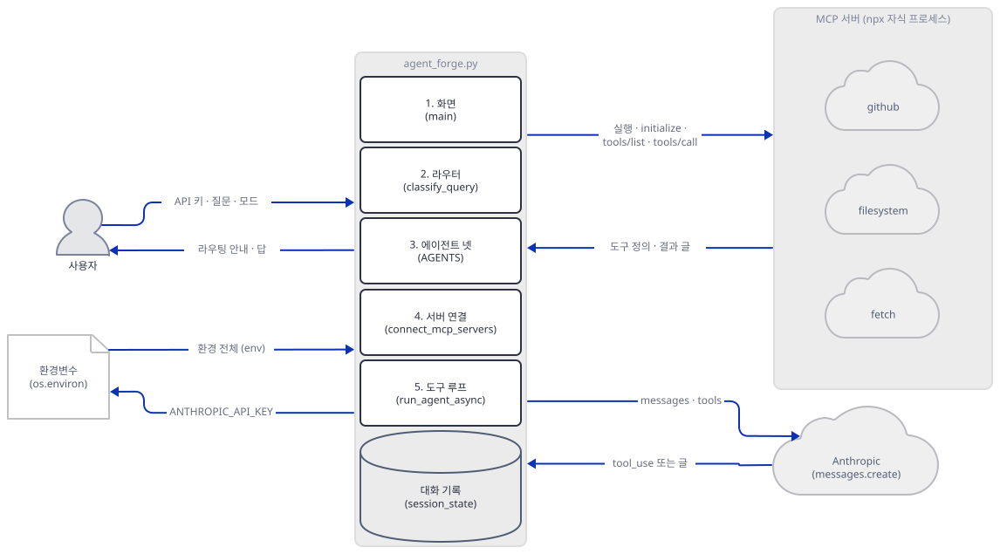

그림의 화살표는 `agent_forge.py` 묶음 전체에서 나가고 들어오는 것으로 읽습니다. 실제로는 서버 쪽 화살표(`실행 · initialize · tools/list · tools/call`)가 서버 연결과 도구 루프에서, `ANTHROPIC_API_KEY`는 화면(`agent_forge.py:286`)에서, `환경 전체`는 서버 연결(`agent_forge.py:163`)로, Anthropic 쪽은 도구 루프에서 오갑니다. 앱 안의 호출은 Step 7의 보조 구조 그림이 화살표로 보여 줍니다.

직접 돌려 알게 된 것이 여섯입니다. 첫째, 앱의 모델은 2026-06-15에 퇴역했습니다(사전 준비). 둘째, 오늘 `requirements.txt`를 그대로 설치하면 `mcp` 2.3.0이 깔리고 첫 질문이 `'Tool' object has no attribute 'inputSchema'`로 죽습니다. `mcp<2`를 더해 1.30.0으로 돌립니다(Step 1, 5). 같은 처방을 Day 130(`mcp` 2.3.0에서 세 군데가 어긋남)과 Day 131(agno 2.2.13이 불러오는 `streamablehttp_client`가 2.3.0에 없음)이 이미 썼고, 오늘의 어긋남은 그 둘과 다른 곳입니다. 셋째, 네 에이전트 중 둘이 쓰는 `@modelcontextprotocol/server-fetch`는 npm 레지스트리에 없었고, 다른 하나가 쓰는 `server-github`는 npm에서 지원 종료로 표시돼 있습니다(Step 3). 넷째, 라우터는 낱말을 부분 문자열로 찾아서 "latest"가 코드 리뷰로, "architecture"가 BIM 엔지니어로 갑니다(Step 4). 다섯째, 서버는 질문마다 새로 뜨고 셸 환경 전체가 넘어가서 사이드바에 넣은 Anthropic 키까지 모든 서버가 받습니다(Step 5). 여섯째, 도구 반복에는 상한이 없고, 서버가 알려 준 도구 오류에는 `is_error`가 붙지 않으며, 두 번째 서버가 못 뜨면 첫 서버가 정리되지 않습니다(Step 5, 6).

## 사전 준비

| 서비스/도구 | 용도 | 발급·설치 |
|---|---|---|
| uv | 가상환경 생성과 패키지 설치 | [공통 사전 준비](../README.md#공통-사전-준비-한-번만) 참고 |
| Python | 이 문서는 3.13.3으로 확인했다. 앱 README는 3.10 이상이라고 적는다 | 공통 사전 준비와 같음 |
| Anthropic API 키 | 실제로 쓸 때만 필요하다. 이 문서는 가짜 값 `sk-ant-fake-132`와 가짜 서버로 확인한다 | https://console.anthropic.com |
| Node.js(`npx`) | 진짜 MCP 서버를 내려받아 띄울 때만 필요하다. 이 문서의 실습은 쓰지 않는다 | https://nodejs.org/ |
| GitHub 토큰 | 진짜 `server-github`는 `GITHUB_PERSONAL_ACCESS_TOKEN`을 읽는다(서버 README). 앱은 이 변수를 따로 넣지 않으므로 셸에 있어야 한다. 이 문서는 쓰지 않는다 | GitHub 설정의 개인 액세스 토큰 |
| 터미널 셋 | 가짜 Anthropic 서버, Streamlit 앱, 그리고 Step 3~6의 스크립트와 `tail`을 돌리는 터미널 | 별도 설치 없음 |

앱이 쓰는 모델 `claude-sonnet-4-20250514`(`agent_forge.py:192, 203, 251`)를 Anthropic의 폐기 문서(https://platform.claude.com/docs/en/about-claude/model-deprecations, 2026-10-14에 내려받아 읽음)에서 찾았습니다. 이 모델은 "Retired"이고 폐기 공지 2026-04-14, 퇴역 2026-06-15, 권장 대체는 `claude-sonnet-5-5`입니다. 문서는 퇴역한 모델로 보낸 요청이 실패한다고 적습니다. 그러니 오늘 이 앱은 진짜 키를 넣어도 모델 호출 단계에서 실패할 것으로 보이지만, 실제 Anthropic은 부르지 않았으므로 어떤 오류가 오는지는 보지 못했습니다(Step 6의 404는 제 가짜 서버가 흉내 낸 것입니다). `anthropic` 1.13.0은 이 모델 이름을 알아보고 `messages.create`를 부를 때마다 Streamlit 터미널에 `DeprecationWarning: The model 'claude-sonnet-4-20250514' is deprecated and will reach end-of-life on June 15th, 2026.`을 찍었습니다(직접 확인). 세 곳의 모델 이름을 바꾸는 일은 "더 해보기"에 두었습니다.

## 아키텍처 한눈에 보기

| 컴포넌트 | 역할 | 코드 위치 |
|---|---|---|
| 에이전트 정의 (`Agent`, `AGENTS`) | 이름·시스템 프롬프트·MCP 서버 목록을 가진 에이전트 넷 | `mcp_ai_agents/multi_mcp_agent_router/agent_forge.py:28-118` |
| 라우터 (`classify_query`) | 질문 속 낱말로 에이전트 id를 고름 | `mcp_ai_agents/multi_mcp_agent_router/agent_forge.py:121-138` |
| 도구 변환 (`mcp_tool_to_anthropic`) | MCP 도구를 Anthropic 도구 모양으로 | `mcp_ai_agents/multi_mcp_agent_router/agent_forge.py:141-147` |
| 서버 연결 (`connect_mcp_servers`) | 서버마다 자식 프로세스를 띄우고 도구를 모음 | `mcp_ai_agents/multi_mcp_agent_router/agent_forge.py:150-183` |
| 도구 루프 (`run_agent_async`) | 모델 호출, 도구 호출, 결과 되돌리기를 반복하고 서버를 닫음 | `mcp_ai_agents/multi_mcp_agent_router/agent_forge.py:186-263` |
| 동기 감싸개 (`run_agent`) | 새 이벤트 루프를 만들어 위 함수를 돌림 | `mcp_ai_agents/multi_mcp_agent_router/agent_forge.py:266-272` |
| 화면 (`main`) | 키 입력, 모드 선택, 채팅, 에이전트별 기록 | `mcp_ai_agents/multi_mcp_agent_router/agent_forge.py:275-367` |
| MCP 서버 셋 | 앱 밖. `npx`가 띄우는 `server-github`·`server-filesystem`·`server-fetch`. 이 문서는 가짜 | `mcp_ai_agents/multi_mcp_agent_router/agent_forge.py:55-56, 76-77, 94-95, 115` |
| Anthropic | 앱 밖. SDK의 기본 주소, 이 문서는 `ANTHROPIC_BASE_URL`로 가짜 | `mcp_ai_agents/multi_mcp_agent_router/agent_forge.py:349` |

앱이 밖으로 여는 길은 둘입니다. 자식 프로세스로 뜬 MCP 서버(그 서버가 다시 GitHub·웹으로 나갑니다)와 Anthropic으로 가는 HTTP입니다. `anthropic` 1.13.0과 `mcp` 1.30.0 소스에서 `posthog`·`sentry`·`segment`·`mixpanel`·`amplitude`를 grep하면 둘 다 아무것도 안 나옵니다. 에이전트 프레임워크가 없으니 agno의 익명 통계(Day 047)도 이 앱과 상관없습니다. 브라우저로 화면을 열면 Streamlit의 사용 통계가 나가므로 아래 명령은 `--browser.gatherUsageStats false`를 붙입니다(Day 063이 같은 사실을 확인했습니다).

## 단계별 진행

### Step 1. 환경 만들기 — 설치는 되지만 `mcp`가 2.3.0입니다

**목적.** 원본을 건드리지 않도록 복사본과 가상환경을 만들고, 이 앱이 `npx`로 가는 자리를 먼저 세어 둡니다.

**할 일.** `<저장소>`는 이 저장소를 받은 경로입니다.

```bash
mkdir forge-work
cd forge-work
cp <저장소>/mcp_ai_agents/multi_mcp_agent_router/agent_forge.py .
cp <저장소>/mcp_ai_agents/multi_mcp_agent_router/requirements.txt .
uv venv
uv pip install -r requirements.txt "mcp<2"
```

(pip 대안: `python -m venv .venv`로 만들고 활성화한 뒤 `pip install -r requirements.txt "mcp<2"`.) 아래 PowerShell 줄은 실행해 보지 못했습니다(이 문서를 쓴 하네스가 PowerShell 실행을 막습니다).

```powershell
mkdir forge-work
cd forge-work
Copy-Item <저장소>\mcp_ai_agents\multi_mcp_agent_router\agent_forge.py .
Copy-Item <저장소>\mcp_ai_agents\multi_mcp_agent_router\requirements.txt .
uv venv
uv pip install -r requirements.txt "mcp<2"
```

저장소 안에서 `uv run`은 루트 환경을 쓰려 하므로 이후 `uv run`에는 모두 `--no-project`를 붙입니다. 여기서 복사한 `agent_forge.py`는 읽기 전용으로만 씁니다. 이 파일을 그대로 `streamlit run`하고 질문을 치면 앱이 `npx -y`로 패키지를 내려받아 실행합니다. 파일 위쪽의 가져오기는 이렇습니다.

`mcp_ai_agents/multi_mcp_agent_router/agent_forge.py:10-19`

```python
import asyncio
import json
import os
from contextlib import AsyncExitStack
from dataclasses import dataclass, field

import streamlit as st
from anthropic import Anthropic
from mcp import ClientSession, StdioServerParameters
from mcp.client.stdio import stdio_client
```

`requirements.txt`는 `pydantic>=2.0.0`도 적지만 `grep -c pydantic agent_forge.py`는 0이라, 앱은 `pydantic`을 직접 가져오지 않습니다. 

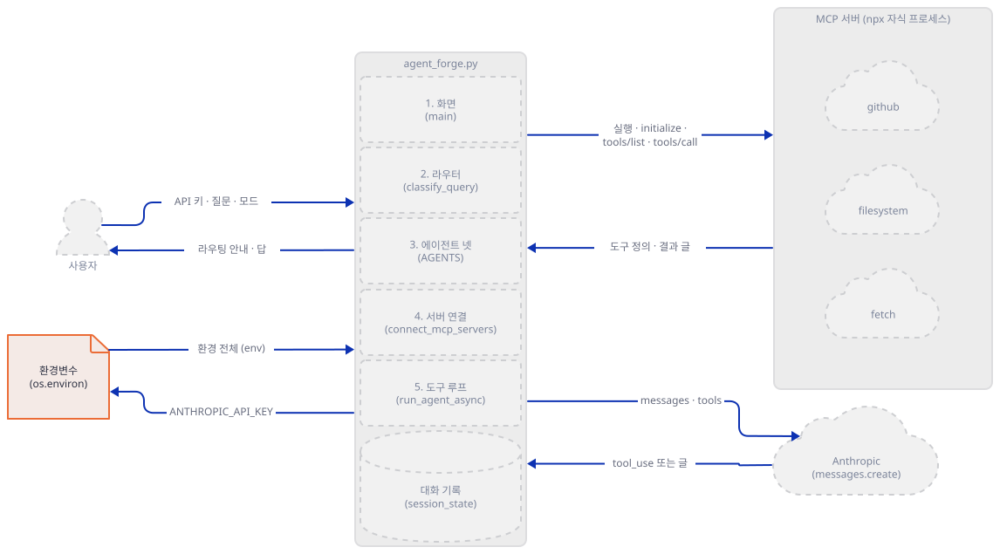

**확인.** 설치된 판과 `npx`가 나오는 줄, 모델 이름이 나오는 줄을 봅니다.

```bash
uv run --no-project python -c "from importlib.metadata import version as v; print('mcp', v('mcp'), '| anthropic', v('anthropic'), '| streamlit', v('streamlit'))"
grep -n "claude-" agent_forge.py
grep -c npx agent_forge.py
```

```text
mcp 1.30.0 | anthropic 1.13.0 | streamlit 1.65.0
192:            model="claude-sonnet-4-20250514",
203:            model="claude-sonnet-4-20250514",
251:                model="claude-sonnet-4-20250514",
7
```

`"mcp<2"`를 빼고 설치하면 `mcp` 2.3.0이 깔립니다(이 문서는 두 번째 가상환경으로 직접 확인했습니다). 2.x의 `Tool`은 `inputSchema` 대신 `input_schema`를 쓰므로 Step 5의 변환 함수가 죽습니다. 이 어긋남은 Day 130 문제 해결 첫 행(스트림 개수)이나 Day 131의 `streamablehttp_client`와 다른 곳이고, 처방(`mcp<2`)만 같습니다. 숫자는 2026-10-14의 값입니다.

### Step 2. 가짜 서버 둘과 `npx` 자리 바꾸기

**목적.** `npx`를 실행하지 않고 앱 전체를 돌릴 수 있게, MCP 서버 자리와 Anthropic 자리를 내 PC의 파이썬 프로세스로 바꿉니다.

**할 일.** 같은 폴더에 파일 셋을 저장합니다. 첫째는 가짜 MCP 서버입니다. `github`·`filesystem`·`fetch` 가운데 이름을 인자로 받아 그 이름의 도구를 냅니다. 도구 이름은 서버들의 공개 README에서 읽었고(`fetch`는 `url`·`max_length`를 받는다는 파이썬 참조 서버의 README), `boom`과 모든 도구의 본문은 제가 지었습니다. 환경변수는 값이 아니라 "있는지"와 키의 길이만 `mcp.log`에 남깁니다.

`fake_mcp.py`

```python
"""가짜 MCP 서버(stdio). 도구 이름은 공개 README에서 읽은 것이고, 도구가 하는 일은 내가 지었다."""
import json
import os
import sys
import time

try:
    from mcp.server.mcpserver import MCPServer  # mcp 2.x
except ImportError:
    from mcp.server.fastmcp import FastMCP as MCPServer  # mcp 1.x

name = sys.argv[1]  # github | filesystem | fetch


def log(**kw):
    kw.update(server=name, pid=os.getpid(), t=round(time.time(), 2))
    with open("mcp.log", "a", encoding="utf-8") as f:  # 앱을 띄운 폴더에 쌓인다
        f.write(json.dumps(kw, ensure_ascii=False) + "\n")


# 환경변수는 값이 아니라 "있는지"만 기록한다.
log(event="start", args=sys.argv[2:],
    anthropic_key_len=len(os.environ.get("ANTHROPIC_API_KEY", "")),
    has_demo_token="DEMO_TOKEN" in os.environ)

mcp = MCPServer(name)

if name == "github":
    @mcp.tool()
    def search_repositories(query: str) -> str:
        log(event="call", tool="search_repositories", args={"query": query})
        return json.dumps({"items": [{"full_name": "demo/" + query.replace(" ", "-")}]})

    @mcp.tool()
    def get_file_contents(owner: str, repo: str, path: str) -> str:
        log(event="call", tool="get_file_contents", args={"path": path})
        return "def add(a, b):\n    return a - b  # (가짜 파일)\n"

    @mcp.tool()
    def boom(why: str) -> str:
        """내가 지은 도구: 항상 예외를 던진다."""
        log(event="call", tool="boom", args={"why": why})
        raise RuntimeError("boom: " + why)

elif name == "filesystem":
    @mcp.tool()
    def list_directory(path: str) -> str:
        log(event="call", tool="list_directory", args={"path": path})
        return "[FILE] notes.txt\n[DIR] src"

    @mcp.tool()
    def read_text_file(path: str) -> str:
        log(event="call", tool="read_text_file", args={"path": path})
        return "가짜 파일 내용"

    @mcp.tool()
    def write_file(path: str, content: str) -> str:
        log(event="call", tool="write_file", args={"path": path})
        return "(가짜) 쓰지 않았다: " + path

elif name == "fetch":
    @mcp.tool()
    def fetch(url: str, max_length: int = 5000) -> str:
        log(event="call", tool="fetch", args={"url": url})
        return "# 가짜 페이지\n" + url + " 에 요청하지 않았다."

mcp.run()
```

둘째는 가짜 Anthropic 서버입니다. 질문 속 `@@tool:이름 {json}`·`@@loop`·`@@retired`·`@@slow`로 동작을 고릅니다. `allow_reuse_address = False`는 Windows에서 다른 프로세스의 포트에 겹쳐 뜨는 것을 막습니다.

`fake_anthropic.py`

```python
"""가짜 Anthropic /v1/messages (127.0.0.1의 임의 포트). 질문 속 지시어로 동작을 고른다.
  @@tool:이름 {json}   첫 요청에서 그 도구를 부르라고 답한다
  @@loop               도구 결과가 와도 계속 도구를 부르라고 답한다(25번째에 멈춘다)
  @@retired            404 not_found_error로 답한다(퇴역 모델을 흉내 낸 것)
  @@slow               1.5초 늦게 답한다
"""
import json
import random
import time
from http.server import BaseHTTPRequestHandler, HTTPServer


def log(**kw):
    kw["t"] = round(time.time(), 2)
    with open("anth.log", "a", encoding="utf-8") as f:
        f.write(json.dumps(kw, ensure_ascii=False) + "\n")


class Handler(BaseHTTPRequestHandler):
    def log_message(self, *a):
        pass

    def do_POST(self):
        body = json.loads(self.rfile.read(int(self.headers["content-length"])))
        msgs, tools = body["messages"], body.get("tools", [])
        last = msgs[-1]["content"]
        results = [{"is_error": b.get("is_error"), "head": str(b["content"])[:60]}
                   for b in last if isinstance(b, dict) and b.get("type") == "tool_result"] if isinstance(last, list) else []
        log(model=body["model"], tools=[t["name"] for t in tools], n_messages=len(msgs),
            tool_results=results, key_len=len(self.headers.get("x-api-key", "")))
        q = next(m["content"] for m in reversed(msgs) if isinstance(m["content"], str))
        rounds = sum(1 for m in msgs if isinstance(m["content"], list) and m["content"]
                     and isinstance(m["content"][0], dict) and m["content"][0].get("type") == "tool_result")

        def send(obj, code=200):
            raw = json.dumps(obj).encode()
            self.send_response(code)
            self.send_header("content-type", "application/json")
            self.send_header("content-length", str(len(raw)))
            self.end_headers()
            self.wfile.write(raw)

        if "@@retired" in q:
            return send({"type": "error", "error": {"type": "not_found_error", "message": "simulated 404"}}, 404)
        if "@@slow" in q:
            time.sleep(1.5)
        call = None
        if "@@loop" in q and tools and rounds < 25:
            call = (tools[0]["name"], {"query": "x"} if tools[0]["name"] == "search_repositories" else {})
        elif "@@tool:" in q and tools and rounds == 0:
            name, _, args = q.split("@@tool:", 1)[1].strip().partition(" ")
            call = (name, json.loads(args) if args else {})
        out = {"id": "msg_fake", "type": "message", "role": "assistant", "model": body["model"],
               "stop_sequence": None, "usage": {"input_tokens": 1, "output_tokens": 1}}
        if call:
            out.update(stop_reason="tool_use", content=[
                {"type": "text", "text": "도구를 부르겠다."},
                {"type": "tool_use", "id": "toolu_%d" % random.randint(1000, 9999), "name": call[0], "input": call[1]}])
        else:
            out.update(stop_reason="end_turn", content=[{"type": "text", "text": "가짜 답: 메시지 %d개를 받았다" % len(msgs)}])
        send(out)


class Server(HTTPServer):
    allow_reuse_address = False  # Windows에서 다른 프로세스의 포트에 겹쳐 뜨는 것을 막는다


port = random.randint(49152, 65535)
server = Server(("127.0.0.1", port), Handler)
print("listening on", port, flush=True)
server.serve_forever()
```

셋째는 `npx` 자리를 바꾸는 스크립트입니다. 복사본을 읽어 일곱 곳을 바꾼 `agent_forge_fake.py`를 새로 쓰고 원본은 건드리지 않습니다.

`patch_npx.py`

```python
"""agent_forge.py를 읽어 npx 자리를 가짜 서버로 바꾼 agent_forge_fake.py를 쓴다. 원본은 건드리지 않는다."""
src = open("agent_forge.py", encoding="utf-8").read()
py = 'sys.executable, "args": ["fake_mcp.py", '
swaps = [
    ('"npx", "args": ["-y", "@modelcontextprotocol/server-github"]', py + '"github"]'),
    ('"npx", "args": ["-y", "@modelcontextprotocol/server-fetch"]', py + '"fetch"]'),
    ('"npx", "args": ["-y", "@modelcontextprotocol/server-filesystem", "/tmp"]', py + '"filesystem", "/tmp"]'),
]
for old, new in swaps:
    print(src.count(old), "x", old)
    src = src.replace(old, new)
src = src.replace("import os\n", "import os\nimport sys\n", 1)
open("agent_forge_fake.py", "w", encoding="utf-8", newline="\n").write(src)
print("npx가 남은 줄:", src.count("npx"))
```

```bash
uv run --no-project python patch_npx.py
grep -c npx agent_forge_fake.py
uv run --no-project python fake_anthropic.py
```

세 번째 명령은 터미널 하나를 차지하고 포트를 찍습니다(49152~65535의 임의 값). 다른 터미널에서 계속합니다.

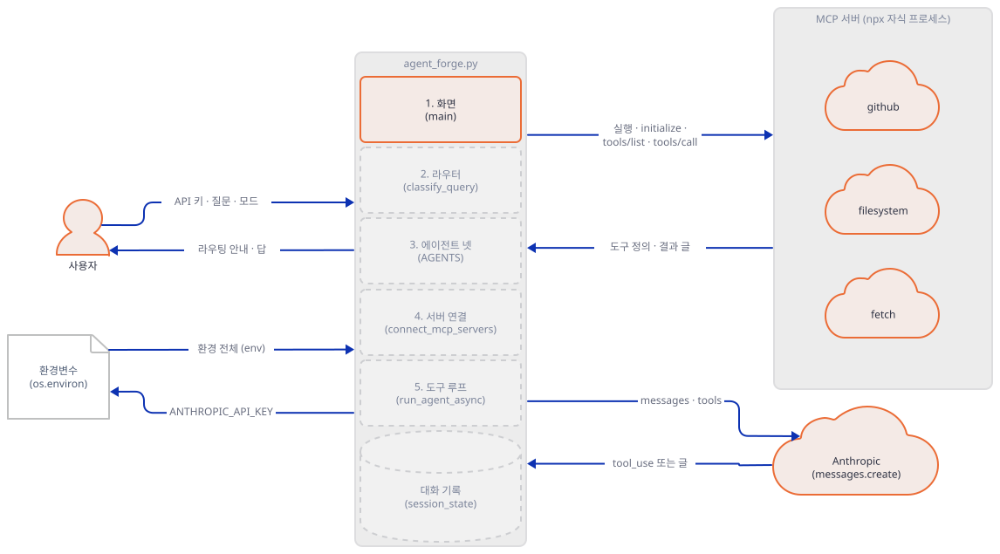

**확인.**

```text
2 x "npx", "args": ["-y", "@modelcontextprotocol/server-github"]
2 x "npx", "args": ["-y", "@modelcontextprotocol/server-fetch"]
3 x "npx", "args": ["-y", "@modelcontextprotocol/server-filesystem", "/tmp"]
npx가 남은 줄: 0
0
listening on 60657
```

`npx`가 남은 줄이 0이어야 다음으로 갑니다. 앱이 Anthropic으로 가는 주소는 SDK가 정합니다. 앱은 `Anthropic(api_key=api_key)`만 부르고 주소 인자가 없으므로(`agent_forge.py:349`), `anthropic` 1.13.0의 `_client.py:235`가 읽는 환경변수 `ANTHROPIC_BASE_URL`이 주소가 됩니다(소스로 확인). 그래서 앱을 띄우는 터미널에서 먼저 이 변수를 가짜 서버의 포트로 겁니다. 변수 없이 키를 넣고 질문하면 요청이 실제 `api.anthropic.com`으로 갑니다.

```bash
export ANTHROPIC_BASE_URL=http://127.0.0.1:<위에서 찍힌 포트>
export DEMO_TOKEN=fake-not-real
uv run --no-project streamlit run agent_forge_fake.py --server.headless true --server.address localhost --browser.gatherUsageStats false
```

```powershell
$env:ANTHROPIC_BASE_URL = "http://127.0.0.1:<위에서 찍힌 포트>"
$env:DEMO_TOKEN = "fake-not-real"
uv run --no-project streamlit run agent_forge_fake.py --server.headless true --server.address localhost --browser.gatherUsageStats false
```

(PowerShell 줄은 실행해 보지 못했습니다.) 출력에 `URL: http://localhost:<포트>`가 뜨면 그 주소를 브라우저로 엽니다. 앱을 띄우는 것만으로는 서버가 뜨지 않고, 질문을 치는 순간 `connect_mcp_servers`가 서버를 띄웁니다(소스로 확인). 이 문서는 같은 스크립트를 Streamlit의 테스트 도구 `AppTest`로도 돌려 기록을 얻었습니다. 화면에서 같은 질문을 치면 같은 줄이 `mcp.log`·`anth.log`에 쌓이지만, 이 문서는 사람 손으로 화면을 돌려 보지는 않았습니다.

### Step 3. 에이전트 정의 — 넷 가운데 둘은 서버가 뜨지 않습니다

**목적.** 에이전트가 무엇으로 이루어졌는지 보고, 에이전트마다 서버 목록을 확인합니다.

**할 일.** 에이전트는 이름·설명·시스템 프롬프트·아이콘·서버 목록을 가진 데이터 클래스입니다.

`mcp_ai_agents/multi_mcp_agent_router/agent_forge.py:28-35`

```python
@dataclass
class Agent:
    """A specialized agent with its own system prompt and MCP server configs."""
    name: str
    description: str
    system_prompt: str
    icon: str = "\U0001f916"
    mcp_servers: list = field(default_factory=list)
```

네 에이전트의 서버 목록은 각 정의의 `mcp_servers`에 있습니다. 가장 짧은 BIM 엔지니어를 봅니다.

`mcp_ai_agents/multi_mcp_agent_router/agent_forge.py:98-117`

```python
    "bim_engineer": Agent(
        name="BIM Engineer",
        description="Works with building information models, Revit, and construction data",
        icon="\U0001f3d7\ufe0f",
        system_prompt=(
            "You are a BIM (Building Information Modeling) engineer.\n"
            "You specialize in:\n"
            "- Revit API and model manipulation\n"
            "- Construction document standards\n"
            "- Building code compliance\n"
            "- Clash detection and coordination\n"
            "- Detail library management\n\n"
            "When working with Revit, use the MCP bridge for direct model access.\n"
            "Reference AIA standards for document organization.\n"
            "Use the available tools to read and write project files."
        ),
        mcp_servers=[
            {"name": "filesystem", "command": "npx", "args": ["-y", "@modelcontextprotocol/server-filesystem", "/tmp"]},
        ],
    ),
```

시스템 프롬프트는 "Revit에는 MCP 브리지를 쓰라"고 하지만 이 에이전트의 서버는 `filesystem` 하나입니다. 앱 README는 "Custom MCP (named pipes)"를 적지만 코드에는 그런 서버가 없습니다. 네 에이전트 모두 서버가 하나 이상이어서 서버가 없을 때의 갈래(`agent_forge.py:190-197`)는 한 번도 실행되지 않습니다.

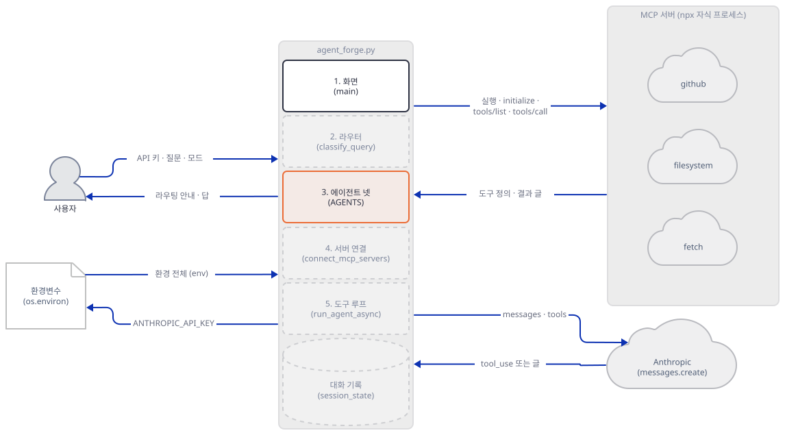

**확인.**

```bash
uv run --no-project python -c "import agent_forge_fake as a; [print(k, [s['name'] for s in v.mcp_servers]) for k, v in a.AGENTS.items()]; print('서버 없는 에이전트:', [k for k, v in a.AGENTS.items() if not v.mcp_servers])"
```

```text
code_reviewer ['github', 'filesystem']
security_auditor ['github', 'fetch']
researcher ['fetch', 'filesystem']
bim_engineer ['filesystem']
서버 없는 에이전트: []
```

(`missing ScriptRunContext` 경고가 stderr에 뜨면 무시합니다. Streamlit 밖에서 파일을 가져와서 나는 경고입니다.) 이 목록이 진짜 서버라면 어떻게 될지는 소스와 레지스트리로 읽었습니다. npm 레지스트리 `registry.npmjs.org/@modelcontextprotocol/server-fetch`는 2026-10-14에 HTTP 404였습니다. 공식 fetch 서버는 파이썬이고 README는 `uvx mcp-server-fetch`나 `pip install mcp-server-fetch`로 쓰라고 합니다. 그래서 `security_auditor`와 `researcher`는 `npx -y @modelcontextprotocol/server-fetch`가 내려받을 패키지가 없어 서버 연결 단계에서 실패할 것으로 보입니다(진짜 `npx`는 실행하지 않았습니다. Step 5에서 서버가 곧바로 종료하는 경우를 시뮬레이션합니다). `@modelcontextprotocol/server-github`는 레지스트리에서 최신 2025.4.8에 "Package no longer supported"라는 지원 종료 문구가 달려 있고, 공식 README는 이 서버가 보관(archived)돼 개발이 `github/github-mcp-server`로 옮겨 갔다고 적습니다. `server-filesystem`은 최신 1.0.0이고 지원 종료 표시가 없습니다. 이 서버에 `/tmp`를 주는 것이 Windows에서 무엇을 뜻하는지는 서버 README가 말하지 않아 확인하지 못했습니다.

### Step 4. 라우터 — 모델이 아니라 낱말 목록입니다

**목적.** `classify_query`가 어떻게 고르는지, 어디서 틀리는지 봅니다.

**할 일.** 함수는 질문을 소문자로 바꾸고 세 목록을 차례로 찾습니다.

`mcp_ai_agents/multi_mcp_agent_router/agent_forge.py:121-138`

```python
def classify_query(query: str) -> str:
    """Route a query to the best agent based on keywords."""
    query_lower = query.lower()

    security_keywords = ["security", "vulnerability", "owasp", "injection", "xss",
                         "csrf", "secret", "credential", "auth", "penetration"]
    code_keywords = ["review", "bug", "refactor", "code quality", "anti-pattern",
                     "lint", "test", "coverage", "pull request", "pr "]
    bim_keywords = ["revit", "bim", "wall", "floor plan", "sheet", "construction",
                    "building", "architecture", "detail", "annotation"]

    if any(kw in query_lower for kw in security_keywords):
        return "security_auditor"
    if any(kw in query_lower for kw in code_keywords):
        return "code_reviewer"
    if any(kw in query_lower for kw in bim_keywords):
        return "bim_engineer"
    return "researcher"
```

규칙은 셋입니다. 목록은 `in`으로 부분 문자열을 찾습니다. 순서는 보안, 코드, BIM이고 처음 맞은 것이 이깁니다. 아무것도 안 맞으면 리서처입니다. 화면의 모드가 Manual이면 이 함수는 아예 안 불리고 선택 상자의 값이 그대로 쓰입니다.

`mcp_ai_agents/multi_mcp_agent_router/agent_forge.py:303-311`

```python
    col1, col2 = st.columns([3, 1])
    with col2:
        mode = st.radio("Agent Selection", ["Auto-Route", "Manual"])
        if mode == "Manual":
            selected = st.selectbox(
                "Choose Agent",
                options=list(AGENTS.keys()),
                format_func=lambda x: f"{AGENTS[x].icon} {AGENTS[x].name}",
            )
```

`mcp_ai_agents/multi_mcp_agent_router/agent_forge.py:330-336`

```python
        # Route to agent
        if mode == "Auto-Route":
            agent_id = classify_query(prompt)
        else:
            agent_id = selected

        agent = AGENTS[agent_id]
```

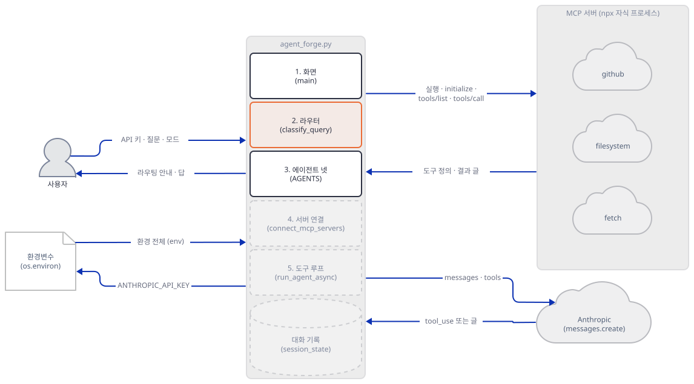

**확인.** 질문 일곱 개를 넣어 봅니다.

```bash
uv run --no-project python route_test.py
```

`route_test.py`는 아래 내용으로 저장합니다.

```python
import warnings; warnings.filterwarnings("ignore")
import agent_forge_fake as a
for q in ["Please review my code", "What is the latest news on AI?", "Who is the author of this book?",
          "Explain in detail how TCP works", "software architecture patterns", "my firewall rules", "Summarize this article"]:
    print(f"{q!r:40} -> {a.classify_query(q)}")
```

```text
'Please review my code'                  -> code_reviewer
'What is the latest news on AI?'         -> code_reviewer
'Who is the author of this book?'        -> security_auditor
'Explain in detail how TCP works'        -> bim_engineer
'software architecture patterns'         -> bim_engineer
'my firewall rules'                      -> bim_engineer
'Summarize this article'                 -> researcher
```

"latest"는 `test`를, "author"는 `auth`를, "detail"과 "architecture"는 BIM 목록을, "firewall"은 `wall`을 품고 있습니다. 소프트웨어 설계를 물어도 BIM 엔지니어가 받아 `filesystem` 서버만 가진 채 답합니다. 라우터라는 이름은 맞지만 고르는 쪽은 모델이 아니라 이 세 줄의 목록입니다.

### Step 5. MCP 연결 — 질문마다 서버를 새로 띄웁니다

**목적.** 서버가 언제, 어떤 환경으로 뜨는지, 하나가 못 뜨면 어떻게 되는지 봅니다.

**할 일.** 도구 변환은 이름·설명·스키마를 Anthropic 모양으로 옮깁니다.

`mcp_ai_agents/multi_mcp_agent_router/agent_forge.py:141-147`

```python
def mcp_tool_to_anthropic(tool) -> dict:
    """Convert an MCP tool definition to Anthropic's tool format."""
    return {
        "name": tool.name,
        "description": tool.description or "",
        "input_schema": tool.inputSchema,
    }
```

연결 함수는 에이전트의 서버마다 차례로 자식 프로세스를 띄웁니다.

`mcp_ai_agents/multi_mcp_agent_router/agent_forge.py:150-183`

```python
async def connect_mcp_servers(agent: Agent) -> tuple[AsyncExitStack, list[dict], dict[str, ClientSession]]:
    """Spawn MCP servers and collect their tools.

    Returns (exit_stack, tools_list, session_map) where session_map maps
    tool_name -> session for dispatching tool calls.
    """
    stack = AsyncExitStack()
    await stack.__aenter__()

    all_tools = []
    session_map = {}

    for srv_config in agent.mcp_servers:
        env = {**os.environ}
        if "env" in srv_config:
            env.update(srv_config["env"])

        params = StdioServerParameters(
            command=srv_config["command"],
            args=srv_config.get("args", []),
            env=env,
        )

        stdio_transport = await stack.enter_async_context(stdio_client(params))
        read_stream, write_stream = stdio_transport
        session = await stack.enter_async_context(ClientSession(read_stream, write_stream))
        await session.initialize()

        result = await session.list_tools()
        for tool in result.tools:
            all_tools.append(mcp_tool_to_anthropic(tool))
            session_map[tool.name] = session

    return stack, all_tools, session_map
```

세 가지를 짚습니다. 첫째, `env = {**os.environ}`(163행)이라 셸 환경 전체가 서버 프로세스에 갑니다. `env` 인자를 주지 않으면 `mcp`가 이름 몇 개만 물려주고(`mcp` 1.30.0의 `mcp/client/stdio/__init__.py` 127행), 앱 방식은 전부 물려줍니다. 둘째, 이 함수는 `run_agent_async`가 질문마다 부르므로(`agent_forge.py:199`) 서버는 질문 하나에 새로 떴다가 닫힙니다. 셋째, `session_map`은 도구 이름으로 세션을 찾으므로 두 서버가 같은 이름의 도구를 내면 뒤의 것이 이깁니다(이 문서는 해 보지 않았습니다).

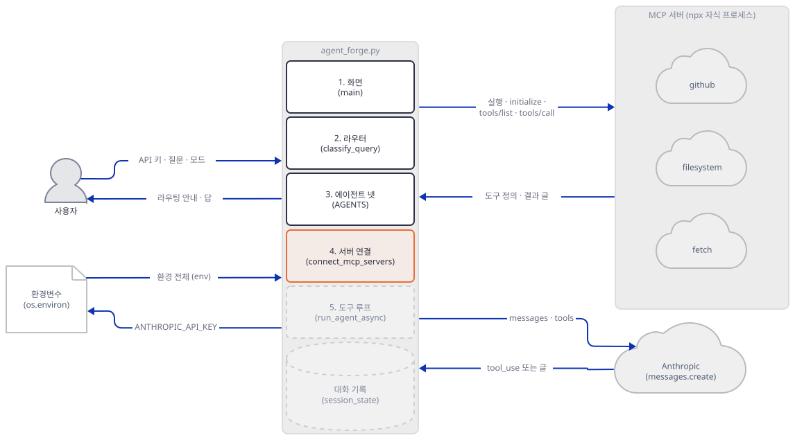

**확인.** 먼저 환경이 넘어가는지 재 봅니다. 아래 `env_test.py`를 저장하고 가짜 키를 넣어 돌립니다.

```python
import asyncio, json, os, sys, warnings
warnings.filterwarnings("ignore")
from mcp import ClientSession, StdioServerParameters
from mcp.client.stdio import stdio_client


async def start(env):
    params = StdioServerParameters(command=sys.executable, args=["fake_mcp.py", "fetch"], env=env)
    async with stdio_client(params) as (r, w):
        async with ClientSession(r, w) as s:
            await s.initialize()


for label, env in [("env 인자 없음", None), ("env={**os.environ} (앱 방식)", {**os.environ})]:
    n = len(open("mcp.log", encoding="utf-8").readlines()) if os.path.exists("mcp.log") else 0
    asyncio.run(start(env))
    last = json.loads(open("mcp.log", encoding="utf-8").readlines()[n])
    print(label, "->", "키 길이", last["anthropic_key_len"], "| DEMO_TOKEN", last["has_demo_token"])
```

```bash
ANTHROPIC_API_KEY=sk-ant-fake-132 DEMO_TOKEN=fake-not-real uv run --no-project python env_test.py
```

```powershell
$env:ANTHROPIC_API_KEY = "sk-ant-fake-132"
$env:DEMO_TOKEN = "fake-not-real"
uv run --no-project python env_test.py
```

```text
env 인자 없음 -> 키 길이 0 | DEMO_TOKEN False
env={**os.environ} (앱 방식) -> 키 길이 15 | DEMO_TOKEN True
```

(PowerShell로 했다면 `Remove-Item Env:ANTHROPIC_API_KEY`로 지웁니다. 아래 화면 실습은 키를 사이드바로 넣습니다.) 앱 방식이면 서버가 키를 그대로 받습니다. 진짜 서버를 `npx`로 띄웠다면 그 npm 패키지의 코드가 같은 환경을 받는다는 뜻입니다(실행은 하지 않았습니다).

이제 화면(앞의 Streamlit 주소)의 사이드바에 `sk-ant-fake-132`를 넣고 질문을 두 번 칩니다. 같은 에이전트가 받도록 모드는 Auto-Route로 둡니다.

```text
Review this code for bugs @@tool:search_repositories {"query": "demo app"}
Review again @@tool:get_file_contents {"owner": "demo", "repo": "app", "path": "a.py"}
```

```bash
cat mcp.log
```

```powershell
Get-Content mcp.log
```

(PowerShell 줄은 실행해 보지 못했습니다.)

기록에서 서버 줄만 추리면 이렇습니다(`t`는 줄였습니다). 파일 맨 앞의 `fetch` 두 줄은 앞의 `env_test.py`가 남긴 것이라 뺐습니다. 두 질문 모두 `github`와 `filesystem`이 새 `pid`로 시작합니다.

```text
{"event": "start", "args": [], "anthropic_key_len": 15, "has_demo_token": true, "server": "github", "pid": 28848}
{"event": "start", "args": ["/tmp"], "anthropic_key_len": 15, "has_demo_token": true, "server": "filesystem", "pid": 16428}
{"event": "call", "tool": "search_repositories", "args": {"query": "demo app"}, "server": "github", "pid": 28848}
{"event": "start", "args": [], "anthropic_key_len": 15, "has_demo_token": true, "server": "github", "pid": 25436}
{"event": "start", "args": ["/tmp"], "anthropic_key_len": 15, "has_demo_token": true, "server": "filesystem", "pid": 30356}
{"event": "call", "tool": "get_file_contents", "args": {"path": "a.py"}, "server": "github", "pid": 25436}
```

`pid`는 매번 다른 값이 나옵니다. 서버 둘의 시작 시각은 0.4~0.5초씩 벌어져 있어(`t`), 서버가 차례로 하나씩 뜬다는 소스의 모양과 맞습니다. 이제 두 번째 서버가 못 뜨는 경우입니다. 아래 `leak_test.py`는 `github` 가짜 서버 다음에 곧바로 종료 코드 1로 끝나는 프로세스를 세운 에이전트를 만듭니다(진짜 `npx`가 아니라 제가 만든 시뮬레이션입니다).

`leak_test.py`

```python
import json, os, subprocess, sys, time, warnings
warnings.filterwarnings("ignore")
import agent_forge_fake as app
from anthropic import Anthropic


def alive(pid):
    cmd = ["tasklist", "/FI", f"PID eq {pid}", "/NH"] if os.name == "nt" else ["ps", "-p", str(pid)]
    return str(pid) in subprocess.run(cmd, capture_output=True, text=True).stdout


dying = [sys.executable, "-c", "import sys; print('simulated launcher error', file=sys.stderr); sys.exit(1)"]
agent = app.Agent(name="Bad", description="d", system_prompt="s", mcp_servers=[
    {"name": "github", "command": sys.executable, "args": ["fake_mcp.py", "github"]},
    {"name": "fetch", "command": dying[0], "args": dying[1:]},
])
before = len(open("mcp.log", encoding="utf-8").readlines()) if os.path.exists("mcp.log") else 0
try:
    app.run_agent(Anthropic(api_key="sk-ant-fake-132"), agent, "hi", [])
except BaseException as e:
    print("예외:", type(e).__name__, "|", e)
pids = [json.loads(l)["pid"] for l in open("mcp.log", encoding="utf-8").readlines()[before:]]
time.sleep(1.5)
print("가짜 github 서버", pids, "예외 1.5초 뒤 살아 있음:", [alive(p) for p in pids])
for p in pids:  # 정리: 내가 띄운 프로세스만 끝낸다
    subprocess.run(["taskkill", "/PID", str(p), "/F"] if os.name == "nt" else ["kill", str(p)], capture_output=True)
```

```bash
ANTHROPIC_BASE_URL=http://127.0.0.1:<포트> uv run --no-project python leak_test.py
```

```powershell
$env:ANTHROPIC_BASE_URL = "http://127.0.0.1:<포트>"
uv run --no-project python leak_test.py
```

(PowerShell 줄은 실행해 보지 못했습니다. 이 변수가 그 터미널에 없으면 스크립트가 실제 `api.anthropic.com`으로 요청을 보내려 하므로 반드시 먼저 겁니다. `leak_test.py`는 요청을 보내기 전에 끝나지만 `block_test.py`는 보냅니다.)

```text
예외: McpError | Connection closed
가짜 github 서버 [7460] 예외 1.5초 뒤 살아 있음: [True]
```

(터미널에 `simulated launcher error`도 한 줄 찍힙니다.) 연결 함수가 서버를 하나 띄운 뒤 예외로 끝나면, 스택을 닫는 `finally`는 연결 함수 밖의 `try`(`agent_forge.py:201`) 안에 있어 아직 시작되지 않은 상태입니다. 그래서 먼저 뜬 서버가 남습니다. 이 문서는 1.5초 뒤까지만 재서 얼마나 오래 사는지는 모릅니다. 이 시험에서 Anthropic 요청은 0건이었습니다.

### Step 6. 도구 루프 — 상한이 없고, 서버의 오류 표시가 사라집니다

**목적.** 모델 호출과 도구 호출이 어떻게 이어지는지, 어떤 방어가 없는지 봅니다.

**할 일.** 서버를 연결하고 첫 호출을 하는 부분입니다. 앞의 갈래(`agent_forge.py:190-197`)는 Step 3에서 본 대로 도달하지 않습니다.

`mcp_ai_agents/multi_mcp_agent_router/agent_forge.py:199-208`

```python
    stack, tools, session_map = await connect_mcp_servers(agent)

    try:
        response = client.messages.create(
            model="claude-sonnet-4-20250514",
            max_tokens=4096,
            system=agent.system_prompt,
            messages=messages,
            tools=tools,
        )
```

`client.messages.create`는 동기 함수인데 `async def` 안에서 `await` 없이 불립니다. 반복은 이어서 `stop_reason`이 `tool_use`인 동안 돕니다.

`mcp_ai_agents/multi_mcp_agent_router/agent_forge.py:211-248`

```python
        while response.stop_reason == "tool_use":
            tool_use_blocks = [b for b in response.content if b.type == "tool_use"]
            tool_results = []

            for tool_use in tool_use_blocks:
                session = session_map.get(tool_use.name)
                if session is None:
                    tool_results.append({
                        "type": "tool_result",
                        "tool_use_id": tool_use.id,
                        "content": f"Error: Unknown tool '{tool_use.name}'",
                        "is_error": True,
                    })
                    continue

                try:
                    result = await session.call_tool(tool_use.name, tool_use.input)
                    result_text = ""
                    for content in result.content:
                        if hasattr(content, "text"):
                            result_text += content.text
                        else:
                            result_text += str(content)
                    tool_results.append({
                        "type": "tool_result",
                        "tool_use_id": tool_use.id,
                        "content": result_text,
                    })
                except Exception as e:
                    tool_results.append({
                        "type": "tool_result",
                        "tool_use_id": tool_use.id,
                        "content": f"Error calling tool: {e}",
                        "is_error": True,
                    })

            messages.append({"role": "assistant", "content": response.content})
            messages.append({"role": "user", "content": tool_results})
```

알 수 있는 것이 셋입니다. 반복에 횟수 상한이 없습니다. 서버가 오류를 돌려줘도 `is_error`는 붙지 않고(`result.isError`를 보지 않습니다), 예외가 날 때와 모르는 이름일 때만 붙습니다. 결과 글은 길이를 자르지 않습니다. 끝은 이렇습니다.

`mcp_ai_agents/multi_mcp_agent_router/agent_forge.py:250-263`

```python
            response = client.messages.create(
                model="claude-sonnet-4-20250514",
                max_tokens=4096,
                system=agent.system_prompt,
                messages=messages,
                tools=tools,
            )

        # Extract final text
        text_blocks = [b.text for b in response.content if hasattr(b, "text")]
        return "\n".join(text_blocks) if text_blocks else "No response generated."

    finally:
        await stack.aclose()
```

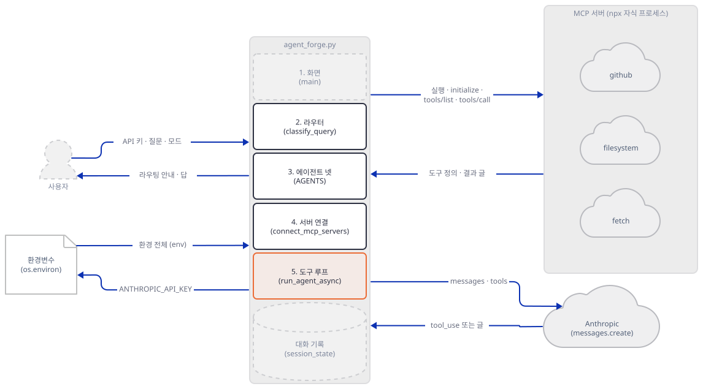

**확인.** 화면에서 질문 둘을 칩니다. Auto-Route인지 확인합니다.

```text
tool error test (review) @@tool:boom {"why": "x"}
unknown tool test (review) @@tool:nope {}
```

`anth.log`에서 도구 결과가 실린 요청만 뽑아 마지막 둘을 봅니다.

```bash
uv run --no-project python -c "import json; rs = [r['tool_results'] for r in map(json.loads, open('anth.log', encoding='utf-8')) if r['tool_results']]; print(*rs[-2:], sep=chr(10))"
```

```powershell
uv run --no-project python -c "import json; rs = [r['tool_results'] for r in map(json.loads, open('anth.log', encoding='utf-8')) if r['tool_results']]; print(*rs[-2:], sep=chr(10))"
```

(PowerShell 줄은 실행해 보지 못했습니다.)

```text
[{'is_error': None, 'head': 'Error executing tool boom: boom: x'}]
[{'is_error': True, 'head': "Error: Unknown tool 'nope'"}]
```

서버가 예외를 `Error executing tool …` 글로 돌려줬는데도 `is_error`는 `None`(요청 JSON에서는 `null`)이라, 모델은 이것을 정상 결과로 받습니다. 이어서 같은 화면에서 세 번째 질문을 칩니다.

```text
Review this code @@loop
```

가짜 서버가 25번 도구를 부르라고 한 뒤에야 글로 답하게 만들어 둔 질문입니다. 끝난 뒤 `anth.log`는 요청 26건이 늘었고, 마지막 요청의 `n_messages`는 59였습니다. 이 숫자는 같은 에이전트(코드 리뷰어)의 앞 기록 8글(Step 5의 두 질문과 위 두 질문, 질문·답 두 글씩)에 새 질문 1개와 25번 왕복의 50개를 더한 값입니다. 화면을 새로 고쳐 기록이 비었다면 51입니다. 앱이 스스로 멈춘 것이 아니라 가짜 서버가 멈춘 것입니다. 이어서 동기 호출이 이벤트 루프를 얼마나 막는지 재 봅니다.

`block_test.py`

```python
import asyncio, time, warnings
warnings.filterwarnings("ignore")
import agent_forge_fake as app
from anthropic import Anthropic


async def main():
    gaps = []

    async def heartbeat():  # 0.05초마다 깨어나 간격을 잰다
        last = time.perf_counter()
        while True:
            await asyncio.sleep(0.05)
            now = time.perf_counter()
            gaps.append(now - last)
            last = now

    task = asyncio.create_task(heartbeat())
    await asyncio.sleep(0.3)
    await app.run_agent_async(Anthropic(api_key="sk-ant-fake-132"), app.AGENTS["bim_engineer"], "hi @@slow", [])
    task.cancel()
    gaps.sort()
    print("가장 긴 간격 %.2f초, 중앙값 %.2f초" % (gaps[-1], gaps[len(gaps) // 2]))


asyncio.run(main())
```

```bash
ANTHROPIC_BASE_URL=http://127.0.0.1:<포트> uv run --no-project python block_test.py
```

```powershell
$env:ANTHROPIC_BASE_URL = "http://127.0.0.1:<포트>"
uv run --no-project python block_test.py
```

(PowerShell 줄은 실행해 보지 못했습니다. 위 `leak_test.py` 때 이미 건 터미널이면 다시 걸지 않아도 됩니다.)

```text
가장 긴 간격 1.52초, 중앙값 0.06초
```

(1.5초대의 값이 나오면 같은 결과입니다. 제 실행은 1.52와 1.53이었습니다.)

가짜 서버가 1.5초 늦게 답하는 동안 같은 루프의 다른 작업이 1.5초쯤 멈췄습니다. 이 앱은 질문마다 새 루프를 만들고 그 안에 다른 작업이 없어(`run_agent`, `agent_forge.py:266-272`) 눈에 띄는 피해는 보지 못했습니다. 이 문서가 본 것은 루프가 멈춘다는 사실뿐입니다. 끝으로 `Review this @@retired`처럼 `@@retired`를 넣은 질문(Auto-Route에서 코드 리뷰어로 갑니다)은 가짜 서버가 404를 내서 Streamlit 화면에 예외를 그대로 올리고, 그때 두 서버 프로세스는 `finally` 덕분에 모두 닫혔습니다(Step 5의 누수와 달리 `try` 안이라서입니다). 이 404는 퇴역 모델이 실제로 주는 응답이 아닙니다.

### Step 7. 화면과 기록 — 키는 프로세스 전체가 공유합니다

**목적.** 키·모드·기록이 어떻게 엮이는지 보고 한 질문의 전체 모양을 마무리합니다.

**할 일.** 사이드바는 키를 받아 환경변수에 심습니다.

`mcp_ai_agents/multi_mcp_agent_router/agent_forge.py:283-286`

```python
        api_key = st.text_input("Anthropic API Key", type="password",
                                help="Get yours at console.anthropic.com")
        if api_key:
            os.environ["ANTHROPIC_API_KEY"] = api_key
```

`os.environ`은 이 Streamlit 서버 프로세스 전체가 공유합니다. 그래서 마지막으로 입력된 키가 이후 어느 세션이 띄우는 서버에도 실립니다(두 세션으로는 돌려 보지 않았고 소스로 읽은 것입니다). 질문이 오면 키가 없을 때 멈추고, 있으면 에이전트를 고르고 안내를 찍은 뒤 `run_agent`를 부릅니다.

`mcp_ai_agents/multi_mcp_agent_router/agent_forge.py:325-336`

```python
    if prompt := st.chat_input("Ask anything..."):
        if not api_key:
            st.error("Please enter your Anthropic API key in the sidebar.")
            return

        # Route to agent
        if mode == "Auto-Route":
            agent_id = classify_query(prompt)
        else:
            agent_id = selected

        agent = AGENTS[agent_id]
```

`mcp_ai_agents/multi_mcp_agent_router/agent_forge.py:344-354`

```python
        with st.chat_message("assistant", avatar=agent.icon):
            st.caption(f"Routed to **{agent.icon} {agent.name}**")
            tools_info = ", ".join(s["name"] for s in agent.mcp_servers)
            st.caption(f"MCP servers: {tools_info}" if tools_info else "No MCP servers")

            client = Anthropic(api_key=api_key)
            with st.spinner(f"{agent.name} is connecting to MCP servers..."):
                response = run_agent(
                    client, agent, prompt,
                    st.session_state.histories[agent_id],
                )
```

기록은 에이전트별 목록에 질문과 답의 글만 넣습니다.

`mcp_ai_agents/multi_mcp_agent_router/agent_forge.py:358-366`

```python
        # Update history
        st.session_state.histories[agent_id].append(
            {"role": "user", "content": prompt}
        )
        st.session_state.histories[agent_id].append(
            {"role": "assistant", "content": response}
        )
        st.session_state.messages.append(
            {"role": "assistant", "content": response, "avatar": agent.icon}
```

화면이 부르고 받는 앱 안의 관계를 한 장으로 그리면 이렇습니다. 읽기(`agent_forge.py:352-353`)와 쓰기(`agent_forge.py:359-367`)가 서로 다른 화살표입니다.

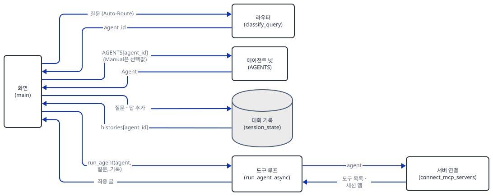

도구를 부른 중간 과정은 기록에 남지 않고, 에이전트마다 기록이 따로입니다. 키가 없으면 서버를 띄우기 전에 멈추는 것도 이 순서(`agent_forge.py:326-328`) 덕분입니다.

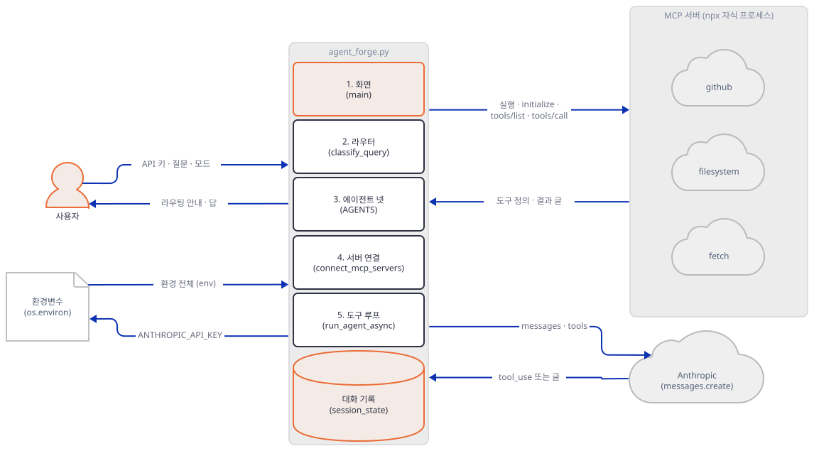

**확인.** 화면에서 질문 `tell me about the architecture`를 칩니다. BIM 엔지니어가 받습니다. 그다음 라디오를 Manual로 바꿔 리서처를 골라 아무 질문이나 치면 안내 줄에 선택한 에이전트의 서버 이름이 뜹니다. Step 5의 두 질문 사이를 `anth.log`로 보면 같은 에이전트의 기록이 이어집니다.

```text
n_messages 1 → 3     (첫 질문: 요청 둘)
n_messages 3 → 5     (두 번째 질문: 첫 요청이 이미 3)
```

두 번째 질문의 첫 요청이 3인 것은 기록의 두 글(질문·답)에 새 질문이 붙었기 때문입니다. 방금 BIM 엔지니어에게 간 질문은 `n_messages`가 다시 1부터 시작했습니다. 앱 README가 말하는 "스트리밍 응답"은 코드에 없습니다. `messages.create`에 `stream`을 주지 않고 가짜 서버가 받은 요청에도 `stream`이 없었습니다. 앱 README의 `cd mcp_ai_agents/multi_mcp_agent_forge`도 실제 폴더 이름(`multi_mcp_agent_router`)과 다릅니다.

## 요청 한 건이 흐르는 과정

질문 하나는 라우팅, 기록 읽기, 서버 연결, 모델과 도구의 반복, 정리, 화면과 기록 갱신의 순서로 지납니다. 먼저 질문이 들어와 에이전트가 정해집니다.

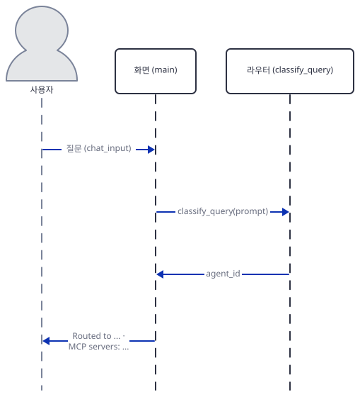

화면은 질문을 기록(`messages`)에 더하고 다시 표시한 뒤 안내 줄을 찍습니다(`agent_forge.py:339-347`).

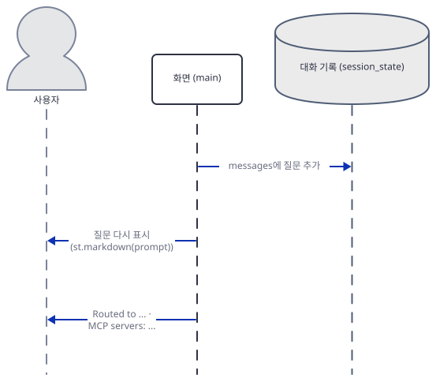

이어서 화면이 에이전트의 기록을 읽어 도구 루프에 넘깁니다.

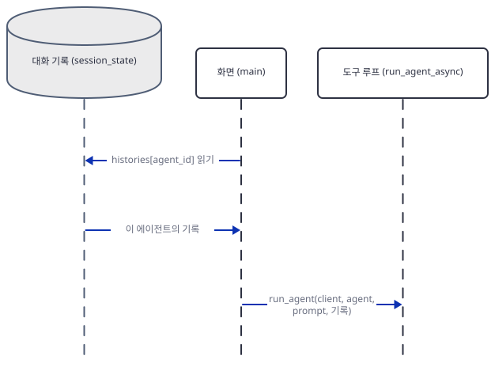

도구 루프는 서버를 차례로 띄우고 `initialize`와 `tools/list`를 서버마다 따로 보냅니다.

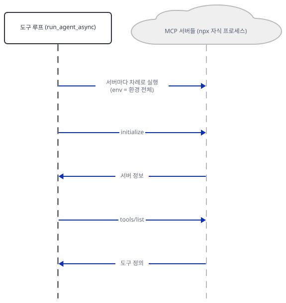

도구 정의를 받으면 모델이 도구를 부르게 하는 첫 왕복입니다.

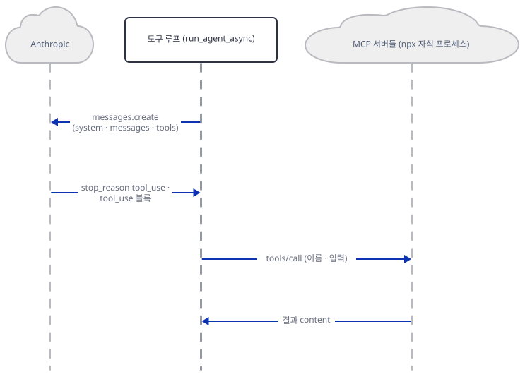

모델이 글로 답하면 서버를 닫고 글을 화면에 돌려줍니다.

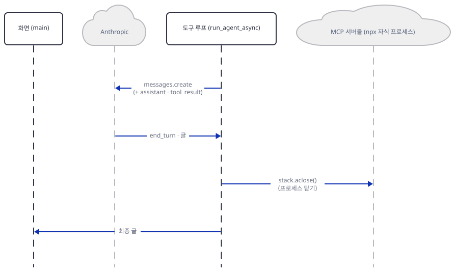

마지막으로 화면이 답을 찍고 기록 두 곳에 질문과 답을 더합니다.

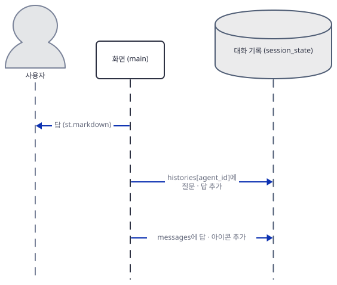

## 실행 체크리스트

- [ ] `uv pip install -r requirements.txt "mcp<2"` 뒤 `mcp 1.30.0`이 보인다
- [ ] `grep -c npx agent_forge_fake.py`가 0이고 `agent_forge.py`는 한 번도 실행하지 않았다
- [ ] 앱을 띄운 터미널에 `ANTHROPIC_BASE_URL`이 가짜 서버 포트로 걸려 있다
- [ ] 키 없이 질문하면 오류 문구가 뜨고 `mcp.log`에 줄이 늘지 않는다
- [ ] "latest news" 질문이 코드 리뷰어로, "architecture" 질문이 BIM 엔지니어로 간다
- [ ] 같은 에이전트에 질문 두 개를 하면 `mcp.log`의 `pid`가 둘 다 새 값이다
- [ ] `env_test.py`에서 앱 방식은 키 길이 15, `env` 인자 없음은 0이다
- [ ] `boom` 결과의 `is_error`가 `null`이고 `nope`는 `true`다
- [ ] `@@loop` 질문 뒤 `anth.log`가 요청 26건 늘고 마지막 `n_messages`가 59다(기록이 비어 있으면 51)
- [ ] `leak_test.py`가 `McpError | Connection closed`와 `[True]`를 찍는다

## 문제 해결

| 증상 | 원인 | 해결 |
|---|---|---|
| 질문하면 `'Tool' object has no attribute 'inputSchema'` | `requirements.txt`의 `mcp>=0.1.0`이 오늘 2.3.0으로 풀림. 2.x의 `Tool`은 `input_schema` | `uv pip install -r requirements.txt "mcp<2"`. 2.x로 가려면 `agent_forge.py:146`을 `tool.input_schema`로 고침(이것 한 곳만 고친 복사본은 가짜 서버로 질문이 통과했고 다른 곳은 확인하지 않음) |
| 진짜 서버에서 모델 호출이 실패함(`DeprecationWarning`이 먼저 찍힘) | 모델 `claude-sonnet-4-20250514`가 2026-06-15에 퇴역. 폐기 문서는 "Requests to retired models will fail."까지만 적고 오류 코드는 말하지 않음. 이 문서는 진짜 응답을 보지 못함(404는 제 가짜 서버가 흉내 낸 것) | 세 곳(`agent_forge.py:192, 203, 251`)의 모델 이름을 권장 대체 `claude-sonnet-5-5`로 바꾼다 |
| `Connection closed`로 질문이 죽음 | 서버 프로세스가 시작하자마자 종료. `server-fetch`처럼 패키지가 없거나 `npx`가 없는 경우를 이 문서는 시뮬레이션으로만 봄 | 에이전트의 서버 목록에서 그 서버를 빼거나 파이썬 참조 서버(`uvx mcp-server-fetch`)로 바꾼다 |
| 가짜 서버 없이 키를 넣었더니 실제 `api.anthropic.com`으로 감 | `ANTHROPIC_BASE_URL`이 그 터미널에 없으면 SDK가 기본 주소를 씀(소스로 확인, 돌려 보지 않음) | 앱을 띄우기 전에 변수를 건다 |
| 소프트웨어 질문이 BIM 엔지니어로 감 | 키워드 `architecture`·`detail`·`building`·`wall`을 부분 문자열로 찾음 | Manual로 고르거나 목록을 고친다 |
| 도구가 오류를 냈는데 모델이 정상 결과처럼 답함 | 서버가 알린 오류에 `is_error`를 붙이지 않음 | `result.isError`를 보고 `is_error`를 넣는다 |
| 포트에 이미 뭔가 떠 있다는 오류 | 가짜 서버가 `allow_reuse_address = False`라 겹치지 않고 실패 | 다시 실행해 다른 임의 포트를 받는다 |

## 더 해보기

- 모델을 바꿔 봅니다. 세 곳의 `claude-sonnet-4-20250514`를 `claude-sonnet-5-5`로 바꾸고 `agent_forge.py:146`의 `inputSchema`를 `input_schema`로 고친 뒤 `mcp` 2.3.0에서 가짜 서버 질문이 통과하는지 보세요. 진짜 Anthropic에서의 동작은 이 문서가 보지 못했습니다.
- 도구 반복에 상한을 답니다. `while response.stop_reason == "tool_use":`에 횟수를 세어 Day 130처럼 예산을 넘으면 도구 없이 마지막으로 한 번 더 부르게 고치고, `@@loop`가 몇 번 만에 멈추는지 `anth.log`로 보세요.
- `connect_mcp_servers`의 누수를 고칩니다. `async with`나 `try/except`로 예외 때 스택을 닫게 하고 `leak_test.py`가 `[False]`를 찍는지 보세요.

## 다음 날 예고

[Day 133 · 🚀 Multi-MCP Intelligent Assistant](../day133-multi-mcp-agent/README.md) — 오늘은 에이전트마다 서버를 따로 줬지만 마지막 날의 앱은 에이전트 하나에 서버 넷(`server-github`, `@chatmcp/server-perplexity-ask`, `@gongrzhe/server-calendar-autoauth-mcp`, `@gongrzhe/server-gmail-autoauth-mcp`)을 한꺼번에 줍니다. 원본 앱 `multi_mcp_agent.py`(편집기 기준 158줄, 마지막 줄에 개행이 없어 `wc -l`은 157)가 agno의 `MultiMCPTools`로 묶습니다(`mcp_ai_agents/multi_mcp_agent/multi_mcp_agent.py:56-61, 67`, 소스로 확인).
