# Day 133 · 🚀 Multi-MCP Intelligent Assistant

> 볼륨 9 ♾️ MCP AI Agents · 난이도 ★★☆ ⚠ `requirements.txt`만 설치하면 앱이 첫 줄들에서 import되지 않습니다(`MultiMCPTools`가 agno 3.0.0에서 삭제됨, Step 1). 고친 뒤에도 서버 하나가 죽으면 앱은 "연결 성공"을 찍고 도구 없이 돕니다(Step 7). 앱이 쓰는 `gpt-4o`의 기본 스냅숏 `gpt-4o-2024-08-06`은 2027-01-14에 종료될 예정입니다(사전 준비) · 예상 소요 150분(앱은 158줄이지만 가짜 MCP 서버 하나와 가짜 OpenAI 서버 하나를 직접 저장하고, 서버를 죽이거나 늦춰 가며 같은 앱을 여러 번 돌려 보고, 같은 앱을 agno 3 판으로 한 번 더 옮겨 돌려 보는 손 시간이 읽는 시간보다 큽니다) · API 비용 대략 한 턴에 수 센트(⚠ 추정입니다. 이 문서는 OpenAI를 한 번도 부르지 않았습니다. 모델 호출은 한 턴에 셋이고 `gpt-4o`는 Day 127이 읽은 표준 요금으로 입력 $2.50·출력 $10.00/백만 토큰입니다. 진짜 서버 넷의 도구 선언이 입력에 얼마나 실리는지는 재지 못했습니다) · 원본 앱: `mcp_ai_agents/multi_mcp_agent`

## 오늘 만들 것

터미널에서 "내 GitHub 저장소 보여 줘", "최신 AI 소식 검색해 줘", "다음 주 회의 잡아 줘"처럼 말하면 `gpt-4o`가 GitHub·Perplexity·Google 캘린더·Gmail용 MCP 서버 넷의 도구를 골라 부르는 대화형 에이전트입니다. 앱은 파이썬 파일 하나(`multi_mcp_agent.py`, 158줄이고 마지막 줄에 개행이 없어 `wc -l`은 157)이고, agno의 `MultiMCPTools`에 `npx` 명령 넷을 한꺼번에 줍니다. 오늘이 볼륨 9의 마지막 날입니다. 이 볼륨은 Day 127이 `npx`로 Notion 서버를, Day 128이 `docker run`으로 GitHub 서버를, Day 129가 설정 파일의 `npx @playwright/mcp`로 브라우저 서버를, Day 130이 URL의 원격 서버를 붙였습니다(각 날 README). Day 131은 오늘과 같은 `MultiMCPTools`에 `npx` 서버 둘을 묶었고, Day 132는 에이전트마다 다른 서버를 주고 Anthropic SDK로 도구 반복을 직접 짰습니다. 저장소의 파이썬 파일 가운데 `MultiMCPTools`를 쓰는 것은 이 앱과 Day 131의 원본 `app.py`뿐입니다(`grep`으로 확인). 그래서 서버를 차례로 띄우는 방식과 서버 하나가 죽을 때의 동작은 Day 131 Step 3·8이 이미 2.2.13에서 다뤘고, 오늘은 그 날을 가리킨 채 판이 다른 부분(2.9.0)만 적습니다. 오늘 새로 보는 것은 서버가 넷으로 늘고 그 가운데 둘이 OAuth 서버라는 점, 앱이 셸 환경 전체를 넘긴다는 점, 그리고 같은 앱을 agno 3으로 옮기는 길(Step 8)입니다.

이 문서는 `npx`를 한 번도 실행하지 않았고 OpenAI·GitHub·Perplexity·Google에 요청을 보내지 않았습니다. 앱을 돌린 셸은 `PATH`에서 Node와 Docker 폴더를 뺀 것이었고(`which npx docker`는 둘 다 못 찾았습니다), 프로세스 생성과 외부 이름 조회를 막는 하네스 안에서만 돌렸습니다. `npx` 자리에는 파이썬 가짜 MCP 서버를, OpenAI 자리에는 `OPENAI_BASE_URL`로 돌린 가짜 서버를 두었습니다. 그래서 아래 도구 이름과 답은 내가 지은 대본이고, 진짜 서버의 동작은 공개 README와 소스를 읽어서만 확인했습니다. 직접 돌려 알게 된 것이 여섯입니다.

1. `requirements.txt`만 설치하면 `multi_mcp_agent.py:7`의 `MultiMCPTools`를 가져오는 줄에서 `ImportError`가 납니다. agno 3.0.0이 그 클래스를 지웠습니다. `agno<3`과 `mcp<2`로 낮추고 `sqlalchemy[asyncio]`를 더하면 원본이 돕니다(Step 1).
2. 앱은 `os.environ` 전체를 서버 넷에 넘깁니다. 가짜 서버가 받은 환경에 `OPENAI_API_KEY`와 이 문서가 심은 무관한 변수까지 모두 있었습니다(Step 4).
3. 서버는 한 줄씩 차례로 뜨고 하나당 10초 안에 `initialize`에 답해야 합니다. 시간이 모자라면 오류는 로그로만 남고 앱은 계속됩니다(Step 4, 7).
4. 지시문은 Notion을 말하는데 Notion 서버는 없고, Gmail 서버는 있는데 지시문에 없습니다(Step 5).
5. 서버 하나가 죽으면 agno 2.9.0은 예외를 삼키고 앱은 `Successfully connected to all MCP servers!`를 찍습니다. 모델에는 도구가 하나도 가지 않고, 첫 질문에서 서버 넷을 다시 띄웁니다. Day 131이 2.2.13에서 본 것과 결론은 같고 정리·재연결 세부가 다릅니다(Step 7).
6. 같은 앱을 agno 3으로 옮기면 서버가 죽을 때 앱도 죽고, 서버마다 환경을 따로 줄 수 있습니다(Step 8).

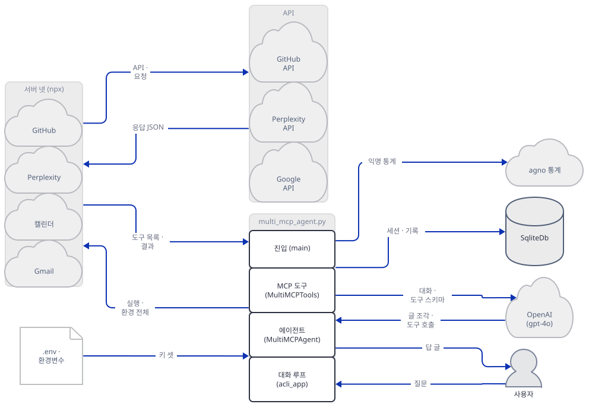

## 사전 준비

| 서비스/도구 | 용도 | 발급·설치 |
|---|---|---|
| uv | 가상환경 생성과 패키지 설치 | [공통 사전 준비](../README.md#공통-사전-준비-한-번만) 절 참고 |
| Python | 이 문서는 3.13.3으로 확인했다. 앱 README는 버전을 적지 않는다 | 공통 사전 준비와 같음 |
| OpenAI API 키 (`OPENAI_API_KEY`) | `gpt-4o` 호출(73행). 이 문서는 가짜 값으로 진행한다 | https://platform.openai.com/api-keys |
| GitHub 토큰, Perplexity 키 | 앱이 시작할 때 있는지 검사하고(27~39행) 서버에 넘긴다. 가짜 값으로 진행한다 | https://github.com/settings/tokens, https://www.perplexity.ai/ |
| Node.js (`npx`) | 진짜로 쓸 때 서버 넷을 내려받아 실행. 이 문서의 실습은 쓰지 않는다 | https://nodejs.org/ |
| Google OAuth 키 파일 | 진짜 캘린더·Gmail 서버가 요구한다(Step 7). 앱 README에는 없다. 이 문서는 쓰지 않는다 | 서버의 공개 README 참고 |

⚠ **모델.** 앱은 `gpt-4o`를 씁니다(`multi_mcp_agent.py:73`). OpenAI 모델 페이지(https://developers.openai.com/api/docs/models/gpt-4o, 2026-10-14 확인)는 이 모델의 "Default snapshot"을 `gpt-4o-2024-08-06`이라고 적습니다. 공식 폐기 문서(https://developers.openai.com/api/docs/deprecations, 같은 날)에는 `gpt-4o`라는 id 자체의 종료 행이 없지만, 그 기본 스냅숏 `gpt-4o-2024-08-06`(과 `gpt-4o-2024-11-20`)이 2027-01-14에 종료된다는 행이 있습니다. 별칭 `gpt-4o`가 그 뒤 어떻게 되는지는 두 문서 어디에도 적혀 있지 않아 이 문서도 확인하지 못했습니다. 2027-01-14 이후에 호출이 실패하면 `OpenAIChat(id=...)`(73행)을 새 모델로 바꿔야 할 수 있습니다.

이 문서의 스크립트와 앱은 한글을 출력합니다. 출력을 파이프나 파일로 받는 한국어 Windows에서는 셸을 먼저 맞춰 두세요.

```bash
export PYTHONIOENCODING=utf-8
```

```powershell
$env:PYTHONIOENCODING = "utf-8"
```

## 아키텍처 한눈에 보기

| 컴포넌트 | 역할 | 코드 위치 |
|---|---|---|
| 키 읽기·검사 | `load_dotenv()` 뒤 키 셋을 읽고 하나라도 없으면 안내를 찍고 끝낸다 | `mcp_ai_agents/multi_mcp_agent/multi_mcp_agent.py:12-16`, `27-39` |
| 서버 환경·명령 | `os.environ` 전체에 키 둘을 얹은 `env`와 `npx` 명령 넷 | `mcp_ai_agents/multi_mcp_agent/multi_mcp_agent.py:50-61` |
| MCP 도구 묶음 (`MultiMCPTools`) | `async with`에 들어서면 서버를 차례로 띄우고 도구 목록을 받는다 | `mcp_ai_agents/multi_mcp_agent/multi_mcp_agent.py:67` |
| 저장소 (`SqliteDb`) | `tmp/multi_mcp_agent.db`. 폴더는 만들 때, 파일은 첫 저장 때 생긴다 | `mcp_ai_agents/multi_mcp_agent/multi_mcp_agent.py:64` |
| 에이전트 (`MultiMCPAgent`) | `gpt-4o`, 긴 지시문, 재시도 3번, 메모리, 기록 10회 | `mcp_ai_agents/multi_mcp_agent/multi_mcp_agent.py:71-133` |
| 대화 루프 (`acli_app`) | 입력 한 줄마다 답을 스트리밍으로 찍고 `exit` 등에서 끝낸다 | `mcp_ai_agents/multi_mcp_agent/multi_mcp_agent.py:147-155` |
| MCP 서버 넷 | 별도 Node 프로세스. 각자 자기 서비스 API를 부른다 | 코드 없음 (외부 npm 패키지) |
| OpenAI 모델 | 대화, 도구 호출, 메모리 관리 (`gpt-4o`) | `mcp_ai_agents/multi_mcp_agent/multi_mcp_agent.py:73` |
| agno 익명 통계 | 성공한 실행마다 한 건 | 코드 없음 (agno 소스) |

첫 그림에서 앱 묶음에 단 화살표는 묶음 전체에 단 것입니다. 묶음 안의 호출은 아래 두 그림이 화살표로 그렸고, 서버 넷이 각자 어느 API를 부르는지는 셋째 그림이 그렸습니다. 첫 그림은 만드는 쪽(진입이 서버 명령, 저장소, 에이전트, 대화 루프를 차례로 만든다)이고 둘째는 도는 쪽입니다.

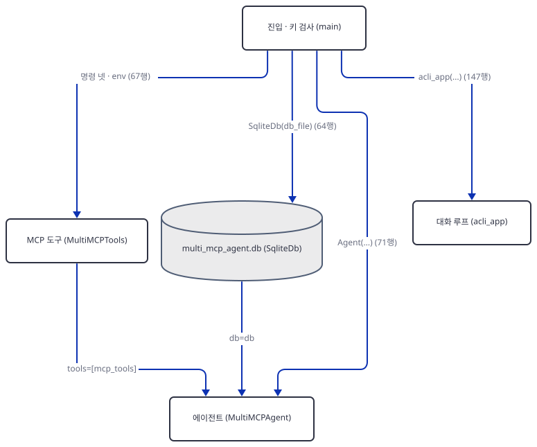

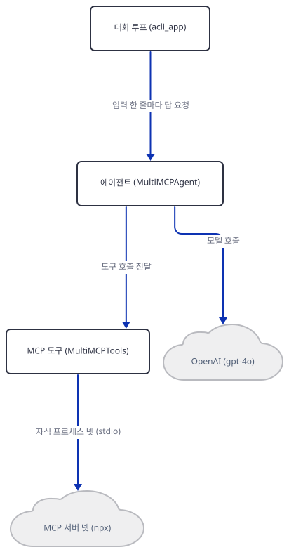

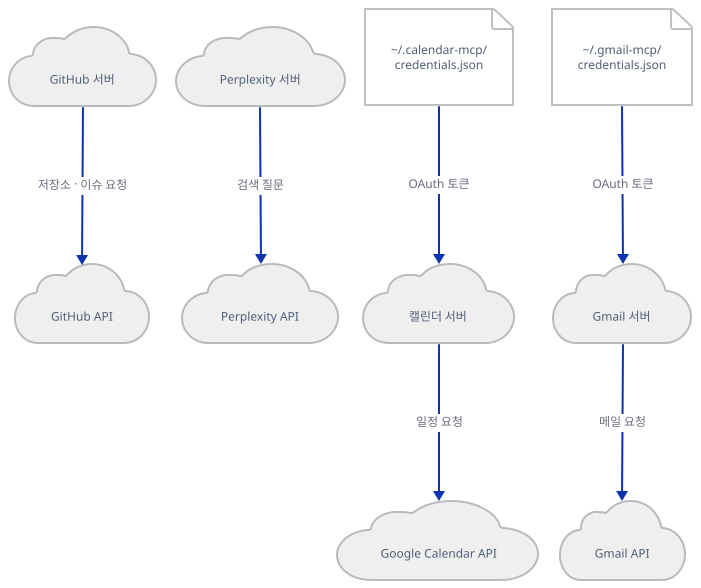

## 단계별 진행

### Step 1. 환경 만들기 — 막히는 셋

**목적.** 앱 파일을 작업 폴더로 복사해 독립 가상환경에 설치하고, `requirements.txt`대로만 설치하면 어디서 멈추는지, 어떻게 고치는지 봅니다.

**할 일.** 저장소 루트에서 시작합니다. 원본 폴더에서 import하면 `__pycache__`가 생기니 복사본으로만 작업합니다. 아래 명령은 앱을 실행하지 않고 import만 합니다.

```bash
mkdir -p ../multi-lab
cp mcp_ai_agents/multi_mcp_agent/multi_mcp_agent.py mcp_ai_agents/multi_mcp_agent/requirements.txt ../multi-lab/
cd ../multi-lab
uv venv --python 3.13
uv pip install -r requirements.txt
```

```powershell
New-Item -ItemType Directory -Force ..\multi-lab
Copy-Item mcp_ai_agents\multi_mcp_agent\multi_mcp_agent.py, mcp_ai_agents\multi_mcp_agent\requirements.txt ..\multi-lab\
Set-Location ..\multi-lab
uv venv --python 3.13
uv pip install -r requirements.txt
```

(PowerShell 줄은 실행해 보지 못했습니다. pip 대안은 `python -m venv .venv`로 만들고 활성화한 뒤 `pip install -r requirements.txt`입니다.) 이후 `uv run`에는 모두 `--no-project`를 붙입니다. 이유는 공통 사전 준비에 있습니다.

`mcp_ai_agents/multi_mcp_agent/requirements.txt:1-5`

```text
agno>=2.2.10
openai
mcp
python-dotenv
sqlalchemy
```

버전이 거의 없어서 오늘 풀리는 버전이 곧 내 환경입니다.

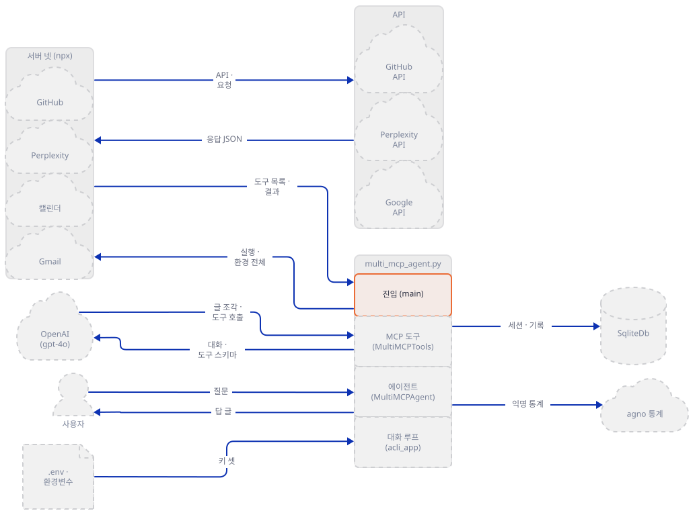

**확인.** 버전을 보고 앱 파일을 import합니다. import는 `main()`을 부르지 않으므로 서버는 뜨지 않습니다.

```bash
uv run --no-project python -c "import importlib.metadata as m; print('agno', m.version('agno')); print('mcp', m.version('mcp')); print('openai', m.version('openai'))"
uv run --no-project python -c "import multi_mcp_agent"
uv run --no-project python -c "import agno.tools.mcp as m; print(m.__all__)"
```

기대 출력(오늘 기준, 뒤 두 명령은 끝 부분):

```text
agno 3.1.3
mcp 2.3.0
openai 3.31.0
    from agno.tools.mcp import MultiMCPTools
ImportError: cannot import name 'MultiMCPTools' from 'agno.tools.mcp' (...)
['MCPTools', 'StreamableHTTPClientParams', 'SSEClientParams']
```

설치는 57개이고(직접 확인) 앱의 7행에서 멈춥니다. `requirements.txt`의 하한 `agno>=2.2.10`은 `MultiMCPTools`가 있던 시절의 것입니다. 2.2.10과 2.9.0의 `agno/tools/mcp/multi_mcp.py`에는 이 클래스가 있고 3.0.0에는 파일이 없습니다(세 판을 `--no-deps`로 받아 직접 확인). agno의 v3.0.0 릴리스 노트(2026-10-14에 읽음)는 "`MultiMCPTools` deleted … use one `MCPTools` per server"라고 적습니다.

원본을 그대로 돌리려면 agno를 3 미만으로 낮춰야 합니다. 그런데 낮추면 오류가 둘 더 나옵니다. 차례로 봅니다.

```bash
uv pip install "agno<3"
uv run --no-project python -c "import multi_mcp_agent" 2>&1 | tail -1
uv pip install "mcp<2"
uv run --no-project python -c "import multi_mcp_agent" 2>&1 | tail -1
uv pip install "sqlalchemy[asyncio]"
uv run --no-project python -c "import multi_mcp_agent; print('import ok')"
```

```text
ImportError: `mcp` not installed. Please install using `pip install mcp`
ImportError: The SQLAlchemy asyncio module requires that the Python 'greenlet' library is installed.  In order to ensure this dependency is available, use the 'sqlalchemy[asyncio]' install target:  'pip install sqlalchemy[asyncio]'
import ok
```

첫 오류는 거짓말입니다. `mcp`는 설치되어 있고, agno 2.9.0이 `mcp.shared.exceptions.McpError`를 가져오는데 `mcp` 2.3.0에서는 이름이 `MCPError`로 바뀌어 실패한 것을 이 메시지가 가립니다(트레이스백에 `Did you mean: 'MCPError'?`가 있었습니다). 그래서 `mcp<2`입니다. 둘째는 `sqlalchemy`가 비동기용 `greenlet`을 끌어오지 않아서입니다. 이 셋을 한 번에 하려면 처음 설치 뒤에 이 한 줄이면 됩니다(같은 최종 환경, 직접 확인).

```bash
uv pip install "agno<3" "mcp<2" "sqlalchemy[asyncio]"
```

최종 버전은 agno 2.9.0, mcp 1.30.0, sqlalchemy 2.1.4, greenlet 3.5.6입니다. agno 2.x의 마지막 판이 2.9.0이었습니다(`agno==2.9.9`는 없었습니다).

### Step 2. 키 검사 — MCP보다 앞에서 끝나는 것

**목적.** 서버가 뜨기 전에 앱이 하는 일(키 읽기, 검사, ID 만들기)을 확인합니다.

**할 일.** 키는 모듈 변수 셋이 읽고, `main()` 첫 부분이 셋을 검사합니다.

`mcp_ai_agents/multi_mcp_agent/multi_mcp_agent.py:26-39`

```python
    # Validate required environment variables
    required_vars = {
        "GITHUB_PERSONAL_ACCESS_TOKEN": GITHUB_TOKEN,
        "OPENAI_API_KEY": OPENAI_API_KEY,
        "PERPLEXITY_API_KEY": PERPLEXITY_API_KEY,
    }
    
    missing_vars = [name for name, value in required_vars.items() if not value]
    if missing_vars:
        print("❌ ERROR: Missing required environment variables:")
        for var in missing_vars:
            print(f"   • {var}")
        print("\nPlease check your .env file and ensure all required variables are set.")
        return
```

세 키뿐입니다. 서버 넷 가운데 둘(캘린더·Gmail)이 쓰는 Google 쪽 인증은 검사 대상이 아니고(Step 7), 배너(22행)도 `GitHub • Perplexity • Calendar`만 말합니다. 통과하면 `user_`와 `session_` 뒤에 `uuid4` 앞 여덟 글자를 붙여 ID 둘을 만듭니다(42~43행). 켤 때마다 새로 만들어집니다.

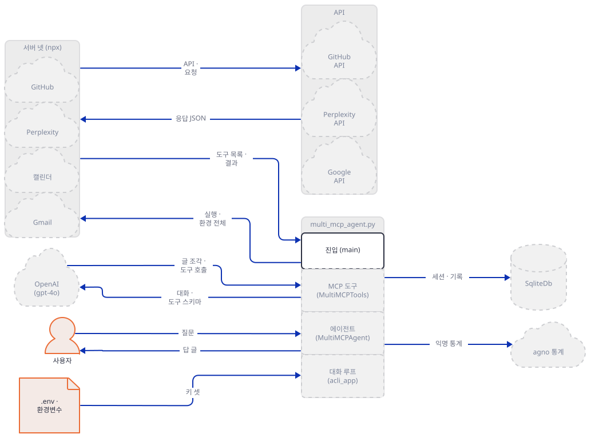

**확인.** 이 Step에서는 앱을 돌리지 않고 소스에서 줄 번호만 봅니다. 키가 빠졌을 때 안내를 찍고 끝나는 동작은 서버 명령을 가짜로 바꾼 Step 3의 끝에서 돌려 봅니다. 지금 고치기 전의 원본을 돌리면 안 되는 까닭이 있습니다. 앱은 `load_dotenv()`(12행)를 부르는데, python-dotenv는 스크립트 폴더에서 위로 올라가며 `.env`를 찾고 셸에 없는 변수만 채웁니다. 실습 폴더는 저장소 밖이라 그 위 어느 폴더의 `.env`든 대상입니다. 키를 `unset`한 셸에서도 상위 `.env`의 키가 채워져 검사를 통과할 수 있고, 그러면 67행에서 원본의 `npx` 명령 넷, 곧 캘린더·Gmail OAuth 서버를 포함한 서버가 실제로 실행됩니다(같은 이유로 Day 127 Step 6은 `unset` 대신 빈 값을 씁니다). 그래서 원본은 Step 3에서 고칠 때까지 import만 하고 돌리지 않습니다.

```bash
grep -n "load_dotenv\|required_vars\|uuid4\|MultiMCPTools(" multi_mcp_agent.py
```

기대 출력(직접 확인):

```text
9:from dotenv import load_dotenv
12:load_dotenv()
27:    required_vars = {
33:    missing_vars = [name for name, value in required_vars.items() if not value]
42:    user_id = f"user_{uuid.uuid4().hex[:8]}"
43:    session_id = f"session_{uuid.uuid4().hex[:8]}"
67:    async with MultiMCPTools(mcp_servers, env=env) as mcp_tools:
```

PowerShell은 `Select-String -Pattern "load_dotenv","required_vars","uuid4","MultiMCPTools\(" multi_mcp_agent.py`로 볼 수 있지만 실행해 보지 못했습니다.

### Step 3. 서버 자리에 가짜를 두기

**목적.** 앱의 서버 명령 넷을 가짜 MCP 서버로 바꾸고 모델 주소를 가짜 서버로 돌려서, 바깥으로 아무것도 나가지 않는 실습장을 만듭니다.

**할 일.** 먼저 가짜 MCP 서버를 `multi-lab/fake_mcp.py`로 저장합니다. 서버 이름(`github`·`perplexity`·`calendar`·`gmail`)을 첫 인자로 받아 도구를 하나씩 내놓습니다. 시작할 때 자기가 받은 환경을 파일에 적고, 세 번째 인자로 죽거나(`exit`) 늦게(`sleep:N`) 응답하게 합니다. 도구 이름은 공개 문서에서 확인한 것을 썼습니다. `search_repositories`는 GitHub 서버 저장소의 README, `search_emails`는 Gmail 서버 README, `list_events`는 캘린더 서버 소스, `perplexity_ask`는 Perplexity 공식 저장소 README(2026-10-14에 읽음)에 있습니다. 다만 앱이 쓰는 `@chatmcp/server-perplexity-ask` 패키지는 npm 페이지가 403, 저장소 주소가 404여서 확인하지 못했고(npm 레지스트리 JSON은 열리지만 README가 비어 있습니다. Step 7), 인자 모양과 응답은 모두 내가 지은 것입니다(`mcp` 2.x에서는 `FastMCP`가 `MCPServer`로 바뀌어 둘 다 받게 썼습니다).

`multi-lab/fake_mcp.py`

```python
import json, os, sys, time

NAME, LOG = sys.argv[1], sys.argv[2]
MODE = sys.argv[3] if len(sys.argv) > 3 else "ok"


def log(rec):
    with open(LOG, "a", encoding="utf-8") as f:
        f.write(json.dumps(rec, ensure_ascii=False) + "\n")


watch = ["OPENAI_API_KEY", "GITHUB_PERSONAL_ACCESS_TOKEN", "PERPLEXITY_API_KEY", "MY_UNRELATED_CANARY"]
log({"event": "start", "server": NAME, "mode": MODE, "env_count": len(os.environ),
     "has": {k: (k in os.environ) for k in watch}})

if MODE == "exit":  # stands in for a server that quits at startup (e.g. missing OAuth keys file)
    log({"event": "exit", "server": NAME})
    sys.exit(1)
if MODE.startswith("sleep:"):
    time.sleep(float(MODE.split(":")[1]))

try:
    from mcp.server.fastmcp import FastMCP
except ImportError:  # mcp 2.x
    from mcp.server.mcpserver import MCPServer as FastMCP

try:
    mcp = FastMCP("fake-" + NAME, log_level="WARNING")
except TypeError:
    mcp = FastMCP("fake-" + NAME)

if NAME == "github":
    @mcp.tool()
    def search_repositories(query: str) -> str:
        """Search repositories (made up for the tutorial)."""
        log({"event": "call", "server": NAME, "tool": "search_repositories", "query": query})
        return "Shubhamsaboo/awesome-llm-apps (대본)"
elif NAME == "perplexity":
    @mcp.tool()
    def perplexity_ask(query: str) -> str:
        """Ask a web-search question (made up for the tutorial)."""
        log({"event": "call", "server": NAME, "tool": "perplexity_ask", "query": query})
        return "가짜 검색 결과 (대본)"
elif NAME == "calendar":
    @mcp.tool()
    def list_events(calendar_id: str = "primary") -> str:
        """List events (made up for the tutorial)."""
        log({"event": "call", "server": NAME, "tool": "list_events", "calendar_id": calendar_id})
        return "10:00 가짜 회의 (대본)"
elif NAME == "gmail":
    @mcp.tool()
    def search_emails(query: str) -> str:
        """Search emails (made up for the tutorial)."""
        log({"event": "call", "server": NAME, "tool": "search_emails", "query": query})
        return "가짜 메일 한 통 (대본)"

mcp.run("stdio")
```

다음은 가짜 OpenAI 서버 `multi-lab/fake_openai.py`입니다. 마지막 사용자 글에 `repo`·`search`·`meeting`이 있고 그 도구가 보이면 그 도구를 부르고, 도구 결과가 오면 짧은 답을 하고, 메모리 관리자의 요청(다른 도구들)에는 평범한 글로 답합니다. 요청 요약을 파일에 적습니다.

`multi-lab/fake_openai.py`

```python
import json, sys, threading
from http.server import BaseHTTPRequestHandler, ThreadingHTTPServer

PORT, LOG = int(sys.argv[1]), sys.argv[2]
LOCK = threading.Lock()
PICK = [("repo", "search_repositories", {"query": "llm apps"}),
        ("search", "perplexity_ask", {"query": "latest AI"}),
        ("meeting", "list_events", {})]


def log(rec):
    with LOCK, open(LOG, "a", encoding="utf-8") as f:
        f.write(json.dumps(rec, ensure_ascii=False) + "\n")


class Handler(BaseHTTPRequestHandler):
    protocol_version = "HTTP/1.1"

    def log_message(self, *args):
        pass

    def do_POST(self):
        body = json.loads(self.rfile.read(int(self.headers["content-length"])))
        msgs = body["messages"]
        tools = [t["function"]["name"] for t in body.get("tools") or []]
        log({"path": self.path, "model": body["model"], "stream": bool(body.get("stream")),
             "tools": tools, "roles": [m["role"] for m in msgs]})
        users = [m["content"] for m in msgs if m["role"] == "user" and isinstance(m["content"], str)]
        text = (users[-1] if users else "").lower()
        call = None
        for key, name, args in PICK:
            if key in text and name in tools:
                call = (name, args)
        if msgs[-1]["role"] == "tool":
            msg = {"role": "assistant", "content": "도구 결과를 받았습니다. (가짜 서버의 대본)"}
        elif call:
            msg = {"role": "assistant", "content": None, "tool_calls": [{
                "id": "call_1", "type": "function",
                "function": {"name": call[0], "arguments": json.dumps(call[1])}}]}
        else:
            msg = {"role": "assistant", "content": "알겠습니다. (가짜 서버의 대본)"}
        if body.get("stream"):
            self.send_response(200)
            self.send_header("content-type", "text/event-stream")
            self.send_header("transfer-encoding", "chunked")
            self.end_headers()
            base = {"id": "c1", "object": "chat.completion.chunk", "created": 0, "model": body["model"]}
            delta = {"role": "assistant"}
            if msg.get("tool_calls"):
                delta["tool_calls"] = [{"index": 0, **msg["tool_calls"][0]}]
                finish = "tool_calls"
            else:
                delta["content"] = msg["content"]
                finish = "stop"
            events = [{**base, "choices": [{"index": 0, "delta": delta, "finish_reason": None}]},
                      {**base, "choices": [{"index": 0, "delta": {}, "finish_reason": finish}]}]
            for e in events + ["[DONE]"]:
                data = ("data: " + (e if isinstance(e, str) else json.dumps(e)) + "\n\n").encode()
                self.wfile.write(f"{len(data):x}\r\n".encode() + data + b"\r\n")
            self.wfile.write(b"0\r\n\r\n")
        else:
            out = {"id": "c1", "object": "chat.completion", "created": 0, "model": body["model"],
                   "choices": [{"index": 0, "message": msg, "finish_reason": "stop"}],
                   "usage": {"prompt_tokens": 10, "completion_tokens": 5, "total_tokens": 15}}
            data = json.dumps(out).encode()
            self.send_response(200)
            self.send_header("content-type", "application/json")
            self.send_header("content-length", str(len(data)))
            self.end_headers()
            self.wfile.write(data)


class Server(ThreadingHTTPServer):
    allow_reuse_address = False
    daemon_threads = True


Server(("127.0.0.1", PORT), Handler).serve_forever()
```

이제 복사본 `multi_mcp_agent.py`의 서버 명령 네 줄을 편집기로 바꿉니다. 원본 폴더의 파일은 건드리지 않습니다. 이 명령들의 `python`은 뒤에서 `uv run`이 앞세우는 가상환경의 파이썬입니다.

`mcp_ai_agents/multi_mcp_agent/multi_mcp_agent.py:56-61`

```python
    mcp_servers = [
        "npx -y @modelcontextprotocol/server-github",
        "npx -y @chatmcp/server-perplexity-ask",
        "npx @gongrzhe/server-calendar-autoauth-mcp",
        "npx @gongrzhe/server-gmail-autoauth-mcp"
    ]
```

| 줄 | 원본 | 복사본 |
|---|---|---|
| 57 | `"npx -y @modelcontextprotocol/server-github",` | `"python fake_mcp.py github mcp.jsonl",` |
| 58 | `"npx -y @chatmcp/server-perplexity-ask",` | `"python fake_mcp.py perplexity mcp.jsonl",` |
| 59 | `"npx @gongrzhe/server-calendar-autoauth-mcp",` | `"python fake_mcp.py calendar mcp.jsonl",` |
| 60 | `"npx @gongrzhe/server-gmail-autoauth-mcp"` | `"python fake_mcp.py gmail mcp.jsonl"` |

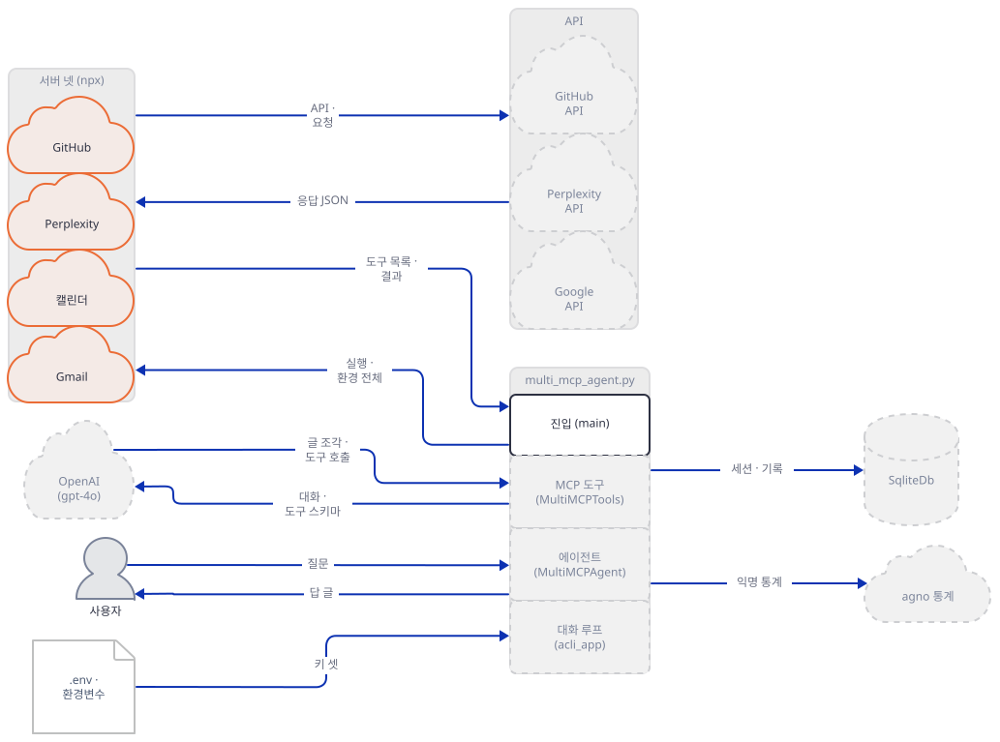

**확인.** 원본과의 차이가 정확히 네 줄이고, 복사본에 `npx`가 더 이상 없는지 봅니다. 이 확인이 끝나기 전에는 앱을 실행하지 마세요. `npx`가 `PATH`에 있는 PC(이 문서를 쓴 머신이 그랬습니다)에서는 원본 명령이 실제로 실행됩니다.

```bash
diff <저장소 경로>/mcp_ai_agents/multi_mcp_agent/multi_mcp_agent.py multi_mcp_agent.py
grep -n "npx" multi_mcp_agent.py
```

(`<저장소 경로>`는 저장소를 받은 위치로 바꿉니다.) 기대 출력은 아래이고 `grep`은 아무것도 찍지 않고 종료 코드 1로 끝납니다(직접 확인).

```text
57,60c57,60
<         "npx -y @modelcontextprotocol/server-github",
<         "npx -y @chatmcp/server-perplexity-ask",
<         "npx @gongrzhe/server-calendar-autoauth-mcp",
<         "npx @gongrzhe/server-gmail-autoauth-mcp"
---
>         "python fake_mcp.py github mcp.jsonl",
>         "python fake_mcp.py perplexity mcp.jsonl",
>         "python fake_mcp.py calendar mcp.jsonl",
>         "python fake_mcp.py gmail mcp.jsonl"
```

**키 검사 확인(Step 2의 동작).** 이제 서버 명령이 가짜인 복사본이라 `.env`가 어떻게 채우든 `npx`에 닿지 않습니다. Perplexity 키를 비운 셸에서 돌립니다. 키 검사는 서버를 띄우는 67행보다 앞에서 끝납니다. 빈 값은 `.env`가 덮어쓰지 않습니다(셸에 이미 있는 변수이므로).

```bash
(export OPENAI_API_KEY=sk-fake GITHUB_PERSONAL_ACCESS_TOKEN=ghp_fake PERPLEXITY_API_KEY=""; printf 'bye\n' | uv run --no-project python multi_mcp_agent.py)
```

기대 출력은 배너 뒤에 이 네 줄입니다(직접 확인).

```text
❌ ERROR: Missing required environment variables:
   • PERPLEXITY_API_KEY

Please check your .env file and ensure all required variables are set.
```

```powershell
$env:OPENAI_API_KEY = "sk-fake"; $env:GITHUB_PERSONAL_ACCESS_TOKEN = "ghp_fake"; Remove-Item Env:PERPLEXITY_API_KEY -ErrorAction SilentlyContinue
"bye" | uv run --no-project python multi_mcp_agent.py
```

(PowerShell에서는 변수에 빈 값을 넣으면 변수가 지워지므로 `Remove-Item`을 씁니다. 이 줄은 실행해 보지 못했습니다. 상위 폴더 `.env`가 키를 채우면 위 네 줄 대신 Step 4의 출력이 나오는데, 서버가 모두 가짜라 안전합니다.)

### Step 4. 서버가 뜨는 순간, 서버가 받는 환경, 시간 제한

**목적.** `async with MultiMCPTools(...)`가 서버를 언제 어떤 순서로 띄우는지, 서버 프로세스가 무엇을 받는지, 얼마나 기다려 주는지 가짜 서버가 적은 파일로 봅니다.

**할 일.** 서버 환경과 명령은 이렇게 만들어져 한 번에 건네집니다.

`mcp_ai_agents/multi_mcp_agent/multi_mcp_agent.py:49-54`

```python
    # Set up environment variables for MCP servers
    env = {
        **os.environ,
        "GITHUB_PERSONAL_ACCESS_TOKEN": GITHUB_TOKEN,
        "PERPLEXITY_API_KEY": PERPLEXITY_API_KEY
    }
```

`mcp_ai_agents/multi_mcp_agent/multi_mcp_agent.py:66-67`

```python
    # Start the MCP Tools session
    async with MultiMCPTools(mcp_servers, env=env) as mcp_tools:
```

`MultiMCPTools(...)`를 만드는 것만으로는 서버가 뜨지 않고, `async with`가 `_connect()`로 서버를 한 줄씩 차례로 띄웁니다. 명령 문자열을 검사하는 `prepare_command`와 이 차례는 Day 131 Step 3이 2.2.13에서 본 것과 같고, 2.9.0 소스(`agno/tools/mcp/multi_mcp.py`, `agno/utils/mcp.py`)에도 같은 코드가 있습니다. 클래스를 만드는 줄에서는 `DeprecationWarning`이 한 번 나옵니다.

환경은 소스의 이 한 줄에서 합쳐집니다. `env = {**get_default_environment(), **env}`, 즉 `mcp` 패키지가 정한 허용 목록 열두 개 남짓(Windows 기준)에 앱이 준 `env`를 얹습니다. 그런데 앱의 `env`가 이미 `os.environ` 전체이므로 허용 목록은 의미가 없어집니다. 하나의 `env`가 서버 넷 모두에 갑니다.

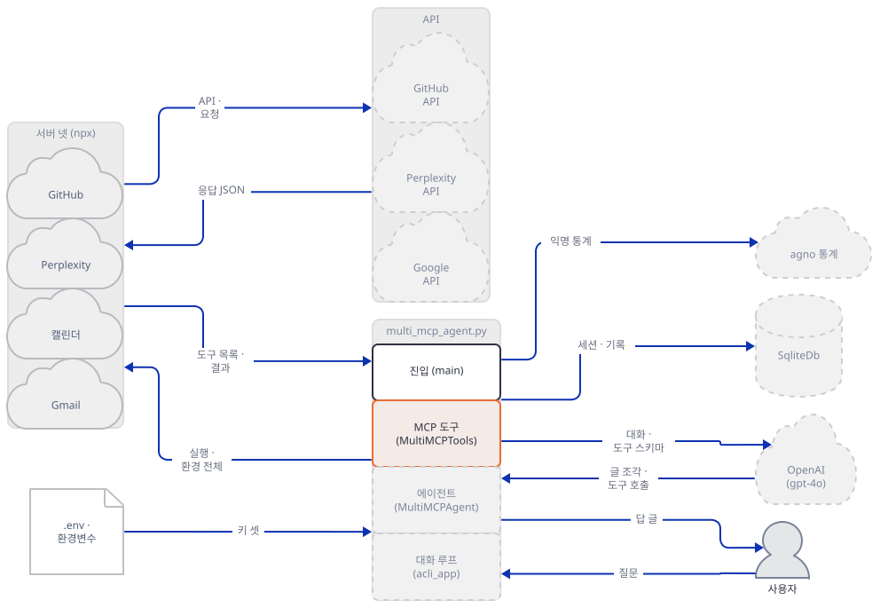

**확인.** 가짜 키와 무관한 변수 하나를 걸고 바로 `exit` 합니다. 모델은 한 번도 부르지 않는 실행입니다. 가짜 OpenAI 주소도 함께 걸어 두면 실수로 모델이 불려도 로컬로 갑니다.

```bash
export PORT=54321
export OPENAI_BASE_URL=http://127.0.0.1:$PORT/v1 OPENAI_API_KEY=sk-fake GITHUB_PERSONAL_ACCESS_TOKEN=ghp_fake PERPLEXITY_API_KEY=pplx-fake AGNO_TELEMETRY=false MY_UNRELATED_CANARY=1
printf 'exit\n' | uv run --no-project python multi_mcp_agent.py
uv run --no-project python -c "import os; print(len(os.environ))"
uv run --no-project python -c "import json; [print(d['server'], d['env_count'], d['has']) for d in map(json.loads, open('mcp.jsonl', encoding='utf-8'))]"
```

```powershell
$env:PORT = "54321"
$env:OPENAI_BASE_URL = "http://127.0.0.1:$($env:PORT)/v1"; $env:OPENAI_API_KEY = "sk-fake"; $env:GITHUB_PERSONAL_ACCESS_TOKEN = "ghp_fake"; $env:PERPLEXITY_API_KEY = "pplx-fake"; $env:AGNO_TELEMETRY = "false"; $env:MY_UNRELATED_CANARY = "1"
"exit" | uv run --no-project python multi_mcp_agent.py
```

(포트는 49152~65535 안에서 아무 수나 고릅니다. 54321은 예시입니다. PowerShell 줄은 실행해 보지 못했습니다. `AGNO_TELEMETRY=false`는 Step 6에서 설명합니다.) 앱 출력은 `DeprecationWarning`, 배너, `Initializing MCP server connections...`, `✅ Successfully connected to all MCP servers!`, 준비 문구와 `🤖 You :` 프롬프트까지입니다. `mcp.jsonl`에는 서버 넷이 시작한 순서(github, perplexity, calendar, gmail) 그대로 줄이 있습니다(직접 확인. 환경 변수의 개수는 PC마다 다릅니다).

```text
111
github 111 {'OPENAI_API_KEY': True, 'GITHUB_PERSONAL_ACCESS_TOKEN': True, 'PERPLEXITY_API_KEY': True, 'MY_UNRELATED_CANARY': True}
perplexity 111 {'OPENAI_API_KEY': True, 'GITHUB_PERSONAL_ACCESS_TOKEN': True, 'PERPLEXITY_API_KEY': True, 'MY_UNRELATED_CANARY': True}
calendar 111 {'OPENAI_API_KEY': True, 'GITHUB_PERSONAL_ACCESS_TOKEN': True, 'PERPLEXITY_API_KEY': True, 'MY_UNRELATED_CANARY': True}
gmail 111 {'OPENAI_API_KEY': True, 'GITHUB_PERSONAL_ACCESS_TOKEN': True, 'PERPLEXITY_API_KEY': True, 'MY_UNRELATED_CANARY': True}
```

내 셸의 환경 변수 111개가 서버마다 그대로 들어갔습니다. 진짜 캘린더·Gmail 서버는 서드파티 패키지인데, 이 앱의 `env`는 `OPENAI_API_KEY`를 포함해 셸의 모든 변수를 그 프로세스에 줍니다. 앱의 `env`에서 `**os.environ,` 한 줄만 지운 복사본은 서버마다 14개(허용 목록 열두 개와 키 둘)만 받았고 `OPENAI_API_KEY`는 없었습니다(직접 확인). 다만 GitHub 토큰과 Perplexity 키는 그래도 서버 넷 모두에 갑니다. 하나의 `env`를 넷이 나눠 쓰기 때문입니다. 서버마다 따로 주는 법은 Step 8입니다.

이제 시간입니다. 가짜 서버에 세 번째 인자로 `sleep:3`을 줘서(네 줄 끝의 `mcp.jsonl"`을 `mcp.jsonl sleep:3"`으로) 앱을 `exit`까지 돌렸더니 8초 걸리던 것이 20초가 됐습니다. 서버가 하나씩 차례로 뜨기 때문에 3초 넷이 더해진 것입니다. 한 서버만 느리게 하면 8초는 연결됐고 12초는 이런 오류로 실패했습니다(직접 확인).

```text
ERROR    Failed to get MCP tools: Timed out while waiting for response to
         ClientRequest. Waited 10.0 seconds.
ERROR    Failed to connect to <MultiMCPTools name=MultiMCPTools functions=[]>:
         MCP connection failed: Timed out while waiting for response to
         ClientRequest. Waited 10.0 seconds.
✅ Successfully connected to all MCP servers!
```

기준은 `MultiMCPTools`의 생성자 인자 `timeout_seconds=10`(소스)이고 서버마다 따로 잽니다. 진짜 `npx -y`가 처음 패키지를 내려받는 시간이 10초를 넘으면 같은 일이 생길 수 있다는 것은 추정입니다. `npx`를 실행하지 않아 재지 못했습니다. 위 출력의 마지막 줄을 보세요. 실패하고도 앱은 성공을 찍습니다. Step 7에서 다룹니다.

### Step 5. 에이전트와 한 턴

**목적.** 서버가 뜬 뒤 에이전트가 만들어지는 과정과, 질문 한 줄이 모델 호출 몇 번이 되는지, 모델이 무엇을 받는지 봅니다.

**할 일.** 에이전트는 `async with` 안에서 만들어지고, 도구는 `MultiMCPTools` 객체 하나입니다. 서버 넷의 도구가 한 목록으로 섞여 모델에게 갑니다.

`mcp_ai_agents/multi_mcp_agent/multi_mcp_agent.py:71-75`

```python
        agent = Agent(
            name="MultiMCPAgent",
            model=OpenAIChat(id="gpt-4o", api_key=OPENAI_API_KEY),
            tools=[mcp_tools],
            description="Advanced AI assistant with GitHub, Perplexity, and Calendar integration",
```

`mcp_ai_agents/multi_mcp_agent/multi_mcp_agent.py:126-133`

```python
            markdown=True,
            debug_mode=True,
            retries=3,
            db=db,
            enable_user_memories=True,
            add_history_to_context=True,
            num_history_runs=10,  # Increased for better context retention
        )
```

`OpenAIChat`에 `base_url`을 주지 않으므로 OpenAI SDK가 `OPENAI_BASE_URL`을 읽어 가짜 서버로 갑니다(직접 확인, 요청이 가짜 서버의 기록에 남았습니다). `enable_user_memories`는 agno 2.9.0에 있는 인자입니다(3.0.0부터 `update_memory_on_run`, Step 8). 같은 이름의 도구가 두 서버에 있으면 뒤 서버의 것이 앞 것을 덮습니다(`multi_mcp.py`의 `self.functions[f.name] = f`, 소스로 확인했고 실행해 보지는 못했습니다). `debug_mode=True`라서 매 턴 모델에게 가는 시스템 메시지가 화면에 통째로 찍힙니다. 이 지시문에는 `Notion`이 세 번(82·114·122행) 나오는데 설정된 서버 가운데 Notion은 없고, `Gmail`은 한 번도 나오지 않습니다. 배너(22행)와 `description`(75행)도 Gmail을 빼고 있습니다. 모델은 Gmail 도구를 목록에서만 압니다.

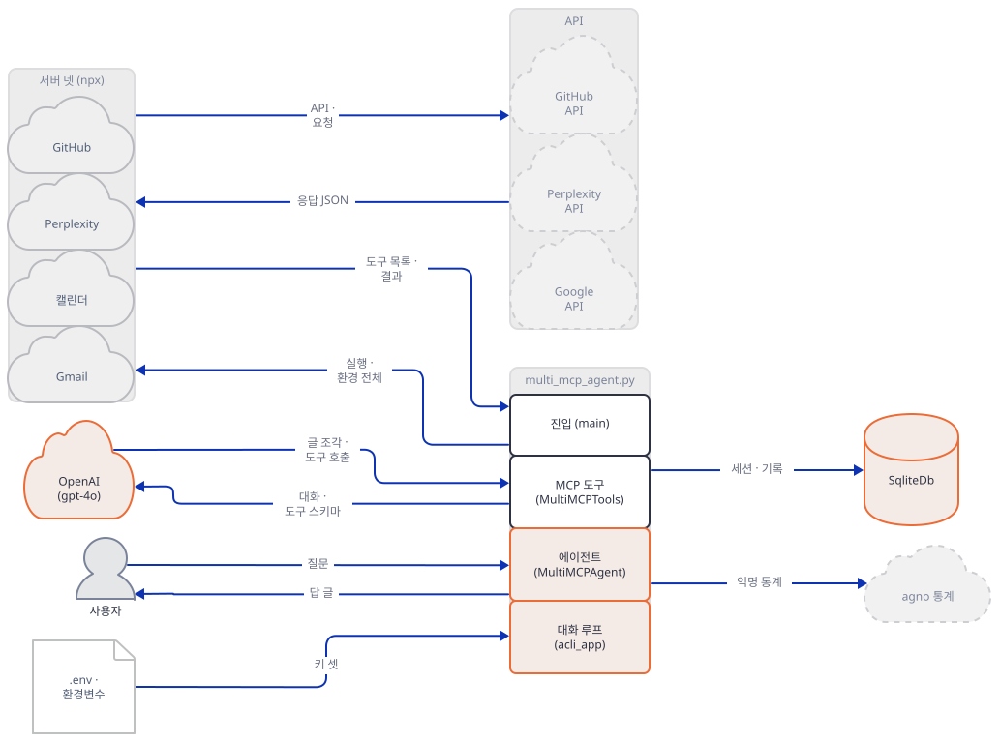

**확인.** 터미널 둘로 합니다. 먼저 **새 터미널**을 하나 열고 `multi-lab`으로 가서 가짜 OpenAI 서버를 띄웁니다. 이 터미널에는 키나 `OPENAI_BASE_URL`을 걸지 않고, 포트 숫자(Step 4의 값)만 씁니다.

```bash
uv run --no-project python fake_openai.py 54321 openai.jsonl
```

```powershell
uv run --no-project python fake_openai.py 54321 openai.jsonl
```

앱은 Step 4에서 쓰던 터미널에서 돌립니다. 새로 연 터미널이라면 아래 환경변수를 먼저 다시 걸고, 첫 줄로 가짜 주소가 걸렸는지 확인합니다. 앱은 `load_dotenv()`(12행)를 부르는데, python-dotenv는 스크립트 폴더에서 위로 올라가며 `.env`를 찾습니다. 상위 폴더에 진짜 키가 든 `.env`가 있어도 셸에 이미 걸린 값이 이기지만, 셸에 값이 없으면 그 파일의 진짜 키로 OpenAI를 부르니 `OPENAI_BASE_URL`이 걸렸는지 꼭 봅니다. 질문을 두 줄 넣은 뒤 끝냅니다.

```bash
export PORT=54321
export OPENAI_BASE_URL=http://127.0.0.1:$PORT/v1 OPENAI_API_KEY=sk-fake GITHUB_PERSONAL_ACCESS_TOKEN=ghp_fake PERPLEXITY_API_KEY=pplx-fake AGNO_TELEMETRY=false MY_UNRELATED_CANARY=1
echo "$OPENAI_BASE_URL"
rm -f mcp.jsonl openai.jsonl
rm -rf tmp
printf 'Show my recent GitHub repos\nSchedule a meeting\nbye\n' | uv run --no-project python multi_mcp_agent.py
```

```powershell
$env:PORT = "54321"
$env:OPENAI_BASE_URL = "http://127.0.0.1:$($env:PORT)/v1"; $env:OPENAI_API_KEY = "sk-fake"; $env:GITHUB_PERSONAL_ACCESS_TOKEN = "ghp_fake"; $env:PERPLEXITY_API_KEY = "pplx-fake"; $env:AGNO_TELEMETRY = "false"; $env:MY_UNRELATED_CANARY = "1"
echo $env:OPENAI_BASE_URL
```

(첫 줄 `echo`가 `http://127.0.0.1:54321/v1`을 찍어야 합니다. PowerShell 줄은 실행해 보지 못했습니다. 위 `rm`은 이 실습 폴더 안의 파일을 지웁니다. `pwd`로 `multi-lab`인지 먼저 확인하세요.)

앱은 질문마다 `Message` 상자, `Tool Calls` 상자(`search_repositories(query=llm apps)`, `list_events()`), `Response` 상자를 찍습니다. 모델이 받은 요청의 요약을 봅니다.

```bash
uv run --no-project python -c "import json; [print(d['stream'], d['tools'], d['roles']) for d in map(json.loads, open('openai.jsonl', encoding='utf-8'))]"
```

```text
True ['list_events', 'perplexity_ask', 'search_emails', 'search_repositories'] ['developer', 'user']
False ['add_memory', 'delete_memory', 'update_memory'] ['developer', 'user']
True ['list_events', 'perplexity_ask', 'search_emails', 'search_repositories'] ['developer', 'user', 'assistant', 'tool']
True ['list_events', 'perplexity_ask', 'search_emails', 'search_repositories'] ['developer', 'user', 'assistant', 'tool', 'assistant', 'user']
False ['add_memory', 'delete_memory', 'update_memory'] ['developer', 'user']
True ['list_events', 'perplexity_ask', 'search_emails', 'search_repositories'] ['developer', 'user', 'assistant', 'tool', 'assistant', 'user', 'assistant', 'tool']
```

읽을 것은 셋입니다. 첫째, 채팅 요청마다 서버 넷의 도구 넷이 모두 갑니다. 둘째, 한 턴은 모델 호출 셋입니다. 스트리밍 채팅 둘(도구를 부르게 하는 것, 결과를 받아 답하게 하는 것)과 도구가 `add_memory`·`delete_memory`·`update_memory`뿐인 비스트리밍 호출 하나입니다. 이 셋째가 `enable_user_memories=True`의 몫이고, 여섯 줄의 순서는 채팅, 메모리, 채팅이었습니다. 셋째, 둘째 턴의 첫 요청에는 앞 턴의 `assistant`·`tool`·`assistant`가 그대로 실려 있습니다(`add_history_to_context`). 가짜 서버가 부른 도구가 어느 서버의 것인지는 `mcp.jsonl`의 `call` 줄이 알려 줍니다(`github`·`calendar`).

### Step 6. 저장과 통계

**목적.** 앱이 디스크에 남기는 것과 밖으로 내보내는 통계를 봅니다.

**할 일.** `SqliteDb`는 `tmp/multi_mcp_agent.db`라는 상대 경로를 받습니다(64행). 폴더 `tmp`는 이 줄이 실행될 때, 즉 서버를 띄우기 전에 만들어지고 `exit`만 한 실행에서는 비어 있었습니다. 파일은 첫 질문이 끝난 뒤 생깁니다.

**확인.** 두 번 실행하고 열어 봅니다.

```bash
rm -rf tmp
for i in 1 2; do printf 'Show my recent GitHub repos\nbye\n' | uv run --no-project python multi_mcp_agent.py > /dev/null; done
uv run --no-project python -c "import sqlite3; c = sqlite3.connect('tmp/multi_mcp_agent.db'); print([r[0] for r in c.execute(\"select name from sqlite_master where type='table'\")]); [print(r) for r in c.execute('select session_id, user_id from agno_sessions')]"
```

```text
['agno_sessions', 'agno_schema_versions']
('session_32f7939e', 'user_efebe521')
('session_c648c3f7', 'user_f2f172d2')
```

(ID는 실행마다 다릅니다.) 두 번의 실행이 서로 다른 세션과 사용자로 쌓였습니다. 42~43행이 켤 때마다 새 ID를 만들기 때문에, 앱 README의 "대화 기억"은 한 번의 실행 안에서만 이어집니다. 가짜 모델은 메모리를 쓰지 않으므로 메모리 표는 만들어지지 않았습니다.

통계는 Day 047 Step 5가 다룬 agno의 익명 사용 통계이고, Day 127 Step 6이 agno 3.1.3에서 읽은 목록과 같은 모양입니다. 다른 점은 2.9.0의 목록에 `has_culture`가 하나 더 있다는 것입니다(`agno/agent/_telemetry.py`, 소스로 확인). 이 에이전트는 `telemetry`를 끄지 않아 기본값 `True`입니다. 그래서 질문이 하나 성공하면 `POST /telemetry/runs`가 한 건 나갑니다. 이 문서는 하네스로 agno의 통계 주소를 가짜 수신기로 돌리고 `AGNO_TELEMETRY`를 끄지 않은 채 같은 실행을 두 번 돌려 본문의 키를 읽었습니다(agno 2.9.0).

```text
agent_id, db_type, has_culture, has_input_schema, has_knowledge, has_learnings, has_memory, has_output_schema,
has_reasoning, has_team, has_tools, model_id, model_name, model_provider, output_model, parser_model
```

실행 둘에 두 건이 갔고 질문 내용은 본문에 없었습니다. 독자 명령이 `AGNO_TELEMETRY=false`를 거는 것은 가짜 서버만 있는 환경에서도 `os-api.agno.com`으로 나가는 길을 막아 두려는 것입니다.

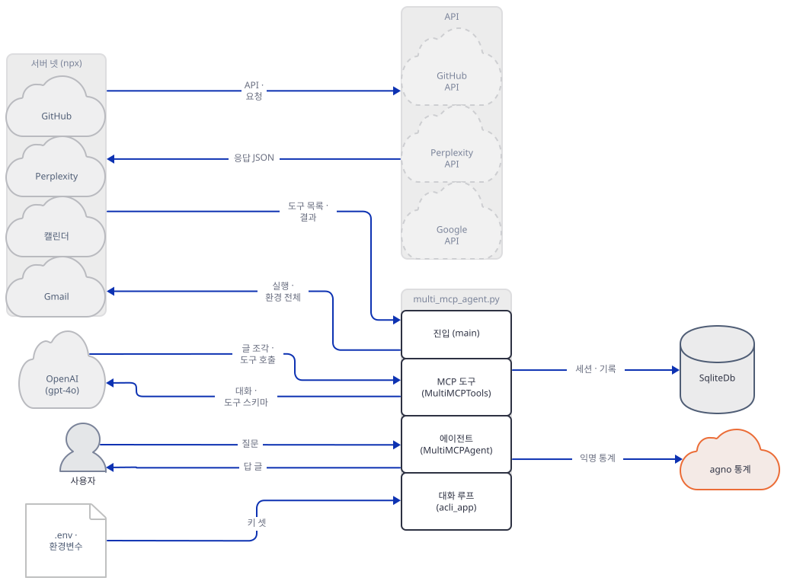

### Step 7. 서버가 죽을 때와 진짜 서버가 하는 일

**목적.** 서버 하나가 죽었을 때 앱이 무엇을 하는지 보고, 진짜 서버 넷이 실제로 무엇을 하는지 공개 문서로 확인합니다.

**할 일.** 가짜 Gmail 서버가 시작하자마자 끝나게 합니다. 복사본의 60행을 `"python fake_mcp.py gmail mcp.jsonl exit"`로 바꿉니다. 이 모양은 진짜 Gmail 서버가 OAuth 키 파일이 없을 때 취할 행동과 같게 골랐습니다(아래).

**확인.** Step 4와 같은 터미널(환경변수가 걸린 곳)에서 돌립니다.

```bash
rm -f mcp.jsonl openai.jsonl
printf 'Show my recent GitHub repos\nbye\n' | uv run --no-project python multi_mcp_agent.py 2>&1 | grep -n "ERROR\|Successfully\|MCP connection\|Tool Calls"
uv run --no-project python -c "import json; print([(d['server'], d['event']) for d in map(json.loads, open('mcp.jsonl', encoding='utf-8'))])"
uv run --no-project python -c "import json; [print(d['stream'], d['tools'], d['roles']) for d in map(json.loads, open('openai.jsonl', encoding='utf-8'))]"
```

```text
16:ERROR    Failed to get MCP tools: Connection closed
17:ERROR    Failed to connect to <MultiMCPTools name=MultiMCPTools functions=[]>:
18:         MCP connection failed: Connection closed
19:✅ Successfully connected to all MCP servers!
35:ERROR    Failed to get MCP tools: Connection closed
36:ERROR    Failed to connect to <MultiMCPTools name=MultiMCPTools functions=[]>:
37:         MCP connection failed: Connection closed
[('github', 'start'), ('perplexity', 'start'), ('calendar', 'start'), ('gmail', 'start'), ('gmail', 'exit'), ('github', 'start'), ('perplexity', 'start'), ('calendar', 'start'), ('gmail', 'start'), ('gmail', 'exit')]
True [] ['developer', 'user']
False ['add_memory', 'delete_memory', 'update_memory'] ['developer', 'user']
```

(줄 번호는 출력 앞쪽 줄 수에 따라 달라질 수 있고, 마지막 두 줄의 순서는 실행마다 바뀔 수 있습니다.) 읽을 것은 넷입니다. 첫째, 한 서버가 실패하면 `_connect()`가 `ValueError`로 반복을 끊고, `__aenter__`가 그 예외를 로그로 삼킵니다. 여기까지는 Day 131 Step 3·8이 2.2.13에서 본 것과 같습니다. 2.9.0은 한 걸음 더 갑니다. `_safe_cleanup()`을 불러 앞서 연결된 github·perplexity·calendar까지 닫고 `initialized`를 끄므로, 모델에 도구가 하나도 가지 않습니다(요청의 `tools`가 `[]`). 둘째, 앱의 68행은 아무것도 검사하지 않아 `✅ Successfully connected to all MCP servers!`가 그대로 찍힙니다. 셋째, `initialized`가 꺼져 있어서 첫 질문에서 에이전트가 `connect_mcp_tools`(agno 2.9.0 `agno/agent/_init.py`)로 `connect()`를 다시 불러 서버 넷이 한 번 더 뜨고, `mcp.jsonl`에 같은 다섯 줄이 또 생기고 같은 오류가 다시 나옵니다(질문 하나만 재 봤고, 질문마다 되풀이되는지는 재지 못했습니다). 넷째, 그래도 질문에는 답이 나옵니다. 도구 없이 답하는 모델이 도구를 쓴 척하지 않는지는 이 문서가 확인하지 못했습니다(가짜 모델은 그냥 대본을 읽습니다). 10초를 넘기는 느린 서버도 같은 길로 갑니다(Step 4의 출력).

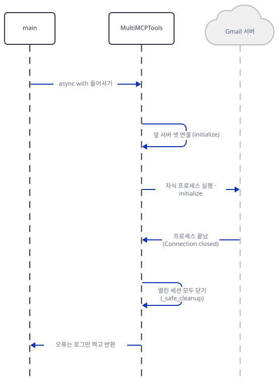

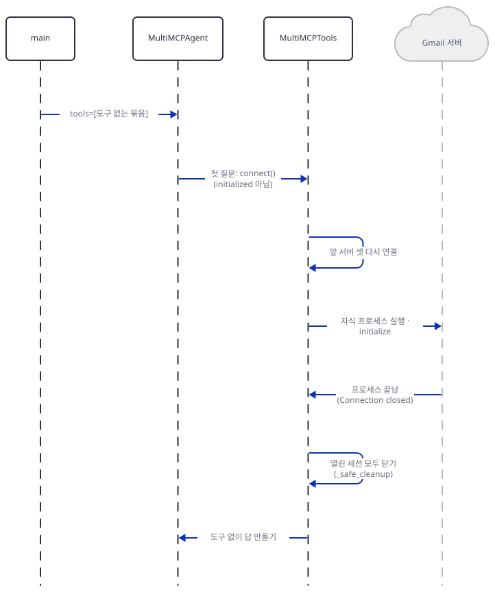

**두 날의 판 차이.** Day 131은 `agno>=2.2.10,<2.3`(2.2.13)을 썼습니다. 그 앱이 쓰는 `GoogleSearchTools`의 모듈 `agno.tools.googlesearch`가 2.3.0부터 없기 때문입니다. 오늘 앱은 그 도구를 쓰지 않으므로 `agno<3`(2.9.0)이 맞고, 두 처방은 모순이 아닙니다. 같은 실패에 대한 동작은 판마다 다릅니다(두 판의 `multi_mcp.py`를 소스로 비교했고, 2.2.13을 실행해 본 것은 Day 131입니다). 2.2.13의 `__aenter__`는 예외를 `log_error`만 하고 정리하지 않아(2.2.13 `multi_mcp.py`의 `__aenter__`) 앞 서버의 연결이 남습니다. 2.9.0의 `__aenter__`는 `_safe_cleanup()`을 부릅니다(2.9.0 `multi_mcp.py`의 `__aenter__`). 그래서 오늘은 연결이 모두 사라지고 첫 질문에서 다시 시도합니다.

**서버 하나가 죽어도 나머지를 쓰기.** 2.9.0에도 `allow_partial_failure` 인자가 있습니다(Day 131 Step 8의 방법). 복사본 67행을 `async with MultiMCPTools(mcp_servers, env=env, allow_partial_failure=True) as mcp_tools:`로 바꾸고 60행의 `exit`를 그대로 두고 같은 명령을 돌리면, Gmail이 죽어도 모델에 도구 셋이 갔고 서버는 한 번만 시도됐습니다(직접 확인).

```text
ERROR    Failed to get MCP tools: Connection closed
ERROR    Failed to initialize MCP server with params command='python' ...
✅ Successfully connected to all MCP servers!
[('github', 'start'), ('perplexity', 'start'), ('calendar', 'start'), ('gmail', 'start'), ('gmail', 'exit'), ('github', 'call')]
True ['list_events', 'perplexity_ask', 'search_repositories']
```

(`ERROR` 줄은 줄여 썼습니다.) 그래도 `✅`는 찍힙니다. agno 3에는 이 인자가 없습니다(릴리스 노트).

**진짜 서버 넷은 이 문서가 실행하지 않았습니다.** 공개 문서(2026-10-14에 읽음)로만 확인한 것은 이렇습니다.

- 캘린더(`@gongrzhe/server-calendar-autoauth-mcp`)와 Gmail(`@gongrzhe/server-gmail-autoauth-mcp`) 저장소는 둘 다 2026-03-03에 소유자가 보관 처리해 읽기 전용입니다. 캘린더는 도구 `create_event`·`get_event`·`update_event`·`delete_event`·`list_events`와 범위 `https://www.googleapis.com/auth/calendar`(읽기·쓰기 전체)를, Gmail은 `send_email`·`delete_email`·`batch_delete_emails` 등 열아홉 개 도구와 범위 `gmail.modify`·`gmail.settings.basic`을 씁니다.
- 둘 다 먼저 `gcp-oauth.keys.json`(Google에서 받은 OAuth 클라이언트 키)을 현재 폴더나 `~/.calendar-mcp/`·`~/.gmail-mcp/`에 두고 `npx … auth`로 인증해야 합니다. 인증은 기본 브라우저를 열고 로컬 3000번 포트가 받으며 토큰을 `credentials.json`에 저장합니다. 소스(`src/index.ts`)를 읽으면 `auth` 없이 서버로 띄울 때(이 앱이 하는 방식) 키 파일이 없으면 `process.exit(1)`로 끝나고, 키 파일만 있고 토큰이 없으면 서버는 뜨지만 호출이 실패합니다. 앱 README의 설치 절차에는 이 인증이 없습니다. 그래서 "키 파일 없이 처음 돌린다"는 위 가짜 `exit`의 실제 모양입니다.
- 앱은 이 도구들에 확인 단계를 두지 않습니다. 메일 발송·삭제와 일정 삭제가 모델의 한 번의 도구 호출로 일어날 수 있습니다. 이 문서는 그것을 시험하지 않았습니다.
- GitHub 서버 `@modelcontextprotocol/server-github`는 보관된 저장소의 README가 개발이 `github/github-mcp-server`로 옮겨 갔다고 적습니다. Perplexity 패키지 `@chatmcp/server-perplexity-ask`는 npm 레지스트리 JSON(`registry.npmjs.org/@chatmcp/server-perplexity-ask`)이 열립니다. 최신 판은 0.1.0이고 `deprecated` 표시도 `repository` 항목도 없으며 readme는 "ERROR: No README data found!"입니다. 패키지는 있지만 README도 저장소도 없어 도구와 키 이름을 알 수 없습니다. 공식 저장소의 서버는 `@perplexity-ai/mcp-server`이며 도구 넷(`perplexity_search`·`perplexity_ask`·`perplexity_research`·`perplexity_reason`)을 낸다고 적습니다.

진짜로 붙이려면 이 문서는 `mcp_servers`에서 캘린더와 Gmail 두 줄을 먼저 지우고 GitHub·Perplexity만으로 시작하기를 권합니다. 지우지 않을 거라면 위 `allow_partial_failure=True`를 더해, 한 서버가 죽어도 나머지 도구를 살리세요. 두 서버의 인증은 읽기만 한 것이라 어떻게 풀리는지 이 문서는 모릅니다.

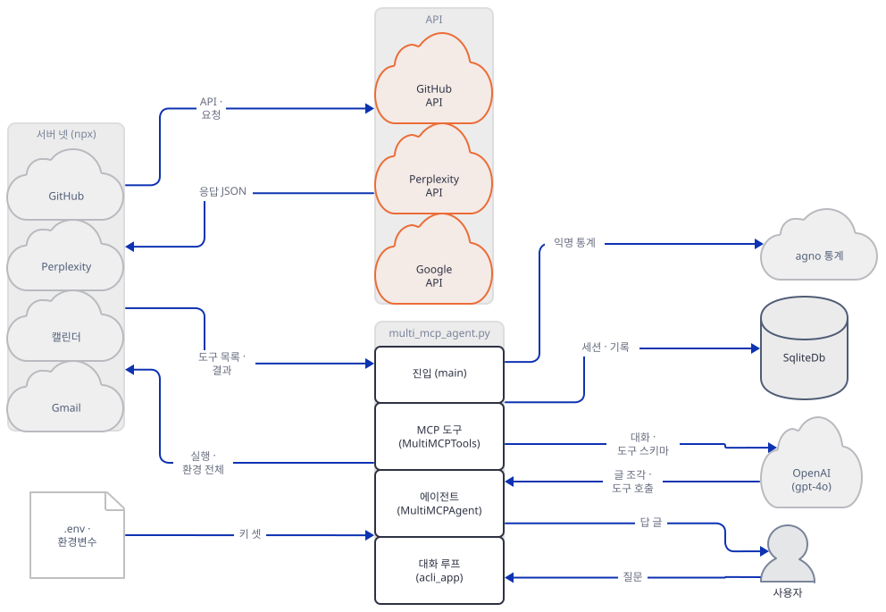

### Step 8. agno 3으로 옮기기

**목적.** `MultiMCPTools` 없이 오늘 풀리는 agno 3.1.3에서 같은 앱을 돌리는 판을 만들고, 달라지는 점을 같은 가짜 서버로 비교합니다.

**할 일.** `multi-lab`(Step 7을 끝낸 폴더)에서 시작합니다. 새 폴더에는 앱, `requirements.txt`, 가짜 MCP 서버만 복사합니다. 가짜 OpenAI 서버는 Step 5에서 `multi-lab`에 띄운 것을 그대로 쓰고, 그 서버가 적는 `openai.jsonl`도 `multi-lab`에 쌓입니다. `fastmcp`와 `greenlet`은 `agno[mcp,sqlite]` 항목에서 옵니다(Day 127 Step 1이 같은 이유를 적었습니다).

```bash
mkdir -p ../multi-lab3
cp <저장소 경로>/mcp_ai_agents/multi_mcp_agent/multi_mcp_agent.py <저장소 경로>/mcp_ai_agents/multi_mcp_agent/requirements.txt fake_mcp.py ../multi-lab3/
cd ../multi-lab3
uv venv --python 3.13
uv pip install -r requirements.txt "agno[mcp,sqlite]"
```

```powershell
New-Item -ItemType Directory -Force ..\multi-lab3
Copy-Item <저장소 경로>\mcp_ai_agents\multi_mcp_agent\multi_mcp_agent.py, <저장소 경로>\mcp_ai_agents\multi_mcp_agent\requirements.txt, fake_mcp.py ..\multi-lab3\
Set-Location ..\multi-lab3
uv venv --python 3.13
uv pip install -r requirements.txt "agno[mcp,sqlite]"
```

(`<저장소 경로>`는 저장소를 받은 위치로 바꿉니다. PowerShell 줄은 실행해 보지 못했습니다.) 설치는 89개이고 agno 3.1.3, mcp 2.3.0, `fastmcp` 4.1.0이 들어옵니다(직접 확인). 복사한 앱은 아직 원본이라 서버 명령이 `npx`입니다. 아래 편집을 끝내고 `diff`와 `grep`을 확인하기 전에는 앱을 실행하지 마세요. 편집은 Step 3의 서버 명령 네 줄과 아래 다섯 군데입니다.

| 원본 | 옮긴 판 |
|---|---|
| (2행 뒤에 한 줄 추가) | `from contextlib import AsyncExitStack` |
| `from agno.tools.mcp import MultiMCPTools` | `from agno.tools.mcp import MCPTools` |
| `async with MultiMCPTools(mcp_servers, env=env) as mcp_tools:` | `async with AsyncExitStack() as stack:`와 그 아래 줄 `mcp_tools = [await stack.enter_async_context(MCPTools(command=c, env=env)) for c in mcp_servers]` |
| `tools=[mcp_tools],` | `tools=mcp_tools,` |
| `enable_user_memories=True,` | `update_memory_on_run=True,` |

서버마다 `MCPTools` 하나를 만들어 `AsyncExitStack`으로 함께 열고 닫으며, 에이전트의 `tools`에는 그 목록을 줍니다. `enable_user_memories`의 새 이름은 Day 108이 버전별로 확인했고 Day 127이 3.1.3에서 같은 오류를 봤습니다.

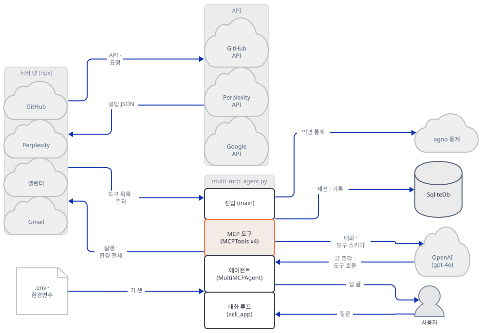

**확인.** 먼저 편집이 맞는지 봅니다. 줄 번호가 import 한 줄만큼 밀립니다.

```bash
diff <저장소 경로>/mcp_ai_agents/multi_mcp_agent/multi_mcp_agent.py multi_mcp_agent.py
grep -n "npx" multi_mcp_agent.py
```

```text
2a3
> from contextlib import AsyncExitStack
7c8
< from agno.tools.mcp import MultiMCPTools
---
> from agno.tools.mcp import MCPTools
57,60c58,61
<         "npx -y @modelcontextprotocol/server-github",
<         "npx -y @chatmcp/server-perplexity-ask",
<         "npx @gongrzhe/server-calendar-autoauth-mcp",
<         "npx @gongrzhe/server-gmail-autoauth-mcp"
---
>         "python fake_mcp.py github mcp.jsonl",
>         "python fake_mcp.py perplexity mcp.jsonl",
>         "python fake_mcp.py calendar mcp.jsonl",
>         "python fake_mcp.py gmail mcp.jsonl"
67c68,69
<     async with MultiMCPTools(mcp_servers, env=env) as mcp_tools:
---
>     async with AsyncExitStack() as stack:
>         mcp_tools = [await stack.enter_async_context(MCPTools(command=c, env=env)) for c in mcp_servers]
74c76
<             tools=[mcp_tools],
---
>             tools=mcp_tools,
130c132
<             enable_user_memories=True,
---
>             update_memory_on_run=True,
```

`grep`은 아무것도 찍지 않고 종료 코드 1로 끝나야 합니다(직접 확인). 그다음 Step 4의 터미널(환경변수가 걸린 곳)에서 `multi-lab3`로 옮겨 가 Step 5와 같은 입력으로 돌립니다. 가짜 OpenAI 서버는 `multi-lab`에서 돌고 있으니 그 폴더의 기록을 읽습니다.

```bash
rm -f ../multi-lab/openai.jsonl mcp.jsonl
rm -rf tmp
printf 'Show my recent GitHub repos\nSchedule a meeting\nbye\n' | uv run --no-project python multi_mcp_agent.py
uv run --no-project python -c "import json; [print(d['stream'], d['tools'], d['roles']) for d in map(json.loads, open('../multi-lab/openai.jsonl', encoding='utf-8'))]"
uv run --no-project python -c "import json; [print(d['server'], d['event'], d.get('tool')) for d in map(json.loads, open('mcp.jsonl', encoding='utf-8')) if d['event'] == 'call']"
```

기대 출력은 Step 5와 같은 여섯 줄(채팅·메모리·채팅, 도구 넷)과 이 두 줄이고, 앱 출력에는 `DeprecationWarning`이 없습니다(직접 확인).

```text
github call search_repositories
calendar call list_events
```

이제 61행(Gmail)을 `"python fake_mcp.py gmail mcp.jsonl exit"`로 바꾸고 다시 돌립니다. 앱이 서버 연결에서 죽어야 합니다.

```bash
rm -f mcp.jsonl
printf 'Show my recent GitHub repos\nbye\n' | uv run --no-project python multi_mcp_agent.py > out.txt 2>&1; echo "종료 코드 $?"
tail -1 out.txt
grep -c "Successfully" out.txt
```

```text
종료 코드 1
mcp.shared.exceptions.MCPError: Connection closed
0
```

`✅`가 한 번도 찍히지 않았고(`grep -c`가 0) 모델 요청도 가지 않았습니다(직접 확인). 지금까지의 실험을 두 판으로 나란히 놓으면 이렇습니다(모두 직접 확인).

| 실험 | agno 2.9.0 (원본) | agno 3.1.3 (옮긴 판) |
|---|---|---|
| 한 턴의 모델 호출 | 셋 (채팅, 메모리, 채팅) | 같음 |
| 도구가 가는 서버 | 넷의 도구가 모두 | 같음. 두 질문에서 `github`와 `calendar` 서버가 불림 |
| 서버가 받는 환경 | 111개 (`os.environ` 전체) | 같음 |
| 시작할 때 | `DeprecationWarning` | 경고 없음 |
| 서버 하나가 죽을 때 | 로그 후 계속, `✅` 출력, 도구 `[]` | 앱이 `MCPError: Connection closed`로 끝나고 `✅`는 찍히지 않음(종료 코드 1) |
| 서버가 15초 늦을 때 | 같은 방식으로 삼킴 | `MCPError: Request 'initialize' timed out`으로 끝남 |
| 서버를 띄우는 순서 | 차례로 | 차례로 (3초씩 늦춘 넷이 11초에서 23초가 됨) |

서버가 죽으면 앱도 죽는 쪽이 낫다고 봅니다. 조용히 도구를 잃는 것보다 시작할 때 알려 주기 때문입니다. 하나 더, 서버마다 환경을 따로 줄 수 있습니다. `per_server_env = [{"GITHUB_PERSONAL_ACCESS_TOKEN": GITHUB_TOKEN}, {"PERPLEXITY_API_KEY": PERPLEXITY_API_KEY}, {}, {}]`를 만들고 `MCPTools(command=c, env=e) for c, e in zip(mcp_servers, per_server_env)`로 바꾸면, 서버가 받은 환경이 github 13, perplexity 13, calendar 12, gmail 12개였고 `OPENAI_API_KEY`는 어디에도 없었으며 GitHub 토큰은 github 서버에만, Perplexity 키는 perplexity 서버에만 갔습니다(직접 확인). 3.x의 `MCPTools`에는 같은 이름의 도구가 부딪히지 않게 하는 `tool_name_prefix` 인자가 있습니다(시그니처로 확인했고 써 보지는 못했습니다).

## 요청 한 건이 흐르는 과정

시퀀스는 열 그림으로 나눴습니다. 서버 연결이 앞 다섯입니다. 코드 순서는 `SqliteDb`를 만들고(64행), `async with`에서 서버 넷에 차례로 `initialize`를 한 뒤, 반복이 끝나고서야 서버 넷에 한꺼번에 `tools/list`를 부르는 것입니다(`_connect`의 반복과 `build_tools`, agno 2.9.0 소스). 한 그림에 다 넣으면 가운데 서버의 수명선이 메시지 라벨을 지나서, 서버가 이웃한 둘씩 나눴습니다. 첫째 그림은 시작, `SqliteDb`, `async with`와 GitHub 서버의 `initialize`입니다.

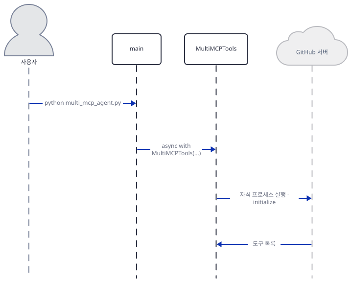

둘째는 Perplexity와 캘린더 서버의 `initialize`입니다.

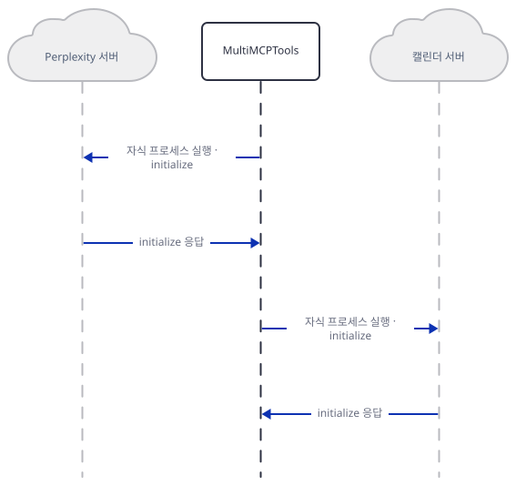

셋째는 Gmail 서버의 `initialize`와, 반복이 끝난 뒤 `tools/list`가 GitHub 서버로 가는 첫 번째입니다.

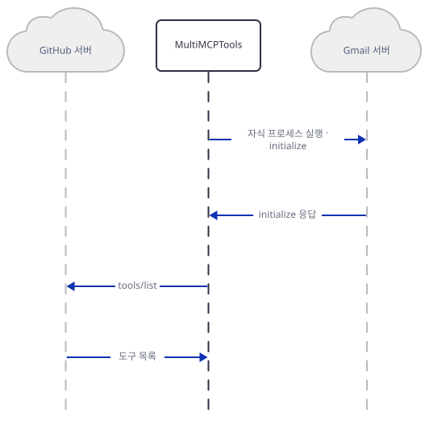

넷째는 Perplexity와 캘린더 서버의 `tools/list`입니다.

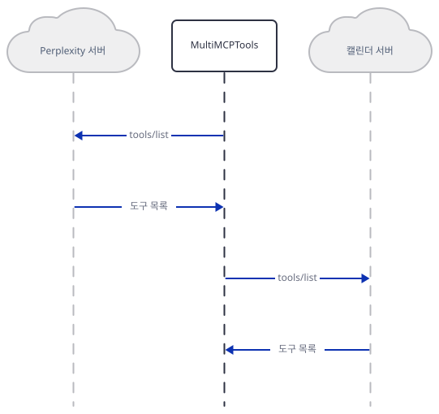

다섯째는 Gmail 서버의 `tools/list`와 연결이 끝나는 부분입니다.

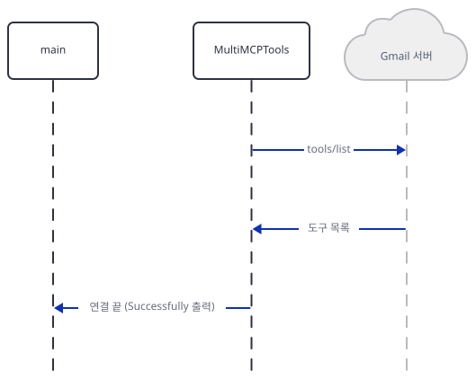

여섯째는 에이전트를 만들고 대화 루프에 들어서는 부분입니다.

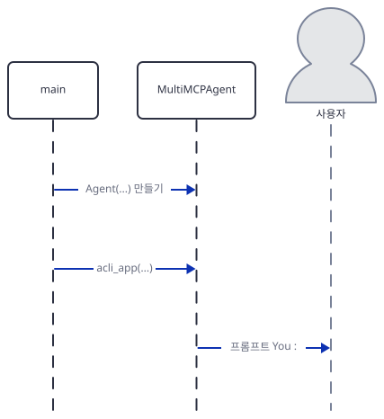

일곱째는 질문 한 줄입니다. 대화와 도구 스키마 넷이 스트림으로 가고, 같은 시점에 메모리 호출이 나란히 나가고(Step 5의 로그 순서), 모델이 도구 호출을 돌려줍니다.

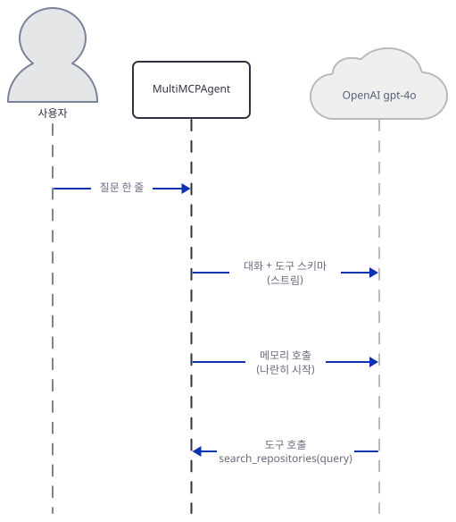

여덟째는 도구 호출입니다. 에이전트가 `MultiMCPTools`에 넘기면 그 도구를 가진 서버(여기서는 GitHub 서버)로 `tools/call`이 가고, 서버가 API에 요청을 보내 결과를 돌려줍니다. 이 문서의 실습에서는 서버가 가짜라 API 구간은 일어나지 않았고 서버 소개 그대로 그렸습니다.

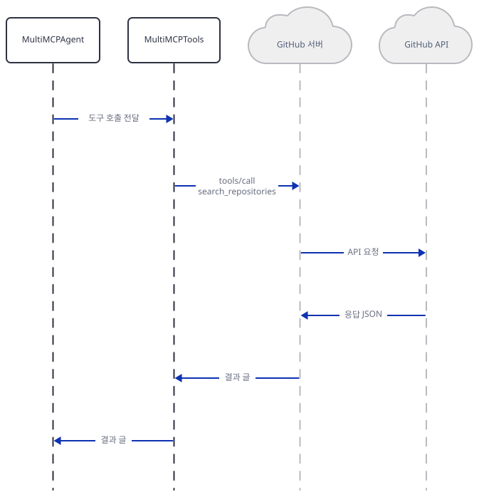

아홉째는 답입니다. 도구 결과를 실은 두 번째 채팅 호출이 가고 답 글 조각이 스트림으로 와서 터미널에 찍힙니다. 메모리 호출의 답을 뒤에 그린 것은 Day 127이 agno 3.1.3 소스에서 읽은 순서를 따른 것이고, 이 문서는 2.9.0에서 요청이 나간 순서만 재었지 답이 도착한 시각은 재지 않았습니다.

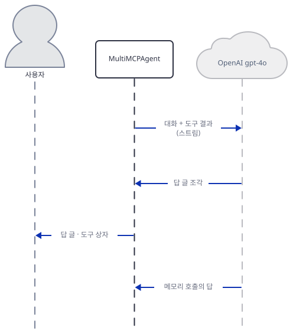

열째는 저장과 통계입니다.

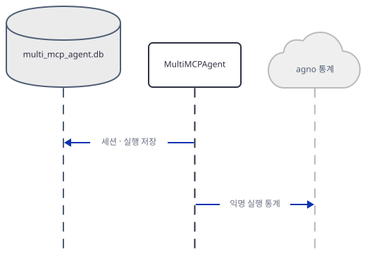

## 실행 체크리스트

- [ ] `requirements.txt`만 설치하고 `MultiMCPTools` import 오류를 봤다
- [ ] `agno<3`·`mcp<2`·`sqlalchemy[asyncio]`를 설치하고 `import ok`를 봤다
- [ ] 서버 명령을 가짜로 바꾼 복사본에서 Perplexity 키를 비우면 서버 전에 `Missing required environment variables`로 끝나는 것을 봤다(원본은 돌리지 않았다)
- [ ] 복사본의 네 줄만 바꿨고, `diff`가 정확히 네 줄이고 `grep -n "npx"`가 비어 있다
- [ ] `mcp.jsonl`에서 서버 넷이 모두 `OPENAI_API_KEY`와 무관한 변수까지 받은 것을 봤다
- [ ] `openai.jsonl`에서 한 턴이 모델 호출 셋이고 도구 넷이 모두 간 것을 봤다
- [ ] 두 번 실행한 `tmp/multi_mcp_agent.db`에 세션이 둘 있는 것을 봤다
- [ ] Gmail 줄을 `exit`로 바꿨을 때 `✅`가 찍히고 도구가 `[]`인 것을 봤다
- [ ] agno 3 판 복사본의 `diff`가 다섯 덩어리이고 `grep -n "npx"`가 비어 있다
- [ ] agno 3 판에서 Step 5와 같은 여섯 줄이 나오고, Gmail 줄을 `exit`로 바꾸면 `MCPError`로 끝나는 것을 봤다
- [ ] 가짜 서버(`fake_openai.py`)를 `Ctrl+C`로 끄고 포트가 비었는지 확인했다

## 문제 해결

| 증상 | 원인 | 해결 |
|---|---|---|
| `ImportError: cannot import name 'MultiMCPTools' from 'agno.tools.mcp'`가 7행에서 | `requirements.txt`가 agno 3.1.3을 깔고 3.0.0이 그 클래스를 지웠다 | `uv pip install "agno<3" "mcp<2" "sqlalchemy[asyncio]"` 또는 Step 8의 판 |
| ``ImportError: `mcp` not installed``인데 `mcp`는 설치되어 있다 | agno 2.9.0이 가져오는 `McpError`가 `mcp` 2.x에서 `MCPError`로 바뀌었다. 메시지가 원인을 가린다 | `uv pip install "mcp<2"` |
| `ImportError: The SQLAlchemy asyncio module requires that the Python 'greenlet' library`가 8행에서 | `sqlalchemy`가 `greenlet`을 끌어오지 않는다 | `uv pip install "sqlalchemy[asyncio]"` |
| `TypeError: Agent.__init__() got an unexpected keyword argument 'enable_user_memories'` (agno 3) | 3.0.0부터 이름이 `update_memory_on_run`이다(Day 108) | 130행을 `update_memory_on_run=True`로 |
| `ModuleNotFoundError: No module named 'mcp.server.fastmcp'`가 가짜 서버에서 | `mcp` 2.x에서 `FastMCP`가 `MCPServer`(`mcp.server.mcpserver`)로 바뀌었다 | 이 문서의 `fake_mcp.py`처럼 둘 다 받게 쓴다 |
| `✅ Successfully connected to all MCP servers!`가 찍혔는데 도구 상자가 한 번도 안 나온다 | 서버 하나가 죽거나 10초를 넘겼고 agno 2.9.0이 예외를 삼켰다. 도구가 `[]`로 간다 | 로그의 `ERROR Failed to connect` 줄을 본다. 서버를 고치거나 `timeout_seconds`를 늘린다. 한 서버가 죽어도 나머지를 쓰려면 `allow_partial_failure=True`(Step 7) |
| 질문할 때마다 서버 프로세스가 다시 뜬다 | 2.9.0은 실패하면 `initialized`를 꺼서 에이전트가 `connect_mcp_tools`로 다시 연결을 시도한다 | 위와 같은 원인부터 고친다 |
| 2027-01-14 이후 `gpt-4o` 호출이 실패한다 | 기본 스냅숏 `gpt-4o-2024-08-06`이 그날 종료 예정이다(폐기 문서). 별칭의 동작은 문서에 없다 | 73행의 `OpenAIChat(id="gpt-4o", ...)`를 새 모델 id로 바꿔 시험한다(이 문서는 시험하지 못했다) |
| 앱을 다시 켰더니 앞 대화를 기억하지 못한다 | 켤 때마다 사용자·세션 ID가 새로 만들어진다(42~43행) | ID를 파일이나 인자로 고정하도록 코드를 고친다 |
| 모델이 Notion을 안다는 듯 말한다 | 지시문에 `Notion`이 있지만 Notion 서버는 설정에 없다(82·114·122행) | 지시문에서 Notion을 지우고 Gmail을 더한다 |

## 더 해보기

- 지시문을 고쳐 봅니다. `multi_mcp_agent.py:82`·`114`·`122`의 `Notion`을 지우고 Gmail을 더한 복사본으로 Step 5를 다시 돌려, `debug_mode`가 찍는 시스템 메시지가 바뀌는지 확인하세요.
- 서버를 하나씩 빼 봅니다. 네 줄 가운데 Gmail 줄을 지우고 Step 4를 다시 돌려 서버가 셋만 뜨고 요청의 `tools`가 셋이 되는지, 그리고 `exit` 실험을 어느 서버에 걸어도 도구가 전부 사라지는지 확인하세요.
- Step 8의 서버별 환경을 완성합니다. `per_server_env`를 `mcp.jsonl`로 확인하고, 앱이 `GITHUB_PERSONAL_ACCESS_TOKEN`만 넘기는 서버에 일부러 `PERPLEXITY_API_KEY`를 하나 더 넣어 `has`가 어떻게 바뀌는지 보세요.

## 다음 날 예고

[Day 134 · ♜ AI Chess Agent](../day134-ai-chess-agent/README.md) — 볼륨 10 "🎮 Autonomous Game-Playing"이 시작됩니다. 원본 앱 `ai_chess_agent.py`(249줄, 마지막 줄에 개행이 없어 `wc -l`은 248)는 Streamlit 앱이고, `requirements.txt`에 `chess==1.11.1`과 `autogen==0.6.1`이 있으며 `from autogen import ConversableAgent, register_function`으로 에이전트를 만듭니다. 모델은 `gpt-4o-mini`(102·109행)이고 OpenAI 키를 사이드바에서 입력받습니다(소스로 확인). MCP 서버를 붙이던 이번 볼륨과 달리 체스 판을 그리는 파이썬 라이브러리 `chess`와 도구 등록이 중심입니다.
