# Day 134 · ♜ AI Chess Agent

> 볼륨 10 🎮 Autonomous Game-Playing · 난이도 ★★☆ ⚠(앱이 쓰는 `gpt-4o-mini`의 기본 스냅숏 `gpt-4o-mini-2024-07-18`은 OpenAI 폐기 문서에서 2027-01-14에 종료될 예정입니다 — 사전 준비. 또 `max_turns`를 101 이상으로 두거나 게임이 중간에 막히면, 이 앱은 Streamlit을 띄운 터미널에서 사람의 입력을 기다리며 멈추고 화면에는 API 키 탓이라는 오류가 뜹니다 — Step 8) · 예상 소요 130분(앱은 248줄 단일 파일이지만 AutoGen 에이전트 둘과 진행자가 주고받는 메시지를 가짜 서버 기록으로 하나하나 세어 보고, 가짜 서버 하나(모드 셋)와 확인 스크립트 넷을 직접 저장해 돌리고, 같은 앱을 `max_turns`와 서버 모드를 바꿔 가며 열 번 넘게 돌려 보는 손 시간이 읽는 시간보다 큽니다) · API 비용 대략 기본값(5턴, 9수)에 약 $0.002, 100턴(199수)에 약 $0.04(⚠ 추정입니다. 이 문서는 OpenAI를 한 번도 부르지 않았습니다. `gpt-4o-mini`는 OpenAI 모델 페이지의 입력 $0.15·출력 $0.60(1M 토큰당, https://developers.openai.com/api/docs/models/gpt-4o-mini, 2026-10-15 확인)이고, 한 수당 모델 호출 3번에 입력 약 770토큰·출력 약 100토큰을 가정했습니다. 입력은 가짜 서버가 받은 요청 본문의 글자 수를 4로 나눈 어림이고 출력 길이는 지어낸 값이라, 진짜 모델이 길게 말하면 몇 배가 될 수 있습니다) · 원본 앱: `advanced_ai_agents/autonomous_game_playing_agent_apps/ai_chess_agent`

## 오늘 만들 것

사이드바에 OpenAI 키와 `max_turns`를 넣고 "Start Game"을 누르면, `gpt-4o-mini`로 움직이는 AutoGen 에이전트 둘(백 `Agent_White`, 흑 `Agent_Black`)이 서로 체스를 두는 Streamlit 앱입니다. 한 수마다 에이전트는 먼저 `available_moves()`로 합법 수를 받고 `execute_move(move)`로 수를 두며, 끝나면 수마다 판 그림(SVG)이 화면 아래에 쌓입니다. 앱은 `ai_chess_agent.py` 하나(편집기 기준 249줄, 마지막 줄에 개행이 없어 `wc -l`은 248)이고 `requirements.txt`는 `streamlit`·`chess==1.11.1`·`autogen==0.6.1`·`cairosvg`·`pillow`입니다.

오늘이 볼륨 10의 첫날입니다. 앞 볼륨 9는 MCP 서버를 `npx`·`docker`·URL로 붙인 앱들이었는데, 오늘은 서버가 없고 도구는 같은 파일 안의 파이썬 함수 둘뿐입니다. 판을 계산하는 것도 모델이 아니라 파이썬 라이브러리 `chess`입니다. AutoGen 계열은 이미 세 번 나왔습니다. Day 085와 Day 116은 AG2의 Swarm(`SwarmAgent`·`initiate_swarm_chat`)을 `pyautogen==0.6.1`과 `autogen`으로 다뤘고, Day 119는 `AssistantAgent`와 `generate_reply`만 썼습니다. 그 세 날의 README에서 `register_function`과 `register_nested_chats`를 grep으로 찾았지만 없었습니다. 오늘 새로 보는 것이 바로 이 둘입니다 — 도구를 에이전트와 실행자 사이에 이어 주는 `register_function`, 그리고 "상대가 말을 걸면 별도의 작은 대화를 열어 답을 만든다"는 `register_nested_chats`입니다. Day 133의 "다음 날 예고"가 말한 파일 길이·`gpt-4o-mini`(102·109행)·`autogen import`는 소스와 같았습니다.

이 문서는 OpenAI에 요청을 보내지 않습니다. 모델은 내 PC의 가짜 서버로 대신했고, 그래서 아래의 "수"는 모두 가짜 서버가 합법 수 목록에서 아무거나 고른 것입니다. 진짜 `gpt-4o-mini`가 얼마나 잘 두는지, 몇 수 만에 끝나는지는 확인하지 못했습니다. 직접 확인한 것은 구조입니다. 호출이 몇 번 나가는지, 에이전트가 무엇을 보는지, `max_turns`가 무엇을 세는지, 어떤 경우에 멈추는지입니다. 이 가운데 세 가지가 앱 화면과 다릅니다. 에이전트는 판도 지난 수도 보지 못합니다(Step 6). `max_turns` N은 수 N개가 아니라 2N−1개입니다(Step 7). 그리고 사이드바가 권하는 200턴은 터미널 입력 없이는 갈 수 없습니다(Step 8). 아래는 완성된 아키텍처입니다.

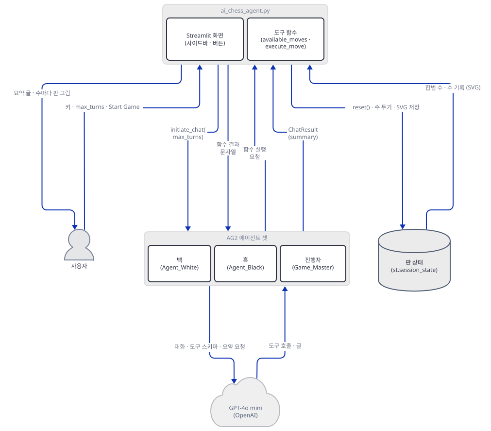

## 사전 준비

| 서비스/도구 | 용도 | 발급·설치 |
|---|---|---|
| OpenAI API 키 | 에이전트 둘의 `gpt-4o-mini` 호출 인증. 사이드바 입력창(`type="password"`)에 직접 붙여넣고 환경변수는 읽지 않습니다. 이 문서의 재현은 가짜 키로 합니다 | https://platform.openai.com/ 가입 후 발급 |
| uv | 가상환경 생성과 패키지 설치 | [공통 사전 준비](../README.md#공통-사전-준비-한-번만) 절 참고 |
| 새 작업 폴더 `chess-lab` | 앱 파일을 복사해 와서 이 폴더 안에서만 돌립니다. 이 앱은 `cache_seed`를 `None`으로 두어 AutoGen의 디스크 캐시(`.cache/`)를 만들지 않습니다(Step 4) | Step 1에서 만듭니다 |
| 터미널의 표준 입력 | 대화 로그가 Streamlit을 띄운 터미널에 찍히고, 100번째 자동 응답 뒤에는 그 터미널이 입력을 기다립니다 | Step 8 |
| `cairosvg`의 Cairo 라이브러리 | 앱이 쓰지 않습니다. `requirements.txt`에 있어서 설치는 되지만 이 Windows PC에서는 import가 실패합니다 | 필요 없음 — Step 1 |
| `PYTHONIOENCODING=utf-8` | 한국어 Windows 콘솔(cp949)에서 말 기호(♙)가 든 출력이 깨지지 않게 합니다 | bash: `export PYTHONIOENCODING=utf-8`, PowerShell: `$env:PYTHONIOENCODING = "utf-8"`(실행해 보지 못했습니다) |

앱이 닿는 외부 서비스는 OpenAI 하나입니다. 이 앱은 agno를 쓰지 않으므로 앞 날들의 agno 통계 전송이 없습니다(`import` 줄이 `chess`·`streamlit`·`autogen`뿐 — 소스로 확인). 설치된 `autogen` 소스에서 `posthog`·`telemetry`를 언급하는 `.py`는 이 앱이 쓰지 않는 `teachability.py` 하나였습니다(grep으로 확인).

⚠ 모델. OpenAI 폐기 문서(https://developers.openai.com/api/docs/deprecations, 2026-10-15 확인)에는 별칭 `gpt-4o-mini` 자체가 아니라 날짜 붙은 `gpt-4o-mini-2024-07-18`이 "January 14, 2027" 종료로 올라 있고 권하는 대체는 `gpt-6-luna`입니다. 모델 페이지는 별칭 `gpt-4o-mini`가 `gpt-4o-mini-2024-07-18`을 가리킨다고 적습니다. 종료일 뒤에 별칭이 어떻게 움직이는지는 폐기 문서가 말하지 않습니다. 교체할 때는 `ai_chess_agent.py`를 고치지 말고 복사본의 102행과 109행 `"model"` 값 두 곳을 바꿉니다(사이드 안내문 194·195행의 "GPT-4o-mini"는 화면 글일 뿐입니다).

## 아키텍처 한눈에 보기

| 컴포넌트 | 역할 | 코드 위치 |
|---|---|---|
| 세션 상태 | 키·판(`chess.Board`)·`made_move`·수 기록·`max_turns`를 보관 | `advanced_ai_agents/autonomous_game_playing_agent_apps/ai_chess_agent/ai_chess_agent.py:6-17` |
| 사이드바 | 키 입력, 200턴 안내문, `max_turns` 입력 | `advanced_ai_agents/autonomous_game_playing_agent_apps/ai_chess_agent/ai_chess_agent.py:19-41` |
| 도구 함수와 종료 판정 | 합법 수 조회, 수 두기, 한 수를 뒀는지 알리는 깃발 | `advanced_ai_agents/autonomous_game_playing_agent_apps/ai_chess_agent/ai_chess_agent.py:45-96` |
| 모델 설정과 에이전트 셋 | 백·흑(`gpt-4o-mini`)과 진행자(모델 없음) | `advanced_ai_agents/autonomous_game_playing_agent_apps/ai_chess_agent/ai_chess_agent.py:98-136` |
| 도구 등록 | 두 함수를 백·흑에게 도구로 보이고 진행자가 실행하게 이음 | `advanced_ai_agents/autonomous_game_playing_agent_apps/ai_chess_agent/ai_chess_agent.py:138-168` |
| 중첩 대화 등록 | 상대가 말을 걸면 진행자와 작은 대화를 열어 답을 만듦 | `advanced_ai_agents/autonomous_game_playing_agent_apps/ai_chess_agent/ai_chess_agent.py:170-190` |
| 게임 시작과 표시 | 초기 판 그림, `initiate_chat(max_turns=…)`, 수 기록 그림 | `advanced_ai_agents/autonomous_game_playing_agent_apps/ai_chess_agent/ai_chess_agent.py:192-236` |
| 리셋과 오류 상자 | 판 되돌리기, 모든 예외를 한 문구로 | `advanced_ai_agents/autonomous_game_playing_agent_apps/ai_chess_agent/ai_chess_agent.py:238-249` |
| OpenAI API | 백·흑의 추론과 대화 요약(`gpt-4o-mini`) | `advanced_ai_agents/autonomous_game_playing_agent_apps/ai_chess_agent/ai_chess_agent.py:102`, `advanced_ai_agents/autonomous_game_playing_agent_apps/ai_chess_agent/ai_chess_agent.py:109` |

## 단계별 진행

명령은 bash 기준이고 앱을 띄우는 터미널마다 환경변수를 다시 줍니다. PowerShell은 줄바꿈이 든 `-c "..."`가 따옴표 문제를 일으키니 같은 내용을 `.py`로 저장해 실행하고, `&&`는 줄을 나누고, `< 파일` 입력 연결은 `Get-Content 파일 | 명령`으로 바꾸세요(PowerShell 형태는 모두 실행해 보지 못했습니다). 저장소 루트에는 `pyproject.toml`이 있어서 모든 `uv run`에 `--no-project`를 붙입니다.

### Step 1. 환경 만들기 — `autogen==0.6.1`은 무엇으로 풀리는가

**목적.** `requirements.txt`를 그대로 설치하면 무엇이 깔리는지, 앱의 첫 줄 import가 되는지, 쓰지 않는 `cairosvg`가 문제인지 확인합니다.

**할 일.** 저장소를 내려받은 폴더를 `<리포>`라고 하면, 앱을 복사해 올 새 폴더를 만듭니다.

```bash
mkdir chess-lab
cd chess-lab
cp <리포>/advanced_ai_agents/autonomous_game_playing_agent_apps/ai_chess_agent/ai_chess_agent.py .
cp <리포>/advanced_ai_agents/autonomous_game_playing_agent_apps/ai_chess_agent/requirements.txt .
uv venv
uv pip install -r requirements.txt
```

(pip 대안: `python -m venv .venv && source .venv/bin/activate && pip install -r requirements.txt`. PowerShell 5.1은 `python -m venv .venv`, `.venv\Scripts\Activate.ps1`, `pip install -r requirements.txt` 세 줄로 나눕니다. 실행해 보지 못했습니다.)

`advanced_ai_agents/autonomous_game_playing_agent_apps/ai_chess_agent/requirements.txt:1-5`

```text
streamlit
chess==1.11.1
autogen==0.6.1
cairosvg
pillow
```

`autogen`만 `==0.6.1`로 고정되어 있습니다. 이 문서를 쓰며 설치했을 때(2026-10-15) `autogen 0.6.1`과 함께 **`pyautogen 0.6.1`**, `chess 1.11.1`, `streamlit 1.66.0`, `openai 3.31.0`, `pillow 12.3.0`, `cairosvg 2.9.1`(과 `cairocffi`), `docker 7.2.0`이 받아졌습니다(직접 확인). `autogen 0.6.1`의 메타데이터는 `pyautogen==0.6.1` 하나를 요구하는 얇은 포장입니다(`importlib.metadata`로 확인). Day 116은 버전 없는 `autogen`이 0.14.1로 풀려 앱이 첫 줄에서 `ImportError`로 멈췄고, Day 085는 `pyautogen`을 0.6.1로 직접 고정해야 했습니다. 오늘은 앱이 처음부터 `autogen==0.6.1`로 고정해 두어서 Day 085가 고른 것과 같은 `pyautogen 0.6.1`이 `autogen`이라는 이름으로 풀립니다. `pyautogen 0.6.1`은 `openai>=1.58`을 요구하고 오늘 3.31.0이 깔렸는데 앱이 쓰는 호출은 이 조합에서 끝까지 돌았습니다(Step 7). `docker`는 `pyautogen`의 의존성이라 깔린 것이고, 이 앱은 코드 실행을 켜지 않습니다(Step 4).

`advanced_ai_agents/autonomous_game_playing_agent_apps/ai_chess_agent/ai_chess_agent.py:1-4`

```python
import chess
import chess.svg
import streamlit as st
from autogen import ConversableAgent, register_function
```

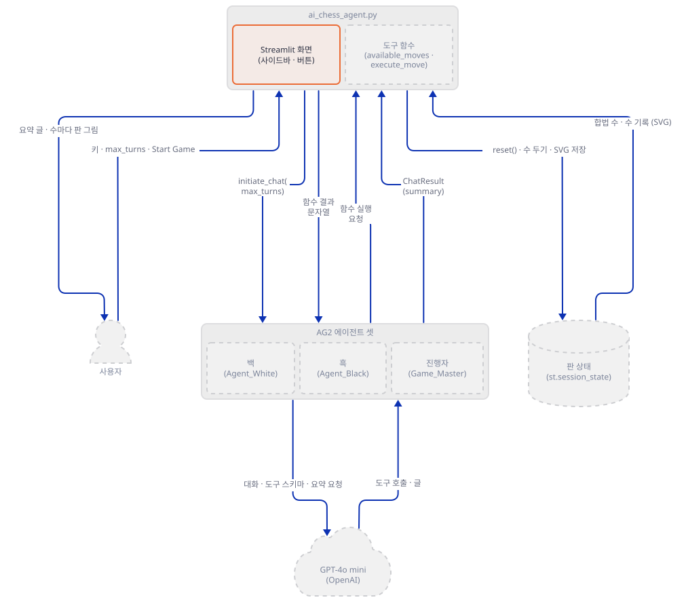

**확인.**

```bash
uv run --no-project python -W ignore -c "
from autogen import ConversableAgent, register_function
import autogen, chess
print('IMPORT_OK', autogen.__version__, chess.__version__)"
uv run --no-project python -B -c "compile(open('ai_chess_agent.py', encoding='utf-8').read(), 'ai_chess_agent.py', 'exec'); print('COMPILE_OK')"
uv run --no-project python -c "import cairosvg"
```

직접 확인한 출력입니다. 세 번째 명령은 긴 오류 문구가 이어지고, 마지막 줄만 옮겼습니다.

```text
IMPORT_OK 0.6.1 1.11.1
COMPILE_OK
cannot load library 'libcairo-2.dll': error 0x7e.  Additionally, ctypes.util.find_library() did not manage to locate a library called 'libcairo-2.dll'
```

`cairosvg`는 설치는 되지만 이 PC(Windows)에는 Cairo 네이티브 라이브러리가 없어 import가 실패합니다. 그래도 앱은 상관없습니다. `ai_chess_agent.py`에서 `cairosvg`와 `PIL`을 grep했지만 없었고(종료 코드 1), SVG 문자열을 `st.image`에 주면 Streamlit이 `<svg`로 시작하는 문자열을 스스로 base64 데이터 주소로 바꿔 보여 줍니다(소스로 확인, `streamlit/elements/lib/image_utils.py`). `pillow`는 `streamlit`이 요구해서 어차피 깔립니다. `cairosvg` 없이 `streamlit`·`chess`·`autogen==0.6.1`만 설치한 두 번째 가상환경에서도 Step 7의 3수 게임이 같은 결과로 돌았습니다(직접 확인).

### Step 2. 세션 상태와 사이드바

**목적.** 키를 어디서 받는지, `max_turns`의 기본값과 범위, 앱이 기억하는 상태를 봅니다.

**할 일.**

`advanced_ai_agents/autonomous_game_playing_agent_apps/ai_chess_agent/ai_chess_agent.py:6-17`

```python
if "openai_api_key" not in st.session_state:
    st.session_state.openai_api_key = None
if "board" not in st.session_state:
    st.session_state.board = chess.Board()
if "made_move" not in st.session_state:
    st.session_state.made_move = False
if "board_svg" not in st.session_state:
    st.session_state.board_svg = None
if "move_history" not in st.session_state:
    st.session_state.move_history = []
if "max_turns" not in st.session_state:
    st.session_state.max_turns = 5
```

판(`chess.Board()`)과 한 수를 뒀는지 알리는 깃발 `made_move`, 수마다 쌓는 그림 목록 `move_history`, 키, `max_turns`(기본 5)가 모두 Streamlit 세션 상태에 있습니다. 이 상태는 브라우저 탭 하나의 것이고, 다음 Step의 도구 함수가 이 판을 바로 읽고 씁니다.

`advanced_ai_agents/autonomous_game_playing_agent_apps/ai_chess_agent/ai_chess_agent.py:19-41`

```python
st.sidebar.title("Chess Agent Configuration")
openai_api_key = st.sidebar.text_input("Enter your OpenAI API key:", type="password")
if openai_api_key:
    st.session_state.openai_api_key = openai_api_key
    st.sidebar.success("API key saved!")

st.sidebar.info("""
For a complete chess game with potential checkmate, it would take max_turns > 200 approximately.
However, this will consume significant API credits and a lot of time.
For demo purposes, using 5-10 turns is recommended.
""")

max_turns_input = st.sidebar.number_input(
    "Enter the number of turns (max_turns):",
    min_value=1,
    max_value=1000,
    value=st.session_state.max_turns,
    step=1
)

if max_turns_input:
    st.session_state.max_turns = max_turns_input
    st.sidebar.success(f"Max turns of total chess moves set to {st.session_state.max_turns}!")
```

키는 환경변수가 아니라 사이드바 입력창에서 받습니다. 안내문(25~29행)은 "완전한 게임은 `max_turns` > 200쯤"이라고 하고, `max_turns` 입력은 1~1000입니다. 41행의 성공 문구는 `max_turns`를 "Max turns of total chess moves"라고 부르지만, Step 7에서 보듯 턴과 수는 같은 수가 아닙니다.

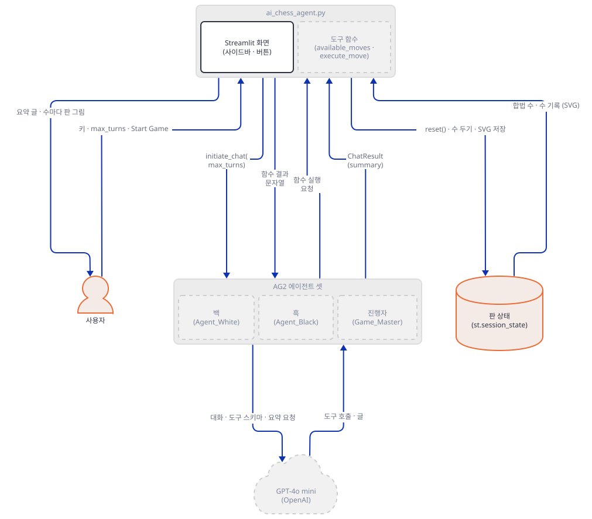

**확인.** 아래를 `appcheck.py`로 저장해 `chess-lab`에서 실행합니다.

```python
from streamlit.testing.v1 import AppTest

at = AppTest.from_file("ai_chess_agent.py")
at.run(timeout=60)
print("키 없을 때 경고:", [w.value for w in at.warning])
n = at.sidebar.number_input[0]
print("max_turns 입력:", n.label, "| 값", n.value, "| 범위", n.min, "~", n.max)
s = at.session_state
print("세션 상태:", s["openai_api_key"], s["made_move"], s["move_history"], s["board_svg"], s["max_turns"], s["board"].fen())
at.sidebar.text_input[0].set_value("sk-fake-1234567890").run(timeout=60)
print("키를 넣은 뒤 사이드바:", [s.value for s in at.sidebar.success])
print("버튼:", [b.label for b in at.button], "| 소제목:", [s.value for s in at.subheader])
```

```bash
uv run --no-project python -X utf8 -W ignore appcheck.py
```

직접 확인한 출력입니다(`missing ScriptRunContext` 경고 한 줄은 무시해도 됩니다).

```text
키 없을 때 경고: ['Please enter your OpenAI API key in the sidebar to start the game.']
max_turns 입력: Enter the number of turns (max_turns): | 값 5 | 범위 1.0 ~ 1000.0
세션 상태: None False [] None 5 rnbqkbnr/pppppppp/8/8/8/8/PPPPPPPP/RNBQKBNR w KQkq - 0 1
키를 넣은 뒤 사이드바: ['API key saved!', 'Max turns of total chess moves set to 5!']
버튼: ['Start Game', 'Reset Game'] | 소제목: ['Initial Board']
```

키가 없으면 249행의 경고만 뜨고 에이전트는 만들어지지 않습니다. 키가 있어야 98행의 `if` 안으로 들어가 버튼 둘이 생깁니다.

### Step 3. 도구 함수 둘과 종료 깃발

**목적.** 에이전트가 부를 두 함수와, 한 수를 뒀는지 알려 주는 `check_made_move`가 판을 어떻게 건드리는지 봅니다.

**할 일.**

`advanced_ai_agents/autonomous_game_playing_agent_apps/ai_chess_agent/ai_chess_agent.py:45-96`

```python
def available_moves() -> str:
    available_moves = [str(move) for move in st.session_state.board.legal_moves]
    return "Available moves are: " + ",".join(available_moves)

def execute_move(move: str) -> str:
    try:
        chess_move = chess.Move.from_uci(move)
        if chess_move not in st.session_state.board.legal_moves:
            return f"Invalid move: {move}. Please call available_moves() to see valid moves."
        
        # Update board state
        st.session_state.board.push(chess_move)
        st.session_state.made_move = True

        # Generate and store board visualization
        board_svg = chess.svg.board(st.session_state.board,
                                  arrows=[(chess_move.from_square, chess_move.to_square)],
                                  fill={chess_move.from_square: "gray"},
                                  size=400)
        st.session_state.board_svg = board_svg
        st.session_state.move_history.append(board_svg)

        # Get piece information
        moved_piece = st.session_state.board.piece_at(chess_move.to_square)
        piece_unicode = moved_piece.unicode_symbol()
        piece_type_name = chess.piece_name(moved_piece.piece_type)
        piece_name = piece_type_name.capitalize() if piece_unicode.isupper() else piece_type_name
        
        # Generate move description
        from_square = chess.SQUARE_NAMES[chess_move.from_square]
        to_square = chess.SQUARE_NAMES[chess_move.to_square]
        move_desc = f"Moved {piece_name} ({piece_unicode}) from {from_square} to {to_square}."
        if st.session_state.board.is_checkmate():
            winner = 'White' if st.session_state.board.turn == chess.BLACK else 'Black'
            move_desc += f"\nCheckmate! {winner} wins!"
        elif st.session_state.board.is_stalemate():
            move_desc += "\nGame ended in stalemate!"
        elif st.session_state.board.is_insufficient_material():
            move_desc += "\nGame ended - insufficient material to checkmate!"
        elif st.session_state.board.is_check():
            move_desc += "\nCheck!"

        return move_desc
    except ValueError:
        return f"Invalid move format: {move}. Please use UCI format (e.g., 'e2e4')."

def check_made_move(msg):
    if st.session_state.made_move:
        st.session_state.made_move = False
        return True
    else:
        return False
```

`available_moves()`는 합법 수를 `g1h3,g1f3,...`처럼 UCI 문자열(출발칸+도착칸)로 이어 붙여 돌려줍니다. `execute_move(move)`는 수가 합법인지 확인하고, 아니면 아무것도 바꾸지 않은 채 "Invalid move" 문장을 돌려줍니다. 합법이면 세 가지가 한꺼번에 일어납니다. 판에 수를 두고(56행), `made_move`를 `True`로 세우고(57행), 방금 둔 수를 화살표로 표시한 판 그림을 `board_svg`와 `move_history` 양쪽에 저장합니다(60~65행). 돌려주는 문장은 어느 말이 어디서 어디로 갔는지와, 체크메이트·스테일메이트·말 부족·체크 가운데 해당하는 한 줄입니다. `check_made_move`는 `made_move`가 `True`이면 `False`로 되돌리고 `True`를 돌려주는 일회용 깃발입니다. 이 함수가 나중에 진행자의 종료 판정이 됩니다(Step 4).

이 코드에 작은 불일치가 둘 있습니다. 71행의 `piece_unicode.isupper()`는 체스 기호(♙·♟)가 대소문자가 없는 글자라 늘 `False`여서, 말 이름이 대문자가 되는 분기는 죽은 코드이고 백 폰도 "Moved pawn (♙)"으로 나옵니다. 그리고 `except ValueError`(88행)가 잡는 것은 `chess.InvalidMoveError`입니다. 이것이 `ValueError`의 하위 클래스라서 `hello`나 빈 문자열 같은 형식 오류가 "Invalid move format"으로 처리됩니다(둘 다 직접 확인).

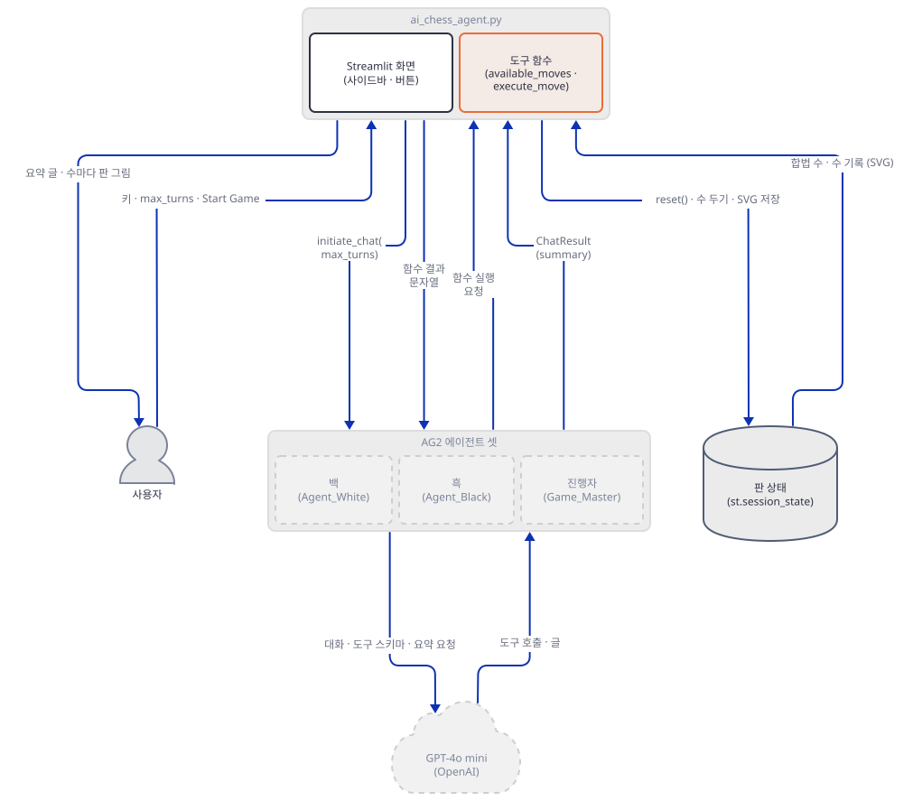

**확인.** 아래를 `toolcheck.py`로 저장합니다. 앱 파일에서 세 함수만 뽑아 가짜 `st`와 함께 실행하므로 Streamlit도 모델도 필요 없습니다.

```python
import ast
import types

import chess
import chess.svg

src = open("ai_chess_agent.py", encoding="utf-8").read()
tree = ast.parse(src)
want = {"available_moves", "execute_move", "check_made_move"}
st = types.SimpleNamespace(session_state=types.SimpleNamespace(
    board=chess.Board(), made_move=False, board_svg=None, move_history=[]))
ns = {"chess": chess, "st": st}
for node in tree.body:
    if isinstance(node, ast.FunctionDef) and node.name in want:
        exec(compile(ast.Module([node], []), "ai_chess_agent.py", "exec"), ns)

s = st.session_state
available = ns["available_moves"]
execute = ns["execute_move"]
check = ns["check_made_move"]

print(available()[:60], "... 합계", len(available().split(": ")[1].split(",")))
print(execute("e2e5"))
print(execute("hello"))
print("made_move:", s.made_move)
print(execute("e2e4"), "| made_move:", s.made_move, "| 기록:", len(s.move_history))
print("check_made_move 첫 호출:", check("x"), "둘째 호출:", check("x"))
print(execute("e7e5"))
for move in ["f1c4", "b8c6", "d1h5", "g8f6", "h5f7"]:
    out = execute(move)
print(out.replace("\n", " / "))
print("available_moves 끝난 판:", repr(available()))
print(execute(""))
```

```bash
uv run --no-project python -X utf8 -W ignore toolcheck.py
```

직접 확인한 출력입니다.

```text
Available moves are: g1h3,g1f3,b1c3,b1a3,h2h3,g2g3,f2f3,e2e3 ... 합계 20
Invalid move: e2e5. Please call available_moves() to see valid moves.
Invalid move format: hello. Please use UCI format (e.g., 'e2e4').
made_move: False
Moved pawn (♙) from e2 to e4. | made_move: True | 기록: 1
check_made_move 첫 호출: True 둘째 호출: False
Moved pawn (♟) from e7 to e5.
Moved queen (♕) from h5 to f7. / Checkmate! White wins!
available_moves 끝난 판: 'Available moves are: '
Invalid move format: . Please use UCI format (e.g., 'e2e4').
```

마지막 두 줄을 눈여겨보세요. 게임이 끝난 판에서도 `available_moves`는 오류가 아니라 빈 목록 문장을 돌려주고, 거기서 모델이 낼 수 있는 수는 없습니다. Step 8에서 이것이 무슨 일을 일으키는지 봅니다.

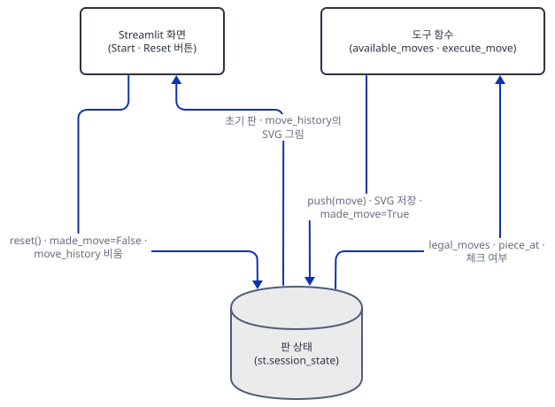

### Step 4. 모델 설정과 에이전트 셋

**목적.** 백·흑·진행자가 각각 무엇으로 만들어지는지, 그리고 기본값이 어떤 동작을 숨기고 있는지 봅니다.

**할 일.**

`advanced_ai_agents/autonomous_game_playing_agent_apps/ai_chess_agent/ai_chess_agent.py:98-136`

```python
if st.session_state.openai_api_key:
    try:
        agent_white_config_list = [
            {
                "model": "gpt-4o-mini",
                "api_key": st.session_state.openai_api_key,
            },
        ]

        agent_black_config_list = [
            {
                "model": "gpt-4o-mini",
                "api_key": st.session_state.openai_api_key,
            },
        ]

        agent_white = ConversableAgent(
            name="Agent_White",  
            system_message="You are a professional chess player and you play as white. "
            "First call available_moves() first, to get list of legal available moves. "
            "Then call execute_move(move) to make a move.",
            llm_config={"config_list": agent_white_config_list, "cache_seed": None},
        )

        agent_black = ConversableAgent(
            name="Agent_Black",  
            system_message="You are a professional chess player and you play as black. "
            "First call available_moves() first, to get list of legal available moves. "
            "Then call execute_move(move) to make a move.",
            llm_config={"config_list": agent_black_config_list, "cache_seed": None},
        )

        game_master = ConversableAgent(
            name="Game_Master",  
            llm_config=False,
            is_termination_msg=check_made_move,
            default_auto_reply="Please make a move.",
            human_input_mode="NEVER",
        )
```

백과 흑은 같은 모양입니다. `config_list`에 모델 이름과 사이드바에서 받은 키를 넣고, 시스템 메시지는 한 문장(이름·색·"먼저 `available_moves()`, 그다음 `execute_move(move)`")뿐입니다. `cache_seed`가 `None`이라 AutoGen의 디스크 캐시를 끕니다. Day 085·116에서는 이 값이 없어 작업 폴더에 `.cache/41/cache.db`가 생겼지만, 오늘은 문서의 모든 실행을 마친 `chess-lab`에 `.cache/`가 없었습니다(직접 확인). 진행자 `Game_Master`는 `llm_config=False`라서 모델을 부르지 않고, 받은 메시지가 `check_made_move`를 통과하면(방금 수를 뒀으면) 대화를 끝내고, 아니면 "Please make a move."를 자동으로 답합니다.

`config_list` 항목에 `base_url`이 없습니다. 이 앱에서는 `OPENAI_BASE_URL` 환경변수가 대신 먹힙니다. Step 7에서 그 변수만으로 요청이 가짜 서버에 도착하는 것을 서버 기록으로 봅니다. 항목에 `base_url`을 직접 넣는 것도 AutoGen이 받아 줍니다(`oai/client.py`가 `OpenAI.__init__`의 키워드 인자를 그대로 통과시키는 것을 소스로 확인했습니다). 가짜 키 `sk-fake-...`는 AutoGen이 "The API key specified is not a valid OpenAI format" 경고 한 줄을 찍지만 동작에는 지장이 없었습니다(직접 확인).

기본값 둘이 Step 8에서 중요합니다. 백과 흑은 `human_input_mode`를 주지 않아 기본값 `"TERMINATE"`이고, `max_consecutive_auto_reply`도 기본 100입니다. 진행자는 `"NEVER"`입니다. 그리고 진행자에게는 `code_execution_config`가 없어 코드 실행이 꺼져 있어서 `docker`를 쓰지 않습니다(직접 확인, 아래 출력).

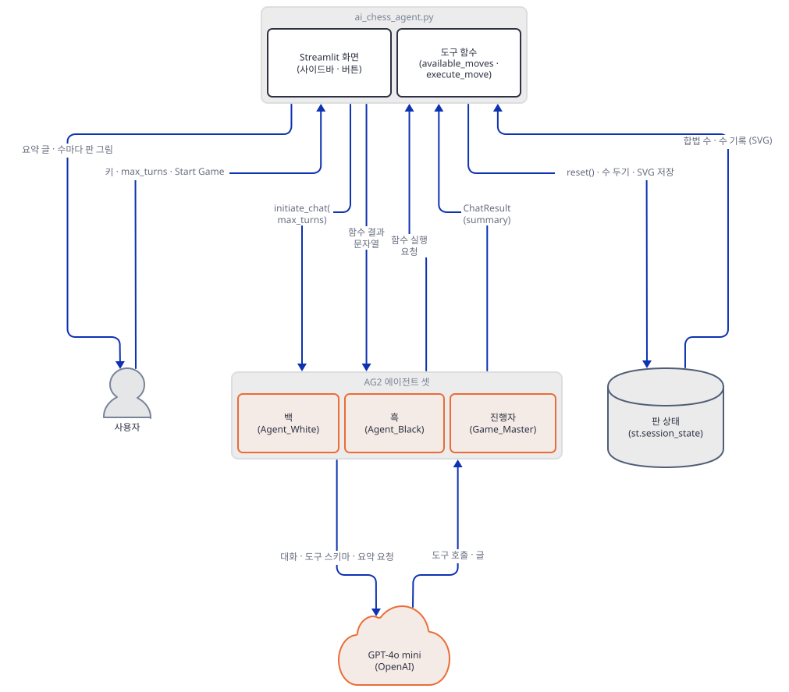

**확인.** 아래를 `agentcheck.py`로 저장합니다. 앱의 100~190행을 그대로 실행해(Step 5·6의 코드까지 포함) 에이전트를 만들고 설정을 읽습니다. 요청은 보내지 않습니다.

```python
import json
import textwrap
import types

import chess
from autogen import ConversableAgent, register_function

lines = open("ai_chess_agent.py", encoding="utf-8").read().splitlines()
# 100~190행: config_list 둘, 에이전트 셋, register_function 넷, register_nested_chats 둘 (if/try 안이라 8칸 들여쓰기)
body = textwrap.dedent("\n".join(lines[99:190]))
st = types.SimpleNamespace(session_state=types.SimpleNamespace(openai_api_key="sk-fake-1234567890"))
def available_moves() -> str:
    return ""


def execute_move(move: str) -> str:
    return ""


def check_made_move(msg):
    return False


ns = {"st": st, "ConversableAgent": ConversableAgent, "register_function": register_function,
      "available_moves": available_moves, "execute_move": execute_move, "check_made_move": check_made_move}
exec(compile(body, "ai_chess_agent.py:100-190", "exec"), ns)
w, b, gm = ns["agent_white"], ns["agent_black"], ns["game_master"]

for a in (w, b, gm):
    cfg = a.llm_config
    print(a.name, "| llm_config:", "False" if cfg is False else sorted(k for k in cfg if k != "config_list"),
          "| human_input_mode:", a.human_input_mode, "| max_consecutive_auto_reply:", a.max_consecutive_auto_reply())
print("white tools:", [t["function"]["name"] for t in w.llm_config["tools"]], "| cache_seed:", w.llm_config["cache_seed"])
print("model/base_url:", w.llm_config["config_list"][0]["model"], "/", w.llm_config["config_list"][0].get("base_url"))
print("game_master 실행 함수:", sorted(gm.function_map))
print("code_execution_config:", gm._code_execution_config)
for a in (w, b, gm):
    print(a.name, "reply 순서:", [f["reply_func"].__name__ for f in a._reply_func_list])
trig = lambda a: [(f["reply_func"].__name__, getattr(f["trigger"], "name", f["trigger"])) for f in a._reply_func_list if f["reply_func"].__name__ == "_summary_from_nested_chats"]
print("white 중첩 대화 트리거:", trig(w))
print("black 중첩 대화 트리거:", trig(b))
print("execute_move 인자:", json.dumps(w.llm_config["tools"][0]["function"]["parameters"]))
print("available_moves 인자:", json.dumps(w.llm_config["tools"][1]["function"]["parameters"]))
print("진행자 종료 판정:", gm._is_termination_msg.__name__, "| 기본 답:", repr(gm._default_auto_reply))
```

```bash
uv run --no-project python -X utf8 -W ignore agentcheck.py
```

직접 확인한 출력입니다(위의 가짜 키 경고 두 줄은 생략했습니다).

```text
Agent_White | llm_config: ['cache_seed', 'tools'] | human_input_mode: TERMINATE | max_consecutive_auto_reply: 100
Agent_Black | llm_config: ['cache_seed', 'tools'] | human_input_mode: TERMINATE | max_consecutive_auto_reply: 100
Game_Master | llm_config: False | human_input_mode: NEVER | max_consecutive_auto_reply: 100
white tools: ['execute_move', 'available_moves'] | cache_seed: None
model/base_url: gpt-4o-mini / None
game_master 실행 함수: ['available_moves', 'execute_move']
code_execution_config: False
Agent_White reply 순서: ['a_check_termination_and_human_reply', 'check_termination_and_human_reply', '_summary_from_nested_chats', 'a_generate_function_call_reply', 'generate_function_call_reply', 'a_generate_tool_calls_reply', 'generate_tool_calls_reply', 'a_generate_oai_reply', 'generate_oai_reply']
Agent_Black reply 순서: ['a_check_termination_and_human_reply', 'check_termination_and_human_reply', '_summary_from_nested_chats', 'a_generate_function_call_reply', 'generate_function_call_reply', 'a_generate_tool_calls_reply', 'generate_tool_calls_reply', 'a_generate_oai_reply', 'generate_oai_reply']
Game_Master reply 순서: ['a_check_termination_and_human_reply', 'check_termination_and_human_reply', 'a_generate_function_call_reply', 'generate_function_call_reply', 'a_generate_tool_calls_reply', 'generate_tool_calls_reply', 'a_generate_oai_reply', 'generate_oai_reply']
white 중첩 대화 트리거: [('_summary_from_nested_chats', 'Agent_Black')]
black 중첩 대화 트리거: [('_summary_from_nested_chats', 'Agent_White')]
execute_move 인자: {"type": "object", "properties": {"move": {"type": "string", "description": "move"}}, "required": ["move"]}
available_moves 인자: {"type": "object", "properties": {}, "required": []}
진행자 종료 판정: check_made_move | 기본 답: 'Please make a move.'
```

### Step 5. 도구 등록 — 보이는 쪽과 실행하는 쪽

**목적.** 같은 두 함수가 백·흑에게는 "부를 수 있는 도구"로, 진행자에게는 "실행할 함수"로 어떻게 등록되는지 봅니다.

**할 일.**

`advanced_ai_agents/autonomous_game_playing_agent_apps/ai_chess_agent/ai_chess_agent.py:138-152`

```python
        register_function(
            execute_move,
            caller=agent_white,
            executor=game_master,
            name="execute_move",
            description="Call this tool to make a move.",
        )

        register_function(
            available_moves,
            caller=agent_white,
            executor=game_master,
            name="available_moves",
            description="Get legal moves.",
        )
```

`register_function(f, caller=, executor=, name=, description=)` 한 번이 두 일을 합니다. `caller`(백)의 모델 요청에 도구 스키마를 싣고, `executor`(진행자)의 실행 목록에 함수를 넣습니다. 154~168행이 같은 두 호출을 흑에게 반복하므로 모두 네 번이고, 진행자의 실행 목록은 이름이 같은 함수를 덮어쓰며 두 개로 남습니다(위 출력의 `game_master 실행 함수`). 모델이 보는 스키마는 함수 정의에서 만들어집니다. `execute_move`는 `move`라는 문자열 인자 하나, `available_moves`는 인자 없음입니다(위 출력). 이 스키마는 함수의 타입 주석(`move: str`, `-> str`)에서 나옵니다. 주석 없는 `lambda`로 바꿔 등록해 보면 "All parameters of the function ... must be annotated"라는 `TypeError`가 났습니다(직접 확인). 도구 설명은 "Call this tool to make a move."와 "Get legal moves."가 전부입니다. 같은 스키마가 요청마다 실립니다(Step 7의 `tools=2`).


**확인.** Step 4의 `agentcheck.py` 출력에서 `white tools`, `game_master 실행 함수`, 두 `인자` 줄이 이 Step의 확인입니다. 도구 이름이 `execute_move`, `available_moves` 순서로 나오는 것도 보입니다(등록 순서와 같습니다).

### Step 6. 중첩 대화 — 상대가 말을 걸면 진행자와 작은 대화를 연다

**목적.** 백과 흑이 직접 서로의 수를 주고받지 않고 어떻게 한 수를 만드는지, 그때 모델이 무엇을 보는지 봅니다.

**할 일.**

`advanced_ai_agents/autonomous_game_playing_agent_apps/ai_chess_agent/ai_chess_agent.py:170-190`

```python
        agent_white.register_nested_chats(
            trigger=agent_black,
            chat_queue=[
                {
                    "sender": game_master,
                    "recipient": agent_white,
                    "summary_method": "last_msg",
                }
            ],
        )

        agent_black.register_nested_chats(
            trigger=agent_white,
            chat_queue=[
                {
                    "sender": game_master,
                    "recipient": agent_black,
                    "summary_method": "last_msg",
                }
            ],
        )
```

`agent_white.register_nested_chats(trigger=agent_black, ...)`는 "Black이 보낸 메시지에 답해야 할 때, 일반 답변 대신 이 대화를 연다"는 뜻입니다. 대화 목록(`chat_queue`)에는 하나뿐이고 보낸 쪽은 진행자, 받는 쪽은 백입니다. `message`를 적지 않았으므로 AutoGen이 바깥 대화의 마지막 메시지를 그대로 첫 메시지로 씁니다(`conversable_agent.py`의 `_get_chats_to_run`을 소스로 확인). `summary_method`가 `"last_msg"`라서 중첩 대화가 끝나면 그 대화의 마지막 메시지가 바깥 대화의 답이 됩니다. 흑에게도 같은 등록이 거울처럼 있습니다. 위 `agentcheck.py` 출력에서 이 등록은 `check_termination_and_human_reply` 바로 다음 칸(`_summary_from_nested_chats`)에 들어가 있고, 트리거는 백 쪽이 `Agent_Black`, 흑 쪽이 `Agent_White`입니다. 진행자에는 이 등록이 없습니다.

중첩 대화는 `clear_history`를 따로 정하지 않아 기본값 `True`로 열립니다. 그래서 한 수마다 백은 빈 기록에서 시작하고, 모델이 처음 받는 요청은 메시지 둘(시스템 메시지와 상대가 한 말 한 줄)뿐입니다. Step 7의 서버 기록에서 모든 수의 첫 호출이 `messages=2`인 것으로 확인합니다. 판도, 지난 수도 모델에게 전달되지 않습니다. 모델이 판에 대해 아는 것은 그 수의 `available_moves()` 결과(합법 수 목록)와, 상대가 마지막에 한 말 한 줄이 전부입니다. 상대가 무슨 말을 했는지도 진짜 모델이 쓴 글에 달려 있어서 이 문서는 확인하지 못했습니다.


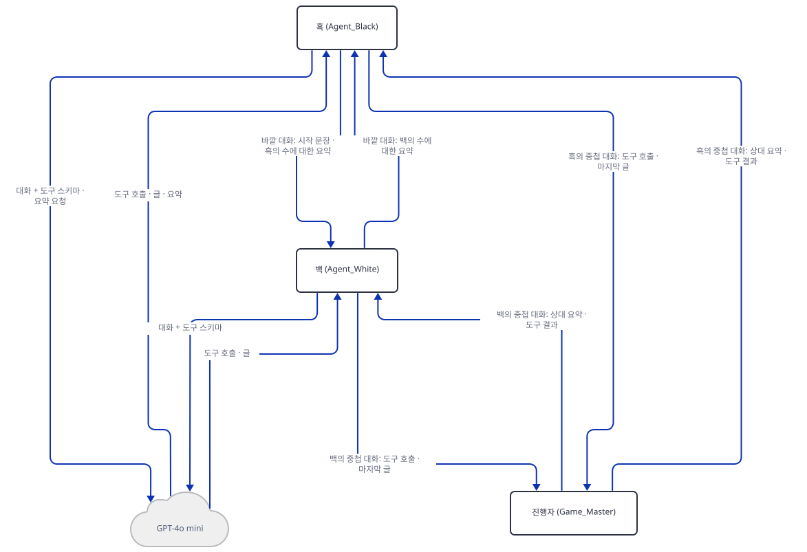

그림은 같은 두 에이전트 사이의 두 종류 대화를 보여 줍니다. 백·흑 사이의 바깥 대화는 "한 줄 알림"만 오가고, 도구 호출과 결과는 각자 진행자와의 중첩 대화 안에서 오갑니다. 진행자가 두 도구를 실행할 때 판 상태와 오가는 것은 아래 그림입니다. 진행자는 도구 함수에 실행을 맡기고, 종료 판정 `check_made_move`로 `made_move`를 읽고 되돌립니다.

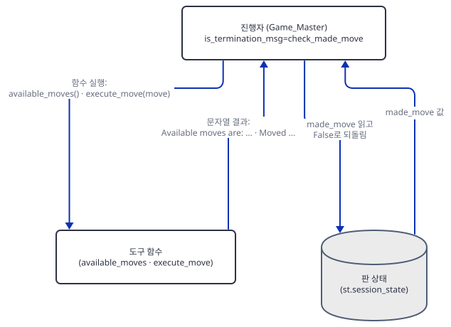

**확인.** Step 4의 `agentcheck.py` 출력이 이 Step의 확인입니다. 모든 수의 첫 모델 호출이 메시지 둘이라는 것은 다음 Step에서 봅니다.

### Step 7. 게임 시작 — `initiate_chat`, 가짜 서버로 끝까지

**목적.** 버튼 한 번이 모델 호출을 몇 번이나 내는지, `max_turns`가 무엇을 세는지, 에이전트의 메시지가 어떤 순서로 오가는지 가짜 서버로 직접 봅니다.

**할 일.**

`advanced_ai_agents/autonomous_game_playing_agent_apps/ai_chess_agent/ai_chess_agent.py:204-236`

```python
        initial_board_svg = chess.svg.board(st.session_state.board, size=300)
        st.subheader("Initial Board")
        st.image(initial_board_svg)

        if st.button("Start Game"):
            st.session_state.board.reset()
            st.session_state.made_move = False
            st.session_state.move_history = []
            st.session_state.board_svg = chess.svg.board(st.session_state.board, size=300)
            st.info("The AI agents will now play against each other. Each agent will analyze the board, " 
                   "request legal moves from the Game Master (proxy agent), and make strategic decisions.")
            st.success("You can view the interaction between the agents in the terminal output, after the turns between agents end, you get view all the chess board moves displayed below!")
            st.write("Game started! White's turn.")

            chat_result = agent_black.initiate_chat(
                recipient=agent_white, 
                message="Let's play chess! You go first, its your move.",
                max_turns=st.session_state.max_turns,
                summary_method="reflection_with_llm"
            )
            st.markdown(chat_result.summary)

            # Display the move history (boards for each move)
            st.subheader("Move History")
            for i, move_svg in enumerate(st.session_state.move_history):
                # Determine which agent made the move
                if i % 2 == 0:
                    move_by = "Agent White"  # Even-indexed moves are by White
                else:
                    move_by = "Agent Black"  # Odd-indexed moves are by Black
                
                st.write(f"Move {i + 1} by {move_by}")
                st.image(move_svg)
```

버튼은 판과 깃발·기록을 초기화한 뒤 `agent_black.initiate_chat(recipient=agent_white, ...)`를 부릅니다. 첫 메시지를 보내는 쪽이 흑이고 받는 쪽이 백이라서 백이 먼저 둡니다. `summary_method="reflection_with_llm"`은 대화가 끝난 뒤 모델을 한 번 더 불러 요약을 만들게 하고, 그 글이 `chat_result.summary`로 화면(224행)에 나옵니다. 이어 수 기록의 그림을 짝수 번째는 백, 홀수 번째는 흑이라고 붙여 보여 줍니다(230~233행). 대화 로그는 화면이 아니라 터미널에 찍힙니다(215행의 안내가 이것입니다). 판 그림은 대화가 모두 끝난 뒤에야 한꺼번에 나옵니다.

가짜 서버로 이 흐름을 끝까지 돌려 봅니다. 서버는 이 문서가 재현용으로 만든 것이라 저장소에 없으니 아래 둘을 `chess-lab`에 저장하세요. 서버는 `/v1/chat/completions`만 흉내 냅니다. 마지막 메시지만 보고, 막 시작했으면 `available_moves`를 부르고, 합법 수 목록을 받았으면 그중 하나로 `execute_move`를 부르고, 수의 결과를 받았으면 "I have made my move."라고 말하고, 시스템 메시지로 끝나는 요청(요약)에는 "FAKE SUMMARY"라고 답합니다. 호출마다 한 줄씩 누가·메시지 몇 개·도구 몇 개·요청 글자 수·무엇을 답했는지 찍습니다. 두 번째 인자로 모드를 줄 수 있고(`mate`·`text`는 Step 8) 기본은 `normal`입니다.

```python
import json
import sys
import zlib
from http.server import BaseHTTPRequestHandler, HTTPServer

PORT = int(sys.argv[1])
MODE = sys.argv[2] if len(sys.argv) > 2 else "normal"  # normal | mate | text
MATE = ["f2f3", "e7e5", "g2g4", "d8h4"]  # 바보의 메이트: 네 수에 흑이 이긴다
calls = 0
played = 0


def tool_call(name, args):
    return {"role": "assistant", "content": None, "tool_calls": [
        {"id": f"call_{calls}", "type": "function",
         "function": {"name": name, "arguments": json.dumps(args)}}]}


def answer(body):
    """말 잘 듣는 체스 모델이 할 법한 답. 마지막 메시지만 보고 정한다."""
    global played
    last = body["messages"][-1]
    if last["role"] == "system":  # 대화가 끝난 뒤의 요약 요청
        return {"role": "assistant", "content": "FAKE SUMMARY"}
    if MODE == "text":  # 도구를 안 쓰고 말만 하는 모델
        return {"role": "assistant", "content": "I think e4 is a good move."}
    if last["role"] == "tool" and last["content"].startswith("Available moves are:"):
        moves = last["content"].split(": ", 1)[1].split(",")
        move = moves[zlib.crc32(last["content"].encode()) % len(moves)]  # 같은 판이면 늘 같은 수
        if MODE == "mate" and played < len(MATE):
            move, played = MATE[played], played + 1
        return tool_call("execute_move", {"move": move})
    if last["role"] == "tool":  # execute_move의 결과를 받았다
        return {"role": "assistant", "content": "I have made my move."}
    return tool_call("available_moves", {})


class Handler(BaseHTTPRequestHandler):
    def log_message(self, *args):
        pass

    def do_POST(self):
        global calls
        calls += 1
        body = json.loads(self.rfile.read(int(self.headers["Content-Length"])))
        message = answer(body)
        system = body["messages"][0]["content"]
        who = "white" if "play as white" in system else "black" if "play as black" in system else "?"
        if body["messages"][-1]["role"] == "system":
            who = "summary"
        size = len(json.dumps(body["messages"])) + len(json.dumps(body.get("tools", [])))
        what = message["tool_calls"][0]["function"]["name"] if message.get("tool_calls") else "text"
        print(f"{calls:3d} {who:7s} messages={len(body['messages']):3d} tools={len(body.get('tools', []))} "
              f"chars={size:5d} -> {what}", flush=True)
        out = {"id": f"fake-{calls}", "object": "chat.completion", "created": 0,
               "model": body["model"],
               "choices": [{"index": 0, "message": message,
                            "finish_reason": "tool_calls" if message.get("tool_calls") else "stop"}],
               "usage": {"prompt_tokens": 1, "completion_tokens": 1, "total_tokens": 2}}
        data = json.dumps(out).encode()
        self.send_response(200)
        self.send_header("Content-Type", "application/json")
        self.send_header("Content-Length", str(len(data)))
        self.end_headers()
        self.wfile.write(data)


class Server(HTTPServer):
    allow_reuse_address = False  # Windows에서 다른 프로세스의 포트에 겹쳐 뜨는 것을 막는다


Server(("127.0.0.1", PORT), Handler).serve_forever()
```

`drive.py`는 앱을 `AppTest`로 띄워 가짜 키와 `max_turns`를 넣고 버튼을 누릅니다. 맨 앞의 `assert`는 `OPENAI_BASE_URL`을 먼저 걸지 않았다면 여기서 멈추게 해, 가짜 키가 진짜 OpenAI로 나가는 일을 막습니다. 에이전트 사이의 `send`를 감싸 메시지를 기록하고, `input()`이 불릴 때마다 센 뒤 그대로 넘깁니다.

```python
import builtins
import contextlib
import io
import os
import sys

# 가짜 서버가 아니면 아무것도 보내지 않는다. 변수를 먼저 걸지 않았다면 여기서 멈춘다.
assert os.environ.get("OPENAI_BASE_URL", "").startswith("http://127.0.0.1:"), "OPENAI_BASE_URL을 먼저 거세요"

from autogen import ConversableAgent
from streamlit.testing.v1 import AppTest

TRACE, PROMPTS = [], []

_send = ConversableAgent.send


def send(self, message, recipient, request_reply=None, silent=False):
    if isinstance(message, dict) and message.get("tool_calls"):
        kind = "tool_calls " + ",".join(c["function"]["name"] for c in message["tool_calls"])
    elif isinstance(message, dict) and message.get("tool_responses"):
        kind = "tool_responses"
    else:
        kind = "text"
    text = message.get("content") if isinstance(message, dict) else message
    TRACE.append(f"{self.name} -> {recipient.name} [{kind}] {str(text)[:48]!r}")
    return _send(self, message, recipient, request_reply, silent)


ConversableAgent.send = send

_input = builtins.input


def counted_input(prompt=""):
    PROMPTS.append(prompt)
    return _input(prompt)


builtins.input = counted_input

turns = int(sys.argv[1]) if len(sys.argv) > 1 else 5
at = AppTest.from_file("ai_chess_agent.py")
at.run(timeout=60)
at.sidebar.text_input[0].set_value("sk-fake-1234567890")
at.sidebar.number_input[0].set_value(turns)
at.run(timeout=60)
with contextlib.redirect_stdout(io.StringIO()):  # autogen이 터미널에 찍는 대화 로그는 숨긴다
    at.button[0].click().run(timeout=900)

moves = [m.value for m in at.markdown if m.value.startswith("Move ")]
print("exception:", [e.value for e in at.exception])
print("error:", [e.value for e in at.error])
print("화면의 수:", len(moves), "| 마지막:", moves[-1] if moves else None)
print("input() 호출:", len(PROMPTS), PROMPTS[:1])
if os.environ.get("TRACE") == "1":
    print("\n".join(TRACE))
```

서버는 한 터미널에, `drive.py`는 다른 터미널에 띄웁니다. 포트는 49152~65535 중에서 쓰이지 않는 것을 고릅니다. Windows에서는 제외 포트 범위에 걸리면 바인드가 거부됩니다("문제 해결"). 아래는 51733 예시입니다.

```bash
uv run --no-project python fake_openai.py 51733
```

```bash
export OPENAI_BASE_URL=http://127.0.0.1:51733/v1
export PYTHONIOENCODING=utf-8
TRACE=1 uv run --no-project python -X utf8 -W ignore drive.py 1 < /dev/null
```

PowerShell에서는 `$env:OPENAI_BASE_URL = "http://127.0.0.1:51733/v1"`과 `$env:TRACE = "1"`입니다(실행해 보지 못했습니다). `OPENAI_BASE_URL`을 걸지 않고 돌리면 `drive.py`의 `assert`가 멈춰 줍니다. `< /dev/null`은 Step 8을 위한 것으로, 터미널 입력을 일부러 막아 둡니다.


**확인.** `max_turns=1`로 돌린 직접 확인한 출력은 이렇습니다. 위쪽 네 줄은 `drive.py`의 요약이고, 아래 여덟 줄은 `TRACE=1`이 찍은 에이전트 사이의 메시지입니다(고른 수는 가짜 서버가 정한 것이라 돌릴 때마다 같지만 의미는 없습니다).

```text
exception: []
error: []
화면의 수: 1 | 마지막: Move 1 by Agent White
input() 호출: 0 []
Agent_Black -> Agent_White [text] "Let's play chess! You go first, its your move."
Game_Master -> Agent_White [text] "Let's play chess! You go first, its your move."
Agent_White -> Game_Master [tool_calls available_moves] 'None'
Game_Master -> Agent_White [tool_responses] 'Available moves are: g1h3,g1f3,b1c3,b1a3,h2h3,g2'
Agent_White -> Game_Master [tool_calls execute_move] 'None'
Game_Master -> Agent_White [tool_responses] 'Moved pawn (♙) from c2 to c4.'
Agent_White -> Game_Master [text] 'I have made my move.'
Agent_White -> Agent_Black [text] 'I have made my move.'
```

서버 터미널에는 이렇게 찍혔습니다. 수 하나에 모델 호출 셋(도구 둘, 말 하나)과 마지막 요약 호출이 하나입니다.

```text
  1 white   messages=  2 tools=2 chars=  712 -> available_moves
  2 white   messages=  4 tools=2 chars= 1045 -> execute_move
  3 white   messages=  6 tools=2 chars= 1307 -> text
  4 summary messages=  3 tools=2 chars=  698 -> text
```

서버가 이 요청을 받았다는 것이 `OPENAI_BASE_URL`만으로 요청이 가짜 서버에 도착한다는 증거입니다. 요약 호출(4번)에도 도구 스키마 둘이 실립니다. 이 요청에 진짜 모델이 도구를 부르며 답하면 어떻게 되는지는 확인하지 못했습니다. 이제 `max_turns`를 2로 돌립니다(서버는 그대로 두고 4번 호출 뒤에 이어집니다).

```bash
uv run --no-project python -X utf8 -W ignore drive.py 2 < /dev/null
```

```text
exception: []
error: []
화면의 수: 3 | 마지막: Move 3 by Agent White
input() 호출: 0 []
```

서버 기록의 5~14번입니다.

```text
  5 white   messages=  2 tools=2 chars=  712 -> available_moves
  6 white   messages=  4 tools=2 chars= 1045 -> execute_move
  7 white   messages=  6 tools=2 chars= 1307 -> text
  8 black   messages=  2 tools=2 chars=  686 -> available_moves
  9 black   messages=  4 tools=2 chars= 1019 -> execute_move
 10 black   messages=  6 tools=2 chars= 1281 -> text
 11 white   messages=  2 tools=2 chars=  686 -> available_moves
 12 white   messages=  4 tools=2 chars= 1031 -> execute_move
 13 white   messages=  6 tools=2 chars= 1295 -> text
 14 summary messages=  5 tools=2 chars=  855 -> text
```

`max_turns=2`인데 수는 3개입니다. 백(5~7번), 흑(8~10번), 다시 백(11~13번)이고, 모든 수의 첫 호출이 `messages=2`입니다(Step 6에서 말한 빈 기록). `max_turns`를 3과 5로 돌리면 화면의 수는 5와 9, 서버 호출은 16과 28번이었고(직접 확인) 일반식은 수 `2N−1`개, 호출 `3(2N−1)+1`번입니다. 까닭은 `initiate_chat`의 반복(`conversable_agent.py`)에 있습니다. 첫 턴에는 흑이 시작 문장을 보내 백이 두고, 이후 턴마다 흑이 바깥 대화의 마지막 말에 답해 한 수를 두고 곧바로 그 알림을 받은 백이 한 수를 둡니다. 그래서 턴 하나가 두 수이고 첫 턴만 한 수입니다. 사이드바의 "total chess moves"는 정확하지 않습니다. 기본값 5턴은 9수이고 호출은 28번입니다.

앱을 실제로 띄우는 명령은 이렇습니다. `OPENAI_BASE_URL`이 걸린 터미널이 아니라 새 터미널에서, 진짜 키가 있을 때만 하세요(사이드바에 붙여넣고 `max_turns`는 1이나 2로 시작하세요).

```bash
uv run --no-project streamlit run ai_chess_agent.py
```

기동만 확인하려면 외부 IP 조회 요청을 막으려고 `--server.address`를 함께 붙입니다(Day 060 참고). Streamlit 1.66.0에서 확인한 형태입니다.

```bash
uv run --no-project streamlit run ai_chess_agent.py --server.headless true --server.address localhost --server.port 58231 --browser.gatherUsageStats false
curl http://localhost:58231/_stcore/health
```

직접 확인한 출력은 `ok`였습니다. 시작 로그에는 `URL: http://localhost:58231`이 나왔고 끝낼 때는 `Ctrl+C`입니다.

### Step 8. 끝나지 않는 대화 — 100번 한도와 터미널 입력

**목적.** 대화가 스스로 끝나지 않는 두 경우(`max_turns`가 101 이상일 때, 게임이 막혔을 때)에 앱이 어떻게 되는지 봅니다.

**할 일.** 이 앱에는 대화를 끊는 장치가 둘 있습니다. 진행자의 종료 판정(수를 두면 끝, Step 3)과 AutoGen의 연속 자동 응답 한도입니다. 한도는 Step 4의 출력대로 백·흑·진행자 모두 기본 100이고, 백과 흑은 `human_input_mode="TERMINATE"`라서 한도에 닿으면 사람에게 입력을 묻습니다(`check_termination_and_human_reply`, 소스로 확인). 그 물음은 `input()`이라서 앱을 띄운 터미널에서 일어납니다. 진행자는 `"NEVER"`라서 한도에 닿으면 묻지 않고 대화를 끝냅니다.

**100번째 턴을 넘기면.** 백은 바깥 대화에서 흑의 메시지를 한 턴에 하나씩 받고, 그때마다 자동 응답 수가 하나씩 오릅니다. 아래 네 번의 실행은 같은 서버(51733)에 `max_turns`만 바꿔 돌린 결과입니다. 입력 파일은 둘 만듭니다.

```bash
uv run --no-project python -c "open('enter.txt', 'w').write('\n' * 20); open('exit.txt', 'w').write('exit\n')"
uv run --no-project python -X utf8 -W ignore drive.py 100 < /dev/null
uv run --no-project python -X utf8 -W ignore drive.py 101 < /dev/null
uv run --no-project python -X utf8 -W ignore drive.py 101 < enter.txt
uv run --no-project python -X utf8 -W ignore drive.py 101 < exit.txt
```

직접 확인한 결과입니다(서버 호출 수는 서버 기록 줄 수의 차이입니다).

| 실행 | 화면의 수 | `input()` 호출 | 화면의 오류 | 서버 호출 |
|---|---|---|---|---|
| 100턴, 입력 없음 | 199 | 0 | 없음 | 598 |
| 101턴, 입력 없음(`/dev/null`) | 0 | 1 | `An error occurred: EOF when reading a line. Please check your API key and try again.` | 600 |
| 101턴, Enter | 201 | 1 | 없음 | 604 |
| 101턴, `exit` | 200 | 1 | 없음 | 601 |

100턴까지는 한 번도 묻지 않고 199수를 둡니다. 101턴째에 터미널이 `Please give feedback to Agent_Black. Press enter to skip and use auto-reply, or type 'exit' to stop the conversation:`이라고 묻습니다. Enter를 누르면 자동 응답으로 계속되고 201수까지 갑니다. `exit`를 입력하면 대화가 거기서 끝나지만 화면은 그때까지의 200수를 보여 줍니다. 표준 입력이 없는 터미널(여기서는 `/dev/null`)이면 `input()`이 `EOFError`를 내고, 앱의 가장 바깥 `except`(245~246행)가 이것을 잡아 "API 키를 확인하라"는 문구를 보여 줍니다. 키 문제가 아닌데 키 문제처럼 보이는 오류이고, 그때까지 둔 수는 화면에 남지 않습니다(`화면의 수` 0). 그래서 사이드바가 권하는 "200턴 이상"은 이 앱에서 Enter를 눌러 줄 사람이 터미널 앞에 있어야만 갑니다. 한 판이 보통 몇 수에서 끝나는지는 이 문서가 재지 못했습니다.

**게임이 막히면.** 체크메이트가 난 판이나 모델이 수를 못 두는 판에서는 진행자가 "Please make a move."를 계속 보내고 모델은 계속 답합니다. 서버를 `mate`(바보의 메이트로 네 수에 흑이 이기게 하는 모드) 또는 `text`(도구를 안 쓰고 말만 하는 모드)로 띄워 봅니다. `mate`는 서버 하나당 한 번만 수를 짜 주니, 다시 돌릴 때는 서버를 새로 띄우세요.

```bash
uv run --no-project python fake_openai.py 51734 mate
```

```bash
export OPENAI_BASE_URL=http://127.0.0.1:51734/v1
uv run --no-project python -X utf8 -W ignore drive.py 4 < /dev/null
```

직접 확인한 결과입니다. 흑이 네 번째 수로 체크메이트를 낸 뒤(`Moved queen (♛) from d8 to h4.` / `Checkmate! Black wins!`) 백의 다섯 번째 수에서 모델은 빈 합법 수 목록을 받고 빈 수를 두려다 "Invalid move format"을 받고 말하고, 진행자가 "Please make a move."로 다시 시키는 일을 되풀이합니다. `input()`이 불릴 때까지 서버 호출이 정확히 112번(`mate`) 나갔고(앞의 12번은 정상적인 네 수), 이어서 터미널이 `Please give feedback to Game_Master. ...`라고 묻습니다. 그 사이 요청의 `messages`가 2, 4, 6, ... 200으로 늘고 `chars`는 700에서 23,000을 넘습니다. 중첩 대화 안에서는 기록이 지워지지 않기 때문입니다. 입력을 막고 돌리면 같은 EOF 오류 상자, Enter를 주면 호출이 114번(요약 한 번 포함)에서 끝나고 화면에는 네 수가 남았습니다. `text` 서버(도구를 안 쓰는 모델)로 `max_turns=1`을 돌려도 호출 100번 뒤에 같은 물음이 나왔습니다. 진짜 `gpt-4o-mini`가 같은 식으로 되풀이할지는 확인하지 못했습니다. 이 동작은 모델이 수를 못 두면 어떻게 되는지에 대한 소스상의 결과이고, 모델이 빈 목록 앞에서 `TERMINATE` 같은 말을 할지는 알 수 없습니다.


**확인.** 비용도 이 Step에서 어림합니다. 정상 한 수의 요청 셋은 글자 수로 712+1045+1307=3,064자(약 770토큰)입니다. 아홉 수(기본값)면 입력 약 7천 토큰에 출력 약 천 토큰으로 `gpt-4o-mini` 요금에 약 $0.002, 199수(100턴)면 약 $0.04입니다. 막혀서 100번을 되풀이하는 경우는 요청 글자 수를 모두 더하면 약 123만 자, 약 31만 토큰이라 약 $0.05입니다. 모두 ⚠ 추정입니다. 글자 수를 4로 나눈 어림이고(토크나이저는 어휘 파일을 내려받으려면 바깥 접속이 필요해서 쓰지 않았습니다), 가짜 서버의 답은 짧은 문장이라 진짜 모델이 길게 말하면 몇 배가 될 수 있습니다.

## 요청 한 건이 흐르는 과정

버튼 한 번의 메시지를 `max_turns=1`로 모두 그렸습니다. 29개 메시지가 한 장에 들어가지 않아(전부를 한 장에 그려 재 보니 1445×2952였고 상한은 1400×1500입니다) 코드 순서 그대로 다섯 장으로 나눴고, 메시지는 하나도 빼지 않았습니다. 2턴째부터는 같은 수 하나가 백과 흑에게 번갈아 반복되므로, 한 수의 구조는 첫 수에 모두 들어 있습니다.

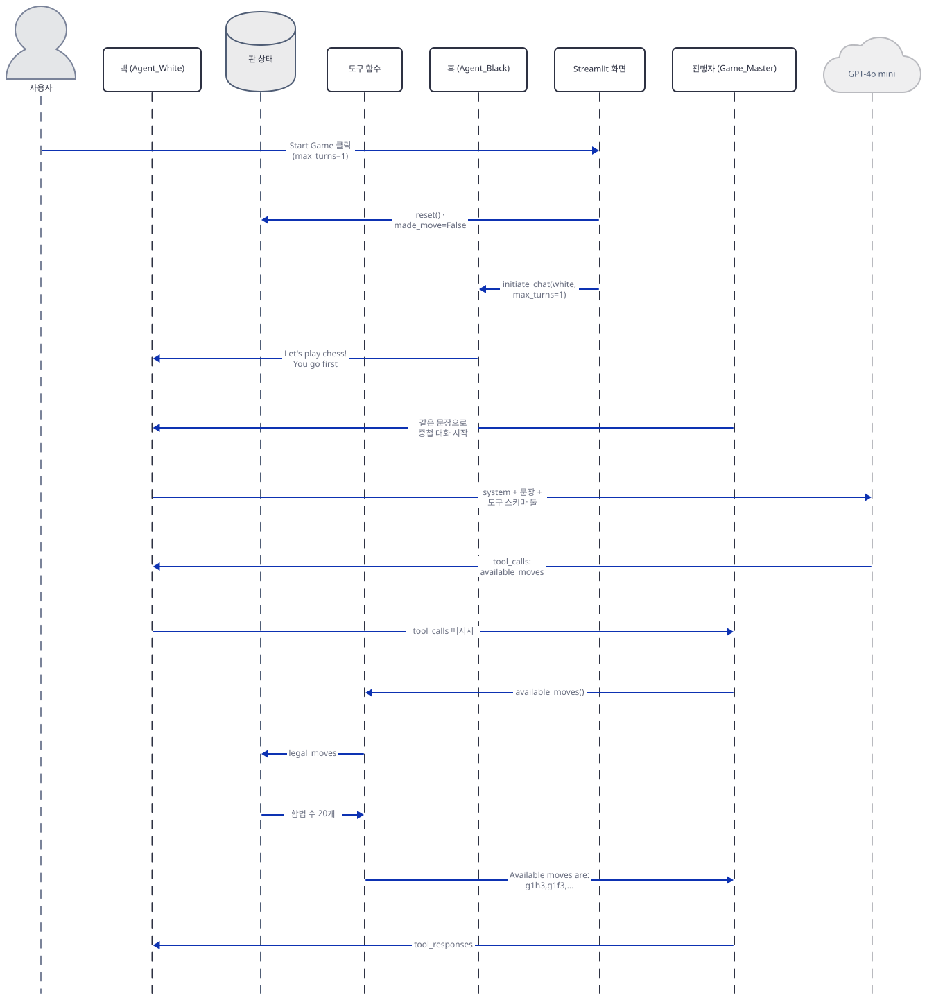

1번은 버튼 클릭부터 백이 합법 수 목록을 받는 곳까지입니다. 화면이 판을 초기화하고 흑에게 `initiate_chat`을 시키고, 흑의 시작 문장이 백에게 가며, 그 문장으로 진행자가 중첩 대화를 엽니다. 백은 모델에게 도구 스키마 둘과 함께 묻고 `available_moves` 호출을 받아 진행자에게 넘기고, 진행자는 도구 함수를 실행해 판에서 합법 수를 읽어 문자열로 돌려줍니다.

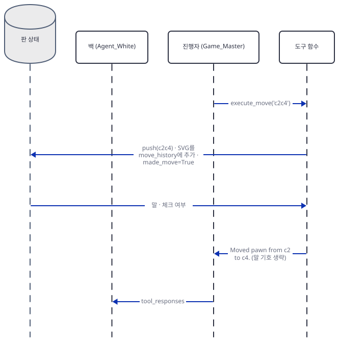

2번은 백이 합법 수 목록을 보고 `execute_move`를 부르는 곳입니다. 도구 함수가 판에 수를 두고, 그림을 저장하고, `made_move`를 `True`로 세운 뒤 판에서 말과 체크 여부를 읽어 "Moved ..." 문장을 만들어 진행자에게 돌려줍니다.

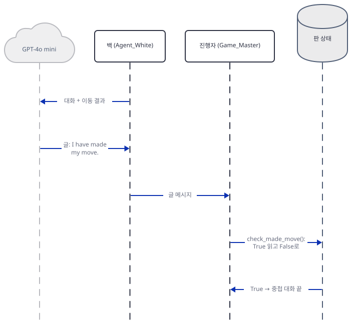

3번에서 백이 결과를 보고 "I have made my move."라고 말하고, 진행자가 받은 이 메시지에서 `check_made_move`가 `True`를 돌려 중첩 대화가 끝납니다.

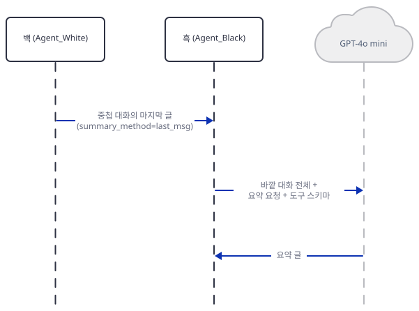

4번은 중첩 대화의 마지막 글이 바깥 대화로 흑에게 가는 곳이고, `max_turns=1`이라 턴이 끝나 흑이 `reflection_with_llm`으로 요약 호출을 합니다.

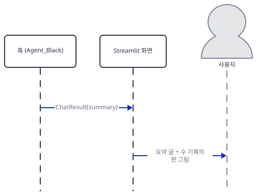

5번은 요약이 화면에 `st.markdown`으로 나오고 수마다 판 그림이 쌓여 사용자에게 보이는 마무리입니다. 29개 메시지의 존재·순서는 `max_turns=1`로 서버 기록과 `TRACE=1` 출력으로 직접 확인했고, 진짜 모델의 문장은 확인하지 못했습니다.

## 실행 체크리스트

- [ ] `requirements.txt`를 그대로 설치하면 `autogen 0.6.1`이 `pyautogen 0.6.1`을 끌어오고 앱의 import와 컴파일이 모두 성공하는 것을 확인했다
- [ ] 이 PC에서 `import cairosvg`가 실패해도 앱은 영향받지 않는 것(앱이 import하지 않음)을 확인했다
- [ ] `AppTest`로 키 없이 경고만 뜨고, 키를 넣으면 버튼 둘과 `max_turns` 기본값 5가 보이는 것을 확인했다
- [ ] `toolcheck.py`로 합법 수 20개, 불법 수·형식 오류 문장, 일회용 깃발, 체크메이트 문장을 확인했다
- [ ] `agentcheck.py`로 에이전트 셋의 `human_input_mode`·한도 100·`cache_seed=None`·도구 둘의 스키마·중첩 대화 트리거를 확인했다
- [ ] 가짜 서버로 `max_turns=1`일 때 호출 4번(도구 둘·말 하나·요약 하나)과 메시지 순서를 확인했다
- [ ] `max_turns` 1·2·3·5에서 수가 `2N−1`, 호출이 `3(2N−1)+1`인 것을 확인했다
- [ ] `max_turns=101`에서 터미널이 입력을 묻고, 입력이 없으면 API 키 오류로 보이는 것을 확인했다
- [ ] `mate` 서버로 체크메이트 뒤 호출 112번 만에 터미널이 입력을 묻는 것을 확인했다
- [ ] (키가 있다면) 새 터미널에서 `max_turns=1`로 실제로 한 수를 두게 해 보았다

## 문제 해결

| 증상 | 원인 | 해결 |
|---|---|---|
| `import cairosvg`가 `cannot load library 'libcairo-2.dll'`로 실패(직접 확인, 이 Windows PC) | `requirements.txt`의 `cairosvg`는 설치되지만 Cairo 네이티브 라이브러리가 없음. 앱은 `cairosvg`를 import하지 않음 | 무시해도 됩니다. Linux·macOS에서는 Cairo가 이미 있을 수 있지만 이 PC 밖에서는 확인하지 못했습니다 |
| 화면에 `An error occurred: EOF when reading a line. Please check your API key and try again.`(직접 확인) | AutoGen이 100번째 자동 응답 뒤에 터미널 입력을 요구했는데 표준 입력이 없어 `EOFError`. 키 문제가 아님 | 앱을 띄운 터미널에서 Enter(계속)나 `exit`(끝내기)를 입력. `max_turns`를 100 이하로 |
| 턴을 시작한 뒤 화면이 멈춘 듯하고 터미널에 `Please give feedback to Agent_Black. ...` 또는 `... to Game_Master. ...`(직접 확인) | 같은 이유. `max_turns`가 101 이상이거나, 게임이 끝났거나 모델이 수를 못 두어 100번 되풀이한 경우 | Enter 또는 `exit`. 호출은 이미 100번 나간 뒤입니다(Step 8) |
| 체크메이트가 났는데 호출이 계속 나감(직접 확인, 가짜 모델) | `available_moves`가 빈 목록을 돌려줘도 대화를 끊는 장치가 없음. 진행자는 `made_move`가 `True`일 때만 끝냄 | 사본에서 `max_turns`를 짧게. 막힌 판의 되풀이는 Step 8 |
| 게임이 끝난 뒤 "Initial Board" 제목 아래에 마지막 판이 보이고, 다른 위젯을 건드리면 "Move History"가 사라짐(직접 확인) | 204~206행이 세션의 `board` 현재 상태로 그림을 그리고, 수 기록은 "Start Game" 블록 안에서만 그려짐 | "Reset Game"을 눌러 판을 되돌리고, 기록은 게임이 끝난 화면에서 바로 보세요 |
| `Moved pawn (♙) from ...`처럼 백 말 이름이 대문자로 나오지 않음(직접 확인) | 71행의 `isupper()`가 체스 기호에서 늘 `False` | 무시해도 됩니다(표시 문구일 뿐) |
| 사이드바가 "Max turns of total chess moves"라고 하는데 수가 `2N−1`개 | `max_turns`는 `initiate_chat`의 턴이고 첫 턴만 한 수(Step 7) | 턴과 수를 구분해서 읽기 |
| `gpt-4o-mini`가 종료됨 또는 응답 오류 | `gpt-4o-mini-2024-07-18`이 2027-01-14에 종료 예정(OpenAI 폐기 문서). 별칭 동작은 문서가 말하지 않음 | 복사본의 102·109행 `"model"` 값을 폐기 문서가 권하는 `gpt-6-luna` 등으로 바꿈(리포 코드는 고치지 않음) |
| 로그에 `The API key specified is not a valid OpenAI format`(직접 확인) | 가짜 키(`sk-fake-...`)가 AutoGen의 키 모양 검사에 걸림 | 무시해도 됩니다. 진짜 키에서는 나오지 않았습니다(진짜 키는 써 보지 않았으니 확인하지는 못했습니다) |
| 앱 자체 README의 "Board Proxy"라는 이름과 `git clone` 뒤의 `cd` | 코드에는 `Board Proxy`가 없고 진행자는 `Game_Master`(98~136행). `git clone` 직후 `cd`는 저장소 폴더 이름이 빠짐(`cd awesome-llm-apps`를 먼저 해야 함) | 무시해도 됩니다 |
| 가짜 서버가 `PermissionError: [WinError 10013]`로 죽음 | 고른 포트가 Windows의 TCP 제외 포트 범위(Hyper-V·WSL 등)에 걸림. 이 PC는 49825~49924, 50000~50059, 53643~53742, 55778~55877, 57803~57902, 61153~61352가 제외(`netsh interface ipv4 show excludedportrange protocol=tcp`로 직접 확인) | 그 명령으로 범위를 보고 밖의 포트를 고름 |
| `streamlit run`을 헤드리스로 띄우면 시작 중 외부 IP 조회가 나갈 수 있음 | `--server.address`를 안 주면 Streamlit이 외부 IP를 알아내려 `checkip.amazonaws.com`에 요청(Day 060) | `--server.headless true --server.address localhost` |
| 확인 스크립트에 `missing ScriptRunContext!` 경고 | `AppTest`를 Streamlit 서버 밖에서 부름 | 무시해도 됩니다(직접 확인) |

## 더 해보기

- `drive.py`와 앱 사본에서 `"human_input_mode": "NEVER"`와 `max_consecutive_auto_reply`를 백·흑에 주고, `mate` 서버로 Step 8을 다시 돌려 막힌 판에서 호출이 몇 번에 끝나는지, 터미널이 더는 묻지 않는지 비교해 보기
- 사본의 `execute_move`가 돌려주는 문장에 판의 FEN(`chess.Board.fen()`)을 덧붙이면 상대에게 판이 전달되는지, 서버 기록의 `messages`·`chars`가 어떻게 달라지는지 보기
- `config_list` 항목에 `"base_url"`을 직접 넣어 환경변수 없이도 가짜 서버로 가는지, 환경변수와 둘 다 있으면 무엇이 이기는지 확인해 보기(소스로 받아 준다는 것까지만 확인했고 돌려 보지 않았습니다)

## 다음 날 예고

[Day 135 · 🎮 AI 3D Pygame Agent](../day135-ai-3dpygame-r1/README.md) — 같은 볼륨의 다음 앱입니다. `ai_3dpygame_r1.py`(187줄, Streamlit)는 OpenAI `gpt-4o`(86행)나 Google Gemini `gemini-1.5-pro`(96행)로 pygame 코드를 만들고, "Visualize" 버튼은 browser-use의 `BrowserSession()`(126행)으로 브라우저를 띄우는 구조이며 폴더 이름의 `r1`과 달리 두 `.py` 파일에는 `r1`도 `deepseek`도 없습니다(grep으로 확인). 같은 폴더의 `ai_gen_game01.py`(84줄)는 pygame 예시입니다(모두 소스로 확인).
