# Day 135 · 🎮 AI 3D Pygame Agent

> 볼륨 10 🎮 Autonomous Game-Playing · 난이도 ★★☆ ⚠ 앱의 Gemini 경로는 지금 두 겹으로 막혀 있습니다. `google.generativeai`는 `requirements.txt`에 없어 import가 실패하고, 모델 `gemini-1.5-pro`는 Google 변경 기록상 2025-09-29에 종료됐습니다(Step 5). "Generate Visualization" 버튼은 진짜 Chrome을 띄워 제3자 사이트 trinket.io에 코드를 올리므로 이 문서의 실습은 그 버튼의 진짜 동작을 한 번도 실행하지 않습니다(Step 2·6·7). 앱이 쓰는 `gpt-4o`의 기본 스냅숏 `gpt-4o-2024-08-06`은 2027-01-14에 종료될 예정입니다(사전 준비) · 예상 소요 105분(앱은 187줄이지만 가짜 OpenAI 서버와 `browser_use` 자리표시자, 확인 스크립트 넷을 직접 저장하고, 응답 모양을 바꿔 가며 같은 앱을 여러 번 돌려 보는 손 시간이 읽는 시간보다 큽니다) · API 비용 대략 코드 생성 한 번에 1센트 안팎(⚠ 추정입니다. 이 문서는 OpenAI를 한 번도 부르지 않았고, `gpt-4o` 표준 요금 입력 $2.50·출력 $10.00/백만 토큰에 출력 500~1,500토큰을 가정한 값입니다). 시각화 버튼은 비용을 재지 못했습니다 · 원본 앱: `advanced_ai_agents/autonomous_game_playing_agent_apps/ai_3dpygame_r1`

## 오늘 만들 것

자연어로 pygame 프로그램을 설명하면 `gpt-4o`가 코드를 써 주고, 그 코드를 브라우저 에이전트 넷이 trinket.io의 pygame 편집기에 붙여 넣어 실행하게 하는 Streamlit 앱을 따라 봅니다. 앱은 파이썬 파일 하나(`ai_3dpygame_r1.py`, 187줄)와 요청과 무관한 예시 `ai_gen_game01.py`(마지막 줄에 개행이 없어 `wc -l`은 84, 편집기에서는 85줄)로 이루어집니다. 볼륨 10의 둘째 날입니다. 첫날 Day 134의 원본 `ai_chess_agent.py`(249줄, 마지막 줄에 개행이 없어 `wc -l`은 248)는 `autogen==0.6.1`의 `ConversableAgent`로 흰·검 에이전트(`Agent_White`·`Agent_Black`)와 진행자(`Game_Master`)를 만들고 모델은 `gpt-4o-mini`입니다(소스로 확인). 오늘 앱은 게임을 "두는" 에이전트가 아닙니다. 게임 코드를 만들고 브라우저에서 돌려 볼 뿐 코드가 만든 게임을 누가 플레이하지는 않습니다. 브라우저 에이전트 자체는 Day 007이 같은 `browser-use==0.13.8`로 imgflip에서 다뤘고, 오늘은 그 라이브러리를 앱이 `BrowserSession`을 직접 만들어 쓰는 모양으로 봅니다.

이 문서는 브라우저를 한 번도 띄우지 않았고 trinket.io, OpenAI, Google에 요청을 보내지 않았습니다. OpenAI 자리에는 `OPENAI_BASE_URL`로 돌린 가짜 서버를, `browser-use` 자리에는 앱 폴더에 둔 같은 이름의 짧은 파일을 두었습니다. 그래서 아래 모델 응답은 내가 지은 대본이고, Chrome과 trinket.io 쪽, 그리고 통계 전송과 PyPI 버전 확인은 `browser-use`의 소스와 앱 README로만 읽었고 실행하지 않았습니다(통계 이벤트의 내용만 기록기로 직접 확인했습니다). 직접 돌려 보거나 소스로 확인한 것이 여섯입니다.

1. 폴더 이름의 `r1`과 앱 README의 DeepSeek는 낡았습니다. 코드에는 DeepSeek도 `agno`도 쓰이지 않고, OpenAI `gpt-4o` 한 번 호출과 문자열 처리가 코드 생성의 전부입니다(Step 1·4).
2. 응답이 코드 블록으로 시작하지 않으면(앞에 인사말이 붙으면) 백틱과 인사말이 코드에 그대로 남아 실행하면 `SyntaxError`입니다(Step 4, 8).
3. Gemini를 고르면 `No module named 'google.generativeai'`가 화면에 나옵니다(Step 5).
4. 시각화 버튼은 에이전트 넷을 만들어 아래 순서로 돌립니다. 코드를 입력하는 에이전트가 실행 에이전트보다 먼저 돌고, 에이전트가 단계 실패로 멈춘 경우에도 화면은 "Code is running on Trinket!"을 찍습니다(브라우저를 못 띄우는 등의 시작 예외는 `st.error`가 됩니다, Step 6·7).
5. `browser-use` 0.13.8은 익명 통계를 기본으로 보내고, 그 이벤트에 에이전트의 과제 글 전체가 들어갑니다. 입력 에이전트의 과제 글에는 생성된 코드 전문이 있습니다(Step 7).
6. 앱의 예시 `ai_gen_game01.py`는 첫 프레임에서 `TypeError`로 죽습니다(Step 8).

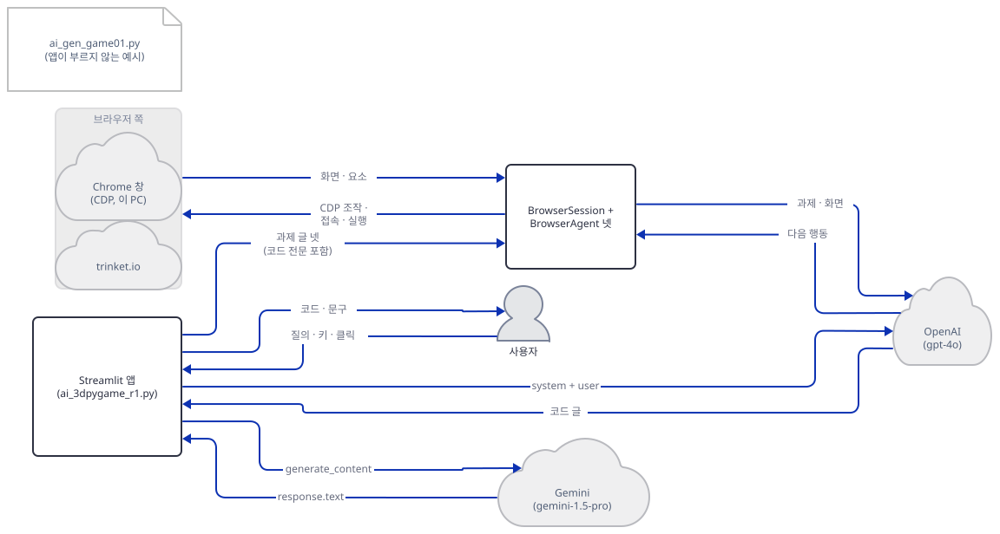

## 사전 준비

| 서비스/도구 | 용도 | 발급·설치 |
|---|---|---|
| uv | 가상환경 생성과 패키지 설치 | [공통 사전 준비](../README.md#공통-사전-준비-한-번만) 절 참고 |
| Python | 이 문서는 3.13.3으로 확인했다. `browser-use` 0.13.8은 3.11 이상을 요구한다 | 공통 사전 준비와 같음 |
| OpenAI API 키 | 진짜로 쓸 때 코드 생성(86행)과 `browser-use`의 모델(130행)이 부른다. 이 문서의 실습은 쓰지 않는다 | https://platform.openai.com/api-keys |
| Google Gemini API 키 | 진짜로 쓸 때 Gemini 경로(95행). 이 문서의 실습은 쓰지 않는다 | https://aistudio.google.com/app/api-keys |
| Chrome 등 Chromium 계열 브라우저 | 진짜 시각화 버튼이 띄운다. 이 문서의 실습은 쓰지 않는다 | Step 7 참고 |
| pygame | Step 8에서 코드를 돌려 볼 때만. 앱의 `requirements.txt`에는 없다 | Step 1에서 설치 |

⚠ **모델.** 앱은 `gpt-4o`를 두 곳에서 씁니다(`ai_3dpygame_r1.py:86`, `130`). OpenAI 모델 페이지(https://developers.openai.com/api/docs/models/gpt-4o, 2026-10-15 확인)는 이 모델의 "Default snapshot"을 `gpt-4o-2024-08-06`이라고 적습니다. 공식 폐기 문서(https://developers.openai.com/api/docs/deprecations, 같은 날)에는 `gpt-4o`라는 id 자체의 종료 행이 없지만, 그 기본 스냅숏 `gpt-4o-2024-08-06`(과 `gpt-4o-2024-11-20`)이 2027-01-14에 종료되고 대체 모델이 `gpt-6-luna`라는 행이 있습니다. 별칭 `gpt-4o`가 그 뒤 어떻게 되는지는 두 문서 어디에도 적혀 있지 않아 이 문서도 확인하지 못했습니다. 2027-01-14 이후에 호출이 실패하면 86행과 130행을 새 모델로 바꿔야 할 수 있습니다. ⚠ **Gemini 모델.** 96행의 `gemini-1.5-pro`는 Google 변경 기록(https://ai.google.dev/gemini-api/docs/changelog, 같은 날 확인)의 "September 29, 2025" 항목에 "The following Gemini 1.5 models are now shut down: gemini-1.5-pro, gemini-1.5-flash-8b, gemini-1.5-flash"라고 적혀 있고(2025-09-29), 원문은 대체 모델을 적지 않습니다. 같은 날 확인한 폐기 문서(https://ai.google.dev/gemini-api/docs/deprecations)의 표에는 1.5 계열이 아예 없습니다.

이 문서의 스크립트와 앱은 한글을 출력합니다. 출력을 파이프나 파일로 받는 한국어 Windows에서는 셸을 먼저 맞춰 두세요. 이 문서의 모든 터미널에 같은 변수 셋을 줍니다. 아래 셋 가운데 `ANONYMIZED_TELEMETRY`는 값이 반드시 `false`여야 합니다(빈 값이면 `browser-use`를 가져오는 순간 실패합니다, 문제 해결).

```bash
export PYTHONIOENCODING=utf-8
export ANONYMIZED_TELEMETRY=false
export STREAMLIT_BROWSER_GATHER_USAGE_STATS=false
```

```powershell
$env:PYTHONIOENCODING = "utf-8"
$env:ANONYMIZED_TELEMETRY = "false"
$env:STREAMLIT_BROWSER_GATHER_USAGE_STATS = "false"
```

## 아키텍처 한눈에 보기

| 컴포넌트 | 역할 | 코드 위치 |
|---|---|---|
| 화면 | 제공자 선택, 키 입력 둘, 질의 입력, 버튼 둘 | `advanced_ai_agents/autonomous_game_playing_agent_apps/ai_3dpygame_r1/ai_3dpygame_r1.py:21-64` |
| 코드 생성 | 키 검사, 모델 한 번 호출, 코드 블록 정리, 화면 표시 | `advanced_ai_agents/autonomous_game_playing_agent_apps/ai_3dpygame_r1/ai_3dpygame_r1.py:66-119` |
| 저장 (`session_state`) | 정리한 코드를 `generated_code`로 둔다 | `advanced_ai_agents/autonomous_game_playing_agent_apps/ai_3dpygame_r1/ai_3dpygame_r1.py:110` |
| 시각화 | 브라우저 세션과 에이전트 넷을 만들어 차례로 돌린다 | `advanced_ai_agents/autonomous_game_playing_agent_apps/ai_3dpygame_r1/ai_3dpygame_r1.py:121-184` |
| OpenAI (`gpt-4o`) | 코드를 쓰는 모델과 브라우저 에이전트의 모델 | 코드 없음 (외부 서비스, 86행·130행에서 호출) |
| Gemini (`gemini-1.5-pro`) | 제공자를 Gemini로 고르면 부르는 모델 | `advanced_ai_agents/autonomous_game_playing_agent_apps/ai_3dpygame_r1/ai_3dpygame_r1.py:93-98` |
| Chrome 창·trinket.io | `browser-use`가 CDP로 조종하는 브라우저와 코드를 실행하는 사이트 | 코드 없음 (외부, Step 7) |
| `browser-use` 익명 통계 | `run()`이 끝날 때마다 보내는 이벤트 | 코드 없음 (라이브러리 소스) |
| PyPI 버전 확인 | `run()`을 시작할 때 `browser-use`의 최신 버전을 묻는다 | 코드 없음 (라이브러리 소스) |
| 예시 `ai_gen_game01.py` | 앱이 부르지 않는 pygame 예시 | `advanced_ai_agents/autonomous_game_playing_agent_apps/ai_3dpygame_r1/ai_gen_game01.py:1-85` |

첫 그림에서 앱은 하나로 그렸습니다. 앱 안의 네 덩어리가 서로 어떻게 이어지는지는 아래 그림이 화살표로 그렸습니다.

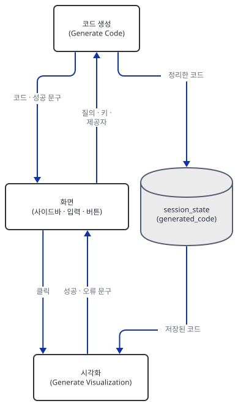

## 단계별 진행

### Step 1. 환경 만들기

**목적.** 앱 파일을 작업 폴더로 복사해 독립 가상환경에 설치하고, 무엇이 설치되고 무엇이 설치되지 않는지, 앱 README와 코드가 어디서 다른지 확인합니다.

**할 일.** 저장소 루트에서 시작합니다. 원본 폴더에서 컴파일하면 `__pycache__`가 생기니 복사본으로만 작업합니다.

```bash
mkdir -p ../pygame-lab
cp advanced_ai_agents/autonomous_game_playing_agent_apps/ai_3dpygame_r1/ai_3dpygame_r1.py advanced_ai_agents/autonomous_game_playing_agent_apps/ai_3dpygame_r1/ai_gen_game01.py advanced_ai_agents/autonomous_game_playing_agent_apps/ai_3dpygame_r1/requirements.txt ../pygame-lab/
cd ../pygame-lab
uv venv --python 3.13
uv pip install -r requirements.txt
uv pip install pygame
```

```powershell
New-Item -ItemType Directory -Force ..\pygame-lab
Copy-Item advanced_ai_agents\autonomous_game_playing_agent_apps\ai_3dpygame_r1\ai_3dpygame_r1.py, advanced_ai_agents\autonomous_game_playing_agent_apps\ai_3dpygame_r1\ai_gen_game01.py, advanced_ai_agents\autonomous_game_playing_agent_apps\ai_3dpygame_r1\requirements.txt ..\pygame-lab\
Set-Location ..\pygame-lab
uv venv --python 3.13
uv pip install -r requirements.txt
uv pip install pygame
```

(PowerShell 줄은 실행해 보지 못했습니다. pip 대안은 `python -m venv .venv`로 만들고 활성화한 뒤 `pip install -r requirements.txt`와 `pip install pygame`입니다.) 이후 모든 명령은 `pygame-lab` 폴더에서 `uv run --no-project`로 돌립니다. 이유는 공통 사전 준비에 있습니다.

`advanced_ai_agents/autonomous_game_playing_agent_apps/ai_3dpygame_r1/requirements.txt:1-3`

```text
agno>=2.2.10
browser-use==0.13.8
streamlit
```

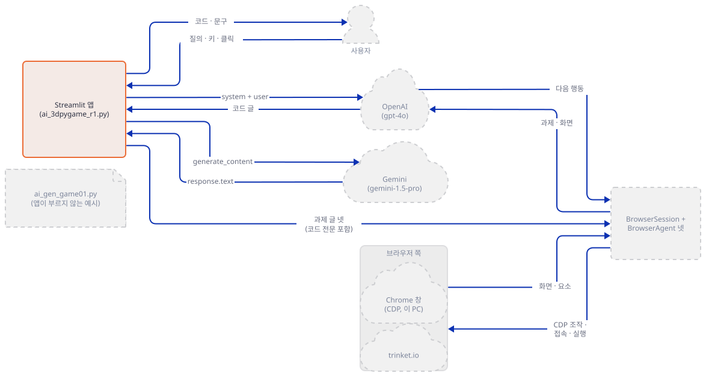

**확인.** 설치 결과를 스크립트로 봅니다. 아래를 `pygame-lab/versions.py`로 저장합니다.

```python
import importlib.metadata as m
import importlib.util as u

for name in ["agno", "browser-use", "streamlit", "openai", "google-genai", "pygame", "playwright"]:
    try:
        print(f"{name:14s}", m.version(name))
    except m.PackageNotFoundError:
        print(f"{name:14s}", "설치 안 됨")
print("google.generativeai:", "있음" if u.find_spec("google.generativeai") else "없음")
```

```bash
uv run --no-project python versions.py
uv run --no-project python -m py_compile ai_3dpygame_r1.py && echo compiled
grep -n "agno\|AgnoAgent\|RunOutput\|AgnoOpenAIChat" ai_3dpygame_r1.py
grep -ci "deepseek" ai_3dpygame_r1.py
```

기대 출력(오늘 기준, 직접 확인)이고 마지막 `grep -c`는 `0`을 찍고 종료 코드 1로 끝납니다.

```text
agno           3.1.3
browser-use    0.13.8
streamlit      1.66.0
openai         2.16.0
google-genai   1.65.0
pygame         2.6.1
playwright     설치 안 됨
google.generativeai: 없음
compiled
3:from agno.agent import Agent as AgnoAgent
4:from agno.run.agent import RunOutput
5:from agno.models.openai import OpenAIChat as AgnoOpenAIChat
0
```

설치는 `requirements.txt` 기준 125개입니다(직접 확인). 읽을 것이 다섯입니다. 첫째, `openai`는 `requirements.txt`에 없지만 `browser-use`가 `openai==2.16.0`을 정확히 고정해 끌고 옵니다(패키지 메타데이터로 확인). 둘째, 같은 방식으로 `google-genai==1.65.0`도 들어오는데 이것은 앱이 쓰는 `google.generativeai`가 아니라 새 SDK입니다(Step 5). 셋째, `agno`는 3~5행에서 가져오기만 하고 이름 셋 모두 그 뒤 어디에도 쓰이지 않습니다(위 `grep`이 이 세 줄뿐). 3~5행을 지운 사본으로도 같은 요청이 끝났고 `agno`는 불러지지 않았습니다(직접 확인, Step 4의 `fenced`와 같은 요청). 그러니 `agno>=2.2.10`은 설치 시간만 늘립니다. 넷째, `playwright`는 설치되지 않습니다. 이 버전의 `browser-use`는 CDP로 브라우저를 직접 조종하고 Day 007도 설치 목록에 `playwright`가 없다는 같은 사실을 적었습니다. 다섯째, 앱 README의 DeepSeek Reasoner·"OpenAI로 코드 추출" 설명은 코드와 맞지 않습니다. 안내 5번("Browser use automatically opens your web browser")은 귀속이 틀립니다. 헤드리스가 아닌 `streamlit run`이 앱 주소를 브라우저로 여는 것이고, `browser-use`는 시각화 버튼을 누를 때에야 Chrome을 띄웁니다. `grep -ci deepseek`가 0이고, 코드 추출이라고 부를 만한 모델 호출은 없습니다(Step 4). 폴더 이름의 `r1`은 DeepSeek R1의 흔적입니다.

### Step 2. 가짜 서버와 자리표시자 — 바깥으로 나가지 않는 실습장

**목적.** 모델 서버를 가짜로 바꾸고, 진짜 `browser_use`가 불러지지 않게 같은 이름의 파일로 가립니다. 이 단계가 끝나기 전에는 앱을 띄우지 않습니다.

**할 일.** 먼저 가짜 OpenAI 서버를 `pygame-lab/fake_openai.py`로 저장합니다. 요청마다 한 줄을 `openai.jsonl`에 적고, 질의에 든 낱말(`chatty`, `bare`, `plain`)로 응답 모양을 바꿉니다. 모양을 고르지 않으면 `python` 표시가 붙은 코드 블록(백틱 셋으로 감싼 것)으로 답합니다. 코드는 pygame 창을 만들고 세 번 칠한 뒤 닫는 짧은 것입니다.

`pygame-lab/fake_openai.py`

```python
import json, sys, threading
from http.server import BaseHTTPRequestHandler, ThreadingHTTPServer

PORT, LOG = int(sys.argv[1]), sys.argv[2]
LOCK = threading.Lock()
CODE = (
    "import pygame\n"
    "pygame.init()\n"
    "screen = pygame.display.set_mode((320, 200))\n"
    "for _ in range(3):\n"
    "    screen.fill((0, 0, 0))\n"
    "    pygame.display.flip()\n"
    "print('generated code ran')\n"
    "pygame.quit()"
)


def log(rec):
    with LOCK, open(LOG, "a", encoding="utf-8") as f:
        f.write(json.dumps(rec, ensure_ascii=False) + "\n")


class Handler(BaseHTTPRequestHandler):
    protocol_version = "HTTP/1.1"

    def log_message(self, *args):
        pass

    def do_POST(self):
        body = json.loads(self.rfile.read(int(self.headers["content-length"])))
        msgs = body["messages"]
        user = msgs[-1]["content"]
        log({"path": self.path, "model": body["model"], "roles": [m["role"] for m in msgs],
             "key_head": (self.headers.get("authorization") or "")[:11], "user": user[:60]})
        # 질문에 든 낱말로 응답 모양을 고른다
        if "chatty" in user:
            content = "Sure! Here is the code:\n```python\n" + CODE + "\n```\nHope it helps."
        elif "bare" in user:
            content = "```\n" + CODE + "\n```"
        elif "plain" in user:
            content = CODE
        else:
            content = "```python\n" + CODE + "\n```"
        out = {"id": "c1", "object": "chat.completion", "created": 0, "model": body["model"],
               "choices": [{"index": 0, "message": {"role": "assistant", "content": content},
                            "finish_reason": "stop"}],
               "usage": {"prompt_tokens": 10, "completion_tokens": 5, "total_tokens": 15}}
        data = json.dumps(out).encode()
        self.send_response(200)
        self.send_header("content-type", "application/json")
        self.send_header("content-length", str(len(data)))
        self.end_headers()
        self.wfile.write(data)


class Server(ThreadingHTTPServer):
    allow_reuse_address = False
    daemon_threads = True


Server(("127.0.0.1", PORT), Handler).serve_forever()
```

다음은 `browser_use`를 가리는 파일입니다. 이름이 진짜 패키지와 같고, 앱이 쓰는 것(`BrowserSession`, `ChatOpenAI`, `Agent`)만 흉내 내어 부름을 `visualize_calls.jsonl`에 적을 뿐 브라우저는 띄우지 않습니다. 가려지는 까닭은 두 가지입니다. `streamlit run`은 스크립트 폴더를 `sys.path` 맨 앞에 넣고(Streamlit 소스 `web/bootstrap.py`의 `_fix_sys_path`로 확인), `python -c`와 `python 스크립트.py`는 파이썬 자신이 현재 폴더나 스크립트 폴더를 맨 앞에 넣습니다. 어느 쪽이든 같은 폴더의 `browser_use.py`가 설치된 패키지보다 먼저 잡힙니다. 그래서 이 폴더에서 돌리지 않으면(또는 `python -I`로 돌리면) 가려지지 않습니다. Step 3의 확인 스크립트는 이것을 맨 앞에서 검사합니다.

`pygame-lab/browser_use.py`

```python
"""진짜 browser-use가 아니다. 브라우저를 띄우지 않고, 앱이 부른 것을 기록만 하는 자리표시자."""
import json


def _log(**rec):
    with open("visualize_calls.jsonl", "a", encoding="utf-8") as f:
        f.write(json.dumps(rec, ensure_ascii=False) + "\n")


class BrowserSession:
    def __init__(self, *args, **kwargs):
        _log(call="BrowserSession()")

    async def start(self):
        _log(call="session.start()")

    async def stop(self):
        _log(call="session.stop()")


class ChatOpenAI:
    def __init__(self, model, api_key):
        _log(call="ChatOpenAI", model=model, key_head=api_key[:4])


class Agent:
    def __init__(self, task, llm, browser_session):
        self.task = task
        _log(call="Agent()", task_chars=len(task), task_head=task[:40])

    async def run(self):
        _log(call="agent.run()", task_head=self.task[:12])
```

**터미널 A**에서 가짜 서버를 띄웁니다. 포트는 아무 높은 번호면 됩니다(여기서는 54123). 이 터미널에서는 다른 일을 하지 않습니다.

```bash
uv run --no-project python fake_openai.py 54123 openai.jsonl
```

**터미널 B**를 새로 열어 `pygame-lab`으로 가서, 위 사전 준비의 변수 셋을 다시 주고 모델 주소를 가짜 서버로 돌립니다. 앱이 `OpenAI(api_key=...)`에 주소 인자를 주지 않으므로(84행) SDK가 `OPENAI_BASE_URL`을 따릅니다. 가짜 서버에 요청이 기록되는 것으로 확인합니다(Step 4).

```bash
export PYTHONIOENCODING=utf-8
export ANONYMIZED_TELEMETRY=false
export STREAMLIT_BROWSER_GATHER_USAGE_STATS=false
export OPENAI_BASE_URL=http://127.0.0.1:54123/v1
```

```powershell
$env:PYTHONIOENCODING = "utf-8"
$env:ANONYMIZED_TELEMETRY = "false"
$env:STREAMLIT_BROWSER_GATHER_USAGE_STATS = "false"
$env:OPENAI_BASE_URL = "http://127.0.0.1:54123/v1"
```

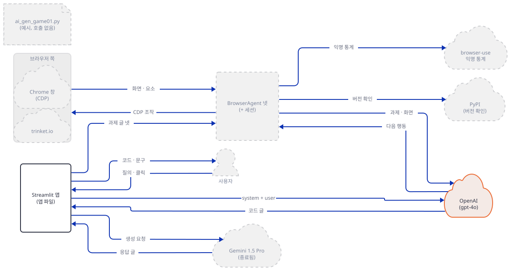

**확인.** 이 터미널에서 `browser_use`가 가려졌는지, 변수가 맞는지 봅니다. 하나라도 어긋나면 다음 Step으로 가지 마세요.

```bash
uv run --no-project python -c "import browser_use; print(browser_use.__file__)"
echo "$OPENAI_BASE_URL"
```

기대 출력은 경로 끝이 `pygame-lab`의 `browser_use.py`이고(직접 확인) 둘째 줄은 `http://127.0.0.1:54123/v1`입니다. 첫 줄이 `.venv`의 `site-packages` 아래를 가리키면 진짜 패키지가 가져와진 것이니 이 폴더에서 실행하고 있는지 보세요. 앱은 키를 환경변수에서 읽지 않고 사이드바 입력에서만 받습니다(`st.session_state.api_keys`가 13·29~38·70~73·84·95·131행에 있고, 앱 파일에는 `os`도 `getenv`도 없음, `grep`으로 확인). 그래서 셸에 진짜 `OPENAI_API_KEY`가 있어도 이 앱은 쓰지 않고, 상위 폴더 `.env`도 앱 코드가 부르지 않습니다. 진짜 `browser_use`만 가져오는 순간 `load_dotenv()`를 부르는데(소스 `telemetry/service.py`의 10행), 자리표시자가 가리는 동안은 불리지 않습니다.

### Step 3. 화면과 키 검사 — 요청이 나가기 전에 끝나는 경로

**목적.** 화면이 무엇을 입력받고, 키·질의가 비었을 때 모델 호출 전에 어디서 멈추는지 봅니다.

**할 일.** 화면은 사이드바의 선택 상자 하나와 키 입력 둘, 본문의 질의 입력과 버튼 둘입니다. 선택 결과는 `session_state`에 들어갑니다.

`advanced_ai_agents/autonomous_game_playing_agent_apps/ai_3dpygame_r1/ai_3dpygame_r1.py:24-38`

```python
    st.session_state.model_provider = st.selectbox(
        "Select Model Provider",
        ["OpenAI", "Google Gemini"]
    )

    st.session_state.api_keys["openai"] = st.text_input(
        "OpenAI API Key",
        type="password",
        value=st.session_state.api_keys["openai"]
    )
    st.session_state.api_keys["gemini"] = st.text_input(
        "Google Gemini API Key",
        type="password",
        value=st.session_state.api_keys["gemini"]
    )
```

"Generate Code"를 누르면 질의가 있는지 먼저 봅니다(66행). 질의가 있으면 고른 제공자의 키가 비었는지 검사해 비었으면 `st.stop()`으로 멈춥니다. 질의가 없으면 마지막 `elif`가 경고만 띄웁니다(186~187행). "Generate Visualization"은 코드를 만든 적이 없으면 경고로 끝납니다(121~123행).

`advanced_ai_agents/autonomous_game_playing_agent_apps/ai_3dpygame_r1/ai_3dpygame_r1.py:66-75`

```python
if generate_code_btn and query:
    provider = st.session_state.model_provider

    # Validate API keys
    if provider == "OpenAI" and not st.session_state.api_keys["openai"]:
        st.error("Please provide OpenAI API key in the sidebar")
        st.stop()
    elif provider == "Google Gemini" and not st.session_state.api_keys["gemini"]:
        st.error("Please provide Google Gemini API key in the sidebar")
        st.stop()
```

화면을 브라우저로 누르지 않고 Streamlit의 테스트 도구(`AppTest`)로 앱을 한 번 돌려 결과를 읽는 확인 스크립트를 저장합니다. 같은 앱 코드를 그대로 실행하고, 사이드바·입력·버튼을 코드로 조작합니다. 인자 하나가 경우를 고릅니다(`nokey`, `empty`, `early`, `fenced`, `chatty`, `bare`, `plain`, `gemini`, `visualize`). 화면에 나온 오류·경고·성공 문구와, 정리된 코드가 있으면 그 줄 수를 찍고 `generated_game.py`로 저장합니다. 맨 앞의 두 `assert`가 안전장치입니다. `OPENAI_BASE_URL`이 루프백 가짜 서버가 아니거나 `browser_use`가 Step 2의 자리표시자가 아니면(진짜 패키지는 `__path__`가 있고 파일 하나짜리 모듈인 자리표시자는 없습니다) 앱을 돌리기 전에 멈춥니다. 이 장치가 없으면 진짜 패키지로 시각화 경로를 돌리게 됩니다(Step 7).

`pygame-lab/check_generate.py`

```python
import json, os, sys

# 안전 검사: 아래 둘 가운데 하나라도 거짓이면 모델·브라우저로 가기 전에 멈춘다
assert os.environ.get("OPENAI_BASE_URL", "").startswith("http://127.0.0.1:"), "OPENAI_BASE_URL을 먼저 거세요 (Step 2)"
import browser_use
assert not hasattr(browser_use, "__path__"), "진짜 browser_use가 잡혔습니다. Step 2의 browser_use.py를 이 폴더에 두세요"
from streamlit.testing.v1 import AppTest

case = sys.argv[1]
at = AppTest.from_file("ai_3dpygame_r1.py", default_timeout=30)
at.run()

if case != "nokey":
    at.sidebar.text_input[0].set_value("sk-fake-1234567890")
if case == "gemini":
    at.sidebar.selectbox[0].select("Google Gemini")
    at.sidebar.text_input[1].set_value("fake-gemini-key")
if case != "empty":
    at.text_area[0].set_value(case + " particle system")

if case == "early":
    at.button[1].click().run()  # 코드를 만들기 전에 시각화부터
else:
    at.button[0].click().run()  # Generate Code
    if case == "visualize":
        at.button[1].click().run()  # Generate Visualization

for e in at.error:
    print("error  :", e.value)
for w in at.warning:
    print("warning:", w.value)
for s in at.success:
    print("success:", s.value)
if "generated_code" in at.session_state:
    code = at.session_state["generated_code"]
    open("generated_game.py", "w", encoding="utf-8").write(code)  # Step 8에서 돌려 볼 파일
    lines = code.splitlines()
    print("generated_code:", len(lines), "줄 | 첫 줄:", lines[0], "| 끝 줄:", lines[-1])
if case == "visualize" and os.path.exists("visualize_calls.jsonl"):
    for line in open("visualize_calls.jsonl", encoding="utf-8"):
        print(line.strip())
```

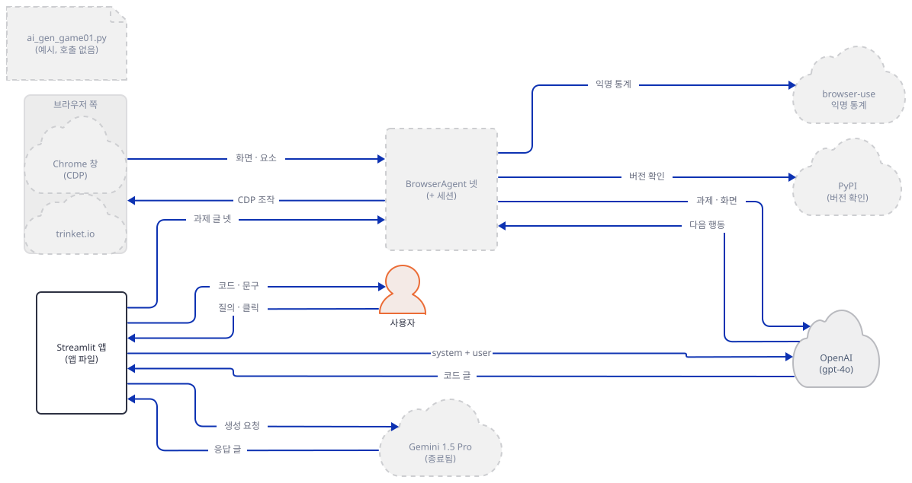

**확인.** 터미널 B에서 세 경우를 돌립니다. 이 스크립트는 `streamlit run` 밖에서 앱을 돌리므로 stderr에 `Thread 'MainThread': missing ScriptRunContext! This warning can be ignored when running in bare mode.` 경고가 나오는데 무시해도 됩니다(직접 확인). 이 셋은 모델을 부르지 않습니다.

```bash
uv run --no-project python check_generate.py nokey
uv run --no-project python check_generate.py empty
uv run --no-project python check_generate.py early
```

기대 출력(경고 줄 제외, 직접 확인):

```text
error  : Please provide OpenAI API key in the sidebar
warning: Please enter a query before generating code
warning: Please generate code first before visualization
```

`openai.jsonl`은 아직 생기지 않았거나 비어 있어야 합니다. 세 경우 모두 모델 호출 앞에서 끝났다는 뜻입니다.

### Step 4. 코드 생성과 정리 — 호출 하나, 문자열 처리 셋

**목적.** 코드 생성이 모델을 몇 번 어떻게 부르는지, 응답을 코드로 바꾸는 정리 규칙이 어떤 응답에서 깨지는지 봅니다.

**할 일.** 코드 생성의 호출은 하나입니다. 시스템 메시지로 역할과 "백틱 없이 코드만"을 요청하고, 사용자 메시지에 질의를 그대로 담아 `gpt-4o`에 보냅니다. 키는 사이드바에서 받은 값이고 주소 인자는 없습니다.

`advanced_ai_agents/autonomous_game_playing_agent_apps/ai_3dpygame_r1/ai_3dpygame_r1.py:77-92`

```python
    system_prompt = """You are a Pygame and Python Expert that specializes in making games and visualisation through pygame and python programming.
    Generate complete, working Python pygame code for the user's request.
    Return ONLY the Python code without any explanations or markdown backticks."""

    try:
        with st.spinner("Generating code..."):
            if provider == "OpenAI":
                client = OpenAI(api_key=st.session_state.api_keys["openai"])
                response = client.chat.completions.create(
                    model="gpt-4o",
                    messages=[
                        {"role": "system", "content": system_prompt},
                        {"role": "user", "content": query}
                    ]
                )
                extracted_code = response.choices[0].message.content
```

시스템 프롬프트가 백틱을 금지하는데도 앱은 응답이 백틱으로 싸여 있을 때를 대비한 정리를 따로 합니다. 규칙은 문자열의 처음과 끝만 봅니다. 백틱 셋과 `python`으로 시작하면 9글자, 백틱 셋으로만 시작하면 3글자를 앞에서 떼고, 백틱 셋으로 끝나면 3글자를 뒤에서 뗀 뒤 공백을 다듬습니다. 결과를 `session_state`에 두고 화면에 보입니다.

`advanced_ai_agents/autonomous_game_playing_agent_apps/ai_3dpygame_r1/ai_3dpygame_r1.py:100-116`

```python
        # Clean up code if wrapped in markdown
        if extracted_code.startswith("```python"):
            extracted_code = extracted_code[9:]
        if extracted_code.startswith("```"):
            extracted_code = extracted_code[3:]
        if extracted_code.endswith("```"):
            extracted_code = extracted_code[:-3]
        extracted_code = extracted_code.strip()

        # Store the generated code in session state
        st.session_state.generated_code = extracted_code

        # Display the code
        with st.expander("Generated PyGame Code", expanded=True):
            st.code(extracted_code, language="python")

        st.success("Code generated successfully! Click 'Generate Visualization' to run it.")
```

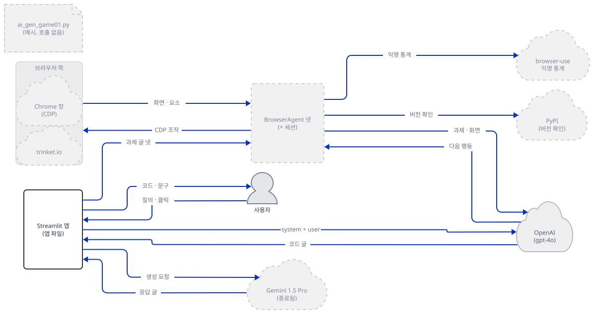

**확인.** 네 가지 응답 모양을 차례로 돌립니다. 가짜 서버가 질의에 든 낱말로 모양을 고릅니다. 앞의 `fenced`는 낱말이 없어 기본(`python` 표시 코드 블록)입니다.

```bash
uv run --no-project python check_generate.py fenced
uv run --no-project python check_generate.py bare
uv run --no-project python check_generate.py plain
uv run --no-project python check_generate.py chatty
cat openai.jsonl
```

기대 출력(경고 줄 제외, 직접 확인):

```text
success: Code generated successfully! Click 'Generate Visualization' to run it.
generated_code: 8 줄 | 첫 줄: import pygame | 끝 줄: pygame.quit()
success: Code generated successfully! Click 'Generate Visualization' to run it.
generated_code: 8 줄 | 첫 줄: import pygame | 끝 줄: pygame.quit()
success: Code generated successfully! Click 'Generate Visualization' to run it.
generated_code: 8 줄 | 첫 줄: import pygame | 끝 줄: pygame.quit()
success: Code generated successfully! Click 'Generate Visualization' to run it.
generated_code: 12 줄 | 첫 줄: Sure! Here is the code: | 끝 줄: Hope it helps.
```

앞 셋(블록, 이름 없는 블록, 백틱 없음)은 8줄 코드로 정리됩니다. 넷째 `chatty`는 인사말이 앞에 붙어 문자열이 백틱으로 시작하지 않아 앞쪽 정리가 한 번도 걸리지 않았습니다. 인사말·여는 백틱 줄·닫는 백틱 줄·맺음말이 모두 남은 12줄이고, 화면은 그래도 성공 문구를 찍습니다. 이 글은 Step 8에서 `SyntaxError`가 됩니다. 정리 규칙은 "응답 전체가 코드 블록 하나"일 때만 맞습니다.

`cat openai.jsonl`은 요청이 네 줄이고, 각 줄이 같은 모양입니다(첫 줄만 적음, 직접 확인).

```text
{"path": "/v1/chat/completions", "model": "gpt-4o", "roles": ["system", "user"], "key_head": "Bearer sk-f", "user": "fenced particle system"}
```

요청 하나가 `gpt-4o`, 메시지 둘(system·user)이고, `key_head`는 사이드바에 넣은 가짜 키의 앞 몇 글자입니다. 셸에 넣어 둔 `OPENAI_API_KEY`나 상위 폴더 `.env`의 키가 아닙니다. 모델 호출이 한 번뿐이라는 것은 소스에서도 같습니다. 코드 생성 경로에 `client.chat.completions.create`는 한 줄입니다(85행). 코드의 "추출"을 모델이 한 번 더 하지 않습니다.

### Step 5. Gemini 경로 — 두 겹으로 막혀 있다

**목적.** 제공자를 Gemini로 고르면 무슨 일이 일어나는지 보고, 무엇이 막는지 구분합니다.

**할 일.** Gemini 경로는 호출하는 순간에 라이브러리를 가져옵니다. `requirements.txt`가 설치하지 않는 옛 SDK `google.generativeai`입니다.

`advanced_ai_agents/autonomous_game_playing_agent_apps/ai_3dpygame_r1/ai_3dpygame_r1.py:93-98`

```python
            else:  # Google Gemini
                import google.generativeai as genai
                genai.configure(api_key=st.session_state.api_keys["gemini"])
                model = genai.GenerativeModel("gemini-1.5-pro")
                response = model.generate_content(f"{system_prompt}\n\nUser request: {query}")
                extracted_code = response.text
```

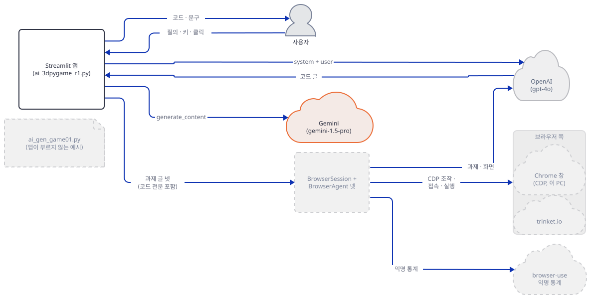

**확인.**

```bash
uv run --no-project python check_generate.py gemini
```

기대 출력(경고 줄 제외, 직접 확인):

```text
error  : An error occurred: No module named 'google.generativeai'
```

첫째 겹은 이 설치에서 직접 본 것입니다. 앱의 `except`(118~119행)가 예외 글을 그대로 화면에 보여 줍니다. 둘째 겹은 모델입니다. 이 문서는 Google을 부르지 않았으므로 실제 오류 글은 보지 못했고, Google 변경 기록의 "2025-09-29에 `gemini-1.5-pro` 종료" 줄을 근거로 호출이 실패할 것이라고만 말할 수 있습니다(사전 준비). 옛 SDK 쪽도 PyPI의 `google-generativeai` 0.8.6(2025-12-16)이 설명 맨 앞에 "[Deprecated] Google AI Python SDK for the Gemini API"라고 적습니다(2026-10-15에 PyPI JSON으로 읽음). 새 SDK `google-genai`는 Step 1에서 본 대로 이미 설치돼 있습니다. 가짜 Gemini 서버에 `genai.Client(api_key=..., http_options=types.HttpOptions(base_url=...))`로 `models.generate_content(model=..., contents=...)`를 부르면 `.text`가 돌아오는 것까지는 이 문서가 확인했습니다(더 해보기).

### Step 6. Generate Visualization — 에이전트 넷은 이 순서로 돈다

**목적.** 시각화 버튼이 무엇을 만들고 어떤 순서로 돌리는지, 생성된 코드가 어디에 들어가는지 자리표시자로 봅니다.

**할 일.** 버튼은 비동기 함수를 `asyncio.run`으로 한 번 돌립니다(184행). 함수는 먼저 브라우저 세션을 만들어 `start()`합니다. 이때 진짜 `browser-use`라면 브라우저가 뜹니다(Step 7).

`advanced_ai_agents/autonomous_game_playing_agent_apps/ai_3dpygame_r1/ai_3dpygame_r1.py:125-132`

```python
        async def run_pygame_on_trinket(code: str) -> None:
            browser_session = BrowserSession()
            try:
                await browser_session.start()
                model = ChatOpenAI(
                    model="gpt-4o", 
                    api_key=st.session_state.api_keys["openai"]
                )
```

에이전트는 넷이고 같은 세션과 모델을 나눠 씁니다. 선언 순서는 길 찾기(134~138행), 실행(140~144행), 코드 입력(152~162행), 보기(164~168행)입니다. 코드 입력 에이전트의 과제 글에만 생성된 코드가 `f"{code}"`로 통째로 들어갑니다. 앱 안의 주석(146~151행)은 이전 판에서 `code`가 어느 과제에도 없었다는 고침 이력입니다.

`advanced_ai_agents/autonomous_game_playing_agent_apps/ai_3dpygame_r1/ai_3dpygame_r1.py:152-162`

```python
                coder = BrowserAgent(
                    task=(
                        "Coder. Click into the Trinket code editor. Select all existing "
                        "content (Ctrl+A) and delete it. Then paste the following Python "
                        "code exactly as provided without modifying the formatting or "
                        "indentation:\n\n"
                        f"{code}"
                    ),
                    llm=model,
                    browser_session=browser_session,
                )
```

돌리는 순서는 선언 순서와 다릅니다. 길 찾기 → 코드 입력 → 실행 → 보기입니다. 어느 `run()`이 예외를 던지면 `st.error`와 안내를 찍지만, 던지지 않으면 넷이 끝난 뒤 성공 문구를 찍고, `finally`가 세션을 `stop()`합니다.

`advanced_ai_agents/autonomous_game_playing_agent_apps/ai_3dpygame_r1/ai_3dpygame_r1.py:170-184`

```python
                with st.spinner("Running code on Trinket..."):
                    try:
                        await agent1.run()
                        await coder.run()
                        await executor.run()
                        await viewer.run()
                        st.success("Code is running on Trinket!")
                    except Exception as e:
                        st.error(f"Error running code on Trinket: {str(e)}")
                        st.info("You can still copy the code above and run it manually on Trinket")
            finally:
                await browser_session.stop()

        # Run the async function with the stored code
        asyncio.run(run_pygame_on_trinket(st.session_state.generated_code))
```

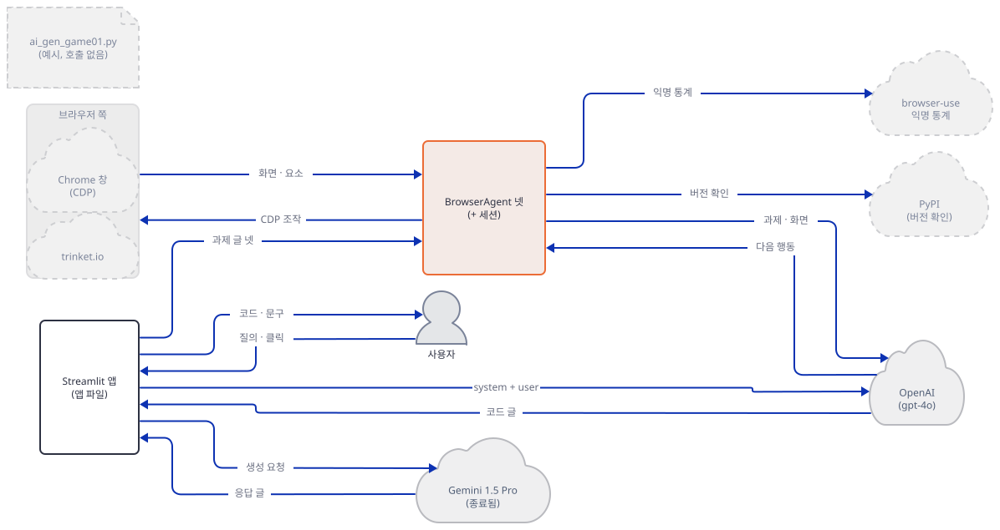

**확인.** 코드를 만든 뒤 시각화까지 한 번에 돌립니다. 이때 `browser_use`는 자리표시자입니다.

```bash
rm -f visualize_calls.jsonl
uv run --no-project python check_generate.py visualize
```

```powershell
Remove-Item visualize_calls.jsonl -ErrorAction SilentlyContinue
uv run --no-project python check_generate.py visualize
```

(PowerShell 줄은 실행해 보지 못했습니다.) 기대 출력(경고 줄 제외, 직접 확인):

```text
success: Code is running on Trinket!
generated_code: 8 줄 | 첫 줄: import pygame | 끝 줄: pygame.quit()
{"call": "BrowserSession()"}
{"call": "session.start()"}
{"call": "ChatOpenAI", "model": "gpt-4o", "key_head": "sk-f"}
{"call": "Agent()", "task_chars": 62, "task_head": "Go to https://trinket.io/features/pygame"}
{"call": "Agent()", "task_chars": 91, "task_head": "Executor. Execute the code written by th"}
{"call": "Agent()", "task_chars": 388, "task_head": "Coder. Click into the Trinket code edito"}
{"call": "Agent()", "task_chars": 66, "task_head": "Viewer. Your job is to just view the pyg"}
{"call": "agent.run()", "task_head": "Go to https:"}
{"call": "agent.run()", "task_head": "Coder. Click"}
{"call": "agent.run()", "task_head": "Executor. Ex"}
{"call": "agent.run()", "task_head": "Viewer. Your"}
{"call": "session.stop()"}
```

읽을 것이 셋입니다. 만들기는 `Agent()` 넷이 `run()`보다 먼저이고, `run()`은 길 찾기·코드 입력·실행·보기 순서입니다. 코드 입력 에이전트의 과제 글이 388자로 다른 셋(62·91·66자)보다 길고, 그 차이가 코드 8줄 분입니다. 마지막으로 모델 `gpt-4o`와 사이드바의 OpenAI 키(앞 4글자 `sk-f`)가 `ChatOpenAI`로 에이전트 넷에 한 번에 건네집니다. 한 가지 더, 시각화를 누르면 앱이 다시 그려지면서 코드 표시가 사라집니다. 코드를 보여 주는 `st.code`가 코드 생성 분기 안에 있어서입니다(113~114행). 같은 `AppTest`로 코드 생성 뒤에는 코드 블록이 1개, 시각화 뒤에는 0개인 것을 확인했습니다. 코드 자체는 `session_state`에 남아 있습니다.

이 자리표시자 아래에서만 화면을 직접 눌러 보고 싶다면 터미널 B에서 아래를 돌리고 주소를 엽니다. 사이드바에는 가짜 키만 넣으세요. 자리표시자 파일이 `pygame-lab`에 있는 동안에만 안전합니다. 여기서 시각화를 눌러도 성공 문구가 뜨지만 브라우저는 뜨지 않고 `visualize_calls.jsonl`에 줄이 쌓일 뿐입니다. 실행 블록의 `--browser.gatherUsageStats false`는 화면을 연 브라우저가 Streamlit 사용 통계를 보내지 않게 합니다(Day 054).

먼저 Step 2의 확인 두 줄을 이 터미널에서 다시 돌립니다. 첫 줄이 `pygame-lab`의 `browser_use.py`가 아니거나 둘째 줄이 가짜 서버 주소가 아니면 다음 블록을 돌리지 마세요.

```bash
uv run --no-project python -c "import browser_use; print(browser_use.__file__)"
echo "$OPENAI_BASE_URL"
```

아래 블록은 스스로 검사합니다. 파이썬 한 줄이 `browser_use`가 자리표시자이고 `OPENAI_BASE_URL`이 루프백일 때만 종료 코드 0으로 끝나고, 아니면 1로 끝나 서버를 띄우지 않습니다. 그래도 블록을 붙여 넣기 전에 위 확인을 한 번 읽으세요.

```bash
uv run --no-project python -c "import os, sys, browser_use; sys.exit(int(hasattr(browser_use, '__path__') or not os.environ.get('OPENAI_BASE_URL', '').startswith('http://127.0.0.1:')))" && uv run --no-project streamlit run ai_3dpygame_r1.py --server.headless true --server.address localhost --server.port 54124 --browser.gatherUsageStats false
```

```powershell
uv run --no-project python -c "import browser_use; print(browser_use.__file__)"
$env:OPENAI_BASE_URL
```

```powershell
uv run --no-project python -c "import os, sys, browser_use; sys.exit(int(hasattr(browser_use, '__path__') or not os.environ.get('OPENAI_BASE_URL', '').startswith('http://127.0.0.1:')))"
if ($LASTEXITCODE -eq 0) { uv run --no-project streamlit run ai_3dpygame_r1.py --server.headless true --server.address localhost --server.port 54124 --browser.gatherUsageStats false }
```

(PowerShell 줄은 실행해 보지 못했습니다.)

### Step 7. 진짜 browser-use가 하는 일 — 소스로만 읽는다

**목적.** 자리표시자를 치우면 시각화 버튼이 무슨 일을 하는지, `browser-use` 0.13.8의 소스를 읽어 알아 둡니다. 이 Step의 어떤 것도 실행하지 않습니다. 읽는 명령은 `grep`이고, 아래 경로는 Git Bash 기준(`.venv/Lib/site-packages`)입니다. macOS·Linux는 `.venv/lib/python3.13/site-packages`입니다.

**할 일.** 먼저 경로 변수를 잡습니다.

```bash
SP=.venv/Lib/site-packages/browser_use
```

세션을 `start()`하면 로컬 브라우저를 찾고 없으면 설치합니다. 찾는 순서는 기본 채널(`profile.py:327`이 Chromium)의 설치를 먼저, 그다음 Chrome, Brave, Edge(`_find_installed_browser_path`, `local_browser_watchdog.py:220` 이하)입니다. Windows 경로 목록에 Edge가 있어서 Edge가 설치된 PC에서는 찾아집니다. 아무것도 못 찾으면 `uvx playwright install chromium`을 실행합니다.

```bash
grep -n "Priority\|'uvx'" $SP/browser/watchdogs/local_browser_watchdog.py
```

```text
123:				# Priority: custom executable > fallback paths > playwright subprocess
365:		cmd = ['uvx', 'playwright', 'install', 'chromium']
```

(직접 확인) 그래서 이 버전은 Playwright를 의존성으로 두지 않지만, 브라우저가 하나도 없는 PC에서는 첫 시각화 클릭이 `uvx`로 내려받기를 시작할 수 있습니다(소스로 확인, 실행하지 않음). 창이 보이는지는 `profile.py:1247`이 정합니다. 화면이 있으면 `headless`가 꺼지고 창이 뜹니다(이 PC에서 `BrowserSession()`을 만들어 `headless: False`를 직접 확인). 프로필 폴더는 지정하지 않으면 시스템 임시 폴더의 `browser-use-user-data-dir-…`입니다(`profile.py:553`, 직접 확인). 평소 쓰는 Chrome 프로필이 아닙니다. 에이전트 하나는 단계마다 스크린샷과 페이지 요소 목록을 모델에 보냅니다(`use_vision`이 기본 참, `agent/service.py:168`, 요소 목록 문구는 `agent/prompts.py:332`). 한 번의 `run()`이 최대 500단계까지 갈 수 있고(`service.py:2508`) 앱은 이 값을 바꾸지 않습니다. 연속 5번 실패한 뒤 마지막으로 한 번 더 시도하고 멈추는데(`max_failures` 171행, `final_response_after_failure` 기본 참 201행, 멈춤 조건 2612~2618행) 멈춘 뒤에도 `run()`은 예외를 던지지 않고 기록만 돌려줍니다. 그래서 에이전트가 길을 못 찾아도 앱은 Step 6의 성공 문구를 찍습니다. `except`(177행)는 예외가 날 때만 걸립니다. 브라우저를 못 띄우는 시작 예외는 다시 던져져 걸립니다(2597~2598·2674~2677행).

**`run()` 하나의 순서.** 에이전트는 `run()`을 시작하면 먼저 PyPI에 최신 버전을 묻습니다(`agent/service.py:2541` → `_log_agent_run` 2038~2045행, `https://pypi.org/pypi/browser-use/json`, `BROWSER_USE_VERSION_CHECK` 기본 참 `config.py:183~184`). 모델 없이도 나가는 요청입니다. 이어서 세션을 `start()`하고(2566행) 과제 글에 URL이 있으면 첫 모델 호출 전에 그 주소로 이동합니다(초기 동작, 2581~2586행). 모델은 그다음 단계 반복에서야 부릅니다. `run()`이 끝나면 `finally`가 통계 이벤트를 보내고(2692행) `close()`(2729행)를 부릅니다. `keep_alive`가 참이 아니면 `close()`는 세션을 `kill()`해 Chrome을 끕니다(3984~3989행, 앱은 `keep_alive`를 주지 않아 `None`입니다, 직접 확인). 그래서 에이전트의 `run()`이 끝날 때마다 Chrome이 꺼지고 다음 에이전트가 새로 띄웁니다(`start()`는 이미 연결돼 있으면 건너뛰는 멱등 동작이라, 앱이 처음 띄운 Chrome은 길 찾기가 쓰고 길 찾기가 끝나며 꺼집니다, `browser/session.py:778~786`). 코드 입력 에이전트는 길 찾기가 연 trinket.io 페이지가 아니라 새로 뜬 창에서 시작합니다. 같은 임시 프로필 폴더를 다시 쓰지만 열려 있던 페이지가 이어지지는 않습니다. 이것은 소스로 판단한 것이고 실행하지 않았습니다. 앱 마지막의 `browser_session.stop()`(181행)은 이미 꺼진 뒤의 정리입니다.

익명 통계는 기본으로 켜져 있습니다. `ANONYMIZED_TELEMETRY`를 안 주면 참이고, 그 값이 클라우드 동기화의 기본값도 정합니다.

```bash
grep -n "ANONYMIZED_TELEMETRY" $SP/config.py
grep -n "POSTHOG_HOST =" $SP/telemetry/service.py
grep -n "task=self.task,$" $SP/agent/service.py
```

```text
58:	def ANONYMIZED_TELEMETRY(self) -> bool:
59:		return os.getenv('ANONYMIZED_TELEMETRY', 'true').lower()[:1] in 'ty1'
63:		return os.getenv('BROWSER_USE_CLOUD_SYNC', str(self.ANONYMIZED_TELEMETRY)).lower()[:1] in 'ty1'
201:	ANONYMIZED_TELEMETRY: bool = Field(default=True)
22:POSTHOG_HOST = 'https://eu.i.posthog.com'
506:			task=self.task,
2216:				task=self.task,
```

(직접 확인. 506행은 메시지 관리자를 만드는 호출이고, 2216행이 통계 이벤트입니다.) `agent/service.py:2214` 이하의 `AgentTelemetryEvent`가 `task=self.task`를 담습니다. 에이전트의 `run()`이 끝날 때마다 `finally`에서 `_log_agent_event`(2692행)가 이 이벤트를 `https://eu.i.posthog.com`으로 보냅니다(소스로 확인, 실제 전송은 실행하지 않음). 네 `run()`에 하나씩이고, 입력 에이전트의 것에 코드가 담깁니다. 에이전트 객체를 만들고 PostHog 클라이언트 자리에 기록기를 끼워 `_log_agent_event`를 불러, 이벤트 속성의 `task`에 생성된 코드가 그대로 들어 있는 것을 직접 확인했습니다(실제 전송은 없음). 이 앱의 입력 에이전트가 바로 코드 전문을 과제로 받습니다. 그래서 통계를 끄지 않은 채 진짜 시각화를 돌리면 코드 전문이 OpenAI(모델 호출)와 trinket.io(붙여 넣기)뿐 아니라 통계 서버에도 갈 수 있습니다. 앱 README는 이것을 말하지 않습니다.

마지막으로 코드가 과제 글에 섞이는 부작용이 하나 있습니다. `Agent`는 과제 글에서 URL을 정규식으로 찾아 하나만 나오면 첫 동작으로 그 주소로 이동합니다(`service.py:461~466`). 입력 에이전트의 과제 글에는 코드가 들어 있습니다. 이 동작을 가짜 모델 주소 아래 `Agent`를 만들어 `_extract_start_url`만 불러 재 봅니다. 아래를 `pygame-lab/probe_url.py`로 저장합니다. 진짜 `browser_use`를 가져와야 하므로 자리표시자가 안 가려지게 `-I`로 돌리고, 임시 폴더와 `browser-use`의 설정 폴더를 이 폴더 안으로 돌립니다. 에이전트 객체는 만들지만 브라우저는 띄우지 않고 모델도 부르지 않습니다(`BrowserSession`을 `start()`하지 않으므로).

`pygame-lab/probe_url.py`

```python
import browser_use
from browser_use import Agent, BrowserSession, ChatOpenAI

print("browser_use:", browser_use.__file__)
agent = Agent(task="x", llm=ChatOpenAI(model="gpt-4o", api_key="sk-fake"), browser_session=BrowserSession())
head = "Coder. Click into the Trinket code editor. Select all existing content (Ctrl+A) and delete it. Then paste the following Python code exactly as provided without modifying the formatting or indentation:\n\n"
cases = {
    "agent1 task": "Go to https://trinket.io/features/pygame, thats your only job.",
    "code: 2 lines": head + "import pygame\npygame.init()\n",
    "code: one URL": head + "url = 'https://example.org/a'\nprint(url)\n",
    "code: two URLs": head + "a = 'https://example.org/a'\nb = 'https://example.net/b'\n",
    "code: generated_game.py": head + open("generated_game.py", encoding="utf-8").read(),
}
for name, task in cases.items():
    print(f"{name:24s} ->", agent._extract_start_url(task))
```

```bash
mkdir -p tmp
TEMP="$PWD/tmp" TMP="$PWD/tmp" BROWSER_USE_CONFIG_DIR="$PWD/bu_cfg" uv run --no-project python -I probe_url.py
```

```powershell
New-Item -ItemType Directory -Force tmp
$env:TEMP = "$PWD\tmp"; $env:TMP = "$PWD\tmp"; $env:BROWSER_USE_CONFIG_DIR = "$PWD\bu_cfg"
uv run --no-project python -I probe_url.py
```

(PowerShell 줄은 실행해 보지 못했습니다. `-I`는 `PYTHONIOENCODING`도 무시하므로 스크립트의 출력 글은 영문으로 두었습니다. `ANONYMIZED_TELEMETRY`는 터미널 B에 이미 `false`입니다. 가짜 `OPENAI_BASE_URL`도 그대로여야 합니다.) 기대 출력(직접 확인, 경로는 환경에 따라 다름):

```text
browser_use: ...\pygame-lab\.venv\Lib\site-packages\browser_use\__init__.py
agent1 task              -> https://trinket.io/features/pygame
code: 2 lines            -> https://pygame.init
code: one URL            -> https://example.org/a
code: two URLs           -> None
code: generated_game.py  -> None
```

첫 줄이 `site-packages` 아래의 `browser_use`여야 합니다. 이 결과가 말하는 것은 이렇습니다. 코드가 두 줄뿐인데 `pygame.init`이 도메인 모양이라 `https://pygame.init`이 시작 주소로 잡혔고, 코드에 URL이 하나면 그 주소가, 둘 이상이면(또는 `pygame.display.set_mode` 같은 점 표기가 여러 개면) 아무것도 잡히지 않았습니다. 이 문서의 짧은 가짜 코드는 마지막 경우였습니다. 실제 모델이 쓴 코드는 대부분 점 표기가 많아 둘 이상일 테지만 보장은 없습니다. `pygame.init` 같은 이름이 홀로 잡히면 입력 에이전트가 시작하자마자 엉뚱한 주소로 이동할 수 있다는 것까지가 확인한 사실이고, 그 뒤 실제 브라우저에서 무슨 일이 일어나는지는 실행하지 않아 모릅니다. 이 폴더에는 이제 `tmp/`와 `bu_cfg/`가 생겼고 안에 에이전트 임시 파일이 있습니다. 실습이 끝나면 `pygame-lab` 폴더째로 지우면 됩니다.

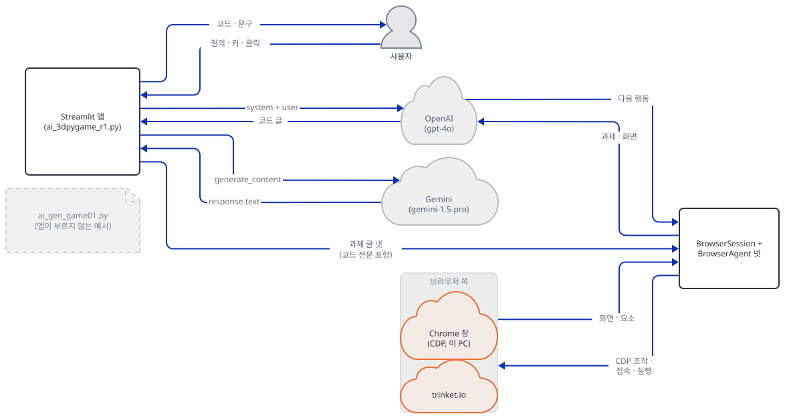

**확인.** 위 `grep` 둘과 `probe_url.py`의 출력이 기대와 같은지 봅니다. 아래는 이 Step이 그리는 진짜 시각화의 메시지 순서입니다. Chrome·trinket.io 쪽 화살표는 소스와 앱 README로 그렸고 이 문서가 실행해 본 것이 아닙니다. 먼저 에이전트가 밖으로 내는 호출 전부입니다(통계와 PyPI 확인은 첫 그림에서 폭 때문에 이 그림으로 옮겼습니다).

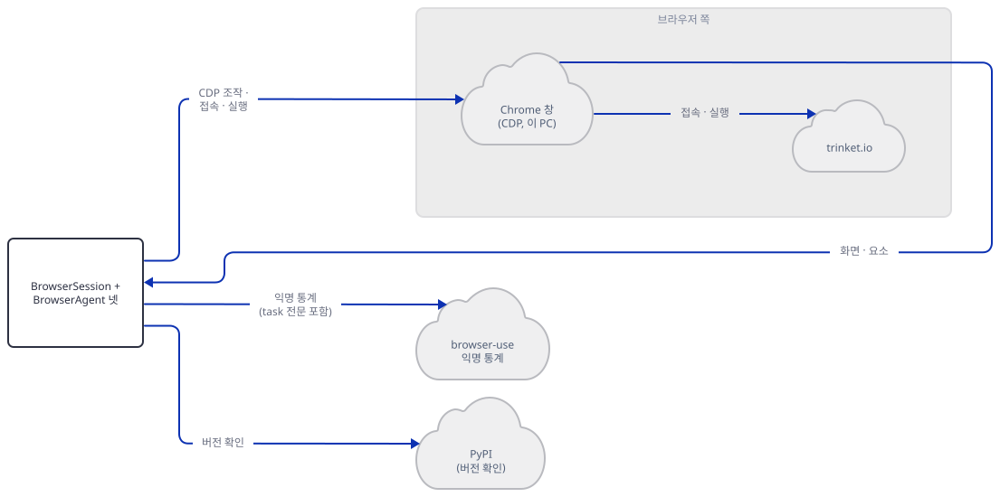

이어서 시작과 에이전트 만들기입니다. 아래 그림은 `run()`마다 시작·행동·끝 세 장입니다. 행동 그림은 모델 호출을 한 번만 그렸습니다. 실제로는 모델이 `done`을 고를 때까지 단계가 되풀이되고(최대 500단계), 그림의 "예: done"은 한 사이클의 예입니다. 시작은 PyPI 확인과 `start()`, 행동은 Chrome에서 받은 화면을 모델에 보내 다음 행동을 얻는 부분, 끝은 통계 전송과 Chrome 종료입니다.

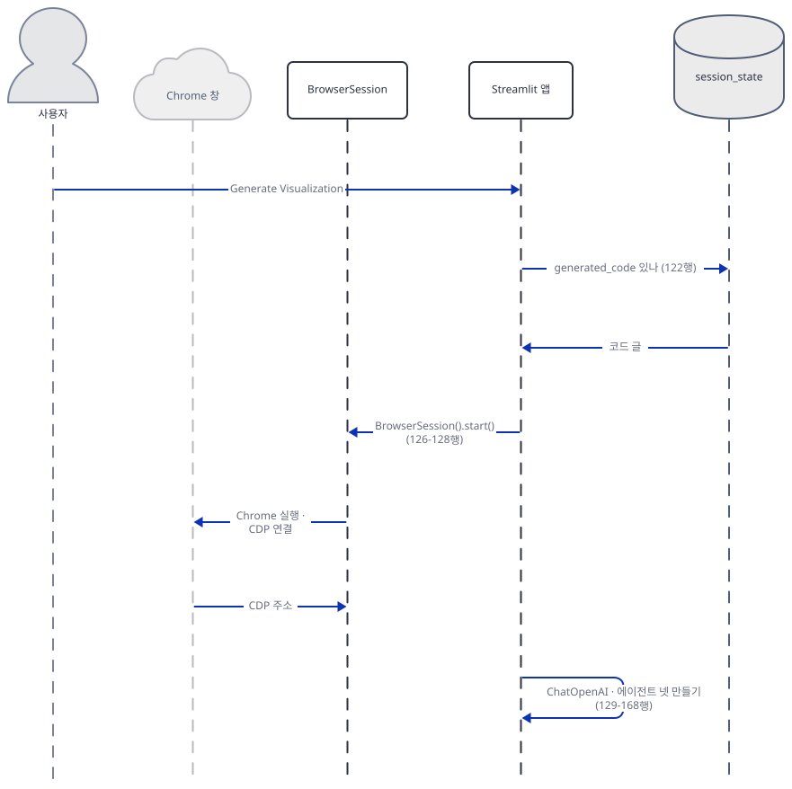

길 찾기 에이전트의 시작입니다. 앱이 이미 `start()`로 Chrome을 띄웠으므로 `start()`는 그대로 지나갑니다.

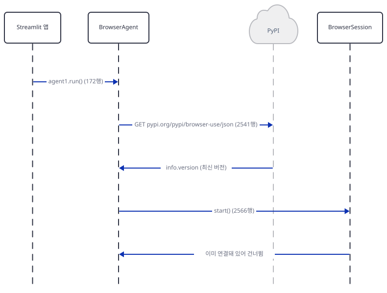

길 찾기의 행동입니다. 주소 이동은 모델 호출보다 먼저입니다(과제 글의 URL이 초기 동작이 됩니다).

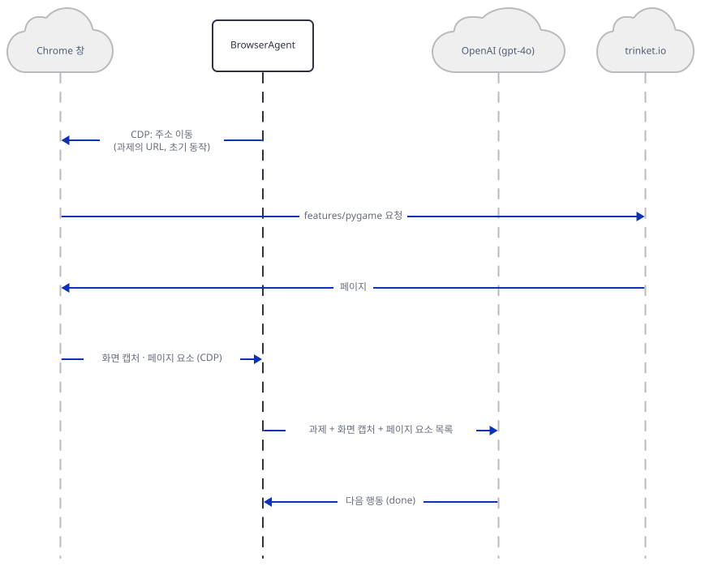


코드 입력 에이전트의 시작입니다. 이전 에이전트가 끝나며 Chrome이 꺼졌으므로 새로 띄웁니다.

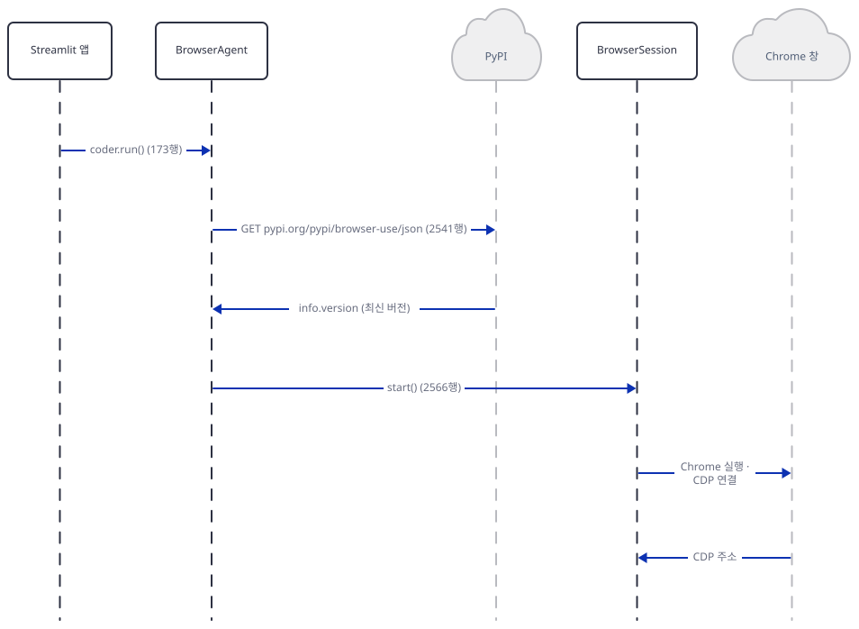

코드 입력의 행동입니다. 과제 글에 코드 전문이 들어 있어서, 이 호출의 입력이 가장 큽니다.

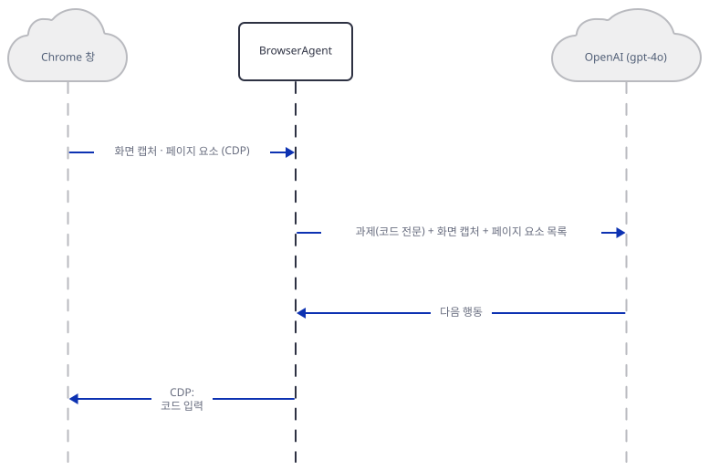

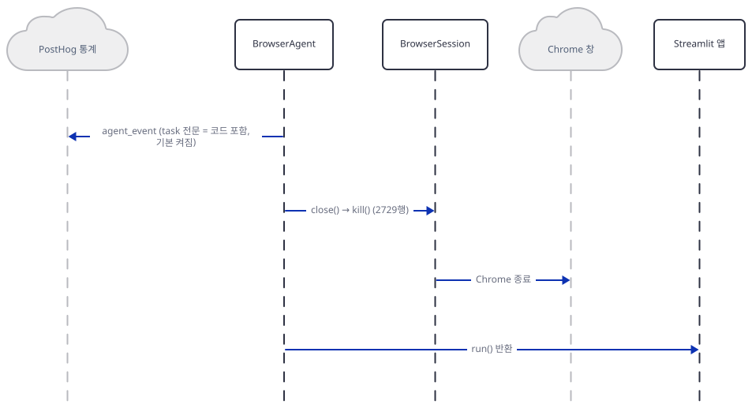

실행 에이전트의 시작입니다.

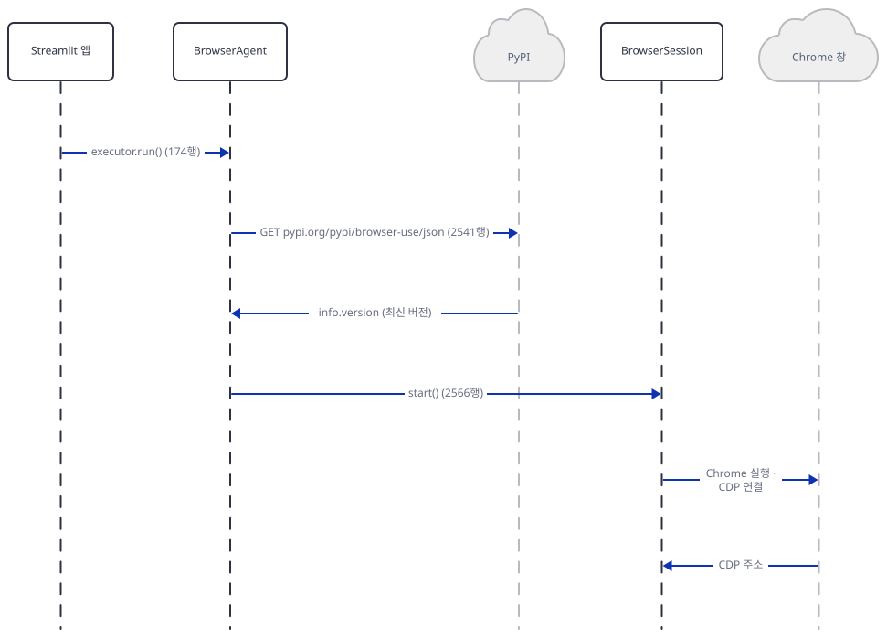

실행의 행동입니다. Run 클릭 이후에 trinket.io가 무엇을 하는지는 소스에도 앱 README에도 없어 확인하지 못했습니다.

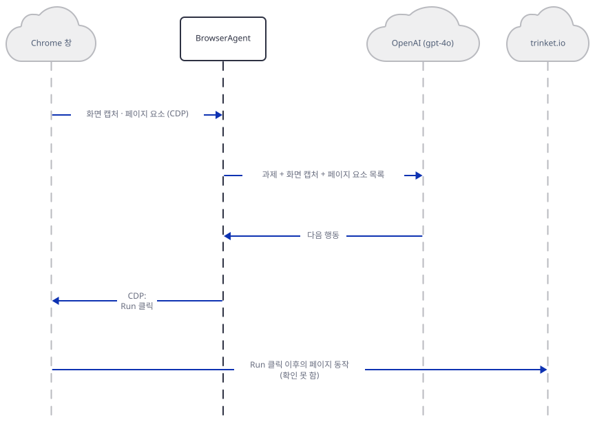


보기 에이전트의 시작입니다.

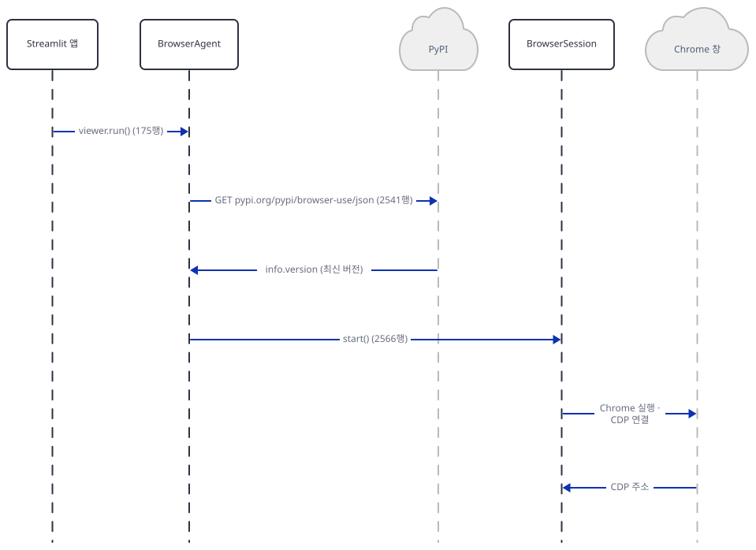

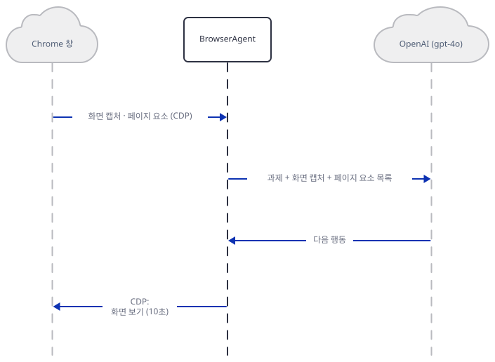

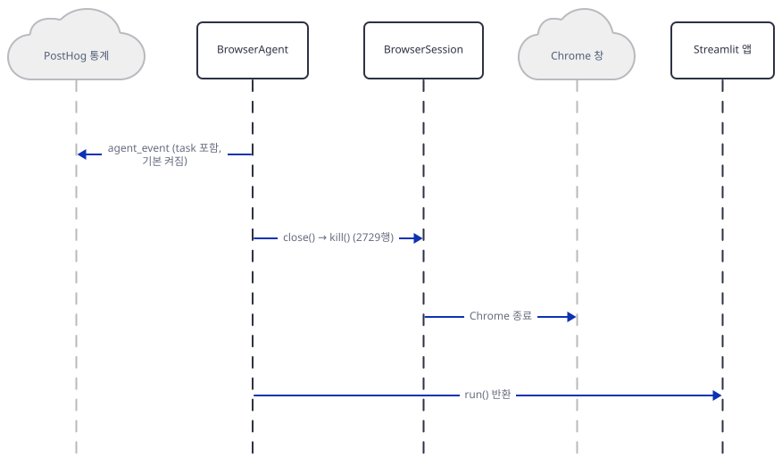

끝내기입니다. 성공 문구가 세션 `stop()`보다 먼저이고, `stop()`은 이미 꺼진 세션의 정리입니다.

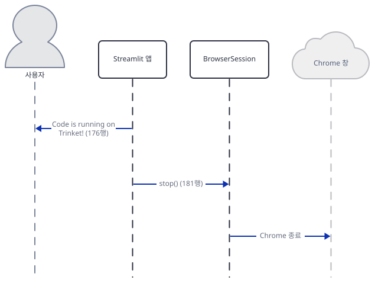

### Step 8. 생성된 코드를 내 PC에서 돌린다는 것

**목적.** 모델이 쓴 코드를 앱 밖에서 직접 실행하는 일이 무슨 뜻인지 알고, 앱이 함께 주는 예시를 창 없이 돌려 봅니다.

**할 일.** 이 앱은 생성된 코드를 자기 PC에서 실행하지 않습니다. 보여 주고(`st.code`), 브라우저 에이전트를 통해 trinket.io 편집기에 넣을 뿐입니다. 그러나 화면의 코드를 복사해 `.py`로 저장하고 `python`으로 돌리는 순간부터는 모델이 쓴 임의 코드가 내 계정의 권한으로 도는 것입니다. 파일을 읽고 지우는 것, 네트워크 접속, 프로세스 실행이 모두 가능하고 앱도 모델도 그것을 막지 않습니다. 코드를 읽고 나서 돌리고, 낯선 import나 `os`·`subprocess`·`open`이 있으면 돌리지 마세요. 이 문서는 pygame 창이 뜨지 않게 SDL의 `dummy` 드라이버로만 돌립니다. 아래를 `pygame-lab/run_bounded.py`로 저장합니다. 1초 뒤 닫기 요청을 보내고 `flip` 횟수를 셉니다. 이 도구가 코드를 막아 주지는 않습니다. 창이 안 뜨고 영원히 돌지 않을 뿐입니다.

`pygame-lab/run_bounded.py`

```python
import runpy, sys
import pygame

frames = [0]
_flip = pygame.display.flip


def flip():
    frames[0] += 1
    _flip()


pygame.display.flip = flip
pygame.init()
print("video driver:", pygame.display.get_driver())
pygame.time.set_timer(pygame.QUIT, 1000, 1)  # 1초 뒤 닫기 요청
try:
    runpy.run_path(sys.argv[1], run_name="__main__")
except SystemExit:
    print("sys.exit()로 끝남, flip 횟수:", frames[0])
else:
    print("끝까지 실행됨, flip 횟수:", frames[0])
```

먼저 앱이 함께 주는 예시 `ai_gen_game01.py`입니다. 이름은 3D 미로 게임이지만 코드는 평면에 사각형 선을 그립니다. 원근 투영 변수 `dist`·`H_PROJECTION`(35·36행)은 정의만 하고 쓰지 않습니다(`grep`으로 두 줄뿐). 그리고 78행이 문제입니다.

`advanced_ai_agents/autonomous_game_playing_agent_apps/ai_3dpygame_r1/ai_gen_game01.py:78`

```python
    offset = ((WIDTH - scale[0] * len(MAZE[0])), (HEIGHT - scale[1] * len(MAZE[0][0]))) // 2
```

튜플을 정수로 나눕니다. 이 터미널(B)에서 창 없는 드라이버를 지정해 돌립니다.

```bash
export SDL_VIDEODRIVER=dummy
export SDL_AUDIODRIVER=dummy
export PYGAME_HIDE_SUPPORT_PROMPT=1
uv run --no-project python run_bounded.py ai_gen_game01.py
```

```powershell
$env:SDL_VIDEODRIVER = "dummy"
$env:SDL_AUDIODRIVER = "dummy"
$env:PYGAME_HIDE_SUPPORT_PROMPT = "1"
uv run --no-project python run_bounded.py ai_gen_game01.py
```

(PowerShell 줄은 실행해 보지 못했습니다.) 기대 출력(끝 부분, 직접 확인):

```text
  File "ai_gen_game01.py", line 78, in <module>
    offset = ((WIDTH - scale[0] * len(MAZE[0])), (HEIGHT - scale[1] * len(MAZE[0][0]))) // 2
             ~~~~~~~~~~~~~~~~~~~~~~~~~~~~~~~~~~~~~~~~~~~~~~~~~~~~~~~~~~~~~~~~~~~~~~~~~~~^^~~
TypeError: unsupported operand type(s) for //: 'tuple' and 'int'
```

예시는 첫 프레임에서 죽습니다. 먼저 복사본 `game_fixed.py`를 만듭니다(이 명령은 한 번만 돌립니다. 고친 뒤에 다시 돌리면 고친 파일을 덮어씁니다).

```bash
cp ai_gen_game01.py game_fixed.py
```

```powershell
Copy-Item ai_gen_game01.py game_fixed.py
```

(PowerShell 줄은 실행해 보지 못했습니다.) 편집기로 `game_fixed.py`의 78행을 각 성분을 따로 2로 나누도록 고칩니다.

```python
    offset = ((WIDTH - scale[0] * len(MAZE[0])) // 2, (HEIGHT - scale[1] * len(MAZE[0][0])) // 2)
```

고친 뒤 차이와 실행을 봅니다.

```bash
diff ai_gen_game01.py game_fixed.py
uv run --no-project python run_bounded.py game_fixed.py
```

`diff`는 78행 한 줄만 다르다고 하고(직접 확인), 마지막 명령은 아래를 찍습니다(직접 확인). 1초에 30프레임이고 `clock.tick(30)`이 그 속도를 정합니다.

```text
video driver: dummy
sys.exit()로 끝남, flip 횟수: 30
```

이제 Step 4에서 저장된 `generated_game.py`를 돌립니다. 마지막으로 돌린 경우가 `visualize`(Step 6)이면 8줄 코드가 들어 있습니다. 그다음 `chatty`로 다시 만들어 같은 명령을 돌립니다.

```bash
uv run --no-project python run_bounded.py generated_game.py
uv run --no-project python check_generate.py chatty
uv run --no-project python run_bounded.py generated_game.py
```

첫 명령의 기대 출력(직접 확인)입니다.

```text
video driver: dummy
generated code ran
끝까지 실행됨, flip 횟수: 3
```

셋째 명령은 `video driver: dummy` 뒤에 트레이스백이 나오고 끝 부분은 아래와 같습니다(직접 확인).

```text
  File "generated_game.py", line 1
    Sure! Here is the code:
        ^
SyntaxError: invalid syntax
```

앞의 것은 Step 4의 정리가 통한 응답이고, 뒤의 것은 인사말이 붙은 응답입니다. 화면은 둘 다 "Code generated successfully!"였습니다.

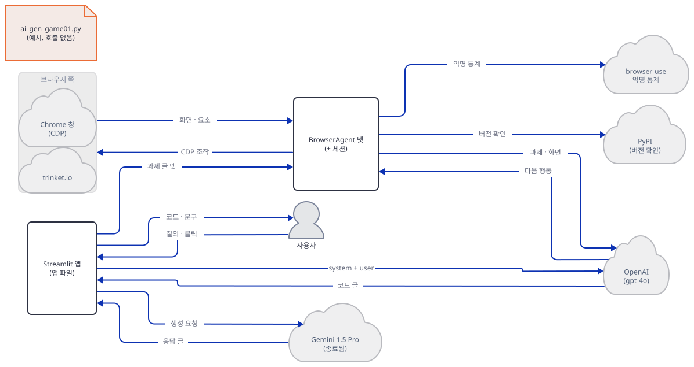

**확인.** 위 세 가지가 기대와 같은지 봅니다. 끝나면 터미널 A의 가짜 서버를 `Ctrl+C`로 멈추고, 포트가 비었는지 봅니다(`netstat -ano | grep :54123`이 아무것도 내놓지 않아야 합니다, Windows 기준).

## 요청 한 건이 흐르는 과정

"Generate Code" 한 번이 흐르는 길입니다.

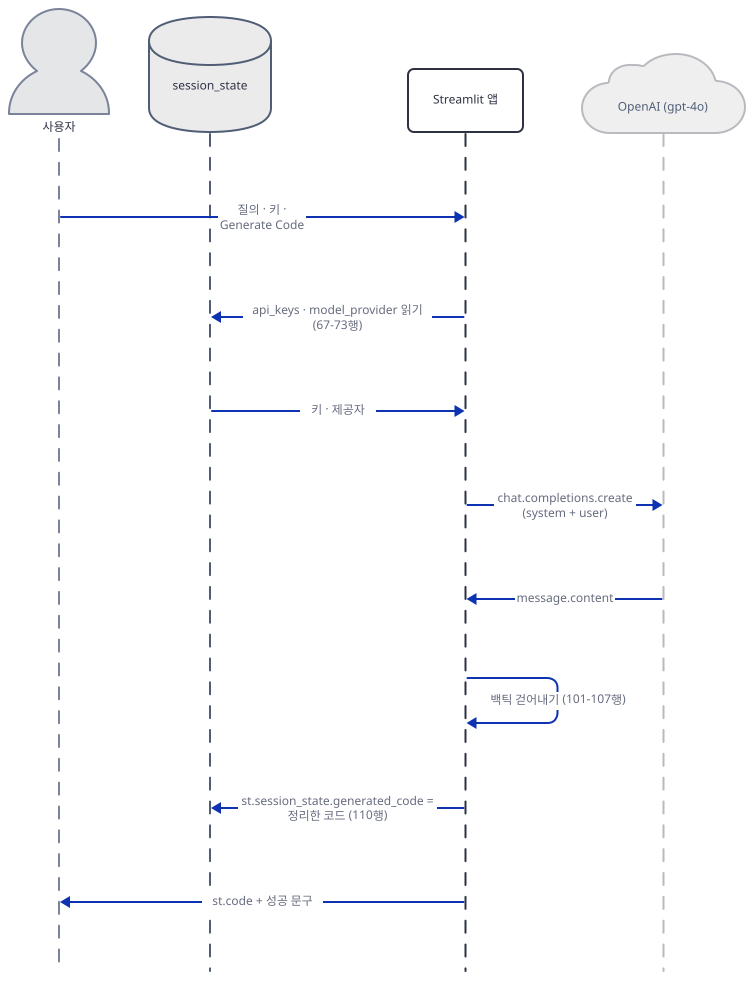

질의와 키가 앱에 들어오면 앱은 키부터 검사하고(70~75행), 통과하면 `gpt-4o`에 시스템·사용자 메시지 둘을 보냅니다. 응답 글을 받으면 백틱을 걷어 내 `session_state`에 저장하고 화면에 코드를 보입니다. 모델 호출은 한 번이고, 그 뒤는 모두 문자열 처리입니다. 시각화 버튼은 이 저장된 코드를 꺼내(122행) 브라우저 에이전트를 돕니다. 그 길은 Step 7의 그림 열다섯 장이 이어서 그렸고, Gemini를 고른 경우는 다음 그림이 그렸습니다.

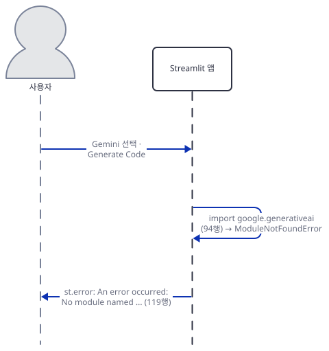

## 실행 체크리스트

- [ ] `uv pip install -r requirements.txt`가 125개를 설치했고 `versions.py`가 `google.generativeai: 없음`을 찍었다
- [ ] 터미널 B에서 `browser_use.__file__`이 `pygame-lab`의 `browser_use.py`를 가리킨다(진짜 패키지가 아니다)
- [ ] `nokey`·`empty`·`early` 세 경우가 모델 호출 없이 끝났다(`openai.jsonl` 없음)
- [ ] 네 가지 응답 모양의 줄 수를 봤고(8·8·8·12줄), `chatty`만 인사말이 남았다
- [ ] `gemini` 경우가 `No module named 'google.generativeai'`를 찍었다
- [ ] `visualize` 경우의 `visualize_calls.jsonl` 열두 줄에서 `run()` 순서(길 찾기·입력·실행·보기)를 봤다
- [ ] Step 7의 `grep` 둘과 `probe_url.py`를 읽었다(진짜 브라우저는 한 번도 띄우지 않았다)
- [ ] 예시 `ai_gen_game01.py`가 78행에서 죽는 것과 고친 `game_fixed.py`가 30프레임을 그리는 것을 봤다
- [ ] 가짜 서버를 멈췄고 포트가 비었다

## 문제 해결

| 증상 | 원인 | 해결 |
|---|---|---|
| `browser_use.__file__`이 `site-packages` 아래를 가리킨다 | `pygame-lab`이 아닌 폴더에서 실행했거나 `browser_use.py`를 저장하지 않았다. 그대로 두면 확인 스크립트의 `assert`가 멈춘다. 이 `assert` 없이 시각화 경로를 돌리면 모델 호출 전에 진짜 Chrome이 trinket.io로 이동하고, PyPI에 버전을 묻고, 브라우저가 하나도 없으면 `uvx playwright install chromium`을 실행한다(소스로 확인) | Step 2의 `browser_use.py`를 `pygame-lab`에 저장하고 그 폴더에서 다시 확인. 확인되기 전에는 앱을 띄우지 않는다 |
| `AssertionError: 진짜 browser_use가 잡혔습니다 ...` 또는 `OPENAI_BASE_URL을 먼저 거세요 ...` | `check_generate.py`의 안전 검사가 걸렸다. 진짜 패키지가 가져와졌거나 가짜 서버 주소가 없다(`import browser_use`만으로는 설정 폴더가 만들어지지 않았다, 직접 확인) | 자리표시자가 있는 `pygame-lab`에서 다시 돌리고 Step 2의 변수를 준다. `from browser_use import Agent`처럼 `Agent`·`BrowserSession`을 가져오거나 만들면 설정 폴더(`BROWSER_USE_CONFIG_DIR`, 기본은 홈 아래 `.config/browseruse`, 소스 `config.py`)와 임시 폴더가 생긴다(직접 확인). 이 `assert` 경로에서는 생기지 않는다 |
| `ValidationError ... ANONYMIZED_TELEMETRY ... Input should be a valid boolean, unable to interpret input` (직접 확인, 진짜 `browser_use`를 가져올 때) | 통계를 끄려고 `ANONYMIZED_TELEMETRY`를 빈 값으로 두었다 | 값을 `false`로 준다. 빈 값으로 덮어쓰지 않는다 |
| `No module named 'google.generativeai'` | `requirements.txt`가 옛 SDK를 설치하지 않는다. 설치해도 모델 `gemini-1.5-pro`가 2025-09-29에 종료됐다 | Gemini를 쓰지 않거나 Step 5와 더 해보기대로 `google-genai`와 현재 모델 ID로 94~98행을 바꾼다 |
| 화면은 성공인데 실행하면 `SyntaxError`(첫 줄이 인사말) | 응답이 코드 블록으로 시작하지 않아 101~107행의 정리가 걸리지 않았다 | 응답 앞뒤의 글을 걷어 내는 정리를 더하거나(더 해보기), 코드를 읽고 직접 지운 뒤 돌린다 |
| `TypeError: unsupported operand type(s) for //: 'tuple' and 'int'` (`ai_gen_game01.py` 78행, 직접 확인) | 튜플 전체를 `// 2` 했다 | 성분마다 `// 2` 한다(Step 8) |
| `ModuleNotFoundError: No module named 'pygame'` | `requirements.txt`에 pygame이 없다 | `uv pip install pygame` |
| 앱을 띄우자 `missing ScriptRunContext` 경고 | `AppTest`처럼 `streamlit run` 밖에서 앱을 돌릴 때 나오는 경고 | 무시해도 된다(직접 확인) |
| 요청이 가짜 서버가 아니라 바깥으로 나가는 것 같다 | 앱을 띄운 터미널에 `OPENAI_BASE_URL`이 없다 | 그 터미널에서 `echo "$OPENAI_BASE_URL"`로 확인하고 Step 2의 변수를 다시 준다. 사이드바에는 가짜 키만 넣는다 |
| 2027-01-14 이후 `gpt-4o` 호출이 실패한다 | `gpt-4o`의 기본 스냅숏이 폐기 일정에 있다(사전 준비) | `ai_3dpygame_r1.py:86`과 `130`을 새 모델 id로 바꾼다 |
| 시각화에서 "Code is running on Trinket!"이 떴는데 아무것도 안 일어났다 | 실패해도 `run()`이 예외를 던지지 않는다(Step 7) | 브라우저 창과 에이전트 로그를 직접 본다. 화면 문구를 믿지 않는다 |

## 더 해보기

- **Gemini를 새 SDK로 옮기기.** `advanced_ai_agents/autonomous_game_playing_agent_apps/ai_3dpygame_r1/ai_3dpygame_r1.py:94-98`을 `from google import genai`와 `genai.Client(api_key=...)`, `client.models.generate_content(model=..., contents=...)`, `.text`로 바꿉니다. 모델 ID는 Google 모델 목록에서 현재 제공되는 것을 고릅니다. 가짜 서버(`/v1beta/models/<모델>:generateContent`에 `candidates`를 담아 답하는 것)에 `types.HttpOptions(base_url="http://127.0.0.1:<포트>")`를 주고 부르면 `.text`가 돌아오는 것을 이 문서는 확인했습니다. 앱에 고쳐 넣은 판은 돌려 보지 못했습니다. 확인 스크립트의 `gemini` 경우로 직접 보세요.
- **정리 규칙 고치기.** `chatty` 응답에서도 통하게 응답 안의 첫 코드 블록을 정규식으로 꺼내는 정리를 `advanced_ai_agents/autonomous_game_playing_agent_apps/ai_3dpygame_r1/ai_3dpygame_r1.py:101-107` 자리에 만들고, `check_generate.py chatty`의 첫 줄이 `import pygame`이 되는지 보세요. 그다음 블록이 둘인 응답(`bare` 두 개)에서 어느 것을 고를지 정해 보세요.
- **통계를 껐는지 읽어 확인하기.** `ANONYMIZED_TELEMETRY`를 `false`로 둔 채 `probe_url.py`처럼 `Agent`를 만들고 `agent.telemetry._posthog_client`가 `None`인지 찍어 보세요. 켠 채(변수를 지우고)라면 어떤 클래스가 되는지도 봅니다. 두 경우 모두 `BrowserSession`을 `start()`하지 마세요.

## 다음 날 예고

[Day 136 · 🎲 AI Tic-Tac-Toe Agent](../day136-ai-tic-tac-toe-agent/README.md) — 볼륨 10의 마지막 날입니다. 원본 앱은 Streamlit 앱 `app.py`(309줄)·`agents.py`(165줄)·`utils.py`(416줄)이고, `requirements.txt`는 236줄짜리 고정 목록입니다. 사이드바에서 플레이어 X·O의 모델을 각각 고르는데, 선택지가 여덟(`gpt-4o`, `o3-mini`, `claude-3.5`, `claude-3.7`, `claude-3.7-thinking`, `gemini-flash`, `gemini-pro`, `llama-3.3`)이고 제공자가 OpenAI·Anthropic·Google·Groq 넷입니다. 기본값은 X가 `claude-3.7-thinking`, O가 `o3-mini`입니다(`app.py:36-89`, 소스로 확인). 오늘의 "모델 한 개와 폐기 문서 확인"이 이번에는 선택지 여덟 개로 늘어납니다.
