# Day 136 · 🎲 AI Tic-Tac-Toe Agent

> 볼륨 10 🎮 Autonomous Game-Playing · 난이도 ★★☆ ⚠ 화면의 기본 선택(X `claude-3.7-thinking`, O `o3-mini`)은 처음 누르는 순간 실패합니다. X의 모델은 2026-02-19에 퇴역했고 O의 모델은 2026-10-23에 종료되며, `requirements.txt`는 그대로는 설치되지 않습니다(사전 준비, Step 1, Step 7) · 예상 소요 130분(앱은 파일 셋 890줄이지만 가짜 서버를 직접 저장해 띄우고, 확인용 스크립트 여섯을 저장해 돌리며, 서버 쪽 기록과 앱의 동작을 맞대어 보는 시간이 읽는 시간보다 큽니다) · API 비용 대략 이 문서의 따라 하기는 $0(가짜 서버만 부릅니다. 실제 OpenAI·Anthropic·Google·Groq는 한 번도 부르지 않았고 요금표도 확인하지 못했습니다) · 원본 앱: `advanced_ai_agents/autonomous_game_playing_agent_apps/ai_tic_tac_toe_agent`

## 오늘 만들 것

Streamlit 화면에서 모델 둘을 골라 X와 O로 세우고, 두 모델이 3×3 판에서 서로 한 수씩 두는 것을 구경하는 앱입니다. 볼륨 10 "🎮 Autonomous Game-Playing"의 셋째 날이자 마지막 날입니다. 앞의 두 앱과 이어지는 부분은 이렇습니다. 세 앱 모두 Streamlit 화면입니다. Day 134의 체스 앱은 `autogen`의 `register_function`을 가져와(`ai_chess_agent.py:4`) 도구로 수를 두는 구조이고, Day 135의 앱은 `agno`와 `browser_use`를 가져옵니다(`ai_3dpygame_r1.py:3-7`). 오늘 앱에는 도구가 하나도 없습니다(`grep -c "tools=" agents.py app.py`가 둘 다 0). 모델에게 판과 빈 칸을 글로 보여 주고, 돌아온 글에서 숫자 둘을 정규식으로 뽑아 수로 씁니다.

이름과 달리 "심판 에이전트"는 없습니다. 앱의 README는 세 에이전트(Master Agent (Referee)와 플레이어 둘)라고 적고 `agents.py` 머리 주석도 `get_tic_tac_toe_referee()`를 부르라고 하지만, 그 함수는 파일에 없습니다(Step 3). 심판 일은 `utils.py`의 `TicTacToeBoard`와 `app.py`의 코드가 합니다. 이 문서는 OpenAI·Anthropic·Google·Groq 어디에도 요청을 보내지 않았습니다. 네 제공자 자리에는 `127.0.0.1`의 가짜 서버를 두었고, 그 서버가 주는 수는 제가 정한 규칙(X는 첫 빈 칸, O는 마지막 빈 칸)이라 틱택토를 두는 모델이 아닙니다. 따라서 실제 모델이 어떤 수를 두는지, 어떤 오류를 돌려주는지는 이 문서가 보여 주지 못합니다.

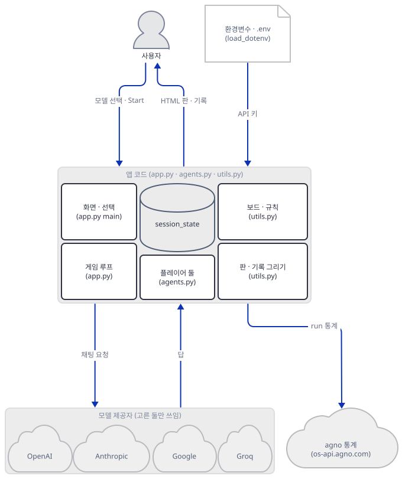

그림에서 앱 코드 셋(`app.py`·`agents.py`·`utils.py`)은 한 묶음입니다. 파일 사이의 호출은 Step 5·6의 보조 구조 그림이 화살표로 보여 줍니다. 화살표 가운데 "모델 제공자"로 가는 것은 실제로는 플레이어(`agents.py`)가 보냅니다.

따라 하기의 중심은 한 제공자(OpenAI의 `gpt-4o`를 X와 O 모두에) 경로입니다. 화면의 기본값(Anthropic X, OpenAI O)이 독자가 처음 겪는 경로이지만, 그 경로는 퇴역한 모델 때문에 첫 수에서 멈춥니다. 그래서 기본값은 "어떻게 실패하는가"로 Step 7에서 보고, 한 판을 끝까지 보는 데는 모델 둘이 같은 제공자인 경로를 씁니다. 가짜 서버는 제공자마다 따로 짓지 않고 한 파일 하나가 네 제공자의 요청 주소를 모두 받습니다(Step 2). 네 제공자가 모두 가짜 서버로 오는지는 Step 2의 확인 스크립트가 한 번씩 보여 줍니다.

직접 돌려 알게 된 것이 여섯입니다. 첫째, `requirements.txt`는 오늘 설치되지 않습니다. `agno>=2.2.10`이 `h11>=0.16.0`을 요구하는데 목록이 `h11==0.14.0`을 고정합니다(Step 1). 둘째, 그 두 줄만 풀어도 `agents.py`의 import가 죽습니다. 목록이 고정한 `anthropic`·`openai`·`google-genai`가 오늘의 agno(3.1.3)에 비해 낡았기 때문입니다(Step 1). 셋째, 모델 선택지 여덟 가운데 제공자 폐기 문서에서 종료 표시가 없는 것은 `gpt-4o`와 `gemini-2.0-pro-exp-02-05`뿐입니다(사전 준비). 넷째, 심판은 없고 판 검사는 보드와 화면 코드가 나눠 합니다(Step 3, 4). 다섯째, 모델 호출이 실패하면 agno는 예외를 던지지 않고 오류 글을 답으로 돌려주며, 앱은 그 글의 첫 숫자 둘(`404`, `3`)을 수로 읽어 요청을 쉬지 않고 되풀이합니다(Step 7). 여섯째, 틀린 수 한 번은 요청 세 번이고, 재시도의 답은 버려집니다(Step 7).

## 사전 준비

| 서비스/도구 | 용도 | 발급·설치 |
|---|---|---|
| uv | 가상환경 생성과 패키지 설치 | [공통 사전 준비](../README.md#공통-사전-준비-한-번만) 참고 |
| Python | 이 문서는 3.13.3으로 확인했다. 앱 README는 버전을 적지 않는다 | 공통 사전 준비와 같음 |
| OpenAI API 키 | 실제로 쓸 때 `gpt-4o`만 쓴다면 이것 하나면 된다. 이 문서는 가짜 값 `sk-fake-openai`와 가짜 서버로 확인한다 | https://platform.openai.com/api-keys |
| Anthropic·Google·Groq 키 | 화면의 다른 선택지를 쓸 때만. 대부분 종료되었다(아래 표). 이 문서는 가짜 값만 쓴다 | 각 제공자 콘솔 |
| 터미널 둘 | 가짜 서버를 띄우는 터미널(A)과 나머지 모두를 돌리는 터미널(B) | 별도 설치 없음 |

환경변수 `PYTHONIOENCODING=utf-8`을 아래 `envfake.sh`가 함께 겁니다. 한국어 Windows의 Git Bash에서 파이썬 출력이 cp949로 깨지는 것을 막으려는 것입니다.

**이 앱의 선택지 여덟 개가 아직 살아 있는지.** `app.py:67-76`의 선택지 여덟 개가 가리키는 모델 ID를 제공자의 공식 폐기 문서에서 하나씩 찾았습니다. 모든 문서는 2026-10-15에 페이지 변환 도구(WebFetch)로 읽었고, 각 판정은 그 문서의 해당 항목에서 가져왔습니다.

| 화면의 선택지 | 실제 모델 ID(`agents.py:54-75`) | 제공자 문서의 판정 |
|---|---|---|
| `gpt-4o` | `gpt-4o` | OpenAI 폐기 문서에 별칭 `gpt-4o` 항목은 없다. 날짜 붙은 스냅숏 `gpt-4o-2024-08-06`·`gpt-4o-2024-11-20`은 2026-10-14에 공지되어 2027-01-14 종료, `gpt-4o-2024-05-13`은 2026-10-23 종료다. 별칭이 어느 스냅숏을 가리키는지는 문서가 말하지 않는다 |
| `o3-mini` | `o3-mini` | ⚠ 2026-04-22 공지, **2026-10-23 종료**, 권장 대체 `gpt-5.6-sol`. 이 문서를 쓴 2026-10-15 기준 8일 남았다 |
| `claude-3.5` | `claude-3-5-sonnet-20241022` | Anthropic 폐기 문서에서 Retired, 2025-10-28 퇴역, 권장 대체 `claude-sonnet-5-5` |
| `claude-3.7` | `claude-3-7-sonnet-20250219` | Retired, 공지 2025-10-28, 퇴역 2026-02-19, 권장 대체 `claude-sonnet-5-5` |
| `claude-3.7-thinking` | 위와 같은 ID에 `thinking` 설정(`agents.py:66-71`) | 위와 같다. **화면의 X 기본값이 이것이다** |
| `gemini-flash` | `gemini-2.0-flash` | Google 폐기 문서에 종료일 2026-06-01, 권장 대체 `gemini-3.6-flash`. 문서는 종료일을 "가능한 가장 이른 날짜"라고 설명하고 "퇴역"이라는 상태 표시는 붙이지 않는다. 날짜는 이미 지났다 |
| `gemini-pro` | `gemini-2.0-pro-exp-02-05` | 폐기 문서(마지막 갱신 2026-10-12)에 이 ID도 `gemini-2.0-pro-exp`도 없다. 폐기 문서에 없다는 것만 확인했고, 지금 이 ID로 요청이 받아지는지는 확인하지 못했다 |
| `llama-3.3` | `llama-3.3-70b-versatile` | Groq 폐기 문서에서 deprecated, 2026-06-17 메일 공지, **종료 2026-08-16**, 권장 대체 `openai/gpt-oss-120b` 또는 `qwen/qwen3.6-27b`. 유료 약정 기업 고객은 영향 없다고 적는다 |

출처 주소는 OpenAI https://developers.openai.com/api/docs/deprecations, Anthropic https://platform.claude.com/docs/en/about-claude/model-deprecations, Google https://ai.google.dev/gemini-api/docs/deprecations, Groq https://console.groq.com/docs/deprecations입니다. Anthropic 문서는 퇴역한 모델로 보낸 요청은 실패한다고 적습니다. 그러니 이 앱의 기본값은 진짜 키를 넣어도 X의 첫 호출에서 실패할 것으로 보이지만, 실제 Anthropic은 부르지 않았으므로 어떤 오류가 오는지는 보지 못했습니다(Step 7의 404는 제 가짜 서버가 흉내 낸 것입니다). 바꾸는 방법은 문제 해결 표에 있습니다.

## 아키텍처 한눈에 보기

| 컴포넌트 | 역할 | 코드 위치 |
|---|---|---|
| 화면과 선택 (`main`) | 키 검사, 모델 선택 상자 둘, Start·Pause·New Game 버튼, 현재 차례 표시 | `advanced_ai_agents/autonomous_game_playing_agent_apps/ai_tic_tac_toe_agent/app.py:34-284` |
| 게임 루프 (`main`의 아랫부분) | 한 번 실행에 한 번 모델에게 묻고, 답에서 숫자를 뽑아 두고, `st.rerun()` | `advanced_ai_agents/autonomous_game_playing_agent_apps/ai_tic_tac_toe_agent/app.py:203-282` |
| 모델 만들기 (`get_model_for_provider`) | 제공자 이름과 모델 이름으로 agno 모델 객체를 만듦 | `advanced_ai_agents/autonomous_game_playing_agent_apps/ai_tic_tac_toe_agent/agents.py:40-77` |
| 플레이어 둘 (`get_tic_tac_toe_players`) | 지시문이 다른 `Agent` 둘(Player X·Player O)을 만듦 | `advanced_ai_agents/autonomous_game_playing_agent_apps/ai_tic_tac_toe_agent/agents.py:80-165` |
| 보드 (`TicTacToeBoard`) | 판 상태, 수 검사, 승부 판정, 빈 칸 목록 | `advanced_ai_agents/autonomous_game_playing_agent_apps/ai_tic_tac_toe_agent/utils.py:11-122` |
| 그리기 (`display_board` 등) | 판과 수 기록을 HTML로 그림, 모양을 정하는 CSS 문자열 | `advanced_ai_agents/autonomous_game_playing_agent_apps/ai_tic_tac_toe_agent/utils.py:125-416` |
| 모델 제공자 넷 | 앱 밖. 고른 모델의 제공자만 쓰임. 이 문서는 가짜 서버 | `advanced_ai_agents/autonomous_game_playing_agent_apps/ai_tic_tac_toe_agent/agents.py:54-75` |

앱이 밖으로 여는 길은 고른 모델 둘의 제공자 둘뿐이고, 대화 기록을 저장하는 곳은 없습니다(`Agent`에 `db`가 없고 화면의 `session_state`에만 수 기록이 쌓입니다). agno의 익명 사용 통계는 Day 047 Step 5가 `agno/agent/_telemetry.py`로 확인한 대로, `agent.run()`이 성공할 때마다 `os-api.agno.com`에 가려 합니다. 오늘 agno 3.1.3으로도 같았습니다. 모든 요청을 기록만 하고 거절하는 프록시를 걸어 두고 `AGNO_TELEMETRY`를 끄지 않은 채 한 판(성공한 호출 5번)을 돌리자 프록시 기록에 `CONNECT os-api.agno.com:443`이 다섯 줄 남았습니다(직접 확인). 아래 `envfake.sh`는 `AGNO_TELEMETRY=false`를 겁니다. 이 문서의 모든 실행 명령은 이 줄을 건 터미널에서만 돌립니다.

## 단계별 진행

### Step 1. 환경 만들기 — `requirements.txt`는 설치되지 않습니다

**목적.** 원본을 건드리지 않도록 복사본과 가상환경을 만들고, 고정 목록이 오늘 왜 안 되는지 확인해 고칩니다.

**할 일.** `<저장소>`는 이 저장소를 받은 경로입니다. 저장소 밖 아무 폴더에서 시작합니다.

```bash
mkdir ttt-work
cd ttt-work
cp <저장소>/advanced_ai_agents/autonomous_game_playing_agent_apps/ai_tic_tac_toe_agent/{app.py,agents.py,utils.py,requirements.txt} .
uv venv
uv pip install -r requirements.txt
```

(pip 대안: `python -m venv .venv`로 만들고 활성화한 뒤 `pip install -r requirements.txt`.) 아래 PowerShell 줄은 실행해 보지 못했습니다(이 문서를 쓴 하네스가 PowerShell 실행을 막습니다).

```powershell
mkdir ttt-work
cd ttt-work
Copy-Item <저장소>\advanced_ai_agents\autonomous_game_playing_agent_apps\ai_tic_tac_toe_agent\app.py, <저장소>\advanced_ai_agents\autonomous_game_playing_agent_apps\ai_tic_tac_toe_agent\agents.py, <저장소>\advanced_ai_agents\autonomous_game_playing_agent_apps\ai_tic_tac_toe_agent\utils.py, <저장소>\advanced_ai_agents\autonomous_game_playing_agent_apps\ai_tic_tac_toe_agent\requirements.txt .
uv venv
uv pip install -r requirements.txt
```

설치는 실패합니다. 이 폴더에 `.env`를 만들지 않습니다. 앱 README는 `.env`에 키를 적으라고 하지만 아래 Step 2의 가짜 값을 셸에 거는 쪽이 안전합니다(이유는 Step 5).

`requirements.txt`는 `agno>=2.2.10`과 함께 `h11==0.14.0`, `httpcore==1.0.7`처럼 모든 의존성을 고정한 236줄짜리 목록입니다. 머리 주석이 `cookbook/examples/apps/tic_tac_toe/requirements.in`을 가리키므로 agno 쿡북의 같은 예제에서 `uv`로 뽑아 옮겨 온 것으로 보입니다. 고정판이 만들어진 시점의 agno에는 맞았겠지만 오늘의 agno는 다릅니다.

```text
  × No solution found when resolving dependencies:
  ╰─▶ Because agno>=2.2.10 depends on h11>=0.16.0 and only the following
      versions of agno are available:
          agno<=2.2.10
          agno==2.2.11
          (중간의 agno==… 줄들 생략)
          agno==3.1.3
      we can conclude that agno>=2.2.10 depends on h11>=0.16.0.
      And because you require agno>=2.2.10 and h11==0.14.0, we can conclude
      that your requirements are unsatisfiable.
```

pip도 같은 이유로 끝납니다(`ERROR: ResolutionImpossible`, pip 26.2.1로 `--dry-run` 확인). `h11` 줄을 빼면 다음에는 `httpcore==1.0.7`이 `h11<0.15`를 요구한다며 막습니다. 둘을 빼고 설치합니다.

```bash
grep -vE '^(h11|httpcore)==' requirements.txt > requirements-step1.txt
uv pip install -r requirements-step1.txt
uv run --no-project python -c "import agents"
```

이번에는 설치가 되지만 `import agents`가 죽습니다. `agents.py`는 네 제공자의 agno 모델 클래스를 맨 위에서 모두 가져오는데(`agents.py:29-33`), 목록이 고정한 제공자 SDK들이 오늘의 agno 3.1.3보다 낡았습니다.

`advanced_ai_agents/autonomous_game_playing_agent_apps/ai_tic_tac_toe_agent/agents.py:29-33`

```python
from agno.agent import Agent
from agno.models.anthropic import Claude
from agno.models.google import Gemini
from agno.models.groq import Groq
from agno.models.openai import OpenAIChat
```

```text
ImportError: cannot import name 'ParsedBetaContentBlockStopEvent' from 'anthropic.lib.streaming._beta_types' (...)
...
ImportError: `anthropic` not installed. Please install it with `pip install anthropic`
```

두 번째 줄의 메시지는 `anthropic`이 없다고 말하지만 실제로는 0.47.1이 깔려 있고 너무 낡은 것입니다(첫 줄이 진짜 이유). 나머지 둘도 같았습니다. OpenAI는 `ModuleNotFoundError: No module named 'openai.types.responses'`(`openai` 1.64.0), Google은 `ImportError: cannot import name 'FileSearch' from 'google.genai.types'`(`google-genai` 1.3.0)였습니다. Groq만 통과합니다. agno가 선택 의존성으로 적는 최소 판은 `anthropic>=0.77.0`, `google-genai>=1.52.0`, `openai>=1.106.0`입니다(`importlib.metadata.requires('agno')`로 확인). 세 SDK를 풀어서 올립니다.

```bash
grep -vE '^(h11|httpcore|anthropic|openai|google-genai)==' requirements.txt > requirements-fixed.txt
uv pip install -r requirements-fixed.txt -U anthropic openai google-genai
```

(새 가상환경에서 처음부터 한다면 `-U` 없이 `uv pip install -r requirements-fixed.txt anthropic openai google-genai`로 같은 결과입니다.)

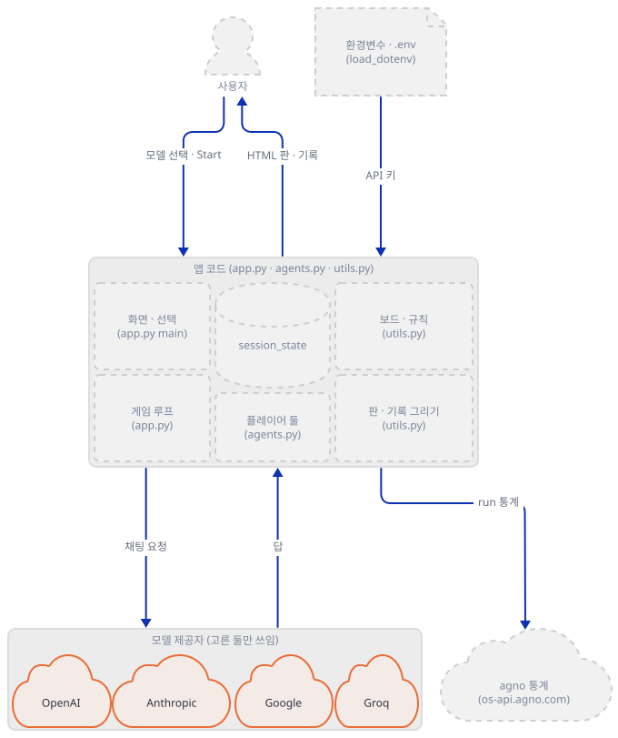

**확인.** 설치된 판과 import를 봅니다.

```bash
uv run --no-project python -c "from importlib.metadata import version as v; print(' | '.join(f'{n} {v(n)}' for n in ['agno','anthropic','openai','google-genai','groq','pydantic','streamlit']))"
uv run --no-project python -c "import agents; print('import agents: ok')"
```

```text
agno 3.1.3 | anthropic 0.85.0 | openai 2.2.0 | google-genai 1.55.0 | groq 0.18.0 | pydantic 2.10.6 | streamlit 1.42.2
import agents: ok
```

숫자는 2026-10-15의 값입니다. 목록에 남은 나머지 고정판(`pydantic==2.10.6`, `streamlit==1.42.2` 등)은 이 문서의 모든 실행에서 문제를 일으키지 않았습니다. 저장소 안에서 `uv run`은 루트 환경을 쓰려 하므로 이후 `uv run`에는 모두 `--no-project`를 붙입니다.

### Step 2. 가짜 서버 하나와 환경변수 — 네 제공자의 주소 바꾸기

**목적.** 진짜 제공자에 요청이 가지 않도록, 한 포트가 네 제공자의 요청을 받는 가짜 서버와 그 서버로 가게 하는 환경변수를 만듭니다.

**할 일.** 앱 코드의 모델 객체는 `OpenAIChat(id=model_name)`처럼 주소 인자 없이 만들어집니다(`agents.py:54-75`). 그래서 주소는 환경변수로만 바꿀 수 있고, 네 SDK가 읽는 이름을 소스로 확인했습니다.

| 제공자 | 바꾸는 환경변수 | 확인한 곳(소스) | 가짜 서버가 받는 주소 |
|---|---|---|---|
| OpenAI | `OPENAI_BASE_URL`(끝에 `/v1`) | `openai` 패키지 `_client.py`의 162행 | `/v1/chat/completions` |
| Anthropic | `ANTHROPIC_BASE_URL` | `anthropic` 패키지 `_client.py`의 101행 | `/v1/messages` |
| Groq | `GROQ_BASE_URL` | `groq` 패키지 `_client.py`의 90행 | `/openai/v1/chat/completions` |
| Google | `GOOGLE_GEMINI_BASE_URL` | `google-genai` 패키지 `_base_url.py`의 50행 | `/v1beta/models/<모델>:generateContent` |

OpenAI·Groq는 agno 쪽 `base_url`이 비어 있으면 SDK가 환경변수를 따르고(agno `models/openai/chat.py`가 값이 `None`인 인자를 빼고 넘깁니다), Anthropic·Google도 같았습니다. 실제로 네 곳에 요청을 보내 보는 것은 아래 확인에서 합니다.

터미널 A에서 가짜 서버를 저장합니다. 제가 만든 서버이고 틱택토를 두는 모델이 아닙니다. 요청 본문의 `Available valid moves (row, col): [...]` 줄에서 빈 칸을 읽어 X에게는 첫 칸, O에게는 마지막 칸을 답하고, 모든 요청을 기록 파일에 남깁니다. 네 번째 인자 `MODE`는 Step 7의 실패를 흉내 내는 데 쓰고, 세 번째 인자의 모델 ID는 404 오류(Anthropic 오류 모양을 제가 지어 흉내 냄)로 답합니다. `allow_reuse_address=False`는 Windows에서 다른 프로그램이 쓰는 포트에 오류 없이 겹쳐 뜨는 것을 막으려는 것입니다.

```bash
cat > fake_llm.py <<'PY'
"""네 제공자의 채팅 API를 한 포트에서 흉내 내는 가짜 서버. 127.0.0.1에만 뜬다."""
import json, re, socketserver, sys, time
from http.server import BaseHTTPRequestHandler, HTTPServer

PORT, LOG = int(sys.argv[1]), sys.argv[2]
DEAD = set(filter(None, (sys.argv[3] if len(sys.argv) > 3 else "").split(",")))  # 이 모델 ID는 404
MODE = sys.argv[4] if len(sys.argv) > 4 else "normal"  # normal | illegal | chatter | words
calls = {"X": 0, "O": 0}


def pick(body, player):
    text = json.dumps(body)
    tail = text.rsplit("Available valid moves (row, col): [", 1)[1].split("]")[0]
    moves = re.findall(r"\((\d), (\d)\)", tail)
    r, c = moves[0] if player == "X" else moves[-1]  # X는 첫 칸, O는 마지막 칸
    if MODE == "illegal" and player == "O" and calls["O"] == 2:
        r, c = "0", "0"  # O의 두 번째 수: 이미 X가 둔 칸
    if MODE == "words" and player == "O":
        return "I pass"
    if MODE == "chatter" and player == "O":
        return f"Move {calls['O']}: I choose row {r}, column {c}."
    return f"{r} {c}"


class H(BaseHTTPRequestHandler):
    def log_message(self, *a):
        pass

    def reply(self, code, obj):
        raw = json.dumps(obj).encode()
        self.send_response(code)
        self.send_header("content-type", "application/json")
        self.send_header("content-length", str(len(raw)))
        self.end_headers()
        self.wfile.write(raw)

    def do_POST(self):
        body = json.loads(self.rfile.read(int(self.headers["content-length"])))
        path = self.path
        if path.startswith("/v1/messages"):
            prov, model = "anthropic", body["model"]
        elif path.startswith("/v1beta/models/"):
            prov, model = "google", path.split("/models/")[1].split(":")[0]
        elif path.startswith("/openai/v1/"):
            prov, model = "groq", body["model"]
        elif path.startswith("/v1/chat/completions"):
            prov, model = "openai", body["model"]
        else:
            return self.reply(404, {"error": f"unknown path {path}"})
        raw = json.dumps(body)
        player = "X" if "You are Player X" in raw else "O"
        key = (self.headers.get("x-api-key") or self.headers.get("authorization")
               or self.headers.get("x-goog-api-key") or "")[:12]
        rec = {"t": round(time.time(), 3), "prov": prov, "path": path, "model": model,
               "player": player, "key": key, "keys": sorted(body),
               "n": len(body.get("messages") or body.get("contents") or []), "chars": len(raw),
               "retry": "Invalid move:" in raw}
        if model in DEAD:
            rec["answer"] = "404"
            open(LOG, "a").write(json.dumps(rec) + "\n")
            err = {"type": "error", "error": {"type": "not_found_error", "message": f"model: {model}"}}
            return self.reply(404, err)
        calls[player] += 1
        answer = pick(body, player)
        rec["answer"] = answer
        open(LOG, "a").write(json.dumps(rec) + "\n")
        usage = {"prompt_tokens": 10, "completion_tokens": 3, "total_tokens": 13}
        if prov == "anthropic":
            blocks = [{"type": "text", "text": answer}]
            if body.get("thinking"):
                blocks.insert(0, {"type": "thinking", "thinking": "가짜 생각", "signature": "fake"})
            self.reply(200, {"id": "msg_1", "type": "message", "role": "assistant", "model": model,
                             "content": blocks, "stop_reason": "end_turn", "stop_sequence": None,
                             "usage": {"input_tokens": 10, "output_tokens": 3}})
        elif prov == "google":
            self.reply(200, {"candidates": [{"content": {"role": "model", "parts": [{"text": answer}]},
                                             "finishReason": "STOP"}],
                             "usageMetadata": {"promptTokenCount": 10, "candidatesTokenCount": 3,
                                               "totalTokenCount": 13}})
        else:
            self.reply(200, {"id": "c1", "object": "chat.completion", "created": 0, "model": model,
                             "choices": [{"index": 0, "finish_reason": "stop",
                                          "message": {"role": "assistant", "content": answer}}],
                             "usage": usage})


class S(socketserver.ThreadingMixIn, HTTPServer):
    allow_reuse_address = False
    daemon_threads = True


S(("127.0.0.1", PORT), H).serve_forever()
PY
```

같은 터미널 A에서 49152~65535 사이의 쓰이지 않는 포트(예: 52875)로 띄웁니다. 터미널을 닫거나 Ctrl+C로 멈출 때까지 떠 있습니다.

```bash
uv run --no-project python fake_llm.py 52875 fake.log "" normal
```

터미널 B에서 환경변수 파일을 저장하고 걸어 둡니다. **이 파일을 건 터미널에서만 앱 코드를 돌립니다.** 네 키를 가짜 값으로 덮고 네 주소를 가짜 서버로 돌립니다. 앱이 `load_dotenv()`를 부르지만(`app.py:7`) 이미 셸에 있는 변수는 `.env`가 덮지 않으므로(직접 확인, Step 5) 가짜 값이 이깁니다.

```bash
cat > envfake.sh <<'EOF'
# 사용: . ./envfake.sh <포트>   (이 터미널에서만 유효)
export OPENAI_API_KEY=sk-fake-openai ANTHROPIC_API_KEY=sk-ant-fake GOOGLE_API_KEY=fake-google GROQ_API_KEY=gsk_fake
export OPENAI_BASE_URL=http://127.0.0.1:$1/v1 ANTHROPIC_BASE_URL=http://127.0.0.1:$1
export GROQ_BASE_URL=http://127.0.0.1:$1 GOOGLE_GEMINI_BASE_URL=http://127.0.0.1:$1
export AGNO_TELEMETRY=false PYTHONIOENCODING=utf-8
EOF
. ./envfake.sh 52875
echo $OPENAI_BASE_URL
```

`echo`가 `http://127.0.0.1:52875/v1`을 찍어야 이 터미널은 가짜 서버로 갑니다. 비어 있거나 다른 주소면 앱이 진짜 제공자로 가려 하므로, 앱 코드를 돌리기 전에 터미널마다 이 줄로 확인합니다. 이 문서를 쓰는 중에 이 순서를 한 번 어겼습니다. `. ./envfake.sh`를 파이프 뒤에 물려 변수가 하위 셸에만 걸렸고, 그 상태로 돌린 `play.py`에서 `app.py`의 `load_dotenv()`가 상위 폴더의 가짜 `.env` 키를 채워 `api.openai.com:443`으로 연결을 시도했습니다. 요청을 기록만 하고 거절하는 로컬 프록시를 걸어 두었으므로 바깥으로 나간 것은 없었고(프록시 기록 132건 모두 거절), 이 사고가 이 줄을 넣은 까닭입니다.

아래 PowerShell 줄은 실행해 보지 못했습니다. `. ./envfake.sh` 대신 이 줄들을 터미널 B마다 붙여 넣습니다(포트는 가짜 서버와 같게).

```powershell
$env:OPENAI_API_KEY="sk-fake-openai"; $env:ANTHROPIC_API_KEY="sk-ant-fake"; $env:GOOGLE_API_KEY="fake-google"; $env:GROQ_API_KEY="gsk_fake"
$env:OPENAI_BASE_URL="http://127.0.0.1:52875/v1"; $env:ANTHROPIC_BASE_URL="http://127.0.0.1:52875"
$env:GROQ_BASE_URL="http://127.0.0.1:52875"; $env:GOOGLE_GEMINI_BASE_URL="http://127.0.0.1:52875"
$env:AGNO_TELEMETRY="false"; $env:PYTHONIOENCODING="utf-8"
```

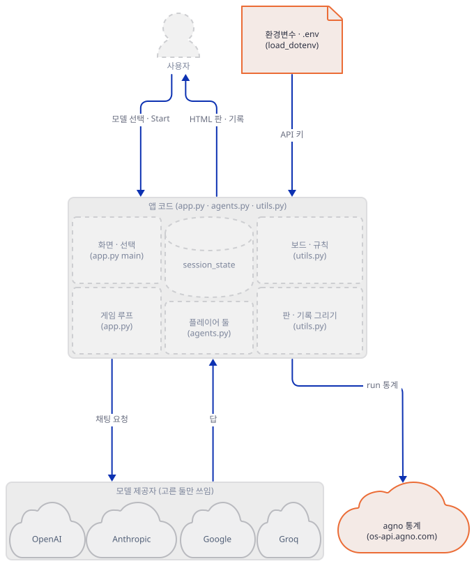

**확인.** 네 제공자의 모델 객체를 한 번씩 만들어 같은 질문을 보내고, 가짜 서버가 받은 요청을 봅니다. `probe.py`와 기록을 한 줄씩 찍는 `show_log.py`를 저장합니다.

```bash
cat > probe.py <<'PY'
from agents import get_model_for_provider
from agno.agent import Agent
for spec in ["openai:gpt-4o", "openai:o3-mini", "anthropic:claude-3-5-sonnet", "anthropic:claude-3-7-sonnet-thinking",
             "google:gemini-2.0-flash", "groq:llama-3.3-70b-versatile"]:
    prov, name = spec.split(":")
    a = Agent(name="Player X", description="You are Player X.", model=get_model_for_provider(prov, name))
    try:
        r = a.run('Available valid moves (row, col): [(0, 0), (1, 1)]\nReply "r c".', stream=False)
        print(spec, "->", repr(r.content))
    except Exception as e:
        print(spec, "!!", type(e).__name__, str(e)[:150])
PY
cat > show_log.py <<'PY'
import json, sys
for i, line in enumerate(open(sys.argv[1]), 1):
    r = json.loads(line)
    print(i, r["player"], r["model"], repr(r["answer"]), "messages=%d" % r["n"], "(재시도 문구 있음)" if r["retry"] else "")
PY
uv run --no-project python probe.py
uv run --no-project python -c "
import json
for l in open('fake.log'):
    r = json.loads(l); print(r['prov'].ljust(9), r['path'].ljust(48), r['model'].ljust(28), r['key'])
"
```

```text
openai:gpt-4o -> '0 0'
openai:o3-mini -> '0 0'
anthropic:claude-3-5-sonnet -> '0 0'
anthropic:claude-3-7-sonnet-thinking -> '0 0'
google:gemini-2.0-flash -> '0 0'
groq:llama-3.3-70b-versatile -> '0 0'
openai    /v1/chat/completions                             gpt-4o                       Bearer sk-fa
openai    /v1/chat/completions                             o3-mini                      Bearer sk-fa
anthropic /v1/messages                                     claude-3-5-sonnet-20241022   sk-ant-fake
anthropic /v1/messages                                     claude-3-7-sonnet-20250219   sk-ant-fake
google    /v1beta/models/gemini-2.0-flash:generateContent  gemini-2.0-flash             fake-google
groq      /openai/v1/chat/completions                      llama-3.3-70b-versatile      Bearer gsk_f
```

여섯 호출이 모두 가짜 서버에 닿았고 키는 가짜 값입니다. `claude-3-5-sonnet`이 `claude-3-5-sonnet-20241022`로, `claude-3-7-sonnet-thinking`이 `claude-3-7-sonnet-20250219`로 바뀌어 간 것은 `agents.py:59-71`의 매핑 그대로입니다. 이 확인은 `fake.log`에 기록을 남기므로 다음 Step 전에 지웁니다(`: > fake.log`).

### Step 3. 플레이어 둘 — 심판은 어디에도 없습니다

**목적.** 모델 이름이 모델 객체가 되는 길과, 플레이어에게 주어지는 지시문을 읽고, 앱 README가 말하는 심판이 코드에 있는지 확인합니다.

**할 일.** `agents.py`의 모델 만들기는 제공자 이름으로 갈라집니다. OpenAI·Google·Groq는 모델 이름을 그대로 넘기고, Anthropic만 화면 선택지의 짧은 이름 셋을 실제 ID와 설정으로 바꿉니다.

`advanced_ai_agents/autonomous_game_playing_agent_apps/ai_tic_tac_toe_agent/agents.py:54-77`

```python
    if provider == "openai":
        return OpenAIChat(id=model_name)
    elif provider == "google":
        return Gemini(id=model_name)
    elif provider == "anthropic":
        if model_name == "claude-3-5-sonnet":
            return Claude(id="claude-3-5-sonnet-20241022", max_tokens=8192)
        elif model_name == "claude-3-7-sonnet":
            return Claude(
                id="claude-3-7-sonnet-20250219",
                max_tokens=8192,
            )
        elif model_name == "claude-3-7-sonnet-thinking":
            return Claude(
                id="claude-3-7-sonnet-20250219",
                max_tokens=8192,
                thinking={"type": "enabled", "budget_tokens": 4096},
            )
        else:
            return Claude(id=model_name)
    elif provider == "groq":
        return Groq(id=model_name)
    else:
        raise ValueError(f"Unsupported model provider: {provider}")
```

`get_tic_tac_toe_players`는 `"제공자:모델"` 문자열 둘을 받아(`agents.py:98-99`의 `split(":")`) 플레이어 `Agent` 둘을 돌려줍니다. 두 에이전트의 지시문은 `description`에 들어 있고 X·O 글자만 다릅니다. 응답 형식을 "숫자 두 개를 공백으로"로 못 박고(`agents.py:120-123`), `debug_mode`를 그대로 넘깁니다.

`advanced_ai_agents/autonomous_game_playing_agent_apps/ai_tic_tac_toe_agent/agents.py:105-108`

```python
    player_x = Agent(
        name="Player X",
        description=dedent("""\
        You are Player X in a Tic Tac Toe game. Your goal is to win by placing three X's in a row (horizontally, vertically, or diagonally).
```

`advanced_ai_agents/autonomous_game_playing_agent_apps/ai_tic_tac_toe_agent/agents.py:131-133`

```python
        model=model_x,
        debug_mode=debug_mode,
    )
```

이제 앱 README의 "Master Agent (Referee)"가 코드에 있는지 봅니다.

```bash
grep -n -i referee agents.py
grep -n "^def " agents.py
```

```text
5:The game features a referee agent coordinating between two player agents using different
11:   referee_agent = get_tic_tac_toe_referee()
15:   referee_agent = get_tic_tac_toe_referee(debug_mode=False)
86:    Returns an instance of the Tic Tac Toe Referee Agent that coordinates the game.
91:        model_referee: ModelConfig for the referee agent
95:        An instance of the configured Referee Agent
40:def get_model_for_provider(provider: str, model_name: str):
80:def get_tic_tac_toe_players(
```

"referee"는 주석과 docstring에만 나오고(`get_tic_tac_toe_players`의 docstring이 "Referee Agent를 돌려준다"고 적지만 실제 반환은 `Tuple[Agent, Agent]`, `agents.py:84`), 함수는 둘뿐입니다. 머리 주석의 `get_tic_tac_toe_referee`와 `play_tic_tac_toe`는 파일 어디에도 정의되어 있지 않고(위 `def` 목록), docstring이 말하는 `model_referee` 인자도 없습니다. 쿡북에서 옮겨 오며 심판을 지운 흔적으로 보이지만 그 경위는 확인하지 못했습니다. 코드에서 확인된 사실만 정리하면 에이전트는 둘이고, 도구는 없고(`tools=` 0건), `db`도 없습니다.

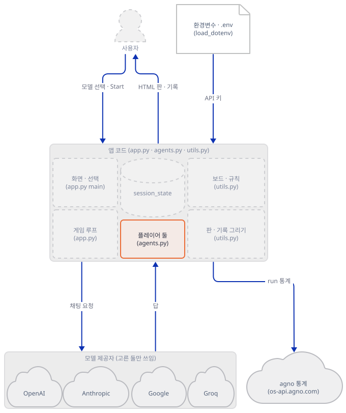

**확인.** 요청 한 건에 무엇이 실려 가는지 가짜 서버로 봅니다. Step 2의 `probe.py`가 이미 지시문을 실어 보냈습니다. 서버 기록의 `keys`와 `messages=`가 모양을 알려 줍니다. Anthropic 요청의 최상위 키는 `max_tokens`·`messages`·`model`·`system`(·`thinking`), Google 요청은 `contents`·`generationConfig`·`systemInstruction`이었습니다(서버 로그 `keys` 항목, 직접 확인). 즉 지시문 `description`은 제공자마다 시스템 메시지 자리(`system`, `systemInstruction`)로 갑니다. 아래 Step 6의 한 판 기록에서는 요청마다 `messages=2`(시스템과 사용자)입니다. 이전 수의 대화가 따라가지 않는다는 뜻이고, 매 수가 새 대화입니다.

### Step 4. 보드와 규칙 — 틀린 수는 보드가 거릅니다

**목적.** `utils.py`의 `TicTacToeBoard`가 하는 일을 모델 없이 확인합니다. 이 앱에서 "심판"에 가까운 것은 이 클래스입니다.

**할 일.** 수를 두는 `make_move`는 판 밖과 찬 칸을 거르고, 성공하면 놓은 뒤 차례를 바꿉니다.

`advanced_ai_agents/autonomous_game_playing_agent_apps/ai_tic_tac_toe_agent/utils.py:28-48`

```python
        # Validate move coordinates
        if not (0 <= row <= 2 and 0 <= col <= 2):
            return (
                False,
                "Invalid move: Position out of bounds. Please choose row and column between 0 and 2.",
            )

        # Check if position is already occupied
        if self.board[row][col] != EMPTY:
            return False, f"Invalid move: Position ({row}, {col}) is already occupied."

        # Make the move
        self.board[row][col] = self.current_player

        # Get board state
        board_state = self.get_board_state()

        # Switch player
        self.current_player = O_PLAYER if self.current_player == X_PLAYER else X_PLAYER

        return True, f"Move successful!\n{board_state}"
```

승부는 `get_game_state`가 정합니다. 이긴 줄이 있으면 `Player X wins!`, 판이 다 차면 `It's a draw!`, 아니면 `Game in progress`입니다(`utils.py:108-122`). 모델에게 주는 빈 칸 목록은 `get_valid_moves`(`utils.py:94-106`)가 만들고, 판을 글로 바꾸는 것은 `get_board_state`(`utils.py:50-57`)입니다.

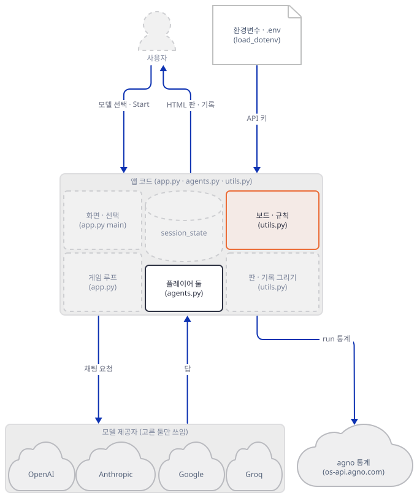

**확인.** 모델 없이 보드만 돌립니다.

```bash
cat > board_check.py <<'PY'
from utils import TicTacToeBoard

b = TicTacToeBoard()
print(b.make_move(3, 0))                       # 판 밖
print(b.make_move(0, 0)[0], b.current_player)  # X가 둠 -> 차례가 O로
print(b.make_move(0, 0))                       # 이미 찬 칸
for rc in [(1, 0), (0, 1), (1, 1), (0, 2)]:     # O X O X
    b.make_move(*rc)
print(b.get_game_state(), len(b.get_valid_moves()), "칸 남음")
print(b.make_move(2, 2)[0], "<- 이긴 뒤에도 보드는 수를 받는다")
print(b.get_board_state())
PY
uv run --no-project python board_check.py
```

```text
(False, 'Invalid move: Position out of bounds. Please choose row and column between 0 and 2.')
True O
(False, 'Invalid move: Position (0, 0) is already occupied.')
(True, 'Player X wins!') 4 칸 남음
True <- 이긴 뒤에도 보드는 수를 받는다

-------------
| X | X | X |
-------------
| O | O |   |
-------------
|   |   | O |
-------------
```

마지막 두 줄이 이 앱에서 눈여겨볼 점입니다. 보드는 이긴 뒤에도 수를 받고(`make_move`가 승부를 보지 않습니다), 게임이 끝났는지는 화면 코드가 `get_game_state()`로 따로 확인해서 에이전트를 부르지 않는 식으로 막습니다(`app.py:203`).

### Step 5. 화면과 선택 — 기본값에서는 Start가 막힙니다

**목적.** 모델 선택 상자와 키 검사, 시작 버튼이 어떻게 이어지는지 읽고, 기본 선택으로 열었을 때 화면이 어떻게 되는지 봅니다.

**할 일.** 화면의 선택지 여덟은 "화면 이름 → `제공자:모델`" 사전입니다. 값이 `agents.py:54-75`의 분기로 들어갑니다.

`advanced_ai_agents/autonomous_game_playing_agent_apps/ai_tic_tac_toe_agent/app.py:67-76`

```python
        model_options = {
            "gpt-4o": "openai:gpt-4o",
            "o3-mini": "openai:o3-mini",
            "claude-3.5": "anthropic:claude-3-5-sonnet",
            "claude-3.7": "anthropic:claude-3-7-sonnet",
            "claude-3.7-thinking": "anthropic:claude-3-7-sonnet-thinking",
            "gemini-flash": "google:gemini-2.0-flash",
            "gemini-pro": "google:gemini-2.0-pro-exp-02-05",
            "llama-3.3": "groq:llama-3.3-70b-versatile",
        }
```

기본 선택은 X가 `claude-3.7-thinking`, O가 `o3-mini`입니다(`app.py:80-91`의 `index=`). 선택한 두 모델에 맞는 키가 환경변수에 없으면 빨간 상자가 뜨고 Start 버튼이 꺼집니다. 키 이름은 `app.py:38-47`의 사전이 화면 이름별로 정해 둡니다.

`advanced_ai_agents/autonomous_game_playing_agent_apps/ai_tic_tac_toe_agent/app.py:96-100`

```python
        missing_keys = []
        for model in [selected_p_x, selected_p_o]:
            required_key = required_keys_info.get(model)
            if required_key and not os.getenv(required_key):
                missing_keys.append(f"**{model}** requires `{required_key}`")
```

시작 버튼은 `get_tic_tac_toe_players`로 플레이어를 만들어 `session_state`에 두고, 새 `TicTacToeBoard()`를 만들고 `game_started`를 켠 뒤 `st.rerun()`합니다(`app.py:126-138`). 화면 위쪽의 "X 모델 vs O 모델" 제목과 승자 안내는 선택 상자의 **현재 값**에서 읽습니다(`app.py:165-169`, `app.py:186`). 플레이어는 시작할 때의 선택으로 만들어져 있으니, 판 도중에 상자를 바꾸면 제목과 승자 이름이 실제로 두는 모델과 어긋납니다(소스로 확인, 실행해 보지는 않았습니다).

앱의 구조 관계를 화살표로 보면, 시작에서 만들어진 것들이 `session_state`에 쌓이고, 그리기 함수들이 그것을 읽습니다.

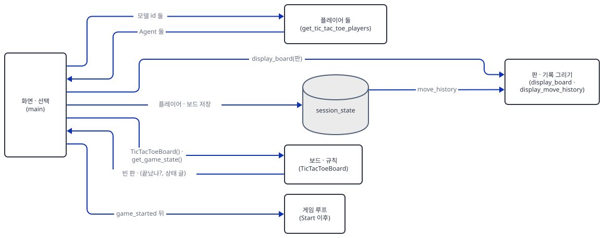

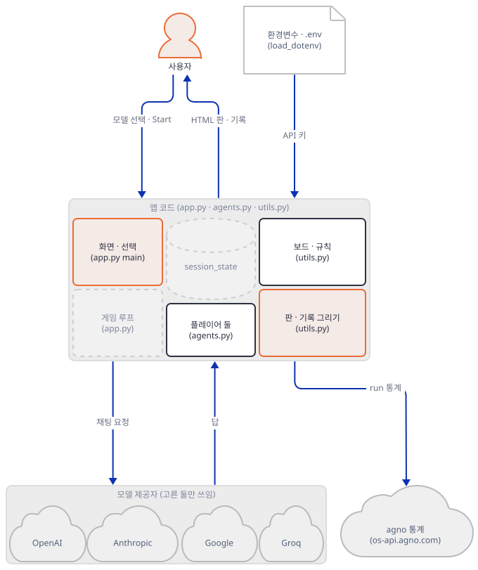

**확인.** 브라우저 없이 Streamlit의 시험 도구(`AppTest`)로 앱을 돌립니다. 아래 스크립트는 화면을 한 번 그려 기본 선택과 경고를 보고, X를 `gpt-4o`로 바꿉니다. Anthropic 키는 일부러 **빈 값**으로 덮습니다. `unset`으로 지우면 `load_dotenv()`가 상위 폴더의 `.env`에서 다시 채울 수 있기 때문입니다(이 문서를 쓰며 상위 폴더에 가짜 키가 든 `.env`를 두고 확인했을 때, 셸의 값이 있으면 `.env`의 값이 이기지 못했고, 셸에 없는 변수는 `.env`에서 채워졌습니다).

```bash
cat > keyprobe.py <<'PY'
from streamlit.testing.v1 import AppTest

at = AppTest.from_file("app.py", default_timeout=60)
at.run()
print("기본 선택:", at.selectbox(key="model_p1").value, "/", at.selectbox(key="model_p2").value)
print("경고 상자:", [l.strip() for e in at.error for l in e.value.splitlines() if "requires" in l])
print("Start 비활성:", [b.disabled for b in at.button if "Start" in b.label])
at.selectbox(key="model_p1").select("gpt-4o")
at.run()
print("X=gpt-4o 뒤 -> 경고", len(at.error), "개, Start 비활성:", [b.disabled for b in at.button if "Start" in b.label])
PY
ANTHROPIC_API_KEY= uv run --no-project python keyprobe.py 2>&1 | grep -E "^(기본|경고|Start|X=)"
```

```text
기본 선택: claude-3.7-thinking / o3-mini
경고 상자: ['• **claude-3.7-thinking** requires `ANTHROPIC_API_KEY`']
Start 비활성: [True]
X=gpt-4o 뒤 -> 경고 0 개, Start 비활성: [False]
```

OpenAI 키만 가진 독자가 기본값으로 열면 Start가 막히고, X를 `gpt-4o`로 바꾸면 풀립니다. 반대로 Anthropic 키까지 가진 독자는 막히지 않고 Start를 눌러 Step 7의 실패로 들어갑니다.

### Step 6. 게임 루프 — 실행 한 번에 모델 호출 한 번

**목적.** Start 이후 한 판이 어떻게 진행되는지 읽고, 모델 둘을 `gpt-4o`로 맞춰 한 판을 끝까지 돌립니다.

**할 일.** 루프는 `while`이 없습니다. Streamlit은 입력이 바뀔 때마다 스크립트를 처음부터 다시 실행하고, 이 앱은 수를 하나 둘 때마다 `st.rerun()`으로 스스로 다시 실행시킵니다. 한 번의 실행에서 일어나는 일은 이렇습니다. 판을 그리고 상태를 보여 준 뒤(`app.py:175-201`), 끝나지 않았고 멈춘 상태가 아니면 현재 차례의 에이전트에게 판과 빈 칸을 글로 주고 답을 받아 숫자 둘을 뽑아 수로 둡니다.

`advanced_ai_agents/autonomous_game_playing_agent_apps/ai_tic_tac_toe_agent/app.py:215-236`

```python
            valid_moves = st.session_state.game_board.get_valid_moves()

            current_agent = (
                st.session_state.player_x
                if current_player == "X"
                else st.session_state.player_o
            )
            response: RunOutput = current_agent.run(
                f"""\
Current board state:\n{st.session_state.game_board.get_board_state()}\n
Available valid moves (row, col): {valid_moves}\n
Choose your next move from the valid moves above.
Respond with ONLY two numbers for row and column, e.g. "1 2".""",
                stream=False,
            )

            try:
                import re

                numbers = re.findall(r"\d+", response.content if response else "")
                row, col = map(int, numbers[:2])
                success, message = st.session_state.game_board.make_move(row, col)
```

성공하면 수 기록(`move_history`)에 더하고, 승부가 났으면 `game_paused`를 켜고, 어느 쪽이든 `st.rerun()`합니다(`app.py:238-264`). 에이전트에게 주는 질문은 판 글, 빈 칸 목록(`[(0, 0), (0, 1), ...]` 모양), 응답 형식 안내의 세 부분이고, 이전 수의 대화는 없습니다. 이 호출마다 화면 아래쪽의 "thinking" 안내 상자가 다시 그려지고, `debug_mode=True`라서 터미널에 에이전트의 로그(시스템 메시지 전문 포함)가 수마다 길게 찍힙니다(이 문서의 한 판 출력은 341줄 가운데 DEBUG가 106줄이었습니다).

한 판은 X의 5수로 끝났습니다. 아래 구조 그림이 게임 루프가 주고받는 관계를 보여 줍니다.

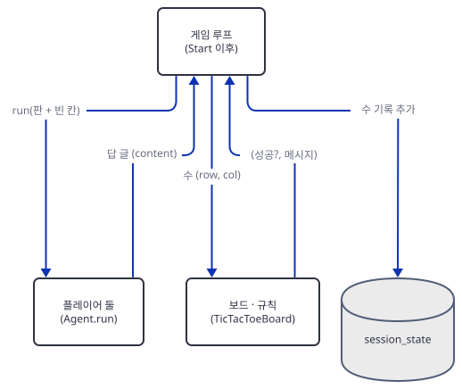

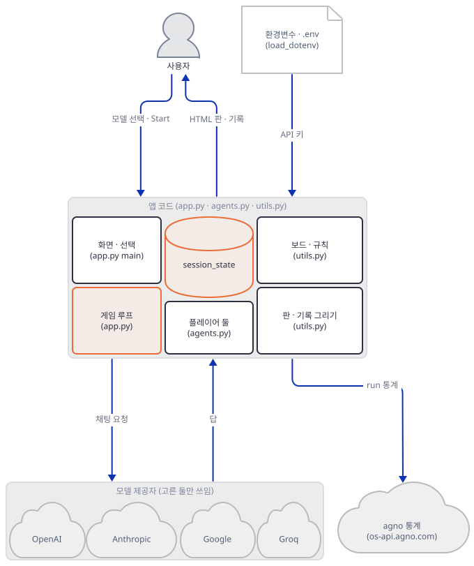

**확인.** 터미널 B에서(`envfake.sh`를 건 채) 가짜 서버를 새 기록으로 다시 띄우고 한 판을 돌립니다. 터미널 A에서 서버를 Ctrl+C로 멈춘 뒤 `uv run --no-project python fake_llm.py 52875 fake.log "" normal`로 다시 띄워도 됩니다(기록 파일은 `: > fake.log`로 비움). 아래 `play.py`는 선택 상자를 고르고 Start를 누른 뒤 제한 시간까지 기다립니다.

```bash
cat > play.py <<'PY'
"""브라우저 없이 app.py를 돌린다: 선택 상자를 고르고 Start Game을 누르고, 제한 시간까지 기다린다."""
import sys
from streamlit.testing.v1 import AppTest

x, o, limit = sys.argv[1], sys.argv[2], float(sys.argv[3])
at = AppTest.from_file("app.py", default_timeout=60)
at.run()
at.selectbox(key="model_p1").select(x)
at.selectbox(key="model_p2").select(o)
at.run()
try:
    [b for b in at.button if "Start Game" in b.label][0].click().run(timeout=limit)
    print(f"RESULT 제한 {limit:g}초 안에 끝남")
except RuntimeError:
    print(f"RESULT 제한 {limit:g}초가 지나도 안 끝남")
moves = [m["move"] for m in at.session_state.move_history]
rows = ["".join(c.strip() or "." for c in r) for r in at.session_state.game_board.board]
print("RESULT 수:", moves)
print("RESULT 판:", "/".join(rows))
PY
uv run --no-project python play.py gpt-4o gpt-4o 60 2>&1 | grep -E "^(RESULT|INFO    Move|INFO    Game|ERROR )"
uv run --no-project python show_log.py fake.log
```

```text
INFO    Move 1: Player 1 (gpt-4o) placed at position (0, 0)
INFO    Move 2: Player 2 (gpt-4o) placed at position (2, 2)
INFO    Move 3: Player 1 (gpt-4o) placed at position (0, 1)
INFO    Move 4: Player 2 (gpt-4o) placed at position (2, 1)
INFO    Move 5: Player 1 (gpt-4o) placed at position (0, 2)
INFO    Game Over - Player X wins!
RESULT 제한 60초 안에 끝남
RESULT 수: ['0,0', '2,2', '0,1', '2,1', '0,2']
RESULT 판: XXX/.../.OO
1 X gpt-4o '0 0' messages=2
2 O gpt-4o '2 2' messages=2
3 X gpt-4o '0 1' messages=2
4 O gpt-4o '2 1' messages=2
5 X gpt-4o '0 2' messages=2
```

요청 다섯 건이 X, O, X, O, X 순서로 한 건씩 갔고 틀린 수가 없었습니다. 그러니 한 판의 요청 수는 수의 수와 같고, 이기는 판이면 5~9건(판이 다 차면 9건)입니다. 요청 한 건의 본문은 1,367~1,399자였습니다(서버 기록의 `chars`, 빈 칸이 줄어 점점 짧아짐). 영어 글자 4자를 1토큰으로 어림하면 입력 350토큰 안팎(⚠ 추정, 실제 토큰 수는 모델마다 다르고 확인하지 못했습니다)입니다. 화면 기본값의 X는 여기에 생각 토큰 예산 최대 4,096(`agents.py:70`)이 더해질 수 있습니다. 요금표는 확인하지 못해 달러로 어림하지 않습니다.

### Step 7. 잘못된 수와 죽은 모델 — 요청이 멈추지 않는 길

**목적.** 모델이 틀린 수를 두거나, 이상한 글을 돌려주거나, 모델 자체가 죽어 있을 때 앱이 어떻게 되는지 가짜 서버로 흉내 내어 봅니다. 아래는 모두 `app.py:265-282`의 두 갈래를 지납니다.

**할 일.** 수가 보드에서 거절되면(`success`가 거짓) 앱은 같은 에이전트에게 `Invalid move: ...`로 시작하는 새 질문을 보내고, 그 답을 변수에 받기만 한 채 `st.rerun()`합니다. 답에서 숫자를 뽑거나 수를 두는 코드가 그 뒤에 없습니다. 숫자를 뽑다 예외가 나면 오류 상자를 띄우고 역시 `st.rerun()`합니다.

`advanced_ai_agents/autonomous_game_playing_agent_apps/ai_tic_tac_toe_agent/app.py:265-282`

```python
                else:
                    logger.error(f"Invalid move attempt: {message}")
                    response: RunOutput = current_agent.run(
                        f"""\
Invalid move: {message}

Current board state:\n{st.session_state.game_board.get_board_state()}\n
Available valid moves (row, col): {valid_moves}\n
Please choose a valid move from the list above.
Respond with ONLY two numbers for row and column, e.g. "1 2".""",
                        stream=False,
                    )
                    st.rerun()

            except Exception as e:
                logger.error(f"Error processing move: {str(e)}")
                st.error(f"Error processing move: {str(e)}")
                st.rerun()
```

넷을 차례로 돌립니다. 각각 터미널 A에서 서버를 멈추고 아래 모드로 다시 띄운 뒤 터미널 B(`envfake.sh`를 건 채)에서 `play.py`를 돌립니다. 포트가 바뀌면 `. ./envfake.sh <새 포트>`를 다시 겁니다. 기록 파일은 서버를 띄우기 전에 `: > fake.log`로 비웁니다.

**(가) 틀린 수 한 번 — `illegal` 모드.** O의 두 번째 답이 이미 X가 둔 `0 0`입니다.

```bash
uv run --no-project python fake_llm.py 52877 fake.log "" illegal
```

```bash
. ./envfake.sh 52877
uv run --no-project python play.py gpt-4o gpt-4o 60 2>&1 | grep -E "^(RESULT|ERROR )"
uv run --no-project python show_log.py fake.log
```

```text
ERROR   Invalid move attempt: Invalid move: Position (0, 0) is already occupied.
RESULT 제한 60초 안에 끝남
RESULT 수: ['0,0', '2,2', '0,1', '2,1', '0,2']
RESULT 판: XXX/.../.OO
1 X gpt-4o '0 0' messages=2
2 O gpt-4o '2 2' messages=2
3 X gpt-4o '0 1' messages=2
4 O gpt-4o '0 0' messages=2
5 O gpt-4o '2 1' messages=2 (재시도 문구 있음)
6 O gpt-4o '2 1' messages=2
7 X gpt-4o '0 2' messages=2
```

틀린 수 하나가 요청 세 건이 되었습니다. 4번이 틀린 답, 5번이 재시도(질문에 `Invalid move:`가 들어 있음)인데 그 답 `2 1`은 버려졌고, `st.rerun()` 뒤 6번에서 같은 질문을 처음부터 다시 해서 받은 `2 1`이 실제 수가 되었습니다. 재시도 질문에 실린 오류 설명은 그다음 호출에 따라가지 않으니(에이전트에 대화 기록이 없습니다), 모델은 자기가 틀렸다는 것을 한 번도 배우지 못한 채 같은 질문을 다시 받습니다.

**(나) 숫자가 낀 설명 — `chatter` 모드.** O가 `Move 1: I choose row 2, column 2.` 같은 문장으로 답합니다.

```bash
uv run --no-project python fake_llm.py 52878 fake.log "" chatter
```

```bash
. ./envfake.sh 52878
uv run --no-project python play.py gpt-4o gpt-4o 60 2>&1 | grep -E "^RESULT"
uv run --no-project python show_log.py fake.log
```

```text
RESULT 제한 60초 안에 끝남
RESULT 수: ['0,0', '1,2', '0,1', '2,2', '0,2']
RESULT 판: XXX/..O/..O
1 X gpt-4o '0 0' messages=2
2 O gpt-4o 'Move 1: I choose row 2, column 2.' messages=2
3 X gpt-4o '0 1' messages=2
4 O gpt-4o 'Move 2: I choose row 2, column 2.' messages=2
5 X gpt-4o '0 2' messages=2
```

정규식 `\d+`는 글 속의 모든 숫자를 뽑아 앞의 둘을 쓰므로, 2번 답은 `(1, 2)`로 읽혔습니다(`Move 1`의 `1`이 행, `row 2`의 `2`가 열). 모델이 가리킨 `(2, 2)`가 아닙니다. 4번은 우연히 `(2, 2)`로 맞았습니다. 틀린 칸이라도 빈 칸이면 보드는 받아들이므로 아무 오류 없이 엉뚱한 수가 두어졌습니다. 실제 모델이 이런 답을 하는지는 확인하지 못했고, 이 서버의 문장은 제가 지은 것입니다.

**(다) 숫자가 없는 답 — `words` 모드.** O가 `I pass`라고만 답합니다. 끝나지 않으므로 5초만 기다립니다.

```bash
uv run --no-project python fake_llm.py 52879 fake.log "" words
```

```bash
. ./envfake.sh 52879
uv run --no-project python play.py gpt-4o gpt-4o 5 2>&1 | grep -E "^RESULT"
uv run --no-project python -c "
import json, collections
print(dict(collections.Counter(json.loads(l)['player'] for l in open('fake.log'))))"
```

```text
RESULT 제한 5초가 지나도 안 끝남
RESULT 수: ['0,0']
RESULT 판: X../.../...
{'X': 1, 'O': 36}
```

`numbers[:2]`가 비어 `map(int, ...)`의 풀어 담기에서 `not enough values to unpack (expected 2, got 0)`가 나고(`Error processing move:` 오류 상자), 그다음 `st.rerun()`이 같은 질문을 곧바로 다시 보냅니다. 5초 동안 O에게 36번(다른 실행에서는 114번) 갔고, 쉬는 시간이나 횟수 상한이 코드에 없으므로 이 서버였다면 끝없이 이어집니다(`play.py`가 제한 시간 뒤 멈춰서 끝났을 뿐입니다). 요청 횟수는 서버·머신마다 다릅니다.

**(라) 죽은 모델 — 화면의 기본 선택.** X의 모델 ID `claude-3-7-sonnet-20250219`에 404를 주는 서버로 기본 선택 그대로 돌립니다. 이것이 독자가 Anthropic과 OpenAI 키를 모두 넣고 아무것도 바꾸지 않은 채 Start를 눌렀을 때 일어날 일의 흉내입니다(오류 본문은 제가 지은 것이고, 아래 둘째 확인이 보여 주는 `Error code: <상태코드> - ...` 모양은 Anthropic SDK의 예외 글입니다).

```bash
uv run --no-project python fake_llm.py 52880 fake.log "claude-3-5-sonnet-20241022,claude-3-7-sonnet-20250219" normal
```

```bash
. ./envfake.sh 52880
uv run --no-project python play.py claude-3.7-thinking o3-mini 5 > dead.out 2>&1
grep -E "^RESULT" dead.out
grep -E "^ERROR" dead.out | sort | uniq -c | sort -rn | cut -c1-120 | head -4
uv run --no-project python -c "
import json, collections
print(dict(collections.Counter((json.loads(l)['model'], json.loads(l)['answer']) for l in open('fake.log'))))"
```

```text
RESULT 제한 5초가 지나도 안 끝남
RESULT 수: []
RESULT 판: .../.../...
    242 ERROR   Non-retryable model provider error: Error code: 404 - {'type': 'error', 'error': {'type': 'not_found_...
    242 ERROR   Claude API error (status 404)
    242 ERROR   Error in Agent run: Error code: 404 - {'type': 'error', 'error': {'type': 'not_found_...
    121 ERROR   Invalid move attempt: Invalid move: Position out of bounds. Please choose row and column between 0 and 2.
{('claude-3-7-sonnet-20250219', '404'): 242}
```

5초 동안 죽은 모델에 요청이 242번(다른 실행에서는 190번) 갔고 O는 한 번도 차례를 얻지 못했습니다(`Invalid move attempt`가 121번, 한 번에 요청 둘). 왜 이런지는 에이전트를 직접 불러 보면 보입니다. 같은 기본 선택의 X 에이전트에 질문 하나만 보냅니다.

```bash
cat > err_probe.py <<'PY'
import re
from agents import get_tic_tac_toe_players

x, o = get_tic_tac_toe_players("anthropic:claude-3-7-sonnet-thinking", "openai:gpt-4o", debug_mode=False)
r = x.run('Available valid moves (row, col): [(0, 0)]\nRespond with ONLY two numbers, e.g. "1 2".', stream=False)
print("status :", r.status)
print("content:", r.content)
print("숫자   :", re.findall(r"\d+", r.content)[:2])
PY
uv run --no-project python err_probe.py 2>&1 | grep -E "^(status|content|숫자)"
```

```text
status : RunStatus.error
content: Error code: 404 - {'type': 'error', 'error': {'type': 'not_found_error', 'message': 'model: claude-3-7-sonnet-20250219'}}
숫자   : ['404', '3']
```

agno 3.1.3의 `Agent.run()`은 모델 호출이 실패해도 예외를 던지지 않고, 상태가 `error`인 결과의 `content`에 오류 글을 담아 돌려줍니다. 앱은 그 글에서 숫자 둘 `404`, `3`을 뽑아 `make_move(404, 3)`을 부르고, 판 밖이라 거절되어 (가)의 재시도 분기로 들어갑니다. 재시도도 같은 이유로 실패하고, 그 결과는 버려지고, `st.rerun()`이 처음부터 다시 시작합니다. 앱에는 `RunOutput`의 상태를 보는 곳이 없습니다(`grep -c "RunStatus|response.status" app.py`가 0). 진짜 제공자가 퇴역한 모델에 어떤 글을 돌려주는지는 확인하지 못했습니다. 다만 Anthropic SDK의 예외 글이 `Error code: <상태코드>`로 시작한다는 것은 이 실행에서 보았으므로, 상태코드 세 자리가 첫 "숫자"가 되는 점은 진짜 제공자에서도 같을 것으로 보입니다. 상태코드가 `0`~`2`에 걸릴 일은 없어 늘 판 밖으로 읽힙니다.


**확인.** 위 네 실행의 서버 기록과 출력이 증거입니다. 끝나면 터미널 A의 서버를 Ctrl+C로 멈추고 포트가 비었는지 봅니다.

```bash
netstat -ano | grep :52880
```

아무것도 나오지 않으면 비었습니다(PowerShell: `netstat -ano | Select-String ":52880"`, 실행해 보지 못했습니다).

화면으로 보려면 가짜 서버(예: `normal` 모드)를 띄운 터미널 A를 그대로 두고, 터미널 B에서 환경변수를 다시 걸고 앱을 띄웁니다. `--server.address localhost`와 `--server.headless true`가 없으면 Streamlit이 시작하며 외부 주소를 알아내려고 바깥에 요청을 보낼 수 있고(Day 060에서 확인), 사용 통계도 끕니다.

```bash
. ./envfake.sh 52875
echo $OPENAI_BASE_URL
uv run --no-project streamlit run app.py --server.headless true --server.address localhost --server.port 52881 --browser.gatherUsageStats false
```

브라우저로 http://localhost:52881 을 열어 X를 `gpt-4o`로 바꾸고(O도 `gpt-4o`로) Start Game을 누르면 화면이 한 수씩 갱신됩니다. 이 문서는 브라우저로 화면을 열어 보지 않았고, `curl http://localhost:52881/_stcore/health`가 `ok`를 돌려주는 것까지만 확인했습니다. 화면의 동작은 `AppTest`로 대신 확인했습니다. 진짜 키로 쓰려면 `envfake.sh`를 걸지 않은 새 터미널에서 `OPENAI_API_KEY`만 넣고 같은 명령을 쓰되, 아래 "문제 해결"의 모델 교체를 먼저 합니다.

## 요청 한 건이 흐르는 과정

"요청 한 건"은 Start Game을 누른 뒤 모델이 수를 하나 두기까지입니다. 스크립트 실행 단위로 나눠 그렸고, 메시지는 모두 한 그림에 코드 순서대로 있습니다. 먼저 Start 버튼을 누른 실행입니다. 배우는 왼쪽부터 사용자, 플레이어, 화면, `session_state`, 보드입니다.

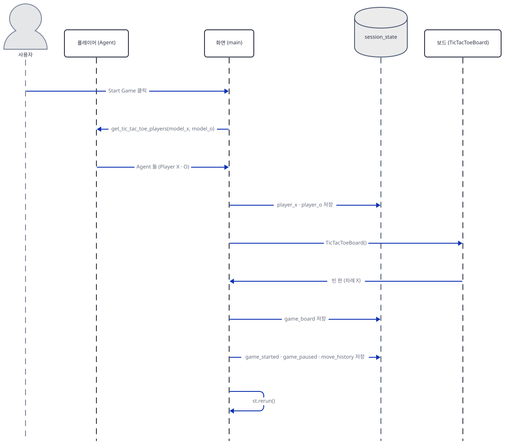

`st.rerun()` 뒤의 두 번째 실행은 판을 그리고 빈 칸과 판 글을 만듭니다(`app.py:175-201`, `app.py:215-224`).

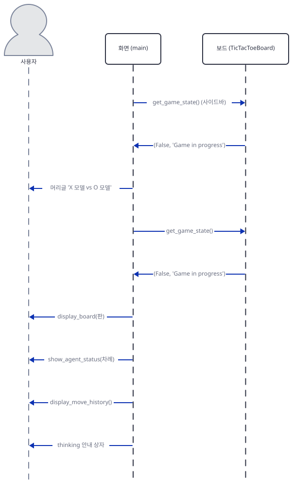

이어서 현재 차례의 플레이어에게 묻습니다. 앞선 `get_board_state()`는 질문 문자열을 만들 때 불립니다.

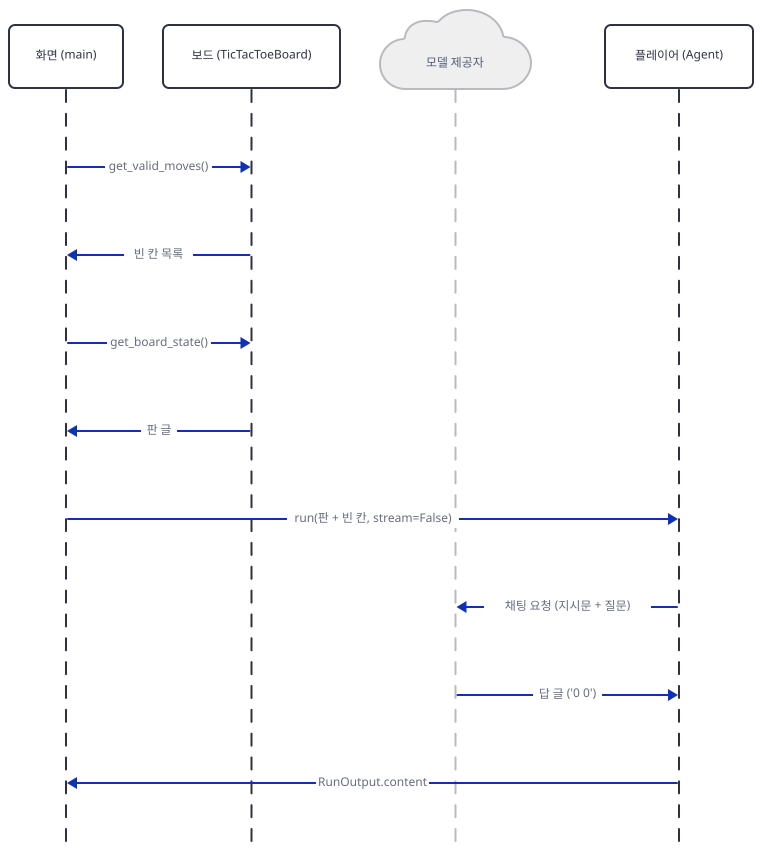

답을 받으면 수를 두고 기록하고 다시 실행합니다. 이 세 그림(다시 실행, 묻기, 두기)이 한 수이고, 같은 일이 X, O, X, O, X로 되풀이되었습니다(Step 6의 서버 기록).

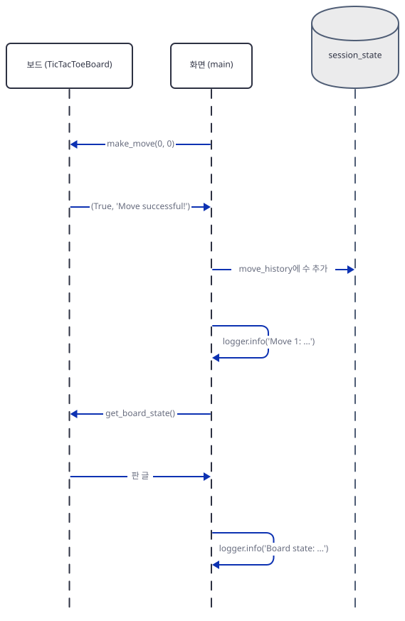

예외 둘도 같은 방식으로 그렸습니다. 보드가 수를 거절하면 재시도 질문을 보내고 답을 받아 버립니다. 아래는 Step 7 (가)의 O의 4~6번째 요청 부분입니다.

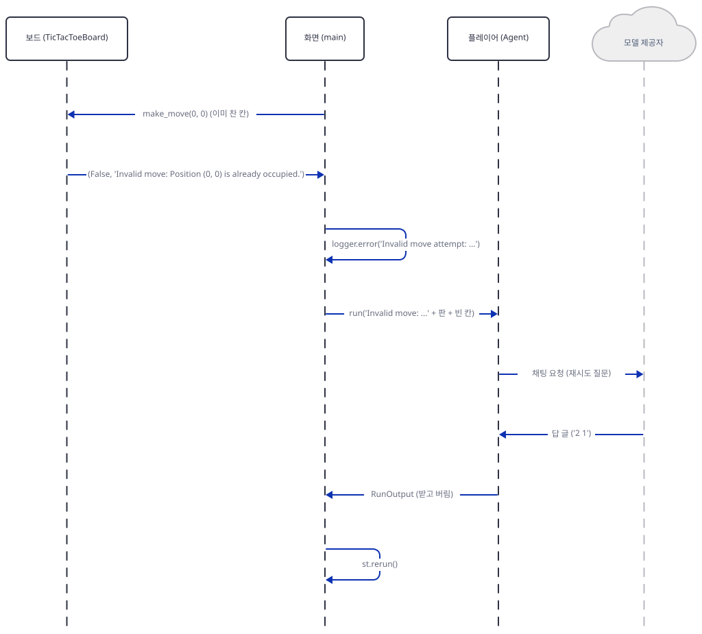

승부가 나는 수는 이렇게 끝납니다. 이긴 수를 둔 직후의 검사와, 그 뒤 다시 실행에서 안내를 그리는 부분을 둘로 나눠 그렸습니다.

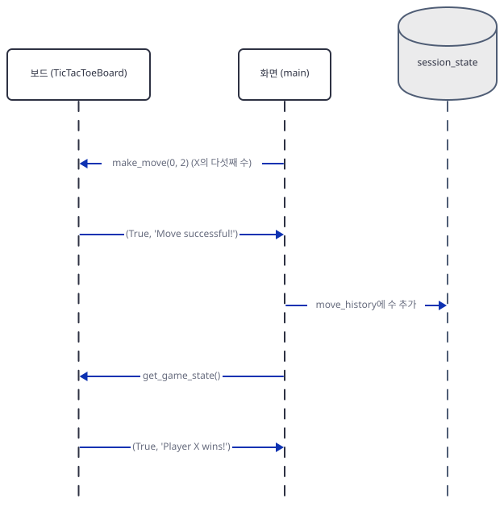

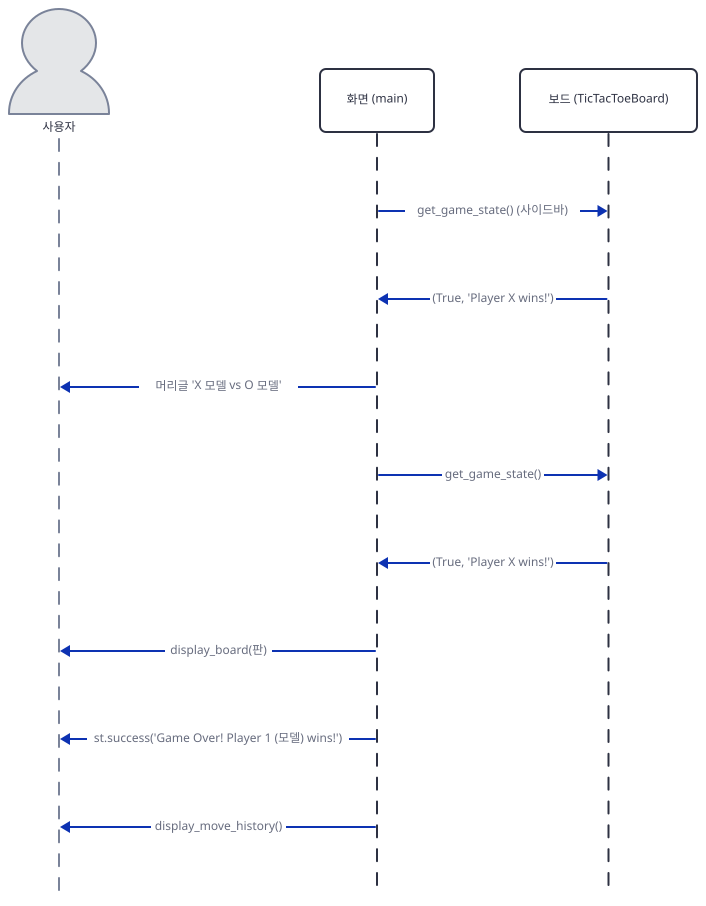

## 실행 체크리스트

- [ ] `ttt-work`에 원본 파일 넷을 복사했고 `.env`는 만들지 않았다
- [ ] `requirements.txt`가 설치되지 않는 것을 보았고, 풀린 목록(`requirements-fixed.txt`)과 세 SDK로 `import agents`가 된다
- [ ] 가짜 서버(`fake_llm.py`)를 터미널 A에 띄웠고, 터미널 B는 `. ./envfake.sh <포트>`를 건 채다
- [ ] `probe.py`의 여섯 호출이 모두 가짜 서버에 닿고 키가 가짜 값이다
- [ ] `board_check.py`가 판 밖·찬 칸을 거르고, 이긴 뒤에도 보드가 수를 받는 것을 보았다
- [ ] `keyprobe.py`로 기본 선택에서 Start가 막히는 것을 보았다
- [ ] `play.py gpt-4o gpt-4o 60`으로 한 판이 X의 5수로 끝나고 요청이 5건이다
- [ ] 틀린 수 한 번이 요청 세 건이고, 숫자 없는 답과 죽은 모델은 요청이 멈추지 않는 것을 보았다
- [ ] 가짜 서버를 모두 멈췄고 쓴 포트가 비었다

## 문제 해결

| 증상 | 원인 | 해결 |
|---|---|---|
| `uv pip install -r requirements.txt`가 `agno>=2.2.10 depends on h11>=0.16.0`로 실패 | 고정 목록의 `h11==0.14.0`·`httpcore==1.0.7`이 오늘의 agno와 충돌 | Step 1의 `grep -vE`로 `h11`·`httpcore`·`anthropic`·`openai`·`google-genai` 줄을 뺀 `requirements-fixed.txt`로 설치하고 세 SDK를 따로 설치 |
| `import agents`가 ``ImportError: `anthropic` not installed``(또는 `openai`·`google-genai`)로 죽는데 패키지는 깔려 있음 | 목록이 고정한 SDK가 agno 3.1.3이 요구하는 것보다 낡음. 메시지는 "없다"고 하지만 실제로는 판이 낮음 | 같은 명령에 `-U anthropic openai google-genai`를 붙여 올림. 바로 위 줄(`cannot import name ...`)이 진짜 이유 |
| 기본 선택으로 Start를 눌렀더니 로그에 `Error code: 404`가 끝없이 찍히고 판이 비어 있음 | X의 `claude-3-7-sonnet-20250219`는 2026-02-19 퇴역. 에이전트가 오류 글을 답으로 돌려주고 앱이 그 글의 숫자로 수를 두려다 되풀이(Step 7 라) | 브라우저 탭을 닫고 Streamlit을 멈춘다. `app.py:67-76`의 값을 살아 있는 모델로 바꾼다. 예: `"claude-3.7-thinking": "anthropic:claude-3-7-sonnet-thinking"` 줄의 값을 `"anthropic:claude-sonnet-5-5"`로(Anthropic 문서의 권장 대체. `agents.py:73`의 `else` 분기가 `Claude(id=model_name)`로 받는다. 이 문서는 이 모델로 실제 호출을 해 보지 못했다) |
| 화면에서 Start가 회색이고 `requires ANTHROPIC_API_KEY` 같은 빨간 상자 | 고른 모델의 제공자 키가 환경변수에 없음(`app.py:96-100`) | 두 선택 상자를 키가 있는 제공자의 모델로 바꾸거나 키를 환경변수에 넣는다. 지울 때는 `unset`이 아니라 `ANTHROPIC_API_KEY=`처럼 빈 값으로 덮는다. `load_dotenv()`가 상위 폴더 `.env`에서 다시 채울 수 있다 |
| `o3-mini`를 골랐더니 2026-10-23 뒤에 요청이 거절됨 | OpenAI 폐기 문서의 종료일 2026-10-23, 권장 대체 `gpt-5.6-sol` | `"o3-mini": "openai:o3-mini"` 줄(`app.py:69`)의 값을 `"openai:gpt-5.6-sol"` 등 문서의 대체로 바꾼다. 이 문서는 이 모델로 호출해 보지 못했다 |
| 한 수가 엉뚱한 칸에 두어지고 오류는 없음 | 답 속의 첫 숫자 둘을 수로 쓰는 정규식(`app.py:234`)이 설명 속 숫자를 집음(Step 7 나) | 응답을 숫자만 받도록 지시문을 강화하거나 `app.py:234`를 바꿔 "줄 전체가 `\d \d`일 때만" 받도록 고친다. 원본을 고치는 일은 이 문서가 하지 않았다 |
| 모델이 `I pass` 같은 글만 돌려주면 로그에 `not enough values to unpack`가 계속 | 숫자가 없어 `row, col = map(int, numbers[:2])`가 실패하고 `st.rerun()`이 곧바로 다시 질문(Step 7 다) | 같은 해결. 요청 횟수 상한이 코드에 없으니 비용이 걸린 키로 돌릴 때는 지켜본다 |
| 제목에 적힌 모델과 실제 두는 모델이 다름 | 제목·승자 이름은 선택 상자의 현재 값에서 읽고 플레이어는 시작 때 만들어짐(`app.py:165-169`, `186`) | 판 도중에 선택 상자를 바꾸지 않는다. 바꾸려면 New Game을 누른다 |
| 로그에 `API connection error from OpenAI API`(또는 진짜 주소 오류)가 쏟아짐 | 앱을 돌린 터미널에 `envfake.sh`가 걸리지 않아 진짜 제공자 주소로 가려 함(`echo $OPENAI_BASE_URL`이 비어 있음) | 즉시 중단하고 `. ./envfake.sh <포트>`를 걸고 `echo`로 확인한 뒤 다시 돌린다. `.env`에 진짜 키가 있다면 이 상태에서는 그 키가 진짜 주소로 나간다 |
| 따라 하기 중 터미널 A의 서버가 `Address already in use`로 안 뜸 | 고른 포트가 이미 쓰이는 중(`allow_reuse_address=False`라 겹쳐 뜨지 않음) | 49152~65535 사이의 다른 포트로 바꾸고 `. ./envfake.sh <새 포트>`를 다시 건다 |

## 더 해보기

- `app.py:234`의 숫자 뽑는 줄을 `re.fullmatch(r"\s*(\d)\s+(\d)\s*", ...)`로 바꾸고, Step 7의 가), 나), 다)를 같은 서버로 다시 돌려 요청 수와 결과가 어떻게 달라지는지 비교해 보세요(원본이 아니라 `ttt-work`의 복사본을 고칩니다).
- `response.status`를 `RunStatus.error`와 비교해 오류일 때 `st.error`를 띄우고 `st.session_state.game_paused = True`로 멈추는 분기를 `app.py:222-229` 사이에 넣어 보세요. Step 7 (라)가 요청 몇 건에서 멈추는지 세어 보세요.
- `fake_llm.py`의 `pick`을 바꿔 O가 X의 이길 칸을 막는 수를 두게 하고, X의 "첫 빈 칸" 전략과 몇 판 두게 해 보세요. 앱의 틀린 수 처리가 쓰일 일이 줄어드는지 서버 기록으로 세어 봅니다.

## 다음 날 예고

[Day 137 · 📞 Customer Support Voice Agent](../day137-customer-support-voice-agent/README.md) — 볼륨 11 "🗣️ Voice AI Agents"가 시작됩니다. 원본 앱 `voice_ai_agents/customer_support_voice_agent/customer_support_voice_agent.py`(마지막 줄에 개행이 없어 `wc -l`은 392, 편집기에서는 393줄)는 Streamlit 화면이고, 사이드바에서 Qdrant 주소와 키, Firecrawl 키, OpenAI 키를 입력받습니다(`customer_support_voice_agent.py:40-65`). 모델은 `gpt-4o`(228·240행)와 음성을 만드는 `gpt-4o-mini-tts`(288행)이고 `from agents import Agent, Runner`(9행)로 OpenAI Agents SDK를 씁니다(소스로 확인). 오늘처럼 모델 둘이 판을 두는 대신, 문서를 크롤링해 벡터 저장소에 넣고 질문에 음성으로 답하는 앱입니다.
