# Day 137 · 📞 Customer Support Voice Agent

> 볼륨 11 🗣️ Voice AI Agents · 난이도 ★★☆ ⚠ 오늘 풀리는 `firecrawl-py` 4.50.0에서는 "Initialize System"이 크롤링 단계에서 `FirecrawlClient.crawl() got an unexpected keyword argument 'params'`로 멈춰 질문까지 가지 못하고(Step 4), 앱이 쓰는 `gpt-4o`와 `gpt-4o-mini-tts`는 기본 스냅숏이 OpenAI 폐기 문서에서 2027년 1월 종료 예정입니다(사전 준비) · 예상 소요 160분(앱은 392줄 한 파일이지만 가짜 서버 하나와 확인 스크립트 일곱(`patches.py`·`run_app.py`·`screen_app.py`·`screen_check.py`·`sig_check.py`·`embed_check.py`·`guard.py`)을 직접 저장하고, 같은 앱을 시나리오를 바꿔 여러 번 돌려 서버 기록과 맞대어 보며, 그림 열아홉 장 가운데 시퀀스 일곱 장을 따라가는 손 시간이 읽는 시간보다 큽니다) · API 비용 대략 이 문서의 따라 하기는 $0(가짜 서버만 부릅니다). 진짜 키로 질문 한 건에 `gpt-4o` 두 번 약 $0.02에 음성 합성 요금이 더 붙습니다(⚠ 추정이며 Step 6에 계산을 적었습니다. 음성 합성의 분당 요금은 확인하지 못했습니다) · 원본 앱: `voice_ai_agents/customer_support_voice_agent`

## 오늘 만들 것

문서 사이트 주소 하나를 주면 Firecrawl로 최대 다섯 쪽을 긁어 Qdrant에 넣고, 그 문서에 대한 질문에 글과 음성으로 답하는 Streamlit 앱을 따라 봅니다. 앱은 `customer_support_voice_agent.py` 한 파일(`wc -l`은 392, 마지막 줄에 개행이 없어 편집기에서는 393줄)이고 `requirements.txt`는 일곱 줄입니다. 사이드바에 Qdrant 주소·키, Firecrawl 키, OpenAI 키, 문서 주소를 넣고 목소리 열한 개 가운데 하나를 고른 뒤 "Initialize System"을 누르면 지식 베이스가 만들어집니다. 질문을 적으면 가장 가까운 페이지 셋을 찾아 `gpt-4o` 에이전트가 답을 쓰고, 두 번째 `gpt-4o` 에이전트("TTS 에이전트")를 한 번 더 거친 뒤, `gpt-4o-mini-tts`가 mp3를 만들어 화면의 오디오 플레이어에 올립니다.

오늘이 볼륨 11 "🗣️ Voice AI Agents"의 첫날입니다. 앞 볼륨 10은 소리가 없는 게임 앱들이었습니다. 이어지는 것은 셋입니다. OpenAI Agents SDK는 Day 024~034가 다뤘고 Day 033이 트레이싱 기본값을, Day 118이 가짜 서버로 이 SDK의 호출을 센 방법을 보였습니다. 음성은 Day 034가 `VoicePipeline`(STT → 에이전트 → TTS)의 기본 TTS 모델이 `gpt-4o-mini-tts`라는 것을, Day 109가 업로드한 영상에서 오디오를 뽑아 분석하는 쪽을 다뤘습니다. Qdrant와 사이드바에서 주소·키를 받는 RAG는 Day 057·059가 다뤘고, Firecrawl의 버전 드리프트는 Day 104·105가 `extract`로 다뤘습니다. 새로운 것은 두 가지입니다. 하나는 마이크 없이 글을 소리로 바꾸는 일만 하는 앱이라는 점이고(앱에 `sounddevice`·`pyaudio`·`LocalAudioPlayer`·`getUserMedia`가 없습니다. grep 0건), 다른 하나는 `fastembed`입니다. 앞 날들의 README에서 `fastembed`를 찾았지만 없었습니다. Day 136의 "다음 날 예고"가 말한 392줄, 사이드바 입력(`:40-65`), `gpt-4o` 228·240행, `gpt-4o-mini-tts` 288행, `from agents import Agent, Runner` 9행은 소스와 같았습니다.

직접 돌려 보고 알게 된 것이 넷 있습니다.

1. 오늘 설치하면 크롤링이 `params` 인자 오류로 멈춥니다. 요청은 한 건도 나가지 않습니다(Step 4).
2. "TTS 에이전트"는 소리를 만들지 않습니다. 그 에이전트가 쓴 글은 음성 합성 호출의 `instructions`(말투 지시)로 들어가고, 읽히는 글은 첫 에이전트의 답입니다(Step 6).
3. 목소리를 바꾸거나 파일을 내려받는 등 화면을 한 번 건드릴 때마다, 질문 칸에 글이 남아 있으면 같은 질문이 처음부터 다시 처리됩니다. 모델 호출 셋과 mp3 하나가 매번 더 생깁니다. 게다가 목소리를 고른 두 번째 변경은 선택칸에서 무시되는데 요금은 나갑니다(Step 7).
4. "Initialize System"을 두 번 누르면 같은 페이지가 두 번 저장되고 검색 결과에 같은 페이지가 겹쳐 나옵니다(Step 5).

이 문서는 OpenAI·Firecrawl·Qdrant 어디에도 요청을 보내지 않았고 마이크·스피커·카메라를 열지 않았으며 mp3를 재생하지 않았습니다. OpenAI와 Firecrawl 자리에는 `127.0.0.1`의 가짜 서버를, Qdrant 자리에는 파이썬 프로세스 안의 메모리 저장소를, `fastembed` 모델 자리에는 단어를 해시해 만든 가짜 벡터를 두었습니다. 그래서 아래의 답·음성 바이트·검색 순위는 모두 내가 정한 값이고, 진짜 `gpt-4o`가 어떤 답을 쓰는지, 진짜 임베딩이 어떤 페이지를 고르는지, 소리가 어떻게 들리는지는 확인하지 못했습니다. 아래는 완성된 아키텍처입니다.

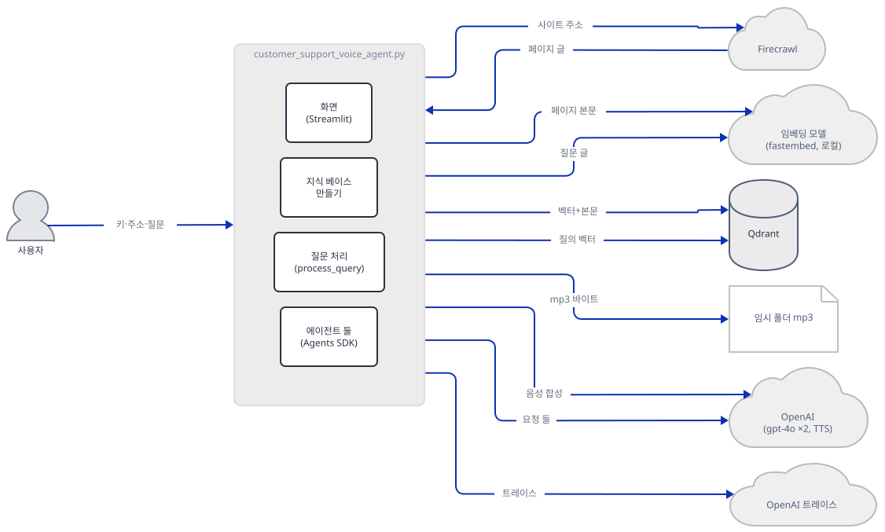

그림의 앱 묶음에서 나가는 화살표는 묶음 안의 어느 부분이 보내는지 가렸습니다. 부분별 화살표는 아래 그림 셋에 따로 그렸습니다. Hugging Face Hub도 그렸습니다. fastembed는 모델을 내 PC에서 돌리지만 처음 한 번은 바깥에서 받아 오기 때문이고(Step 3), 화살표가 묶음에서 나가는 것은 fastembed가 앱 프로세스 안에서 돌기 때문입니다. 먼저 지식 베이스를 만드는 쪽입니다.

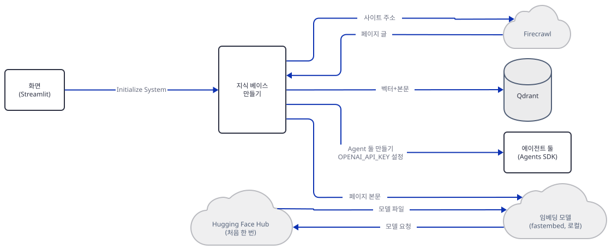

다음은 질문을 검색하고 에이전트 둘을 부르는 쪽입니다. 답 글과 말투 글이 `process_query`로 돌아오는 화살표도 여기에 있습니다.

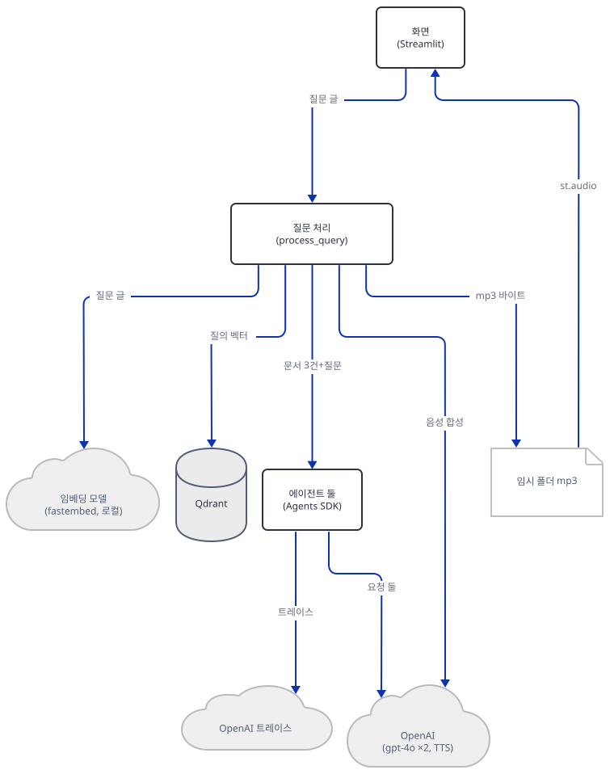

마지막은 음성을 만들어 파일로 쓰고 화면이 그 파일을 읽는 쪽입니다.

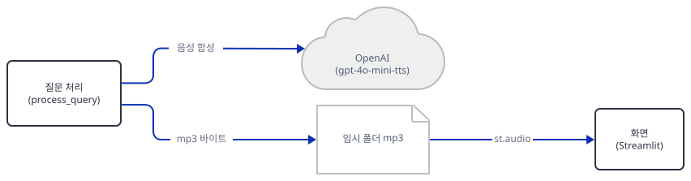

## 사전 준비

| 서비스/도구 | 용도 | 발급·설치 |
|---|---|---|
| uv | 가상환경 생성과 패키지 설치 | [공통 사전 준비](../README.md#공통-사전-준비-한-번만) 절 참고 |
| Python | 이 문서는 3.13.3(uv가 고른 판)으로 확인했고, 따로 3.14.2 환경에서도 같은 결과였습니다 | 공통 사전 준비와 같음 |
| OpenAI API 키 | `gpt-4o` 두 번과 `gpt-4o-mini-tts` 한 번. 사이드바 입력칸에서 받아 `os.environ["OPENAI_API_KEY"]`에 넣습니다(217행). 이 문서는 가짜 값만 씁니다 | https://platform.openai.com/api-keys |
| Firecrawl API 키 | 문서 사이트 크롤링. 페이지당 1크레딧이고 앱은 `limit` 5를 겁니다(Firecrawl 문서 https://docs.firecrawl.dev/features/crawl, 2026-10-15 확인) | https://www.firecrawl.dev/ |
| Qdrant 주소와 키 | 벡터 저장소. 사이드바가 요구하는 것은 비어 있지 않은 문자열 둘이고 `QdrantClient(url=..., api_key=...)`가 받습니다(133행) | Qdrant Cloud 또는 직접 띄운 Qdrant. Day 057·059가 같은 사이드바 모양을 다뤘습니다 |
| `fastembed` 기본 모델 | 이 앱의 `TextEmbedding()`이 처음 만들어질 때 Hugging Face에서 `Qdrant/bge-small-en-v1.5-onnx-Q`(fastembed 목록의 크기 0.067GB)를 내려받아 `%TEMP%\fastembed_cache`(환경변수 `FASTEMBED_CACHE_PATH`로 바꿈)에 둡니다(소스로 확인, Step 3). 이 문서의 실행은 내려받지 않았습니다 | 자동 |
| 새 작업 폴더 `support-voice-lab` | 앱 파일을 복사해 와서 이 폴더 안에서만 돌립니다 | Step 1에서 만듭니다 |
| `PYTHONIOENCODING=utf-8` | 한국어 Windows 콘솔(cp949)에서 출력이 깨지지 않게 합니다 | bash: `export PYTHONIOENCODING=utf-8`, PowerShell: `$env:PYTHONIOENCODING = "utf-8"`(실행해 보지 못했습니다) |

⚠ 모델. OpenAI 폐기 문서(https://developers.openai.com/api/docs/deprecations, 2026-10-15 확인)의 "2026-10-14: GPT-4 series model deprecations" 표에 `gpt-4o-2024-08-06`과 `gpt-4o-2024-11-20`이 "January 14, 2027" 종료로 올라 있고 권하는 대체는 `gpt-6-luna`입니다. 모델 페이지의 기본 스냅숏이 `gpt-4o-2024-08-06`입니다(https://developers.openai.com/api/docs/models/gpt-4o). 음성 모델은 별칭 `gpt-4o-mini-tts` 자체의 항목이 없고, "2026-10-01: Text-to-speech models" 표에 `gpt-4o-mini-tts-2025-03-20`과 `gpt-4o-mini-tts-2025-12-15`가 "Jan 6, 2027" 종료로 올라 있으며 권하는 대체는 `gpt-realtime-2.1-mini`입니다. 모델 페이지의 기본 스냅숏은 `gpt-4o-mini-tts-2025-12-15`입니다. 종료일 뒤에 별칭이 어떻게 움직이는지는 폐기 문서가 말하지 않습니다. 그런데 `gpt-realtime-2.1-mini`는 이름만 바꿔 `audio.speech.create`에 넣을 수 있는 모델로 보이지 않습니다. 음성 API 레퍼런스(https://developers.openai.com/api/reference/resources/audio/subresources/speech/methods/create)의 `model` 목록은 `tts-1`·`tts-1-hd`·`gpt-4o-mini-tts`·`gpt-4o-mini-tts-2025-12-15`이고 `gpt-realtime`이 없습니다. 폐기 문서의 안내는 "Migrate to gpt-realtime-2.1-mini … See the Realtime API guide"이며, `gpt-realtime-2.1-mini` 모델 페이지는 지원 엔드포인트로 `v1/realtime`만 표시하고 `v1/audio/speech`는 지원하지 않는 것으로 표시합니다(2026-10-15 확인. 요청을 보내 보지는 않았습니다). 그래서 교체는 둘로 나뉩니다. `gpt-4o`는 복사본의 228·240행(`model="gpt-4o"`)을 바꾸면 되고, 288행의 음성 합성은 이름 교체가 아니라 Realtime API로 옮기는 일이 되는 것으로 보입니다. 원본은 고치지 마세요.

## 아키텍처 한눈에 보기

| 컴포넌트 | 역할 | 코드 위치 |
|---|---|---|
| 세션 상태 | 키·주소·클라이언트·에이전트·선택한 목소리(기본 `coral`)를 보관 | `voice_ai_agents/customer_support_voice_agent/customer_support_voice_agent.py:21-39` |
| 사이드바 | 입력칸 다섯, 목소리 열한 개, "Initialize System" 버튼과 그 처리 | `voice_ai_agents/customer_support_voice_agent/customer_support_voice_agent.py:41-130` |
| Qdrant 준비 | 클라이언트 생성, 임베딩 모델 생성, 컬렉션 `docs_embeddings` 만들기 | `voice_ai_agents/customer_support_voice_agent/customer_support_voice_agent.py:132-147` |
| 크롤링 | Firecrawl로 최대 5쪽을 받아 페이지 목록으로 바꿈 | `voice_ai_agents/customer_support_voice_agent/customer_support_voice_agent.py:149-196` |
| 저장 | 페이지마다 벡터 하나와 본문·주소·제목을 Qdrant에 넣음 | `voice_ai_agents/customer_support_voice_agent/customer_support_voice_agent.py:198-214` |
| 에이전트 둘 | 처리 에이전트와 "TTS 에이전트"(둘 다 `gpt-4o`) | `voice_ai_agents/customer_support_voice_agent/customer_support_voice_agent.py:216-243` |
| 질문 처리 | 검색, 에이전트 둘, 음성 합성, mp3 쓰기 | `voice_ai_agents/customer_support_voice_agent/customer_support_voice_agent.py:245-319` |
| 화면 | 질문 칸, 답·오디오·내려받기·출처 표시 | `voice_ai_agents/customer_support_voice_agent/customer_support_voice_agent.py:321-390` |
| OpenAI API | `gpt-4o` 두 번과 `gpt-4o-mini-tts` 한 번 | `voice_ai_agents/customer_support_voice_agent/customer_support_voice_agent.py:228`, `voice_ai_agents/customer_support_voice_agent/customer_support_voice_agent.py:240`, `voice_ai_agents/customer_support_voice_agent/customer_support_voice_agent.py:288` |

## 단계별 진행

명령은 bash 기준이고 앱을 띄우는 터미널마다 환경변수를 다시 줍니다. PowerShell은 `&&`가 없어 줄을 나누고, 줄바꿈이 든 `-c "..."`는 따옴표 문제를 일으키니 같은 내용을 `.py`로 저장해 실행하세요(PowerShell 형태는 모두 실행해 보지 못했습니다). 저장소 루트에는 `pyproject.toml`이 있어서 모든 `uv run`에 `--no-project`를 붙입니다. 포트 `53217`은 내 PC에서 비어 있던 값이고 다른 번호를 써도 됩니다.

### Step 1. 환경 만들기 — 설치는 되는데 `firecrawl-py`가 4.x로 풀립니다

**목적.** `requirements.txt`를 그대로 설치해 무엇이 깔리는지, 앱의 import가 되는지 확인합니다.

**할 일.** 저장소를 내려받은 폴더를 `<리포>`라고 하면, 앱을 복사해 올 새 폴더를 만듭니다.

```bash
mkdir support-voice-lab
cd support-voice-lab
cp <리포>/voice_ai_agents/customer_support_voice_agent/customer_support_voice_agent.py .
cp <리포>/voice_ai_agents/customer_support_voice_agent/requirements.txt .
uv venv
uv pip install -r requirements.txt
```

(pip 대안: `python -m venv .venv`로 만들고 활성화한 뒤 `pip install -r requirements.txt`. PowerShell은 `mkdir`, `cd`, `Copy-Item <리포>\voice_ai_agents\customer_support_voice_agent\customer_support_voice_agent.py .`, `Copy-Item … requirements.txt .`, `uv venv`, `uv pip install -r requirements.txt`를 한 줄씩 씁니다.)

`voice_ai_agents/customer_support_voice_agent/requirements.txt:1-7`

```text
firecrawl-py
qdrant-client
streamlit
fastembed
openai>=1.0.0
python-dotenv 
openai-agents
```

버전을 정한 것은 `openai>=1.0.0` 하나뿐입니다(`python-dotenv` 줄 끝에 공백이 하나 있습니다). 이 문서를 쓰며 설치했을 때(2026-10-15) 패키지 89개가 깔렸고 `firecrawl-py` 4.50.0, `qdrant-client` 1.19.1, `streamlit` 1.66.0, `fastembed` 0.9.0, `openai` 3.31.0, `openai-agents` 0.24.0, `python-dotenv` 1.2.4가 포함됩니다(직접 확인). Day 118은 `openai-agents` 0.6.4와 `openai` 2.54.0이 서로 맞지 않아 첫 호출에서 멈췄는데, 오늘의 `openai-agents` 0.24.0과 `openai` 3.31.0 조합은 아래 Step 6에서 호출 셋이 끝까지 돌았습니다.

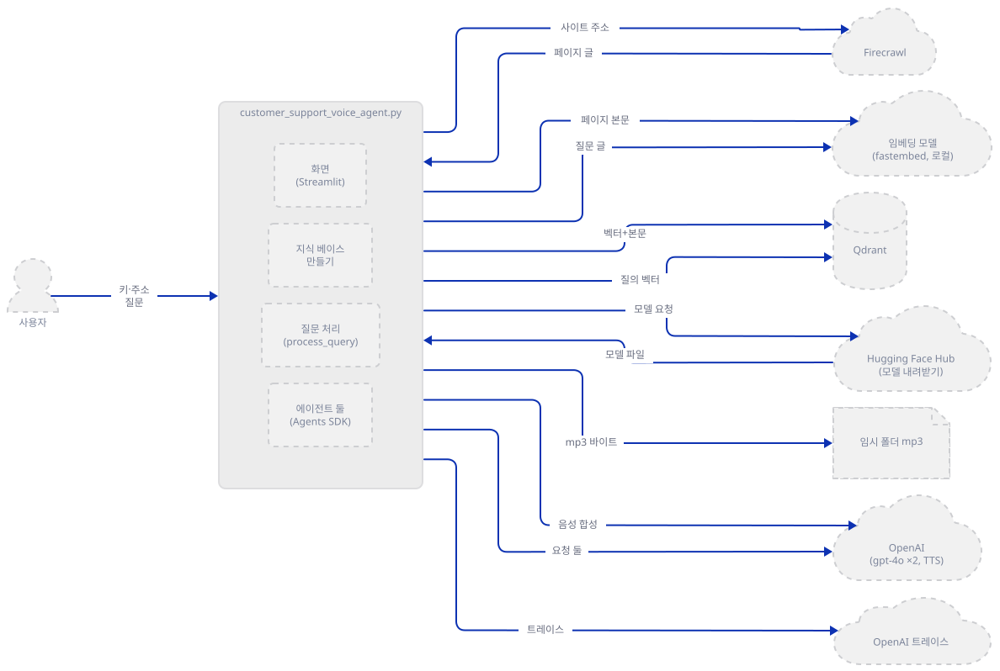

**확인.**

```bash
uv run --no-project python -B -W ignore -c "
compile(open('customer_support_voice_agent.py', encoding='utf-8').read(), 'customer_support_voice_agent.py', 'exec'); print('COMPILE_OK')
from firecrawl import FirecrawlApp
from fastembed import TextEmbedding
from qdrant_client import QdrantClient
from agents import Agent, Runner
from openai import AsyncOpenAI
print('IMPORT_OK')
"
```

직접 확인한 출력입니다.

```text
COMPILE_OK
IMPORT_OK
```

앱의 1~19행에 있는 import가 모두 됩니다. `FirecrawlApp`은 독립된 클래스가 아니라 새 `Firecrawl` 클래스의 다른 이름이고, Day 104 Step 1이 4.46.2에서 같은 별칭을 확인했습니다. import가 된다고 호출 모양까지 맞는 것은 아닙니다. Step 4에서 보입니다.

### Step 2. 사이드바와 세션 상태 — 그리고 확인용 하니스

**목적.** 화면이 무엇을 받는지 보고, 외부 서비스에 닿지 않고 앱을 끝까지 돌릴 확인용 스크립트를 저장합니다.

**할 일.** 앱의 입력칸부터 봅니다.

`voice_ai_agents/customer_support_voice_agent/customer_support_voice_agent.py:46-65`

```python
        st.session_state.qdrant_url = st.text_input(
            "Qdrant URL",
            value=st.session_state.qdrant_url,
            type="password"
        )
        st.session_state.qdrant_api_key = st.text_input(
            "Qdrant API Key",
            value=st.session_state.qdrant_api_key,
            type="password"
        )
        st.session_state.firecrawl_api_key = st.text_input(
            "Firecrawl API Key",
            value=st.session_state.firecrawl_api_key,
            type="password"
        )
        st.session_state.openai_api_key = st.text_input(
            "OpenAI API Key",
            value=st.session_state.openai_api_key,
            type="password"
        )
```

네 칸이 `type="password"`입니다. Qdrant 주소도 가려진다는 뜻입니다. 칸의 초기값은 모두 빈 문자열이고(`:24-28`) 앱은 환경변수에서 키를 읽지 않습니다. 환경변수를 읽는 코드는 없고 217행이 `OPENAI_API_KEY`를 쓸 뿐입니다(`grep -n "getenv\|environ"`). `load_dotenv()`(19행)는 `.env`의 값을 환경에 올리기만 해서 칸을 채워 주지 않습니다. 그래서 세션마다 키를 다시 넣어야 합니다. 목소리 목록은 75~82행에 열한 개이고, OpenAI 문서(https://developers.openai.com/api/reference/resources/audio/subresources/speech/methods/create, 2026-10-15 확인)는 여기에 `marin`·`cedar`도 지원 목록에 있다고 적습니다. 버튼의 검사는 이렇습니다.

`voice_ai_agents/customer_support_voice_agent/customer_support_voice_agent.py:84-91`

```python
        if st.button("Initialize System", type="primary"):
            if all([
                st.session_state.qdrant_url,
                st.session_state.qdrant_api_key,
                st.session_state.firecrawl_api_key,
                st.session_state.openai_api_key,
                st.session_state.doc_url
            ]):
```

다섯 칸이 모두 차야 합니다. 이 문서의 모든 실행은 외부로 나갈 다섯 곳을 먼저 바꿔 놓은 채로 앱을 돌립니다. 바꾸는 코드는 `patches.py` 하나에 있습니다. `OPENAI_BASE_URL`을 가짜 서버로 걸고, `QdrantClient`는 사이드바 주소와 상관없이 메모리 저장소 하나를 돌려주며, `TextEmbedding`은 단어를 해시한 384차원 벡터를 만드는 가짜로(모델을 내려받지 않습니다), `FirecrawlApp`은 가짜 서버 주소(`api_url`)를 달아서 만들고, 트레이스 업로드 주소(`default_exporter().endpoint`)도 가짜 서버로 돌립니다. 바꾼 줄마다 바로 뒤에 `assert`가 있어서 한 줄이라도 빠지면 앱이 뜨기 전에 멈춥니다. 또 셸에 `HTTP_PROXY`가 있는 독자의 루프백 요청이 프록시로 새지 않도록 `NO_PROXY`에 `127.0.0.1,localhost`를 더합니다(`HTTP_PROXY`만 걸고 `NO_PROXY`는 비운 셸에서 돌려도 프록시에 요청이 0건인 것을 직접 확인했습니다). 가짜 벡터는 의미를 모르기 때문에 아래의 검색 순위는 뜻이 없습니다.

```python
"""Replace everything the app could reach outside, then assert that each replacement is in place.
install(base) must run before the app file is executed. It is safe to call again on a rerun."""
import hashlib
import os
import re

import numpy as np


def install(base):  # base: the fake server, e.g. http://127.0.0.1:53217
    assert base.startswith("http://127.0.0.1:"), base
    # a shell with HTTP_PROXY must not send loopback requests to the proxy
    no_proxy = ",".join(filter(None, [os.environ.get("NO_PROXY"), "127.0.0.1,localhost"]))
    os.environ["NO_PROXY"] = os.environ["no_proxy"] = no_proxy
    os.environ["OPENAI_BASE_URL"] = base + "/v1"

    import fastembed, firecrawl, qdrant_client
    from agents.tracing.processors import default_exporter

    class FakeEmbedding(fastembed.TextEmbedding):  # no model download: hashed words, 384 dims like bge-small
        def __init__(self, *a, **k):
            pass

        def embed(self, docs, *a, **k):
            for d in docs:
                v = np.zeros(384, dtype=np.float32)
                for w in re.findall(r"[a-z0-9\-]+", d.lower()):
                    v[int(hashlib.md5(w.encode()).hexdigest(), 16) % 384] += 1
                yield v / (np.linalg.norm(v) or 1.0)

    orig_q = getattr(qdrant_client, "_orig_QdrantClient", qdrant_client.QdrantClient)
    qdrant_client._orig_QdrantClient = orig_q
    shared = getattr(qdrant_client, "_shared_store", None) or orig_q(":memory:")
    qdrant_client._shared_store = shared  # one store for the whole run, like a server that outlives a click

    def MemQdrant(url=None, api_key=None, **k):  # whatever the sidebar holds, use the in-memory store
        print("QdrantClient asked for url=%r api_key=%s..." % (url, (api_key or "")[:4]))
        return shared

    class LocalFirecrawl(getattr(firecrawl, "_orig_FirecrawlApp", firecrawl.FirecrawlApp)):
        def __init__(self, api_key=None, **k):
            super().__init__(api_key=api_key, api_url=base)

    if not hasattr(firecrawl, "_orig_FirecrawlApp"):
        firecrawl._orig_FirecrawlApp = firecrawl.FirecrawlApp
    fastembed.TextEmbedding = FakeEmbedding
    qdrant_client.QdrantClient = MemQdrant
    firecrawl.FirecrawlApp = LocalFirecrawl
    default_exporter().endpoint = base + "/v1/traces/ingest"  # the SDK uploads traces to api.openai.com otherwise

    assert fastembed.TextEmbedding is FakeEmbedding, "fastembed would download a model"
    assert qdrant_client.QdrantClient is MemQdrant, "the sidebar Qdrant address would be used"
    assert firecrawl.FirecrawlApp is LocalFirecrawl, "Firecrawl would use its real address"
    assert default_exporter().endpoint.startswith("http://127.0.0.1:"), "traces would go to api.openai.com"
    assert os.environ["OPENAI_BASE_URL"].startswith("http://127.0.0.1:"), "OpenAI would be the real one"
    assert "127.0.0.1" in os.environ["NO_PROXY"], "loopback requests could go through a proxy"
```

`run_app.py`는 Streamlit의 `AppTest`로 앱을 내 프로세스 안에서 돌리고(브라우저를 열지 않습니다) 시작할 때 `patches.install`을 부릅니다. 그래서 이 스크립트는 명령 앞의 환경변수를 하나 빠뜨려도 바깥으로 나가지 않습니다. 아래 명령에 `OPENAI_AGENTS_DISABLE_TRACING=1`을 붙이는 것은 트레이스 업로드를 끄려는 것이고, 바깥을 막는 장치가 아닙니다. 파일 이름은 `run_app.py`입니다.

```python
"""Run the app under AppTest with patches.install() applied.
Usage: run_app.py PORT SCENARIO   (SCENARIO: empty | init | ask | rerun | twice)"""
import os, sys, glob, tempfile

port, scenario = sys.argv[1], sys.argv[2]
base = f"http://127.0.0.1:{port}"

import patches

patches.install(base)  # replaces fastembed, Qdrant, Firecrawl's address, OpenAI's address and the trace address, with asserts

from streamlit.testing.v1 import AppTest

at = AppTest.from_file(os.path.abspath("customer_support_voice_agent.py"), default_timeout=120).run()
print("sidebar inputs:", [t.label for t in at.sidebar.text_input])
if scenario == "empty":  # click Initialize with every box empty
    next(b for b in at.sidebar.button if b.label == "Initialize System").click()
    at.run()
    print("errors:", [e.value for e in at.error])
    sys.exit(0)

vals = ["http://qdrant.invalid:6333", "qd-fake-sidebar", "fc-fake-sidebar", "sk-fake-sidebar", "https://docs.example.test"]
for t, v in zip(at.sidebar.text_input, vals):
    t.set_value(v)
at.run()


def init():
    next(b for b in at.sidebar.button if b.label == "Initialize System").click()
    at.run()
    print("errors:", [e.value for e in at.error], "| success:", [s.value for s in at.success])
    print("progress lines:", [m.value for m in at.sidebar.markdown if "✅" in m.value or "🔄" in m.value])


init()
if scenario == "init":
    sys.exit(0)

q = next(t for t in at.text_input if t.label.startswith("What would you like"))
q.set_value("How do I authenticate API requests?").run()
print("errors:", [e.value for e in at.error])
print("answer on screen:", [m.value[:70] for m in at.markdown if m.value.startswith("FAKE")])
print("sources on screen:", [m.value for m in at.markdown if m.value.startswith("- https")])
print("mp3 files in temp:", len(glob.glob(os.path.join(tempfile.gettempdir(), "response_*.mp3"))))
if scenario == "rerun":
    for v in ("nova", "onyx"):
        at.sidebar.selectbox[0].select(v).run()
        print("picked", v, "| box shows:", at.sidebar.selectbox[0].value, "| session:", at.session_state.selected_voice, "| errors:", [e.value for e in at.error])
    print("mp3 files in temp:", len(glob.glob(os.path.join(tempfile.gettempdir(), "response_*.mp3"))))
if scenario == "twice":
    init()
    c = at.session_state.client
    print("points in collection after 2nd init:", c.count("docs_embeddings", exact=True).count)
    print("sources on screen:", [m.value for m in at.markdown if m.value.startswith("- https")])

import agents.tracing as tr
tr.get_trace_provider()._multi_processor.force_flush()  # send any pending trace batch to the fake server now
```

**확인.** 칸을 모두 비운 채 버튼을 누르는 시나리오입니다. 이 명령은 서버가 없어도 됩니다.

```bash
OPENAI_AGENTS_DISABLE_TRACING=1 uv run --no-project python -B -W ignore run_app.py 53217 empty
```

PowerShell은 두 줄입니다(실행해 보지 못했습니다). 변수는 그 창에 남으므로 끝나면 지웁니다.

```powershell
$env:OPENAI_AGENTS_DISABLE_TRACING = "1"
uv run --no-project python -B -W ignore run_app.py 53217 empty
Remove-Item Env:OPENAI_AGENTS_DISABLE_TRACING
```

직접 확인한 출력입니다(Streamlit의 `missing ScriptRunContext` 경고 몇 줄이 먼저 찍히지만 무시해도 되고 뺐습니다).

```text
sidebar inputs: ['Qdrant URL', 'Qdrant API Key', 'Firecrawl API Key', 'OpenAI API Key', 'Documentation URL']
errors: ['Please fill in all the required fields!']
```

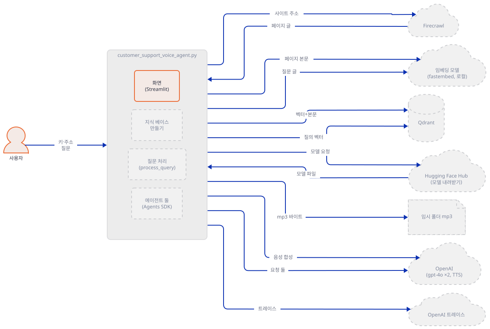

### Step 3. Qdrant와 임베딩 모델 — 처음 만드는 순간 모델을 내려받습니다

**목적.** 버튼을 누르면 가장 먼저 도는 `setup_qdrant_collection`이 무엇을 만들고 어디에 접속하는지 봅니다.

**할 일.**

`voice_ai_agents/customer_support_voice_agent/customer_support_voice_agent.py:132-147`

```python
def setup_qdrant_collection(qdrant_url: str, qdrant_api_key: str, collection_name: str = "docs_embeddings"):
    client = QdrantClient(url=qdrant_url, api_key=qdrant_api_key)
    embedding_model = TextEmbedding()
    test_embedding = list(embedding_model.embed(["test"]))[0]
    embedding_dim = len(test_embedding)
    
    try:
        client.create_collection(
            collection_name=collection_name,
            vectors_config=VectorParams(size=embedding_dim, distance=Distance.COSINE)
        )
    except Exception as e:
        if "already exists" not in str(e):
            raise e
    
    return client, embedding_model
```

순서는 이렇습니다. 클라이언트를 만들고(133행), 임베딩 모델을 만들고(134행), 낱말 `"test"` 하나를 임베딩해 차원을 재고(135~136행), 그 차원과 코사인 거리로 컬렉션을 만듭니다(139~142행). 앞 두 단계는 아래 그림과 같습니다.

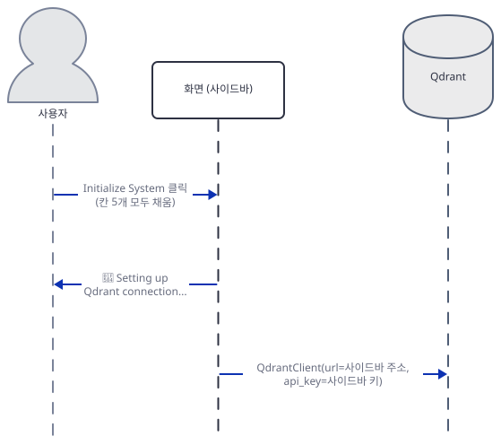

`QdrantClient(url=…, api_key=…)`는 오류 없이 돌아오지만 연결을 하지 않는 것은 아닙니다. 루프백 가짜 서버 주소로 만들었더니 만든 직후에는 서버가 받은 요청이 0건이고 2초 뒤에 `GET /` 한 건이 와 있었습니다(직접 확인). 만든 뒤 백그라운드 스레드가 서버 호환성을 확인하는 요청으로 읽었습니다. 그래서 사이드바에 적은 주소로는 버튼을 누르는 순간에 이미 요청이 나갑니다. 닫힌 포트(`http://127.0.0.1:9`)로 만들어도 오류는 나지 않았고 `http` 주소에 키를 주면 `UserWarning: Api key is used with an insecure connection.`만 떴습니다. 오류는 컬렉션을 만드는 139~142행에서 났습니다. 같은 닫힌 포트에서 `create_collection`을 직접 불렀더니 `ResponseHandlingException [WinError 10061] …`(한국어 Windows의 "연결을 거부했으므로 연결하지 못했습니다")였고, 앱에서는 사이드바에 `Error during setup: …`로 나옵니다. 이미 있는 컬렉션은 오류 문구에 `already exists`가 있으면 넘어갑니다(143~145행). 메모리 저장소는 `ValueError: Collection docs_embeddings already exists`로 이 문구를 냈고(직접 확인), 진짜 서버가 같은 문구를 내는지는 확인하지 못했습니다. 컬렉션 이름은 `docs_embeddings`로 고정이라 앱은 하나의 문서 사이트만 한 컬렉션에 쌓습니다.

134행의 `TextEmbedding()`은 모델 이름을 주지 않으므로 fastembed의 기본값 `BAAI/bge-small-en-v1.5`가 됩니다(소스로 확인, `fastembed/text/text_embedding.py` 89행). fastembed 0.9.0의 모델 목록에서 이 모델은 384차원, 크기 0.067GB이고 출처가 Hugging Face의 `Qdrant/bge-small-en-v1.5-onnx-Q`이며 설명이 "English, 512 input tokens truncation"입니다(직접 확인). 내려받기는 생성자 안에서 늘 일어나고(소스로 확인, `onnx_embedding.py` 310행의 `download_model`), `lazy_load` 기본값 `False`는 내려받은 모델을 메모리에 올리는 일(317행의 `load_onnx_model`)만 생성자 안으로 가져옵니다. 캐시 폴더는 `FASTEMBED_CACHE_PATH`가 없으면 `tempfile.gettempdir()` 아래의 `fastembed_cache`입니다(소스로 확인, `common/utils.py` 76~87행). 이 문서는 내려받지 않았습니다. 생성자만 불러 무슨 일이 나는지 보는 `embed_check.py`를 저장합니다. 이 스크립트는 `import` 앞에서 `HF_HUB_OFFLINE=1`을 스스로 걸고 `local_files_only=True`도 주기 때문에, 명령 앞에 아무것도 붙이지 않아도 Hugging Face에 접속하지 않습니다.

```python
import os
os.environ["HF_HUB_OFFLINE"] = "1"  # set before the import: this check must never download
from fastembed import TextEmbedding

try:
    TextEmbedding(local_files_only=True, cache_dir="fastembed-cache")
except Exception as e:
    print(type(e).__name__, str(e)[:80])
```

```bash
mkdir fastembed-cache
uv run --no-project python -B -W ignore embed_check.py
```

(PowerShell은 `mkdir fastembed-cache`를 만든 뒤 같은 `uv run` 줄을 씁니다. 실행해 보지 못했습니다.) 직접 확인한 출력입니다. 앞에 모델 파일이 없다는 `ERROR` 로그 두 줄이 먼저 나옵니다.

```text
ValueError Could not load model BAAI/bge-small-en-v1.5 from any source.
```

생성자가 캐시에서 모델을 찾으려 했고 못 찾아서 멈춘다는 뜻입니다. 이 확인에서 스크립트의 위 두 줄을 지우고 돌리면 인터넷이 되는 PC에서는 이 자리에서 Hugging Face로 접속해 약 67MB를 받습니다(내가 바깥을 막은 환경에서 지우고 돌렸을 때 `huggingface.co:443` 접속 시도가 찍힌다는 것을 확인했습니다). 앱에서는 "Initialize System"을 처음 누를 때 이 일이 일어납니다. 영어 모델이라 한국어 문서의 검색 품질은 이 문서가 확인하지 못했습니다. 아래는 임베딩 두 단계(134~136행)입니다.

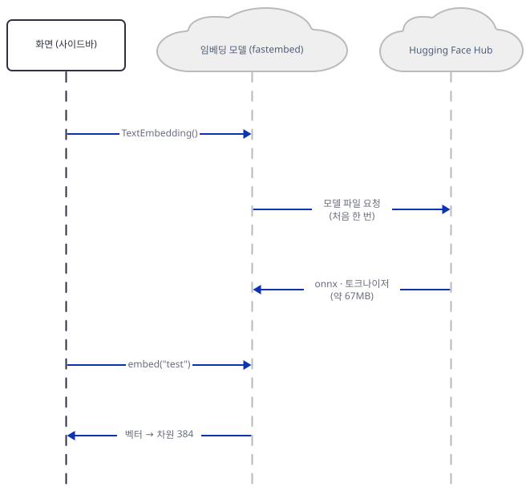

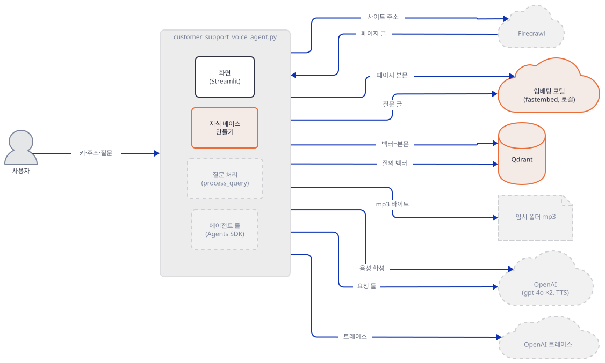

### Step 4. 크롤링 — `crawl_url(params=…)`는 오늘 풀리는 판에서 거부됩니다

**목적.** Firecrawl 호출이 오늘의 `firecrawl-py`에서 도는지 확인하고, 도는 판으로 고정합니다.

**할 일.**

`voice_ai_agents/customer_support_voice_agent/customer_support_voice_agent.py:149-165`

```python
def crawl_documentation(firecrawl_api_key: str, url: str, output_dir: Optional[str] = None):
    firecrawl = FirecrawlApp(api_key=firecrawl_api_key)
    pages = []
    
    if output_dir:
        os.makedirs(output_dir, exist_ok=True)
    
    response = firecrawl.crawl_url(
        url,
        params={
            'limit': 5,
            'scrapeOptions': {
                'formats': ['markdown', 'html']
            }
        }
    )
    
```

`firecrawl.crawl_url(url, params={...})`는 `firecrawl-py` 1.x의 모양입니다. 오늘의 4.50.0에서 `crawl_url`은 새 `crawl`을 부르는 "V1 compatibility alias"일 뿐이고 `params=`를 받지 않습니다(소스로 확인, `firecrawl/v2/client.py` 413~415행). 호출 모양을 시그니처로 대조하는 `sig_check.py`를 저장합니다.

```python
import inspect
from importlib.metadata import version
from firecrawl import FirecrawlApp

app = FirecrawlApp(api_key="fc-test", api_url="http://127.0.0.1:9")
print("firecrawl-py", version("firecrawl-py"))
real = app.crawl if hasattr(app, "crawl") else app.crawl_url  # 4.x: crawl_url is a thin alias of crawl
params = list(inspect.signature(real).parameters)
print(real.__qualname__, "| takes params=:", "params" in params, "| first args:", params[:4])
print("crawl_url exists:", hasattr(app, "crawl_url"), "| get exists:", hasattr(app, "get"))
```

```bash
uv run --no-project python -B -W ignore sig_check.py
```

직접 확인한 출력입니다.

```text
firecrawl-py 4.50.0
FirecrawlClient.crawl | takes params=: False | first args: ['url', 'prompt', 'exclude_paths', 'include_paths']
crawl_url exists: True | get exists: False
```

앱을 이 상태로 돌리면 사이드바에 오류가 뜹니다. 아직 가짜 서버를 띄우지 않았으니 이 명령은 어디에도 닿지 못하는 상태에서 돕니다.

```bash
OPENAI_AGENTS_DISABLE_TRACING=1 uv run --no-project python -B -W ignore run_app.py 53217 init
```

```text
sidebar inputs: ['Qdrant URL', 'Qdrant API Key', 'Firecrawl API Key', 'OpenAI API Key', 'Documentation URL']
QdrantClient asked for url='http://qdrant.invalid:6333' api_key=qd-f...
errors: ["Error during setup: FirecrawlClient.crawl() got an unexpected keyword argument 'params'"] | success: []
progress lines: ['🔄 Setting up Qdrant connection...', '✅ Qdrant setup complete!', '🔄 Crawling documentation pages...']
```

서버가 없는데도 연결 오류가 아니라 `TypeError`가 먼저 난 것은 이 호출이 요청을 만들기 전에 인자 검사에서 끝난다는 뜻입니다(요청 0건). 같은 문제를 Day 104·105가 `extract`의 `params`로 겪었고, 같은 처방(1.x 고정)이 여기서도 맞습니다. Day 104와 같은 1.17.0으로 고정합니다.

```bash
uv pip install "firecrawl-py==1.17.0"
uv run --no-project python -B -W ignore sig_check.py
```

```text
 - firecrawl-py==4.50.0
 + firecrawl-py==1.17.0
firecrawl-py 1.17.0
FirecrawlApp.crawl_url | takes params=: True | first args: ['url', 'params', 'poll_interval', 'idempotency_key']
crawl_url exists: True | get exists: False
```

이제 나머지 호출을 받을 가짜 서버를 저장합니다. 요청마다 한 줄을 파일에 적고, 키는 `-fake-` 뒤의 낱말(`sidebar`·`shell` 등)만 적습니다. 모델 요청에는 고정 문장으로, 음성 요청에는 가짜 mp3 바이트로 답하고, 크롤링 요청에는 페이지 셋을 줍니다. 인자 `speech-fail`을 주면 음성 요청만 400으로 거절합니다. 응답 값은 모두 내가 지은 것입니다. 파일 이름은 `fake_server.py`입니다.

```python
import json, re, sys, itertools, threading
from http.server import BaseHTTPRequestHandler, ThreadingHTTPServer

PORT = int(sys.argv[1])
LOG = sys.argv[2]
SPEECH_FAIL = len(sys.argv) > 3 and sys.argv[3] == "speech-fail"  # 음성 요청만 400으로 거절
ids = itertools.count(1)
lock = threading.Lock()

PAGES = [
    {"markdown": "# Authentication\nSend your API key in the X-Acme-Key header. Keys start with acme_live_ or acme_test_.",
     "metadata": {"sourceURL": "https://docs.example.test/auth", "title": "Authentication", "description": "How to authenticate", "language": "en"}},
    {"markdown": "# Rate limits\nThe API allows 60 requests per minute per key. Exceeding it returns HTTP 429.",
     "metadata": {"sourceURL": "https://docs.example.test/limits", "title": "Rate limits", "description": "Limits", "language": "en"}},
    {"markdown": "# Webhooks\nWebhooks are signed with an HMAC-SHA256 signature in the X-Acme-Signature header.",
     "metadata": {"sourceURL": "https://docs.example.test/webhooks", "title": "Webhooks", "description": "Webhooks", "language": "en"}},
]


def key_tag(auth):  # never echo a key: only the word after "-fake-" is shown
    m = re.search(r"-fake-([a-z-]+)$", auth)
    return m.group(1) if m else "not-a-fake-key"


def record(entry):
    with lock, open(LOG, "a", encoding="utf-8") as f:
        f.write(json.dumps(entry, ensure_ascii=False) + "\n")


def resp(model, text):
    return {"id": f"resp_{next(ids)}", "object": "response", "created_at": 0, "status": "completed", "model": model,
            "output": [{"type": "message", "id": f"msg_{next(ids)}", "role": "assistant", "status": "completed",
                        "content": [{"type": "output_text", "text": text, "annotations": []}]}],
            "parallel_tool_calls": True, "tool_choice": "auto", "tools": [],
            "usage": {"input_tokens": 100, "input_tokens_details": {"cached_tokens": 0, "cache_write_tokens": 0},
                      "output_tokens": 20, "output_tokens_details": {"reasoning_tokens": 0}, "total_tokens": 120}}


class H(BaseHTTPRequestHandler):
    def log_message(self, *a):
        pass

    def send(self, code, body, ctype="application/json"):
        data = body if isinstance(body, bytes) else json.dumps(body).encode()
        self.send_response(code)
        self.send_header("Content-Type", ctype)
        self.send_header("Content-Length", str(len(data)))
        self.end_headers()
        self.wfile.write(data)

    def do_POST(self):
        raw = self.rfile.read(int(self.headers.get("Content-Length", 0)) or 0)
        try:
            body = json.loads(raw or b"{}")
        except Exception:
            body = {}
        auth = key_tag(self.headers.get("Authorization", ""))
        if self.path.endswith("/responses"):
            ins = body.get("instructions") or ""
            inp = body.get("input")
            text_in = inp if isinstance(inp, str) else json.dumps(inp)
            who = "processor" if "documentation assistant" in ins else ("tts" if "text-to-speech agent" in ins else "other")
            out = ("FAKE ANSWER: send the key in the X-Acme-Key header. Source https://docs.example.test/auth"
                   if who == "processor" else "FAKE STYLE: calm, friendly, slow pace.")
            record({"path": self.path, "who": who, "model": body.get("model"), "auth": auth,
                    "input_chars": len(text_in), "input_head": text_in[:60]})
            return self.send(200, resp(body.get("model"), out))
        if self.path.endswith("/audio/speech"):
            record({"path": self.path, "model": body.get("model"), "voice": body.get("voice"),
                    "format": body.get("response_format"), "input": body.get("input"),
                    "instructions": body.get("instructions"), "auth": auth})
            if SPEECH_FAIL:
                return self.send(400, {"error": {"message": "FAKE: speech request rejected", "type": "invalid_request_error"}})
            return self.send(200, b"ID3\x03\x00\x00\x00\x00\x00\x00FAKE-MP3-BYTES", "audio/mpeg")
        if self.path == "/v1/crawl":
            record({"path": self.path, "body": body, "auth": auth})
            return self.send(200, {"success": True, "id": "crawl-1", "url": f"http://127.0.0.1:{PORT}/v1/crawl/crawl-1"})
        if self.path.endswith("/traces/ingest"):
            kinds, spans = {}, {}
            for it in body.get("data", []):
                kinds[it.get("object")] = kinds.get(it.get("object"), 0) + 1
                t = (it.get("span_data") or {}).get("type")
                if t:
                    spans[t] = spans.get(t, 0) + 1
            leaked = [w for w in ("X-Acme-Key", "How do I authenticate", "FAKE ANSWER", "FAKE STYLE", "documentation assistant")
                      if w in raw.decode("utf-8", "replace")]
            record({"path": self.path, "auth": auth, "items": kinds, "span_types": spans, "text_found_in_upload": leaked})
            return self.send(200, {"ok": True})
        record({"path": self.path, "note": "unhandled POST"})
        self.send(404, {"error": "not found"})

    def do_GET(self):
        auth = key_tag(self.headers.get("Authorization", ""))
        if self.path == "/v1/crawl/crawl-1":
            record({"path": self.path, "auth": auth})
            return self.send(200, {"success": True, "status": "completed", "total": 3, "completed": 3,
                                   "creditsUsed": 3, "expiresAt": "2026-10-16T00:00:00Z", "data": PAGES})
        record({"path": self.path, "note": "unhandled GET"})
        self.send(404, {"error": "not found"})


class S(ThreadingHTTPServer):
    allow_reuse_address = False
    daemon_threads = True


S(("127.0.0.1", PORT), H).serve_forever()
```

터미널 A에서 서버를 띄웁니다. 이 서버의 요청 기록은 `server.log`에 쌓입니다.

```bash
uv run --no-project python fake_server.py 53217 server.log
```

터미널 B에서 같은 시나리오를 다시 돌립니다.

```bash
OPENAI_AGENTS_DISABLE_TRACING=1 uv run --no-project python -B -W ignore run_app.py 53217 init
cat server.log
```

직접 확인한 출력입니다(앞 두 줄은 위와 같아 뺐습니다).

```text
errors: [] | success: ['System initialized successfully!']
progress lines: ['🔄 Setting up Qdrant connection...', '✅ Qdrant setup complete!', '🔄 Crawling documentation pages...', '✅ Crawled 3 documentation pages!']
{"path": "/v1/crawl", "body": {"url": "https://docs.example.test", "limit": 5, "scrapeOptions": {"formats": ["markdown", "html"]}}, "auth": "sidebar"}
{"path": "/v1/crawl/crawl-1", "auth": "sidebar"}
```

1.17.0은 `POST /v1/crawl`로 시작하고 `GET /v1/crawl/<id>`로 끝날 때까지 상태를 물어 페이지를 모읍니다. 보낸 본문에 `limit` 5와 `formats`가 그대로 있고, 키는 사이드바 칸의 것이 쓰였습니다(`auth`가 `sidebar`. 셸의 `FIRECRAWL_API_KEY`나 `.env`의 값이 아닙니다). Firecrawl의 현재 문서는 `/v2/crawl`만 적고 `/v1/crawl`을 언급하지 않아서, 진짜 서버가 1.x의 요청을 지금도 받아 주는지는 확인하지 못했습니다. 다른 문제도 소스에서 둘 읽었습니다. 앱의 크롤링 함수는 `output_dir`이 `None`이 아닐 때만 마크다운을 파일로 쓰는데(153·172~176행), 사이드바가 부르는 105행은 두 인자만 줘서 파일은 만들어지지 않습니다. 돌린 뒤 작업 폴더에 새 파일이 없었습니다(`ls`로 확인). 그리고 193행의 `firecrawl.get(next_url)`은 4.50.0에도 1.17.0에도 `get`이 없습니다(위 `get exists: False`). 1.17.0은 `crawl_url` 안에서 `next`를 스스로 따라가 한 딕셔너리로 돌려주므로 `next`가 남지 않아 이 줄에 닿지 않습니다. 다만 한 페이지의 `data`가 비어 있는데 `next`가 남은 응답이면 `AttributeError`가 날 수 있다고 `firecrawl.py` 1084~1094행에서 읽었고 실행해 보지는 않았습니다.

`voice_ai_agents/customer_support_voice_agent/customer_support_voice_agent.py:166-196`

```python
    while True:
        for page in response.get('data', []):
            content = page.get('markdown') or page.get('html', '')
            metadata = page.get('metadata', {})
            source_url = metadata.get('sourceURL', '')
            
            if output_dir and content:
                filename = f"{uuid.uuid4()}.md"
                filepath = os.path.join(output_dir, filename)
                with open(filepath, 'w', encoding='utf-8') as f:
                    f.write(content)
            
            pages.append({
                "content": content,
                "url": source_url,
                "metadata": {
                    "title": metadata.get('title', ''),
                    "description": metadata.get('description', ''),
                    "language": metadata.get('language', 'en'),
                    "crawl_date": datetime.now().isoformat()
                }
            })
        
        next_url = response.get('next')
        if not next_url:
            break
            
        response = firecrawl.get(next_url)
        time.sleep(1)
    
    return pages
```

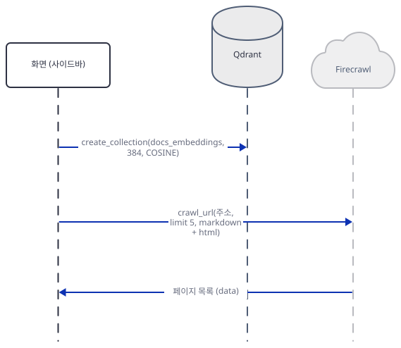

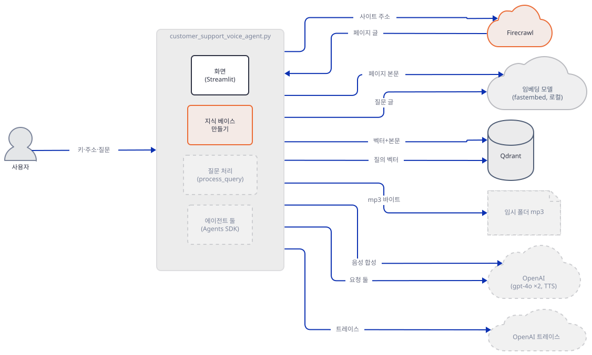

### Step 5. 저장 — 페이지 하나가 벡터 하나, 다시 누르면 두 배

**목적.** 크롤링한 페이지가 Qdrant에 어떤 모양으로 들어가는지, 두 번 초기화하면 어떻게 되는지 봅니다.

**할 일.**

`voice_ai_agents/customer_support_voice_agent/customer_support_voice_agent.py:198-214`

```python
def store_embeddings(client: QdrantClient, embedding_model: TextEmbedding, pages: List[Dict], collection_name: str):
    for page in pages:
        embedding = list(embedding_model.embed([page["content"]]))[0]
        client.upsert(
            collection_name=collection_name,
            points=[
                models.PointStruct(
                    id=str(uuid.uuid4()),
                    vector=embedding.tolist(),
                    payload={
                        "content": page["content"],
                        "url": page["url"],
                        **page["metadata"]
                    }
                )
            ]
        )
```

페이지를 쪼개지 않습니다. `page["content"]` 전체를 한 번에 임베딩하고(200행), 점 하나의 `payload`에 본문 전체와 주소·제목 등을 함께 넣습니다(207~211행). 점의 `id`는 `uuid4()`라 같은 페이지를 다시 넣어도 새 점이 생깁니다. 모델 설명이 "512 input tokens truncation"이므로 긴 페이지는 앞부분만 벡터에 반영된다고 읽을 수 있지만, 실제 자르는 길이는 모델을 내려받지 않아 확인하지 못했습니다. 저장은 페이지마다 `upsert` 한 번입니다.

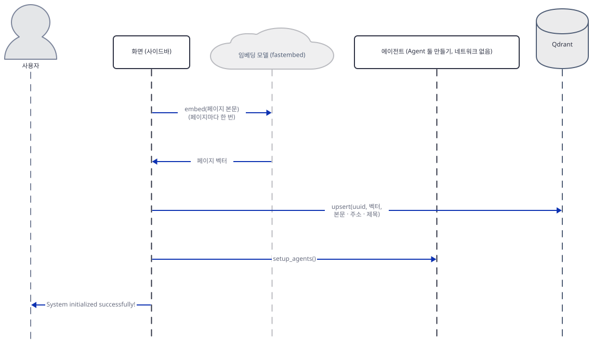

**확인.** 버튼을 두 번 누르는 시나리오입니다. 두 번째 초기화 뒤에는 질문 칸에 아직 글이 남아 있어서 질문도 한 번 더 처리됩니다(Step 7). 질문 칸을 건드린 뒤 한 번 더 누르므로 서버 터미널이 떠 있어야 합니다. 임시 폴더를 이 폴더 안으로 돌려 mp3가 한곳에 모이게 합니다.

```bash
mkdir -p tmp-out
TMPDIR=$PWD/tmp-out TMP=$PWD/tmp-out TEMP=$PWD/tmp-out OPENAI_AGENTS_DISABLE_TRACING=1 uv run --no-project python -B -W ignore run_app.py 53217 twice
```

PowerShell은 `$env:TMP`·`$env:TEMP`·`$env:OPENAI_AGENTS_DISABLE_TRACING`을 `$PWD\tmp-out`과 `"1"`로 걸고 같은 명령을 돌린 뒤 지웁니다(실행해 보지 못했습니다). 직접 확인한 출력입니다(`sidebar inputs`·`QdrantClient asked`·`progress lines` 줄은 뺐습니다).

```text
errors: [] | success: ['System initialized successfully!']
errors: []
answer on screen: ['FAKE ANSWER: send the key in the X-Acme-Key header. Source https://doc']
sources on screen: ['- https://docs.example.test/limits', '- https://docs.example.test/auth', '- https://docs.example.test/webhooks']
mp3 files in temp: 1
errors: [] | success: ['System initialized successfully!']
points in collection after 2nd init: 6
sources on screen: ['- https://docs.example.test/limits', '- https://docs.example.test/limits', '- https://docs.example.test/auth']
```

첫 초기화 뒤 점은 셋이었고 두 번째 뒤에는 여섯입니다. 그리고 질문의 검색 결과 셋 중 두 개가 같은 페이지(`/limits`)로 바뀌었습니다. 점 여섯 가운데 같은 벡터를 가진 쌍이 생기기 때문이고, 모델에게 가는 문맥에 같은 페이지가 겹쳐 들어간다는 뜻입니다. 이 가짜 임베딩으로는 `limits`가 먼저 나오는 순위가 뜻이 없다는 점을 다시 적어 둡니다. 이 컬렉션은 앱이 지우지 않으므로, 다른 사이트로 바꿔 다시 누르면 두 사이트의 페이지가 한 컬렉션에서 섞입니다(소스로 확인, 컬렉션 이름 고정과 삭제 호출 없음).

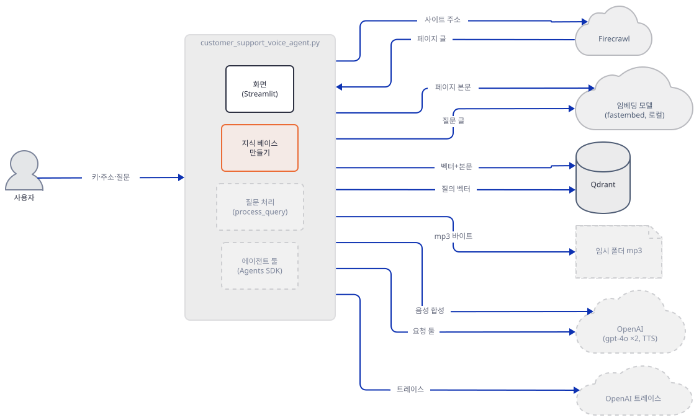

### Step 6. 질문 한 건 — 에이전트 둘이 글 둘을 만들고, 음성은 세 번째 호출이 만듭니다

**목적.** 질문이 검색 → 에이전트 둘 → 음성 합성을 거치는 순서와, "TTS 에이전트"가 정말 하는 일을 봅니다.

**할 일.**

`voice_ai_agents/customer_support_voice_agent/customer_support_voice_agent.py:216-243`

```python
def setup_agents(openai_api_key: str):
    os.environ["OPENAI_API_KEY"] = openai_api_key
    
    processor_agent = Agent(
        name="Documentation Processor",
        instructions="""You are a helpful documentation assistant. Your task is to:
        1. Analyze the provided documentation content
        2. Answer the user's question clearly and concisely
        3. Include relevant examples when available
        4. Cite the source URLs when referencing specific content
        5. Keep responses natural and conversational
        6. Format your response in a way that's easy to speak out loud""",
        model="gpt-4o"
    )

    tts_agent = Agent(
        name="Text-to-Speech Agent",
        instructions="""You are a text-to-speech agent. Your task is to:
        1. Convert the processed documentation response into natural speech
        2. Maintain proper pacing and emphasis
        3. Handle technical terms clearly
        4. Keep the tone professional but friendly
        5. Use appropriate pauses for better comprehension
        6. Ensure the speech is clear and well-articulated""",
        model="gpt-4o"
    )
    
    return processor_agent, tts_agent
```

에이전트 둘은 모델도 같고(`gpt-4o`) 도구도 없습니다. 지시문만 다릅니다. 질문 처리는 이렇습니다.

`voice_ai_agents/customer_support_voice_agent/customer_support_voice_agent.py:255-293`

```python
        query_embedding = list(embedding_model.embed([query]))[0]
        search_response = client.query_points(
            collection_name=collection_name,
            query=query_embedding.tolist(),
            limit=3,
            with_payload=True
        )
        
        search_results = search_response.points if hasattr(search_response, 'points') else []
        
        if not search_results:
            raise Exception("No relevant documents found in the vector database")
        
        context = "Based on the following documentation:\n\n"
        for result in search_results:
            payload = result.payload
            if not payload:
                continue
            url = payload.get('url', 'Unknown URL')
            content = payload.get('content', '')
            context += f"From {url}:\n{content}\n\n"
        
        context += f"\nUser Question: {query}\n\n"
        context += "Please provide a clear, concise answer that can be easily spoken out loud."
        
        processor_result = await Runner.run(processor_agent, context)
        processor_response = processor_result.final_output
        
        tts_result = await Runner.run(tts_agent, processor_response)
        tts_response = tts_result.final_output
        
        async_openai = AsyncOpenAI(api_key=openai_api_key)
        audio_response = await async_openai.audio.speech.create(
            model="gpt-4o-mini-tts",
            voice=st.session_state.selected_voice,
            input=processor_response,
            instructions=tts_response,
            response_format="mp3"
        )
```

질문 한 건에 모델 호출이 셋입니다. 질문 벡터로 검색해 점 셋을 받고(255~261행) 문맥 글을 만든 뒤(268~278행), 처리 에이전트에게 문맥을 주고(280행), 그 답(`processor_response`)을 TTS 에이전트에게 그대로 넘기고(283행), 음성 합성에는 두 글을 이렇게 나눠 줍니다. 읽을 글(`input`)은 처리 에이전트의 답이고(290행), TTS 에이전트의 글은 `instructions`로 들어갑니다(291행). OpenAI 문서는 `instructions`를 "Control the voice of your generated audio with additional instructions"라고 적습니다. 말투를 정하는 칸이라는 뜻입니다. 그러니 이름과 달리 "TTS 에이전트"는 소리를 만들지 않고 글을 한 편 더 쓰는 두 번째 `gpt-4o` 호출입니다. 그 지시문(233~239행)은 "음성으로 바꾸라"고 하지만 모델이 돌려주는 것은 글이고, 그 글이 말투 지시 칸에 들어갑니다. 진짜 `gpt-4o`가 이 지시문에 어떤 글을 쓰는지는 확인하지 못했습니다. 문서는 `input`의 최대 길이를 4096자라고 적으므로 답이 그보다 길면 음성 합성이 거절될 수 있습니다(문서에서 읽었고 진짜 API로는 확인하지 못했습니다).

다음 명령은 위의 두 단계(`ask`)를 서버 기록과 함께 봅니다. `server.log`를 비우고 돌립니다.

```bash
: > server.log
rm -rf tmp-out && mkdir tmp-out
TMPDIR=$PWD/tmp-out TMP=$PWD/tmp-out TEMP=$PWD/tmp-out OPENAI_AGENTS_DISABLE_TRACING=1 uv run --no-project python -B -W ignore run_app.py 53217 ask
cut -c1-290 server.log
```

(위 줄의 `rm -rf tmp-out`은 이 폴더 안의 `tmp-out` 하나만 지웁니다. PowerShell은 `Remove-Item -Recurse -Force tmp-out`과 `mkdir tmp-out`입니다. 실행해 보지 못했습니다.) 직접 확인한 출력입니다(`sidebar inputs`·`QdrantClient asked`·`progress lines` 줄은 뺐습니다. 서버 기록의 앞 두 줄은 초기화의 크롤링 요청입니다).

```text
errors: [] | success: ['System initialized successfully!']
errors: []
answer on screen: ['FAKE ANSWER: send the key in the X-Acme-Key header. Source https://doc']
sources on screen: ['- https://docs.example.test/limits', '- https://docs.example.test/auth', '- https://docs.example.test/webhooks']
mp3 files in temp: 1
{"path": "/v1/crawl", "body": {"url": "https://docs.example.test", "limit": 5, "scrapeOptions": {"formats": ["markdown", "html"]}}, "auth": "sidebar"}
{"path": "/v1/crawl/crawl-1", "auth": "sidebar"}
{"path": "/v1/responses", "who": "processor", "model": "gpt-4o", "auth": "sidebar", "input_chars": 624, "input_head": "[{\"content\": \"Based on the following documentation:\\n\\nFrom "}
{"path": "/v1/responses", "who": "tts", "model": "gpt-4o", "auth": "sidebar", "input_chars": 122, "input_head": "[{\"content\": \"FAKE ANSWER: send the key in the X-Acme-Key he"}
{"path": "/v1/audio/speech", "model": "gpt-4o-mini-tts", "voice": "coral", "format": "mp3", "input": "FAKE ANSWER: send the key in the X-Acme-Key header. Source https://docs.example.test/auth", "instructions": "FAKE STYLE: calm, friendly, slow pace.", "auth": "sidebar"}
```

세 가지를 읽습니다. 첫째, 에이전트 둘은 Responses API의 `/v1/responses`로, 음성은 `/v1/audio/speech`로 갑니다. 둘째, TTS 에이전트의 입력은 처리 에이전트의 답 그대로(`input_head`가 `FAKE ANSWER`)이고, 음성 요청의 `input`은 그 답, `instructions`는 TTS 에이전트의 글(`FAKE STYLE`)입니다. 셋째, 처리 에이전트의 입력 624자는 페이지 셋의 본문 전체와 질문이 들어간 것이어서, 진짜 문서라면 페이지가 커서 이 입력이 가장 큰 비용이 됩니다. 오디오는 `audio_response.content`를 임시 폴더의 `response_<uuid>.mp3`로 씁니다(295~299행). 이 파일을 지우는 코드는 없습니다(`remove`·`unlink` grep 0건). 위 출력의 `mp3 files in temp: 1`이 그 파일이고, 질문 한 건에 하나씩 쌓입니다.

비용을 어림합니다(⚠ 추정). 모델 페이지의 `gpt-4o` 값은 입력 $2.5·출력 $10(1M 토큰당, 2026-10-15 확인)입니다. 페이지 셋을 합쳐 약 6,000토큰이라 가정하면 처리 에이전트의 입력은 지시문과 질문을 더해 약 6,200토큰, 출력은 약 250토큰이고, TTS 에이전트는 입력 약 360에 출력 약 250토큰으로 가정합니다. 곱하면 처리 에이전트가 약 $0.018, TTS 에이전트가 약 $0.003으로 둘을 합쳐 약 $0.02입니다. 토큰 수는 내가 정한 값이라 실제 페이지가 크면 몇 배가 됩니다. 음성 합성은 `gpt-4o-mini-tts` 모델 페이지에 텍스트 입력 $0.6·오디오 출력 $12(1M 토큰당)가 있지만 오디오 토큰 수와 길이의 대응이 없어 어림하지 못했습니다. Firecrawl는 초기화 한 번에 페이지당 1크레딧, 최대 5크레딧입니다. 임베딩은 내 PC에서 돌아 요금이 없습니다.

음성 합성이 실패하면 어떻게 되는지도 봅니다. 두 번째 가짜 서버를 `speech-fail`로 띄우고(터미널 C) 같은 시나리오를 그 포트로 돌립니다.

```bash
uv run --no-project python fake_server.py 53218 fail.log speech-fail
```

```bash
OPENAI_AGENTS_DISABLE_TRACING=1 uv run --no-project python -B -W ignore run_app.py 53218 ask
```

```text
errors: [] | success: ['System initialized successfully!']
errors: ["Error: Error code: 400 - {'error': {'message': 'FAKE: speech request rejected', 'type': 'invalid_request_error'}}"]
answer on screen: []
sources on screen: []
mp3 files in temp: 0
```

(`sidebar inputs`·`QdrantClient asked`·`progress lines` 줄은 뺐습니다. `mp3 files in temp`는 이 명령의 임시 폴더가 비어 있어 0입니다.)

`fail.log`에는 `/v1/responses` 둘과 `/v1/audio/speech` 하나가 있었습니다(직접 확인). 처리 에이전트의 답은 이미 만들어졌고 요금도 나갔는데, 314~319행이 모든 예외를 오류 딕셔너리 하나로 바꿔서 화면에는 오류 문구만 있고 답과 출처가 없습니다. 이 서버를 확인한 뒤 터미널 C의 서버는 끕니다.

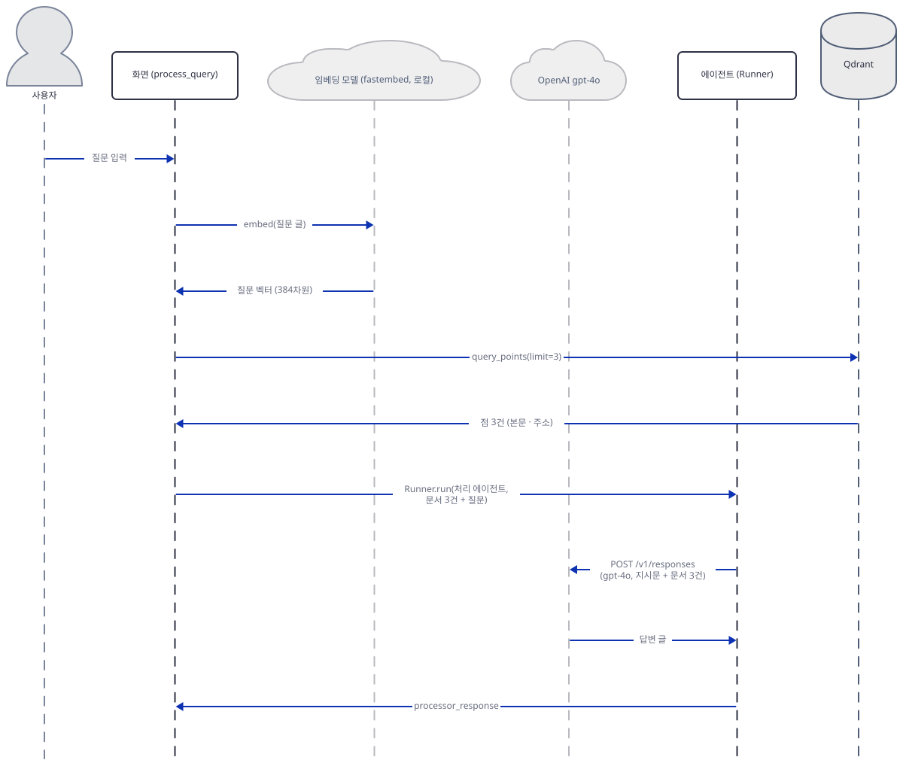

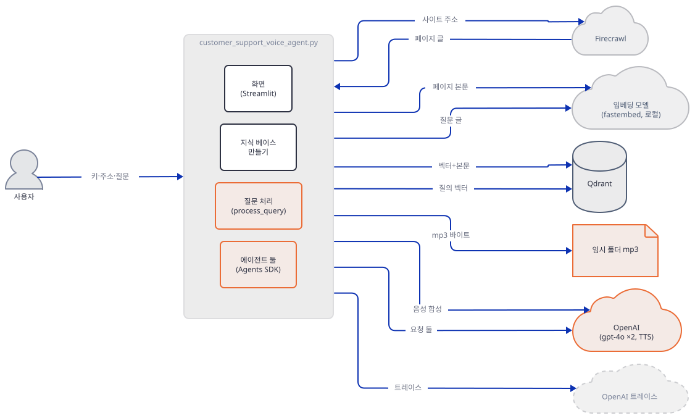

### Step 7. 화면, 재실행, 트레이스 — 앱을 띄우기 전에

**목적.** 화면이 한 번 건드려질 때마다 무엇이 다시 도는지, 질문을 처리할 때 따라붙는 트레이스 전송이 무엇을 싣는지 확인하고, 앱을 띄우는 명령을 정리합니다.

**할 일.**

`voice_ai_agents/customer_support_voice_agent/customer_support_voice_agent.py:345-376`

```python
    if query and st.session_state.setup_complete:
        with st.status("Processing your query...", expanded=True) as status:
            try:
                st.markdown("🔄 Searching documentation and generating response...")
                result = asyncio.run(process_query(
                    query,
                    st.session_state.client,
                    st.session_state.embedding_model,
                    st.session_state.processor_agent,
                    st.session_state.tts_agent,
                    "docs_embeddings",
                    st.session_state.openai_api_key
                ))
                
                if result["status"] == "success":
                    status.update(label="✅ Query processed!", state="complete")
                    
                    st.markdown("### Response:")
                    st.write(result["text_response"])
                    
                    if "audio_path" in result:
                        st.markdown(f"### 🔊 Audio Response (Voice: {st.session_state.selected_voice})")
                        st.audio(result["audio_path"], format="audio/mp3", start_time=0)
                        
                        with open(result["audio_path"], "rb") as audio_file:
                            audio_bytes = audio_file.read()
                            st.download_button(
                                label="📥 Download Audio Response",
                                data=audio_bytes,
                                file_name=f"voice_response_{st.session_state.selected_voice}.mp3",
                                mime="audio/mp3"
                            )
```

Streamlit은 위젯이 바뀔 때마다 스크립트를 처음부터 다시 실행합니다. 이 앱의 화면 쪽은 `query`(질문 칸의 글)가 비어 있지 않고 `setup_complete`이면 매번 `process_query`를 부릅니다(345~357행). 결과를 `session_state`에 담아 두지 않으므로 질문 칸 말고 다른 위젯을 건드려도 같은 질문이 다시 처리됩니다. 목소리 선택칸(`selectbox`)이 대표입니다. 시나리오 `rerun`은 질문 한 건 뒤에 목소리를 `nova`, `onyx`로 차례로 바꾸고, 서버가 받은 음성 요청의 `voice`를 함께 봅니다. 임시 폴더를 비운 뒤 돌립니다.

```bash
rm -rf tmp-out && mkdir tmp-out
: > server.log
TMPDIR=$PWD/tmp-out TMP=$PWD/tmp-out TEMP=$PWD/tmp-out OPENAI_AGENTS_DISABLE_TRACING=1 uv run --no-project python -B -W ignore run_app.py 53217 rerun
echo "responses: $(grep -c '/v1/responses' server.log), speech: $(grep -c 'audio/speech' server.log)"
grep -o '"voice": "[a-z]*"' server.log | tr '\n' ' '
```

```text
errors: [] | success: ['System initialized successfully!']
errors: []
answer on screen: ['FAKE ANSWER: send the key in the X-Acme-Key header. Source https://doc']
sources on screen: ['- https://docs.example.test/limits', '- https://docs.example.test/auth', '- https://docs.example.test/webhooks']
mp3 files in temp: 1
picked nova | box shows: nova | session: nova | errors: []
picked onyx | box shows: nova | session: nova | errors: []
mp3 files in temp: 3
responses: 6, speech: 3
"voice": "coral" "voice": "nova" "voice": "nova"
```

(`sidebar inputs`·`QdrantClient asked`·`progress lines` 줄은 뺐습니다.) 질문은 한 번이었는데 모델 요청이 여섯, 음성 요청이 셋, mp3가 셋입니다(직접 확인). 진짜 키라면 목소리를 바꿀 때마다 `gpt-4o` 두 번과 음성 합성 한 번의 요금이 다시 나갑니다. 그런데 `onyx`로 바꾼 두 번째 변경은 선택칸에 반영되지 않았습니다. 선택칸이 `nova`로 되돌아가 있고 서버가 받은 `voice`도 `nova`가 두 번입니다. 요금은 나가는데 고른 목소리는 나오지 않는 것입니다. 원인은 77~82행의 `st.selectbox(…, index=voices.index(st.session_state.selected_voice))`로 읽었습니다. 키가 없는 위젯에 실행마다 바뀌는 `index`를 주면 Streamlit이 인자가 바뀐 위젯을 새 위젯으로 보고 기본값으로 되돌립니다(소스로 읽었고 이 동작은 위 출력으로 확인했습니다). 그래서 목소리는 한 번 더 골라야 바뀝니다. 내려받기 버튼(`st.download_button`, 371~376행)도 눌러 재실행되는 것은 같습니다. 설치된 Streamlit 1.66.0의 `download_button`은 `on_click` 기본값이 `"rerun"`이라고 소스(`streamlit/elements/widgets/button.py`)에서 읽었고, 브라우저에서 눌러 보지는 않았습니다. 같은 `asyncio.run`이 세 번 이어서 돌았는데 오류가 없었다는 점도 같은 출력에서 보입니다.

트레이스는 목적지와 끄는 법이 Day 033 Step 3·4, Day 118 Step 6과 같습니다. 담기는 내용은 `openai-agents`의 판과 경로에 따라 다릅니다. `setup_agents`의 217행이 `OPENAI_API_KEY`를 환경에 쓰고, 질문을 처리할 때(`Runner.run`) 실행 기록이 OpenAI의 트레이스 서버로 올라갑니다. 키를 넣고 초기화만 한 `init` 시나리오에서는 업로드가 0건이었습니다(직접 확인). `run_app.py`는 이 업로드 주소를 늘 가짜 서버로 돌려 두었으므로 환경변수 없이도 바깥으로 나가지 않습니다. 그 서버가 무엇을 받는지 봅니다. 환경변수 값이 `0`이면 트레이싱이 켜집니다.

```bash
: > server.log
OPENAI_AGENTS_DISABLE_TRACING=0 uv run --no-project python -B -W ignore run_app.py 53217 ask
grep ingest server.log
```

```text
errors: [] | success: ['System initialized successfully!']
errors: []
answer on screen: ['FAKE ANSWER: send the key in the X-Acme-Key header. Source https://doc']
sources on screen: ['- https://docs.example.test/limits', '- https://docs.example.test/auth', '- https://docs.example.test/webhooks']
mp3 files in temp: 1
{"path": "/v1/traces/ingest", "auth": "sidebar", "items": {"trace": 2, "trace.span": 8}, "span_types": {"response": 2, "custom": 4, "agent": 2}, "text_found_in_upload": []}
```

(앞의 `sidebar inputs` 등 세 줄은 뺐고, `mp3 files in temp`는 이 폴더의 임시 파일 수라 다를 수 있습니다.) 업로드는 한 건이고 항목은 트레이스 2건(`Runner.run`이 둘)과 스팬 8건(응답 2, 에이전트 2, 사용자 정의 4)이며 인증에는 사이드바의 키가 쓰였습니다. 가짜 서버가 업로드 본문에서 `X-Acme-Key`·`How do I authenticate`·`FAKE ANSWER`·`FAKE STYLE`·지시문 문구를 찾았지만 하나도 없었습니다(`text_found_in_upload`가 빈 목록. 직접 확인). 이유는 소스에 있습니다. 이 앱의 두 에이전트는 Responses API를 쓰고, `openai-agents` 0.24.0의 응답 스팬은 `type`·`response_id`·`usage`만 내보냅니다(`agents/tracing/span_data.py` 237~242행). 입력 글은 "OpenAI trace processors가 쓰지 않는다"는 주석과 함께 스팬에 담기기만 합니다(같은 파일 227~228행). Day 033 Step 3이 본 `input`·`output` 전문은 `GenerationSpanData`(같은 파일 201~209행)의 내보내기이고, 이 앱의 경로가 아닙니다. 그래서 업로드되는 것은 워크플로와 에이전트 이름, 응답 아이디, 토큰 수이고, 크롤링한 문서 본문·질문·답은 트레이스가 아니라 모델 호출 자체로 OpenAI에 갑니다. 다른 판의 `openai-agents`나 Chat Completions 경로에서 무엇이 실리는지는 이 문서가 확인하지 못했습니다. 끄면 이 요청이 없어집니다.

```bash
: > server.log
OPENAI_AGENTS_DISABLE_TRACING=1 uv run --no-project python -B -W ignore run_app.py 53217 ask
grep -c ingest server.log
```

```text
0
```

(PowerShell은 변수를 `$env:`로 걸고 같은 명령을 돌린 뒤 지웁니다. 실행해 보지 못했습니다. 출력은 마지막 줄만 옮겼습니다.) 트레이스 주소를 바꾸지 않은 채 환경변수 `0`으로 돌렸을 때는, 내가 바깥으로 나가려는 요청을 기록만 하는 프록시를 걸어 두었습니다(독자 PC에는 없는 안전망입니다). 그 프록시가 `CONNECT api.openai.com:443`을 세 번 받았고 앱 출력에는 `[non-fatal] Tracing request failed`가 세 줄, `max retries reached`가 한 줄 나왔습니다. 이 실험은 독자가 따라 할 명령이 아닙니다. 지금의 `patches.py`에서는 트레이스 주소 줄을 빼면 `AssertionError`로 먼저 멈추기 때문에 이 줄을 지운 사본으로만 재현했습니다. 인터넷에 붙은 독자가 진짜 키로 패치 없이 원본 앱을 돌리면 이 요청이 실제 OpenAI로 갑니다. 그래서 앱을 띄우는 터미널에는 `OPENAI_AGENTS_DISABLE_TRACING=1`을 겁니다.

화면을 직접 띄우는 길도 같은 원칙으로 만듭니다. 원본 파일을 그대로 `streamlit run` 하면 "Initialize System"을 누르는 순간 fastembed가 Hugging Face로 접속해 모델을 내려받고(Step 3) 사이드바의 Qdrant 주소로 요청이 나가는데, 초기화가 끝나야 질문 칸이 열리므로 그 버튼은 반드시 눌러야 합니다. 그래서 띄우는 대상을 `screen_app.py`로 바꿉니다. 이 파일은 `patches.install`을 먼저 부른 뒤 원본 앱 파일을 그대로(`runpy`) 실행합니다. 앞에는 환경변수를 검사하는 `guard.py`를 둡니다. 이 스크립트는 `OPENAI_BASE_URL`과 `FIRECRAWL_API_URL`의 호스트(`urlparse`)가 `127.0.0.1`·`localhost`인지, 트레이싱이 꺼져 있는지, `firecrawl-py`가 1.x인지(4.x는 `FIRECRAWL_API_URL`을 무시합니다)를 보고 하나라도 어긋나면 종료 코드 1로 끝납니다.

```python
"""Run this before starting the real app: python guard.py && streamlit run ...
Exits with code 1 unless every address the app can read from the environment is a loopback fake,
tracing is off, and firecrawl-py is a 1.x version (4.x ignores FIRECRAWL_API_URL).
The sidebar boxes are not covered: type only fake values there, and do not press Initialize System
(the first press downloads the fastembed model)."""
import os
import sys
from importlib.metadata import version
from urllib.parse import urlparse


def loopback(url):
    u = urlparse(url)
    return u.scheme == "http" and u.hostname in ("127.0.0.1", "localhost")


def check():
    for name in ("OPENAI_BASE_URL", "FIRECRAWL_API_URL"):
        if not loopback(os.environ.get(name, "")):
            sys.exit(f"{name} is not a loopback http address: {os.environ.get(name)!r}")
    if os.environ.get("OPENAI_AGENTS_DISABLE_TRACING", "").lower() not in ("1", "true"):
        sys.exit("OPENAI_AGENTS_DISABLE_TRACING is not 1: traces would go to api.openai.com")
    if not version("firecrawl-py").startswith("1."):
        sys.exit("firecrawl-py is not 1.x: it would ignore FIRECRAWL_API_URL (Step 4)")


if __name__ == "__main__":
    check()
```

```python
"""streamlit run target: the patches first, then the unchanged app file."""
import os
import runpy

import patches

patches.install(os.environ["FIRECRAWL_API_URL"])  # guard.py has already checked that this is a loopback address
runpy.run_path(os.path.join(os.path.dirname(os.path.abspath(__file__)), "customer_support_voice_agent.py"), run_name="__main__")
```

터미널 A에서 `fake_server.py 53217 server.log`가 떠 있는 채로, 새 터미널에서 변수를 걸고 띄웁니다.

```bash
export OPENAI_BASE_URL=http://127.0.0.1:53217/v1
export FIRECRAWL_API_URL=http://127.0.0.1:53217
export OPENAI_AGENTS_DISABLE_TRACING=1
uv run --no-project python guard.py && uv run --no-project streamlit run screen_app.py --server.headless true --server.address localhost --server.port 53301 --browser.gatherUsageStats false
```

```powershell
$env:OPENAI_BASE_URL = "http://127.0.0.1:53217/v1"
$env:FIRECRAWL_API_URL = "http://127.0.0.1:53217"
$env:OPENAI_AGENTS_DISABLE_TRACING = "1"
uv run --no-project python guard.py
if ($LASTEXITCODE -eq 0) { uv run --no-project streamlit run screen_app.py --server.headless true --server.address localhost --server.port 53301 --browser.gatherUsageStats false }
```

(PowerShell 형태는 실행해 보지 못했습니다. 이 변수들은 그 터미널에 남으므로 끝나면 닫거나 지웁니다.) 이 명령으로 띄워 `/_stcore/health`가 200을 주는 것까지 직접 확인했습니다. 브라우저는 열지 않았으므로 화면 조작은 `screen_check.py`가 `AppTest`로 대신합니다. 이 스크립트는 `screen_app.py`를 대상으로 하고 패치를 따로 걸지 않으며, 첫머리에서 `guard.py`와 같은 검사를 합니다. 사이드바에 가짜 값을 넣고 "Initialize System"을 누르고, 질문하고, 목소리를 바꿉니다. 위와 같이 변수를 건 터미널에서 돌립니다.

```python
"""Drive the screen the way a person would, through screen_app.py (no patches are applied here):
fill the sidebar with fake values, press Initialize System, ask a question, change the voice."""
import sys

from guard import check

check()  # the same environment check as before streamlit run
from streamlit.testing.v1 import AppTest

at = AppTest.from_file("screen_app.py", default_timeout=120).run()
if at.exception:  # a missing patch stops the screen here, before anything can be pressed
    sys.exit("screen stopped: " + str(at.exception[0].value)[:120])
for box, value in zip(at.sidebar.text_input, ["https://qdrant.invalid:6333", "qd-fake-sidebar", "fc-fake-sidebar", "sk-fake-sidebar", "https://docs.example.test"]):
    box.set_value(value)
at.run()
next(b for b in at.sidebar.button if b.label == "Initialize System").click()
at.run()
print("initialize ->", [e.value for e in at.error] or "no error", "|", [s.value for s in at.success])
next(t for t in at.text_input if t.label.startswith("What would you like")).set_value("How do I authenticate API requests?").run()
print("question ->", [e.value for e in at.error] or "no error", "|", [m.value[:40] for m in at.markdown if m.value.startswith("FAKE")])
at.sidebar.selectbox[0].select("nova").run()
print("voice ->", [e.value for e in at.error] or "no error", "|", at.session_state.selected_voice)
sys.exit(0)
```

```bash
: > server.log
uv run --no-project python -B -W ignore screen_check.py
echo "crawl: $(grep -c '/v1/crawl"' server.log), responses: $(grep -c '/v1/responses' server.log), speech: $(grep -c 'audio/speech' server.log)"
```

```text
QdrantClient asked for url='https://qdrant.invalid:6333' api_key=qd-f...
initialize -> no error | ['System initialized successfully!']
question -> no error | ['FAKE ANSWER: send the key in the X-Acme-']
voice -> no error | nova
crawl: 1, responses: 4, speech: 2
```

직접 확인한 출력입니다(`ScriptRunContext` 경고는 뺐습니다). 사이드바의 Qdrant 주소는 `https://qdrant.invalid:6333`이었는데 `QdrantClient`가 메모리 저장소로 바뀌어 있어 그 주소로는 요청이 나가지 않았고, fastembed도 모델을 받지 않았습니다. 바깥 접속을 기록하는 장치(내 쪽 안전망)는 이 실행 내내 0건이었습니다. 목소리를 바꾼 재실행이 모델 요청 둘과 음성 요청 하나를 더 만든 것도 보입니다(질문 한 번에 셋, 합쳐 4와 2). 일부러 `patches.py`의 패치 줄 하나(`fastembed.TextEmbedding = …` 줄, 또는 트레이스 주소 줄)를 지운 사본으로 같은 명령을 돌리면 `screen stopped: fastembed would download a model`처럼 화면이 뜨기 전에 멈춥니다(직접 확인, 바깥 접속 0). 진짜 키와 진짜 주소를 쓰려면 이 문서의 방식을 떠나 원본 앱을 직접 띄워야 하고 그때는 위의 모든 요금과 접속이 나갑니다. 이 문서는 그 길을 안내하지 않습니다. 소리는 서버가 아니라 브라우저의 `st.audio`가 재생합니다(367행). 서버 쪽 코드에는 스피커를 여는 부분이 없습니다.

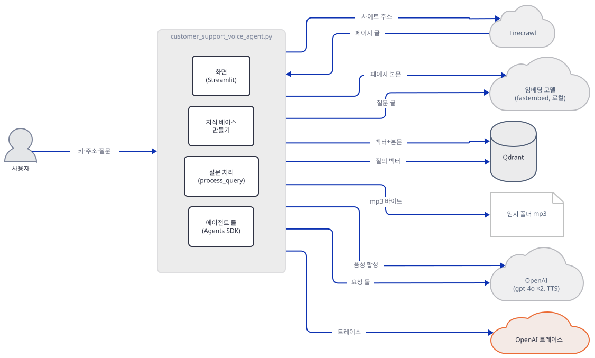

## 요청 한 건이 흐르는 과정

질문 한 건이 소리가 되기까지 그림이 길어 셋으로 나눴고 메시지는 코드 순서대로 한 장에 하나씩 있습니다. 첫 그림은 질문에서 처리 에이전트의 답이 돌아오기까지입니다.


화면은 상태 표시(`st.status`와 "Searching documentation…" 글)를 사용자에게 먼저 보여 줍니다. 질문 글은 로컬 임베딩 모델을 거쳐 벡터가 되고, Qdrant에서 가장 가까운 점 셋을 받아 문맥 글이 됩니다. `Runner.run`은 이 문맥으로 `gpt-4o`를 한 번 부르고 답을 돌려줍니다. 다음 그림의 첫 줄이 이어받습니다.

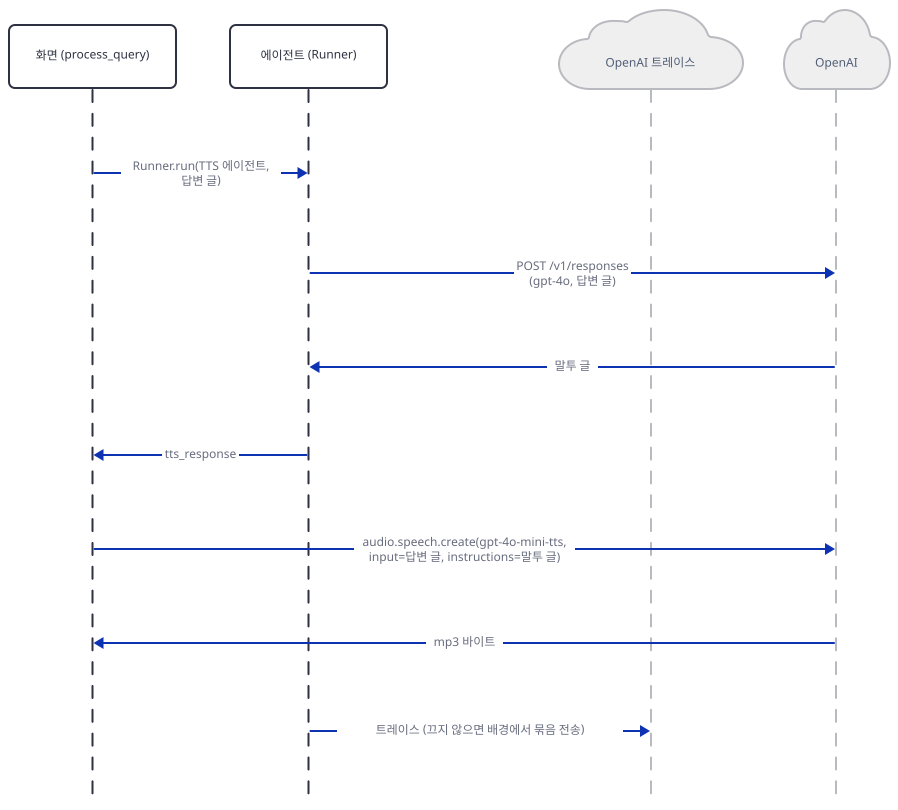

TTS 에이전트의 호출은 모델 요청 한 번이고 그 글은 말투 지시가 됩니다. 마지막 줄의 트레이스는 `Runner.run`이 도는 동안 배경에서 묶음으로 나가는 것이라 시각의 순서가 아니고 정리를 위한 배치입니다. 환경변수를 걸면 이 줄이 없습니다. 마지막은 파일을 쓰고 화면이 하나씩 그리는 단계입니다. 답 글, 오디오 플레이어(mp3를 파일에서 읽음), 내려받기 버튼(같은 파일을 다시 읽음), 출처 목록이 각자 한 줄입니다.

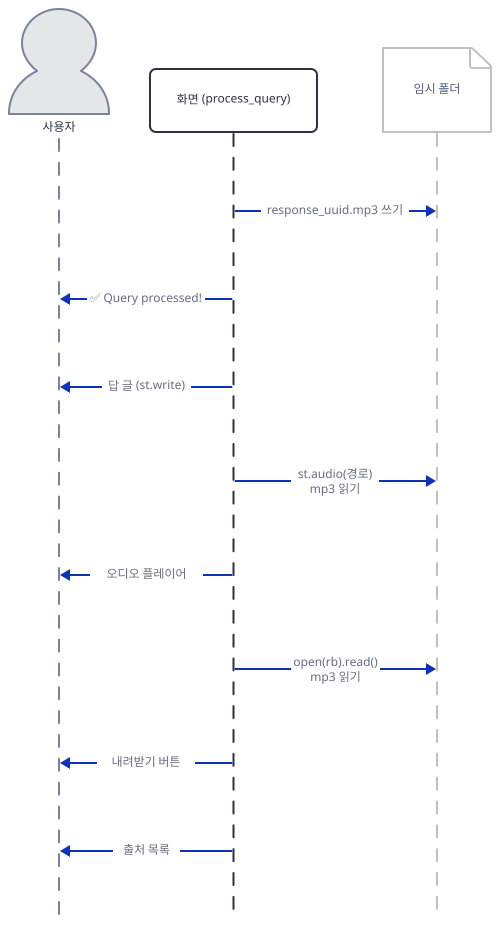

## 실행 체크리스트

- [ ] `uv venv`와 `uv pip install -r requirements.txt`로 환경을 만들고 `firecrawl-py`가 4.x로 풀리는 것을 확인했다
- [ ] `COMPILE_OK`와 `IMPORT_OK`를 봤다
- [ ] `run_app.py ... empty`에서 `Please fill in all the required fields!`를 봤다
- [ ] `embed_check.py`로 `TextEmbedding()`이 모델 이름 없이 만들어지고 캐시 폴더가 `FASTEMBED_CACHE_PATH`나 `%TEMP%\fastembed_cache`라는 것을 읽었다
- [ ] 4.50.0에서 `init`이 `unexpected keyword argument 'params'`로 멈추는 것을 봤다
- [ ] `firecrawl-py==1.17.0`으로 고정하고 `Crawled 3 documentation pages!`를 봤다
- [ ] `twice`에서 점이 6개가 되고 검색 결과에 같은 페이지가 겹치는 것을 봤다
- [ ] `ask`의 서버 기록에서 `/v1/responses` 둘과 `/v1/audio/speech` 하나를 확인하고 `instructions`가 TTS 에이전트의 글인 것을 봤다
- [ ] `speech-fail` 서버에서 오류 문구만 뜨고 답이 사라지는 것을 봤다
- [ ] `rerun`에서 질문 한 건에 요청이 `responses: 6, speech: 3`이 되는 것을 봤다
- [ ] `OPENAI_AGENTS_DISABLE_TRACING`을 `0`과 `1`로 바꿔 `ingest` 요청 수를 비교하고 업로드에 본문이 없는 것을 봤다
- [ ] `rerun`에서 둘째 목소리 변경이 선택칸에서 무시되는 것(`voice`가 `coral, nova, nova`)을 봤다
- [ ] `guard.py`가 변수 없이 종료 코드 1을 내는 것을 확인하고, 변수를 건 터미널에서 `guard.py && streamlit run screen_app.py …`의 `/_stcore/health`가 200인 것과 `screen_check.py`의 출력(초기화 → 질문 → 목소리)을 봤다
- [ ] 띄운 서버(53217·53218)를 모두 끄고 해당 포트가 비었다

## 문제 해결

| 증상 | 원인 | 해결 |
|---|---|---|
| 초기화에서 `Error during setup: FirecrawlClient.crawl() got an unexpected keyword argument 'params'`(직접 확인) | 오늘 풀리는 `firecrawl-py` 4.50.0의 `crawl_url`은 `params=`를 받지 않는다. 앱의 156~164행은 1.x 모양이다(Step 4) | 앱 환경에서 `uv pip install "firecrawl-py==1.17.0"`(호출 모양은 가짜 서버로 확인함. 진짜 서버가 1.x 요청을 받는지는 확인하지 못함) |
| 초기화에서 `Please fill in all the required fields!`(직접 확인) | 다섯 칸 가운데 하나라도 비었다(85~91행). 앱은 환경변수나 `.env`로 칸을 채우지 않는다 | 다섯 칸을 모두 채운다 |
| 초기화에서 `Error during setup: …`에 연결 거부나 이름 조회 실패가 있음(닫힌 포트에서 `create_collection`을 직접 불러 확인) | Qdrant 주소가 틀렸거나 서버가 없다. 클라이언트는 만들 때가 아니라 139~142행의 컬렉션 만들기에서 처음 연결한다 | 주소와 키를 확인한다. `http` 주소에 키를 주면 `UserWarning`이 뜨는 것은 정상이다 |
| 처음 초기화가 오래 걸리거나 모델 오류가 남 | 134행의 `TextEmbedding()`이 Hugging Face에서 모델 약 67MB를 내려받는다(소스로 확인. 바깥을 막은 환경에서는 `huggingface.co:443` 접속 시도가 찍히고 3초·9초·27초 간격으로 다시 시도한다는 것을 내 프록시 아래에서 확인) | 인터넷이 되는 곳에서 한 번 기다린다. 캐시는 `FASTEMBED_CACHE_PATH`로 옮긴다 |
| 질문하자 답 없이 `Error: Error code: 400 …`만 뜸(가짜 서버로 확인) | 음성 합성이 실패하면 314~319행이 모든 예외를 오류 하나로 바꿔 답을 버린다. `input`이 4096자를 넘으면 합성이 거절될 수 있다(문서에서 읽음) | 오류 문구를 읽는다. 답 글을 보려면 사본의 `process_query`에서 합성 앞에서 답을 먼저 돌려주게 고친다(더 해보기) |
| 목소리를 바꾸거나 내려받기를 눌렀더니 답이 다시 만들어지고 요금이 나감(`rerun`으로 직접 확인) | 질문 칸에 글이 남아 있으면 위젯 변경마다 `process_query`가 다시 돈다(345~357행) | 목소리는 질문을 지운 뒤에 고른다. 사본을 고치려면 더 해보기 |
| 목소리를 바꿨는데 이전 목소리로 나옴. 선택칸이 되돌아가 있음(`rerun`으로 직접 확인: 서버가 받은 `voice`가 `coral`, `nova`, `nova`) | 77~82행이 키 없는 `selectbox`에 매번 바뀌는 `index`를 줘서 두 번째 변경이 기본값으로 되돌려진다고 읽었다(Step 7) | 한 번 더 고른다. 사본을 고치려면 `key=`를 주는 식으로 고친다(고쳐 보지는 않았다) |
| 초기화를 두 번 눌렀더니 출처에 같은 주소가 겹침(`twice`로 직접 확인) | 점 `id`가 `uuid4()`라 같은 페이지가 다시 들어간다(205행). 컬렉션을 지우는 코드가 없다 | Qdrant에서 `docs_embeddings` 컬렉션을 지우고 다시 초기화한다 |
| 앱을 띄운 터미널에 `[non-fatal] Tracing request failed`(바깥을 막은 환경에서만 나오는 줄이고, 내 프록시 아래에서 직접 확인) | 환경변수 없이 키를 넣고 질문을 처리하면 `openai-agents`가 트레이스를 OpenAI로 올리려 한다. 바깥이 막혀 있으면 이 줄이 찍히고, 인터넷에 붙은 PC에서 진짜 키면 아무 말 없이 올라간다 | `OPENAI_AGENTS_DISABLE_TRACING=1`을 건다(Step 7). 올라가는 것은 이름·응답 아이디·토큰 수이고 본문은 아니다 |
| 가짜 키로 인터넷에 붙은 채 질문을 처리하면 `Tracing client error 401` 같은 줄이 한 번 찍힌다고 소스에서 읽음(`processors.py`의 4xx 처리. 실행해 보지는 않았다) | 틀린 키로 트레이스 업로드가 거절된 것이다. 401 같은 4xx는 재시도하지 않고 408·409·429만 다시 시도한다(소스로 확인) | 같은 변수로 끈다 |
| 임시 폴더에 `response_*.mp3`가 계속 쌓임(직접 확인) | 질문마다(위젯 재실행마다) 파일 하나를 쓰고 지우지 않는다(295~299행) | 임시 폴더를 가끔 비운다 |
| 모델이 곧 종료된다는 ⚠ | `gpt-4o`와 `gpt-4o-mini-tts`의 기본 스냅숏이 2027-01에 종료 예정이다(사전 준비) | `gpt-4o`는 사본의 228·240행 `model=` 값을 바꾼다. 288행의 음성 합성은 권하는 대체 `gpt-realtime-2.1-mini`가 음성 API 목록에 없어 이름 교체가 안 되고 Realtime API로 옮기라는 안내다(요청을 보내 보지는 않았다) |

## 더 해보기

- 사본의 `process_query` 끝에서 결과를 `st.session_state`에 담아 두고, 질문 칸의 글이 바뀔 때만 `process_query`를 부르게 고쳐 `rerun` 시나리오를 다시 돌려 보세요. 서버 기록이 `responses: 2, speech: 1`로 줄어드는지 보기
- 사본의 `crawl_documentation`을 `firecrawl-py` 4.50.0의 `crawl(url, limit=5, scrape_options=...)` 모양으로 고쳐 보세요. 돌려주는 값이 딕셔너리가 아닐 수 있으니 `sig_check.py`처럼 반환 타입부터 찍어 보고 `.get`을 대체해야 하는 곳을 찾기
- 사본에서 페이지를 문단 단위로 쪼개 점 여러 개로 저장하고 `twice` 시나리오와 비교해, 검색 결과 셋에 같은 페이지가 몇 번 나오는지 세어 보기

## 다음 날 예고

[Day 138 · 🔊 Voice RAG Agent (OpenAI SDK)](../day138-voice-rag-openaisdk/README.md) — 오늘과 구조가 비슷한 다음 앱입니다. `voice_ai_agents/voice_rag_openaisdk/rag_voice.py`(`wc -l` 400, 마지막 줄에 개행이 없어 편집기에서는 401줄, Streamlit)는 문서를 크롤링하는 대신 PDF를 올리게 하고(임시 파일을 `NamedTemporaryFile(delete=False)`로 만드는 곳이 108행), 요구 사항이 `openai-agents==0.4.2`·`streamlit==1.51.0`·`qdrant-client==1.15.1`·`fastembed==0.7.3` 같은 고정판입니다(`requirements.txt`). 17행의 `from openai.helpers import LocalAudioPlayer`와 262행의 `await LocalAudioPlayer().play(stream_response)`는 이 PC의 스피커로 직접 재생하는 코드이고, 267행의 `audio.speech.create`는 오늘처럼 mp3를 만듭니다(모두 소스로 확인).
