# Day 138 · 🔊 Voice RAG Agent (OpenAI SDK)

> 볼륨 11 🗣️ Voice AI Agents · 난이도 ★★☆ ⚠ 처리·음성 지시 에이전트의 `gpt-4o`와 음성 모델 `gpt-4o-mini-tts`가 모두 OpenAI 폐기 문서에 올라 있고(음성 모델은 2027-01-06 종료 예정이며 권장 대체는 이름만 바꿔 쓸 수 있는 모델이 아닌 것으로 보입니다), `requirements.txt`는 설치는 되지만 `pypdf`와 `sounddevice`가 빠져 있어 그대로는 PDF를 읽지도 소리를 내지도 못합니다(사전 준비, Step 1, Step 7) · 예상 소요 165분(앱은 한 파일 401줄이지만 가짜 서버와 소리 없는 복사본을 직접 저장해 만들고, 확인 스크립트를 돌려 서버 쪽 기록과 앱의 동작을 맞대어 보고, 그림 스물일곱 장을 훑는 데 드는 시간이 본문을 읽는 시간보다 큽니다) · API 비용 대략 이 문서의 따라 하기는 $0(가짜 서버만 부릅니다. 실제 OpenAI·Qdrant는 한 번도 부르지 않았습니다). 진짜 키로 돌리면 질문 하나에 gpt-4o 두 번과 음성 합성 두 번이 나가고, 어림으로 gpt-4o 쪽이 $0.01 아래입니다(⚠ 추정, Step 6). 음성 값은 어림하지 못했습니다 · 원본 앱: `voice_ai_agents/voice_rag_openaisdk`

## 오늘 만들 것

PDF를 올려 두고 질문하면 글 답과 함께 읽어 주는 목소리가 나오는 Streamlit 앱입니다. PDF를 `PyPDFLoader`로 읽어 1,000자 조각으로 자르고, `fastembed`로 벡터를 만들어 Qdrant에 넣습니다. 질문하면 가장 가까운 세 조각을 `gpt-4o` 에이전트에 주어 글 답을 받고, 그 글을 둘째 에이전트에 넘긴 뒤 `gpt-4o-mini-tts`로 음성을 만들어 스피커에 틀고 mp3로도 내려받게 합니다. 볼륨 11 "🗣️ Voice AI Agents"의 둘째 날입니다.

어제 [Day 137](../day137-customer-support-voice-agent/README.md)이 같은 부품을 이미 가르쳤습니다. 임베딩 모델과 Qdrant는 Day 137 Step 3, 처리·TTS 에이전트 둘과 "TTS 에이전트의 글이 `instructions`로 들어간다"는 것은 Step 6, 재실행·트레이스·앱을 띄우는 법은 Step 7이 다룹니다. 오늘 문서는 그 내용을 되풀이하지 않고 가리키며, 다른 부분만 다룹니다. 문서가 크롤링한 사이트가 아니라 업로드한 PDF라는 것, 같은 답에서 음성을 두 번 만든다는 것(`LocalAudioPlayer`로 스피커에 한 번, mp3로 한 번. Day 137 소스에는 `LocalAudioPlayer`가 없습니다), 그리고 requirements가 버전을 모두 고정해 판이 다르다는 것(`fastembed` 0.7.3, `openai-agents` 0.4.2, `streamlit` 1.51.0)입니다. Agents SDK의 트레이싱은 Day 033이, 음성 입력과 `VoicePipeline`은 Day 034가 다뤘습니다. 오늘 앱은 `agents`에서 `Agent`와 `Runner`만 가져오고(18행) 질문은 글 상자로 받습니다(349행).

이 문서는 OpenAI·Qdrant·모델 내려받기·스피커 어느 것도 쓰지 않았습니다. OpenAI 자리에는 `127.0.0.1`의 가짜 서버를, Qdrant 자리에는 메모리 모드(`QdrantClient(":memory:")`)를, `fastembed` 자리에는 내려받지 않는 가짜 임베딩을, 스피커 자리에는 소리를 내지 않는 대역을 두었습니다. 이 대역은 앱 파일을 복사해 네 곳만 바꾼 복사본(`rag_voice_scratch.py`)에 들어갑니다(Step 2). 그래서 이 문서는 실제 모델이 무슨 답을 하는지, 목소리가 어떻게 들리는지, 진짜 Qdrant Cloud에 어떻게 붙는지 보여 주지 못합니다. 가짜 서버의 답과 가짜 임베딩의 검색 순서는 제가 정한 것입니다. 확인 스크립트는 모두 첫머리에서 `guard.py`를 불러, 이 셸이 가짜 서버로 향하지 않거나 트레이싱이 켜져 있으면 아무것도 하기 전에 멈춥니다(Step 2).

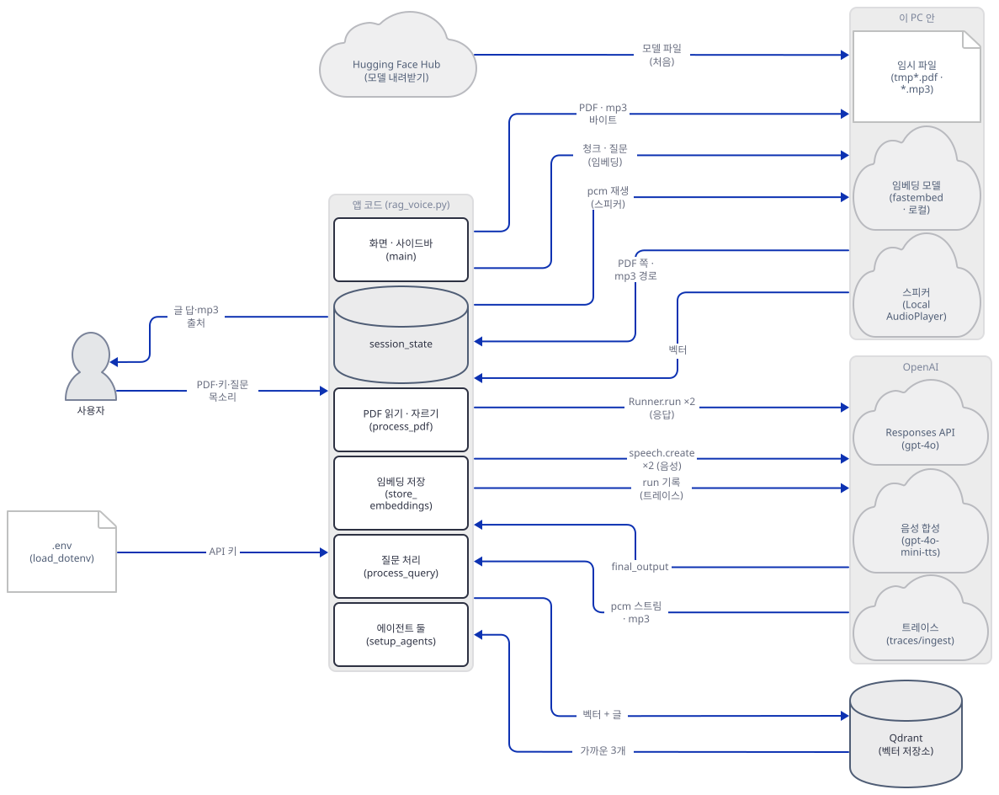

그림에서 앱 코드(`rag_voice.py`)는 한 묶음이고 그 묶음에 달린 화살표는 묶음 전체의 것입니다. 묶음 안에서 어느 함수가 무엇을 부르는지는 보조 구조 그림 다섯이 화살표로 보여 줍니다. 앞의 둘은 Step 4(PDF)와 Step 5(임베딩), 나머지 셋은 Step 6~7(질문·에이전트·소리)에 있습니다. 이 PC 안의 `fastembed`는 로컬에서 도는 모델이라 구름으로 그렸습니다.

직접 돌려 알게 된 것이 여덟입니다. 첫째, `requirements.txt`는 오늘 그대로 설치됩니다(Python 3.13에서 123개 패키지, 충돌 없음). 그러나 `pypdf`와 `sounddevice`가 목록에 없어 PDF 읽기와 소리 재생이 모두 첫 시도에서 실패합니다(Step 1). 둘째, README가 말하는 `.env`의 값은 환경에는 들어오지만 상자를 채우지 않고, 사이드바의 OpenAI 키가 비어 있으면 앱이 환경의 키를 빈 문자열로 덮습니다(Step 3). 셋째, 8,192바이트보다 작은 PDF는 "빈 파일"이라며 실패하고, 올린 PDF마다 임시 파일이 지워지지 않고 남습니다(Step 4). 넷째, 청크마다 임베딩 호출 한 번과 Qdrant 쓰기 한 번이 따로 나가고, 점마다 조각 원문과 이 PC의 임시 파일 경로가 Qdrant로 올라갑니다(Step 5). 다섯째, 질문 하나에 gpt-4o 두 번이 나가고, `OPENAI_AGENTS_DISABLE_TRACING`을 켜지 않으면 트레이스가 `api.openai.com`으로 나가려 합니다. 0.4.2에서 트레이스에 실리는 것은 에이전트 이름과 응답 아이디뿐이었습니다(Step 6). 여섯째, 같은 답에 음성 합성 요청이 두 번 나가고 `sounddevice`가 없으면 한 번은 요금만 나간 채 실패하며 글 답도 화면에 나오지 않습니다(Step 7). 일곱째, 질문 상자에 글이 남아 있는 한 목소리를 바꾸거나 내려받기 버튼을 누를 때마다 같은 네 번의 호출이 되풀이됩니다(Step 7). 여덟째, 목소리 선택칸은 두 번 바꾸면 둘째 변경이 무시됩니다(Step 7).

## 사전 준비

| 서비스/도구 | 용도 | 발급·설치 |
|---|---|---|
| uv | 가상환경 생성과 패키지 설치 | [공통 사전 준비](../README.md#공통-사전-준비-한-번만) 참고 |
| Python | 이 문서는 3.13.3으로 확인했다. 앱 README는 버전을 적지 않는다. 3.14로 만들면 설치가 실패한다(Step 1) | 공통 사전 준비와 같음 |
| OpenAI API 키 | 진짜로 쓸 때만. 이 문서는 가짜 값 `sk-fake-sidebar`와 가짜 서버로 확인한다 | https://platform.openai.com/api-keys |
| Qdrant Cloud 주소와 키 | 진짜로 쓸 때만. 이 문서는 메모리 모드로 대신한다 | https://cloud.qdrant.io/ |
| 스피커와 `sounddevice` | 진짜 소리를 낼 때만. 이 문서는 소리를 내지 않는다 | Step 7 |
| 터미널 둘 | 가짜 서버를 띄우는 터미널(A)과 나머지를 돌리는 터미널(B). 둘 다 `voice-rag-work` 폴더에서 연다 | 별도 설치 없음 |

명령은 Git Bash 기준입니다. 한국어 Windows에서 파이썬 출력이 cp949로 깨지지 않도록 아래 `envfake.sh`가 `PYTHONIOENCODING=utf-8`을 함께 겁니다.

**이 앱의 모델 둘이 아직 살아 있는지.** OpenAI 폐기 문서(https://developers.openai.com/api/docs/deprecations)와 모델 페이지를 2026-10-15에 원문으로 내려받아 읽었습니다.

| 앱의 모델 | 문서의 판정 |
|---|---|
| `gpt-4o` (`voice_ai_agents/voice_rag_openaisdk/rag_voice.py:166`, `voice_ai_agents/voice_rag_openaisdk/rag_voice.py:178`) | ⚠ 모델 페이지(https://developers.openai.com/api/docs/models/gpt-4o)가 GPT-4o를 Deprecated로 표시하고, 별칭 `gpt-4o`의 기본 스냅숏은 `gpt-4o-2024-08-06`으로 읽힌다. 폐기 문서는 `gpt-4o-2024-08-06`·`gpt-4o-2024-11-20`을 2026-10-14에 공지해 **2027-01-14 종료**(권장 대체 `gpt-6-luna`)로 올렸다. 폐기 문서에 별칭 `gpt-4o` 항목은 없고, 종료 뒤 별칭이 어떻게 되는지는 두 문서 어디에도 없다 |
| `gpt-4o-mini-tts` (`voice_ai_agents/voice_rag_openaisdk/rag_voice.py:254`, `voice_ai_agents/voice_rag_openaisdk/rag_voice.py:268`) | ⚠ 모델 페이지(https://developers.openai.com/api/docs/models/gpt-4o-mini-tts)가 Deprecated로 표시하고 별칭의 기본 스냅숏은 `gpt-4o-mini-tts-2025-12-15`다. 폐기 문서의 2026-10-01 항목이 `gpt-4o-mini-tts-2025-03-20`과 `gpt-4o-mini-tts-2025-12-15`를 **2027-01-06 종료**(권장 대체 `gpt-realtime-2.1-mini`)로 올렸다. 이 문서를 쓴 2026-10-15 기준 83일 남았다. 별칭 항목은 역시 없다. 권장 대체는 이름만 바꿔 쓸 수 있는 모델이 아닌 것으로 보인다. 폐기 문서가 "Realtime API guide"로 옮기라고 하고, 대체 모델의 페이지는 지원 엔드포인트 표에서 `v1/realtime`만 Supported이고 `v1/audio/speech`는 Not supported로 적는다(페이지 변환 도구로 읽었다). 이 앱의 `audio.speech.create`를 그 모델로 보내 보지는 않았다 |

이 문서의 따라 하기는 가짜 서버만 부르므로 영향이 없습니다. 진짜 키로 쓰는 독자를 위한 교체 행을 문제 해결 표에 두었습니다.

## 아키텍처 한눈에 보기

| 컴포넌트 | 역할 | 코드 위치 |
|---|---|---|
| 세션 기본값과 사이드바 (`init_session_state`, `setup_sidebar`) | 입력 상자 셋(Qdrant 주소·키, OpenAI 키)과 목소리 열한 개 선택 | `voice_ai_agents/voice_rag_openaisdk/rag_voice.py:25-75` |
| Qdrant와 임베딩 준비 (`setup_qdrant`) | 자격 검사, `QdrantClient`, `TextEmbedding()`, 컬렉션 만들기 | `voice_ai_agents/voice_rag_openaisdk/rag_voice.py:77-103` |
| PDF 읽기·자르기 (`process_pdf`) | 임시 파일에 쓰고 `PyPDFLoader`로 읽어 1,000자(겹침 200) 조각으로 자름 | `voice_ai_agents/voice_rag_openaisdk/rag_voice.py:105-128` |
| 임베딩 저장 (`store_embeddings`) | 조각마다 벡터를 만들어 Qdrant에 점 하나씩 씀 | `voice_ai_agents/voice_rag_openaisdk/rag_voice.py:130-151` |
| 에이전트 만들기 (`setup_agents`) | 키를 환경에 넣고 `gpt-4o` 에이전트 둘을 만듦 | `voice_ai_agents/voice_rag_openaisdk/rag_voice.py:153-181` |
| 질문 처리 (`process_query`) | 검색, 컨텍스트, 에이전트 둘, 스피커 재생, mp3 | `voice_ai_agents/voice_rag_openaisdk/rag_voice.py:183-297` |
| 화면 (`main`) | 업로드, 질문 상자, 결과·음성·내려받기 표시 | `voice_ai_agents/voice_rag_openaisdk/rag_voice.py:299-401` |
| 외부와 장치 | OpenAI(Responses·음성 합성·트레이스), Qdrant, Hugging Face, 스피커. 이 문서는 모두 대역 | `voice_ai_agents/voice_rag_openaisdk/rag_voice.py:10-18` |

모델 요청이 가는 곳은 OpenAI뿐이고, 대화 기록을 저장하는 곳은 없습니다. 화면의 `session_state`에 올린 파일 이름 목록이 쌓입니다(336행).

## 단계별 진행

### Step 1. 환경 만들기 — 설치는 되지만 둘이 빠져 있습니다

**목적.** 원본을 건드리지 않도록 복사본 폴더와 가상환경을 만들고, 고정 목록이 오늘 설치되는지, 코드가 쓰는 것이 다 들어 있는지 확인합니다.

**할 일.** `<저장소>`는 이 저장소를 받은 경로입니다. 저장소 밖 아무 폴더에서 시작합니다. 가상환경은 `--python 3.13`으로 만듭니다.

```bash
mkdir voice-rag-work
cd voice-rag-work
cp <저장소>/voice_ai_agents/voice_rag_openaisdk/{rag_voice.py,requirements.txt} .
uv venv --python 3.13
uv pip install -r requirements.txt
uv pip check
```

(pip 대안: Python 3.13으로 `python -m venv .venv`를 만들고 활성화한 뒤 `pip install -r requirements.txt`.) 아래 PowerShell 줄은 실행해 보지 못했습니다(이 문서를 쓴 하네스가 PowerShell 실행을 막습니다).

```powershell
mkdir voice-rag-work
cd voice-rag-work
Copy-Item <저장소>\voice_ai_agents\voice_rag_openaisdk\rag_voice.py, <저장소>\voice_ai_agents\voice_rag_openaisdk\requirements.txt .
uv venv --python 3.13
uv pip install -r requirements.txt
uv pip check
```

`--python 3.13`을 준 까닭이 있습니다. 이 PC에는 3.13.3과 3.14.2가 함께 있고, `uv venv --python 3.14`로 같은 목록을 설치하자 `streamlit==1.51.0`이 요구하는 `pyarrow==21.0.0`을 휠이 아닌 소스에서 빌드하려다 `× Failed to build \`pyarrow==21.0.0\``로 실패했습니다(직접 확인). 3.13에서는 설치가 123개 패키지로 끝나고 `uv pip check`도 충돌이 없다고 답했습니다(직접 확인). 고정 목록이 `openai-agents==0.4.2`, `openai==2.7.1`, `streamlit==1.51.0` 등으로 서로 맞게 짜여 있기 때문입니다. 이 폴더에 `.env`는 아직 만들지 않습니다(Step 3). 설치된 판은 이렇게 봅니다.

```bash
uv run --no-project python -c "from importlib.metadata import version as v; print(' | '.join(f'{n} {v(n)}' for n in ['openai-agents','openai','streamlit','qdrant-client','fastembed','langchain-community','langchain-text-splitters']))"
```

```text
openai-agents 0.4.2 | openai 2.7.1 | streamlit 1.51.0 | qdrant-client 1.15.1 | fastembed 0.7.3 | langchain-community 0.4.1 | langchain-text-splitters 1.0.0
```

그런데 코드가 실제로 쓰는 것이 다 들어 있는지는 따로 봐야 합니다. PDF 읽기(`PyPDFLoader`)는 `pypdf`를, 스피커 재생(`LocalAudioPlayer`)은 `sounddevice`를 쓰지만 목록에는 둘 다 없습니다. 반대로 `langchain`과 `langchain-openai`는 목록에 있어도 코드가 가져오지 않습니다(소스로 확인, 아래 `grep`의 가져오기 줄에 둘이 없습니다).

```bash
grep -nE "^(from|import) (langchain|openai|agents|fastembed)" rag_voice.py
uv run --no-project python -c "import importlib.util as u; print({m: u.find_spec(m) is not None for m in ['pypdf','sounddevice','numpy','dotenv']})"
uv run --no-project python -c "from langchain_community.document_loaders import PyPDFLoader; PyPDFLoader('requirements.txt').load()" 2>&1 | tail -1
```

둘째 줄은 가져올 수 있는지만 봅니다. 셋째 줄은 `PyPDFLoader`가 실제로 읽기를 시작하는 순간(`.load()`)에 `pypdf`를 찾는다는 것을 보이려고, 아직 PDF가 없으니 아무 파일 이름이나 주었습니다(마지막 한 줄만 찍습니다). 출력은 명령 순서대로입니다.

```text
13:from langchain_text_splitters import RecursiveCharacterTextSplitter
14:from langchain_community.document_loaders import PyPDFLoader
15:from fastembed import TextEmbedding
16:from openai import AsyncOpenAI
17:from openai.helpers import LocalAudioPlayer
18:from agents import Agent, Runner
```

```text
{'pypdf': False, 'sounddevice': False, 'numpy': True, 'dotenv': True}
```

```text
ImportError: `pypdf` package not found, please install it with `pip install pypdf`
```

`pypdf`는 설치해 둡니다. `sounddevice`는 설치하지 않습니다. 이 문서는 소리를 내지 않고, 빠진 채로 앱이 어떻게 실패하는지가 Step 7의 확인거리입니다.

```bash
uv pip install pypdf
uv run --no-project python -c "import pypdf, sys; print('pypdf', pypdf.__version__, '| python', sys.version.split()[0])"
```

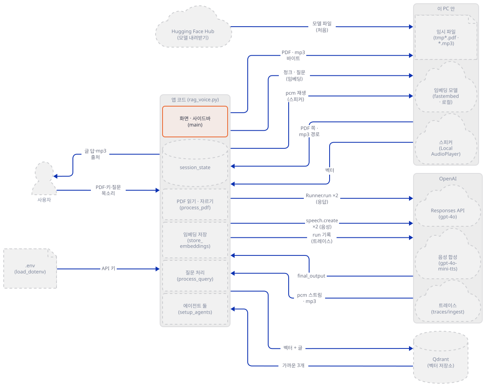

**확인.** 위 마지막 명령이 이렇게 답해야 합니다(`pypdf`는 설치 시점의 최신판이라 숫자가 다를 수 있습니다).

```text
pypdf 6.20.1 | python 3.13.3
```

### Step 2. 가짜 서버와 소리 없는 복사본

**목적.** 앱이 바깥으로 나가는 길 넷(OpenAI, Qdrant, 모델 내려받기, 스피커)을 막고 대역을 세웁니다. 앱 파일 자체는 그대로 두고 복사본을 만들어 필요한 네 줄만 바꿉니다. 그리고 확인 스크립트가 터미널의 환경변수 한 줄에 기대지 않게, 스크립트 스스로 검사하게 합니다.

**할 일.** 터미널 A에서 가짜 OpenAI 서버를 띄웁니다. 앱의 두 종류 요청을 받습니다. 에이전트가 보내는 `/v1/responses`와 음성 합성의 `/v1/audio/speech`입니다. 돌려주는 답과 소리는 제가 정한 가짜입니다(무음 바이트 4,800개와 mp3 머리말 바이트뿐이고 실제 오디오가 아닙니다). `fake_server.py`를 저장합니다.

```bash
cat > fake_server.py <<'EOF'
"""Day 138 fake OpenAI server. Usage: python fake_server.py PORT LOGFILE"""
import itertools, json, sys, time
from http.server import BaseHTTPRequestHandler, HTTPServer

port, logfile = int(sys.argv[1]), sys.argv[2]
seq = itertools.count(1)
FAKE_PCM = b"\x00\x00" * 2400                                   # 0.1 s of silence, 24 kHz 16-bit
FAKE_MP3 = b"ID3\x04\x00\x00\x00\x00\x00\x00" + b"\xff\xfb\x90\x00" + b"\x00" * 413   # header bytes only, not real audio


def text_of(inp):
    if isinstance(inp, str):
        return inp
    return "\n".join(
        c if isinstance(c := item.get("content"), str) else " ".join(x.get("text", "") for x in c or [])
        for item in inp or []
    )


def response(model, text):
    n = next(seq)
    return {"id": f"resp_fake{n}", "object": "response", "created_at": int(time.time()), "status": "completed",
            "model": model, "parallel_tool_calls": True, "tool_choice": "auto", "tools": [], "error": None,
            "incomplete_details": None,
            "output": [{"type": "message", "id": f"msg_fake{n}", "role": "assistant", "status": "completed",
                        "content": [{"type": "output_text", "text": text, "annotations": []}]}],
            "usage": {"input_tokens": 100, "input_tokens_details": {"cached_tokens": 0}, "output_tokens": 20,
                      "output_tokens_details": {"reasoning_tokens": 0}, "total_tokens": 120}}


class H(BaseHTTPRequestHandler):
    def log_message(self, *a):
        pass

    def reply(self, ctype, body):
        self.send_response(200)
        self.send_header("Content-Type", ctype)
        self.send_header("Content-Length", str(len(body)))
        self.end_headers()
        self.wfile.write(body)

    def do_POST(self):
        raw = self.rfile.read(int(self.headers.get("Content-Length", "0")))
        body = json.loads(raw or b"{}")
        rec = {"path": self.path, "key": self.headers.get("Authorization", "")[:22]}
        if self.path.endswith("/responses"):
            ins, text = body.get("instructions") or "", text_of(body.get("input"))
            if ins.lstrip().startswith("You are a helpful documentation assistant"):
                kind, out = "processor", "FAKE ANSWER (processor agent). Retrieved text starts: " + text.split("\n\n", 2)[1][:80].replace("\n", " ")
            else:
                kind, out = "tts-agent", "Speak in a calm, friendly voice with short pauses."
            rec.update(kind=kind, model=body.get("model"), input_chars=len(text))
            self.reply("application/json", json.dumps(response(body.get("model", "gpt-4o"), out)).encode())
        elif self.path.endswith("/audio/speech"):
            fmt = body.get("response_format", "mp3")
            rec.update(kind="tts-" + fmt, model=body.get("model"), voice=body.get("voice"),
                       input_chars=len(body.get("input", "")), instructions=(body.get("instructions") or "")[:30])
            self.reply("audio/pcm" if fmt == "pcm" else "audio/mpeg", FAKE_PCM if fmt == "pcm" else FAKE_MP3)
        else:
            rec.update(kind="other")
            self.reply("application/json", b'{"ok":true}')
        with open(logfile, "a", encoding="utf-8") as f:
            f.write(json.dumps(rec, ensure_ascii=False) + "\n")


class S(HTTPServer):
    allow_reuse_address = False


S(("127.0.0.1", port), H).serve_forever()
EOF
```

포트는 49152~65535 사이에서 다른 프로그램이 쓰지 않는 번호를 아무거나 고릅니다(아래는 52871). 서버는 이 터미널에서 계속 돌게 둡니다.

```bash
uv run --no-project python fake_server.py 52871 fake.log
```

터미널 B에서 환경변수 파일을 저장하고 걸어 둡니다. 바깥으로 나가는 길을 막는 줄이 셋입니다. `OPENAI_BASE_URL`이 모든 OpenAI 요청을 가짜 서버로 돌리고, `OPENAI_API_KEY`의 가짜 값이 셸에 있을지 모르는 진짜 키를 덮고, `OPENAI_AGENTS_DISABLE_TRACING=1`이 트레이스 전송을 끕니다(Step 6). `NO_PROXY`는 루프백 요청이 회사 프록시로 새지 않게 합니다. 나머지는 임시 파일과 모델 캐시를 이 폴더 안으로 모읍니다. 파이썬의 임시 폴더는 `TMPDIR`을 가장 먼저 봅니다.

```bash
cat > envfake.sh <<'EOF'
export OPENAI_BASE_URL=http://127.0.0.1:$1/v1
export OPENAI_API_KEY=sk-fake-env
export OPENAI_AGENTS_DISABLE_TRACING=1
export NO_PROXY=127.0.0.1,localhost
export PYTHONIOENCODING=utf-8
WORK=$(pwd -W 2>/dev/null || pwd)
export TMPDIR=$WORK/tmp-out FAKE_LOG=$WORK/fake.log
export FASTEMBED_CACHE_PATH=$WORK/fe-cache HF_HOME=$WORK/hf-cache
mkdir -p tmp-out
EOF
. ./envfake.sh 52871
echo $OPENAI_BASE_URL
```

```text
http://127.0.0.1:52871/v1
```

`echo`가 `http://127.0.0.1:52871/v1`을 찍어야 이 터미널은 가짜 서버로 갑니다. 그래도 이 한 줄을 빠뜨린 터미널이 생길 수 있으므로, 아래 `guard.py`가 스크립트마다 같은 일을 다시 합니다. 아래 PowerShell 줄은 실행해 보지 못했습니다. `. ./envfake.sh` 대신 터미널 B마다 붙여 넣습니다.

```powershell
$env:OPENAI_BASE_URL="http://127.0.0.1:52871/v1"; $env:OPENAI_API_KEY="sk-fake-env"; $env:OPENAI_AGENTS_DISABLE_TRACING="1"; $env:NO_PROXY="127.0.0.1,localhost"
$env:PYTHONIOENCODING="utf-8"; $env:TMPDIR="$PWD\tmp-out"; $env:FAKE_LOG="$PWD\fake.log"
$env:FASTEMBED_CACHE_PATH="$PWD\fe-cache"; $env:HF_HOME="$PWD\hf-cache"; New-Item -ItemType Directory -Force tmp-out | Out-Null
```

`guard.py`는 `OPENAI_BASE_URL`을 문자열 접두가 아니라 `urlparse`의 호스트가 `127.0.0.1`·`localhost`인지로 비교하고(그래서 `http://127.0.0.1.example.invalid/v1` 같은 주소는 통과하지 못합니다), 트레이싱이 꺼져 있는지도 봅니다. 아니면 종료 코드 1로 끝납니다. 이 문서의 확인 스크립트는 모두 첫머리에서 `from guard import check`로 이것을 부르고, 앱 코드를 가져오는 `harness.py`도 `agents`·`openai`를 가져오기 전에 부릅니다. 뒤의 Step 6에서 트레이스를 일부러 거치는 `tracecheck.py`만 트레이싱을 허용하고, 그때도 주소는 루프백이어야 합니다. 이어서 대역과 복사본을 만드는 파일 셋을 저장합니다. `harness.py`는 임베딩(384차원 해시 벡터, 내려받지 않음)과 플레이어(스트림을 끝까지 읽고 소리는 내지 않음)와 업로드 상자의 대역입니다. `make_scratch.py`는 `rag_voice.py`를 `rag_voice_scratch.py`로 복사하며 네 곳을 정확히 한 번씩만 바꾸고 차이를 보여 줍니다.

```bash
cat > guard.py <<'EOF'
"""Exit with code 1 unless this shell points OpenAI at the local fake server and tracing is off.
Use: `python guard.py && streamlit run ...`, or `from guard import check; check()` at the top of a script."""
import os
import sys
from urllib.parse import urlparse


def check(allow_tracing=False):
    base = os.environ.get("OPENAI_BASE_URL", "")
    u = urlparse(base)
    if u.scheme != "http" or u.hostname not in ("127.0.0.1", "localhost"):
        sys.exit("Run `. ./envfake.sh <port>` first. OPENAI_BASE_URL is not a loopback address: " + repr(base))
    if not allow_tracing and os.environ.get("OPENAI_AGENTS_DISABLE_TRACING", "").lower() not in ("1", "true"):
        sys.exit("Run `. ./envfake.sh <port>` again. Tracing is on and would go to api.openai.com")
    return base


if __name__ == "__main__":
    check()
EOF
cat > harness.py <<'EOF'
"""Stand-ins used only by rag_voice_scratch.py (see make_scratch.py)."""
import hashlib, os, re
import numpy as np
from guard import check

check(allow_tracing=os.environ.get("TRACECHECK") == "1")   # stop before agents/openai are imported

STATS = {"embed_calls": 0, "embed_texts": 0, "played_bytes": [], "model_loads": 0}


class TextEmbedding:
    """Replaces fastembed.TextEmbedding: 384-dim hashed bag of words, downloads nothing."""
    DIM = 384

    def __init__(self, *args, **kwargs):
        STATS["model_loads"] += 1

    def embed(self, texts, **kwargs):
        STATS["embed_calls"] += 1
        for text in texts:
            STATS["embed_texts"] += 1
            v = np.zeros(self.DIM, dtype=np.float32)
            for w in re.findall(r"[a-z0-9]+", text.lower()):
                h = int(hashlib.md5(w.encode()).hexdigest(), 16)
                v[h % self.DIM] += 1.0 if (h >> 20) & 1 else -1.0
            n = np.linalg.norm(v)
            yield v / n if n else v


class _FakePlayer:
    """Replaces openai.helpers.LocalAudioPlayer: drains the stream, plays nothing, never imports sounddevice."""
    async def play(self, input):
        total = 0
        async for chunk in input.iter_bytes(chunk_size=1024):
            total += len(chunk)
        STATS["played_bytes"].append(total)


class _PlayerWithoutSounddevice:
    """Same order as the real play() on a PC without sounddevice: read the whole body, then touch
    sd.OutputStream, which raises. Used by HARNESS_PLAYER=nosd."""
    async def play(self, input):
        async for _ in input.iter_bytes(chunk_size=1024):
            pass
        from openai._extras import sounddevice as sd
        sd.OutputStream


LocalAudioPlayer = _PlayerWithoutSounddevice if os.environ.get("HARNESS_PLAYER") == "nosd" else _FakePlayer


class FakeUpload:
    def __init__(self, path):
        self.name = os.path.basename(path)
        self._data = open(path, "rb").read()

    def getvalue(self):
        return self._data


def file_uploader(*args, **kwargs):
    path = os.environ.get("FAKE_UPLOAD")
    return FakeUpload(path) if path else None
EOF
cat > make_scratch.py <<'EOF'
"""Copy rag_voice.py to rag_voice_scratch.py with four exact-match replacements, then print the diff."""
import difflib, sys

src = open(sys.argv[1], encoding="utf-8").read()
patches = [
    ("from fastembed import TextEmbedding\n", "from harness import TextEmbedding\n"),
    ("from openai.helpers import LocalAudioPlayer\n", "from harness import LocalAudioPlayer, file_uploader\n"),
    ("    client = QdrantClient(\n        url=st.session_state.qdrant_url,\n        api_key=st.session_state.qdrant_api_key\n    )\n",
     "    client = QdrantClient(\":memory:\")\n"),
    ('uploaded_file = st.file_uploader("Upload PDF", type=["pdf"])', 'uploaded_file = file_uploader("Upload PDF", type=["pdf"])'),
]
out = src
for old, new in patches:
    assert out.count(old) == 1, old
    out = out.replace(old, new)
open(sys.argv[2], "w", encoding="utf-8", newline="\n").write(out)
sys.stdout.writelines(difflib.unified_diff(src.splitlines(True), out.splitlines(True), "rag_voice.py", sys.argv[2], n=0))
EOF
curl -s -o /dev/null -w "%{http_code} %{size_download} bytes\n" -X POST -H 'Content-Type: application/json' -d '{"response_format":"pcm","input":"hi"}' $OPENAI_BASE_URL/audio/speech
: > fake.log
uv run --no-project python make_scratch.py rag_voice.py rag_voice_scratch.py
uv run --no-project python -c "import harness; print('harness ok')"
uv run --no-project python guard.py && echo "guard: ok"
OPENAI_BASE_URL=https://api.openai.com/v1 uv run --no-project python guard.py; echo "exit code: $?"
OPENAI_AGENTS_DISABLE_TRACING=0 uv run --no-project python guard.py; echo "exit code: $?"
```

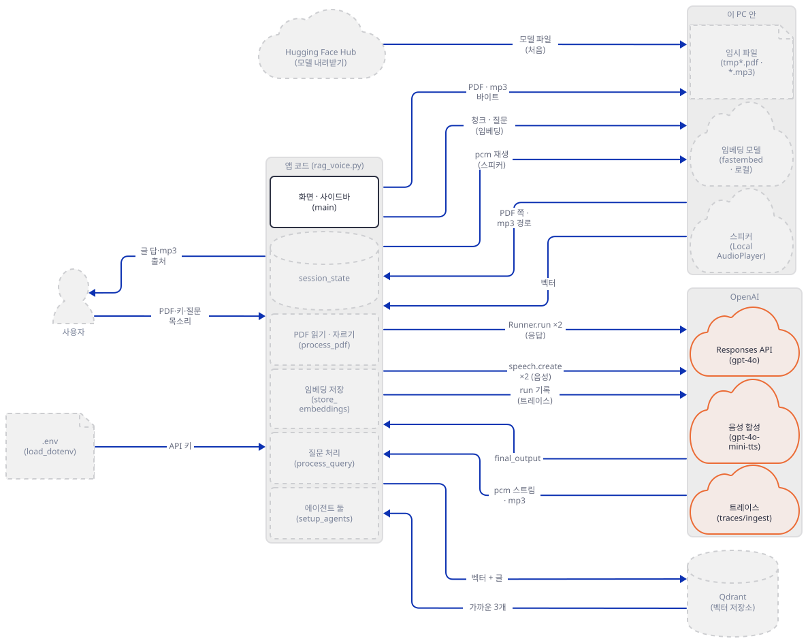

**확인.** 가짜 서버가 음성 요청에 답했고(첫 출력), 복사본의 차이가 정확히 네 곳이며, `guard.py`가 맞는 환경에서는 통과하고 진짜 주소나 켜진 트레이싱에서는 종료 코드 1로 멈춥니다. 마지막 두 줄은 명령 앞에 변수를 붙여 그 한 줄에서만 환경을 바꾼 것입니다.

```text
200 4800 bytes
```

```text
--- rag_voice.py
+++ rag_voice_scratch.py
@@ -15 +15 @@
-from fastembed import TextEmbedding
+from harness import TextEmbedding
@@ -17 +17 @@
-from openai.helpers import LocalAudioPlayer
+from harness import LocalAudioPlayer, file_uploader
@@ -82,4 +82 @@
-    client = QdrantClient(
-        url=st.session_state.qdrant_url,
-        api_key=st.session_state.qdrant_api_key
-    )
+    client = QdrantClient(":memory:")
@@ -314 +311 @@
-    uploaded_file = st.file_uploader("Upload PDF", type=["pdf"])
+    uploaded_file = file_uploader("Upload PDF", type=["pdf"])
```

```text
harness ok
```

```text
guard: ok
```

```text
Run `. ./envfake.sh <port>` first. OPENAI_BASE_URL is not a loopback address: 'https://api.openai.com/v1'
exit code: 1
```

```text
Run `. ./envfake.sh <port>` again. Tracing is on and would go to api.openai.com
exit code: 1
```

`curl`이 찍은 `200 4800 bytes`는 서버의 무음 pcm 바이트입니다. 서버는 요청을 `fake.log`에 한 줄씩 적습니다(방금 줄은 지웠습니다). 앱 파일 자체는 바뀌지 않았고 `QdrantClient`에 주소와 키를 넘기는 원래 모양은 82~85행에 있습니다. 이 네 곳 말고는 앱 코드가 그대로 돕니다. 이후 모든 확인은 `rag_voice_scratch.py`를 Streamlit의 `AppTest`(브라우저 없이 스크립트를 돌려 위젯을 조작하는 테스트 도구)로 돌려 얻은 것입니다. `envfake.sh`를 걸지 않은 셸에서 아래 스크립트들을 돌려 보았을 때(진짜 모양의 가짜 키를 셸에 걸고 상위 폴더에 가짜 `.env`를 둔 채), 모두 `guard.py`의 메시지와 함께 바로 멈췄고 바깥 접속 기록은 0건이었습니다(직접 확인).

### Step 3. 사이드바와 키 — `.env`의 값은 상자를 채우지 않습니다

**목적.** 입력 상자 셋과 목소리 선택을 읽고, 앱 README가 `.env`에 적으라는 값이 실제로 쓰이는지 확인합니다.

**할 일.** 사이드바는 상자 셋을 `session_state`에 담고 목소리 열한 개 가운데 기본 `coral`을 고릅니다. 환경변수를 읽는 `os.getenv`는 파일 어디에도 없고(아래 `grep`이 찾는 것은 `os.environ`을 쓰는 한 줄뿐입니다), 상자의 처음 값은 모두 빈 문자열입니다. 앱 README는 `.env`에 `OPENAI_API_KEY`·`QDRANT_URL`·`QDRANT_API_KEY`를 적으라고 합니다. 맨 위의 `load_dotenv()`(20행)는 `.env`를 읽어 환경변수로 만들지만, 그 값을 상자에 채우는 코드는 없습니다. 더 눈에 띄는 것은 키를 에이전트에 넘기는 줄입니다.

`voice_ai_agents/voice_rag_openaisdk/rag_voice.py:153-155`

```python
def setup_agents(openai_api_key: str) -> Tuple[Agent, Agent]:
    """Initialize the processor and TTS agents."""
    os.environ["OPENAI_API_KEY"] = openai_api_key
```

사이드바의 OpenAI 상자가 비어 있으면 이 줄이 환경의 키를 빈 문자열로 덮습니다. Qdrant 값이 없을 때는 `setup_qdrant`가 먼저 실패합니다.

`voice_ai_agents/voice_rag_openaisdk/rag_voice.py:79-80`

```python
    if not all([st.session_state.qdrant_url, st.session_state.qdrant_api_key]):
        raise ValueError("Qdrant credentials not provided")
```

확인용 PDF 둘과 스크립트를 저장하고, 가짜 키 세 개가 든 `.env`를 만들어 앱을 돌려 봅니다. `mkpdf.py`는 지어낸 문서("Zephyr API 안내")를 쪽마다 쓰는 작은 PDF 작성기입니다. `guide.pdf`는 30쪽, `tiny.pdf`는 1쪽입니다. 파일 저장은 Git Bash의 `cat` 대신 편집기에 같은 내용을 붙여 저장해도 됩니다.

```bash
grep -n 'getenv\|environ' rag_voice.py
cat > mkpdf.py <<'EOF'
"""Write a small made-up PDF (plain Helvetica text, no compression). Usage: python mkpdf.py OUT.pdf PAGES"""
import sys

TOPICS = [
    "The Zephyr API uses bearer tokens. Create a token in the dashboard under Settings, then send it in the Authorization header.",
    "Rate limits: each token may send 60 requests per minute. A 429 response means wait for the seconds in the Retry-After header.",
    "Webhooks: register an HTTPS endpoint, and Zephyr signs every delivery with an HMAC header named X-Zephyr-Signature.",
    "Pagination: list endpoints return at most 100 items and a next_cursor field. Pass it back as the cursor query parameter.",
    "Errors: every error body has a code and a message. Codes starting with E4 are caused by the caller, E5 by Zephyr.",
]


def wrap(text, n=70):
    line, out = "", []
    for w in text.split():
        if len(line) + len(w) + 1 > n:
            out.append(line)
            line = w
        else:
            line = (line + " " + w).strip()
    return out + [line]


pages = int(sys.argv[2])
objs = [b"<< /Type /Catalog /Pages 2 0 R >>", b"", b"<< /Type /Font /Subtype /Type1 /BaseFont /Helvetica >>"]
kids = []
for p in range(pages):
    lines = [f"Zephyr Guide, page {p + 1}"] + [l for k in range(8) for l in wrap(TOPICS[(p + k) % len(TOPICS)])]
    stream = ("BT /F1 11 Tf 40 760 Td 14 TL\n" + "\n".join(f"({l}) '" for l in lines) + "\nET").encode()
    objs.append(b"<< /Length %d >>\nstream\n" % len(stream) + stream + b"\nendstream")
    objs.append(b"<< /Type /Page /Parent 2 0 R /MediaBox [0 0 612 792] /Contents %d 0 R /Resources << /Font << /F1 3 0 R >> >> >>" % (len(objs)))
    kids.append(len(objs))
objs[1] = b"<< /Type /Pages /Count %d /Kids [%s] >>" % (pages, b" ".join(b"%d 0 R" % k for k in kids))
out, offs = bytearray(b"%PDF-1.4\n"), []
for i, o in enumerate(objs, 1):
    offs.append(len(out))
    out += b"%d 0 obj\n" % i + o + b"\nendobj\n"
xref = len(out)
out += b"xref\n0 %d\n0000000000 65535 f \n" % (len(objs) + 1) + b"".join(b"%010d 00000 n \n" % o for o in offs)
out += b"trailer\n<< /Size %d /Root 1 0 R >>\nstartxref\n%d\n%%%%EOF\n" % (len(objs) + 1, xref)
open(sys.argv[1], "wb").write(bytes(out))
print(sys.argv[1], len(out), "bytes")
EOF
cat > drive.py <<'EOF'
"""Drive the patched app headlessly with Streamlit's AppTest. Usage: python drive.py FILE.pdf [upload] [ask] [voice] [voices]"""
from guard import check

check()

import collections, json, os, sys
from streamlit.testing.v1 import AppTest
import harness

LOG = os.environ["FAKE_LOG"]


def requests():
    return [json.loads(l) for l in open(LOG, encoding="utf-8")] if os.path.exists(LOG) else []


def show(at, label):
    print("---", label)
    for kind in ("success", "error"):
        for e in getattr(at, kind):
            print(f"  [{kind}]", " ".join(e.value.split())[:150])
    for e in at.exception:
        print("  [exception]", e.value[:150])


pdf, stages = sys.argv[1], sys.argv[2:] or ["upload"]
os.environ["FAKE_UPLOAD"] = pdf
at = AppTest.from_file("rag_voice_scratch.py", default_timeout=120)
at.run()
at.sidebar.text_input[0].set_value("https://qdrant.invalid:6333")   # Qdrant URL (unused by the patched copy)
at.sidebar.text_input[1].set_value("fake-qdrant-key")
at.sidebar.text_input[2].set_value("sk-fake-sidebar")
at.run()
show(at, "upload " + pdf)
state = at.session_state
print("  processed_documents:", state["processed_documents"], " setup_complete:", state["setup_complete"])
if state["client"] is not None:
    print("  points in Qdrant:", state["client"].count("voice-rag-agent").count)
print("  embed calls:", harness.STATS["embed_calls"], " model loads:", harness.STATS["model_loads"])
if "ask" in stages and state["setup_complete"]:
    n = len(requests())
    at.text_input[0].set_value("How do I authenticate API requests?").run()
    show(at, "ask")
    print("  server saw:", dict(collections.Counter(r["kind"] for r in requests()[n:])), " played bytes:", harness.STATS["played_bytes"])
    print("  sources shown:", [m.value for m in at.markdown if m.value.startswith("- ")])
    if "voice" in stages:
        n = len(requests())
        at.selectbox[0].select("nova").run()
        show(at, "change voice to nova, no new question")
        print("  server saw:", dict(collections.Counter(r["kind"] for r in requests()[n:])))
        print("  voices:", [r.get("voice") for r in requests()[n:] if r["kind"].startswith("tts-")])
    if "voices" in stages:
        for choice in ("nova", "onyx", "fable"):
            n = len(requests())
            at.selectbox[0].select(choice).run()
            sent = [r.get("voice") for r in requests()[n:] if r["kind"] == "tts-mp3"]
            print(f"  picked {choice}: box={at.selectbox[0].value} session={at.session_state['selected_voice']} sent={sent}")
EOF
cat > envtest.py <<'EOF'
from guard import check

check()

import json, os
from streamlit.testing.v1 import AppTest

os.environ.pop("OPENAI_API_KEY", None)          # pretend the shell has no key, so only .env can supply one
os.environ["FAKE_UPLOAD"] = "guide.pdf"
at = AppTest.from_file("rag_voice_scratch.py", default_timeout=120)
at.run()
print("sidebar boxes after the first run:", [t.value for t in at.sidebar.text_input])
print("OPENAI_API_KEY in the environment, loaded from .env:", os.environ.get("OPENAI_API_KEY", "")[:12])
at.sidebar.text_input[0].set_value("https://qdrant.invalid:6333")
at.sidebar.text_input[1].set_value("fake-qdrant-key")      # the OpenAI box stays empty
at.run()
at.text_input[0].set_value("How do I authenticate API requests?").run()
print("OPENAI_API_KEY after the question:", repr(os.environ.get("OPENAI_API_KEY")))
for line in open(os.environ["FAKE_LOG"]):
    r = json.loads(line)
    print(r["kind"].ljust(10), "Authorization:", repr(r["key"]))
EOF
uv run --no-project python mkpdf.py guide.pdf 30
uv run --no-project python mkpdf.py tiny.pdf 1
printf "OPENAI_API_KEY=sk-fake-dotenv\nQDRANT_URL=https://qdrant.invalid\nQDRANT_API_KEY=fake-q\n" > .env
uv run --no-project python envtest.py
rm .env
: > fake.log
```

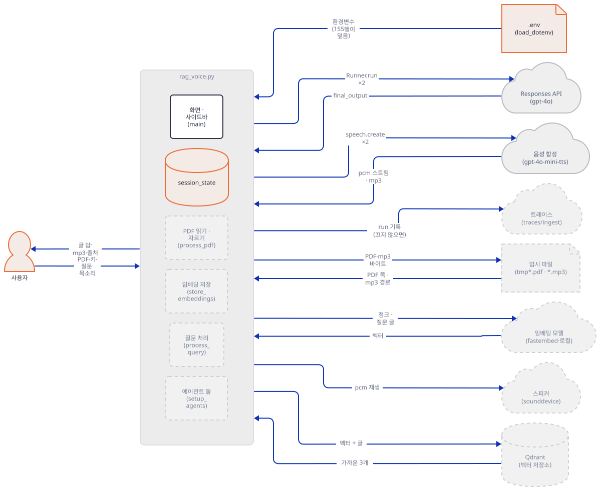

**확인.** 첫 출력(`grep`)은 환경을 만지는 줄이 155행 하나뿐임을 보입니다. 이어서 `mkpdf.py`가 쓴 파일 크기 둘, 그리고 상자가 처음에 모두 비어 있다는 것, `.env`의 키가 환경에는 들어왔다는 것, 질문 뒤에는 환경의 키가 빈 문자열이 되었고 가짜 서버가 받은 요청 넷의 `Authorization`이 모두 비었다는 것이 보입니다. 진짜 OpenAI라면 이 요청들은 인증 오류로 끝날 것입니다(실제로 보내 보지는 않았습니다).

```text
155:    os.environ["OPENAI_API_KEY"] = openai_api_key
```

```text
guide.pdf 39672 bytes
tiny.pdf 1636 bytes
```

```text
sidebar boxes after the first run: ['', '', '']
OPENAI_API_KEY in the environment, loaded from .env: sk-fake-dote
OPENAI_API_KEY after the question: ''
processor  Authorization: ''
tts-agent  Authorization: ''
tts-pcm    Authorization: ''
tts-mp3    Authorization: ''
```

### Step 4. PDF 올리기 — 임시 파일과 8,192바이트

**목적.** 업로드한 PDF가 앱 안에서 어떻게 파일이 되고 조각이 되는지 읽고, 작은 PDF가 실패하는 까닭과 임시 파일이 남는지 확인합니다.

**할 일.** 화면(`main`)은 `process_pdf`와 `store_embeddings`를 부르고 결과를 `session_state`에 둡니다. 그 관계와 `process_pdf`가 임시 파일을 거치는 길은 아래 그림에 화살표로 있습니다.

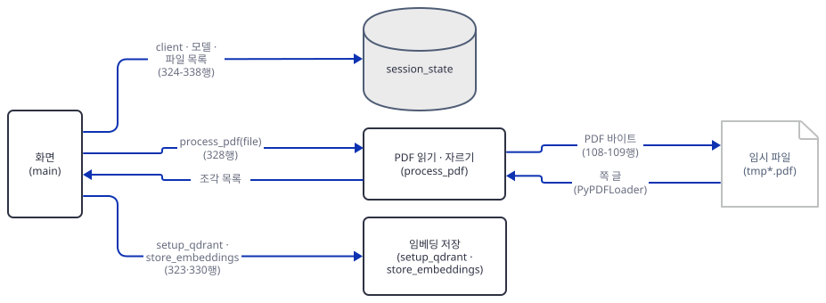

`process_pdf`는 올린 바이트를 임시 파일에 쓰고 곧바로 그 이름으로 `PyPDFLoader`를 부릅니다.

`voice_ai_agents/voice_rag_openaisdk/rag_voice.py:108-111`

```python
        with tempfile.NamedTemporaryFile(delete=False, suffix='.pdf') as tmp_file:
            tmp_file.write(file.getvalue())
            loader = PyPDFLoader(tmp_file.name)
            documents = loader.load()
```

두 가지가 걸립니다. 첫째, 파일을 닫기 전(`with` 블록 안)에 읽고 있습니다. 쓴 바이트는 파이썬의 쓰기 버퍼에 머물다가 버퍼 크기 이상이 되어야 디스크로 내려가므로, 그보다 작은 PDF는 읽을 때 디스크의 파일이 비어 있습니다. 버퍼 크기는 파이썬 판마다 다릅니다. 이 PC의 3.13.3은 8,192바이트(`io.DEFAULT_BUFFER_SIZE`)이고, 3.14.2는 131,072바이트라 9,000바이트를 써도 열린 동안 디스크 크기가 0이었습니다(직접 확인). 둘째, `delete=False`라서 파일이 저절로 지워지지 않고, 파일 어디에도 지우는 코드가 없습니다(`grep -nE "remove|unlink|rmtree" rag_voice.py`가 아무것도 찾지 못합니다). 임시 폴더는 위에서 `tmp-out`으로 옮겨 두었으니 거기에 남는 것을 셉니다.

```bash
ls tmp-out | grep -c '\.pdf$'
uv run --no-project python -c "
import os, tempfile
for n in (1000, 8191, 8192, 40000):
    with tempfile.NamedTemporaryFile(delete=False, suffix='.pdf') as t:
        t.write(b'x' * n)
        size = os.path.getsize(t.name)
    os.remove(t.name)
    print(n, 'bytes written -> on disk while still open:', size)
"
uv run --no-project python -c "
import os, tempfile
with tempfile.NamedTemporaryFile(delete=False, suffix='.pdf') as t:
    t.write(b'x' * 1000)
    t.flush()
    size = os.path.getsize(t.name)
os.remove(t.name)
print('1000 bytes written, then flush() -> on disk while still open:', size)
"
uv run --no-project python drive.py tiny.pdf upload
ls tmp-out | grep -c '\.pdf$'
uv run --no-project python drive.py guide.pdf upload
ls tmp-out | grep -c '\.pdf$'
```

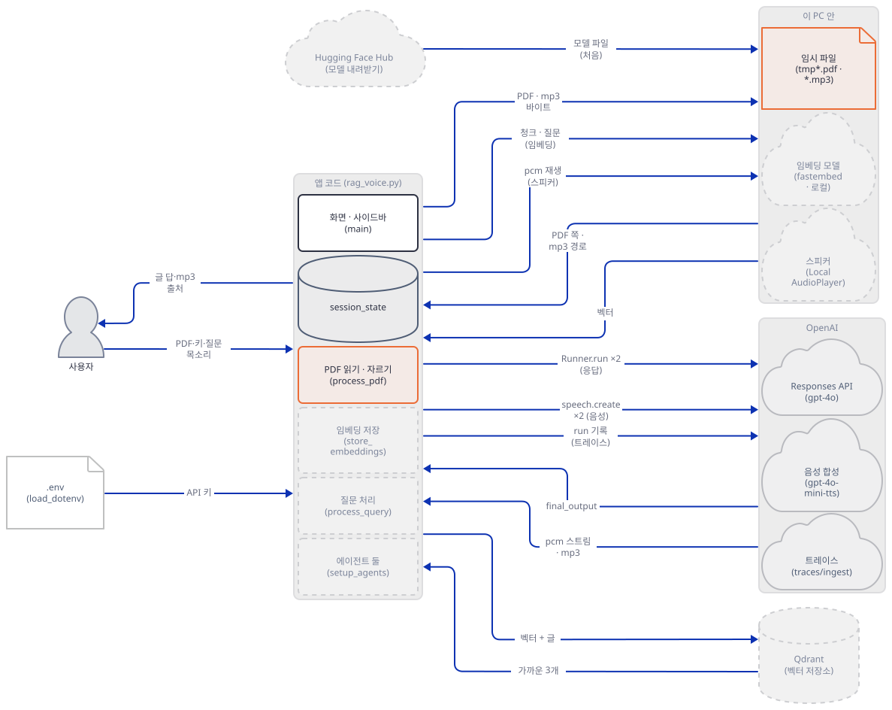

**확인.** 출력은 명령 순서대로입니다. Step 3의 질문 한 번이 PDF 임시 파일 하나를 남겼으므로 처음 세는 값이 1입니다. 쓰기 버퍼는 8,192바이트부터 디스크로 내려가고(둘째 출력), `flush()`를 하면 작은 파일도 바로 내려갑니다(셋째). 그보다 작은 `tiny.pdf`(1,636바이트)는 `Cannot read an empty file`로 실패하며 임시 파일이 하나 더 남습니다. `guide.pdf`(39,672바이트)는 성공하고 하나 더 남습니다. 세는 숫자는 순서대로 1, 2, 3입니다.

```text
1
```

```text
1000 bytes written -> on disk while still open: 0
8191 bytes written -> on disk while still open: 0
8192 bytes written -> on disk while still open: 8192
40000 bytes written -> on disk while still open: 40000
```

```text
1000 bytes written, then flush() -> on disk while still open: 1000
```

```text
--- upload tiny.pdf
  [error] 📄 PDF processing error: Cannot read an empty file
  processed_documents: []  setup_complete: False
  points in Qdrant: 0
  embed calls: 1  model loads: 1
```

```text
2
```

```text
--- upload guide.pdf
  [success] ✅ Added PDF: guide.pdf
  processed_documents: ['guide.pdf']  setup_complete: True
  points in Qdrant: 30
  embed calls: 31  model loads: 1
```

```text
3
```

`tiny.pdf`가 실패했을 때 앱이 화면에 보여 주는 것은 `st.error` 한 줄뿐이고(127행), 함수가 빈 목록을 돌려주어 `if documents:`(329행)를 지나가지 않으니 "Added PDF"도 뜨지 않습니다. 쓰기 뒤에 `flush()`를 하면 1,000바이트짜리도 디스크 크기가 바로 1,000으로 보입니다(위 셋째 출력, 직접 확인). 이 문서는 앱 코드를 고치지 않으므로 문제 해결 표에 적어 두기만 합니다.

### Step 5. 임베딩과 Qdrant — 청크마다 한 번씩, 그리고 무엇이 올라가는가

**목적.** 조각이 벡터가 되어 Qdrant에 들어가는 길을 읽고, 0.7.3에서 Day 137의 0.9.0과 달라진 점과 Qdrant에 실제로 올라가는 내용을 확인합니다.

**할 일.** 처음 PDF를 올릴 때만 `setup_qdrant`가 불립니다(`st.session_state.client`가 비어 있을 때, 322행). 기본 모델(`BAAI/bge-small-en-v1.5`, 384차원, 영어용, 약 0.067GB)을 어디서 받고 어디에 두는지는 [Day 137 Step 3](../day137-customer-support-voice-agent/README.md)이 보였고, 이 앱의 0.7.3도 같은 기본 모델입니다(소스로 확인). 달라진 것은 하나입니다. 0.7.3의 `download_model`은 받은 모델이 이미 있어도 `local_files_only`를 주지 않는 한 `model_info(...)`로 Hugging Face에 저장소 버전을 묻습니다. 이 PC의 소스에서 그 줄을 봅니다.

```bash
FE=$(uv run --no-project python -c "import fastembed, os; print(os.path.dirname(fastembed.__file__))")
grep -n 'model_info(hf_source_repo)\|snapshot_download(' "$FE/common/model_management.py"
```

```text
232:            result = snapshot_download(
241:        repo_revision = model_info(hf_source_repo).sha
264:        result = snapshot_download(
```

(소스로 확인, 실행해 보지는 않았습니다. 이 문서의 복사본은 이 길을 전혀 타지 않습니다. 영어용 모델이라 한국어 PDF의 검색 품질은 확인하지 못했습니다.) 컬렉션은 `Distance.COSINE`입니다(94~98행). 임베딩 모델·Hugging Face·Qdrant가 `store_embeddings` 쪽과 맺는 관계는 아래 그림에 화살표로 있습니다.

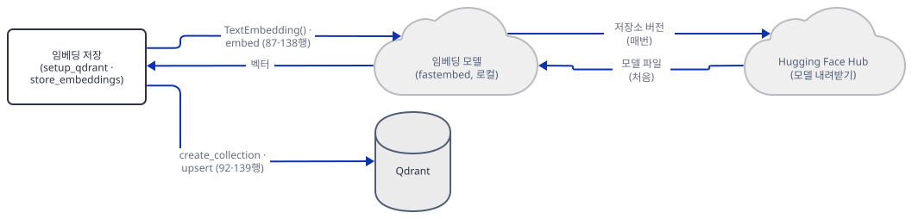

조각을 만들고 넣는 쪽을 봅니다. 자르개는 1,000자, 겹침 200자이고, 넣는 쪽은 조각마다 임베딩 호출 하나와 `upsert` 하나를 따로 부릅니다.

`voice_ai_agents/voice_rag_openaisdk/rag_voice.py:137-151`

```python
    for doc in documents:
        embedding = list(embedding_model.embed([doc.page_content]))[0]
        client.upsert(
            collection_name=collection_name,
            points=[
                models.PointStruct(
                    id=str(uuid.uuid4()),
                    vector=embedding.tolist(),
                    payload={
                        "content": doc.page_content,
                        **doc.metadata
                    }
                )
            ]
        )
```

그래서 쪽이 많은 문서는 Qdrant Cloud로 가는 왕복이 조각 수만큼 나갑니다(소스로 확인, 한 번에 묶어 보내는 `upsert`는 쓰지 않습니다). 직접 센 값은 Step 4의 `guide.pdf` 출력에 있습니다. 점 30개, 임베딩 호출 31번(차원 재기 1번과 조각 30번)입니다. 그리고 점마다 올라가는 것은 벡터만이 아닙니다. `payload`에 조각 원문과 `PyPDFLoader`가 붙인 메타데이터 전부가 들어갑니다. 조각 수와 점 하나의 `payload`를 봅니다.

```bash
uv run --no-project python -c "
from langchain_community.document_loaders import PyPDFLoader
from langchain_text_splitters import RecursiveCharacterTextSplitter
pages = PyPDFLoader('guide.pdf').load()
chunks = RecursiveCharacterTextSplitter(chunk_size=1000, chunk_overlap=200).split_documents(pages)
print(len(pages), 'pages ->', len(chunks), 'chunks, longest', max(len(c.page_content) for c in chunks), 'characters')
"
cat > payload.py <<'EOF'
from guard import check

check()

import os
import tempfile
from streamlit.testing.v1 import AppTest

os.environ["FAKE_UPLOAD"] = "guide.pdf"
at = AppTest.from_file("rag_voice_scratch.py", default_timeout=120)
at.run()
at.sidebar.text_input[0].set_value("https://qdrant.invalid:6333")
at.sidebar.text_input[1].set_value("fake-qdrant-key")
at.run()
point = at.session_state["client"].scroll("voice-rag-agent", limit=1, with_payload=True, with_vectors=True)[0][0]
for key, value in point.payload.items():
    if key == "source":
        print("source: <a file name in the temp folder>", "| folder is the temp folder:", os.path.dirname(value) == tempfile.gettempdir())
    else:
        print(f"{key}: {str(value)[:50]!r}")
print("vector length:", len(point.vector))
EOF
uv run --no-project python payload.py
```

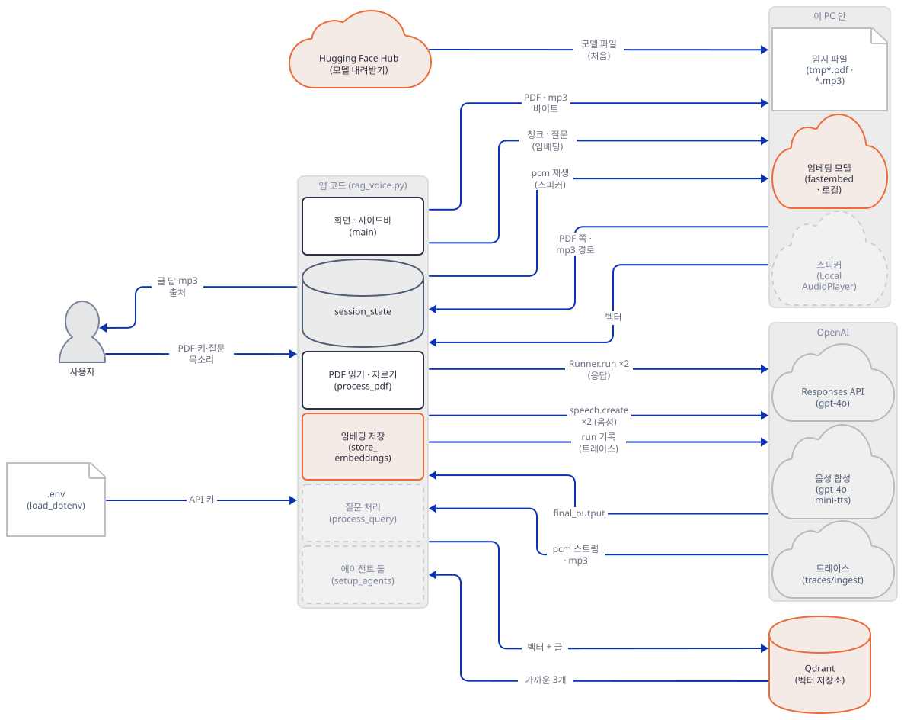

**확인.** 쪽마다 990자 안팎이라 한 쪽이 한 조각이 되었고 겹침이 쓰일 일이 없었습니다. 점 하나에는 조각 원문(`content`), `PyPDFLoader`의 메타데이터(`producer`·`creator`·`creationdate`, 실제 PDF라면 작성자·제목도 담깁니다), 쪽 정보(`total_pages`·`page`·`page_label`), 앱이 붙인 `source_type`·`file_name`·`timestamp`, 그리고 `source`가 있습니다. `source`는 PDF를 쓴 **임시 파일의 경로**이고, 마지막 줄의 `True`가 그 경로의 폴더가 파이썬의 임시 폴더임을 말합니다. 기본 임시 폴더는 Windows에서 사용자 이름이 들어간 경로(`C:\Users\<이름>\AppData\Local\Temp`)입니다. 그래서 사이드바에 넣은 주소의 Qdrant에는 조각 원문과 PDF 메타데이터, 이 PC의 임시 파일 경로가 점마다 올라갑니다(직접 확인).

```text
30 pages -> 30 chunks, longest 990 characters
```

```text
content: 'Zephyr Guide, page 17\nRate limits: each token may '
producer: 'PyPDF'
creator: 'PyPDF'
creationdate: ''
source: <a file name in the temp folder> | folder is the temp folder: True
total_pages: '30'
page: '16'
page_label: '17'
source_type: 'pdf'
file_name: 'guide.pdf'
timestamp: '2026-10-15T16:06:14.401540'
vector length: 384
```

### Step 6. 검색과 에이전트 둘 — 질문 한 건

**목적.** 질문이 검색을 거쳐 `gpt-4o`에 가는 길을 따라가고, 트레이스가 어디로 가서 무엇을 싣는지 이 앱의 0.4.2로 확인합니다.

**할 일.** 질문 하나는 임베딩, `query_points(limit=3)`, 컨텍스트 글 만들기(213~224행)를 거쳐 에이전트에 갑니다. 이 흐름에서 `process_query`가 무엇과 어떻게 이어지는지는 아래 그림에 화살표로 있습니다.

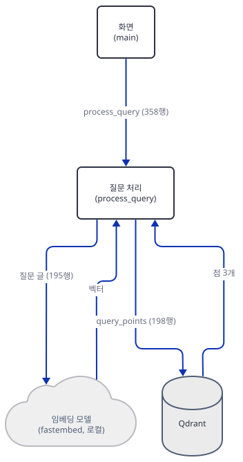

에이전트 둘은 같은 모델에 지시문만 다릅니다. 둘째 에이전트가 이름과 달리 소리를 만들지 않고 글을 돌려주며 그 글이 음성 합성 요청의 `instructions=`로 들어간다는 것은 [Day 137 Step 6](../day137-customer-support-voice-agent/README.md)이 보인 것과 같습니다(이 앱의 두 `Runner.run`은 238·244행, `instructions=`는 257·271행에서 소스로 확인). 오늘 따로 볼 것은 첫 질문에서만 불리는 `setup_agents`의 키 덮어쓰기(155행, Step 3)와 에이전트를 만드는 관계입니다.

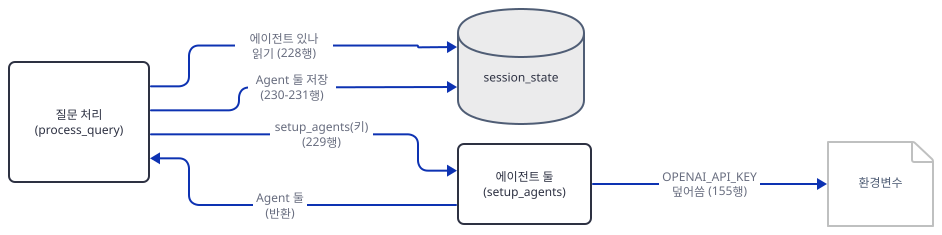

`Agent(...)`에 도구가 없고 `Runner.run`이 한 번에 한 번씩 끝나므로 에이전트 하나는 모델 호출 한 번입니다. 기본 모델 호출은 Responses API(`/v1/responses`)입니다(소스로 확인, 가짜 서버가 이 주소로 받는 것을 아래에서 봅니다). 질문을 한 번 던지고 가짜 서버가 받은 기록을 봅니다.

```bash
: > fake.log
uv run --no-project python drive.py guide.pdf upload ask
uv run --no-project python -c "
import json
for line in open('fake.log'):
    r = json.loads(line)
    print(r['kind'].ljust(10), r['model'], 'input_chars=%d' % r['input_chars'], 'Authorization:', r['key'])
"
```

```text
--- upload guide.pdf
  [success] ✅ Added PDF: guide.pdf
  processed_documents: ['guide.pdf']  setup_complete: True
  points in Qdrant: 30
  embed calls: 31  model loads: 1
--- ask
  [success] ✅ Query processing complete!
  server saw: {'processor': 1, 'tts-agent': 1, 'tts-pcm': 1, 'tts-mp3': 1}  played bytes: [4800]
  sources shown: ['- guide.pdf', '- guide.pdf', '- guide.pdf']
```

```text
processor  gpt-4o input_chars=3177 Authorization: Bearer sk-fake-sidebar
tts-agent  gpt-4o input_chars=134 Authorization: Bearer sk-fake-sidebar
tts-pcm    gpt-4o-mini-tts input_chars=134 Authorization: Bearer sk-fake-sidebar
tts-mp3    gpt-4o-mini-tts input_chars=134 Authorization: Bearer sk-fake-sidebar
```

앞의 출력은 Step 4와 같은 업로드 뒤에 `ask`를 돌린 것입니다. 서버가 받은 요청은 넷입니다. 처음 둘이 이 Step의 것(`processor`, `tts-agent`)이고 뒤의 둘은 Step 7에서 봅니다. 사이드바에 넣은 키(`sk-fake-sidebar`)가 에이전트 요청에도 실렸고, 출처는 같은 파일 이름이 세 번 나옵니다(`result["sources"]`가 조각마다 하나씩이라서입니다). `processor`의 입력이 3,177자인 것은 조각 셋과 지시 문구가 들어가서입니다. 요금을 어림해 봅니다. 영어 기준으로 글자 넷을 토큰 하나로 치면(⚠ 추정, 토큰 수를 직접 세지 않았습니다) 처리 에이전트는 입력 900토큰 안팎에 출력 150토큰 안팎, 음성 지시 에이전트는 입력과 출력이 각각 200토큰 안팎입니다. 모델 페이지의 gpt-4o 가격(입력 $2.50, 출력 $10, 100만 토큰당)이면 질문 하나의 gpt-4o 쪽이 $0.01 아래입니다. 음성 합성은 텍스트 입력 $0.60, 음성 출력 $12(100만 토큰당)인데, 페이지가 음성 토큰을 분으로 바꾸는 값을 주지 않아 이 문서는 음성 값을 어림하지 못했습니다.

트레이스는 환경변수 하나로 갈립니다. 이 앱의 `openai-agents` 0.4.2에서 변수는 `agents`를 가져오는 순간 한 번 읽히고(0.24.0을 본 Day 137은 첫 사용 때였습니다), 목적지는 상수(`https://api.openai.com/v1/traces/ingest`)라 `OPENAI_BASE_URL`을 가짜 서버로 돌려도 따라오지 않습니다. 이 PC의 소스에서 두 줄을 봅니다. 앱 코드에는 이 변수를 켜는 줄이 없으므로, 터미널마다 직접 거는 것이 독자 몫입니다.

```bash
AG=$(uv run --no-project python -c "import agents, os; print(os.path.dirname(agents.__file__))")
grep -n 'OPENAI_AGENTS_DISABLE_TRACING' "$AG/tracing/provider.py"
grep -n 'set_trace_provider(DefaultTraceProvider())' "$AG/tracing/__init__.py"
```

```text
171:        self._disabled = os.environ.get("OPENAI_AGENTS_DISABLE_TRACING", "false").lower() in (
```

```text
111:set_trace_provider(DefaultTraceProvider())
```

트레이싱을 켠 채 한 질문을 돌려 무엇이 실리는지 봅니다. 아래 `tracecheck.py`는 트레이스 업로드 주소만 같은 프로세스 안의 로컬 기록기(`127.0.0.1`의 임의 포트)로 돌리고 트레이싱을 켭니다. 그 전에 `guard.py`가 `OPENAI_BASE_URL`이 루프백인지 확인하므로 `envfake.sh`를 빠뜨린 셸에서는 멈추고, 업로드 주소를 바꾸는 줄이 `agents`가 무엇이든 보내기 전에 실행됩니다.

```bash
cat > tracecheck.py <<'EOF'
"""Run one question with tracing ON, but with the trace upload address pointed at a local recorder."""
import os

os.environ["TRACECHECK"] = "1"                              # lets harness.py accept tracing here only
os.environ.pop("OPENAI_AGENTS_DISABLE_TRACING", None)
from guard import check

check(allow_tracing=True)                                   # OPENAI_BASE_URL must still be loopback

import json, threading
from http.server import BaseHTTPRequestHandler, HTTPServer

got = []


class Recorder(BaseHTTPRequestHandler):
    def log_message(self, *a):
        pass

    def do_POST(self):
        got.append(json.loads(self.rfile.read(int(self.headers["Content-Length"]))))
        self.send_response(200)
        self.send_header("Content-Length", "0")
        self.end_headers()


server = HTTPServer(("127.0.0.1", 0), Recorder)
threading.Thread(target=server.serve_forever, daemon=True).start()

from agents.tracing.processors import default_exporter, default_processor

default_exporter().endpoint = f"http://127.0.0.1:{server.server_port}/v1/traces/ingest"

from streamlit.testing.v1 import AppTest
import harness

os.environ["FAKE_UPLOAD"] = "guide.pdf"
at = AppTest.from_file("rag_voice_scratch.py", default_timeout=120)
at.run()
at.sidebar.text_input[0].set_value("https://qdrant.invalid:6333")
at.sidebar.text_input[1].set_value("fake-qdrant-key")
at.sidebar.text_input[2].set_value("sk-fake-sidebar")
at.run()
at.text_input[0].set_value("How do I authenticate API requests?").run()
default_processor().force_flush()

items = [item for upload in got for item in upload["data"]]
print("uploads:", len(got), " items:", len(items))
for item in items:
    keys = {k: v for k, v in item.items() if k in ("object", "workflow_name", "span_data")}
    print(" ", json.dumps(keys.get("span_data") or keys, ensure_ascii=False)[:110])
body = json.dumps(got)
for needle in ("Zephyr", "Based on the following", "How do I authenticate", "FAKE ANSWER", "Speak in a calm"):
    print(f"{needle!r} in the uploaded traces:", needle in body)
EOF
uv run --no-project python tracecheck.py
```

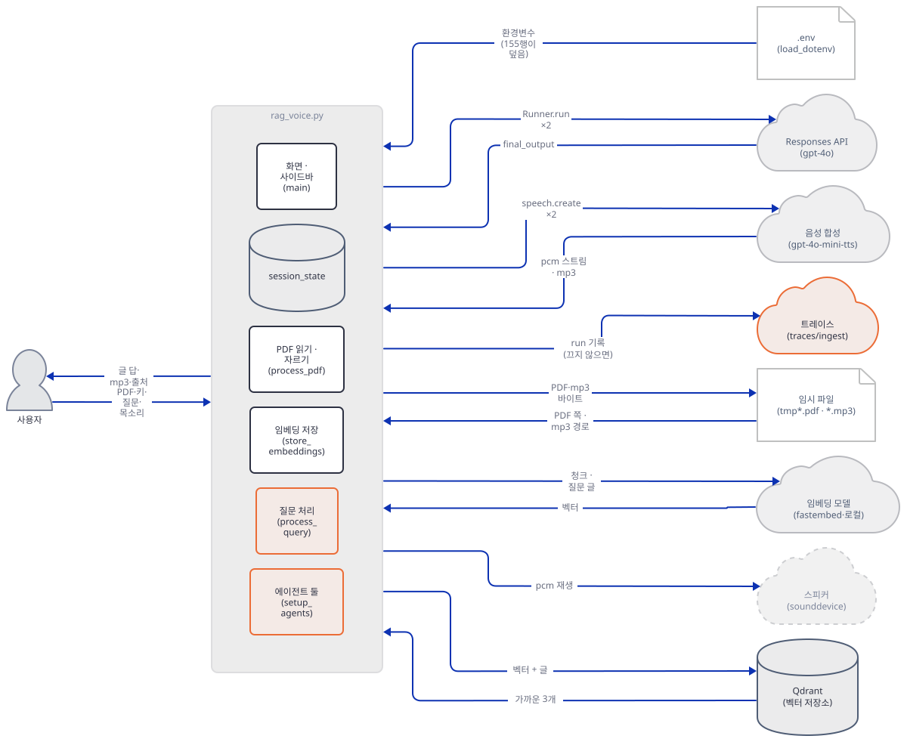

**확인.** 질문 하나에서 업로드가 둘(처리 에이전트와 음성 지시 에이전트의 워크플로 하나씩), 항목이 여섯(트레이스 하나와 응답·에이전트 스팬 하나씩, 둘씩)입니다. 실린 것은 워크플로 이름, 응답 아이디(`response_id`), 에이전트 이름·도구 목록(비어 있음)·출력 형식이고, 문서 조각·질문·답은 하나도 없습니다(직접 확인). `openai-agents` 0.4.2의 응답 스팬은 `export()`가 응답 아이디만 내기 때문입니다(소스로 확인: `agents/tracing/span_data.py`의 `ResponseSpanData.export`, 입력은 "OpenAI trace processors가 쓰지 않는다"는 주석이 달려 있습니다). 따라서 [Day 033 Step 3](../day033-openai-sdk-10-tracing-observability/README.md)의 "프롬프트 전문과 응답 전문이 실린다"는 이 앱의 0.4.2에서는 맞지 않았습니다. 그 글은 모델 호출로 이미 OpenAI에 가므로 트레이스까지 막을 이유는 줄어도, 끄지 않으면 가짜 키나 진짜 키로 `api.openai.com`에 연결하려 하는 것은 그대로입니다. 이 PC의 측정으로, 변수를 끄지 않고 주소도 돌리지 않은 같은 실행은 기록용 프록시에 `CONNECT api.openai.com:443` 세 줄을 남겼습니다(독자가 따라 할 명령이 아닙니다). 트레이스 전송은 질문의 응답을 기다리지 않는 배경 스레드의 일이라 요청 시퀀스 그림에는 그리지 않았고, 개요와 구조 그림의 화살표로 그렸습니다.

```text
uploads: 2  items: 6
  {"object": "trace", "workflow_name": "Agent workflow"}
  {"type": "response", "response_id": "resp_fake5"}
  {"type": "agent", "name": "Documentation Processor", "handoffs": [], "tools": [], "output_type": "str"}
  {"object": "trace", "workflow_name": "Agent workflow"}
  {"type": "response", "response_id": "resp_fake6"}
  {"type": "agent", "name": "Text-to-Speech Agent", "handoffs": [], "tools": [], "output_type": "str"}
'Zephyr' in the uploaded traces: False
'Based on the following' in the uploaded traces: False
'How do I authenticate' in the uploaded traces: False
'FAKE ANSWER' in the uploaded traces: False
'Speak in a calm' in the uploaded traces: False
```

### Step 7. 소리 — 스피커 재생, mp3, 그리고 되풀이

**목적.** 같은 글이 음성으로 두 번 만들어지는 것과, `LocalAudioPlayer`가 무엇을 하는지, `sounddevice`가 없으면 어디서 멈추는지, 화면을 조작할 때마다 이 모든 것이 되풀이되는지 확인하고, 앱을 띄울 때 무엇이 함께 움직이는지 정리합니다.

**할 일.** 음성 합성은 두 번 부릅니다. 먼저 스트리밍 응답을 열어 `LocalAudioPlayer().play`에 넘기고, 같은 `async with` 안에서 같은 글·목소리·지시로 mp3를 한 번 더 만듭니다. 스피커·음성 합성·트레이스·임시 mp3가 `process_query`와 맺는 관계는 아래 그림에 화살표로 있습니다.

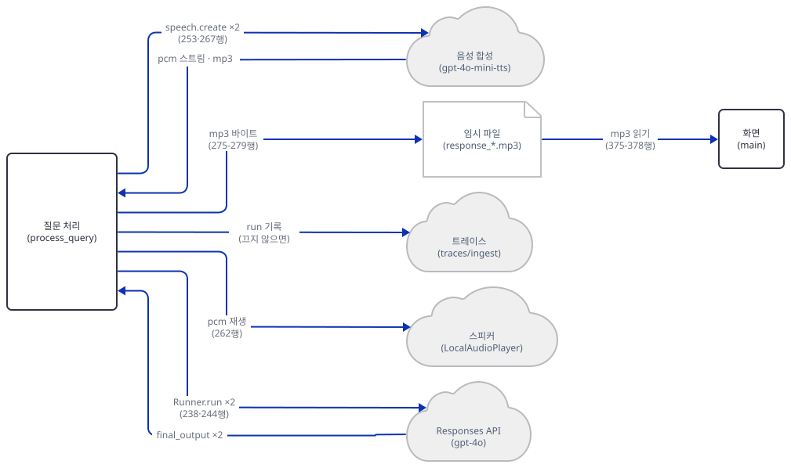

`voice_ai_agents/voice_rag_openaisdk/rag_voice.py:253-273`

```python
        async with async_openai.audio.speech.with_streaming_response.create(
            model="gpt-4o-mini-tts",
            voice=voice,
            input=text_response,
            instructions=voice_instructions,
            response_format="pcm",
        ) as stream_response:
            st.write("Starting audio playback...")
            # Play audio directly using LocalAudioPlayer
            await LocalAudioPlayer().play(stream_response)
            st.write("Audio playback complete")
            
            st.write("Generating downloadable MP3 version...")
            # Also save as MP3 for download
            audio_response = await async_openai.audio.speech.create(
                model="gpt-4o-mini-tts",
                voice=voice,
                input=text_response,
                instructions=voice_instructions,
                response_format="mp3"
            )
```

`LocalAudioPlayer`는 `openai` 2.7.1의 `openai/helpers/local_audio_player.py`에 있습니다(소스로 확인). 이름과 달리 `play`는 소리를 흘려 틀지 않고 스트림 본문을 끝까지 모은 뒤에야 `sounddevice`의 `OutputStream`을 열어 틉니다. `sounddevice`와 `numpy`는 `openai`의 선택 의존성 `voice_helpers`에 있고, 없으면 속성에 처음 닿는 순간 `MissingDependencyError`가 납니다.

```bash
OA=$(uv run --no-project python -c "import openai, os; print(os.path.dirname(openai.__file__))")
grep -n 'async def _tts_response_to_buffer\|audio_content = await self._tts_response_to_buffer\|stream = sd.OutputStream' "$OA/helpers/local_audio_player.py"
uv run --no-project python -c "
from openai._extras import sounddevice as sd
try:
    sd.OutputStream
except Exception as e:
    print(type(e).__name__, '|', ' '.join(str(e).split()))
"
```

```text
28:    async def _tts_response_to_buffer(
72:            audio_content = await self._tts_response_to_buffer(input)
95:        stream = sd.OutputStream(
```

```text
MissingDependencyError | OpenAI error: missing `sounddevice` This feature requires additional dependencies: $ pip install openai[voice_helpers]
```

이제 앱이 소리를 만드는 실행을 해 봅니다. 복사본의 플레이어는 진짜 플레이어처럼 스트림 본문을 끝까지 읽고 소리는 내지 않습니다. 목소리를 `nova`로 바꾸는 단계까지 한 번에 돌리고, 가짜 서버가 받은 음성 합성 요청만 골라 봅니다.

```bash
: > fake.log
uv run --no-project python drive.py guide.pdf upload ask voice
uv run --no-project python - <<'PY'
import json
for line in open("fake.log"):
    r = json.loads(line)
    if r["kind"].startswith("tts-") and r["kind"] != "tts-agent":
        print(r["kind"].ljust(8), r["model"], r["voice"], "input_chars=%d" % r["input_chars"], "instructions=%r" % r["instructions"])
PY
```

음성 합성 요청은 질문 하나에 `pcm`과 `mp3`가 같은 글(134자)·같은 지시로 한 번씩 나갑니다. 목소리를 바꾸기만 해도 같은 둘이 다시 나갑니다.

```text
--- upload guide.pdf
  [success] ✅ Added PDF: guide.pdf
  processed_documents: ['guide.pdf']  setup_complete: True
  points in Qdrant: 30
  embed calls: 31  model loads: 1
--- ask
  [success] ✅ Query processing complete!
  server saw: {'processor': 1, 'tts-agent': 1, 'tts-pcm': 1, 'tts-mp3': 1}  played bytes: [4800]
  sources shown: ['- guide.pdf', '- guide.pdf', '- guide.pdf']
--- change voice to nova, no new question
  [success] ✅ Query processing complete!
  server saw: {'processor': 1, 'tts-agent': 1, 'tts-pcm': 1, 'tts-mp3': 1}
  voices: [None, 'nova', 'nova']
```

```text
tts-pcm  gpt-4o-mini-tts coral input_chars=134 instructions='Speak in a calm, friendly voic'
tts-mp3  gpt-4o-mini-tts coral input_chars=134 instructions='Speak in a calm, friendly voic'
tts-pcm  gpt-4o-mini-tts nova input_chars=134 instructions='Speak in a calm, friendly voic'
tts-mp3  gpt-4o-mini-tts nova input_chars=134 instructions='Speak in a calm, friendly voic'
```

되풀이의 조건(질문 상자와 `setup_complete`가 그대로면 스크립트가 다시 돌 때마다 `process_query`가 불리고, 결과를 저장해 두지 않는다는 것)은 [Day 137 Step 7](../day137-customer-support-voice-agent/README.md)이 보인 그대로이고, 이 앱의 같은 줄은 355~358행입니다. `st.download_button`의 `on_click` 기본값이 `"rerun"`인 것도 이 앱의 `streamlit` 1.51.0 소스에서 같았습니다(`streamlit/elements/widgets/button.py`의 `download_button`과 내부 구현 `_download_button`, 소스로 확인). 버튼을 누르는 실행은 `AppTest`가 지원하지 않아 해 보지 못했습니다. 오늘 앱에서 달라지는 것은 되풀이가 부르는 일입니다. 재실행마다 `gpt-4o` 둘과 음성 합성 둘이 나가고, 스피커 재생이 있으면 질문마다 소리가 다시 납니다. 응답마다 쌓이는 mp3도 세어 봅니다.

```bash
ls tmp-out | grep -c '\.mp3$'
```

```text
5
```

응답마다 `response_<uuid>.mp3`가 임시 폴더에 쌓입니다. 지금까지 성공한 응답이 다섯(Step 3의 질문 하나, Step 6의 질문 둘(`drive.py`와 `tracecheck.py`), 이 Step의 질문 하나와 목소리 바꾸기 하나)이라 파일도 다섯입니다. 이것도 지우는 코드가 없습니다.

목소리 선택칸에는 하나 더 있습니다. 목소리를 차례로 `nova`, `onyx`, `fable`로 바꾸어 위젯 값, 세션 값, 서버가 받은 목소리를 봅니다.

```bash
: > fake.log
uv run --no-project python drive.py guide.pdf upload ask voices
```

```text
--- upload guide.pdf
  [success] ✅ Added PDF: guide.pdf
  processed_documents: ['guide.pdf']  setup_complete: True
  points in Qdrant: 30
  embed calls: 31  model loads: 1
--- ask
  [success] ✅ Query processing complete!
  server saw: {'processor': 1, 'tts-agent': 1, 'tts-pcm': 1, 'tts-mp3': 1}  played bytes: [4800]
  sources shown: ['- guide.pdf', '- guide.pdf', '- guide.pdf']
  picked nova: box=nova session=nova sent=['nova']
  picked onyx: box=nova session=nova sent=['nova']
  picked fable: box=fable session=fable sent=['fable']
```

`onyx`로 바꾼 두 번째 변경은 위젯 값도 세션 값도 `nova`로 남고 서버가 받은 목소리도 `nova`였습니다. 선택칸의 `index`를 세션에 저장된 이전 값으로 계산하는 줄(`voice_ai_agents/voice_rag_openaisdk/rag_voice.py:70-75`)과 맞물려 둘째 변경이 한 번 무시되는 것으로 보입니다(원인은 소스 읽기로만 짐작했습니다). 선택을 마친 뒤 같은 값을 한 번 더 고르거나 한 번 더 바꾸면 반영됩니다. Day 137 앱의 같은 줄(`voice_ai_agents/customer_support_voice_agent/customer_support_voice_agent.py:77-82`)도 같은 모양입니다(소스로 확인).

마지막으로 `sounddevice`가 없는 PC의 순서를 봅니다. 그 PC의 앱은 스트림을 끝까지 받고(음성 합성 요청 한 번이 이미 나갑니다), `OutputStream`에서 멈추고, 그 예외가 `process_query`의 `except`(291행)에 걸려 오류 글만 돌려줍니다. 글 답은 화면에 나오지 않고 mp3는 만들어지지 않습니다. 아래 실행은 복사본의 플레이어를 이 순서(본문을 끝까지 읽고 `sd.OutputStream`에 닿기)로 흉내 낸 대역(`HARNESS_PLAYER=nosd`)으로 돌린 것입니다. 진짜 `LocalAudioPlayer`는 실행하지 않았으므로, 순서는 소스를 읽어 얻은 것이고 이 실행은 그 순서가 앱에 미치는 결과를 보여 줄 뿐입니다.

```bash
: > fake.log
HARNESS_PLAYER=nosd uv run --no-project python drive.py guide.pdf upload ask
```

(PowerShell은 실행해 보지 못했습니다: `$env:HARNESS_PLAYER = "nosd"`, `uv run --no-project python drive.py guide.pdf upload ask`, `Remove-Item Env:HARNESS_PLAYER`를 차례로.)

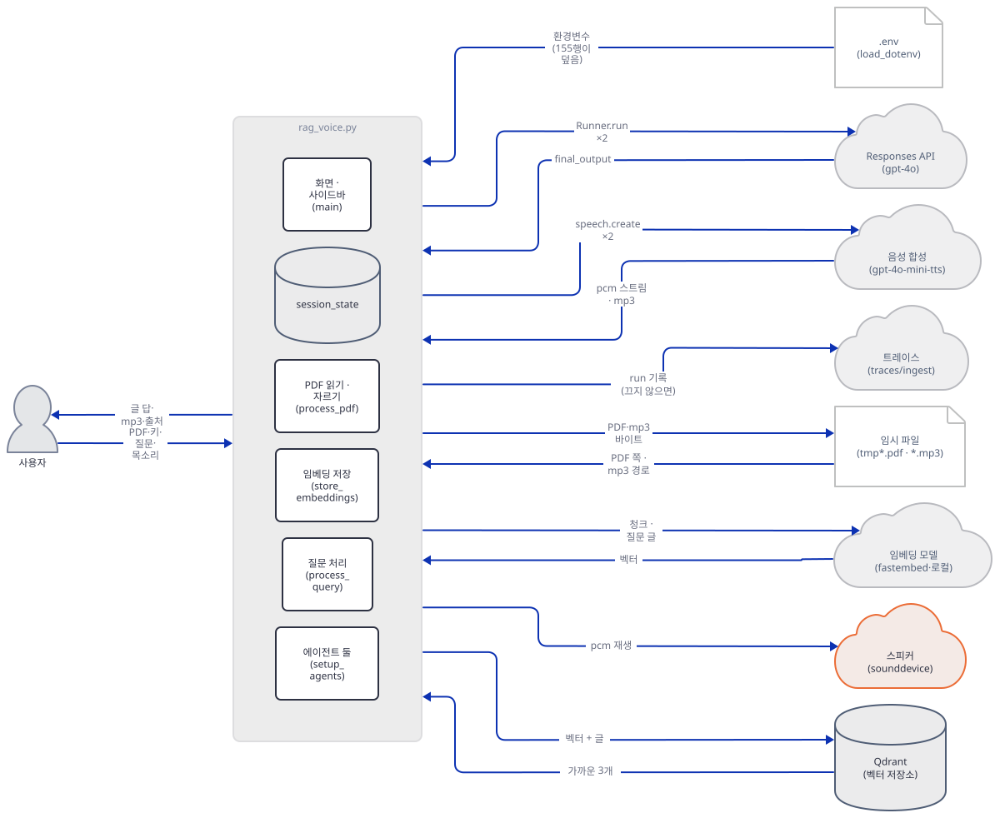

**확인.** 앞의 `grep`은 소스의 순서를 보였습니다. `local_audio_player.py`에서 `play`가 `_tts_response_to_buffer`를 먼저 기다리고(72행), 그다음에 `sd.OutputStream`을 만듭니다(95행). 마지막 실행의 서버는 `processor`와 `tts-agent` 그리고 `pcm` 음성 요청까지 셋을 받았는데 `mp3`는 없고, 화면에는 오류 글만 있고 출처 목록이 비었습니다.

```text
--- upload guide.pdf
  [success] ✅ Added PDF: guide.pdf
  processed_documents: ['guide.pdf']  setup_complete: True
  points in Qdrant: 30
  embed calls: 31  model loads: 1
--- ask
  [error] ❌ Error during query processing: OpenAI error: missing `sounddevice` This feature requires additional dependencies: $ pip install openai[voice_helpers
  [error] Error: OpenAI error: missing `sounddevice` This feature requires additional dependencies: $ pip install openai[voice_helpers]
  server saw: {'processor': 1, 'tts-agent': 1, 'tts-pcm': 1}  played bytes: []
  sources shown: []
```

**앱을 띄운다면.** 이 문서는 브라우저로 앱을 열지 않았습니다. 띄우면 한꺼번에 움직이는 것이 많기 때문입니다. 원본 `rag_voice.py`를 띄우면 첫 업로드에서 임베딩 모델을 Hugging Face에서 받고(약 67MB, 받은 뒤에도 매번 저장소 버전을 묻습니다), 사이드바의 Qdrant에 조각과 임시 경로가 올라가고, 질문마다 OpenAI로 요청이 나가고, 트레이싱을 끄지 않으면 트레이스가 나가고, `sounddevice`가 없으면 요금만 나간 채 답이 사라지며 있으면 PC 스피커가 바로 울립니다. 그래서 이 문서가 확인한 것은 소리 없는 복사본을 가드와 함께 띄워 서버가 응답하는 것까지입니다. 새 터미널을 열어 `envfake.sh`를 걸고 띄웁니다(`FAKE_UPLOAD`는 복사본의 업로드 상자 대역이 읽는 파일입니다).

```bash
. ./envfake.sh 52871
export FAKE_UPLOAD=guide.pdf
uv run --no-project python guard.py && uv run --no-project streamlit run rag_voice_scratch.py --server.headless true --server.address localhost --server.port 58741 --browser.gatherUsageStats false
```

(PowerShell은 실행해 보지 못했습니다. 위 `envfake.sh` 대신 Step 2의 PowerShell 줄을 붙여 넣고 `$env:FAKE_UPLOAD = "guide.pdf"`와 `uv run --no-project python guard.py`를 실행한 뒤 `if ($LASTEXITCODE -eq 0) { uv run --no-project streamlit run rag_voice_scratch.py --server.headless true --server.address localhost --server.port 58741 --browser.gatherUsageStats false }`로 띄웁니다.) 띄운 뒤 다른 터미널에서 `curl -s http://localhost:58741/_stcore/health`가 `ok`를 답했고(직접 확인), 브라우저로 열어 보지는 않았습니다. `envfake.sh`를 빠뜨린 터미널이면 `guard.py`가 멈추므로 서버가 뜨지 않습니다. 진짜 키로 진짜 앱을 쓰고 싶다면 앱 README의 `streamlit run rag_voice.py`에 변수만 더해 `OPENAI_AGENTS_DISABLE_TRACING=1 uv run --no-project streamlit run rag_voice.py --server.headless true --server.address localhost --browser.gatherUsageStats false`로 띄우고, 위의 움직임을 각오한 뒤 진짜 소리를 내려면 `uv pip install "openai[voice_helpers]"`가 필요합니다(이 명령은 실행해 보지 못했습니다).

```text
ok
```

## 요청 한 건이 흐르는 과정

앱이 하는 일은 PDF 올리기(문서마다 한 번)와 질문(질문마다 한 번)의 두 흐름입니다. 한 장에 다 넣으면 세로가 상한을 넘으므로 시간 경계에서 나눠 그림 열네 장으로 그렸고, 메시지는 모두 정확히 한 그림에 코드 순서대로 있습니다. 화면에 뜨는 `st.info`·`st.write` 같은 진행 문구도 메시지로 그렸습니다.

PDF를 올리면 먼저 처음 한 번만 도는 준비가 있습니다. 임베딩 모델을 만들고(`TextEmbedding()`, 이때 Hugging Face에 저장소 버전을 묻고 받은 적이 없을 때만 모델 파일을 받습니다) 차원을 재서(`embed(["test"])`) Qdrant에 컬렉션을 만듭니다.

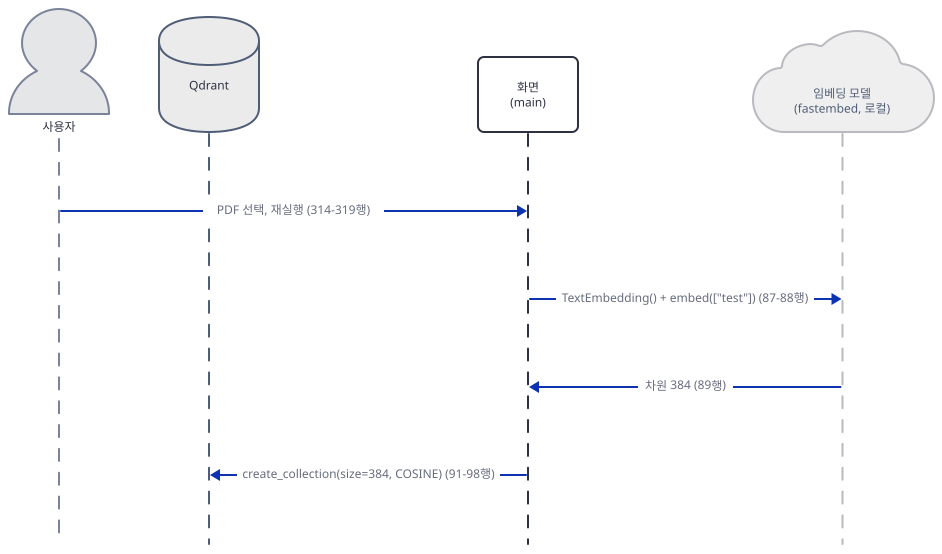

이어서 올린 바이트를 임시 파일에 쓰고 `PyPDFLoader`가 읽어 쪽마다 문서 하나를 만든 뒤 앱이 출처 메타데이터를 보탭니다.

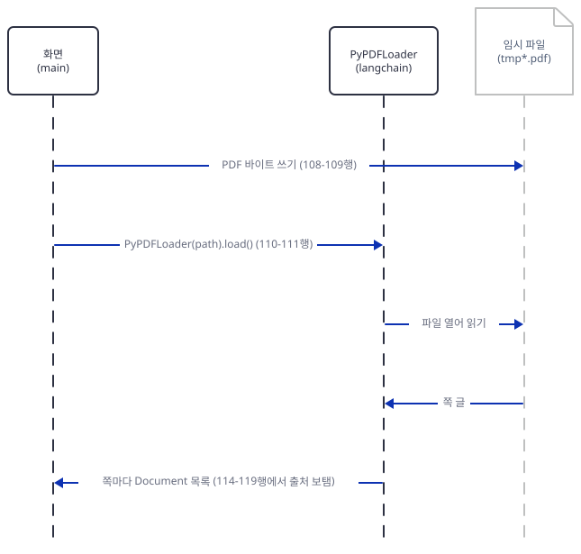

그다음 자르개가 조각으로 나누고, 조각마다 임베딩과 `upsert`가 한 번씩 나가며, 끝나면 화면에 "Added PDF"와 처리한 문서 목록이 뜹니다.

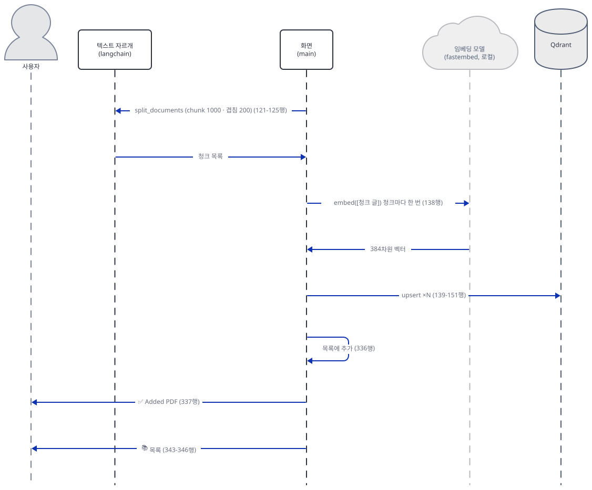

질문은 이렇게 흐릅니다. 첫째 그림은 질문 입력과 질문의 임베딩입니다. 질문 상자에서 Enter를 치면(349행) 스크립트가 다시 돌고 `st.status`가 열리며, 질문 글이 임베딩됩니다.

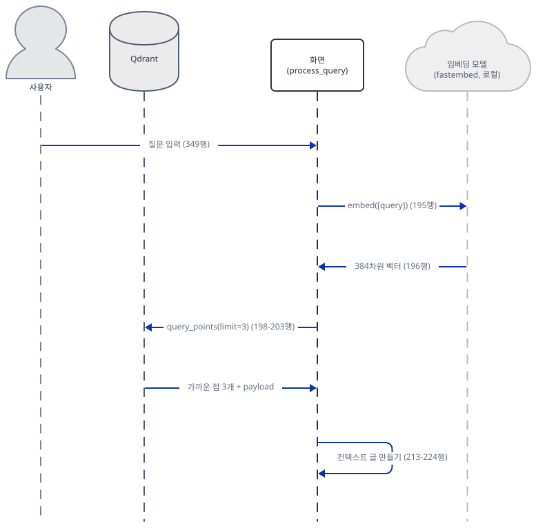

둘째 그림은 검색과 컨텍스트입니다. `query_points`가 가까운 점 세 개와 `payload`를 돌려주고, 조각 글을 파일 이름과 함께 쌓아 컨텍스트 글을 만듭니다(213~224행).

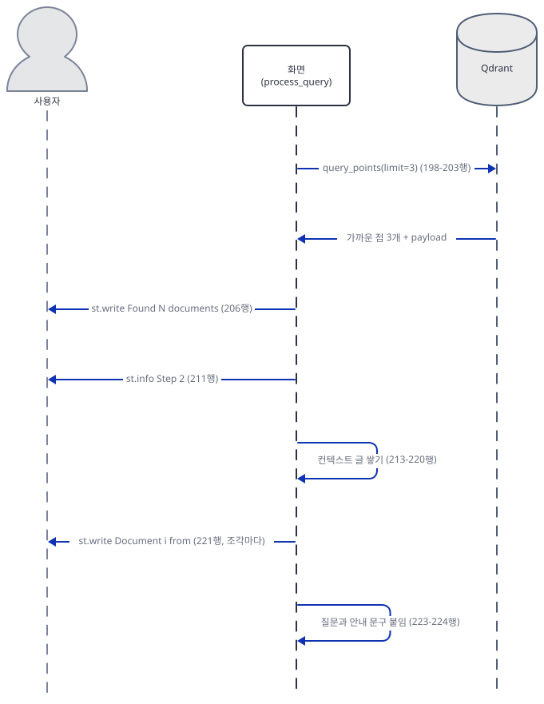

셋째 그림은 첫 질문에서만 있는 `setup_agents`입니다. 사이드바 키를 환경에 쓰고(155행) 에이전트 둘을 돌려줍니다.

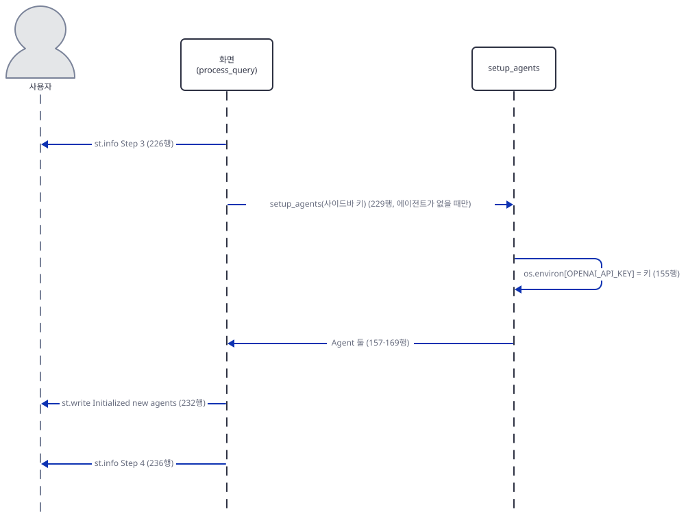

넷째 그림은 처리 에이전트입니다. `Runner.run`이 컨텍스트로 `/v1/responses`를 부르고, 받은 `final_output`이 `text_response`가 됩니다.

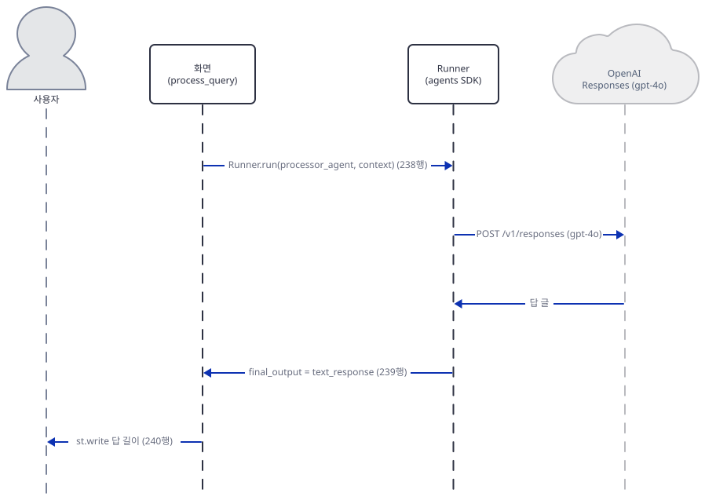

다섯째 그림은 음성 지시 에이전트입니다. `text_response`가 둘째 에이전트의 입력이 되고, 둘째 호출의 `final_output`이 `voice_instructions`가 됩니다.

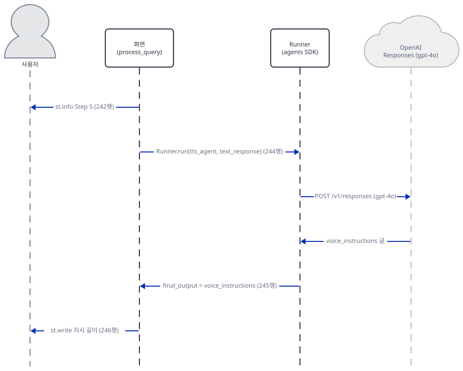

여섯째 그림은 스트림 열기입니다. 클라이언트를 만들고 `create(pcm)`으로 스트림을 엽니다.

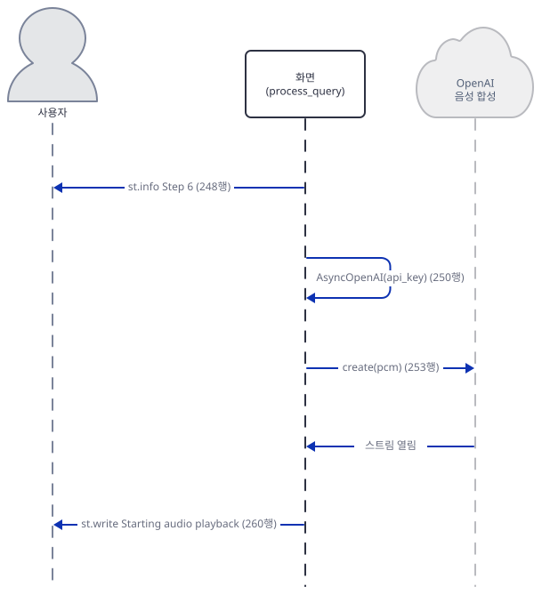

일곱째 그림은 재생입니다. `LocalAudioPlayer`가 본문을 끝까지 읽은 뒤 스피커로 틉니다.

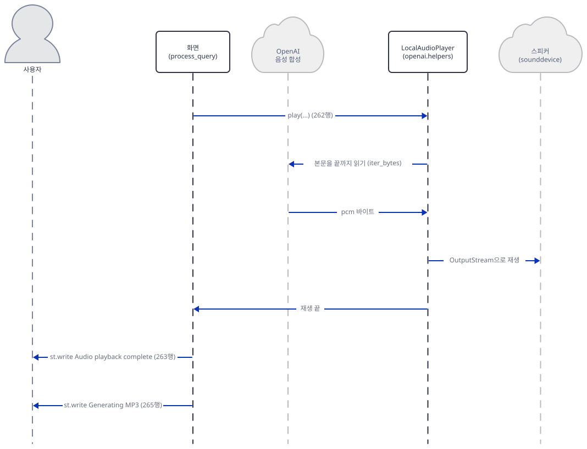

여덟째 그림은 mp3입니다. 같은 입력으로 mp3를 한 번 더 만들어 임시 파일로 씁니다.

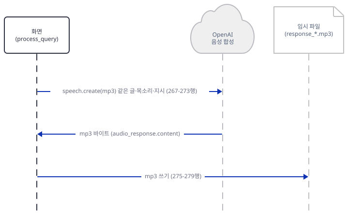

아홉째 그림은 결과를 돌려주는 부분입니다. 저장 경로와 완료 문구를 화면에 쓰고, 결과를 반환하며 상태를 닫습니다.

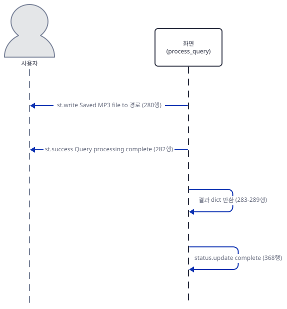

열째 그림은 화면에 나오는 것입니다. 글 답, `st.audio`, mp3를 다시 읽어 만드는 내려받기 버튼, 출처 목록입니다.

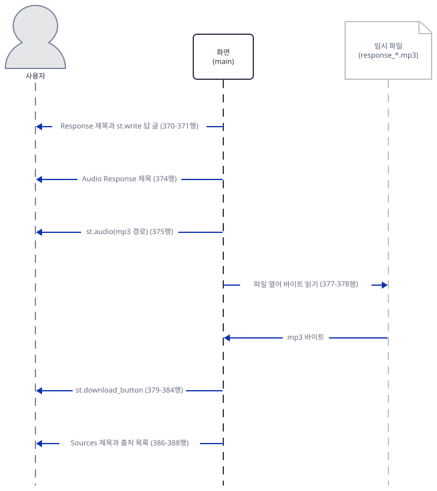

마지막 그림은 이 모든 것이 위젯 조작마다 다시 돌 수 있다는 Step 7의 사실입니다. 질문 상자에 글이 남아 있는 한 목소리를 바꾸거나 내려받기 버튼을 누르는 것도 질문을 처음부터 다시 처리시킵니다.

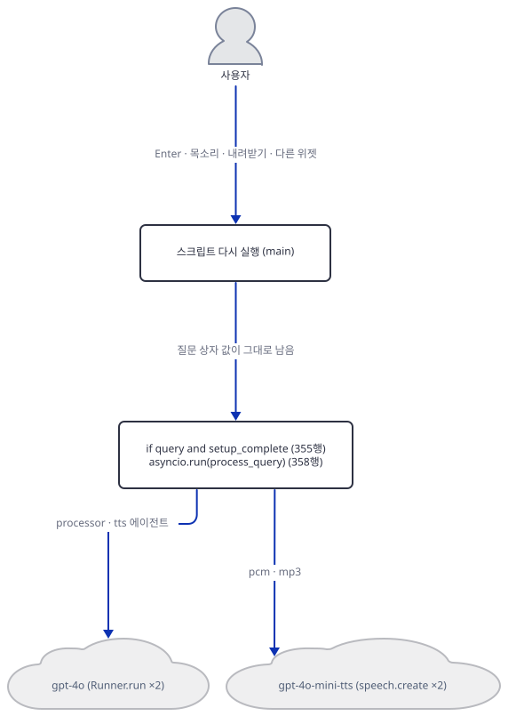

## 실행 체크리스트

- [ ] `uv venv --python 3.13`으로 만든 환경에 `uv pip install -r requirements.txt`가 123개 패키지로 끝났고 `uv pip check`가 충돌 없음이라 답했다. `pypdf`는 목록에 없어 따로 설치했다
- [ ] `echo $OPENAI_BASE_URL`이 `http://127.0.0.1:` 주소를 찍은 터미널에서만 앱 코드를 돌렸고, `guard.py`가 진짜 주소와 켜진 트레이싱에서 종료 코드 1로 멈추는 것을 봤다
- [ ] `make_scratch.py`의 차이가 정확히 네 곳(임베딩, 플레이어·업로더 가져오기, Qdrant 생성, 업로드 상자)이다
- [ ] 사이드바 상자가 처음에 모두 비어 있고, `.env`의 키는 환경에만 들어왔으며 OpenAI 상자를 비운 질문은 `Authorization`이 빈 요청이 되었다
- [ ] 8,191바이트까지는 디스크에 0바이트, 8,192바이트부터 내려간다는 것과, `tiny.pdf`가 `Cannot read an empty file`로 실패하고 임시 PDF가 1, 2, 3으로 쌓이는 것을 봤다
- [ ] `guide.pdf`가 점 30개, 임베딩 호출 31번으로 올라갔고 점 하나의 `source`가 임시 폴더의 파일 경로이다
- [ ] 질문 한 번에 서버가 `processor`·`tts-agent`·`tts-pcm`·`tts-mp3` 넷을 받았고, 사이드바 키가 `Authorization`에 실렸다
- [ ] `tracecheck.py`가 업로드 둘, 항목 여섯을 받았고 문서 조각·질문·답이 하나도 들어 있지 않았다
- [ ] 목소리를 `nova`로 바꾸기만 해도 요청 넷이 다시 나갔고, 둘째 변경(`onyx`)은 무시되었다
- [ ] `HARNESS_PLAYER=nosd`로는 `mp3` 없이 셋만 나가고 오류 글만 보였다
- [ ] 복사본을 `guard.py`와 함께 띄우고 `/_stcore/health`가 `ok`를 답했다. 원본은 띄우지 않았다

## 문제 해결

| 증상 | 원인 | 해결 |
|---|---|---|
| `uv venv`를 Python 3.14로 만들어 설치하면 `Failed to build pyarrow==21.0.0`으로 끝난다 | `streamlit==1.51.0`이 `pyarrow<22`를 요구해 3.14용 휠이 없는 판을 끌어와 소스 빌드를 시도합니다(직접 확인, `uv 0.7.2`) | `uv venv --python 3.13`으로 만듭니다 |
| PDF를 올렸더니 "PDF processing error"와 함께 pypdf 패키지를 찾을 수 없다는 메시지가 뜬다 | `requirements.txt`에 `pypdf`가 없습니다(직접 확인) | `uv pip install pypdf` |
| 질문하면 "Error during query processing"과 함께 OpenAI error: missing sounddevice가 뜬다 | `requirements.txt`에 `sounddevice`가 없고 `LocalAudioPlayer`가 필요로 합니다. 이때 음성 요청 한 번은 이미 나갔습니다(소스로 확인, 복사본의 대역으로 같은 순서를 돌려 봄) | 메시지가 권하는 `uv pip install "openai[voice_helpers]"`(이 문서는 소리를 내지 않아 실행해 보지 못했습니다). 설치하면 질문마다 PC 스피커가 울립니다 |
| `Error processing document: Qdrant credentials not provided` | 사이드바의 Qdrant 주소·키 상자가 비어 있습니다. `.env`의 값은 환경에는 들어오지만 상자를 채우지 않습니다(직접 확인) | 두 상자를 화면에서 채웁니다. 주소 상자는 비밀번호 칸(`type="password"`)이라 입력이 가려집니다 |
| 작은 PDF만 "PDF processing error: Cannot read an empty file" | 쓴 바이트가 버퍼에 남은 채 읽습니다(3.13에서 8,192바이트 미만, 3.14에서는 131,072바이트 미만, 직접 확인). `voice_ai_agents/voice_rag_openaisdk/rag_voice.py:109`에 `flush()`가 없습니다 | 버퍼보다 큰 PDF를 올립니다. 앱 코드를 고친다면 쓴 뒤 `tmp_file.flush()`를 넣는 것으로 1,000바이트짜리가 바로 디스크에 보였습니다(직접 확인) |
| OpenAI 상자를 비우고 질문하면 요청이 키 없이 나간다(진짜 OpenAI라면 인증 오류로 끝날 것으로 보이나 보내 보지는 않았습니다) | `voice_ai_agents/voice_rag_openaisdk/rag_voice.py:155`가 환경의 키를 상자의 빈 값으로 덮습니다(직접 확인, 가짜 서버가 받은 `Authorization`이 비었음) | 사이드바에 키를 넣습니다. `.env`만으로는 안 됩니다 |
| 목소리만 바꿨는데 요금이 또 나간다 | 질문 상자에 글이 남아 있어 스크립트가 다시 돌며 같은 질문을 처음부터 처리합니다(직접 확인). 내려받기 버튼도 같은 효과(소스로 확인) | 답을 들은 뒤에는 질문 상자를 비우거나, 앱 코드를 고친다면 결과를 `session_state`에 저장합니다 |
| 목소리를 두 번 바꿨는데 둘째 선택이 적용되지 않는다 | 선택칸의 `index` 계산과 맞물려 둘째 변경이 한 번 무시됩니다(직접 확인: nova는 반영, onyx는 무시, fable은 반영) | 한 번 더 고릅니다 |
| `OPENAI_AGENTS_DISABLE_TRACING`을 안 걸었더니 트레이스가 바깥으로 나가려 함, 연결이 안 되는 PC에서는 `Tracing: request failed`류의 경고가 쌓일 수 있음 | 목적지가 `api.openai.com`으로 고정되어 `OPENAI_BASE_URL`을 따르지 않습니다(소스와 프록시 기록으로 확인). 0.4.2에서 실리는 것은 에이전트 이름과 응답 아이디뿐이었습니다(직접 확인) | 앱을 띄우는 터미널마다 `OPENAI_AGENTS_DISABLE_TRACING=1` |
| 임시 폴더에 `tmp*.pdf`와 `response_*.mp3`가 계속 쌓임 | 지우는 코드가 없습니다(`grep`으로 확인). 올린 PDF 바이트와 음성이 그대로 남습니다 | 직접 지웁니다. 이 문서는 `TMPDIR`을 작업 폴더 안으로 옮겨 그 폴더에만 쌓였습니다 |
| Qdrant 컬렉션에 이 PC의 임시 경로가 들어 있다 | 점마다 `payload`에 `source`(임시 파일 경로)와 PDF 메타데이터가 들어갑니다(직접 확인) | 앱 코드를 고칠 때 `doc.metadata`에서 `source`를 빼고 올립니다 |
| 모델 종료 뒤 요청이 실패하면 | `gpt-4o`와 `gpt-4o-mini-tts`가 폐기 문서에 올라 있습니다(사전 준비) | `gpt-4o`는 `voice_ai_agents/voice_rag_openaisdk/rag_voice.py:166`과 `voice_ai_agents/voice_rag_openaisdk/rag_voice.py:178`의 `model="gpt-4o"`를 폐기 문서가 권하는 모델로 바꿉니다. 음성은 `voice_ai_agents/voice_rag_openaisdk/rag_voice.py:254`와 `voice_ai_agents/voice_rag_openaisdk/rag_voice.py:268`의 `gpt-4o-mini-tts`를 바꾸는 것만으로는 안 되는 것으로 보입니다. 권장 대체가 Realtime API용 모델이라 `audio.speech.create` 호출을 Realtime 방식으로 옮겨야 할 수 있습니다(보내 보지 않았습니다) |

## 더 해보기

- 쪽마다 한 조각이 된 `guide.pdf` 대신, 문단이 긴 PDF를 만들어 `RecursiveCharacterTextSplitter`(`voice_ai_agents/voice_rag_openaisdk/rag_voice.py:121-125`)의 겹침이 실제로 쓰이는 조각을 세어 보세요. `drive.py`가 찍는 점 수와 Step 5의 조각 세기 스크립트가 찍는 조각 수가 같은지 맞춰 봅니다.
- 조각마다 따로 부르는 임베딩과 `upsert`(`voice_ai_agents/voice_rag_openaisdk/rag_voice.py:137-151`)를 한 번의 `embed`와 한 번의 `upsert`로 묶으면, `drive.py`가 찍는 `embed calls`가 31에서 어떻게 줄어드는지 복사본에서 확인해 보세요. 이때 `payload`에서 임시 경로(`source`)를 빼면 `payload.py`의 출력이 어떻게 바뀌는지도 봅니다.
- 질문 결과를 `session_state`에 저장해 목소리만 바꿀 때는 `process_query`(`voice_ai_agents/voice_rag_openaisdk/rag_voice.py:355-358`)를 건너뛰게 고치고, 가짜 서버가 받는 요청 수가 4에서 0이 되는지 `drive.py ... ask voice`로 봅니다. 내려받기 버튼(`voice_ai_agents/voice_rag_openaisdk/rag_voice.py:379-384`)에는 `on_click="ignore"`를 줘 보세요.

## 다음 날 예고

[Day 139 · 🗣️ AI Audio Tour Agent](../day139-ai-audio-tour-agent/README.md) — 볼륨 11의 셋째 날입니다. 원본 앱 `voice_ai_agents/ai_audio_tour_agent`는 Streamlit 화면(`ai_audio_tour_agent.py`, 편집기에서 128줄) 하나에 에이전트 파일(`agent.py` 306줄)·관리자(`manager.py` 215줄)·출력 도우미(`printer.py` 46줄)가 붙은 구조이고, 오늘처럼 버전을 모두 고정한 `requirements.txt`(`openai==1.68.2`, `openai-agents==0.0.6` 등)를 씁니다. 에이전트는 `WebSearchTool()`과 `tool_choice="required"`를 쓰는 `gpt-4o-mini` 넷(28·58·87·116행), `gpt-4o-mini` 오케스트레이터(200행), `gpt-4o` 계획 에이전트(304행)이고, 음성은 `gpt-4o-mini-tts`의 `nova` 목소리로 만들어 스크립트 옆에 `speech_tour.mp3` 파일을 씁니다(`voice_ai_agents/ai_audio_tour_agent/ai_audio_tour_agent.py:12-22`). 오늘의 스피커 재생과 달리 소리를 파일로만 받는 앱입니다(소스로 확인).
