# Day 139 · 🗣️ AI Audio Tour Agent

> 볼륨 11 🗣️ Voice AI Agents · 난이도 ★★☆ ⚠ 이 앱이 쓰는 모델 셋은 OpenAI 폐기 문서에서 날짜 붙은 스냅숏이 2027년 1월에 종료될 예정이고(사전 준비), 화면의 기본값(10분)으로 만든 투어는 연구 호출을 모두 쓴 뒤 음성 단계에서 입력 4096자 한도를 넘어 실패할 수 있으며(Step 6), 사이드바에 넣은 키는 음성 호출에 쓰이지 않고(Step 2·6), 기본 트레이싱이 사이드바 키로 OpenAI에 트레이스를 올립니다(Step 5) · 예상 소요 170분(앱은 파일 넷 695줄이지만 가짜 서버를 직접 저장해 띄우고, 저장해 쓰는 스크립트 아홉을 돌리고, 서버 기록과 앱 출력을 맞대어 보고, 시퀀스 그림 열한 장을 훑는 손 시간이 본문을 읽는 시간보다 큽니다) · API 비용 대략 이 문서의 따라 하기는 $0(가짜 서버만 부릅니다. 실제 OpenAI는 한 번도 부르지 않았습니다). 진짜 키로 5분·관심사 넷 투어 한 번은 웹 검색 호출 요금만 약 $0.10입니다(⚠ 추정, 사전 준비) · 원본 앱: `voice_ai_agents/ai_audio_tour_agent`

## 오늘 만들 것

장소와 관심사(History·Architecture·Culinary·Culture 중 하나 이상), 투어 길이(5~60분)를 고르고 "Generate Tour"를 누르면, OpenAI Agents SDK의 에이전트 여섯이 투어 글을 만들고 `gpt-4o-mini-tts`가 그 글을 목소리 `nova`로 읽어 mp3로 돌려주는 Streamlit 앱입니다. 에이전트는 계획(`gpt-4o`), 건축·음식·문화·역사 전문가 넷(`gpt-4o-mini` + 웹 검색 도구), 이들의 글을 모으는 오케스트레이터(`gpt-4o-mini`)입니다. 앱은 파일 넷(`ai_audio_tour_agent.py` 128줄, `agent.py` 306줄, `manager.py` 215줄, `printer.py` 46줄, 편집기 기준)이고 `requirements.txt`는 `openai==1.68.2`, `openai-agents==0.0.6`, `pydantic==2.10.6`, `pydantic_core==2.27.2`, `python-dotenv==1.0.1`, `rich==13.9.4`, `streamlit==1.43.2` 일곱 줄로 모두 고정입니다.

오늘이 볼륨 11 "🗣️ Voice AI Agents"의 셋째 날입니다. 이 볼륨의 앞 두 앱도 `from agents import Agent, Runner`를 쓰고 `gpt-4o-mini-tts`를 부릅니다. Day 137의 원본(`voice_ai_agents/customer_support_voice_agent/customer_support_voice_agent.py:287-288`)은 `audio.speech.create(model="gpt-4o-mini-tts")` 한 번으로 음성을 받고, Day 138의 원본(`voice_ai_agents/voice_rag_openaisdk/rag_voice.py:253-268`)은 같은 질문에 스트리밍 호출과 일반 호출 둘을 하며 스트림을 `LocalAudioPlayer`로 재생합니다. 두 원본은 모두 `AsyncOpenAI(api_key=openai_api_key)`로 화면에서 받은 키를 음성 클라이언트에 직접 넘깁니다(`customer_support_voice_agent.py:286`, `rag_voice.py:250`, 모두 소스로 확인). 오늘 앱의 `tts()`는 그렇지 않습니다(Step 6). 오늘 앱은 소리를 재생하지 않고 파일만 만듭니다. 음성 단계는 에이전트가 아니라 `ai_audio_tour_agent.py`의 함수 하나(`tts`)이고, 글을 만드는 쪽이 에이전트 여섯이라는 점이 오늘 새로 보는 부분입니다. Day 034는 같은 SDK의 `VoicePipeline`(STT → 에이전트 → TTS)을 다뤘는데, 오늘 앱은 그 파이프라인을 쓰지 않고 글을 다 만든 뒤 TTS를 한 번 따로 부릅니다. 웹 검색 도구 `WebSearchTool`이 OpenAI 서버에서 돈다는 "호스팅 도구"라는 설명은 Day 026에 있고, 트레이싱이 기본으로 켜져 있다는 것은 Day 033 Step 2에, 환경변수로 끈다는 것은 Day 033 Step 4에 있습니다. 두 가지 모두 오늘 이 앱에서 어떻게 나타나는지 Step 3과 Step 5에서 봅니다.

이 문서는 OpenAI에 요청을 보내지 않습니다. 모델은 내 PC의 가짜 서버가 대신하고, 아래의 투어 글은 모두 가짜 서버가 같은 문장을 되풀이해 만든 것입니다. 그래서 진짜 모델이 낱말 수 한도를 지키는지, 웹 검색이 어떻게 동작하는지, 진짜 음성 API가 긴 입력에 어떤 오류 문구를 돌려주는지는 확인하지 못했습니다. 직접 확인한 것은 구조입니다. 호출이 몇 번 어떤 순서로 나가는지, 어느 키가 어디에 쓰이는지, 어떤 글이 음성으로 가는지, 어떤 데이터가 어디로 나가는지입니다. 그 가운데 네 가지가 앱 화면의 인상과 다릅니다. 계획 에이전트의 답은 쓰이지 않습니다(Step 4). 소개와 맺음말은 음성에 들어가지 않습니다(Step 4). 기본 트레이싱은 사이드바 키를 들고 `api.openai.com`으로 나갑니다(Step 5). 그리고 투어가 5분을 넘으면 음성 입력 한도 4096자를 넘기 쉽습니다(Step 6). 아래는 완성된 아키텍처입니다.

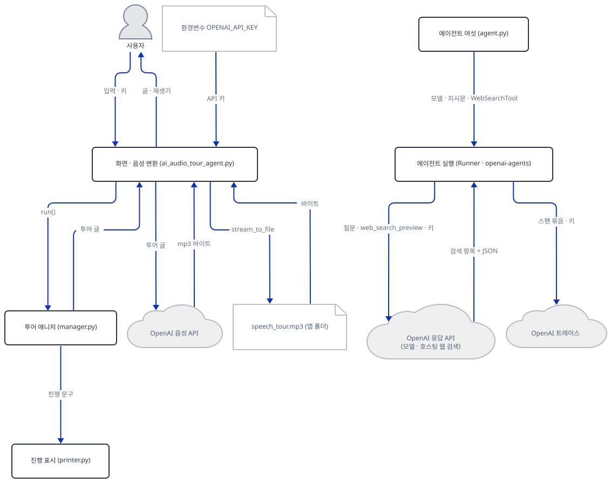

## 사전 준비

| 서비스/도구 | 용도 | 발급·설치 |
|---|---|---|
| OpenAI API 키 | 에이전트 여섯의 응답 호출과 음성 호출. 사이드바 입력창은 에이전트 쪽에만 쓰이고, 음성 호출은 환경변수 `OPENAI_API_KEY`를 읽습니다(Step 2·6). 이 문서의 재현은 가짜 키로 합니다 | https://platform.openai.com/ 가입 후 발급 |
| uv와 Python 3.13 | 가상환경과 설치. 고정된 `pydantic_core==2.27.2`는 Python 3.14에서 설치되지 않았습니다(Step 1) | [공통 사전 준비](../README.md#공통-사전-준비-한-번만) 절 참고. `uv venv --python 3.13` |
| 새 작업 폴더 `audio-tour-lab` | 앱 파일 넷을 복사해 와서 이 폴더 안에서만 돌립니다. 앱이 `speech_tour.mp3`를 앱 파일 옆에 쓰기 때문입니다(Step 6) | Step 1에서 만듭니다 |
| 가짜 OpenAI 서버 `fake_openai.py` | `/v1/responses`와 `/v1/audio/speech`만 흉내 냅니다. 이 문서가 재현용으로 만든 것이라 저장소에 없습니다 | Step 3에서 저장합니다 |
| 환경변수 파일 `envfake.sh` | 가짜 서버 주소(`OPENAI_BASE_URL`), 가짜 키, 트레이싱 끄기(`OPENAI_AGENTS_DISABLE_TRACING=1`)를 한꺼번에 겁니다. 이 문서의 확인 스크립트와 `streamlit run`은 `OPENAI_BASE_URL`이 가짜 서버 주소가 아니면 시작하지 않습니다(`guard.py`) | Step 1에서 저장합니다 |
| `PYTHONIOENCODING=utf-8` | 한국어 Windows 콘솔(cp949)에서 출력이 깨지지 않게 합니다 | bash: `export PYTHONIOENCODING=utf-8`, PowerShell: `$env:PYTHONIOENCODING = "utf-8"`(실행해 보지 못했습니다). `envfake.sh`가 bash 쪽을 겁니다 |

앱이 닿는 외부 서비스는 OpenAI 하나이고 호출 종류가 셋입니다. 응답 API(`/v1/responses`, 모델 호출과 호스팅 웹 검색), 음성 API(`/v1/audio/speech`), 트레이스 올리기(`https://api.openai.com/v1/traces/ingest`)입니다. 이 앱은 agno를 쓰지 않으므로 앞 날들의 agno 통계 전송은 없습니다(서드파티 `import`가 `streamlit`·`agents`·`openai`·`rich`·`pydantic`뿐 — 소스로 확인). `requirements.txt`에 `python-dotenv`가 있지만 앱 코드는 `dotenv`도 `os.environ`도 쓰지 않아서 `.env` 파일을 읽지 않습니다(`grep -n "dotenv\|environ\|getenv"`가 네 파일에서 아무것도 찾지 못함).

⚠ 모델. OpenAI 폐기 문서(https://developers.openai.com/api/docs/deprecations, 2026-10-15 확인)에는 별칭이 아니라 날짜 붙은 스냅숏이 종료 예정으로 올라 있습니다. `gpt-4o-2024-08-06`과 `gpt-4o-2024-11-20`은 2027-01-14에 종료되고 권하는 대체는 `gpt-6-luna`입니다(모델 페이지의 "Default snapshot"이 `gpt-4o-2024-08-06`). `gpt-4o-mini-2024-07-18`도 2027-01-14에 종료되고 대체는 `gpt-6-luna`입니다(모델 페이지의 기본 스냅숏이 이것). `gpt-4o-mini-tts-2025-03-20`과 `gpt-4o-mini-tts-2025-12-15`는 2027-01-06에 종료되고 대체는 `gpt-realtime-2.1-mini`입니다(모델 페이지의 기본 스냅숏이 `gpt-4o-mini-tts-2025-12-15`). 세 별칭(`gpt-4o`·`gpt-4o-mini`·`gpt-4o-mini-tts`) 자체는 폐기 문서에 없고, 종료일 뒤에 별칭이 어떻게 움직이는지는 문서가 말하지 않습니다. 이미 종료된 모델은 없습니다. 교체할 때는 리포의 파일을 고치지 말고 복사본에서 `agent.py`의 28·58·87·116·200행(`gpt-4o-mini`)과 304행(`gpt-4o`), `ai_audio_tour_agent.py`의 15행(`gpt-4o-mini-tts`)을 바꿉니다. 다만 권장 대체 `gpt-realtime-2.1-mini`는 음성 API 레퍼런스의 `model` 목록(`tts-1`, `tts-1-hd`, `gpt-4o-mini-tts`, `gpt-4o-mini-tts-2025-12-15`, https://developers.openai.com/api/reference/resources/audio/subresources/speech/methods/create, 2026-10-15 확인)에 없습니다. 권장 대체가 Realtime 계열이라 `audio.speech.create`의 모델 이름 한 줄 교체로는 안 될 것으로 보입니다(보내 보지는 않았습니다).

비용. 가격은 OpenAI 가격 페이지(https://developers.openai.com/api/docs/pricing, 2026-10-15 확인)의 값입니다. `gpt-4o`는 입력 $2.50·출력 $10.00, `gpt-4o-mini`는 입력 $0.15·출력 $0.60(1M 토큰당)이고, `gpt-4o-mini-tts`는 글 입력 $0.60, 오디오 출력 $12.00(1M 토큰당)입니다. 이 앱의 `WebSearchTool`은 SDK가 `web_search_preview`라는 이름으로 보내는데(Step 3), 같은 페이지에서 그 도구는 비추론 모델에서 1천 호출당 $25.00이고 검색 내용 토큰은 무료라고 합니다. 호출당 $0.025입니다. 전문가 에이전트마다 검색을 한 번 한다고 가정하면 관심사 넷의 투어 한 번은 $0.10입니다(⚠ 추정. 모델이 검색을 몇 번 하는지는 확인하지 못했습니다). 글 토큰 요금은 관심사 넷·5분 기준으로 모두 합쳐도 1센트 안쪽으로 어림됩니다(⚠ 추정. 가짜 서버가 받은 요청 글자 수를 4로 나눈 어림입니다). 음성은 오디오 출력이 토큰으로 세어지는데 가격 페이지에 분당 어림이 없어서 계산하지 못했습니다.

## 아키텍처 한눈에 보기

| 컴포넌트 | 역할 | 코드 위치 |
|---|---|---|
| 사이드바와 키 | 키 입력, 세션 저장, 에이전트 SDK의 기본 키 지정 | `voice_ai_agents/ai_audio_tour_agent/ai_audio_tour_agent.py:40-48` |
| 입력 화면 | 장소, 관심사, 길이 슬라이더, 목소리 선택(쓰이지 않음) | `voice_ai_agents/ai_audio_tour_agent/ai_audio_tour_agent.py:50-90` |
| 버튼과 검증 | 키·장소·관심사 검사, 매니저 실행, 투어 글 표시 | `voice_ai_agents/ai_audio_tour_agent/ai_audio_tour_agent.py:92-109` |
| 이벤트 루프 도우미 | 비동기 `run`을 Streamlit 스크립트 안에서 실행 | `voice_ai_agents/ai_audio_tour_agent/ai_audio_tour_agent.py:25-30` |
| 음성 변환과 재생 | TTS 호출, mp3 저장, 재생기, 내려받기 | `voice_ai_agents/ai_audio_tour_agent/ai_audio_tour_agent.py:7-23`, `voice_ai_agents/ai_audio_tour_agent/ai_audio_tour_agent.py:111-128` |
| 에이전트 정의 | 전문가 넷(웹 검색), 오케스트레이터, 계획 | `voice_ai_agents/ai_audio_tour_agent/agent.py:22-306` |
| 투어 매니저 | 계획 → 전문가 → 오케스트레이터 순서, 낱말 예산, 최종 조립 | `voice_ai_agents/ai_audio_tour_agent/manager.py:21-215` |
| 진행 표시 | 터미널의 진행 문구(rich `Live`) | `voice_ai_agents/ai_audio_tour_agent/printer.py:8-46` |
| OpenAI 응답 API | 에이전트 여섯의 모델 호출과 호스팅 웹 검색 | 외부 서비스(`agents` 라이브러리가 호출) |
| OpenAI 음성 API | `gpt-4o-mini-tts`로 투어 글을 mp3로 | `voice_ai_agents/ai_audio_tour_agent/ai_audio_tour_agent.py:14-21` |
| OpenAI 트레이스 | 기본으로 켜진 트레이스 올리기 | 외부 서비스(`agents` 라이브러리가 호출) |

## 단계별 진행

명령은 bash 기준이고 앱을 띄우는 터미널마다 환경변수를 다시 줍니다. PowerShell은 줄바꿈이 든 `-c "..."`가 따옴표 문제를 일으키니 같은 내용을 `.py`로 저장해 실행하고, `&&`는 줄을 나누고, 환경변수 앞붙임(`A=1 명령`)은 `$env:A = "1"`을 먼저 실행하는 식으로 바꾸세요(PowerShell 형태는 모두 실행해 보지 못했습니다). 저장소 루트에는 `pyproject.toml`이 있어서 모든 `uv run`에 `--no-project`를 붙입니다.

### Step 1. 환경 만들기 — 고정 목록은 Python 3.13에서 설치된다

**목적.** 일곱 줄짜리 고정 목록이 오늘 그대로 설치되는지, 앱이 쓰는 이름이 `openai-agents==0.0.6`에 있는지 확인합니다.

**할 일.** 저장소를 내려받은 폴더를 `<리포>`라고 하면, 앱 파일을 복사해 올 새 폴더를 만듭니다.

```bash
mkdir audio-tour-lab
cd audio-tour-lab
cp <리포>/voice_ai_agents/ai_audio_tour_agent/ai_audio_tour_agent.py .
cp <리포>/voice_ai_agents/ai_audio_tour_agent/agent.py .
cp <리포>/voice_ai_agents/ai_audio_tour_agent/manager.py .
cp <리포>/voice_ai_agents/ai_audio_tour_agent/printer.py .
cp <리포>/voice_ai_agents/ai_audio_tour_agent/requirements.txt .
uv venv --python 3.13
uv pip install -r requirements.txt
```

(pip 대안: `python3.13 -m venv .venv && source .venv/bin/activate && pip install -r requirements.txt`. PowerShell 5.1은 `python -m venv .venv`, `.venv\Scripts\Activate.ps1`, `pip install -r requirements.txt` 세 줄로 나눕니다. 실행해 보지 못했습니다.)

이 문서의 확인 스크립트는 모두 가짜 서버 주소가 걸린 터미널에서만 돌립니다. 먼저 아래 `envfake.sh`를 저장합니다. 이 파일이 가짜 서버 주소, 가짜 키, 트레이싱 끄기를 한꺼번에 걸어서, 독자 셸에 진짜 `OPENAI_API_KEY`가 있어도 이 터미널에서는 가짜 값이 이깁니다. 이 문서의 모든 실행은 이 파일을 건 터미널에서 했습니다.

```bash
# 사용: . ./envfake.sh <가짜 서버 포트>
export OPENAI_BASE_URL="http://127.0.0.1:$1/v1"
export OPENAI_API_KEY="sk-fake-env-key"
export OPENAI_AGENTS_DISABLE_TRACING=1
export PYTHONIOENCODING=utf-8
export NO_PROXY=127.0.0.1,localhost
```

그리고 이 터미널이 정말 가짜 서버로 향하는지 검사하는 `guard.py`를 저장합니다. 이 문서의 확인 스크립트는 첫머리에서 이것을 부르고, 앱을 띄우는 `streamlit run` 줄은 `python guard.py &&` 뒤에 둡니다. 검사가 실패하면 종료 코드 1로 끝나서 스크립트도 서버도 시작하지 않습니다. 주소는 문자열 접두가 아니라 `urlparse`의 호스트가 `127.0.0.1`·`localhost`인지로 비교하므로 `http://127.0.0.1:80@example.invalid/v1`이나 `http://127.0.0.1.example.invalid/v1` 같은 주소는 통과하지 못합니다. 트레이싱이 켜져 있어도 멈춥니다(Step 5의 `tracecheck.py`만 켜는 것을 허용합니다).

```python
"""가짜 서버 주소가 걸린 터미널인지 검사한다. 아니면 종료 코드 1로 끝난다.
쓰는 법: python guard.py && streamlit run ... (스크립트는 `from guard import check`)"""
import os
import sys
from urllib.parse import urlparse


def check(allow_tracing=False):
    base = os.environ.get("OPENAI_BASE_URL", "")
    u = urlparse(base)
    if u.scheme != "http" or u.hostname not in ("127.0.0.1", "localhost"):
        sys.exit(". ./envfake.sh <포트> 를 먼저 거세요. OPENAI_BASE_URL이 루프백이 아닙니다: " + repr(base))
    if not allow_tracing and os.environ.get("OPENAI_AGENTS_DISABLE_TRACING", "").lower() not in ("1", "true"):
        sys.exit(". ./envfake.sh <포트> 를 다시 거세요. 트레이싱이 켜져 있으면 api.openai.com으로 나갈 수 있습니다")
    return base


if __name__ == "__main__":
    check()
```

`voice_ai_agents/ai_audio_tour_agent/requirements.txt:1-7`

```text
openai==1.68.2
openai-agents==0.0.6
pydantic==2.10.6
pydantic_core==2.27.2
python-dotenv==1.0.1
rich==13.9.4
streamlit==1.43.2
```

`uv venv --python 3.13`을 준 까닭이 있습니다. `--python`을 주지 않은 `uv venv`는 이 PC의 uv 0.7.2에서 CPython 3.13.3을 골랐지만, 이 PC에는 3.14.2도 깔려 있어서 `uv venv --python 3.14`로 같은 목록을 설치해 보니 `pydantic-core==2.27.2`를 휠이 아닌 소스에서 빌드하려다 `maturin`이 `rustup could not choose a version of cargo to run`이라며 실패했습니다(직접 확인). 이 PC에는 `~/.cargo/bin`에 rustup 프록시는 있지만 기본 툴체인이 설정되어 있지 않아서 그런 것이고, 툴체인이 있으면 빌드되는지는 확인하지 못했습니다. 더 새로운 uv가 기본으로 3.14를 고른다면 `--python 3.13`을 주지 않은 독자는 같은 실패를 만날 수 있습니다. Python 3.13.3에서는 58개 패키지가 설치되었고 `openai-agents 0.0.6`, `openai 1.68.2`, `pydantic 2.10.6`(`pydantic-core 2.27.2`), `streamlit 1.43.2`, `rich 13.9.4`, `python-dotenv 1.0.1`이 요구한 판 그대로였습니다(직접 확인).

앱의 첫 import가 `agents` 0.0.6에 있는지가 다음 질문입니다.

`voice_ai_agents/ai_audio_tour_agent/ai_audio_tour_agent.py:1-5`

```python
import streamlit as st
import asyncio
from manager import TourManager
from agents import set_default_openai_key
import json
```

`voice_ai_agents/ai_audio_tour_agent/manager.py:8-18`

```python
from rich.console import Console

from agents import Runner, RunResult, custom_span, gen_trace_id, trace

from agent import History, historical_agent
from agent import Culinary,culinary_agent
from agent import Culture,culture_agent
from agent import Architecture,architecture_agent
from agent import Planner, planner_agent
from agent import FinalTour, orchestrator_agent
from printer import Printer
```

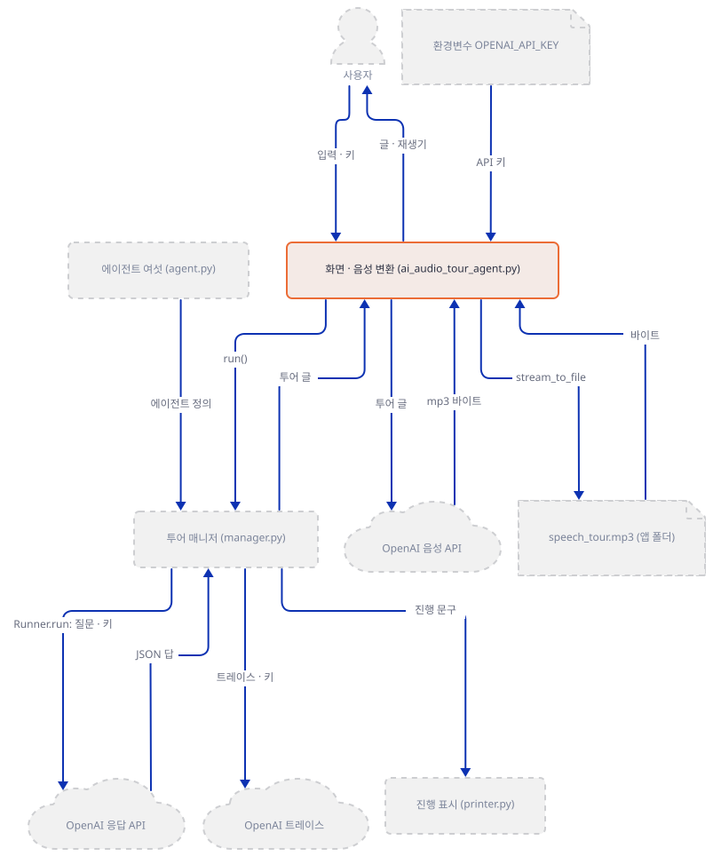

**확인.** 서버는 아직 없지만 먼저 `. ./envfake.sh 58731`을 겁니다.

```bash
. ./envfake.sh 58731
uv run --no-project python -c "
import importlib.metadata as m, sys
print(sys.version.split()[0], 'openai-agents', m.version('openai-agents'), 'openai', m.version('openai'), 'streamlit', m.version('streamlit'))
from agents import Agent, Runner, RunResult, custom_span, gen_trace_id, trace, set_default_openai_key, WebSearchTool
import manager
print('IMPORT_OK')"
uv run --no-project python -B -c "compile(open('ai_audio_tour_agent.py', encoding='utf-8').read(), 'ai_audio_tour_agent.py', 'exec'); print('COMPILE_OK')"
```

직접 확인한 출력입니다.

```text
3.13.3 openai-agents 0.0.6 openai 1.68.2 streamlit 1.43.2
IMPORT_OK
COMPILE_OK
```

`import manager`는 `agent.py`까지 따라 들어가는데 에이전트 여섯이 모듈이 불릴 때 만들어지기만 하고 어디에도 요청을 보내지 않습니다.

### Step 2. 화면과 키 — 키가 가는 길이 둘이다

**목적.** 화면이 무엇을 받는지, 사이드바 키가 어디에 쓰이는지, 그리고 쓰이지 않는 위젯을 확인합니다.

**할 일.**

`voice_ai_agents/ai_audio_tour_agent/ai_audio_tour_agent.py:40-48`

```python
# Sidebar for API key
with st.sidebar:
    st.title("🔑 Settings")
    api_key = st.text_input("OpenAI API Key:", type="password")
    if api_key:
        st.session_state["OPENAI_API_KEY"] = api_key
        st.success("API key saved!")

set_default_openai_key(api_key)
```

사이드바의 키 입력창은 `type="password"`이고, 값이 있으면 세션 상태에 저장합니다. 48행의 `set_default_openai_key(api_key)`는 스크립트가 다시 실행될 때마다 불리고, 키를 넣기 전에는 빈 문자열을 넘깁니다. 이 호출이 정하는 것은 `agents` 라이브러리의 기본 키입니다. SDK 소스로 보면 `set_default_openai_key(key, use_for_tracing=True)`라서 이 키가 모델 호출에도, 트레이스 올리기(Step 5)에도 쓰입니다(`agents/__init__.py`, `agents/_config.py`). 반면 Step 6의 `tts()`는 `client = OpenAI()`로 키 없이 클라이언트를 만들어서 환경변수 `OPENAI_API_KEY`만 읽습니다. 키가 두 갈래로 갈라진다는 것이 이 앱의 첫 번째 함정입니다.

`voice_ai_agents/ai_audio_tour_agent/ai_audio_tour_agent.py:50-90`

```python
# Main content
st.title("🎧 AI Audio Tour Agent")
st.markdown("""
    <div class='welcome-card'>
        <h3>Welcome to your personalized audio tour guide!</h3>
        <p>I'll help you explore any location with an engaging, natural-sounding tour tailored to your interests.</p>
    </div>
""", unsafe_allow_html=True)

# Create a clean layout with cards
col1, col2 = st.columns([2, 1])

with col1:
    st.markdown("### 📍 Where would you like to explore?")
    location = st.text_input("", placeholder="Enter a city, landmark, or location...")
    
    st.markdown("### 🎯 What interests you?")
    interests = st.multiselect(
        "",
        options=["History", "Architecture", "Culinary", "Culture"],
        default=["History", "Architecture"],
        help="Select the topics you'd like to learn about"
    )

with col2:
    st.markdown("### ⏱️ Tour Settings")
    duration = st.slider(
        "Tour Duration (minutes)",
        min_value=5,
        max_value=60,
        value=10,
        step=5,
        help="Choose how long you'd like your tour to be"
    )
    
    st.markdown("### 🎙️ Voice Settings")
    voice_style = st.selectbox(
        "Guide's Voice Style",
        options=["Friendly & Casual", "Professional & Detailed", "Enthusiastic & Energetic"],
        help="Select the personality of your tour guide"
    )
```

위젯은 장소 입력, 관심사 선택(기본 History·Architecture), 길이 슬라이더(5~60분, 5분 단위, 기본 10), 목소리 선택(세 가지)입니다. 눈여겨볼 것이 셋입니다. 첫째, `voice_style`(86행)은 이후 어디에서도 쓰이지 않습니다(`grep -n voice_style ai_audio_tour_agent.py`가 86행 하나만 찾음). 목소리 스타일을 바꿔도 음성은 달라지지 않고, 음성 지시문은 18~20행에 고정입니다. 둘째, 앱 README는 투어 길이를 "15, 30, or 60 minutes"라고 하고 계획 에이전트의 지시문도 15·30·60분을 말하지만(`agent.py:212`), 슬라이더는 5~60분을 5분 단위로 고르게 합니다. 셋째, 장소 입력과 관심사 선택에 빈 라벨(`""`)을 주어서 Streamlit이 접근성 경고를 찍습니다. 아래 확인에서 직접 봅니다.

`voice_ai_agents/ai_audio_tour_agent/ai_audio_tour_agent.py:92-105`

```python
# Generate Tour Button
if st.button("🎧 Generate Tour", type="primary"):
    if "OPENAI_API_KEY" not in st.session_state:
        st.error("Please enter your OpenAI API key in the sidebar.")
    elif not location:
        st.error("Please enter a location.")
    elif not interests:
        st.error("Please select at least one interest.")
    else:
        with st.spinner(f"Creating your personalized tour of {location}..."):
            mgr = TourManager()
            final_tour = run_async(
                mgr.run, location, interests, duration
            )
```

버튼의 검사 순서는 키, 장소, 관심사이고 하나라도 걸리면 `st.error`만 보여 줍니다. 키 검사는 사이드바에서 넣은 키가 세션에 있는지만 봅니다. 키가 유효한지는 보지 않습니다.

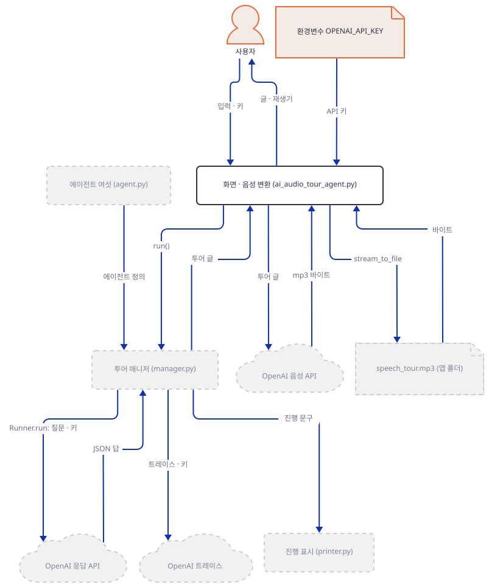

**확인.** 가짜 서버가 필요 없는 확인입니다. 요청을 보내는 곳(버튼 통과 뒤)까지 가지 않게 오류 세 가지에서 멈춥니다. 아래를 `uicheck.py`로 저장합니다.

```python
from guard import check

check()

from streamlit.testing.v1 import AppTest

at = AppTest.from_file("ai_audio_tour_agent.py", default_timeout=60)
at.run()
print("사이드바 입력:", [(t.label, t.type) for t in at.sidebar.text_input])
print("장소 입력 라벨:", repr(at.text_input[0].label), "| 관심사 라벨:", repr(at.multiselect[0].label), "| 기본값:", at.multiselect[0].value)
s = at.slider[0]
print("길이 슬라이더:", s.label, s.min, "~", s.max, "단계", s.step, "기본", s.value)
v = at.selectbox[0]
print("목소리 선택:", v.label, "|", v.options)
at.button[0].click().run()
print("키 없이 누르면:", [e.value for e in at.error])
at.sidebar.text_input[0].set_value("sk-fake-sidebar-key").run()
at.button[0].click().run()
print("키만 넣고 누르면:", [e.value for e in at.error])
at.text_input[0].set_value("Fake Town").run()
at.multiselect[0].set_value([]).run()
at.button[0].click().run()
print("관심사를 비우고 누르면:", [e.value for e in at.error])
```

```bash
. ./envfake.sh 58731
uv run --no-project python -X utf8 uicheck.py
```

직접 확인한 출력입니다(Streamlit이 `AppTest` 밖에서 부르는 `missing ScriptRunContext` 경고 한 줄은 생략했습니다. `` `label` got an empty value `` 경고는 화면을 다시 그릴 때마다 위젯 둘에 대해 한 줄씩 찍혀 이 스크립트 한 번에 14줄이 나왔고 아래에서 생략했습니다).

```text
사이드바 입력: [('OpenAI API Key:', 'text_input')]
장소 입력 라벨: '' | 관심사 라벨: '' | 기본값: ['History', 'Architecture']
길이 슬라이더: Tour Duration (minutes) 5.0 ~ 60.0 단계 5.0 기본 10
목소리 선택: Guide's Voice Style | ['Friendly & Casual', 'Professional & Detailed', 'Enthusiastic & Energetic']
키 없이 누르면: ['Please enter your OpenAI API key in the sidebar.']
키만 넣고 누르면: ['Please enter a location.']
관심사를 비우고 누르면: ['Please select at least one interest.']
```

앱을 눈으로 확인하려면 Step 3을 마친 뒤, 가짜 서버(터미널 A)를 둔 채 새 터미널에서 환경변수를 다시 걸고 앱을 띄웁니다.

```bash
. ./envfake.sh 58731
echo $OPENAI_BASE_URL
uv run --no-project python guard.py && uv run --no-project streamlit run ai_audio_tour_agent.py --server.headless true --server.address localhost --server.port 58751 --browser.gatherUsageStats false
```

(PowerShell: `$env:OPENAI_BASE_URL = "http://127.0.0.1:58731/v1"`, `$env:OPENAI_API_KEY = "sk-fake-env-key"`, `$env:OPENAI_AGENTS_DISABLE_TRACING = "1"`, `$env:NO_PROXY = "127.0.0.1,localhost"`을 차례로 실행한 뒤, 검사는 `uv run --no-project python guard.py`로 따로 돌리고 `if ($LASTEXITCODE -eq 0) { uv run --no-project streamlit run ai_audio_tour_agent.py --server.headless true --server.address localhost --server.port 58751 --browser.gatherUsageStats false }`로 띄웁니다. 실행해 보지 못했습니다.) `envfake.sh` 줄을 빠뜨린 터미널이면 `guard.py`가 멈추므로 서버가 뜨지 않습니다. `--server.headless true`를 주면서 `--server.address`를 주지 않으면 Streamlit이 시작하며 외부 주소를 알아내려고 `checkip.amazonaws.com`에 요청합니다(Day 060에서 확인, streamlit 1.43.2 `web/bootstrap.py`를 소스로 확인). headless가 아니면 브라우저를 엽니다. 그래서 두 옵션을 함께 줍니다. 이 문서는 브라우저로 화면을 열어 보지 않았고 `curl http://localhost:58751/_stcore/health`가 `ok`를 돌려주는 것까지만 확인했습니다. 화면의 동작은 `AppTest`로 대신 확인했습니다. 화면을 닫을 때는 앱을 띄운 터미널에서 Ctrl+C를 누릅니다.

### Step 3. 에이전트 여섯 — 호스팅 웹 검색이 요청에 실리는 모양

**목적.** 에이전트 여섯이 각각 어떤 모델·도구·출력 형식으로 만들어지는지, 그리고 `WebSearchTool`이 요청에 어떻게 실리는지를 가짜 서버가 받은 요청으로 확인합니다.

**할 일.** 전문가 넷은 같은 모양이라 건축 전문가 하나를 봅니다.

`voice_ai_agents/ai_audio_tour_agent/agent.py:22-32`

```python
class Architecture(BaseModel):
    output: str

architecture_agent = Agent(
    name="ArchitectureAgent",
    instructions=ARCHITECTURE_AGENT_INSTRUCTIONS,
    model="gpt-4o-mini",
    tools=[WebSearchTool()],
    model_settings=ModelSettings(tool_choice="required"),
    output_type=Architecture
)
```

도구는 `WebSearchTool()` 하나이고 `ModelSettings(tool_choice="required")`가 "도구를 반드시 하나는 부르라"고 합니다. 출력은 `Architecture`라는 pydantic 모델이고 필드가 `output: str` 하나입니다. 문화·음식·역사 전문가도 이름만 다르고 같은 모양입니다(`agent.py:51-62`, `agent.py:81-91`, `agent.py:110-120`). 지시문은 건축 전문가 기준으로 앞쪽의 번호 목록에서 "제목을 붙이지 말 것, 서식 없이 말하듯 쓸 것, 낱말 수 한도를 지킬 것"을 요구하고, 15행에서 "웹 검색으로 최신 정보를 가져오라", 17행에서 "링크를 넣거나 출처를 인용하지 말라"고 합니다.

`voice_ai_agents/ai_audio_tour_agent/agent.py:197-202`

```python
orchestrator_agent = Agent(
    name="OrchestratorAgent",
    instructions=ORCHESTRATOR_INSTRUCTIONS,
    model="gpt-4o-mini",
    output_type=FinalTour,
)
```

`voice_ai_agents/ai_audio_tour_agent/agent.py:301-306`

```python
planner_agent = Agent(
    name="PlannerAgent",
    instructions=PLANNER_INSTRUCTIONS,
    model="gpt-4o",
    output_type=Planner,
)
```

오케스트레이터는 도구가 없고 `FinalTour`(소개·건축·역사·문화·음식·맺음 여섯 문자열 필드)를 출력합니다(`agent.py:177-194`). 계획 에이전트는 도구가 없고 `Planner`(소개·건축·역사·문화·음식·맺음의 분 단위 숫자 여섯 개)를 출력합니다(`agent.py:292-298`).

`WebSearchTool`이 실제로 무엇을 하는지는 요청에서 보입니다. 가짜 서버가 `/v1/responses`로 받은 요청 본문을 기록하게 해 두었으니, 서버를 먼저 저장합니다. 이것은 `Responses API` 모양의 응답(검색 호출 항목 하나와 글 항목 하나)과 `/v1/audio/speech`의 가짜 mp3를 돌려주고, 입력이 4096자를 넘으면 Step 6에서 쓸 400 오류를 돌려줍니다. 4096자 한도는 OpenAI API 문서에서 가져온 것이고(Step 6), 오류 문구는 내가 지은 것입니다.

```python
"""가짜 OpenAI 서버: /v1/responses 와 /v1/audio/speech 만 흉내 낸다.
사용: python fake_openai.py <포트> <기록파일> [호출마다 기다릴 초] [글 길이 배율]"""
import json
import re
import socketserver
import sys
import time
from http.server import BaseHTTPRequestHandler, HTTPServer

PORT = int(sys.argv[1])
LOG = sys.argv[2]
DELAY = float(sys.argv[3]) if len(sys.argv) > 3 else 0.0
SCALE = float(sys.argv[4]) if len(sys.argv) > 4 else 1.0  # 1.0 = 요청한 낱말 수를 지킴, 0.4 = 짧게 씀
WORDS = ("the old stone bridge crosses a quiet river and every morning "
         "visitors walk slowly beside warm bakeries while bells ring over "
         "narrow streets painted with history").split()
AGENTS = [("Architecture agent", "architecture"), ("Culinary agent", "culinary"),
          ("Culture agent", "culture"), ("History agent", "history"),
          ("Orchestrator Agent", "orchestrator"), ("Planner Agent", "planner")]


class Server(socketserver.ThreadingMixIn, HTTPServer):
    allow_reuse_address = False
    daemon_threads = True


def text_of(n):
    return " ".join(WORDS[i % len(WORDS)] for i in range(n)) + "."


def write_log(rec):
    with open(LOG, "a", encoding="utf-8") as f:
        f.write(json.dumps(rec, ensure_ascii=False) + "\n")


def user_text(body):
    inp = body.get("input")
    if isinstance(inp, str):
        return inp
    parts = []
    for it in inp:
        c = it.get("content")
        if isinstance(c, str):
            parts.append(c)
        elif isinstance(c, list):
            parts += [x.get("text", "") for x in c]
    return "\n".join(parts)


def respond(agent, user):
    if agent == "planner":
        return {"introduction": 1, "architecture": 3, "history": 3, "culture": 2, "culinary": 1, "conclusion": 1}
    if agent == "orchestrator":
        interests = re.search(r"Selected Interests: (.*)", user).group(1).split(", ")
        sections = re.search(r"Content Sections:\n(.*)\n\nInstructions", user, re.S).group(1).split("\n\n")
        got = {i.lower(): s for i, s in zip(interests, sections)}
        return {"introduction": "Welcome to the tour.", "architecture": got.get("architecture", ""),
                "history": got.get("history", ""), "culture": got.get("culture", ""),
                "culinary": got.get("culinary", ""), "conclusion": "Thanks for walking with me."}
    m = re.search(r"Word Limit: (\d+) - (\d+)", user)
    n = int((int(m.group(1)) + 10) * SCALE) if m else 50
    return {"output": text_of(n)}


class H(BaseHTTPRequestHandler):
    def log_message(self, *a):
        pass

    def do_POST(self):
        raw = self.rfile.read(int(self.headers.get("Content-Length", 0)))
        time.sleep(DELAY)
        auth = (self.headers.get("Authorization") or "")[:20]
        if self.path.endswith("/traces/ingest"):  # 트레이스 올리기 (Step 5)
            body = json.loads(raw)
            items = []
            for it in body.get("data", []):
                sd = it.get("span_data") or {}
                if it.get("object") == "trace":
                    items.append("trace " + str(it.get("workflow_name")))
                elif sd.get("type") == "response":
                    items.append("response " + str(sd.get("response_id")))
                elif sd.get("type") == "agent":
                    items.append(f'agent {sd.get("name")} tools={sd.get("tools")} output_type={sd.get("output_type")}')
                else:
                    items.append(str(sd.get("type")))
            write_log({"t": round(time.time(), 3), "path": self.path, "auth": auth, "items": items,
                       "has_place": b"Fake Town" in raw, "has_model_text": b"old stone bridge" in raw, "bytes": len(raw)})
            out = b"{}"
            self.send_response(200)
            self.send_header("Content-Type", "application/json")
            self.send_header("Content-Length", str(len(out)))
            self.end_headers()
            self.wfile.write(out)
            return
        if self.path.endswith("/audio/speech"):
            body = json.loads(raw)
            n = len(body.get("input", ""))
            rec = {"t": round(time.time(), 3), "path": self.path, "model": body.get("model"),
                   "voice": body.get("voice"), "input_chars": n, "has_instructions": "instructions" in body,
                   "auth": auth}
            if n > 4096:  # 공식 문서의 한도(4096자)를 흉내 낸 것. 오류 문구는 내가 지었다.
                rec["status"] = 400
                write_log(rec)
                out = json.dumps({"error": {"message": "FAKE: input too long (limit 4096)", "type": "invalid_request_error"}}).encode()
                self.send_response(400)
                self.send_header("Content-Type", "application/json")
                self.send_header("Content-Length", str(len(out)))
                self.end_headers()
                self.wfile.write(out)
                return
            rec["status"] = 200
            write_log(rec)
            out = b"ID3\x03\x00\x00\x00\x00\x00\x00" + b"FAKEMP3" * 20
            self.send_response(200)
            self.send_header("Content-Type", "audio/mpeg")
            self.send_header("Content-Length", str(len(out)))
            self.end_headers()
            self.wfile.write(out)
            return
        body = json.loads(raw)
        instr = body.get("instructions") or ""
        agent = next((k for s, k in AGENTS if s in instr), "unknown")
        user = user_text(body)
        payload = respond(agent, user)
        text = json.dumps(payload)
        tools = [t.get("type") for t in body.get("tools", [])]
        write_log({"t": round(time.time(), 3), "path": self.path, "agent": agent, "model": body.get("model"),
                   "tools": tools, "tools_full": body.get("tools"), "tool_choice": body.get("tool_choice"),
                   "format": (body.get("text") or {}).get("format", {}).get("name"),
                   "strict": (body.get("text") or {}).get("format", {}).get("strict"),
                   "input_chars": len(user), "instr_chars": len(instr), "out_chars": len(text),
                   "auth": auth, "ua": self.headers.get("User-Agent")})
        output = []
        if "web_search_preview" in tools:
            output.append({"type": "web_search_call", "id": "ws_fake", "status": "completed"})
        output.append({"type": "message", "id": "msg_fake", "status": "completed", "role": "assistant",
                       "content": [{"type": "output_text", "text": text, "annotations": []}]})
        resp = {"id": "resp_fake", "object": "response", "created_at": time.time(), "status": "completed",
                "model": body.get("model"), "output": output, "parallel_tool_calls": True,
                "tool_choice": "auto", "tools": [], "usage": {
                    "input_tokens": len(user + instr) // 4, "output_tokens": len(text) // 4,
                    "total_tokens": (len(user + instr) + len(text)) // 4,
                    "input_tokens_details": {"cached_tokens": 0}, "output_tokens_details": {"reasoning_tokens": 0}}}
        out = json.dumps(resp).encode()
        self.send_response(200)
        self.send_header("Content-Type", "application/json")
        self.send_header("Content-Length", str(len(out)))
        self.end_headers()
        self.wfile.write(out)


if __name__ == "__main__":
    srv = Server(("127.0.0.1", PORT), H)
    print("listening", PORT, flush=True)
    srv.serve_forever()
```

터미널 A에서 서버를 띄웁니다. 인자는 포트, 기록 파일, 호출마다 기다릴 초, 가짜 모델이 쓸 글의 길이 배율입니다. 이 문서는 `58731`에 배율 1.0(요청한 낱말 수를 지킴)과 1초 지연으로 띄우고, 음성이 성공하는 경로를 볼 Step 6에서 `58741`에 배율 0.4(짧게 씀)로 하나 더 띄웁니다. 포트는 다른 프로그램과 겹치지 않는 임의의 높은 번호로 바꿔도 됩니다.

```bash
uv run --no-project python fake_openai.py 58731 serverA.jsonl 1.0 1.0
```

그리고 이 Step의 확인 스크립트 `agentcheck.py`와, 기록을 한 줄로 줄여 보여 주는 `summ.py`를 저장합니다.

```python
import asyncio

from agents import Runner
from agent import (architecture_agent, culinary_agent, culture_agent,
                   historical_agent, orchestrator_agent, planner_agent)
from guard import check

check()

for a in (planner_agent, architecture_agent, historical_agent, culinary_agent, culture_agent, orchestrator_agent):
    print(f"{a.name:<18} {a.model:<12} 도구={[type(t).__name__ for t in a.tools]} "
          f"tool_choice={a.model_settings.tool_choice} 출력={a.output_type.__name__}")

result = asyncio.run(Runner.run(
    architecture_agent,
    "Query: Fake Town Interests: Architecture Word Limit: 40 - 60"))
print("최종 출력:", type(result.final_output).__name__, "| 글자", len(result.final_output.output))
print("새 항목:", [type(i).__name__ for i in result.new_items], "| 모델 호출", len(result.raw_responses))
```

```python
"""가짜 서버 기록(jsonl)을 한 줄씩 요약한다. 사용: python summ.py <기록파일>"""
import json
import sys

rows = [json.loads(line) for line in open(sys.argv[1], encoding="utf-8")]
t0 = rows[0]["t"] if rows else 0
for i, r in enumerate(rows, 1):
    if r["path"].endswith("/traces/ingest"):
        print(f'{i} +{r["t"] - t0:5.1f}s traces       {r["auth"]} 항목 {len(r["items"])}개 {r["bytes"]}B 장소 글자 있음={r["has_place"]} 모델 글 있음={r["has_model_text"]}')
        for it in r["items"]:
            print("    -", it)
    elif r["path"].endswith("/responses"):
        print(f'{i} +{r["t"] - t0:5.1f}s {r["agent"]:<12} {r["model"]:<11} tools={r["tools"]} tool_choice={r["tool_choice"]} '
              f'format={r["format"]} 입력 {r["input_chars"]}자 지시문 {r["instr_chars"]}자')
    else:
        print(f'{i} +{r["t"] - t0:5.1f}s speech       {r["model"]} voice={r["voice"]} 입력 {r["input_chars"]}자 instructions={r["has_instructions"]} -> {r["status"]}')
```

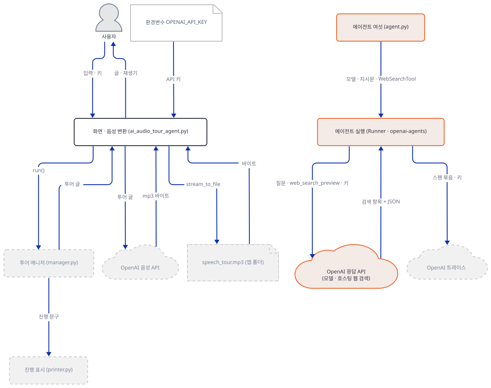

**확인.** 터미널 B에서 환경변수를 걸고 돌립니다.

```bash
. ./envfake.sh 58731
uv run --no-project python -X utf8 agentcheck.py
uv run --no-project python summ.py serverA.jsonl
```

직접 확인한 출력입니다.

```text
PlannerAgent       gpt-4o       도구=[] tool_choice=None 출력=Planner
ArchitectureAgent  gpt-4o-mini  도구=['WebSearchTool'] tool_choice=required 출력=Architecture
HistoricalAgent    gpt-4o-mini  도구=['WebSearchTool'] tool_choice=required 출력=History
CulinaryAgent      gpt-4o-mini  도구=['WebSearchTool'] tool_choice=required 출력=Culinary
CulturalAgent      gpt-4o-mini  도구=['WebSearchTool'] tool_choice=required 출력=Culture
OrchestratorAgent  gpt-4o-mini  도구=[] tool_choice=None 출력=FinalTour
최종 출력: Architecture | 글자 309
새 항목: ['ToolCallItem', 'MessageOutputItem'] | 모델 호출 1
1 +  0.0s architecture gpt-4o-mini tools=['web_search_preview'] tool_choice=required format=final_output 입력 60자 지시문 1284자
```

에이전트 여섯의 모델·도구·`tool_choice`·출력 형식이 소스 그대로입니다. `최종 출력`·`새 항목` 두 줄이 호스팅 도구의 모양입니다. 건축 전문가 한 번에 모델 호출이 한 번이고(`모델 호출 1`), 가짜 서버가 돌려준 검색 호출 항목(`ToolCallItem`)과 글 항목(`MessageOutputItem`)이 함께 처리되었습니다. SDK는 구조화된 출력이 있는 에이전트가 글을 받으면 그것을 최종 출력으로 보고 끝냅니다(`agents/_run_impl.py`를 소스로 확인). 서버 기록의 첫 줄(건축 전문가의 요청)에서 요청 모양을 꺼내 봅니다.

```bash
uv run --no-project python -c "import json; r = json.loads(open('serverA.jsonl', encoding='utf-8').readline()); print('도구:', r['tools_full']); print('tool_choice:', r['tool_choice'], '| text.format 이름:', r['format'], '| strict:', r['strict'])"
```

```text
도구: [{'type': 'web_search_preview', 'user_location': None, 'search_context_size': 'medium'}]
tool_choice: required | text.format 이름: final_output | strict: True
```

요청을 실제로 보내는 것은 매니저가 아니라 `agents` 라이브러리의 실행기(`Runner`)입니다. 매니저는 `Runner.run(에이전트, 질문)`을 부를 뿐이고(`manager.py:101`, `manager.py:114`, `manager.py:127`, `manager.py:140`, `manager.py:153`, `manager.py:205`), 실행기가 에이전트의 모델·지시문·도구를 요청에 싣고 응답 API로 보냅니다. 완성 아키텍처 그림에서 실행기가 매니저와 떨어져 보이는 것은 높이 상한 때문이고, 둘의 관계(그리고 화면이 `set_default_openai_key`로 사이드바 키를 실행기에 넣는 관계)는 아래 보조 구조 그림에 있습니다.

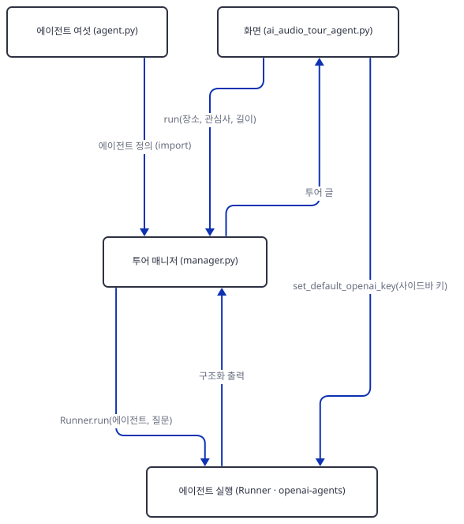

SDK 0.0.6은 `WebSearchTool`을 `web_search_preview`라는 이름으로 보냅니다(`agents/models/openai_responses.py`의 `Converter._convert_tool`을 소스로 확인). 그 도구는 내 프로세스가 아니라 OpenAI 서버에서 돌고(Day 026), 그래서 검색을 위한 별도 호출이 앱 쪽 요청에 나타나지 않습니다. 요청은 에이전트당 하나이고, 검색 요금(사전 준비)은 그 요청 안에서 붙습니다. 진짜 서버가 검색 호출과 글을 한 응답에 담아 주는지는 확인하지 못했습니다. 글 없이 검색 호출만 오면 SDK는 같은 `tool_choice`로 다시 묻는 갈래로 들어가는데(`_run_impl.py`의 `NextStepRunAgain`), 그때 몇 번까지 되풀이되는지는 돌려 보지 않았습니다(`Runner.run`의 `max_turns` 기본값은 `agents/run.py`에서 10).

### Step 4. 투어 매니저 — 순서, 낱말 예산, 그리고 쓰이지 않는 계획

**목적.** 매니저가 에이전트를 어떤 순서로 부르는지, 낱말 수를 어떻게 정하는지, 최종 글이 어떻게 조립되는지 가짜 서버 기록으로 확인합니다.

**할 일.**

`voice_ai_agents/ai_audio_tour_agent/manager.py:41-72`

```python
            # Get plan based on selected interests
            planner = await self._get_plan(query, interests, duration)
            
            # Initialize research results
            research_results = {}
            
            # Calculate word limits based on duration
            # Assuming average speaking rate of 150 words per minute
            words_per_minute = 150
            total_words = int(duration) * words_per_minute
            words_per_section = total_words // len(interests)
            
            # Only research selected interests
            if "Architecture" in interests:
                research_results["architecture"] = await self._get_architecture(query, interests, words_per_section)
            
            if "History" in interests:
                research_results["history"] = await self._get_history(query, interests, words_per_section)
            
            if "Culinary" in interests:
                research_results["culinary"] = await self._get_culinary(query, interests, words_per_section)
            
            if "Culture" in interests:
                research_results["culture"] = await self._get_culture(query, interests, words_per_section)
            
            # Get final tour with only selected interests
            final_tour = await self._get_final_tour(
                query, 
                interests, 
                duration, 
                research_results
            )
```

`run`은 계획 에이전트를 먼저 부르고(42행), 선택한 관심사마다 전문가를 `await`로 하나씩 부르고(54~64행), 마지막에 오케스트레이터를 부릅니다(67행). 모두 앞 호출이 끝나기를 기다린 뒤 다음을 부르는 한 줄짜리 순서입니다. `asyncio.gather` 같은 동시 실행은 이 파일에 없습니다. 전문가를 부르는 순서는 사용자가 고른 순서가 아니라 코드의 순서(건축, 역사, 음식, 문화)입니다. 눈여겨볼 것은 42행의 `planner`입니다. 이 변수는 이 함수 어디에서도 다시 읽히지 않습니다(`grep -nw planner manager.py`가 할당 한 줄만 찾음). 계획 에이전트가 정한 구역별 분은 낱말 수 계산에 쓰이지 않습니다.

`voice_ai_agents/ai_audio_tour_agent/manager.py:47-51`

```python
            # Calculate word limits based on duration
            # Assuming average speaking rate of 150 words per minute
            words_per_minute = 150
            total_words = int(duration) * words_per_minute
            words_per_section = total_words // len(interests)
```

낱말 수는 계획이 아니라 이 네 줄이 정합니다. 분당 150낱말에 분을 곱한 것을 관심사 수로 똑같이 나눕니다. 전문가에게 가는 질문은 `Word Limit: {한도} - {한도+20}`을 담고(`manager.py:116`, `manager.py:129`, `manager.py:142`, `manager.py:155`), 전문가 지시문은 이 범위를 "엄격히" 지키라고 합니다. 모델이 지키는지는 확인하지 못했고, 가짜 서버는 한도에 10을 더한 낱말을 돌려줍니다.

`voice_ai_agents/ai_audio_tour_agent/manager.py:74-97`

```python
            self.printer.update_item("final_report", "", is_done=True)
            self.printer.end()

        # Build final tour content based on selected interests
        sections = []
        
        # Add selected interest sections without headers
        if "Architecture" in interests:
            sections.append(final_tour.architecture)
        if "History" in interests:
            sections.append(final_tour.history)
        if "Culture" in interests:
            sections.append(final_tour.culture)
        if "Culinary" in interests:
            sections.append(final_tour.culinary)
        
        # Format final tour with natural transitions
        final = ""
        for i, content in enumerate(sections):
            if i > 0:
                final += "\n\n"  # Add spacing between sections
            final += content
            
        return final
```

최종 글은 오케스트레이터가 만든 `FinalTour`에서 건축, 역사, 문화, 음식 네 필드만 이어 붙입니다. `introduction`과 `conclusion` 필드는 어디에도 쓰이지 않습니다. 오케스트레이터가 소개와 맺음말을 정성껏 써도 음성으로 가는 글에는 들어가지 않습니다. 선택하지 않은 관심사의 필드는 채워져 있든 비어 있든 아예 붙지 않고(`if "Architecture" in interests:` 같은 검사), 빈 문자열이 붙는 것은 선택한 관심사의 필드를 모델이 비워 둔 경우입니다.

`Printer`(`printer.py`)는 이 흐름의 진행 문구를 `rich`의 `Live`로 터미널에 그립니다(`printer.py:8-46`). 화면 쪽 코드가 아니라 `TourManager`의 생성자에서 만들어져 `Live`를 바로 시작하고(`manager.py:26-28`, `printer.py:18`), `end()`는 성공했을 때만 불립니다(`manager.py:75`). 그래서 호출이 중간에 예외로 끝나면 `Live`가 멈추지 않은 채 남습니다. 이 부분은 읽어서 안 것이고 돌려 보지는 않았습니다.

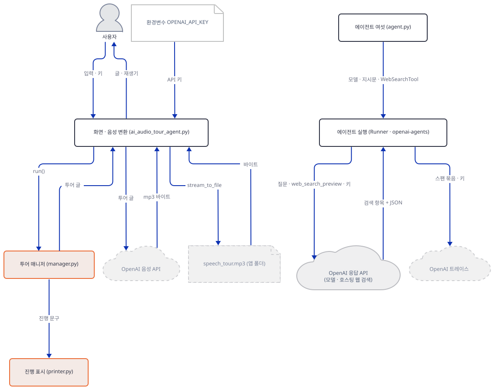

**확인.** 아래 `tourcheck.py`를 저장합니다. Streamlit 없이 `TourManager.run`을 직접 돌립니다. 가짜 서버가 호출마다 1초 기다리게 했으니(`serverA.jsonl`) 순차인지 한눈에 보입니다.

```python
import asyncio
import sys
import time

from guard import check

from manager import TourManager

check()

interests = sys.argv[1].split(",")
minutes = sys.argv[2]
t0 = time.time()
tour = asyncio.run(TourManager().run("Fake Town", interests, minutes))
print(f"\n걸린 시간 {time.time() - t0:.1f}초 | 낱말 {len(tour.split())} | 글자 {len(tour)} | 구역 낱말 {[len(p.split()) for p in tour.split(chr(10) * 2)]}")
print("소개 문장 있음:", "Welcome to the tour." in tour, "| 맺음 문장 있음:", "Thanks for walking" in tour)
```

```bash
. ./envfake.sh 58731
rm -f serverA.jsonl
uv run --no-project python -X utf8 tourcheck.py History,Architecture 10
uv run --no-project python summ.py serverA.jsonl
```

(`rm -f serverA.jsonl`은 앞 Step의 기록을 지웁니다. 서버는 기록 파일을 열 때마다 이어 쓰므로 서버를 끄지 않은 채 지워도 됩니다.) 직접 확인한 출력입니다. 걸린 시간은 실행마다 조금씩 다르고(4.7~4.8초를 보았습니다) 서버가 받은 시각은 `+N.0s`로 1초 단위를 지킵니다.

```text
걸린 시간 4.8초 | 낱말 1520 | 글자 9402 | 구역 낱말 [760, 760]
소개 문장 있음: False | 맺음 문장 있음: False
1 +  0.0s planner      gpt-4o      tools=[] tool_choice=None format=final_output 입력 62자 지시문 2657자
2 +  1.0s architecture gpt-4o-mini tools=['web_search_preview'] tool_choice=required format=final_output 입력 421자 지시문 1284자
3 +  2.0s history      gpt-4o-mini tools=['web_search_preview'] tool_choice=required format=final_output 입력 430자 지시문 1349자
4 +  3.0s orchestrator gpt-4o-mini tools=[] tool_choice=None format=final_output 입력 10349자 지시문 2272자
```

호출은 네 번이고 서버가 받은 시각이 정확히 1초 간격(`+0.0s`, `+1.0s`, `+2.0s`, `+3.0s`)입니다. 순서는 계획, 건축, 역사, 오케스트레이터입니다. 관심사가 N개면 모델 호출은 N+2번입니다. 4개를 고른 투어를 Step 6에서 돌릴 때 여섯 번이 찍힙니다. 가짜 서버는 한도 750낱말에 10을 더해 760낱말씩 쓰고 오케스트레이터가 그것을 그대로 돌려주어 1,520낱말이 되었습니다. 그 가운데 소개 문장과 맺음 문장은 없습니다(`소개 문장 있음: False`, `맺음 문장 있음: False`). 가짜 서버의 오케스트레이터는 `Welcome to the tour.`와 `Thanks for walking with me.`를 소개·맺음 필드에 넣어 돌려주었지만 최종 글에 들어가지 않았습니다. 소개·맺음 필드는 모델이 쓰고 버려지는 출력 토큰입니다.

### Step 5. 트레이싱 — 사이드바 키를 들고 나가는 요청

**목적.** 기본 설정에서 트레이스가 어디로 어떤 키로 나가는지, 끄면 정말 안 나가는지 확인합니다.

**할 일.**

`voice_ai_agents/ai_audio_tour_agent/manager.py:30-39`

```python
    async def run(self, query: str, interests: list, duration: str) -> None:
        trace_id = gen_trace_id()
        with trace("Tour Research trace", trace_id=trace_id):
            self.printer.update_item(
                "trace_id",
                "View trace: https://platform.openai.com/traces/{}".format(trace_id),
                is_done=True,
                hide_checkmark=True,
            )
            self.printer.update_item("start", "Starting tour research...", is_done=True)
```

`trace("Tour Research trace", ...)` 블록이 `run` 전체를 감쌉니다(32~72행). 블록 안의 모든 `Runner.run`이 이 트레이스의 스팬으로 기록됩니다. 그리고 `View trace: https://platform.openai.com/traces/<아이디>` 줄을 터미널에 찍습니다(33~38행). 이 줄은 트레이싱이 꺼져 있어도 똑같이 찍힙니다. `gen_trace_id()`는 이름만 만들어 주기 때문입니다. 아래 확인에서 꺼진 상태에서도 줄이 나오는 것을 직접 봅니다.

트레이스를 올리는 쪽은 `agents` 라이브러리입니다. 0.0.6 소스에서 확인한 사실이 다섯입니다.

1. 올리는 주소는 `BackendSpanExporter`의 기본값 `https://api.openai.com/v1/traces/ingest`로 고정이고(`agents/tracing/processors.py`), 모델 호출처럼 `OPENAI_BASE_URL`을 따르지 않습니다.
2. 쓰는 키는 `set_default_openai_key`가 `use_for_tracing=True`로 넘긴 키입니다(`agents/_config.py`).
3. 끄는 환경변수는 `TraceProvider`가 만들어질 때, 곧 `agents`를 import할 때 한 번 읽고(`agents/tracing/setup.py`), `true` 또는 `1`일 때만 끕니다. Day 033 Step 4는 0.22.3에서 이 값이 첫 트레이스를 만들 때 한 번 읽혀 캐시된다고 적었는데, 0.0.6에서는 읽는 때가 더 이르지만 프로세스가 시작된 뒤에 바꿔도 소용없다는 점은 같습니다.
4. 이 앱의 에이전트는 모두 Responses API 모델이라서, 응답 스팬은 `ResponseSpanData.export()`가 응답 아이디만 내보냅니다(`agents/tracing/span_data.py`). `RunConfig.trace_include_sensitive_data`의 기본값은 `True`지만(`agents/run.py`) 그 값이 바꾸는 입력·응답 필드는 메모리의 스팬에만 남고 묶음에는 실리지 않습니다(`agents/models/openai_responses.py`). 입력·출력을 싣는 함수 도구 스팬은 이 앱에 없습니다. 웹 검색이 호스팅 도구라 SDK가 함수를 부르지 않기 때문입니다.
5. 전송은 `httpx.Client`로 하고, 4xx 응답이면 재시도 없이 오류를 한 줄 남기고, 네트워크 오류와 5xx 응답이면 최대 3번 시도합니다.

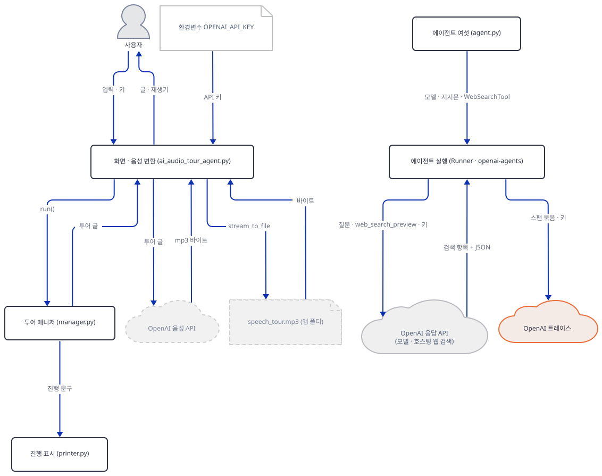

**확인.** 이 확인은 바깥으로 아무것도 보내지 않게 짰습니다. 아래 `tracecheck.py`는 시작하자마자 `OPENAI_BASE_URL`이 가짜 서버(`http://127.0.0.1:...`)가 아니면 멈춥니다. 그다음 기본 전송 대상과 키를 찍고, 트레이스 전송 주소를 가짜 서버의 `/v1/traces/ingest`로 바꾼 뒤에야 매니저를 돌립니다. 그래서 `envfake.sh`를 빠뜨리거나 `OPENAI_AGENTS_DISABLE_TRACING=0`을 빠뜨려도 바깥으로 나가는 경로가 없습니다. 앞 Step의 가짜 서버(터미널 A)가 이 주소를 받도록 `fake_openai.py`에 이미 갈래가 있어서 서버를 다시 저장할 것은 없습니다.

```python
import asyncio

from guard import check

base = check(allow_tracing=True)  # 가짜 서버가 아니면 여기서 멈춘다

from agents import set_default_openai_key
from agents.tracing.processors import default_exporter, default_processor
from manager import TourManager

set_default_openai_key("sk-fake-sidebar-key")  # 화면이 사이드바 키로 부르는 것과 같은 호출
exporter = default_exporter()
print("기본 전송 대상:", exporter.endpoint, "| 쓰는 키 앞 12자:", exporter.api_key[:12])
exporter.endpoint = base + "/traces/ingest"  # 이 줄 뒤로는 가짜 서버로만 간다
print("이 실행의 전송 대상:", exporter.endpoint)
asyncio.run(TourManager().run("Fake Town", ["History"], "5"))
default_processor().force_flush()
```

터미널 B에서 `envfake.sh`를 건 채, 먼저 기본값(트레이싱 끔)으로 돌리고, 그다음 그 한 줄에서만 `OPENAI_AGENTS_DISABLE_TRACING=0`으로 켜서 돌립니다. 둘 다 `summ.py`로 가짜 서버가 받은 것을 봅니다.

```bash
. ./envfake.sh 58731
rm -f serverA.jsonl
uv run --no-project python -X utf8 tracecheck.py
uv run --no-project python summ.py serverA.jsonl
rm -f serverA.jsonl
OPENAI_AGENTS_DISABLE_TRACING=0 uv run --no-project python -X utf8 tracecheck.py
uv run --no-project python summ.py serverA.jsonl
```

(PowerShell: `$env:OPENAI_AGENTS_DISABLE_TRACING = "0"`을 실행하고 같은 `uv run` 줄을 돌린 뒤 `$env:OPENAI_AGENTS_DISABLE_TRACING = "1"`로 되돌리세요. 실행해 보지 못했습니다.) 직접 확인한 출력입니다. `✅` 진행 줄은 생략했습니다. 트레이스 아이디는 실행마다 다릅니다. 먼저 트레이싱을 끈 기본값입니다.

```text
기본 전송 대상: https://api.openai.com/v1/traces/ingest | 쓰는 키 앞 12자: sk-fake-side
이 실행의 전송 대상: http://127.0.0.1:58731/v1/traces/ingest
View trace: 
https://platform.openai.com/traces/trace_96d1f13a6587451bbcd08c2b48136a49
1 +  0.0s planner      gpt-4o      tools=[] tool_choice=None format=final_output 입력 47자 지시문 2657자
2 +  1.0s history      gpt-4o-mini tools=['web_search_preview'] tool_choice=required format=final_output 입력 416자 지시문 1349자
3 +  2.0s orchestrator gpt-4o-mini tools=[] tool_choice=None format=final_output 입력 5629자 지시문 2272자
```

꺼진 상태에서도 `View trace` 줄은 나옵니다. `gen_trace_id()`가 이름만 만들어 주기 때문이고, 그 트레이스는 실제로 만들어지지 않아서 `summ.py`의 기록에 `traces` 줄이 없고 응답 요청 세 줄(계획, 역사, 오케스트레이터)뿐입니다. 그리고 기본 전송 대상이 `https://api.openai.com/v1/traces/ingest`이고 쓰는 키가 사이드바 키(`sk-fake-side...`)이지 환경변수의 `sk-fake-env-key`가 아닌 것도 이 출력에 보입니다. 이어서 켠 실행입니다.

```text
기본 전송 대상: https://api.openai.com/v1/traces/ingest | 쓰는 키 앞 12자: sk-fake-side
이 실행의 전송 대상: http://127.0.0.1:58731/v1/traces/ingest
View trace: 
https://platform.openai.com/traces/trace_a122b8671a494796ae6849726e5be2be
1 +  0.0s planner      gpt-4o      tools=[] tool_choice=None format=final_output 입력 47자 지시문 2657자
2 +  1.0s history      gpt-4o-mini tools=['web_search_preview'] tool_choice=required format=final_output 입력 416자 지시문 1349자
3 +  2.0s orchestrator gpt-4o-mini tools=[] tool_choice=None format=final_output 입력 5629자 지시문 2272자
4 +  3.0s traces       Bearer sk-fake-sideb 항목 7개 2152B 장소 글자 있음=False 모델 글 있음=False
    - trace Tour Research trace
    - response resp_fake
    - agent PlannerAgent tools=[] output_type=Planner
    - response resp_fake
    - agent HistoricalAgent tools=['web_search_preview'] output_type=History
    - response resp_fake
    - agent OrchestratorAgent tools=[] output_type=FinalTour
```

켜면 응답 요청 세 줄 뒤에 `traces` 줄이 하나 더 생겼습니다. 가짜 서버가 `/v1/traces/ingest`로 묶음 하나(항목 일곱 개, 약 2.1KB)를 받았고 인증 머리글 앞부분이 사이드바 키(`Bearer sk-fake-sideb`, 앞 20자만 기록)였습니다. 항목은 워크플로 이름, 응답 아이디, 에이전트 이름과 도구 이름·출력 형식입니다. 장소(`Fake Town`)도 가짜 서버가 쓴 투어 글도 묶음 안에 없었습니다(`장소 글자 있음=False`, `모델 글 있음=False`). 진짜 키로 켜면 이 묶음이 그 키의 OpenAI 계정에 올라갑니다. 0.0.6에서 이 앱의 묶음에 실리는 것은 이 정도라고 직접 확인했습니다. 글 자체는 트레이스가 아니라 모델 호출로 이미 OpenAI에 갑니다. 0.0.6은 `responses.create`에 `store`를 보내지 않아서(`agents/models/openai_responses.py`) 그 응답이 OpenAI에 보관되는지는 API 기본값을 따르는데, 그 기본값은 확인하지 못했습니다. Day 033 Step 3이 "프롬프트 전문과 모델 응답 전문"이 실린다고 한 것은 그 문서가 쓴 0.22.3의 `GenerationSpanData`(Chat Completions 계열) 이야기여서 이 앱의 0.0.6 Responses 경로에는 그대로 맞지 않습니다. 진짜 서버가 이 묶음을 어떻게 받는지(가짜 키면 4xx로 거절할 것으로 소스는 말합니다)는 보내 보지 않았습니다. 올리고 싶지 않다면 앱을 띄우는 터미널마다 `OPENAI_AGENTS_DISABLE_TRACING=1`을 겁니다. 이 문서의 모든 실행은 `envfake.sh`가 그것을 걸었고, 켠 실행만 그 한 줄에서 `0`으로 뒤집었습니다.

### Step 6. 음성 — 4096자 한도, 환경변수 키, 앱 옆에 쓰는 mp3

**목적.** 글이 어떻게 음성이 되는지, 한도를 넘으면 무슨 일이 생기는지, 어느 키가 쓰이는지, 파일이 어디에 생기는지 봅니다.

**할 일.**

`voice_ai_agents/ai_audio_tour_agent/ai_audio_tour_agent.py:7-23`

```python
def tts(text):
    from pathlib import Path
    from openai import OpenAI

    client = OpenAI()
    speech_file_path = Path(__file__).parent / f"speech_tour.mp3"
        
    response = client.audio.speech.create(
        model="gpt-4o-mini-tts",
        voice="nova",
        input=text,
        instructions="""You are a friendly and engaging tour guide. Speak naturally and conversationally, as if you're walking alongside the visitor. 
        Use a warm, inviting tone throughout. Avoid robotic or formal language. Make the tour feel like a casual conversation with a knowledgeable friend.
        Use natural transitions between topics and maintain an enthusiastic but relaxed pace."""
        )
    response.stream_to_file(speech_file_path)
    return speech_file_path
```

`tts`는 투어 글 전체를 `input`으로 한 번에 보내고, `instructions`로 말투(친근하고 대화체)를 정하고, 응답 바이트를 `stream_to_file`로 `ai_audio_tour_agent.py` 옆의 `speech_tour.mp3`에 씁니다(12행의 `Path(__file__).parent`). 같은 이름이라 한 번 돌 때마다 덮어씁니다. 서버 한 대에 사용자가 둘이면 서로의 파일을 덮어쓸 수 있다는 것은 코드로 읽은 사실이고 동시 실행은 해 보지 않았습니다. `tts` 안의 `client = OpenAI()`(11행)에는 키 인자가 없어서 환경변수 `OPENAI_API_KEY`만 읽습니다.

`input`의 한도는 OpenAI API 문서의 음성 생성 항목에 "The maximum length is 4096 characters."로 적혀 있습니다(https://developers.openai.com/api/reference/resources/audio/subresources/speech/methods/create, 2026-10-15 확인). 설치된 `openai 1.68.2`의 `audio/speech.py` 독스트링에도 같은 말이 있습니다. 모델 페이지는 `gpt-4o-mini-tts`의 입력을 토큰 2,000개까지라고 합니다. 투어 글은 `150 × 분`낱말을 목표로 하니 한도에 얼마나 가까운지 계산할 수 있습니다. Step 4의 실행에서 가짜 글 1,520낱말이 9,402자(공백 포함, 낱말당 약 6.19자)였습니다. 이 평균으로 4096자는 약 661낱말이고, 분당 150낱말이면 4.4분입니다. 낱말당 5.0자라고 쳐도 819낱말, 5.5분입니다. 모델이 실제로 쓰는 글의 길이는 확인하지 못했지만, 5분 목표(750낱말)조차 이 평균으로는 한도를 넘고 슬라이더 기본값 10분을 포함해 그 이상은 모두 넘는 목표입니다.

또 하나. 응답을 `stream_to_file`로 쓰는 것은 `openai 1.68.2`에서 `deprecated`로 표시되어 있고 문구가 "Due to a bug, this method doesn't actually stream the response content, `.with_streaming_response.method()` should be used instead"입니다(`openai/_legacy_response.py`를 소스로 확인). 실행하면 경고가 실제로 찍힙니다(아래).

`voice_ai_agents/ai_audio_tour_agent/ai_audio_tour_agent.py:107-128`

```python
            # Display the tour content in an expandable section
            with st.expander("📝 Tour Content", expanded=True):
                st.markdown(final_tour)
            
            # Add a progress bar for audio generation
            with st.spinner("🎙️ Generating audio tour..."):
                progress_bar = st.progress(0)
                tour_audio = tts(final_tour)
                progress_bar.progress(100)
            
            # Display audio player with custom styling
            st.markdown("### 🎧 Listen to Your Tour")
            st.audio(tour_audio, format="audio/mp3")
            
            # Add download button for the audio
            with open(tour_audio, "rb") as file:
                st.download_button(
                    label="📥 Download Audio Tour",
                    data=file,
                    file_name=f"{location.lower().replace(' ', '_')}_tour.mp3",
                    mime="audio/mp3"
                )
```

음성 줄(114행)은 `try`로 감싸져 있지 않습니다. 투어 글 표시(108~109행)는 음성 호출보다 앞이라서, 음성이 실패해도 글은 화면에 남고 아래에 Streamlit의 예외 상자(스택 트레이스)가 붙습니다. `st.error` 상자가 아니라서 아래 출력의 `오류 상자: []`는 비어 있고 `예외:`에 문구가 찍힙니다. 성공하면 재생기와 내려받기 단추가 붙고 내려받는 이름은 `<장소>_tour.mp3`(소문자, 공백은 밑줄)입니다. 진행 막대(113·115행)는 `0`에서 `100`으로 한 번에 점프하는 장식입니다.

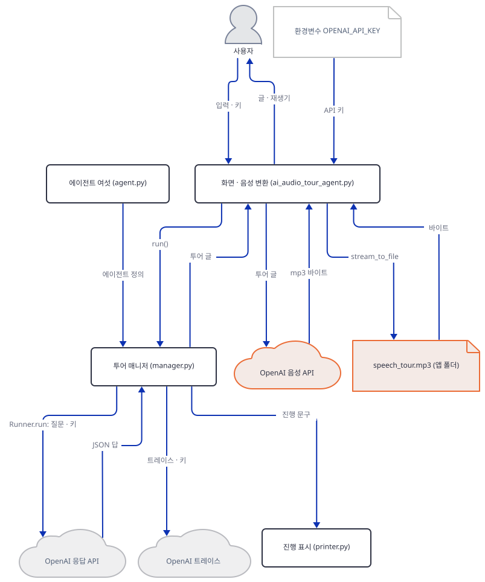

**확인.** 아래 `apptest.py`를 저장합니다. `AppTest`로 화면을 직접 돌려 키·장소·관심사를 넣고 버튼을 누르고, 오류와 오디오를 셉니다.

```python
import sys

from streamlit.testing.v1 import AppTest

from guard import check

check()

interests = [x for x in sys.argv[1].split(",") if x]
minutes = int(sys.argv[2])
key = sys.argv[3] if len(sys.argv) > 3 else "sk-fake-sidebar-key"

at = AppTest.from_file("ai_audio_tour_agent.py", default_timeout=120)
at.run()
if key != "-":
    at.sidebar.text_input[0].set_value(key).run()
at.text_input[0].set_value("Fake Town")
at.multiselect[0].set_value(interests)
at.slider[0].set_value(minutes)
at.run()
at.button[0].click().run()
print("오류 상자:", [e.value for e in at.error])
print("예외:", [e.value[:90] for e in at.exception])
print("투어 글자:", [len(m.value) for m in at.markdown if len(m.value) > 300],
      "| 오디오:", len(at.get("audio")), "| 내려받기:", len(at.get("download_button")))
```

터미널 B에서 환경변수를 걸고 돌립니다. 서버는 앞의 `58731`(배율 1.0)입니다. 먼저 화면의 기본값(10분, 관심사 둘)이고, 둘째는 5분·관심사 하나입니다. 이어서 두 번째 서버를 터미널 D에서 띄워(`58741`, 지연 없음, 배율 0.4) 짧게 쓰는 모델에서 성공하는 경로와, 환경변수 키가 없을 때를 봅니다.

```bash
uv run --no-project python fake_openai.py 58741 serverB.jsonl 0 0.4
```

```bash
. ./envfake.sh 58731
rm -f serverA.jsonl
echo "[1] 기본값 10분 관심사 둘"
uv run --no-project python -X utf8 apptest.py History,Architecture 10
uv run --no-project python summ.py serverA.jsonl | tail -1
echo "[2] 5분 관심사 하나"
uv run --no-project python -X utf8 apptest.py History 5
. ./envfake.sh 58741
echo "[3] 짧게 쓰는 서버, 5분 관심사 넷"
uv run --no-project python -X utf8 apptest.py Architecture,History,Culture,Culinary 5
uv run --no-project python summ.py serverB.jsonl
ls -l speech_tour.mp3 | awk '{print $5, $9}'
rm -f serverB.jsonl speech_tour.mp3
echo "[4] 환경변수 키 없음"
env -u OPENAI_API_KEY uv run --no-project python -X utf8 apptest.py History 5
uv run --no-project python summ.py serverB.jsonl
ls speech_tour.mp3
```

(`env -u`는 그 명령 한 줄에서만 키를 지웁니다. PowerShell에는 `rm -f`·`ls -l | awk`·`env -u`가 없습니다. `Remove-Item serverA.jsonl -ErrorAction SilentlyContinue`, `(Get-Item speech_tour.mp3).Length`, 그리고 `Remove-Item Env:OPENAI_API_KEY`를 실행한 뒤 같은 `uv run` 줄을 돌리고 새 터미널을 여는 식으로 바꾸세요. 실행해 보지 못했습니다.) 직접 확인한 출력을 네 묶음으로 옮깁니다. 서버 기록의 `+N.Ns`는 실행마다 조금씩 다릅니다. 예외의 스택 트레이스, `AppTest` 밖 경고, `ResourceWarning`은 생략하고 `오류 상자`·`예외`·`투어 글자` 줄만 옮겼습니다. 셋째 묶음에는 `DeprecationWarning` 한 줄도 옮겼습니다.

```text
[1] 기본값 10분 관심사 둘
오류 상자: []
예외: ["Error code: 400 - {'error': {'message': 'FAKE: input too long (limit 4096)', 'type': 'inva"]
투어 글자: [9402] | 오디오: 0 | 내려받기: 0
5 +  4.7s speech       gpt-4o-mini-tts voice=nova 입력 9402자 instructions=True -> 400
[2] 5분 관심사 하나
오류 상자: []
예외: ["Error code: 400 - {'error': {'message': 'FAKE: input too long (limit 4096)', 'type': 'inva"]
투어 글자: [4700] | 오디오: 0 | 내려받기: 0
[3] 짧게 쓰는 서버, 5분 관심사 넷
오류 상자: []
예외: []
투어 글자: [1938] | 오디오: 1 | 내려받기: 1
DeprecationWarning: Due to a bug, this method doesn't actually stream the response content, `.with_streaming_response.method()` should be used instead
1 +  0.0s planner      gpt-4o      tools=[] tool_choice=None format=final_output 입력 80자 지시문 2657자
2 +  0.0s architecture gpt-4o-mini tools=['web_search_preview'] tool_choice=required format=final_output 입력 440자 지시문 1284자
3 +  0.0s history      gpt-4o-mini tools=['web_search_preview'] tool_choice=required format=final_output 입력 449자 지시문 1349자
4 +  0.0s culinary     gpt-4o-mini tools=['web_search_preview'] tool_choice=required format=final_output 입력 451자 지시문 1309자
5 +  0.0s culture      gpt-4o-mini tools=['web_search_preview'] tool_choice=required format=final_output 입력 423자 지시문 1287자
6 +  0.0s orchestrator gpt-4o-mini tools=[] tool_choice=None format=final_output 입력 2900자 지시문 2272자
7 +  0.7s speech       gpt-4o-mini-tts voice=nova 입력 1938자 instructions=True -> 200
150 speech_tour.mp3
[4] 환경변수 키 없음
오류 상자: []
예외: ['The api_key client option must be set either by passing api_key to the client or by settin']
투어 글자: [1880] | 오디오: 0 | 내려받기: 0
1 +  0.0s planner      gpt-4o      tools=[] tool_choice=None format=final_output 입력 47자 지시문 2657자
2 +  0.0s history      gpt-4o-mini tools=['web_search_preview'] tool_choice=required format=final_output 입력 416자 지시문 1349자
3 +  0.0s orchestrator gpt-4o-mini tools=[] tool_choice=None format=final_output 입력 2809자 지시문 2272자
ls: cannot access 'speech_tour.mp3': No such file or directory
```

첫 묶음은 화면 기본값입니다. 연구 호출 넷(계획, 건축, 역사, 오케스트레이터)을 모두 쓴 뒤 다섯 번째 요청(음성, 입력 9,402자)이 400으로 돌아왔고 `speech_tour.mp3`는 생기지 않았습니다. 화면에는 투어 글(9,402자)이 먼저 나오고 그 아래에 예외가 붙습니다. 둘째 묶음은 5분·관심사 하나로, 가짜 글이 4,700자라서 같은 400이 났습니다. 셋째는 짧게 쓰는 서버(배율 0.4)에서 5분·관심사 넷으로, 호출 여섯 번 뒤 음성이 1,938자로 성공했고 `speech_tour.mp3`가 앱 폴더에 생겼으며(가짜 바이트 150B) 재생기와 내려받기 단추가 하나씩 생겼습니다. `stream_to_file`의 `DeprecationWarning`도 이때 찍혔습니다. 넷째는 환경변수 키를 지운 경우입니다. 사이드바 키는 있으니 연구 호출 셋(계획, 역사, 오케스트레이터)이 모두 나갔고, 그 뒤 `tts()`가 `OpenAIError: The api_key client option must be set either by passing api_key to the client or by setting the OPENAI_API_KEY environment variable`으로 멈췄습니다. 이 입력 길이 오류 문구(`FAKE: input too long`)는 내가 지은 것이고 진짜 서버의 문구는 확인하지 못했습니다. 진짜 서버가 한도를 넘는 입력을 400으로 거절하는지 잘라서 받는지도 이 문서는 확인하지 못했습니다.

터미널에 띄운 가짜 서버 둘(A·B)과 앱(Step 2에서 띄웠다면)은 이 Step 끝에서 Ctrl+C로 멈추고 포트가 비었는지 봅니다.

```bash
netstat -ano | grep -E ":(58731|58741|58751) " | grep LISTEN
```

아무것도 나오지 않으면 비었습니다(PowerShell: `netstat -ano | Select-String "LISTENING" | Select-String ":58731"` 등, 실행해 보지 못했습니다).

## 요청 한 건이 흐르는 과정

"요청 한 건"은 "Generate Tour"를 한 번 누른 뒤 음성 재생기가 붙기까지입니다. 관심사 둘(History·Architecture, 화면 기본값)로 그렸고, 메시지는 모두 한 그림에 코드 순서대로 있습니다. 모두 쉰 개라서 한 장에는 상한(1400×1500)을 넘어 코드의 시간 경계에서 열한 장으로 나눴고 하나도 빼거나 합치지 않았습니다. 앞의 확인에서 직접 본 것은 서버 기록(Step 4·6)의 응답 API 요청 네 번(계획, 건축, 역사, 오케스트레이터)과 음성 요청 한 번, 그리고 `set_default_openai_key`가 버튼을 누른 재실행에서 사이드바 키로 불린다는 것입니다. 마지막은 `AppTest`로 첫 실행 뒤에는 빈 문자열, 키를 넣은 뒤에는 `sk-fake-side`로 불리는 것을 보고 판단한 것이고 이 문서에는 그 스크립트를 따로 싣지 않았습니다. 트레이싱을 끄면 스팬 묶음을 올리는 메시지(7번 그림의 마지막)는 나가지 않습니다. 관심사를 하나 더 고르면 4번·5번 그림 같은 여섯 메시지 묶음이 하나 더 붙고, 코드의 고정 순서(건축, 역사, 음식, 문화)에 끼어듭니다.

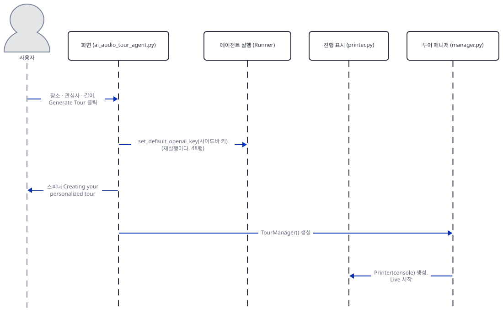

1번은 클릭에서 `TourManager()`가 만들어지기까지입니다. 버튼을 누르면 Streamlit이 스크립트를 처음부터 다시 돌리므로, 버튼 갈래보다 먼저 48행의 `set_default_openai_key(사이드바 키)`가 실행기의 모델 키와 트레이스 키를 정합니다. 이어 스피너가 뜨고(101행), 매니저를 만들 때 `Printer`가 `Live`를 시작합니다.

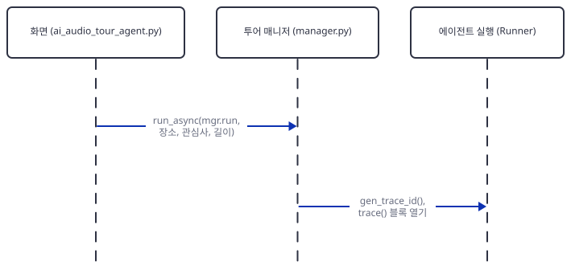

2번은 `run_async`가 `run`을 부르고, 매니저가 트레이스 블록을 여는 곳입니다.

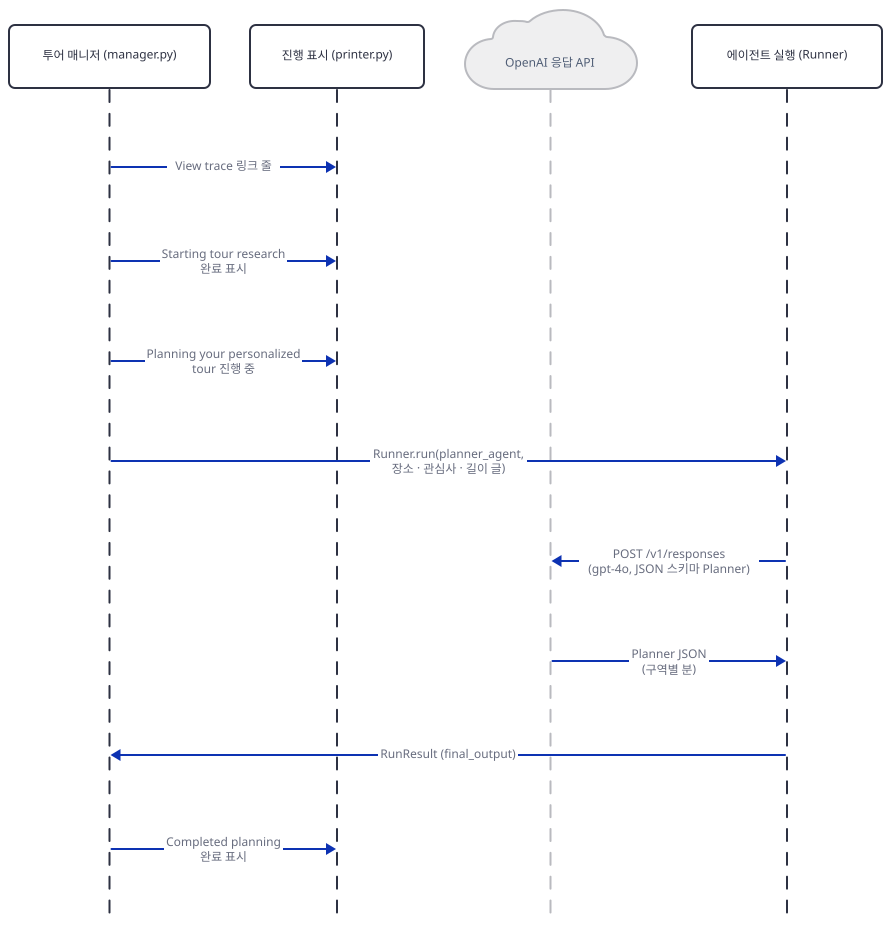

3번은 트레이스 링크 줄과 시작 문구를 찍은 뒤 계획 에이전트가 응답 API에서 돌아오기까지입니다. 결과는 쓰이지 않습니다.

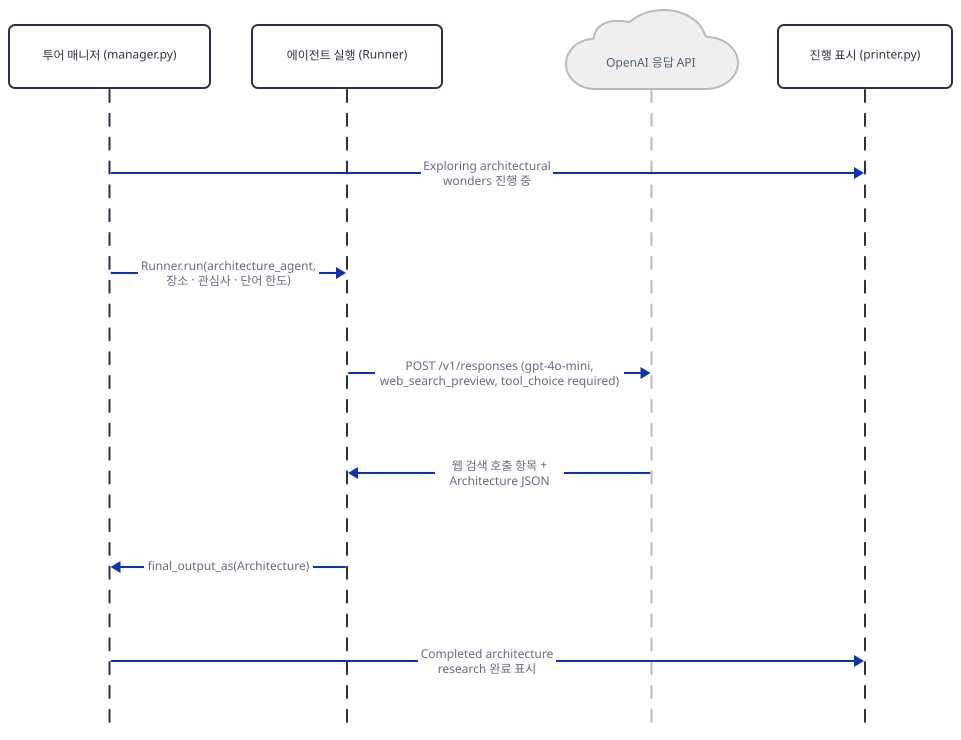

4번은 건축 전문가입니다. 모델 요청에 `web_search_preview`와 `tool_choice required`가 실리고, 응답에는 검색 호출 항목과 글이 함께 옵니다. 실행기가 돌려주는 것은 `RunResult`이고, 매니저가 그 결과에 `final_output_as(...)`를 부르는 것은 다음 진행 문구 뒤의 매니저 쪽 일입니다.

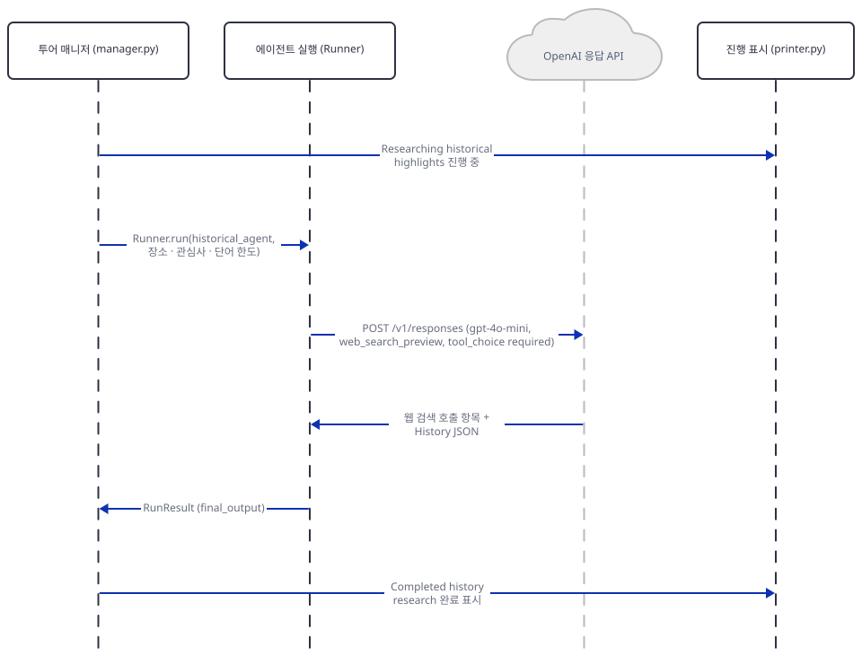

5번은 같은 구성의 역사 전문가입니다. 여섯 메시지로 4번과 모양이 같지만 에이전트와 진행 문구가 다릅니다.

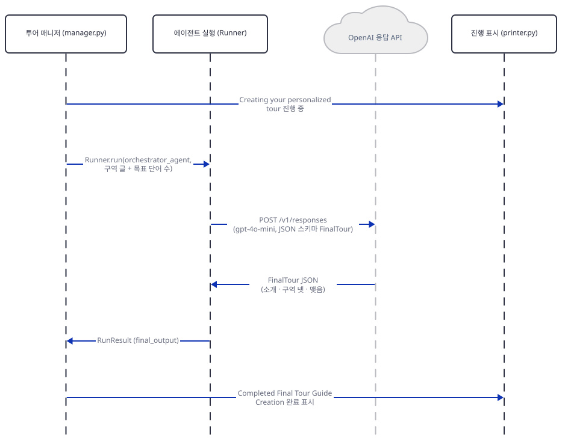

6번은 오케스트레이터입니다. 구역 글과 목표 낱말 수를 받아 `FinalTour`를 만듭니다.

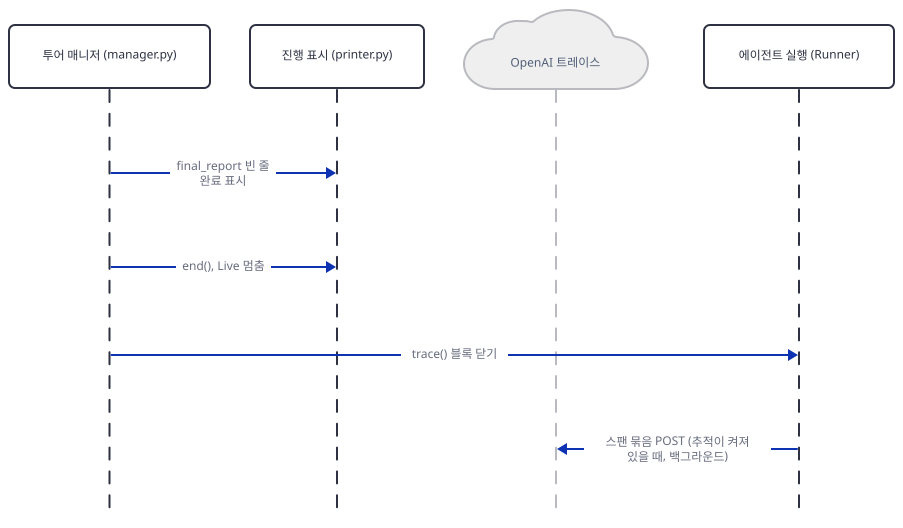

7번에서 진행 표시가 닫히고, 트레이스 블록이 닫히며, 켜져 있으면 배치 처리기가 스팬 묶음을 백그라운드로 올립니다.

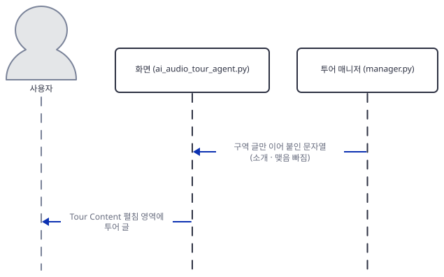

8번은 매니저가 구역 글만 이어 붙인 문자열을 화면에 돌려주고, 화면이 그것을 펼침 영역에 보여 주는 곳입니다. 소개와 맺음말은 여기서 이미 빠져 있습니다.

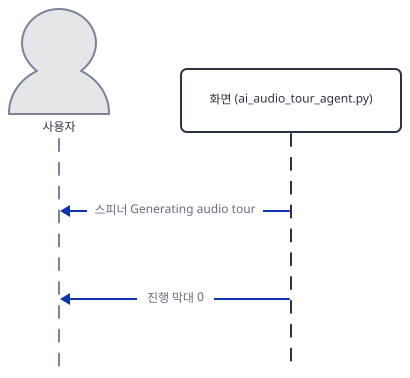

9번은 음성을 만들기 전 스피너와 진행 막대 0입니다(112·113행).

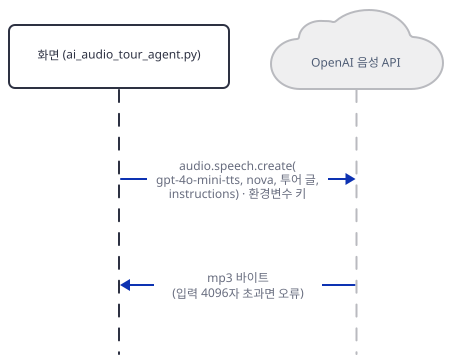

10번은 화면이 환경변수 키로 음성 API를 불러 mp3 바이트를 받는 곳입니다. 입력이 4096자를 넘으면 이 구간이 오류로 끝납니다.

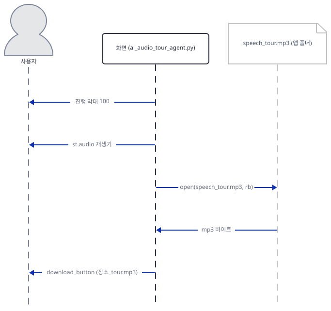

11번은 바이트를 `speech_tour.mp3`에 쓰고, 진행 막대 100과 제목, 재생기를 보이고, 파일을 다시 읽어 내려받기 단추에 넘기는 곳입니다. 서버 기록의 순서와 간격, 음성 입력 글자 수, 트레이스 묶음의 내용은 각각 Step 4·6·5의 실행으로 직접 확인했습니다. 진짜 모델의 글과 진짜 서버의 응답은 확인하지 못했습니다.

## 실행 체크리스트

- [ ] `uv venv --python 3.13`으로 `requirements.txt`를 그대로 설치해 `openai-agents 0.0.6`의 import와 앱 컴파일이 성공하는 것을 확인했다
- [ ] Python 3.14에서는 `pydantic-core==2.27.2`가 설치되지 않는 것(이 PC에는 rustup의 기본 툴체인이 없음)을 알고 있다
- [ ] `AppTest`로 키·장소·관심사 검사 오류 세 가지와 슬라이더 5~60분, `voice_style`이 쓰이지 않는 것을 확인했다
- [ ] 가짜 서버로 에이전트 여섯의 모델·도구·`tool_choice`·출력 형식을 확인하고 요청의 도구가 `web_search_preview`인 것을 봤다
- [ ] `tourcheck.py`로 호출이 순차(1초 간격)이고 N+2번인 것, 계획의 답이 쓰이지 않는 것, 소개·맺음 문장이 빠지는 것을 확인했다
- [ ] 트레이싱을 켜면 사이드바 키로 트레이스 묶음(워크플로·에이전트·응답 아이디, 장소와 글은 없음)이 전송 주소로 가고(가짜 서버 기록), 끄면 아무것도 가지 않는 것을 확인했다
- [ ] 기본값(10분)과 5분·관심사 하나에서 음성 입력이 4096자를 넘어 400이 나고, 짧게 쓰는 서버에서는 성공해 `speech_tour.mp3`가 생기는 것을 확인했다
- [ ] 환경변수 키를 지우면 연구 호출이 나간 뒤 `tts()`에서 멈추는 것을 확인했다
- [ ] 띄운 서버와 앱을 모두 멈추고 포트가 빈 것을 확인했다
- [ ] (키가 있다면) `envfake.sh`를 걸지 않은 새 터미널에서 5분·관심사 하나로 진짜 투어를 한 번 만들어 봤다 — 요금이 붙고, 입력 한도를 넘으면 실패한다. 그 터미널에는 `OPENAI_BASE_URL`이 걸려 있지 않아야 하고, 음성 호출용 `OPENAI_API_KEY`(Step 6)가 있어야 하고, 트레이스를 원치 않으면 `OPENAI_AGENTS_DISABLE_TRACING=1`을 걸어야 합니다. 이 세 가지를 담은 한 줄은 다음과 같습니다(실행해 보지 못했습니다)

```bash
OPENAI_AGENTS_DISABLE_TRACING=1 uv run --no-project streamlit run ai_audio_tour_agent.py --server.headless true --server.address localhost --browser.gatherUsageStats false
```

## 문제 해결

| 증상 | 원인 | 해결 |
|---|---|---|
| `uv pip install -r requirements.txt`가 `Failed to build pydantic-core==2.27.2`와 `rustup could not choose a version of cargo`로 실패(직접 확인, Python 3.14, 이 PC에는 rustup만 있고 기본 툴체인이 없음) | 고정된 `pydantic_core==2.27.2`에 3.14용 휠이 없어 소스 빌드로 넘어감 | `uv venv --python 3.13`으로 가상환경을 다시 만들기(3.13.3에서 설치됨). 기본 툴체인이 있을 때 3.14에서 빌드되는지는 확인하지 못했습니다 |
| 투어는 화면에 나오는데 곧바로 `openai.BadRequestError: Error code: 400`(직접 확인, 가짜 서버 — 문구는 내가 지은 것) | 음성 입력이 문서의 한도 4096자를 넘음. 150낱말/분 목표로는 5분 이후 대부분이 넘음(Step 6) | 사본의 `tts()`에서 입력을 문장 단위로 4096자 안으로 잘라 여러 번 부르고 mp3를 이어 붙이기. 호출 횟수만큼 음성 요금이 붙습니다. 진짜 서버의 오류 문구는 확인하지 못했습니다 |
| 연구가 끝난 뒤 `OpenAIError: The api_key client option must be set ...`(직접 확인) | `tts()`의 `OpenAI()`는 사이드바 키를 모르고 `OPENAI_API_KEY`만 읽음. 키를 사이드바에만 넣으면 연구 호출 요금이 이미 붙은 뒤에 실패 | 앱을 띄우는 터미널에도 `OPENAI_API_KEY`를 걸기. 사본의 `OpenAI()`를 `OpenAI(api_key=st.session_state["OPENAI_API_KEY"])`로 바꾸는 방법도 있습니다(돌려 보지는 않았습니다) |
| `DeprecationWarning: Due to a bug, this method doesn't actually stream the response content, .with_streaming_response.method() should be used instead`(직접 확인) | `stream_to_file`이 `openai 1.68.2`에서 deprecated | 무시해도 됩니다(결과 파일은 정상). 고치려면 사본에서 `with_streaming_response.create(...)`로 바꿉니다 |
| `` `label` got an empty value `` 경고가 화면을 그릴 때마다 찍힘(직접 확인) | 장소 입력과 관심사 선택의 라벨이 빈 문자열(64·68행) | 무시해도 됩니다 |
| `View trace: https://platform.openai.com/traces/...` 줄이 나오는데 트레이스 화면에는 없음 | 트레이싱을 끄면 트레이스가 만들어지지 않지만 `gen_trace_id()`로 만든 아이디의 링크는 그대로 찍힘(직접 확인) | 무시해도 됩니다. 트레이스를 보려면 환경변수 `OPENAI_AGENTS_DISABLE_TRACING`를 걸지 않거나 `0`으로 둡니다 |
| 터미널에 `Tracing client error 401: ...`이 한 번 찍히고 재시도가 없음(소스로 판단, 이 PC에서는 인터넷으로 보내 보지 않았습니다) | 트레이싱이 켜져 있고 인터넷에 붙은 채 가짜·잘못된 키로 돌려서 라이브러리가 `api.openai.com`으로 트레이스를 올렸고 4xx 응답을 받음(`agents/tracing/processors.py`가 4xx면 재시도하지 않음). 요청은 이미 나간 것입니다 | `OPENAI_AGENTS_DISABLE_TRACING=1`. 진짜 키라면 묶음이 그 키의 계정에 올라갑니다(워크플로·에이전트 이름, 응답 아이디. Step 5) |
| 터미널에 `Request failed`·`Max retries reached` | 트레이싱이 켜져 있는데 `api.openai.com`에 닿지 못함(프록시나 오프라인). 소스는 네트워크 오류나 5xx 응답이면 이렇게 3번 시도하고 포기함(5xx는 `Server error ..., retrying.`) | `OPENAI_AGENTS_DISABLE_TRACING=1`. 닿는 환경이었다면 위 행의 요청이 나간 것입니다 |
| 앱 README는 15·30·60분이라는데 슬라이더는 5~60분 | README가 오래됨. 코드(`ai_audio_tour_agent.py:76-83`)는 5분 단위 | 무시해도 됩니다. 길이를 분으로 곱한 낱말 수가 음성 한도에 걸립니다(Step 6) |
| 모델이 종료됨 또는 응답 오류 | `gpt-4o`·`gpt-4o-mini`의 기본 스냅숏이 2027-01-14에, `gpt-4o-mini-tts`의 스냅숏이 2027-01-06에 종료 예정(OpenAI 폐기 문서). 별칭 동작은 문서가 말하지 않음 | 복사본의 `agent.py` 28·58·87·116·200·304행과 `ai_audio_tour_agent.py` 15행을 폐기 문서가 권하는 모델로 바꿈(리포 코드는 고치지 않음). 음성 쪽 권장 대체 `gpt-realtime-2.1-mini`는 음성 API 레퍼런스의 `model` 목록에 없어서 이 한 줄 교체로는 안 될 것으로 보입니다(보내 보지는 않았습니다) |
| 목소리 스타일을 바꿔도 음성이 같음 | `voice_style`이 어디에도 쓰이지 않음(`ai_audio_tour_agent.py:86`) | 무시해도 됩니다. 말투는 18~20행의 고정 지시문입니다 |
| 리포 폴더에서 돌렸더니 `speech_tour.mp3`가 생김 | `tts()`가 `Path(__file__).parent`에 씀(12행) | 이 문서처럼 복사본에서 돌립니다 |
| `streamlit run`을 헤드리스로 띄우면 시작 중 외부 IP 조회가 나갈 수 있음 | `--server.address`를 안 주면 Streamlit이 외부 IP를 알아내려 `checkip.amazonaws.com`에 요청(Day 060) | `--server.headless true --server.address localhost` |
| 확인 스크립트에 `missing ScriptRunContext!` 경고 | `AppTest`를 Streamlit 서버 밖에서 부름 | 무시해도 됩니다(직접 확인) |

## 더 해보기

- `manager.py` 사본의 `await`를 `asyncio.gather`로 바꿔 전문가 넷을 동시에 부르고, 가짜 서버를 1초 지연으로 두어 `tourcheck.py`의 걸린 시간이 어떻게 달라지는지, 서버 기록의 시각이 어떻게 겹치는지 보기(이 PC에서 `tourcheck.py`는 4.8초였습니다)
- 사본의 `voice_ai_agents/ai_audio_tour_agent/manager.py:42` 계획 호출을 지우고 `summ.py`의 호출 수와 입력 글자 수가 어떻게 바뀌는지, 투어 글이 달라지는지 보기(계획 답이 쓰이지 않는다는 것은 Step 4에서 확인했습니다)
- `tts()` 사본이 입력을 4096자 안으로 문장 단위로 나눠 호출하게 하고, 가짜 서버로 5분·관심사 하나(4,700자)가 성공하는지, 호출이 몇 번이고 파일이 몇 개가 되는지 보기

## 다음 날 예고

[Day 140 · 🛡️ Insurance Claim Live Agent Team](../day140-insurance-claim-live-agent-team/README.md) — 볼륨 11의 마지막 앱이고 이 볼륨에서 가장 큽니다. 원본 `voice_ai_agents/insurance_claim_live_agent_team`은 `.py`·`.js`·`.cjs`·`.html`·`.css` 파일 열일곱 개에 합계 5,907줄(`wc -l`)이고, `voice_ai_agents/insurance_claim_live_agent_team/agent.py`(447줄)는 `MODEL = "gemini-3.8-flash"`(57행)를 씁니다. 모델은 OpenAI가 아니라 Google이고, `live_demo/server.py`(1,167줄)의 `aio.live.connect`(988행)가 Google Live API로 음성 웹소켓 세션을 열고, `live_demo/app.js`의 `getUserMedia`(534·589행)가 브라우저의 마이크와 카메라를 엽니다(모두 소스로 확인). requirements는 `google-adk>=2.0.0a1`, `google-genai>=2.24.0`, `fastapi>=0.115`, `uvicorn[standard]>=0.30`, `pydantic>=2.7`, `typing-extensions>=4.12`입니다.
