# Day 141 · 🔍 AI Deep Research Agent

> 볼륨 12 🖼️ Generative UI · 난이도 ★★★ ⚠ 앱 README의 설치·실행 순서는 잠금 파일의 옛 버전(deepagents 0.3.8)으로 돌고, 잠금 없이 오늘 풀면 deepagents 0.7.26에서 계획 도구 `write_todos`가 사라지며(Step 1·2), 서버 기본값은 모든 네트워크 인터페이스(`0.0.0.0`)입니다(Step 4) · 예상 소요 150분(파이썬 에이전트를 가짜 서버와 터미널 셋으로 직접 돌려 이벤트를 읽고, Next.js 화면 소스 일곱 파일을 읽는 일이 겹쳐 읽는 시간보다 손으로 돌려 보는 시간이 더 걸립니다) · API 비용 대략 이 문서의 따라 하기는 $0(가짜 서버만 부릅니다). 진짜 키로 한 번에 $0.5 안팎(⚠ 추정이며 Step 3에 계산을 적었습니다) · 원본 앱: `generative_ui_agents/ai-deep-research-agent`

## 오늘 만들 것

질문 하나를 주면 계획을 세우고, 웹을 검색하고, 보고서 파일을 쓰는 연구 도우미를 따라 봅니다. 볼륨 이름의 Generative UI를 `generative_ui_agents/README.md`는 이렇게 설명합니다. LLM이 글만 내놓는 대신 풍부한 프런트엔드 컴포넌트를 내놓고, 무엇을 보일지는 모델이 정하고, 프런트엔드가 실제 컴포넌트를 그리고, 사용자가 누르고 고치고 답하는 고리입니다. 앱 README는 이 앱의 방식을 "tool-rendered components with a sidecar workspace"(도구가 그리는 컴포넌트와 곁에 붙은 작업 공간)라고 부릅니다. 에이전트가 도구를 부를 때마다 채팅에 상태 카드가 한 장씩 그려지고, 오른쪽 작업 공간에 계획·파일·출처가 쌓입니다. 프런트엔드는 Next.js와 CopilotKit이고, 에이전트는 LangGraph 위의 deepagents(계획·가상 파일·하위 에이전트 도구를 한 번에 얹어 주는 라이브러리)이며, 둘 사이는 AG-UI라는 이벤트 스트림으로 이어집니다. 원본 폴더의 추적 파일은 29개이고 잠금 파일 둘과 이미지 하나를 빼면 26개, 2,587줄입니다(`git ls-files`와 `wc -l`로 직접 셈).

오늘이 볼륨 12의 첫날입니다. 앞 볼륨 11(Day 137~140)은 음성을 다뤘고 앱이 한 프로세스 안의 파이썬이었습니다. 오늘부터는 파이썬 에이전트와 Node.js 화면, 프로세스가 둘입니다. LangGraph의 상태 그래프는 Day 059·061이, 사람이 계획을 승인하는 LangGraph 앱은 Day 106이 다뤘습니다. Next.js 화면을 설치하지 않고 소스로만 읽는 방식은 Day 124가 `client/`에서 썼고 오늘도 같습니다. 새로운 것은 AG-UI입니다. 앞 날 어디서도 가르치지 않았습니다(Day 119는 그 앱의 README가 AG-UI를 소개하지만 코드에는 없다고 적었고, Day 140은 오늘 앱을 소개하며 이름만 불렀습니다). Day 140의 "다음 날 예고"가 말한 줄 수(`agent.py` 96·`main.py` 99·`tools.py` 179, 화면 파일 넷)와 기본 모델 `gpt-5.5`(`generative_ui_agents/ai-deep-research-agent/agent/agent.py:69`)는 소스와 같았습니다. 다만 예고가 옮긴 "Node.js 18 이상"은 잠금 파일의 `next` 16.1.1이 요구하는 20.9 이상과 다릅니다(Step 6).

직접 돌려 보고 소스를 읽어 알게 된 것이 여덟 있습니다.

1. 앱 README대로 `uv pip install -e .` 뒤 `uv run`을 하면 설치한 최신 판이 잠금 파일의 옛 판(deepagents 0.3.8, copilotkit 0.1.76)으로 내려갑니다(Step 1).
2. 잠금 없이 오늘 풀리는 deepagents 0.7.26에는 계획 도구 `write_todos`가 없습니다. 앱 지시문은 여전히 그것을 부르라고 합니다(Step 2).
3. 코드의 `temperature=0.7`은 모델에 가지 않습니다(Step 2).
4. `emit_tool_calls` 목록에 없는 도구(`ls`)의 호출도 스트림에 그대로 나갑니다. 안쪽 에이전트의 호출이 스트림에 없는 것은 목록 덕이 아니라 코드 주석이 말하는 별도 스레드 덕으로 보입니다(Step 3·5).
5. 서버는 기본으로 `0.0.0.0`에 열리고 `reload=True`이며, 복사하라는 `.env.example`이 같은 값과 `gpt-5.2`를 줍니다(Step 4).
6. 모델에 닿지 못하면 스트림은 오류 이벤트 없이 끊깁니다(Step 5).
7. 파일 카드의 제목이 읽는 인자 `args.path`는 deepagents의 실제 인자 `file_path`와 달라 소스상 "Writing: file"로 나옵니다(Step 7, 화면은 띄우지 않음).
8. 작업 공간의 출처 상태 `scraped`·`failed`는 서버가 만들지 않는 값입니다(Step 7).

이 문서는 OpenAI와 Tavily 어디에도 요청을 보내지 않았습니다. 그 자리에는 `127.0.0.1`의 가짜 서버를 두고, 키는 모두 가짜 값이며, 앱을 띄우는 모든 줄 앞에 루프백 가드(`guard.py`)를 두었습니다. Node.js 쪽은 설치도 실행도 하지 않았습니다. 화면을 읽을 때는 `package-lock.json`이 가리키는 `@copilotkit/*`·`@ag-ui/client` 패키지 압축 파일을 내려받아 `integrity` 해시를 맞춘 뒤 파일로만 열었습니다. 그래서 카드 모양, 레이아웃, 애니메이션은 확인하지 못했고 소스가 하는 일만 적습니다. 답·검색 결과·계획은 모두 내가 정한 고정 문장이라 진짜 모델이 무엇을 할지의 근거가 아닙니다. 아래는 완성된 아키텍처입니다.

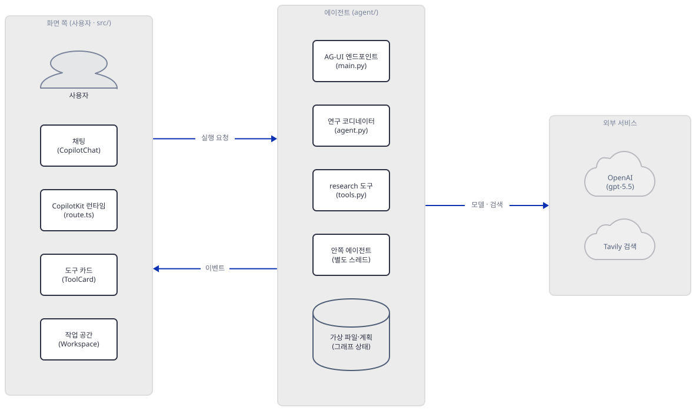

그림의 왼쪽 묶음은 브라우저에서 도는 화면 부품과 Next.js 서버에서 도는 `route.ts`를 한데 묶었습니다. 폭 때문에 묶음끼리만 이었고, 에이전트 묶음 안의 관계는 Step 3~5에서 따로 그립니다.

## 사전 준비

| 서비스/도구 | 용도 | 발급·설치 |
|---|---|---|
| uv | 가상환경 생성과 패키지 설치 | [공통 사전 준비](../README.md#공통-사전-준비-한-번만) 절 참고 |
| Python 3.12 이상 | 앱의 `pyproject.toml`이 `requires-python = ">=3.12"`. 이 문서는 3.13.3(uv가 고른 판)으로 확인했고 3.14.2에서도 같은 결과였습니다 | 공통 사전 준비와 같음 |
| OpenAI API 키 | 진짜로 돌릴 때만(`OPENAI_API_KEY`). 이 문서는 가짜 값만 씁니다 | https://platform.openai.com/api-keys |
| Tavily API 키 | 진짜로 돌릴 때만(`TAVILY_API_KEY`). 기본(basic) 검색 하나가 1크레딧입니다(https://docs.tavily.com/documentation/api-reference/endpoint/search, 2026-10-16 확인) | https://app.tavily.com/home |
| Node.js | 화면을 진짜로 띄울 때만. 앱 README는 18 이상이라고 하지만 잠금 파일의 `next` 16.1.1은 20.9 이상이고(`package-lock.json`의 `engines`), `Dockerfile`은 `node:22-slim`입니다. **이 문서는 설치하지도 실행하지도 않았습니다** | 직접 준비(이 문서는 실행하지 않았음) |
| 새 작업 폴더 `deep-research-lab` | 앱의 파이썬 파일을 복사해 와서 이 폴더 안에서만 돌립니다 | Step 1에서 만듭니다 |
| `PYTHONIOENCODING=utf-8` | 한국어 Windows 콘솔(cp949)에서 출력이 깨지지 않게 합니다 | bash: `export PYTHONIOENCODING=utf-8`, PowerShell: `$env:PYTHONIOENCODING = "utf-8"`(실행해 보지 못했습니다) |

모델은 `gpt-5.5`입니다. 모델 페이지(https://developers.openai.com/api/docs/models/gpt-5.5, 2026-10-16 확인)에 기본 스냅숏 `gpt-5.5-2026-04-23`이 있고 Chat Completions와 Responses를 모두 지원하며, 폐기 문서(https://developers.openai.com/api/docs/deprecations, 같은 날 확인)에는 `gpt-5.5` 항목이 없습니다. 그래서 ⚠는 달지 않습니다. 폐기 문서에는 `gpt-5.2-chat-latest`(2026-08-10 종료)와 `gpt-5.2-codex`(2026-07-23 종료)만 있고 `.env.example`의 `gpt-5.2` 자체는 없습니다. 입력 단가는 모델 페이지 기준 $5/1M 토큰입니다.

## 아키텍처 한눈에 보기

| 컴포넌트 | 역할 | 코드 위치 |
|---|---|---|
| 에이전트 조립 (`build_agent`) | 키를 검사하고 `ChatOpenAI`를 만들고 `create_deep_agent`로 그래프를 만든다 | `generative_ui_agents/ai-deep-research-agent/agent/agent.py:50-96` |
| 코디네이터 지시문 | 계획 → 검색 → 보고서 순서와 "JSON을 내보내지 말라"는 규칙 | `generative_ui_agents/ai-deep-research-agent/agent/agent.py:21-47` |
| `research` 도구 | 별도 스레드에서 안쪽 에이전트를 돌려 검색하고 `{summary, sources}`를 돌려준다 | `generative_ui_agents/ai-deep-research-agent/agent/tools.py:82-179` |
| `internet_search` | Tavily를 부르고 본문을 3,000자로 자른다. 실패는 `[{"error": ...}]`로 삼킨다 | `generative_ui_agents/ai-deep-research-agent/agent/tools.py:19-79` |
| AG-UI 서버 | FastAPI 앱. CORS 모두 허용, `/health`, 루트 경로에 AG-UI 엔드포인트 | `generative_ui_agents/ai-deep-research-agent/agent/main.py:20-78` |
| 서버 실행기 (`main()`) | `SERVER_HOST` 기본 `0.0.0.0`, 포트 8123, `reload=True` | `generative_ui_agents/ai-deep-research-agent/agent/main.py:81-99` |
| CopilotKit 런타임 | `research_assistant`라는 이름의 에이전트를 `LANGGRAPH_DEPLOYMENT_URL`로 잇는다 | `generative_ui_agents/ai-deep-research-agent/src/app/api/copilotkit/route.ts:1-29` |
| 루트 레이아웃 | `<CopilotKit runtimeUrl="/api/copilotkit" agent="research_assistant">`로 앱을 감싼다 | `generative_ui_agents/ai-deep-research-agent/src/app/layout.tsx:24-38` |
| 페이지 | 채팅(38%)과 작업 공간(62%), 그리고 도구 호출을 받는 `useDefaultTool` | `generative_ui_agents/ai-deep-research-agent/src/app/page.tsx:10-159` |
| 도구 카드 (`ToolCard`) | 도구 이름별 설정 표로 카드를 그리고 모르는 도구는 JSON 카드로 | `generative_ui_agents/ai-deep-research-agent/src/components/ToolCard.tsx:28-435` |
| 작업 공간 (`Workspace`) | 계획·파일·출처 세 구역과 파일 보기 모달 | `generative_ui_agents/ai-deep-research-agent/src/components/Workspace.tsx:311-350` |
| 파일 보기 (`FileViewerModal`) | 파일 내용을 `react-markdown`으로 그리고 내려받기 제공 | `generative_ui_agents/ai-deep-research-agent/src/components/FileViewerModal.tsx:23-175` |
| 상태 타입 | 계획·파일·출처의 모양 | `generative_ui_agents/ai-deep-research-agent/src/types/research.ts:9-39` |
| 배포 설정 | `Dockerfile`·`railway.json`·`railway.toml`·`agent/railway.toml`. 읽기만 했고 배포 명령은 실행하지 않았다 | `generative_ui_agents/ai-deep-research-agent/agent/railway.toml:1-9` |
| OpenAI·Tavily | 모델 응답과 웹 검색 | 코드 없음 (외부 서비스) |

`bin/meridian-wrapper`(52줄)는 앱과 무관한 `claude` 재시작 셸 스크립트이고, `.gitignore`가 `.meridian/`·`CLAUDE.md`를 무시하는 것과 짝입니다. 다루지 않습니다.

## 단계별 진행

명령은 bash 기준이고 앱을 띄우는 터미널마다 환경변수를 다시 줍니다. PowerShell은 `&&`가 없어 줄을 나누며, 줄바꿈이 든 `-c "..."`는 따옴표 문제를 일으키니 같은 내용을 `.py`로 저장해 실행하세요(PowerShell 형태는 모두 실행해 보지 못했습니다). 저장소 루트에는 `pyproject.toml`이 있어서 모든 `uv run`에 `--no-project`를 붙입니다. 포트 `58317`·`58318`은 내 PC에서 비어 있던 값이고 다른 번호를 써도 됩니다.

### Step 1. 환경 만들기 — README 순서가 실제로 만드는 환경

**목적.** 앱의 파이썬 파일을 새 폴더로 복사해 의존성을 설치하고, 어느 버전이 도는지 확인합니다.

**할 일.** 저장소를 내려받은 폴더를 `<리포>`라고 하면 이렇게 합니다.

```bash
mkdir deep-research-lab
cd deep-research-lab
SRC=<리포>/generative_ui_agents/ai-deep-research-agent/agent
cp $SRC/agent.py $SRC/main.py $SRC/tools.py $SRC/pyproject.toml $SRC/uv.lock .
uv sync --frozen
```

(pip 대안: `python -m venv .venv`를 만들어 활성화한 뒤 `pip install -e .`. 이 방식은 잠금 파일을 쓰지 않아 아래 둘째 단락의 "최신 판"이 깔립니다. PowerShell은 `$SRC = "<리포>\generative_ui_agents\ai-deep-research-agent\agent"`로 바꾸고 `Copy-Item "$SRC\agent.py","$SRC\main.py","$SRC\tools.py","$SRC\pyproject.toml","$SRC\uv.lock" .`를 씁니다. 실행해 보지 못했습니다.)

의존성은 `agent/pyproject.toml`이 정하고, 같은 폴더의 `uv.lock`이 판을 고정합니다.

`generative_ui_agents/ai-deep-research-agent/agent/pyproject.toml:6-16`

```toml
dependencies = [
  "ag-ui-langgraph>=0.0.23",
  "copilotkit>=0.1.76",
  "deepagents>=0.3.5",
  "fastapi>=0.115.14",
  "langchain>=1.2.4",
  "langchain-openai>=1.1.7",
  "python-dotenv>=1.2.1",
  "tavily-python>=0.3.0",
  "uvicorn[standard]>=0.40.0",
]
```

모두 하한(`>=`)뿐입니다. 이 문서를 쓰며 `uv sync --frozen`으로 설치했을 때(2026-10-16) 패키지 68개가 깔렸고 deepagents 0.3.8, copilotkit 0.1.76, ag-ui-langgraph 0.0.23, langchain-openai 1.1.7, langgraph 1.0.7, openai 2.15.0, tavily-python 0.7.20, fastapi 0.115.14, uvicorn 0.40.0이 포함됩니다(직접 확인). 앱 README는 이렇게 하라고 합니다. `uv venv && source .venv/bin/activate`, `uv pip install -e .`, 그리고 `uv run python main.py`. 앞의 `uv pip install -e .`는 잠금을 보지 않고 오늘의 최신 판(deepagents 0.7.26, copilotkit 0.1.96)을 깝니다. 그런데 뒤의 `uv run`이 프로젝트 모드로 돌며 `.venv`를 잠금 파일에 맞춰 되돌립니다. 더 해보기에 이 순서를 그대로 따라 한 출력이 있습니다. 결국 README대로 하면 잠금의 옛 판이 돌고, 이 문서도 그 판으로 진행합니다. 최신 판과의 차이는 Step 2에서 봅니다.

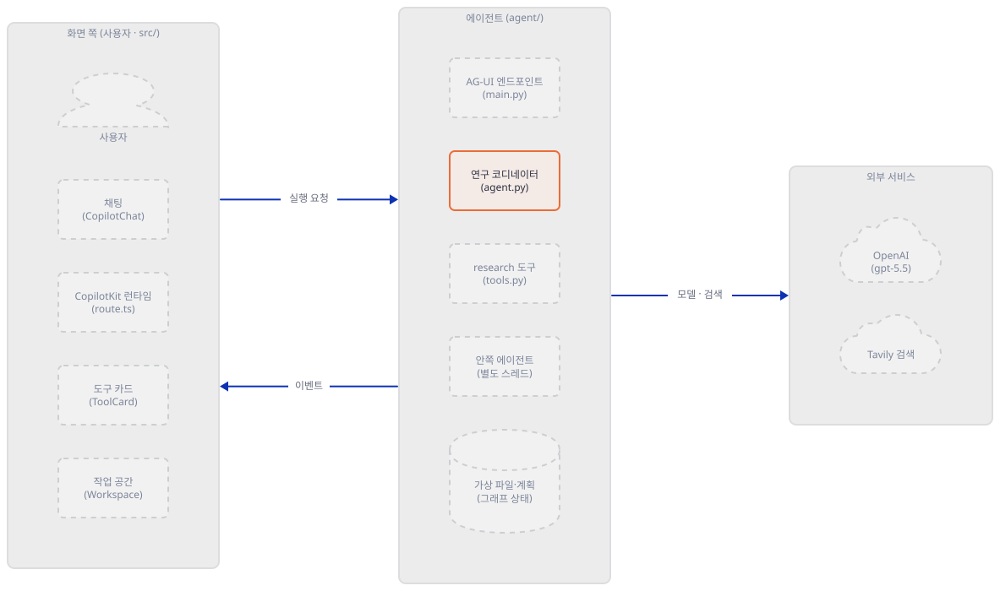

**확인.**

```bash
uv run --no-project python -B -c "import importlib.metadata as m; [print(p, m.version(p)) for p in ('deepagents','copilotkit','ag-ui-langgraph','langchain-openai','langgraph','openai','tavily-python','fastapi','uvicorn')]"
```

직접 확인한 출력입니다.

```text
deepagents 0.3.8
copilotkit 0.1.76
ag-ui-langgraph 0.0.23
langchain-openai 1.1.7
langgraph 1.0.7
openai 2.15.0
tavily-python 0.7.20
fastapi 0.115.14
uvicorn 0.40.0
```

앱의 세 파일이 컴파일되고 핵심 이름이 import되는지도 봅니다.

```bash
uv run --no-project python -B -c "
for f in ('agent.py','main.py','tools.py'):
    compile(open(f, encoding='utf-8').read(), f, 'exec')
print('COMPILE_OK')
from deepagents import create_deep_agent
from copilotkit import CopilotKitMiddleware, LangGraphAGUIAgent
from ag_ui_langgraph import add_langgraph_fastapi_endpoint
from tavily import TavilyClient
print('IMPORT_OK')
"
```

```text
COMPILE_OK
IMPORT_OK
```

### Step 2. 에이전트 만들기 — deepagents가 얹는 것과 모델 설정

**목적.** `build_agent()`가 만드는 그래프가 모델에게 어떤 도구를 주는지, 코드의 모델 설정이 실제로 무엇을 보내는지 봅니다.

**할 일.** 먼저 모델과 에이전트를 만드는 곳입니다.

`generative_ui_agents/ai-deep-research-agent/agent/agent.py:68-74`

```python
    # Initialize LLM - use model from env or default to gpt-5.5
    model_name = os.environ.get("OPENAI_MODEL", "gpt-5.5")
    llm = ChatOpenAI(
        model=model_name,
        temperature=0.7,
        api_key=api_key,
    )
```

모델 이름은 `OPENAI_MODEL`이 없으면 `gpt-5.5`이고, 키가 없으면 `build_agent`가 `RuntimeError`로 멈춥니다(59~66행). 그래프는 이렇게 만듭니다.

`generative_ui_agents/ai-deep-research-agent/agent/agent.py:76-96`

```python
    # Main agent gets research tool plus built-in Deep Agents tools
    # (write_todos, read_file, write_file)
    # The research tool wraps an internal Deep Agent that runs via .invoke()
    # so its text doesn't stream to the frontend
    main_tools = [research]

    # Create the Deep Agent with CopilotKit middleware
    # No subagents - research() tool handles web search internally
    agent_graph = create_deep_agent(
        model=llm,
        system_prompt=MAIN_SYSTEM_PROMPT,
        tools=main_tools,
        middleware=[CopilotKitMiddleware()],
        checkpointer=MemorySaver(),
    )

    print(f"[AGENT] Deep Research Agent created with model={model_name}")
    print(f"[AGENT] Main tools: {[t.name for t in main_tools]}")

    # Configure recursion limit for complex research tasks
    return agent_graph.with_config({"recursion_limit": 100})
```

`create_deep_agent`가 계획·파일·하위 에이전트 도구와 그 사용법을 적은 지시문을 얹고, 앱의 `research`는 거기에 하나 더해집니다. 파일은 디스크가 아니라 그래프 상태 안의 가상 파일입니다(deepagents 0.3.8의 기본 `StateBackend`, 소스로 확인. 아래 Step 5에서 실행한 폴더에 새 파일이 생기지 않는 것도 봅니다). 확인용 스크립트 둘을 저장합니다. 먼저 모든 스크립트가 맨 앞에서 불러오는 가드입니다. 환경변수를 가짜 값으로 덮어쓰고(`.env`가 채우지 못하게 하려는 것입니다), 루프백이 아닌 곳으로 나가는 연결을 거부합니다.

```python
"""guard.py - import this first. Loopback only: any other destination is refused."""
import os
import socket
import sys
from urllib.parse import urlparse

LOOPBACK = {"127.0.0.1", "::1", "localhost"}


def must_be_loopback(name, url):
    if urlparse(url).hostname not in LOOPBACK:
        sys.exit("refuse: %s=%r is not loopback" % (name, url))


FAKE = os.environ.get("FAKE_BASE", "")
must_be_loopback("FAKE_BASE", FAKE)

# Every variable that a .env file could otherwise fill in (load_dotenv never overrides existing ones).
os.environ.update({
    "OPENAI_API_KEY": "sk-fake-not-a-real-key", "TAVILY_API_KEY": "tvly-fake-not-a-real-key",
    "OPENAI_BASE_URL": FAKE + "/v1", "OPENAI_API_BASE": FAKE + "/v1",
    "LANGSMITH_TRACING": "false", "LANGCHAIN_TRACING_V2": "false", "LANGSMITH_ENDPOINT": FAKE,
})

# Fail closed: a connection to anything but loopback is refused and noted in blocked.log.
_connect, _connect_ex, _gai = socket.socket.connect, socket.socket.connect_ex, socket.getaddrinfo


def _check(addr):
    host = addr[0] if isinstance(addr, tuple) else addr
    if host not in LOOPBACK:
        with open("blocked.log", "a", encoding="utf-8") as f:
            f.write("blocked %r\n" % (host,))
        raise OSError("blocked non-loopback connection to %r" % (host,))


socket.socket.connect = lambda s, a: (_check(a), _connect(s, a))[1]
socket.socket.connect_ex = lambda s, a: (_check(a), _connect_ex(s, a))[1]
socket.getaddrinfo = lambda h, *a, **k: (_check((h,)), _gai(h, *a, **k))[1]
```

`FAKE_BASE`가 루프백 주소가 아니거나 비어 있으면 스크립트는 시작하지 않고 멈춥니다. `LANGSMITH_TRACING`을 `false`로 덮는 것은 독자 셸이나 `.env`에 켜져 있을 수 있는 LangSmith 추적이 대화 내용을 바깥으로 보내지 않게 하려는 것입니다. 그다음 도구 목록을 보는 스크립트입니다.

```python
import guard
import sys

sys.path.insert(0, ".")
from langchain_openai import ChatOpenAI

print("temperature kept:", ChatOpenAI(model="gpt-5.5", temperature=0.7, api_key="x").temperature)

from agent import build_agent

graph = build_agent()
print(sorted(graph.nodes["tools"].bound.tools_by_name))
```

```bash
export FAKE_BASE=http://127.0.0.1:58317
uv run --no-project python -B show_tools.py
```

(PowerShell: `$env:FAKE_BASE = "http://127.0.0.1:58317"` 다음 줄에 같은 `uv run` 줄. 실행해 보지 못했습니다.) 직접 확인한 출력입니다.

```text
temperature kept: None
[AGENT] Deep Research Agent created with model=gpt-5.5
[AGENT] Main tools: ['research']
['edit_file', 'execute', 'glob', 'grep', 'ls', 'read_file', 'research', 'task', 'write_file', 'write_todos']
```

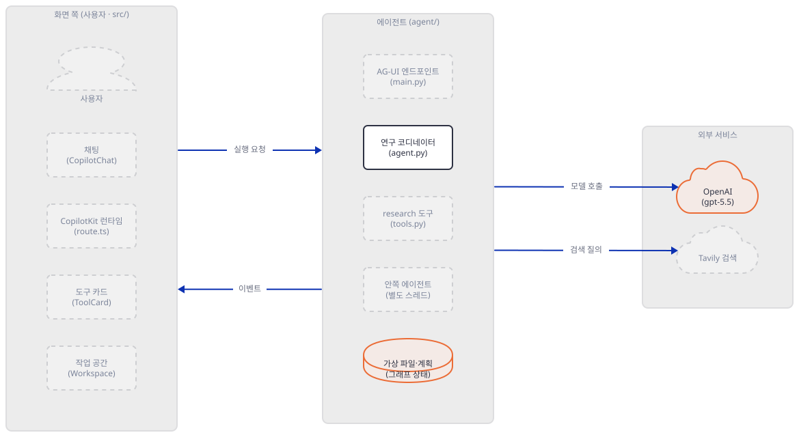

**확인.** 출력에서 읽을 것이 셋입니다.

- `temperature kept: None`. 코드는 `temperature=0.7`을 주지만 `langchain-openai`는 `gpt-5`로 시작하는 모델(`chat`이 이름에 없는 것)에서 1이 아닌 값을 조용히 버립니다(`validate_temperature`, 소스로 확인). 위 출력이 직접 그 결과이고, Step 5에서 가짜 서버가 받은 요청에도 `temperature`가 없습니다.
- 도구가 열 개입니다. `write_todos`는 deepagents가 얹은 `TodoListMiddleware`의 것이고, `execute`는 샌드박스 백엔드가 아니면 쓸 수 없어 모델에게는 보이지 않습니다(Step 5의 요청에서 도구는 아홉). `task`는 하위 에이전트를 부르는 도구입니다. 코드 주석(`generative_ui_agents/ai-deep-research-agent/agent/agent.py:83`)은 "하위 에이전트 없음"이라고 하지만 deepagents 0.3.8은 범용 하위 에이전트 하나를 기본으로 만듭니다(`general_purpose_agent=True`, 소스로 확인).
- 시스템 지시문은 앱의 글 1,254자에 deepagents가 덧붙인 도구 안내가 합쳐져 5,067자가 됩니다(Step 5의 `show_log.py`가 `system=5067`로 보입니다).

최신 판과 비교하려면 잠금 없이 `pyproject.toml`의 하한대로 새 가상환경을 만듭니다.

```bash
cd ..
uv venv latest-venv
uv pip install --python latest-venv/Scripts/python.exe "ag-ui-langgraph>=0.0.23" "copilotkit>=0.1.76" "deepagents>=0.3.5" "fastapi>=0.115.14" "langchain>=1.2.4" "langchain-openai>=1.1.7" "python-dotenv>=1.2.1" "tavily-python>=0.3.0" "uvicorn[standard]>=0.40.0"
cd deep-research-lab
FAKE_BASE=http://127.0.0.1:58317 ../latest-venv/Scripts/python.exe -B show_tools.py
```

(macOS·Linux는 `latest-venv/bin/python`. 설치 줄은 이 문서의 가짜 서버나 프록시 변수가 없는 셸에서 실행하세요.) 이 문서를 쓰며 패키지 75개가 깔렸고 deepagents 0.7.26, copilotkit 0.1.96, langchain-openai 1.7.2, openai 3.31.0이었습니다. 출력의 마지막 줄은 다음과 같았습니다.

```text
['delete', 'edit_file', 'execute', 'glob', 'grep', 'ls', 'read_file', 'research', 'task', 'write_file']
```

`write_todos`가 없고 `delete`가 생겼습니다. 이 판의 `deepagents/profiles/harness/_openai_codex.py`는 "the SDK no longer provides it by default"라고 적고 Codex 모델 세 가지에만 `TodoListMiddleware`를 붙입니다(소스로 확인). 앱의 지시문(`generative_ui_agents/ai-deep-research-agent/agent/agent.py:30`)과 서버 설정(`generative_ui_agents/ai-deep-research-agent/agent/main.py:53`)은 `write_todos`를 계속 말하고, 화면의 "Research Plan" 구역은 그 도구의 인자로만 채워집니다(Step 7). 그래서 오늘 잠금 없이 풀면 계획 구역은 비어 있게 됩니다. 같은 가짜 대본으로 이 판에서 돌려 본 결과는 더 해보기 첫 항목에 있습니다.

### Step 3. research 도구 — 별도 스레드의 안쪽 에이전트와 Tavily

**목적.** 이 앱의 두 번째 에이전트와 검색 호출을 읽습니다.

**할 일.** `research`는 `tools.py`에서 가장 긴 함수이고 안쪽에 에이전트를 하나 더 만듭니다. 검색부터 봅니다.

`generative_ui_agents/ai-deep-research-agent/agent/tools.py:35-42`

```python
    try:
        client = TavilyClient(api_key=tavily_key)
        results = client.search(
            query=query,
            max_results=max_results,
            include_raw_content=False,  # Disable raw content for performance
            topic="general",
        )
```

검색은 Tavily의 `search`에 `include_raw_content=False`로 한 번 부릅니다. 결과는 `url`·`title`·`content` 셋으로 줄이고 본문을 3,000자로 자릅니다(44~55행). 예외는 `[{"error": ...}]`로 삼키고(60~62행) 에이전트에게 그대로 돌려주므로, 키가 틀려도 서버는 오류 없이 돌고 요약 글이 이상해질 뿐입니다. 안쪽 에이전트는 이렇게 만들고 돌립니다.

`generative_ui_agents/ai-deep-research-agent/agent/tools.py:146-154`

```python
        research_agent = create_deep_agent(
            model=llm,
            system_prompt=researcher_prompt,
            tools=[internet_search_tracked],  # Use tracked version
            # No middleware - this runs in isolated thread
        )

        # Run in isolated thread context - no callback inheritance possible
        result = research_agent.invoke({"messages": [HumanMessage(content=query)]})
```

안쪽 에이전트에는 `middleware`도 `checkpointer`도 주지 않았습니다. 그래도 `create_deep_agent`가 같은 도구 묶음을 주므로 이 에이전트도 가상 파일 도구 여섯과 `task`·`write_todos`를 갖습니다. 가짜 서버가 받은 요청의 도구 수는 아홉이고 그 가운데 검색 도구는 `internet_search_tracked`입니다. 화면에 줄 출처를 모으려고 앱이 감싼 함수의 이름이 곧 모델에게 보이는 도구 이름입니다. 그리고 `invoke`로 돌기 때문에 모델 요청이 스트리밍이 아닙니다(Step 5의 `stream=False`). 이 에이전트를 스레드 풀 안에서 돌리는 까닭은 주석이 설명합니다.

`generative_ui_agents/ai-deep-research-agent/agent/tools.py:172-176`

```python
    # Run in thread pool to isolate from parent async context
    # This blocks the tool execution until research completes, which is acceptable
    with ThreadPoolExecutor(max_workers=1) as executor:
        future = executor.submit(_run_research_isolated)
        result = future.result()  # Blocks until complete
```

부모 에이전트의 이벤트 스트림에 안쪽 에이전트의 글과 도구 호출이 섞이는 것을 막으려는 것입니다. 호출한 쪽은 결과가 올 때까지 막힙니다. 마지막으로 모델 이름은 여기서 `OPENAI_MODEL`을 다시 읽고(128행) 안쪽 에이전트의 `ChatOpenAI`도 `temperature=0.7`을 주지만 같은 이유로 버려집니다. `sources`의 `status`는 항상 `"found"`로 고정입니다(164행).

가짜 서버로 돌리려면 길이 하나 막혀 있습니다. `TavilyClient`는 기본 주소를 환경변수로 바꿀 수 없고 생성자 인자 `api_base_url`로만 바꿉니다(`tavily-python` 0.7.20, 소스로 확인). 앱은 그 인자를 주지 않으므로, Step 4의 실행기가 클래스를 한 번 감싸 줍니다. 그 외에는 앱 코드를 고치지 않습니다.

비용의 어림을 여기서 합니다. Step 5의 시나리오(모델 호출 아홉, 검색 둘)에서 가짜 서버가 받은 모델 요청 본문의 글자 수 합계를 `show_log.py`가 셉니다(Step 5, 222,066자). 4자당 1토큰으로 어림잡으면 입력 약 5만 5천 토큰이고 $5/1M 토큰이면 입력만 약 $0.28입니다(캐시 입력은 반영하지 않았습니다). 요청의 상당 부분은 모델에게 주는 도구 설명입니다. 진짜 검색은 한 번에 결과 5건까지 건당 최대 3,000자를 모델에게 더 보냅니다. 출력과 추론 토큰은 확인하지 못했습니다. 그래서 한 번에 $0.5 안팎은 ⚠ 어림입니다. 서버 주석이 "6번 넘는 `research` 호출"을 예상하므로(`generative_ui_agents/ai-deep-research-agent/agent/main.py:60`) 긴 주제는 더 듭니다.

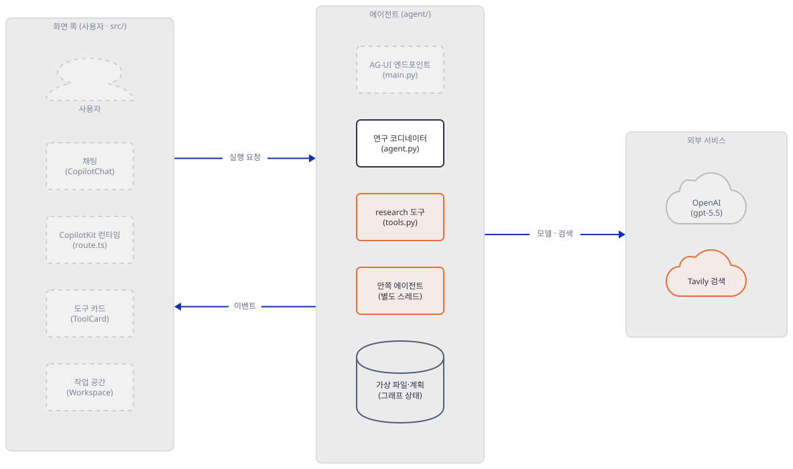

**확인.** 키가 없을 때의 동작을 봅니다. 아래 스크립트는 가드가 심은 가짜 키 하나를 지우고 에이전트를 만듭니다.

```bash
export FAKE_BASE=http://127.0.0.1:58317
uv run --no-project python -B -c "
import guard, os
os.environ.pop('TAVILY_API_KEY')
import agent
agent.build_agent()
" 2>&1 | tail -1
```

```text
RuntimeError: Missing TAVILY_API_KEY environment variable
```

`OPENAI_API_KEY`를 지우면 같은 모양의 `RuntimeError: Missing OPENAI_API_KEY environment variable`이 납니다(둘 다 직접 확인). 서버를 이 상태로 띄우면 `main.py`가 같은 예외를 다시 던져 서버가 아예 뜨지 않습니다(`main.py:76-78`).

### Step 4. 서버 — AG-UI 엔드포인트를 루프백으로 띄우기

**목적.** `main.py`가 에이전트를 어떻게 HTTP로 내놓는지 읽고, 원본 기본값과 다르게 루프백으로만 띄웁니다.

**할 일.** 서버의 중심은 두 호출입니다.

`generative_ui_agents/ai-deep-research-agent/agent/main.py:47-73`

```python
    # Configure which tool calls to emit to the frontend
    # Only emit main agent tools - suppress internal tools (internet_search from research subagent)
    # This prevents subagent tool calls from appearing as JSON noise in the chat
    agui_config = copilotkit_customize_config(
        emit_tool_calls=[
            "research",
            "write_todos",
            "write_file",
            "read_file",
            "edit_file",
        ]
    )

    # Add recursion limit for complex research tasks (6+ research calls + file operations)
    agui_config["recursion_limit"] = 100

    # Add AG-UI endpoint at root path for CopilotKit frontend
    add_langgraph_fastapi_endpoint(
        app=app,
        agent=LangGraphAGUIAgent(
            name="research_assistant",
            description="A deep research assistant that plans, searches, and synthesizes research reports",
            graph=agent_graph,
            config=agui_config,
        ),
        path="/",
    )
```

`LangGraphAGUIAgent`가 컴파일된 그래프를 AG-UI 이벤트 스트림으로 바꾸고, `add_langgraph_fastapi_endpoint`가 루트 경로 `/`에 POST를 겁니다. `name`이 `research_assistant`인 것은 화면의 `agent="research_assistant"`와 같아야 합니다. `copilotkit_customize_config`의 `emit_tool_calls`는 주석대로라면 나열한 도구만 화면에 내보내려는 것입니다. 실제 동작은 Step 5에서 봅니다. 이제 실행 쪽입니다.

`generative_ui_agents/ai-deep-research-agent/agent/main.py:81-95`

```python
def main():
    """Run the server with uvicorn"""
    import uvicorn

    host = os.getenv("SERVER_HOST", "0.0.0.0")
    port = int(os.getenv("SERVER_PORT", "8123"))

    print(f"[SERVER] Starting on {host}:{port}")
    uvicorn.run(
        "main:app",
        host=host,
        port=port,
        reload=True,
        log_level="info",
    )
```

원본의 실행 방법에서 눈여겨볼 곳이 셋입니다. 첫째, `SERVER_HOST`의 기본이 `0.0.0.0`입니다. 모든 네트워크 인터페이스에 열려 같은 네트워크의 누구나 닿습니다. 이 서버에는 로그인이 없고(소스로 확인) CORS는 모든 출처를 허용하며(`generative_ui_agents/ai-deep-research-agent/agent/main.py:28-34`), 닿은 사람이 `/`에 POST하면 내 OpenAI·Tavily 키로 연구가 돕니다. 둘째, 앱 README가 `.env.example`을 복사하라고 하는데 그 파일이 같은 값을 줍니다.

`generative_ui_agents/ai-deep-research-agent/.env.example:3-12`

```text
# Backend Server Configuration
SERVER_HOST=0.0.0.0
SERVER_PORT=8123

# Frontend → Backend Connection
LANGGRAPH_DEPLOYMENT_URL=http://localhost:8123

# OpenAI API (https://platform.openai.com/api-keys)
OPENAI_API_KEY=sk-...
OPENAI_MODEL=gpt-5.2
```

그래서 `.env`를 만들면 `SERVER_HOST=0.0.0.0`이 그대로 들어오고, 모델도 README 표의 기본 `gpt-5.5`가 아니라 `gpt-5.2`가 됩니다. 셋째, `reload=True`입니다. uvicorn은 `reload`를 켜면 감시 프로세스를 두고 서버를 그 아래 서브프로세스로 돌립니다(uvicorn의 일반 동작이며 원본을 띄우지 않아 직접 확인하지는 못했습니다). 이 문서는 원본 실행 방법을 쓰지 않고 `uvicorn`을 직접 부릅니다. 진짜 키로 돌릴 때의 명령은 Step 6 끝에 있습니다. `.env`는 위에서도 옵니다. `load_dotenv()`는 앱 파일이 있는 폴더에서 위로 올라가며 `.env`를 찾으므로, 상위 폴더의 `.env`가 모델 이름이나 주소를 바꿀 수 있습니다(두 단계 위 폴더의 `.env`가 모델 이름을 `gpt-5.2`로 바꾸는 것을 직접 확인했습니다). 아래 가드가 환경변수를 먼저 덮어쓰는 까닭입니다. 가짜 서버와 실행기를 저장합니다.

```python
"""fake_server.py - 127.0.0.1 only. Stands in for OpenAI chat completions and Tavily search."""
import json, sys, time, http.server
from urllib.parse import urlparse

HOST, PORT, LOG = "127.0.0.1", int(sys.argv[1]), sys.argv[2]

TAVILY_RESULTS = [
    {"title": "FAKE source one", "url": "https://example.com/fake-1", "content": "FAKE content one. " * 8},
    {"title": "FAKE source two", "url": "https://example.com/fake-2", "content": "FAKE content two. " * 8},
    {"title": "FAKE source three", "url": "https://example.com/fake-3", "content": "FAKE content three. " * 8},
]
REPORT = "# FAKE report\n\nThis file text was written by the fake model, not a real one.\n"


def note(**kw):
    with open(LOG, "a", encoding="utf-8") as f:
        f.write(json.dumps(kw, ensure_ascii=False) + "\n")


def text_of(m):
    c = m.get("content")
    if isinstance(c, list):
        return "".join(b.get("text", "") for b in c if isinstance(b, dict))
    return c or ""


def called_names(messages):
    return [c["function"]["name"] for m in messages if m.get("role") == "assistant"
            for c in (m.get("tool_calls") or [])]


def script(body):
    names = [t["function"]["name"] for t in body.get("tools", [])]
    msgs = body["messages"]
    done = called_names(msgs)
    if "research" in names:  # main agent
        who = "main"
        n_res = done.count("research")
        if "write_todos" not in done:
            step = ("write_todos", {"todos": [
                {"content": "Look up basics", "status": "in_progress"},
                {"content": "Look up open problems", "status": "pending"},
                {"content": "Write the report", "status": "pending"}]})
        elif n_res == 0:
            step = ("research", {"query": "solid-state battery basics"})
        elif n_res == 1:
            step = ("research", {"query": "solid-state battery open problems"})
        elif "write_file" not in done:
            step = ("write_file", {"file_path": "/reports/final_report.md", "content": REPORT})
        elif "ls" not in done and "with ls" in str(next(m["content"] for m in msgs if m.get("role") == "user")):
            step = ("ls", {"path": "/"})
        else:
            step = ("text", "FAKE answer: the report is saved at /reports/final_report.md.")
    else:  # inner researcher
        who = "inner"
        if "internet_search_tracked" not in done:
            q = next((m["content"] for m in msgs if m.get("role") == "user"), "")
            step = ("internet_search_tracked", {"query": str(q)[:80], "max_results": 3})
        else:
            step = ("text", "FAKE summary: three fake sources were read for this query.")
    return who, step


class H(http.server.BaseHTTPRequestHandler):
    def log_message(self, *a):
        pass

    def _send(self, code, obj):
        raw = json.dumps(obj).encode()
        self.send_response(code)
        self.send_header("Content-Type", "application/json")
        self.send_header("Content-Length", str(len(raw)))
        self.end_headers()
        self.wfile.write(raw)

    def do_POST(self):
        path = urlparse(self.path).path
        body = json.loads(self.rfile.read(int(self.headers.get("Content-Length", 0))) or b"{}")
        auth = (self.headers.get("Authorization") or "")[:14]
        if path == "/search":
            note(kind="tavily", path=path, auth=auth, keys=sorted(body), query=body.get("query"),
                 max_results=body.get("max_results"))
            return self._send(200, {"query": body.get("query"), "results": TAVILY_RESULTS, "response_time": 0.01})
        if not path.endswith("/chat/completions"):
            note(kind="unknown", path=path)
            return self._send(404, {"error": {"message": "fake: unknown path " + path}})
        who, step = script(body)
        note(kind="openai", who=who, path=path, auth=auth, model=body.get("model"), stream=bool(body.get("stream")),
             has_temperature="temperature" in body, chars=len(json.dumps(body)),
             tools=[t["function"]["name"] for t in body.get("tools", [])], n_messages=len(body["messages"]),
             system_len=len(text_of(body["messages"][0])), step=step[0])
        cid, now, model = "chatcmpl-fake-%d" % int(time.time() * 1000), int(time.time()), body.get("model")
        usage = {"prompt_tokens": 100, "completion_tokens": 20, "total_tokens": 120}
        if step[0] == "text":
            msg, fin = {"role": "assistant", "content": step[1]}, "stop"
        else:
            args = json.dumps(step[1])
            msg = {"role": "assistant", "content": None, "tool_calls": [{"id": "call_fake_%d" % int(time.time() * 1000),
                   "type": "function", "function": {"name": step[0], "arguments": args}}]}
            fin = "tool_calls"
        if not body.get("stream"):
            return self._send(200, {"id": cid, "object": "chat.completion", "created": now, "model": model,
                                    "choices": [{"index": 0, "message": msg, "finish_reason": fin}], "usage": usage})
        self.send_response(200)
        self.send_header("Content-Type", "text/event-stream")
        self.end_headers()

        def chunk(delta, finish=None, u=None):
            c = {"id": cid, "object": "chat.completion.chunk", "created": now, "model": model,
                 "choices": [{"index": 0, "delta": delta, "finish_reason": finish}] if delta is not None else []}
            if u:
                c["usage"] = u
            self.wfile.write(b"data: " + json.dumps(c).encode() + b"\n\n")
            self.wfile.flush()

        chunk({"role": "assistant", "content": ""})
        if step[0] == "text":
            words = step[1].split(" ")
            for i in range(0, len(words), 3):
                chunk({"content": " ".join(words[i:i + 3]) + (" " if i + 3 < len(words) else "")})
        else:
            tc = msg["tool_calls"][0]
            chunk({"tool_calls": [{"index": 0, "id": tc["id"], "type": "function",
                                   "function": {"name": step[0], "arguments": ""}}]})
            half = len(args) // 2
            for part in (args[:half], args[half:]):
                chunk({"tool_calls": [{"index": 0, "function": {"arguments": part}}]})
        chunk({}, fin)
        if (body.get("stream_options") or {}).get("include_usage"):
            chunk(None, u=usage)
        self.wfile.write(b"data: [DONE]\n\n")
        self.wfile.flush()


class S(http.server.ThreadingHTTPServer):
    allow_reuse_address = False
    daemon_threads = True


assert HOST == "127.0.0.1"
srv = S((HOST, PORT), H)
print("fake server on %s:%d" % (HOST, PORT), flush=True)
srv.serve_forever()
```

가짜 서버는 127.0.0.1에만 열리고(`assert HOST == "127.0.0.1"`), 모델 요청에는 대본대로 답합니다. 코디네이터라면(도구에 `research`가 있으면) 계획 → 검색 둘 → 파일 쓰기 → 최종 글 순서이고, 안쪽 에이전트라면 검색 한 번 → 요약 글입니다. 요청마다 한 줄씩 `fake.jsonl`에 적습니다. 실행기는 이렇습니다.

```python
"""run_local.py - serve main.py:app on 127.0.0.1 only; the model and Tavily are the fake server."""
import guard  # first line of work: env, loopback check, socket guard
import os
import sys

port = int(sys.argv[1])

# The app calls TavilyClient(api_key=...) with no base URL, so point the class at the fake server.
import tavily
_init = tavily.TavilyClient.__init__
tavily.TavilyClient.__init__ = lambda self, *a, **k: _init(self, *a, **{**k, "api_base_url": guard.FAKE})
assert tavily.TavilyClient(api_key="x").base_url == guard.FAKE

sys.path.insert(0, os.getcwd())
import main  # runs the app's own load_dotenv()

for name in ("OPENAI_BASE_URL", "OPENAI_API_BASE"):
    guard.must_be_loopback(name, os.environ[name])  # check again after .env was read
assert os.environ["LANGSMITH_TRACING"] == "false"

import uvicorn
uvicorn.run(main.app, host="127.0.0.1", port=port, log_level="info")
```

`uvicorn.run`에 앱 객체를 직접 넘기므로 `reload`가 없고 호스트는 줄에 박혀 있어 `.env`의 `SERVER_HOST`가 닿지 않습니다. 터미널을 둘 엽니다.

```bash
# 터미널 1
cd deep-research-lab
export PYTHONIOENCODING=utf-8
uv run --no-project python -B fake_server.py 58317 fake.jsonl
```

```bash
# 터미널 2
cd deep-research-lab
export PYTHONIOENCODING=utf-8
export FAKE_BASE=http://127.0.0.1:58317
uv run --no-project python -B run_local.py 58318
```

(PowerShell은 `export` 대신 `$env:FAKE_BASE = "http://127.0.0.1:58317"`. 실행해 보지 못했습니다.)

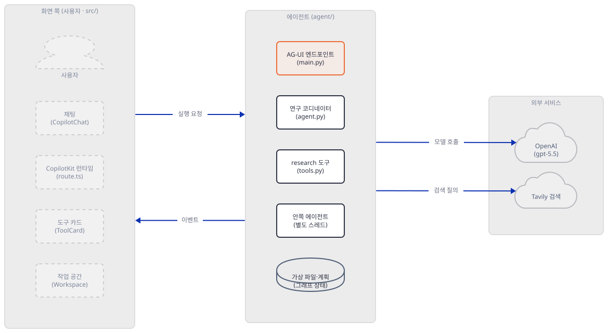

**확인.** 터미널 1의 `fake server on 127.0.0.1:58317`, 터미널 2의 `Uvicorn running on http://127.0.0.1:58318`을 봅니다. 직접 확인한 출력입니다.

```text
fake server on 127.0.0.1:58317
[AGENT] Deep Research Agent created with model=gpt-5.5
[AGENT] Main tools: ['research']
[SERVER] Deep Research Agent registered at /
INFO:     Started server process [55016]
INFO:     Waiting for application startup.
INFO:     Application startup complete.
INFO:     Uvicorn running on http://127.0.0.1:58318 (Press CTRL+C to quit)
```

`netstat`으로 열린 주소를 확인합니다(Windows).

```bash
netstat -ano | grep LISTENING | grep ":5831[78] "
```

```text
  TCP    127.0.0.1:58317        0.0.0.0:0              LISTENING       50788
  TCP    127.0.0.1:58318        0.0.0.0:0              LISTENING       9656
```

둘 다 `127.0.0.1`이고 `0.0.0.0`이 아닙니다. 가드가 실제로 막는지도 봅니다. 아래 줄은 가짜 주소 두 곳(`example.com`과 문서용 주소 `192.0.2.1`)으로 나가 보는 시험이고, 주소를 풀기 전에 막혀 요청은 나가지 않습니다.

```bash
uv run --no-project python -B -c "
import guard, socket
for host in ('example.com', '192.0.2.1'):
    try:
        socket.getaddrinfo(host, 80)
    except OSError as e:
        print('blocked:', e)
"
```

```text
blocked: blocked non-loopback connection to 'example.com'
blocked: blocked non-loopback connection to '192.0.2.1'
```

막은 연결은 `blocked.log`에 적힙니다. 이 시험이 만든 파일은 `rm blocked.log`로 지우세요. 시험 말고 이 문서의 어떤 실행에서도 그 파일은 생기지 않았습니다.

### Step 5. 요청 한 건 보내기 — AG-UI 이벤트 읽기

**목적.** 화면 대신 요청을 직접 보내, 에이전트가 무엇을 주고받는지 이벤트로 읽습니다.

**할 일.** 화면의 요청 모양은 Step 6에서 소스로 확인합니다. CopilotKit 런타임은 파이썬 서버에 JSON 본문을 `POST`하고(헤더 `Content-Type: application/json`, `Accept: text/event-stream`), 본문은 `threadId`·`runId`·`state`·`messages`·`tools`·`context`·`forwardedProps` 일곱 필드입니다. 같은 모양으로 질문 하나를 보내고 이벤트를 요약하는 스크립트입니다.

```python
"""ask.py - send one AG-UI run request and print the event stream (RAW and STEP events are only counted)."""
import guard
import collections
import json
import sys
import time
import urllib.request

url, text = sys.argv[1], sys.argv[2]
guard.must_be_loopback("url", url)
n = int(time.time())  # a new thread id per run: the server keeps each thread in memory
body = {"threadId": "t%d" % n, "runId": "r%d" % n, "state": {}, "tools": [], "context": [], "forwardedProps": {},
        "messages": [{"id": "m%d" % n, "role": "user", "content": text}]}
req = urllib.request.Request(url, json.dumps(body).encode(),
                             {"Content-Type": "application/json", "Accept": "text/event-stream"})
opener = urllib.request.build_opener(urllib.request.ProxyHandler({}))  # a loopback call needs no proxy
counts = collections.Counter()
with opener.open(req, timeout=120) as r:
    print("HTTP", r.status, r.headers.get("content-type"))
    for line in r:
        line = line.decode().rstrip("\n")
        if not line.startswith("data: "):
            continue
        e = json.loads(line[6:])
        t = e["type"]
        counts[t] += 1
        if t in ("RAW", "STEP_STARTED", "STEP_FINISHED"):
            continue
        if t == "TOOL_CALL_START":
            print(t, e["toolCallName"], e["toolCallId"][-6:])
        elif t == "TOOL_CALL_ARGS":
            print(t, e["toolCallId"][-6:], e["delta"][:70])
        elif t == "TOOL_CALL_RESULT":
            print(t, e["toolCallId"][-6:], repr(e["content"][:90]))
        elif t == "TEXT_MESSAGE_CONTENT":
            print(t, repr(e["delta"]))
        elif t == "STATE_SNAPSHOT":
            print(t, {k: len(v) for k, v in e["snapshot"].items() if hasattr(v, "__len__")})
        elif t == "MESSAGES_SNAPSHOT":
            print(t, [m["role"] for m in e["messages"]])
            for m in e["messages"]:
                if m["role"] == "tool" and str(m["content"]).startswith("Error"):
                    print("  tool error:", m["content"][:110])
        else:
            print(t)
print(dict(counts))
```

`RAW`·`STEP_*` 이벤트는 수만 세고 나머지만 찍습니다. 터미널 3에서 보냅니다.

```bash
# 터미널 3
cd deep-research-lab
export PYTHONIOENCODING=utf-8
export FAKE_BASE=http://127.0.0.1:58317
uv run --no-project python -B ask.py http://127.0.0.1:58318/ "Research solid-state batteries"
```

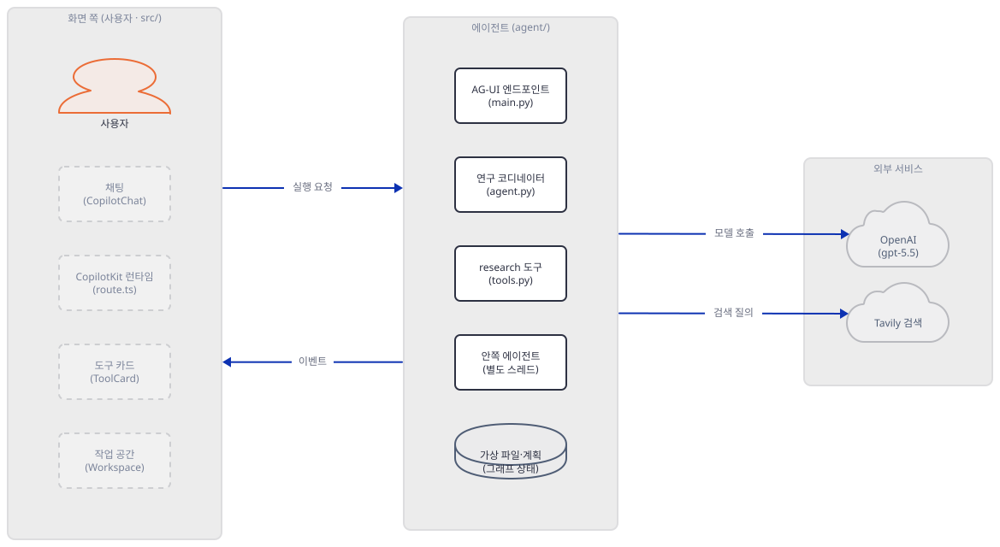

**확인.** 직접 확인한 출력입니다. 도구 호출 id의 숫자는 실행마다 다릅니다.

```text
HTTP 200 text/event-stream; charset=utf-8
RUN_STARTED
STATE_SNAPSHOT {'messages': 1, 'tools': 0, 'copilotkit': 2}
TOOL_CALL_START write_todos 704953
TOOL_CALL_ARGS 704953 {"todos": [{"content": "Look up basics", "status": "in_progress"}, {"c
TOOL_CALL_ARGS 704953 en problems", "status": "pending"}, {"content": "Write the report", "s
TOOL_CALL_END
STATE_SNAPSHOT {'messages': 1, 'tools': 0, 'copilotkit': 2}
TOOL_CALL_RESULT 704953 "Updated todo list to [{'content': 'Look up basics', 'status': 'in_progress'}, {'content': "
TOOL_CALL_START research 704986
TOOL_CALL_ARGS 704986 {"query": "solid-st
TOOL_CALL_ARGS 704986 ate battery basics"}
TOOL_CALL_END
STATE_SNAPSHOT {'messages': 1, 'tools': 0, 'copilotkit': 2}
TOOL_CALL_RESULT 704986 '{"summary": "FAKE summary: three fake sources were read for this query.", "sources": [{"ur'
STATE_SNAPSHOT {'messages': 1, 'tools': 0, 'copilotkit': 2}
TOOL_CALL_START research 705164
TOOL_CALL_ARGS 705164 {"query": "solid-state 
TOOL_CALL_ARGS 705164 battery open problems"}
TOOL_CALL_END
STATE_SNAPSHOT {'messages': 1, 'tools': 0, 'copilotkit': 2}
TOOL_CALL_RESULT 705164 '{"summary": "FAKE summary: three fake sources were read for this query.", "sources": [{"ur'
STATE_SNAPSHOT {'messages': 1, 'tools': 0, 'copilotkit': 2}
TOOL_CALL_START write_file 705343
TOOL_CALL_ARGS 705343 {"file_path": "/reports/final_report.md", "content": "# FAKE report\
TOOL_CALL_ARGS 705343 n\nThis file text was written by the fake model, not a real one.\n"}
TOOL_CALL_END
STATE_SNAPSHOT {'messages': 1, 'tools': 0, 'copilotkit': 2}
TOOL_CALL_RESULT 705343 'Updated file /reports/final_report.md'
TEXT_MESSAGE_START
TEXT_MESSAGE_CONTENT 'FAKE answer: the '
TEXT_MESSAGE_CONTENT 'report is saved '
TEXT_MESSAGE_CONTENT 'at /reports/final_report.md.'
TEXT_MESSAGE_END
STATE_SNAPSHOT {'messages': 1, 'tools': 0, 'copilotkit': 2}
STATE_SNAPSHOT {'messages': 10, 'todos': 3, 'files': 1, 'copilotkit': 2}
MESSAGES_SNAPSHOT ['user', 'assistant', 'tool', 'assistant', 'tool', 'assistant', 'tool', 'assistant', 'tool', 'assistant']
RUN_FINISHED
{'RUN_STARTED': 1, 'RAW': 154, 'STEP_STARTED': 26, 'STATE_SNAPSHOT': 9, 'STEP_FINISHED': 26, 'TOOL_CALL_START': 4, 'TOOL_CALL_ARGS': 8, 'TOOL_CALL_END': 4, 'TOOL_CALL_RESULT': 4, 'TEXT_MESSAGE_START': 1, 'TEXT_MESSAGE_CONTENT': 3, 'TEXT_MESSAGE_END': 1, 'MESSAGES_SNAPSHOT': 1, 'RUN_FINISHED': 1}
```

읽을 것이 셋입니다.

- 도구 호출마다 `TOOL_CALL_START`·`TOOL_CALL_ARGS`(조각 여럿)·`TOOL_CALL_END`가 먼저 오고, 도구가 끝난 뒤에 `TOOL_CALL_RESULT`가 옵니다. `research`의 결과는 `{"summary": ..., "sources": [...]}` JSON 글자이고 `write_todos`의 결과는 JSON이 아닌 문장입니다. 화면은 결과가 JSON이면 객체로 풀고 아니면 글자 그대로 씁니다(Step 6).
- 이벤트 스트림에는 안쪽 에이전트의 글이나 `internet_search_tracked` 호출이 없습니다. 도구 호출 넷은 모두 코디네이터의 것입니다. 코드 주석은 스레드 분리가 그렇게 막는다고 하고, 이 실행에서 확인한 것은 안쪽 호출이 스트림에 없다는 데까지입니다.
- 끝에서 `STATE_SNAPSHOT`이 `todos`와 `files`를 담아 오지만 앱 코드는 그것을 읽지 않습니다(Step 7).

모델 호출 아홉 번의 모양은 `show_log.py`로 봅니다.

```bash
uv run --no-project python -B show_log.py fake.jsonl
```

```text
openai main stream=True model=gpt-5.5 temperature=False tools=9 messages=2 system=5067 -> write_todos
openai main stream=True model=gpt-5.5 temperature=False tools=9 messages=4 system=5067 -> research
openai inner stream=False model=gpt-5.5 temperature=False tools=9 messages=2 system=4104 -> internet_search_tracked
tavily solid-state battery basics 3
openai inner stream=False model=gpt-5.5 temperature=False tools=9 messages=4 system=4104 -> text
openai main stream=True model=gpt-5.5 temperature=False tools=9 messages=6 system=5067 -> research
openai inner stream=False model=gpt-5.5 temperature=False tools=9 messages=2 system=4104 -> internet_search_tracked
tavily solid-state battery open problems 3
openai inner stream=False model=gpt-5.5 temperature=False tools=9 messages=4 system=4104 -> text
openai main stream=True model=gpt-5.5 temperature=False tools=9 messages=8 system=5067 -> write_file
openai main stream=True model=gpt-5.5 temperature=False tools=9 messages=10 system=5067 -> text
model requests: 222066 chars in total
```

코디네이터의 호출 다섯은 스트리밍이고 안쪽 에이전트의 호출 넷은 아닙니다. 요청에 `temperature`가 없고(`temperature=False`), 도구는 아홉(`execute` 제외)이며, 안쪽 에이전트의 지시문도 4,104자로 짧지 않습니다. 검색은 둘, 모델이 정한 `max_results`는 3입니다(앱의 기본은 5).

`emit_tool_calls`도 확인합니다. 목록에 없는 `ls`를 모델이 부르게 하는 질문("with ls"가 들어 있으면 가짜 서버가 `ls` 호출을 하나 끼웁니다)을 보냅니다.

```bash
uv run --no-project python -B ask.py http://127.0.0.1:58318/ "Research solid-state batteries with ls" | grep "^TOOL_CALL_START\|^TOOL_CALL_RESULT" | tail -2
```

```text
TOOL_CALL_START ls 714830
TOOL_CALL_RESULT 714830 "['/reports/']"
```

`ls`의 호출과 결과가 그대로 스트림에 나옵니다. 설정 목록(`research`·`write_todos`·`write_file`·`read_file`·`edit_file`)은 걸러 내지 않습니다. copilotkit 0.1.76과 ag-ui-langgraph 0.0.23의 소스를 보면 걸러 내는 곳은 값이 `False`일 때뿐이고(`copilotkit/langgraph_agui_agent.py`의 `is False` 검사), 목록은 그 검사에 걸리지 않습니다. 소스로 확인한 풀이이며, 이 문서의 실험은 `ls`가 새는 것까지입니다.

`ask.py`는 매번 새 `threadId`를 씁니다. 서버가 `MemorySaver`로 스레드를 메모리에 두므로, 같은 `threadId`로 보내면 앞 대화가 이어져 이번 질문에 대본의 첫 단계가 나오지 않습니다.

이제 가짜 서버를 끄고 같은 질문을 보내 모델에 닿지 못하는 경우를 봅니다(터미널 1에서 Ctrl+C).

```bash
uv run --no-project python -B ask.py http://127.0.0.1:58318/ "hello"
```

```text
HTTP 200 text/event-stream; charset=utf-8
RUN_STARTED
STATE_SNAPSHOT {'messages': 1, 'tools': 0, 'copilotkit': 2}
{'RUN_STARTED': 1, 'RAW': 11, 'STEP_STARTED': 3, 'STATE_SNAPSHOT': 1, 'STEP_FINISHED': 2}
```

HTTP는 200이고 `RUN_STARTED` 뒤에 `RUN_FINISHED`도 `RUN_ERROR`도 없이 스트림이 끝납니다. 오류는 서버 터미널에만 `openai.APIConnectionError: Connection error.`로 남습니다. 진짜 키로 모델이 막혔을 때 화면이 오래 기다리거나 멈춘 것처럼 보일 수 있다는 뜻입니다(화면은 띄우지 못해 확인하지 않았습니다).

### Step 6. 화면 1 — 런타임과 도구 호출 훅 (소스로 읽기)

**목적.** 브라우저에서 파이썬 서버까지 요청이 거치는 길을 소스로 읽습니다. 이 Step과 다음 Step은 설치도 실행도 하지 않았습니다.

**할 일.** Next.js의 서버 쪽 경로입니다.

`generative_ui_agents/ai-deep-research-agent/src/app/api/copilotkit/route.ts:10-19`

```ts
const serviceAdapter = new ExperimentalEmptyAdapter();

// Configure CopilotKit runtime with the Deep Agents backend
const runtime = new CopilotRuntime({
  agents: {
    research_assistant: new LangGraphHttpAgent({
      url: process.env.LANGGRAPH_DEPLOYMENT_URL || "http://localhost:8123",
    }),
  },
});
```

`LangGraphHttpAgent`는 `@ag-ui/langgraph` 0.0.20이 내놓는 이름이고 `@ag-ui/client` 0.0.42의 `HttpAgent`를 이어받은 클래스입니다. `HttpAgent`는 주소로 `POST`하고 헤더는 `Content-Type: application/json`과 `Accept: text/event-stream`, 본문은 JSON 한 덩어리입니다(`dist/index.mjs`, 소스로 확인). Step 5의 `ask.py`가 보낸 것과 같은 모양입니다. 모델은 이 경로에서 쓰이지 않습니다. `ExperimentalEmptyAdapter`는 "LLM은 원격 에이전트가 맡는다"는 뜻의 빈 어댑터이고(주석), 키는 화면 쪽에 필요 없습니다. Next 쪽 코드가 읽는 환경변수는 `LANGGRAPH_DEPLOYMENT_URL` 하나뿐입니다(`src` 전체에서 `process.env`를 찾은 결과). 기본값 `http://localhost:8123`은 안전하게 `http://127.0.0.1:8123`으로 적으세요. 이 문서는 `localhost`가 어느 주소로 풀리는지를 확인하지 못했습니다. 그 뒤 화면 쪽입니다.

`generative_ui_agents/ai-deep-research-agent/src/app/layout.tsx:32-34`

```tsx
        <CopilotKit runtimeUrl="/api/copilotkit" agent="research_assistant">
          {children}
        </CopilotKit>
```

`agent="research_assistant"`가 런타임의 `agents` 키, 파이썬의 `name`과 모두 같아야 이어집니다(세 곳). 도구 호출 하나를 그리는 훅은 `page.tsx`에 있습니다.

`generative_ui_agents/ai-deep-research-agent/src/app/page.tsx:14-16`

```tsx
  useDefaultTool({
    render: (props) => {
      const { name, status, args, result } = props;
```

CopilotKit의 `useDefaultTool`은 `useCopilotAction({...tool, name: "*"})`을 부르는 한 줄짜리 함수이고(`@copilotkit/react-core` 1.51.2의 `use-default-tool.ts`), 이름이 `*`인 액션은 "렌더러만 등록"하는 종류라 에이전트에게 새 도구를 알려 주지 않습니다(`use-copilot-action.ts`의 `type: "render"`). 즉 화면은 서버가 이미 부른 도구 호출이 이벤트로 오면 이름·인자·상태·결과를 받아 `render` 함수로 그립니다. 상태는 `inProgress`·`executing`·`complete`이고, 결과는 글자가 JSON이면 객체로 풀어 줍니다(`parseJson`). 에이전트와 화면 사이에 새 도구 정의가 오가지 않으므로 Step 5의 요청이 `tools: []`로 충분합니다.

화면을 진짜로 띄우는 사람을 위한 명령은 앱 README의 것이고, **이 문서는 실행하지 않았습니다.**

```bash
# <리포>/generative_ui_agents/ai-deep-research-agent 에서 (실행해 보지 못했습니다)
npm install
npm run dev
```

바깥으로 나가는 길이 몇 있어서, 실행하는 독자는 아래를 먼저 설정하세요. 모두 소스로 읽은 것입니다.

| 어디서 | 무엇을 보내는가 | 끄는 법 |
|---|---|---|
| `npm install` 때 `@scarf/scarf` 1.4.0의 `postinstall`(`package-lock.json`이 설치 스크립트가 있다고 표시) | 설치 통계를 `scarf.sh`로. `report.js`가 옵트아웃 변수를 보며 의존하는 쪽의 기본 설정은 "보냄"(`defaultOptIn: true`) | `SCARF_ANALYTICS=false`(또는 `DO_NOT_TRACK=1`) |
| 런타임(`@copilotkit/shared` 1.51.2의 `telemetry-client.ts`) | Segment와 `copilotkit.gateway.scarf.sh`로 이벤트 이름·패키지 버전. 표본 비율 기본 0.05. 요청 때마다 `copilotRuntimeNextJSAppRouterEndpoint`가 불려 이벤트가 만들어집니다(`app-router.ts`) | `COPILOTKIT_TELEMETRY_DISABLED=true` 또는 `DO_NOT_TRACK=true`(`1`도 됨) |
| `next dev`·`next build` | 익명 사용 통계(https://nextjs.org/telemetry, 2026-10-16 확인) | `NEXT_TELEMETRY_DISABLED=1` |
| 브라우저의 `globals.css:2` | `@import url("https://fonts.googleapis.com/css2?family=Inter...")`로 Google Fonts 요청 | 이 줄을 복사본에서 지우거나 그대로 감수 |

예를 들어 이렇게 설정하고 띄웁니다. 화면과 파이썬 서버는 서로 다른 터미널입니다.

```bash
export SCARF_ANALYTICS=false DO_NOT_TRACK=1 COPILOTKIT_TELEMETRY_DISABLED=true NEXT_TELEMETRY_DISABLED=1
npm install
npm run dev
```

진짜 키로 파이썬 서버를 띄우는 명령은 원본의 `uv run python main.py` 대신 이것입니다. `deep-research-lab/.env`에 `OPENAI_API_KEY`·`TAVILY_API_KEY`만 넣고(`SERVER_HOST`·`OPENAI_MODEL`은 넣지 않습니다. 상위 폴더에 다른 `.env`가 없는지도 보세요), `--host 127.0.0.1`을 명시하며 `reload`가 없는 `uvicorn`을 직접 부릅니다.

```bash
cd deep-research-lab
export LANGSMITH_TRACING=false
uv run --no-project python -m uvicorn main:app --host 127.0.0.1 --port 8123
```

이 명령은 진짜 키를 쓰는 요청을 바깥으로 보내므로 이 문서는 실행하지 않았습니다. 가짜 키와 가짜 `OPENAI_BASE_URL`로 같은 줄을 띄워 `127.0.0.1:58320`에만 열리고 `/health`가 `{"status":"ok","service":"deep-research-agent","version":"1.0.0"}`를 돌려주는 것까지는 직접 확인했습니다. 그때 쓴 변수는 `OPENAI_API_KEY=sk-fake TAVILY_API_KEY=tvly-fake OPENAI_BASE_URL=http://127.0.0.1:58317/v1`이었습니다.

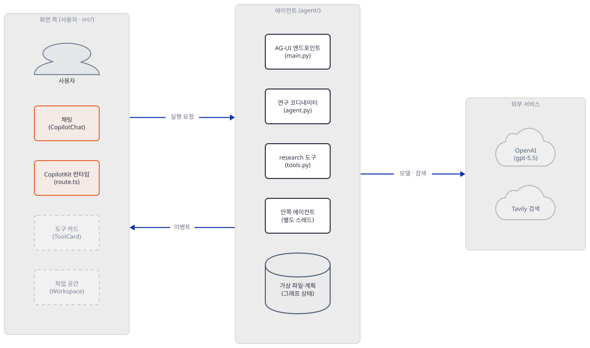

**확인.** 소스에서 세 이름이 일치하는지 찾습니다.

```bash
cd <리포>/generative_ui_agents/ai-deep-research-agent
grep -rn "research_assistant" src agent --include=*.py --include=*.ts --include=*.tsx
```

```text
src/app/api/copilotkit/route.ts:15:    research_assistant: new LangGraphHttpAgent({
src/app/layout.tsx:32:        <CopilotKit runtimeUrl="/api/copilotkit" agent="research_assistant">
agent/main.py:67:            name="research_assistant",
```

(직접 확인한 출력입니다. 이 줄은 원본 폴더를 읽기만 합니다.)

### Step 7. 화면 2 — 카드와 작업 공간 (소스로 읽기)

**목적.** 도구 호출 이벤트가 카드와 작업 공간이 되는 과정을 읽고, 서버가 보내는 것과 화면이 기대하는 것이 맞는지 맞대어 봅니다.

**할 일.** `useDefaultTool`의 `render`가 하는 일은 둘입니다. 도구 이름에 따라 상태 상자(`state`)를 고치고, 언제나 `<ToolCard {...props} />`를 돌려줍니다. 상태를 고치는 곳은 세 도구뿐입니다.

| 도구 | 상태가 되는 값 | 코드 위치 |
|---|---|---|
| `research` | 결과의 `sources`를 `state.sources` 끝에 붙인다 | `generative_ui_agents/ai-deep-research-agent/src/app/page.tsx:32-56` |
| `write_todos` | 인자 `todos`로 `state.todos`를 통째로 바꾼다 | `generative_ui_agents/ai-deep-research-agent/src/app/page.tsx:58-69` |
| `write_file` | 인자 `file_path`·`content`로 `state.files` 끝에 한 건 붙인다 | `generative_ui_agents/ai-deep-research-agent/src/app/page.tsx:71-87` |

`edit_file`·`read_file`·`task`·`ls`는 상태를 건드리지 않습니다. 특히 모델이 `edit_file`로 보고서를 고쳐도 작업 공간의 파일 내용은 그대로이고, 같은 경로를 `write_file`로 두 번 쓰면 목록에 두 건이 생깁니다(`files: [...prev.files, {...}]`). 상태가 이렇게 도구 인자에서 만들어지는 까닭을 타입 파일이 적습니다.

`generative_ui_agents/ai-deep-research-agent/src/types/research.ts:1-7`

```ts
/**
 * Research State Types
 *
 * Types for managing research state in the Deep Research Assistant.
 * Uses local state + useDefaultTool pattern instead of useCoAgent
 * to avoid type mismatches with Python FilesystemMiddleware.
 */
```

파이썬의 `files`는 경로를 키로 하는 딕셔너리이고 TypeScript는 배열을 원해서(앱 README의 설명) `useCoAgent`를 쓰지 않았다는 것입니다. Step 5의 최종 `STATE_SNAPSHOT`에 `todos`·`files`가 있어도 화면이 읽지 않는 까닭입니다. 같은 `page.tsx:18-29`의 `processedKeysRef`는 같은 도구 호출이 다시 그려질 때 상태가 두 번 쌓이지 않게 하는 중복 방지입니다.

카드는 `ToolCard.tsx`의 설정 표가 정합니다. 알려진 도구 다섯(`write_todos`·`read_todos`·`research`·`write_file`·`read_file`)은 아이콘·제목·결과 한 줄을 갖는 카드이고, 나머지는 이름·상태·JSON을 접어 보여 주는 기본 카드입니다. 여기서 서버와 어긋나는 곳이 있습니다.

`generative_ui_agents/ai-deep-research-agent/src/components/ToolCard.tsx:88-95`

```tsx
  write_file: {
    icon: Save,
    getDisplayText: (args) => {
      const path = args.path as string | undefined;
      const filename =
        path?.split("/").pop() || (args.filename as string | undefined);
      return `Writing: ${filename || "file"}`;
    },
```

제목은 `args.path`를 읽는데, Step 5의 요청이 보여 준 deepagents의 `write_file` 인자는 `file_path`입니다(앱의 `write_file` 처리 `page.tsx:73`은 `file_path`를 씁니다). 두 판 모두에서 `write_file`·`read_file`·`edit_file`의 인자 이름은 `file_path`였습니다(스키마를 직접 읽음). 그러면 `path`가 비어 `args.filename`도 없으니 파일 카드의 제목은 소스상 "Writing: file"·"Reading: file"로 나옵니다. 화면을 띄워 확인하지는 못했습니다. 카드 하나를 눌러 펼치는 내용은 `research`(질의와 요약 글)와 `write_todos`(할 일 목록)뿐입니다.

작업 공간은 세 구역(계획·파일·출처)을 접고 펼 수 있는 `Section`으로 그리고, 비어 있으면 "No tasks yet"·"No files yet"·"No sources yet"을 보입니다. 파일을 누르면 `FileViewerModal`이 내용을 `react-markdown`으로 그립니다. 이 앱에는 원시 HTML을 켜는 플러그인(`rehype-raw`)도 `dangerouslySetInnerHTML`도 없습니다(`src`를 찾은 결과). 그러니 모델이나 웹 글이 HTML을 섞어도 글자로 나옵니다. 출처는 목록에서 `<a href={source.url}>`로 새 탭에 열립니다.

출처 구역은 상태를 세 가지로 그립니다(`scraped` 초록 체크, `failed` 빨간 엑스와 "Failed to scrape this source", 그 밖에는 빈 동그라미). 그런데 서버가 만드는 값은 `"found"` 하나입니다(`tools.py:164`). 앞 두 분기는 오늘 코드로는 도달하지 않습니다. 같은 코드가 앞 버전의 "스크랩" 도구를 쓰던 때의 흔적으로 보입니다(추정).

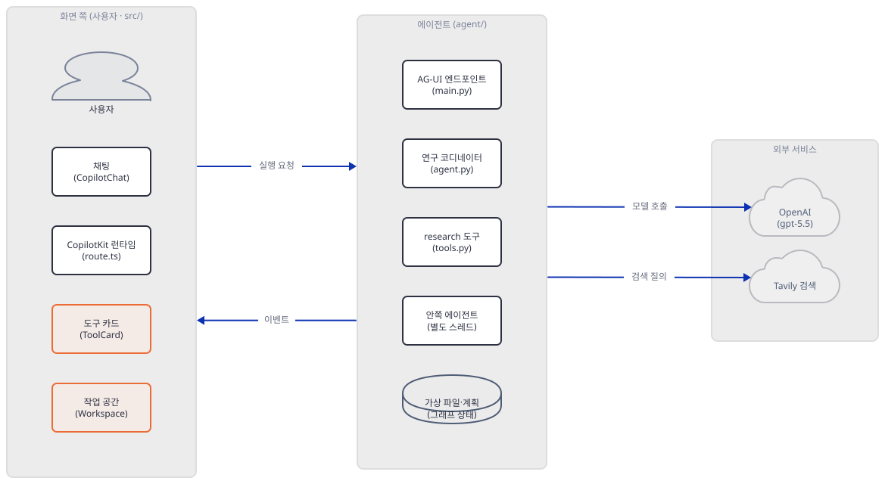

**확인.** 소스에서 서버가 만들 수 있는 출처 상태와 화면이 그리는 상태를 찾아 맞대어 봅니다.

```bash
cd <리포>/generative_ui_agents/ai-deep-research-agent
grep -n '"status"' agent/tools.py
grep -c "scraped\|failed" src/components/Workspace.tsx
```

```text
164:                "status": "found",
8
```

(직접 확인한 출력입니다.) 서버가 만드는 `status`는 `found` 하나이고, 화면은 `scraped`·`failed`를 여덟 줄에서 다룹니다.

## 요청 한 건이 흐르는 과정

질문 하나가 지나는 길을 시간 순서로 그렸습니다. 긴 길이라 다섯 장으로 나눴고 경계는 코드의 실제 순서에서 잘랐습니다. 첫 장은 질문이 서버에 닿아 모델이 계획과 검색을 정하기까지입니다. 도구 호출 이벤트(`TOOL_CALL_START·ARGS·END`)는 모델이 호출을 만드는 동안 먼저 스트림에 실려 나가고, 결과(`TOOL_CALL_RESULT`)는 도구가 끝난 뒤에 나갑니다.

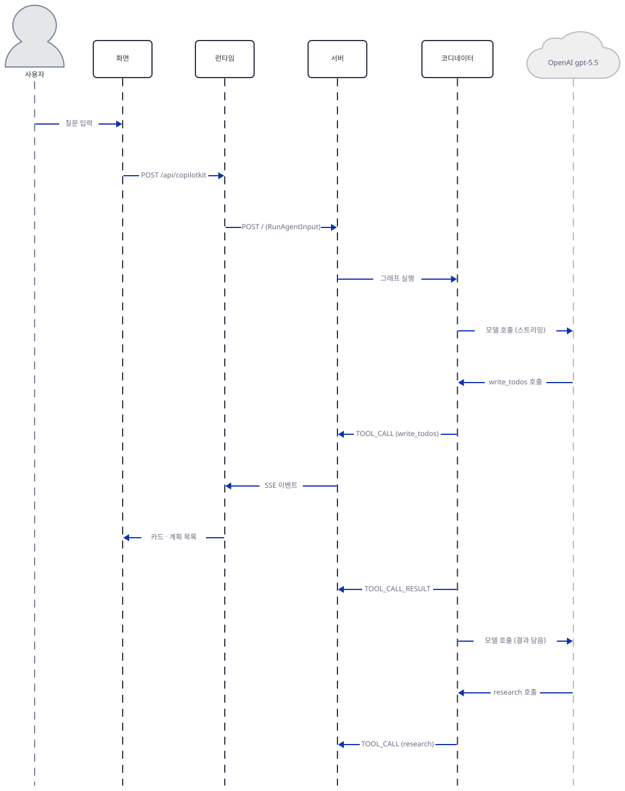

그림의 "서버"는 `main.py`의 AG-UI 엔드포인트이고 "코디네이터"는 `agent.py`가 만든 그래프입니다. 서버→런타임→화면의 전달은 이벤트마다 되풀이되며, 처음 한 번(`write_todos`)만 세 화살표로 그렸습니다. 이어서 `research`가 안쪽 에이전트를 부르는 부분입니다. 안쪽 에이전트의 모델 요청은 스트리밍이 아니고, 검색 도구의 이름은 `internet_search_tracked`입니다.

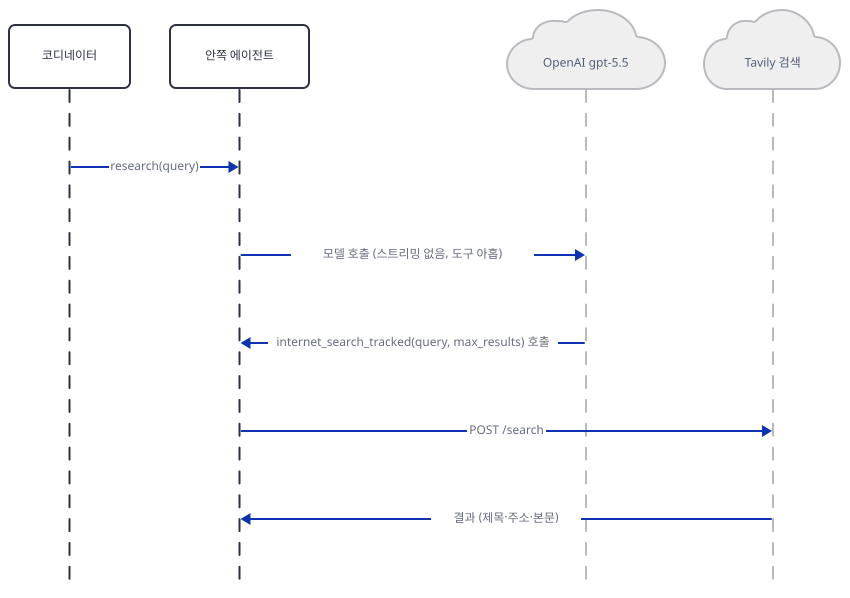

검색 결과가 모델에 들어가 요약 글이 되고, 그것이 `{summary, sources}`로 코디네이터에게 돌아가 카드와 출처 목록이 됩니다.

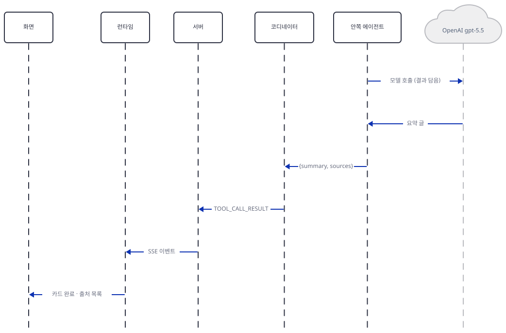

검색을 마친 코디네이터는 요약을 담아 모델을 다시 부르고, 모델이 `write_file`을 부릅니다.

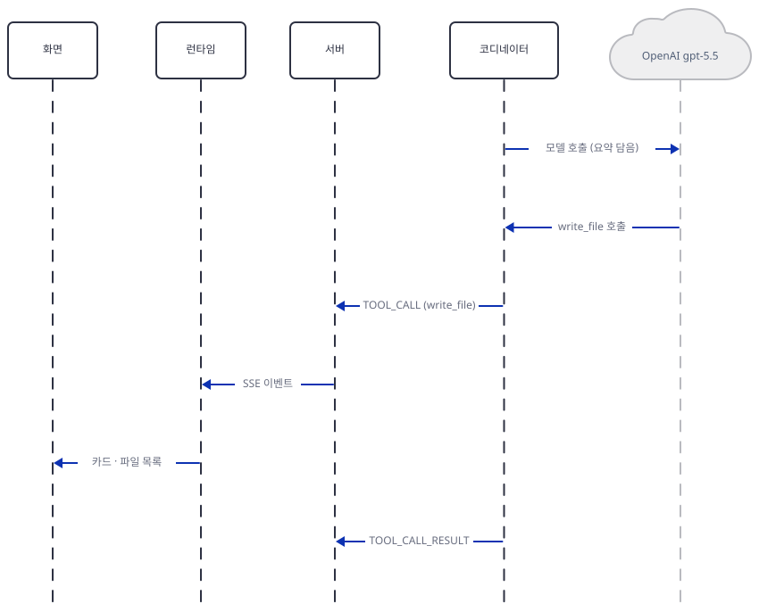

파일 결과를 받은 모델이 마지막 글을 쓰면 채팅 말풍선이 됩니다.

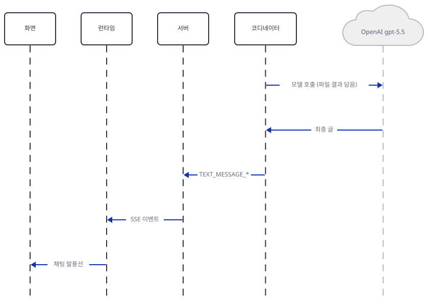

마지막으로 상태 스냅숏과 `RUN_FINISHED`가 가고 실행이 끝납니다. 화면이 보여 주는 것은 채팅의 카드·말풍선과 작업 공간입니다.

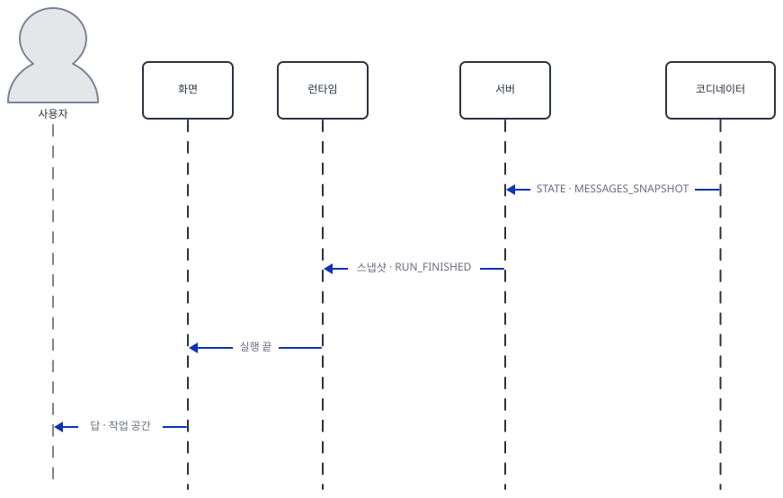

## 실행 체크리스트

- [ ] `uv sync --frozen` 뒤 `deepagents 0.3.8`이 나온다(Step 1)
- [ ] `show_tools.py`가 `temperature kept: None`과 `write_todos`가 든 도구 열 개를 출력한다(Step 2)
- [ ] 키 하나를 지우면 `build_agent`가 `RuntimeError: Missing ... API_KEY`로 멈춘다(Step 3)
- [ ] `netstat`에 `127.0.0.1:58317`과 `127.0.0.1:58318`만 보이고 `0.0.0.0`은 없다(Step 4)
- [ ] `ask.py`가 `TOOL_CALL_*` 넷과 `RUN_FINISHED`로 끝나고 `blocked.log`는 생기지 않는다(Step 5)
- [ ] `show_log.py`가 모델 호출 아홉(코디네이터 다섯·안쪽 넷)과 검색 둘을 센다(Step 5)
- [ ] `"with ls"` 질문에서 목록에 없는 `ls` 호출이 스트림에 나온다(Step 5)
- [ ] `research_assistant`가 `route.ts`·`layout.tsx`·`main.py`에서 같다(Step 6)
- [ ] `tools.py`는 `"status": "found"`만 만든다(Step 7)
- [ ] 원본 폴더에는 아무 파일도 생기지 않았다(`git status --short -- generative_ui_agents/ai-deep-research-agent`가 비어 있다)

## 문제 해결

| 증상 | 원인 | 해결 |
|---|---|---|
| `RuntimeError: Missing OPENAI_API_KEY environment variable`(또는 `TAVILY_API_KEY`)로 서버가 안 뜬다 | `build_agent`가 키를 import 때 검사하고 `main.py`가 예외를 다시 던진다(`generative_ui_agents/ai-deep-research-agent/agent/agent.py:59-66`, `generative_ui_agents/ai-deep-research-agent/agent/main.py:76-78`) | `agent/.env`에 두 키를 넣거나, 이 문서에서는 `guard.py`가 가짜 값을 채웁니다 |
| 화면의 "Research Plan"이 비어 있다 | 잠금 없이 풀린 deepagents 0.7.26에는 `write_todos`가 없다(Step 2). `MESSAGES_SNAPSHOT`의 도구 메시지에 `write_todos is not a valid tool`이 남는다(더 해보기) | 앱 README의 순서대로 `uv run`으로 잠금 판을 쓰거나, 최신 판에서 계획 도구를 직접 붙이는 것은 이 문서의 범위 밖입니다 |
| `.env.example`을 복사했더니 서버가 `0.0.0.0`으로 뜨고 모델이 `gpt-5.2`다 | 그 파일의 `SERVER_HOST=0.0.0.0`·`OPENAI_MODEL=gpt-5.2`(`generative_ui_agents/ai-deep-research-agent/.env.example:4`, `generative_ui_agents/ai-deep-research-agent/.env.example:12`)가 `os.getenv`에 들어온다 | 복사한 `.env`에서 두 줄을 지우고 `--host 127.0.0.1`로 직접 띄웁니다 |
| 서버 로그에 `openai.APIConnectionError: Connection error.`가 나오고 `ask.py`가 `RUN_FINISHED` 없이 끝난다 | 모델 서버(이 문서에서는 가짜 서버)에 닿지 못했는데 스트림에는 오류 이벤트가 없다(Step 5) | 터미널 1의 가짜 서버가 떠 있는지, `FAKE_BASE`의 포트가 맞는지 확인합니다 |
| `refuse: FAKE_BASE='' is not loopback`으로 스크립트가 멈춘다 | 터미널에 `FAKE_BASE`가 없다. 터미널마다 다시 줘야 한다 | `export FAKE_BASE=http://127.0.0.1:58317` |
| 같은 질문을 두 번 보냈더니 두 번째에는 계획·검색 없이 마지막 글만 나온다 | 같은 `threadId`의 상태가 `MemorySaver`에 남아 대화가 이어진다 | `ask.py`처럼 요청마다 새 `threadId`를 씁니다 |
| `emit_tool_calls`에 없는 도구(`ls`·`task`)의 호출이 스트림에 나온다(화면에서는 기본 JSON 카드가 될 것으로 읽힙니다) | 그 설정은 목록으로는 걸러 내지 않는다(Step 5, 소스로 확인) | 걸러야 한다면 `emit_tool_calls=False`를 쓰는 식으로 설계가 달라야 하며 이 문서는 시험하지 않았습니다 |
| 화면의 파일 카드 제목이 "Writing: file"이다 | 카드가 읽는 `args.path`와 deepagents의 `file_path`가 다르다(Step 7, 소스로 확인) | 복사본의 `ToolCard.tsx:91`을 `args.file_path`로 바꾸는 것이 한 방법입니다(시험하지 못했습니다) |
| `npm install`이 `next`의 `engines` 경고를 내거나 `npm run dev`가 시작하지 않는다 | `next` 16.1.1은 Node 20.9 이상을 요구하는데 앱 README는 18 이상이라고 한다 | Node 20.9 이상(`Dockerfile`은 22)을 쓰세요. 직접 실행해 보지는 못했습니다 |

## 더 해보기

- 최신 판에서 모델이 `write_todos`를 부르면 어떻게 되는지 봅니다. Step 4의 터미널 1(가짜 서버. Step 5에서 껐다면 다시 켭니다)은 그대로 두고, 터미널 2의 에이전트 서버를 끈 뒤 `latest-venv`의 파이썬으로 다시 띄웁니다. 포트는 58319입니다.

```bash
# 터미널 2 (Windows Git Bash. macOS·Linux는 ../latest-venv/bin/python)
cd deep-research-lab
export PYTHONIOENCODING=utf-8 FAKE_BASE=http://127.0.0.1:58317
../latest-venv/Scripts/python.exe -B run_local.py 58319
```

```bash
# 터미널 3
cd deep-research-lab
export PYTHONIOENCODING=utf-8 FAKE_BASE=http://127.0.0.1:58317
uv run --no-project python -B ask.py http://127.0.0.1:58319/ "Research solid-state batteries" | grep -v "^TOOL_CALL_ARGS\|^STATE_SNAPSHOT"
```

```text
HTTP 200 text/event-stream; charset=utf-8
RUN_STARTED
TOOL_CALL_START write_todos 759387
TOOL_CALL_END
TOOL_CALL_START research 759410
TOOL_CALL_END
TOOL_CALL_RESULT 759410 '{"summary": "FAKE summary: three fake sources were read for this query.", "sources": [{"ur'
TOOL_CALL_START research 759510
TOOL_CALL_END
TOOL_CALL_RESULT 759510 '{"summary": "FAKE summary: three fake sources were read for this query.", "sources": [{"ur'
TOOL_CALL_START write_file 759579
TOOL_CALL_END
TOOL_CALL_RESULT 759579 'Updated file /reports/final_report.md'
TEXT_MESSAGE_START
TEXT_MESSAGE_CONTENT 'FAKE answer: the '
TEXT_MESSAGE_CONTENT 'report is saved '
TEXT_MESSAGE_CONTENT 'at /reports/final_report.md.'
TEXT_MESSAGE_END
MESSAGES_SNAPSHOT ['user', 'assistant', 'tool', 'assistant', 'tool', 'assistant', 'tool', 'assistant', 'tool', 'assistant']
  tool error: Error: write_todos is not a valid tool, try one of [ls, read_file, write_file, edit_file, delete, glob, grep, 
RUN_FINISHED
{'RUN_STARTED': 1, 'RAW': 116, 'STEP_STARTED': 17, 'STEP_FINISHED': 17, 'TOOL_CALL_START': 4, 'TOOL_CALL_ARGS': 8, 'TOOL_CALL_END': 4, 'STATE_SNAPSHOT': 5, 'TOOL_CALL_RESULT': 3, 'TEXT_MESSAGE_START': 1, 'TEXT_MESSAGE_CONTENT': 3, 'TEXT_MESSAGE_END': 1, 'MESSAGES_SNAPSHOT': 1, 'RUN_FINISHED': 1}
```

(직접 확인한 출력입니다.) 가짜 모델은 대본대로 `write_todos`를 불렀지만 이 판에는 그 도구가 없어서 `TOOL_CALL_START`는 있고 `TOOL_CALL_RESULT`는 없습니다. 결과 넷 가운데 셋만 나오고, 오류는 `MESSAGES_SNAPSHOT` 안의 도구 메시지로만 남으며, 끝의 상태에도 `todos`가 없습니다. 화면의 계획 구역은 이 호출의 인자로 채워지는데(Step 7) 호출 자체가 실패한 것입니다. 진짜 모델이 이 판에서도 같은 호출을 만들지는 확인하지 못했습니다. 지시문이 계속 `write_todos`를 쓰라고 하므로 만들 수 있다는 것까지가 이 실험의 한계입니다.

- 앱 README의 순서를 그대로 따라 해 보고 어느 판이 도는지 봅니다. 아래는 일부러 `--no-project`를 뺀 시연이라 태그 없는 펜스입니다. 새 폴더에서 해야 `uv run`이 만든 변경이 원본에 닿지 않습니다.

```
mkdir readme-flow && cd readme-flow
cp <리포>/generative_ui_agents/ai-deep-research-agent/agent/{agent.py,main.py,tools.py,pyproject.toml,uv.lock} .
uv venv && source .venv/bin/activate     # Windows Git Bash: source .venv/Scripts/activate
uv pip install -e .
python -c "import importlib.metadata as m; print(m.version('deepagents'), m.version('copilotkit'))"
uv run python -c "import importlib.metadata as m; print(m.version('deepagents'), m.version('copilotkit'))"
```

`uv pip install -e .` 직후에는 `0.7.26 0.1.96`이고 `uv run` 안에서는 `0.3.8 0.1.76`이었습니다(직접 확인, uv 0.7.2, 같은 줄에 `Uninstalled 54 packages`·`Installed 57 packages`가 찍혔고 `uv.lock`은 바뀌지 않았습니다). `pip install -e .`는 `deep_research_agent.egg-info/`를 그 폴더에 만듭니다.

- `fake_server.py`의 대본에서 `research` 호출을 둘에서 하나로 줄이고 `show_log.py`의 모델 호출 수·요청 글자 수가 어떻게 바뀌는지 봅니다. 한 번에 드는 비용의 어림(Step 3)이 어디에 가장 민감한지 알 수 있습니다.
- 대본의 `write_file` 단계 뒤에 `edit_file` 호출을 끼워 `ask.py`의 이벤트가 어떻게 달라지는지 보고, Step 7의 표대로 화면의 작업 공간은 그 편집을 반영하지 못한다는 것을 소스(`generative_ui_agents/ai-deep-research-agent/src/app/page.tsx:71-87`)에서 다시 확인합니다.

## 다음 날 예고

[Day 142 · 🪙 AI Financial Coach Agent](../day142-genui-financial-coach-agent/README.md) — 같은 볼륨의 다음 앱입니다. 원본 `generative_ui_agents/ai-financial-coach-agent`는 LangGraph 대신 Google ADK와 `ag-ui-adk` 위의 파이썬 에이전트(`agent/main.py` 507줄)와 Next.js 화면(`src/components/`의 카드 다섯 파일)으로 나뉩니다. 앱 README는 코치가 채팅 한 턴을 알맞은 도구로 보내고(재무 프로필 갱신, 예산·저축·부채 단계 하나 또는 전부), 도구가 돌 때마다 채팅에 상태 알약이 흐르고 보고서 탭에 카드가 나타난다고 소개합니다. 모델 `gemini-3.5-flash`는 같은 파일의 170·193·216·462행에 있고, `generative_ui_agents/ai-financial-coach-agent/agent/main.py:507`은 오늘처럼 `host="0.0.0.0"`으로 서버를 엽니다. 금융 조언을 다루는 앱이라 앱과 문서가 실제 조언이 아니라고 밝히는지도 살펴봅니다.
