# Day 142 · 🪙 AI Financial Coach Agent

> 볼륨 12 🖼️ Generative UI · 난이도 ★★★ ⚠ 앱과 앱 README 어디에도 "금융 조언이 아니다"라는 고지가 없고(소스 검색으로 확인, Step 7), 원본의 `npm run dev:agent`는 에이전트 서버를 모든 네트워크 인터페이스(`0.0.0.0`)에 열고(Step 2), `npm install`은 설치 통계를 보내는 스크립트를 포함해 세 개의 설치 스크립트를 실행합니다(Step 6) · 예상 소요 185분(앱은 약 2,400줄이고 Node 쪽은 소스로만 읽지만, 스크립트 아홉을 직접 저장해 돌리고 서버 기록과 화면 쪽 소스를 맞대어 보고 시퀀스 그림 여덟 장을 훑는 손 시간이 본문 읽는 시간에 더해집니다) · API 비용 대략 이 문서의 따라 하기는 $0(가짜 서버만 부릅니다. 실제 Google API는 한 번도 부르지 않았습니다). 진짜 키로 전체 검토 한 번은 모델 호출 네 번에 요청 본문이 약 2만 2천 자였고, 어림으로 $0.05 이하입니다(⚠ 추정, 사전 준비) · 원본 앱: `generative_ui_agents/ai-financial-coach-agent`

## 오늘 만들 것

채팅으로 자기 재정(소득·부양가족·지출·빚)을 말하거나 폼에 적고, "분석해 줘"라고 하면 예산·저축·빚 상환 카드 세 장이 화면의 Report 탭에 그려지는 앱입니다. 화면은 Next.js와 CopilotKit(React)이고, 에이전트는 Google ADK(파이썬)입니다. 둘 사이는 AG-UI라는 이벤트 규약으로 오갑니다. 에이전트가 모델 응답을 글로만 돌려주는 대신 "도구를 불렀다", "상태가 이렇게 바뀌었다"라는 이벤트를 흘려 보내고, 화면이 그것을 받아 채팅 안의 상태 알림 알약과 탭 안의 카드로 그립니다. 볼륨 12가 말하는 "생성 UI"가 이것입니다(`generative_ui_agents/README.md`: "The model decides *what to show*, the frontend renders real components"). 이 앱에서 모델이 정하는 것은 어느 도구를 부를지이고, 카드의 모양은 화면의 코드가 정합니다. 모델의 출력은 pydantic 스키마(`output_schema`)로 묶여 있어서 화면이 믿고 그립니다.

에이전트는 코치 하나와 전문 에이전트 셋입니다. 코치(`FinanceCoachAgent`)는 사용자의 말을 보고 도구 다섯 중 하나를 고릅니다. 프로필을 고치는 함수(`update_financial_data`), 예산·저축·빚 분석을 각각 맡는 에이전트 셋, 그 셋을 차례로 돌리는 `FullAnalysisPipeline`입니다. ADK의 `output_schema`·`output_key`는 Day 016이, `before_model_callback`과 `tool_context.state`는 Day 019가, `AgentTool`은 Day 021이, `SequentialAgent`와 세션 상태는 Day 022가 다뤘습니다. 오늘 새로 보는 것은 그 조각들이 AG-UI 위에서 화면과 상태를 나누는 방식입니다.

이 문서는 파이썬 쪽만 돌렸습니다. Next.js 쪽(`src/`)은 `npm install`·`npx`·`next`를 하나도 실행하지 않고 소스로만 읽었습니다(Day 124가 `client/`를 같은 방식으로 읽었습니다). 읽은 CopilotKit·AG-UI 패키지는 npm 레지스트리의 압축 파일을 `curl`로 받아 풀기만 했고(앱 `package-lock.json`의 무결성 값과 여섯 개 모두 일치), 실행하지 않았습니다. 브라우저 화면은 한 번도 띄우지 않았으므로 카드가 실제로 어떻게 보이는지는 보여 드리지 못합니다. 화면이 보내는 요청은 `ask.py`가 대신 만들어 보냅니다. 모델 자리에는 `127.0.0.1`의 가짜 서버가 있고, 그 답은 모두 제가 쓴 대본입니다. 그래서 실제 모델이 도구를 어떻게 고르는지, 분석이 얼마나 쓸모 있는지는 확인하지 못했고 문서의 숫자는 어떤 재정 판단의 근거도 아닙니다. 이 문서를 만들며 앱 코드가 Google이나 CopilotKit·Next.js 통계 서버로 보낸 요청은 한 건도 없습니다. 파이썬의 연결과 이름 조회를 기록해 루프백이 아니면 막는 감시를 걸고 돌렸고, 기록 26건이 모두 `127.0.0.1`이었습니다. 셸에 `HTTP_PROXY` 같은 프록시 변수를 걸고(주소는 루프백에 세운 기록용 프록시) 같은 순서로 따라 했을 때도 그 프록시로 간 요청은 0건이었습니다.

직접 돌려 보고 알게 된 특이점이 여덟입니다. 첫째, 앱은 코치가 분석 뒤에 "한두 문장으로 핵심을 짚는다"고 지시하지만 분석 도구에 `skip_summarization=True`가 걸려 있어 그 문장은 나오지 않습니다(Step 5). 둘째, 코치는 사용자의 프로필을 프롬프트로 받지 않고 전문 에이전트만 받습니다(Step 4·5). 셋째, 화면의 폼에서 고친 값이 매 요청마다 서버의 세션 상태를 덮어씁니다(Step 5). 넷째, 프로필을 고쳐도 옛 분석 결과는 지워지지 않아 다음 분석의 프롬프트에 그대로 들어갑니다(Step 5). 다섯째, 화면이 보내는 도구 목록은 이 에이전트에서 무시됩니다(Step 5). 여섯째, 서버를 껐다 켠 뒤 같은 대화로 말하면 첫 요청에서 모델 호출이 세 번 일어납니다(Step 7). 일곱째, 서버는 인증이 없고 `0.0.0.0`에 열립니다(Step 2·7). 여덟째, `fixtures/`와 `docker-compose.test.yml`은 이 앱의 재정 데이터가 아니라 템플릿 저장소의 테스트 설정 조각입니다(Step 7). 아래는 완성된 아키텍처입니다.

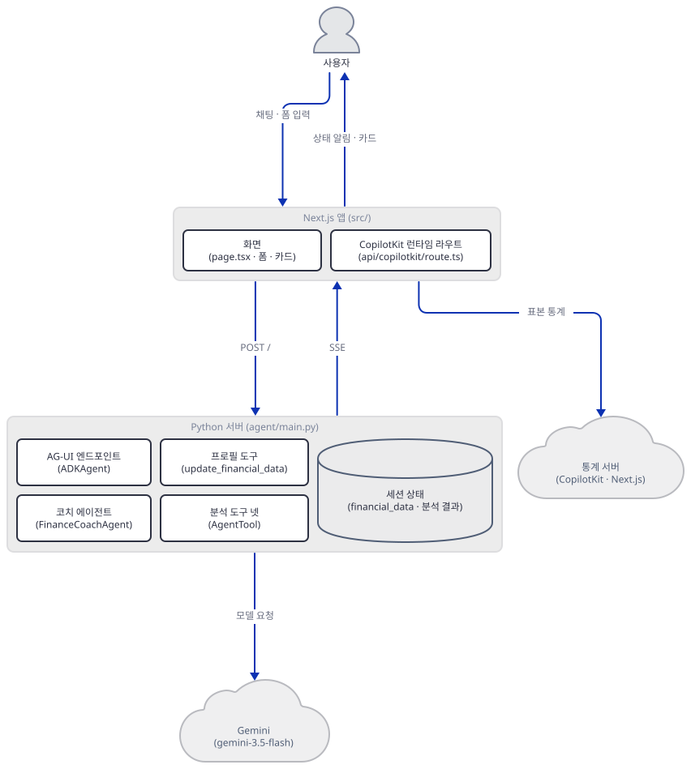

## 사전 준비

| 서비스/도구 | 용도 | 발급·설치 |
|---|---|---|
| uv | 가상환경 생성과 패키지 설치 | [공통 사전 준비](../README.md#공통-사전-준비-한-번만) 절 참고 |
| Python 3.12 이상 | 앱의 `pyproject.toml`이 `requires-python = ">=3.12"`입니다. 이 문서는 3.13.3으로 확인했습니다 | 공통 사전 준비와 같음 |
| Node.js 20.9 이상 | 화면 쪽 실행용. 앱 README는 18 이상이라 하지만 잠긴 `next` 16.1.1의 `engines.node`가 `>=20.9.0`입니다(`package-lock.json`을 읽음). **이 문서는 설치도 실행도 하지 않았습니다** | https://nodejs.org (이 문서는 실행하지 않았음) |
| Google API 키 | 진짜로 쓸 때만(`GOOGLE_API_KEY`). 이 문서는 가짜 값 `fake-key-d142`만 씁니다 | https://aistudio.google.com/apikey |
| 터미널 셋(Step 7에서 넷) | 가짜 서버를 띄우는 A, 앱 서버를 띄우는 B, 나머지를 돌리는 C, Step 7의 키 없는 서버를 띄우는 D. 모두 `coach-work/agent` 폴더(Step 1에서 만듭니다)에서 열고, 열 때마다 아래 `PYTHONIOENCODING` 줄을 겁니다 | 별도 설치 없음 |
| 인터넷 연결 | PyPI에서 설치할 때만. 이 문서의 확인은 설치 뒤에 모두 `127.0.0.1`로만 갑니다 | 별도 설치 없음 |

한국어 Windows의 Git Bash에서 파이썬 출력이 cp949로 깨지는 것을 막으려고, 터미널을 열 때마다 첫 명령 전에 이렇게 겁니다.

```bash
export PYTHONIOENCODING=utf-8
```

```powershell
$env:PYTHONIOENCODING = "utf-8"
```

**앱이 쓰는 모델이 아직 살아 있는지(2026-10-16).** `gemini-3.5-flash`가 네 곳에 박혀 있습니다(`generative_ui_agents/ai-financial-coach-agent/agent/main.py`의 170·193·216·462행). Google 공식 문서 셋을 WebFetch로 읽었습니다. 이 도구는 페이지를 글로 바꾸고 작은 모델이 질문에 답하는 것이라 표 행을 그대로 복사한 것은 아닙니다.

| 문서 | `gemini-3.5-flash`에 대한 내용 |
|---|---|
| 폐기 표 (https://ai.google.dev/gemini-api/docs/deprecations) | 행이 있습니다. 출시 2026-05-19, 종료일 "N/A", 권장 대체 `gemini-3.6-flash`, 비고에 "the endpoint is not shutting down and automatically routes API requests to `gemini-3.6-flash`" |
| 모델 페이지 (https://ai.google.dev/gemini-api/docs/models) | 이 ID는 없습니다. `gemini-3.5-flash-lite`, `gemini-3.6-flash`, `gemini-3.8-flash`가 Stable로 있습니다 |
| 가격표 (https://ai.google.dev/gemini-api/docs/pricing) | 이 ID의 행은 없습니다. `gemini-3.6-flash`는 2026년 12월 31일까지 입력 $0.75·출력(생각 토큰 포함) $3.75(100만 토큰당), 2027년 1월 1일부터 $1.50·$7.50이고 무료 등급이 있습니다 |

종료 예정은 아니라고 읽어 ⚠는 달지 않았습니다(같은 모델을 쓰는 Day 144도 같은 원문으로 같은 결론입니다). 다만 이 ID로 부르면 서버가 다른 모델로 이어 준다고 적혀 있으므로, 실제로 어느 모델이 답하는지와 어느 요금이 붙는지는 확인하지 못했습니다. 이 앱에서 고칠 곳은 위 네 줄이 전부입니다. 비용 어림은 이렇습니다. 가짜 서버가 받은 전체 검토의 요청 본문 네 건이 합쳐 22,525자(`json.dumps`한 요청 전체)였고, 4자당 1토큰으로 어림잡으면 입력 약 5,600토큰입니다. 출력은 대본의 짧은 답이라 의미가 없으므로 한 번에 JSON 셋과 도구 호출 하나가 합쳐 2,500토큰이라고 가정하면 `gemini-3.6-flash` 가격으로 약 $0.013입니다. 생각 토큰이 출력으로 붙으니 넉넉히 $0.05 이하로 잡았습니다(⚠ 추정).

## 아키텍처 한눈에 보기

| 컴포넌트 | 역할 | 코드 위치 |
|---|---|---|
| 화면 (`page.tsx`) | `CopilotSidebar` 채팅, Profile·Report 탭, `useCoAgent`로 에이전트 상태를 읽고 쓰고, 도구 호출마다 알림 알약을 그린다 | `generative_ui_agents/ai-financial-coach-agent/src/app/page.tsx:20-262` |
| 도구 알림 알약 | 진행 중이면 돌아가는 표시, 끝나면 ✅와 요약 | `generative_ui_agents/ai-financial-coach-agent/src/components/tool-status-card.tsx:1-41` |
| 프로필 폼 | 소득·부양가족·지출 아홉 칸·빚 목록을 고쳐 에이전트 상태에 쓴다 | `generative_ui_agents/ai-financial-coach-agent/src/components/financial-form.tsx:18-173` |
| 카드 셋 | 예산(도넛 차트), 저축(비상금), 빚 상환(눈사태·눈덩이·비교 탭) | `generative_ui_agents/ai-financial-coach-agent/src/components/budget-analysis-card.tsx:1-229`, `generative_ui_agents/ai-financial-coach-agent/src/components/savings-strategy-card.tsx:1-108`, `generative_ui_agents/ai-financial-coach-agent/src/components/debt-reduction-card.tsx:1-265` |
| 상태 타입 | 에이전트의 pydantic 스키마를 그대로 옮긴 TypeScript 타입 | `generative_ui_agents/ai-financial-coach-agent/src/lib/types.ts:1-107` |
| 런타임 라우트 | 화면의 요청을 받아 `HttpAgent`로 파이썬 서버에 전달한다. 주소는 `AGENT_URL`, 기본 `http://localhost:8000/` | `generative_ui_agents/ai-financial-coach-agent/src/app/api/copilotkit/route.ts:1-33`, `generative_ui_agents/ai-financial-coach-agent/src/app/layout.tsx:1-27` |
| 출력 스키마·상태 배관 | 전문 에이전트 셋의 결과 모양과 `financial_data`를 프롬프트에 넣는 콜백 | `generative_ui_agents/ai-financial-coach-agent/agent/main.py:21-162` |
| 전문 에이전트 셋·파이프라인 | 예산·저축·빚. `output_key`로 상태에 결과를 쓴다. 셋을 차례로 돌리는 `SequentialAgent` | `generative_ui_agents/ai-financial-coach-agent/agent/main.py:168-246` |
| 프로필 도구 | 별칭 표(`rent`→`Housing` 등)와 `update_financial_data` | `generative_ui_agents/ai-financial-coach-agent/agent/main.py:249-418` |
| `AgentTool` 래핑·코치 | 분석 에이전트를 도구로 감싸고(`skip_summarization=True`) 코치의 지시문과 에이전트 | `generative_ui_agents/ai-financial-coach-agent/agent/main.py:421-473` |
| AG-UI 엔드포인트·서버 실행 | `ADKAgent`를 `POST /`에 달고, `/health`, 직접 실행하면 `0.0.0.0:8000` | `generative_ui_agents/ai-financial-coach-agent/agent/main.py:476-507` |
| 설치·실행 스크립트 | `npm run dev`가 화면과 에이전트를 함께 띄운다. `postinstall`이 파이썬 환경까지 만든다 | `generative_ui_agents/ai-financial-coach-agent/package.json:5-13`, `generative_ui_agents/ai-financial-coach-agent/scripts/run-agent.sh:1-10`, `generative_ui_agents/ai-financial-coach-agent/scripts/setup-agent.sh:1-6` |
| 배포·시험 파일 | 합친 이미지(`Dockerfile`·`entrypoint.sh`), 앱별 이미지(`docker/`), 시험용 compose와 모의 모델 설정(`fixtures/`). 읽기만 했다 | `generative_ui_agents/ai-financial-coach-agent/Dockerfile:1-55`, `generative_ui_agents/ai-financial-coach-agent/docker-compose.test.yml:1-80`, `generative_ui_agents/ai-financial-coach-agent/fixtures/default.json:1-16` |
| Gemini API·CopilotKit와 Next.js 통계 서버 | 모델 응답, 사용 통계 | 코드 없음 (외부 서비스) |

위 그림은 화면의 두 컴포넌트와 서버의 컴포넌트를 묶음으로 그렸고, 묶음 안의 화살표는 세로 1,000px를 지키려고 아래 네 그림으로 나눴습니다. 개념 하나를 한 노드로 합치지는 않았습니다. 분석 에이전트 셋(`LlmAgent`)은 `FullAnalysisPipeline`(`SequentialAgent`) 안에 따로 있고, 도구는 그것들을 감싼 `AgentTool` 넷입니다. 화면 쪽은 사용자와 화면, 런타임 라우트, 파이썬 서버, 통계 서버 사이의 화살표입니다. 통계 서버는 Node 쪽에서만 나가므로 이 그림에만 있습니다.

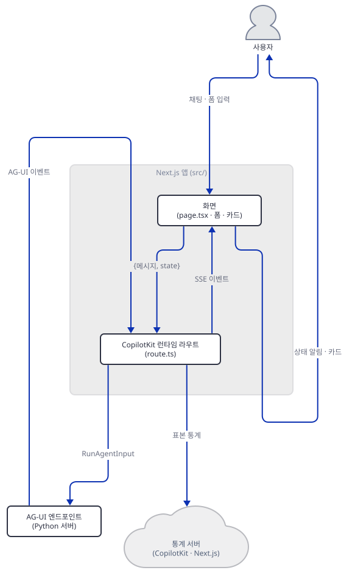

서버 안에서는 요청이 `run`으로 코치에 닿고, 코치가 함수와 `AgentTool`을 부르고, 코치가 Gemini를 부릅니다.

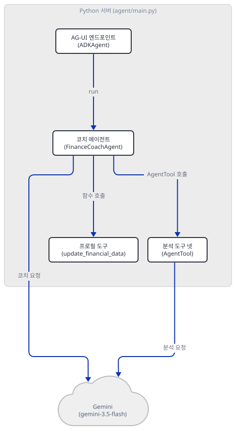

`AgentTool`은 모두 넷이고 각각 노드입니다. `run_budget_analysis`·`run_savings_strategy`·`run_debt_reduction`은 에이전트를 하나씩 감싼 단독 호출용이고, `run_full_analysis`는 파이프라인을 감싸 셋을 차례로 돌립니다. 모델을 부르는 것은 에이전트 셋입니다.

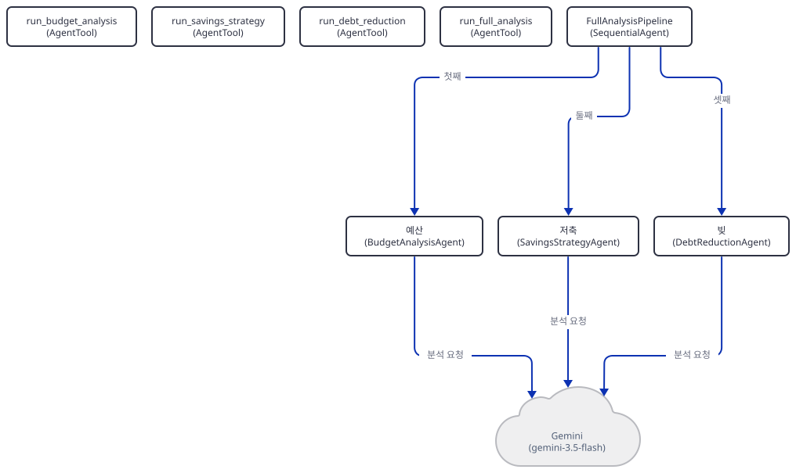

상태는 쓰는 곳이 여럿이고 읽는 곳은 분석 에이전트입니다. 요청이 올 때 `input.state`로 덮어쓰이고, 프로필 도구가 `financial_data`를 쓰고, 분석 에이전트가 각자 `output_key` 항목을 쓰고, 프롬프트에 주입하려고 읽습니다.

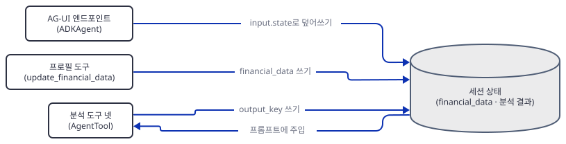

## 단계별 진행

### Step 1. 환경 만들기 — 잠금 파일 그대로 설치

**목적.** 원본을 건드리지 않도록 에이전트 폴더만 복사본에 두고, 잠금 파일대로 설치해 오늘도 되는지 확인합니다.

**할 일.** `<저장소>`는 이 저장소를 받은 경로입니다. 저장소 밖 아무 폴더에서 시작합니다. 복사본에는 `.env`를 만들지 않습니다. 앱 README는 키를 `export`로 주라고 하지만 이 문서는 Step 2의 가드가 가짜 값을 직접 겁니다.

```bash
mkdir coach-work
cd coach-work
mkdir agent
cp <저장소>/generative_ui_agents/ai-financial-coach-agent/agent/{main.py,pyproject.toml,uv.lock} agent/
cd agent
uv sync
```

(pip 대안은 없습니다. 이 폴더에는 `requirements.txt`가 없고 `pyproject.toml`과 `uv.lock`뿐입니다.) 아래 PowerShell 줄은 실행해 보지 못했습니다(이 문서를 쓴 하네스가 PowerShell 실행을 막습니다).

```powershell
mkdir coach-work
cd coach-work
mkdir agent
$src = "<저장소>\generative_ui_agents\ai-financial-coach-agent\agent"
Copy-Item $src\main.py, $src\pyproject.toml, $src\uv.lock agent
cd agent
uv sync
```

앱 README의 순서는 다릅니다. `npm install` 다음에 `npm run install:agent`를 따로 하라고 하지만, `package.json`의 `postinstall`이 이미 그것을 부릅니다(`generative_ui_agents/ai-financial-coach-agent/package.json:12-13`). 그래서 `npm install` 한 번이 화면 쪽 패키지와 파이썬 환경을 함께 만듭니다. 이 문서는 파이썬만 필요하므로 위처럼 `uv sync`만 합니다. 의존성 목록에는 버전이 없고 이름도 템플릿 흔적입니다.

`generative_ui_agents/ai-financial-coach-agent/agent/pyproject.toml:1-14`

```toml
[project]
name = "proverbs-agent"
version = "0.1.0"
description = "ADK Proverbs Agent with shared state"
requires-python = ">=3.12"
dependencies = [
  "fastapi",
  "uvicorn[standard]",
  "python-dotenv",
  "pydantic",
  "google-adk",
  "google-genai",
  "ag-ui-adk",
]
```

실제 버전은 `uv.lock`이 정합니다. 직접 확인한 설치 출력의 앞뒤입니다.

```text
Using CPython 3.13.3
Creating virtual environment at: .venv
Resolved 127 packages in 6ms
Installed 125 packages in 2.36s
```

핵심 패키지의 설치된 버전을 찍습니다.

```bash
uv run --no-project python -c 'import importlib.metadata as m, sys; print("python", sys.version.split()[0]); [print(f"{p:14}", m.version(p)) for p in ("google-adk", "ag-ui-adk", "google-genai", "fastapi", "uvicorn", "pydantic", "python-dotenv")]'
```

```text
python 3.13.3
google-adk     1.26.0
ag-ui-adk      0.5.0
google-genai   1.65.0
fastapi        0.135.1
uvicorn        0.41.0
pydantic       2.12.5
python-dotenv  1.2.2
```

(직접 확인)

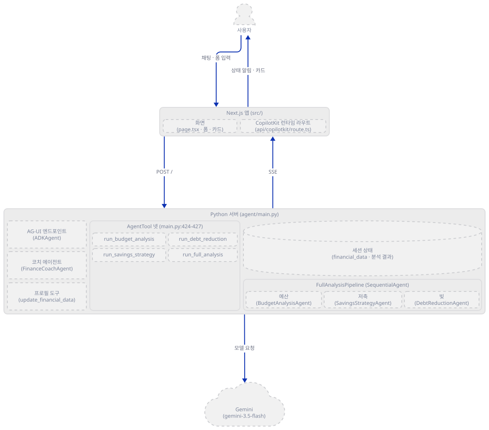

**확인.** 설치된 `.venv`는 `coach-work/agent/` 안에 있고 저장소에는 아무것도 생기지 않았습니다. `uv sync`가 잠금대로 125개를 설치했고(출력은 `Resolved 127 packages`, `Installed 125 packages`), 이후 모든 명령은 `uv run --no-project`로 이 환경을 그대로 씁니다. 저장소 쪽은 `git status --short -- generative_ui_agents/ai-financial-coach-agent`가 비어 있어야 합니다(직접 확인).

### Step 2. 루프백 가드와 가짜 Gemini — 아무 데도 나가지 않게

**목적.** 앱이 Google 대신 `127.0.0.1`의 가짜 서버만 부르도록 환경을 걸고, 서버도 루프백에만 열고, 셸에 진짜 키가 있어도 바깥에 닿지 않는지 확인합니다.

**할 일.** 먼저 두 가지를 소스로 확인했습니다. google-genai 1.65.0은 클라이언트에 주소를 안 주면 환경변수 `GOOGLE_GEMINI_BASE_URL`을 읽고(`google/genai/_base_url.py`의 `get_base_url`, 소스로 확인), 키는 `GOOGLE_API_KEY`가 `GEMINI_API_KEY`보다 앞섭니다(`_api_client.py`). 앱의 `docker-compose.test.yml`은 반대로 말합니다. 모의 모델이 이 앱의 호출을 가로채지 못하는 까닭이 "google-genai SDK does not honor a custom endpoint"라고 주석에 적혀 있습니다.

`generative_ui_agents/ai-financial-coach-agent/docker-compose.test.yml:14-22`

```yaml
      # google-genai SDK does not honor a custom endpoint the way the
      # OpenAI / Anthropic clients do, so aimock can't intercept calls
      # from the adk agent — the SDK hits generativelanguage.googleapis.com
      # directly. Pass a real key via CI secret (see .github/workflows/
      # test_smoke-starter.yml). Fall back to the placeholder for local
      # dev runs where the local harness may provide its own stub.
      - GOOGLE_API_KEY=${GOOGLE_API_KEY:-test-key-for-aimock}
      - GOOGLE_GENAI_USE_VERTEXAI=false
    depends_on:
```

고정된 1.65.0에서는 환경변수가 통했습니다. 아래 가짜 서버가 이 변수만으로 앱의 요청을 받았습니다. 둘째, `main.py`는 첫머리에서 `load_dotenv()`를 부릅니다(`generative_ui_agents/ai-financial-coach-agent/agent/main.py:18`). python-dotenv 1.2.2의 `find_dotenv`는 그 파일(`main.py`)이 있는 폴더에서 위로 올라가며 `.env`를 찾고(소스로 확인), 이미 있는 환경변수는 덮어쓰지 않습니다. 그래서 독자 셸이나 상위 폴더 `.env`에 진짜 키·주소·Vertex 설정이 있으면 그것이 이기거나 섞입니다. 셋째, 프록시입니다. httpx는 기본으로 셸의 `HTTP_PROXY`·`HTTPS_PROXY`를 따르고 `NO_PROXY`가 없으면 `127.0.0.1`로 가는 요청도 프록시로 보냅니다(httpx 0.28.1의 `_utils.get_environment_proxies`, 소스로 확인). google-genai 1.65.0의 클라이언트도 환경변수를 따릅니다(`_api_client.py`의 `trust_env=True`, 소스로 확인). 회사 프록시가 있는 셸이라면 사용자의 말과 재정 정보가 담긴 요청이 프록시로 나가려 합니다. 이 문서의 스크립트는 `main.py`를 import하기 **전에** 가짜 값으로 덮고(프록시 변수는 비우고 `NO_PROXY=127.0.0.1,localhost`를 겁니다), import 뒤에 한 번 더 검사하고, 어긋나면 서버를 띄우기 전에 멈춥니다. 요청을 보내는 `ask.py`는 `trust_env=False`로 프록시 변수를 아예 읽지 않습니다.

터미널 C에서 `guard.py`를 저장합니다. `loopback`은 문자열 접두가 아니라 `urlparse`의 호스트로 비교하므로 `http://127.0.0.1@example.invalid`처럼 앞만 흉내 낸 주소를 통과시키지 않습니다.

```bash
cat > guard.py <<'PY'
"""루프백 가드. 바깥으로 나갈 수 있는 주소가 하나라도 섞이면 이유를 찍고 멈춘다.

- loopback(url): URL의 호스트(urlparse)가 127.0.0.1·localhost·::1 인지. 문자열 접두가 아니라 호스트로 비교한다.
- problems(env): 환경이 가짜 서버로만 향하는지(프록시 변수가 없고 NO_PROXY에 127.0.0.1이 있는지 포함) 검사해 어긋난 이유 목록을 돌려준다.
"""
import os
from urllib.parse import urlparse

LOOP = {"127.0.0.1", "localhost", "::1"}
PROXY_VARS = ("HTTP_PROXY", "HTTPS_PROXY", "ALL_PROXY", "http_proxy", "https_proxy", "all_proxy")
MUST_BE_EMPTY = ("GEMINI_API_KEY", "GOOGLE_CLOUD_PROJECT", "GOOGLE_CLOUD_LOCATION", "GOOGLE_VERTEX_BASE_URL")


def loopback(url: str) -> bool:
    return urlparse(url).hostname in LOOP


def problems(env) -> list:
    out = []
    host = urlparse(env.get("GOOGLE_GEMINI_BASE_URL", "")).hostname
    if host not in LOOP:
        out.append(f"GOOGLE_GEMINI_BASE_URL의 호스트가 루프백이 아님: {host!r}")
    key = env.get("GOOGLE_API_KEY", "")
    if key and not key.startswith("fake-"):
        out.append("GOOGLE_API_KEY가 가짜 값이 아님")
    if env.get("GOOGLE_GENAI_USE_VERTEXAI", "").lower() in ("1", "true"):
        out.append("GOOGLE_GENAI_USE_VERTEXAI가 켜져 있음")
    for name in MUST_BE_EMPTY:
        if env.get(name):
            out.append(f"{name}에 값이 있음")
    for name in PROXY_VARS:
        if env.get(name):
            out.append(f"{name}에 값이 있음 (프록시를 거치면 재정 정보가 프록시로 나갑니다)")
    for name in ("NO_PROXY", "no_proxy"):
        if "127.0.0.1" not in env.get(name, "").split(","):
            out.append(f"{name}에 127.0.0.1이 없음")
    return out


def apply_fake_env(base_url: str, key: str = "fake-key-d142") -> None:
    """main.py를 import하기 *전에* 부른다. main.py의 load_dotenv()는 이미 있는 변수를 덮어쓰지 않으므로,
    셸이나 .env에 진짜 키·주소가 있어도 여기서 건 값이 이긴다."""
    os.environ["GOOGLE_GEMINI_BASE_URL"] = base_url
    os.environ["GOOGLE_API_KEY"] = key
    os.environ["GOOGLE_GENAI_USE_VERTEXAI"] = "false"
    for name in MUST_BE_EMPTY + PROXY_VARS:
        os.environ[name] = ""
    os.environ["NO_PROXY"] = os.environ["no_proxy"] = "127.0.0.1,localhost"
PY
```

다음은 `run_agent.py`입니다. 원본 `main.py`를 고치지 않고 import해, 서버를 `127.0.0.1`에만 엽니다. 원본의 `uvicorn.run(app, host="0.0.0.0", port=port)`(`generative_ui_agents/ai-financial-coach-agent/agent/main.py:507`)는 `__main__`일 때만 도는 줄이라 import하면 건너뜁니다.

```bash
cat > run_agent.py <<'PY'
"""원본 main.py를 고치지 않고 그대로 import해, 서버를 127.0.0.1에만 연다.

사용: python run_agent.py <에이전트 포트> <가짜 Gemini 주소> [nokey]
환경변수는 main.py를 import하기 *전에* 여기서 덮어쓴다. main.py의 load_dotenv()는 이미 있는 변수를
덮어쓰지 않으므로 .env나 셸에 진짜 키·주소가 있어도 이 값이 이긴다. import 뒤에 한 번 더 검사하고,
어긋나면 서버를 띄우지 않는다.
"""
import os
import sys

from guard import apply_fake_env, loopback, problems

port, fake = int(sys.argv[1]), sys.argv[2]
if not loopback(fake):
    sys.exit(f"run_agent 실패: 가짜 Gemini 주소가 루프백이 아님: {fake}")

apply_fake_env(fake, "" if "nokey" in sys.argv[3:] else "fake-key-d142")

import main  # noqa: E402  (load_dotenv()가 여기서 돈다)

bad = problems(os.environ)
if bad:
    sys.exit("run_agent 실패: " + "; ".join(bad))
print(f"run_agent 통과: 모델 요청은 {fake} 로만, 서버는 127.0.0.1:{port} 에만 열립니다", flush=True)

import uvicorn  # noqa: E402

uvicorn.run(main.app, host="127.0.0.1", port=port, log_level="warning")
PY
```

가짜 서버는 제가 만든 대본입니다. 모델이 아닙니다. 요청의 시스템 지시문에 "Budget Analysis Agent"가 있으면 예산 에이전트, "Savings Strategy Agent"·"Debt Reduction Agent"가 있으면 각각 저축·빚 에이전트이고, 아니면 코치입니다. 전문 에이전트에는 지시문 머리에 앱이 붙인 `FINANCIAL DATA:` 덩어리에서 JSON을 꺼내 그 값으로 스키마에 맞는 JSON을 계산해 돌려줍니다. 코치에게는 마지막 사용자 글의 낱말로 도구 호출을 고릅니다("full"·"review"면 `FullAnalysisPipeline`, "budget"이면 `BudgetAnalysisAgent`, 소득·집세·`loan` 같은 말이면 `update_financial_data`). ADK가 쓰는 SSE 길(`streamGenerateContent`)과 일반 길을 모두 받고, 모든 요청을 `fake.jsonl`에 한 줄씩 남깁니다. 숫자는 대본이 계산한 것이라 재정 조언이 아닙니다.

```bash
cat > fake_gemini.py <<'PY'
"""가짜 Gemini 서버 (127.0.0.1). 진짜 Google 서버도, 진짜 모델도 아니다. 제가 쓴 대본이다.

- POST /v1beta/models/<모델>:streamGenerateContent (ADK가 쓰는 SSE 길)
- POST /v1beta/models/<모델>:generateContent
요청의 시스템 지시문으로 누가 불렀는지(코치·예산·저축·부채)를 가려, 정해진 규칙으로 답한다.
모든 요청을 FAKE_LOG(jsonl)에 한 줄씩 남긴다.
사용: python fake_gemini.py <포트> <로그 JSONL>
"""
import json
import re
import sys
import time
from urllib.parse import urlparse

import uvicorn
from fastapi import FastAPI, Request
from fastapi.responses import JSONResponse, StreamingResponse

PORT = int(sys.argv[1])
LOG = sys.argv[2]
app = FastAPI()


def log(**row):
    row["t"] = round(time.time(), 3)
    with open(LOG, "a", encoding="utf-8") as f:
        f.write(json.dumps(row, ensure_ascii=False) + "\n")


def block(text, name):
    """시스템 지시문에서 'NAME:\n{...}' 덩어리를 JSON으로 꺼낸다 (앱의 _state_context가 붙인 것)."""
    m = re.search(name + r":\n(\{.*?\n\})\n\n", text, re.S)
    return json.loads(m.group(1)) if m else None


def money(s):
    return float(s.replace(",", ""))


def coach_reply(text, last_is_tool_result):
    if last_is_tool_result:
        return {"text": "Done. Your profile is updated, so you can ask for a review next."}
    t = text.lower()
    if "full" in t or "review" in t:
        return {"call": ("FullAnalysisPipeline", {"request": text})}
    if "budget" in t:
        return {"call": ("BudgetAnalysisAgent", {"request": text})}
    if "saving" in t or "save" in t:
        return {"call": ("SavingsStrategyAgent", {"request": text})}
    if "debt" in t and "loan" not in t:
        return {"call": ("DebtReductionAgent", {"request": text})}
    args = {}
    m = re.search(r"income is \$?([\d,\.]+)(k?)", t)
    if m:
        args["monthly_income"] = money(m.group(1)) * (1000 if m.group(2) else 1)
    m = re.search(r"(\d+) dependants?", t)
    if m:
        args["dependants"] = int(m.group(1))
    exp = {}
    for word in ("rent", "mortgage", "groceries", "dining", "streaming", "insurance", "gas", "internet"):
        m = re.search(word + r"\D{0,12}\$?([\d,]+)", t)
        if m:
            exp[word] = money(m.group(1))
    if exp:
        args["expenses_patch"] = exp
    m = re.search(r"\$?([\d,]+) ([a-z ]*loan) at ([\d\.]+)%", t)
    if m:
        args["add_debts"] = [{"name": m.group(2).strip().title(), "amount": money(m.group(1)),
                              "interest_rate": float(m.group(3)), "min_payment": 50}]
    m = re.search(r"paid off (?:the )?([a-z ]*loan)", t)
    if m:
        args["remove_debt_names"] = [m.group(1).strip().title()]
    if args:
        return {"call": ("update_financial_data", args)}
    return {"text": "Happy to help. Tell me your income, expenses or debts, or ask for a review."}


def budget(fd):
    exp = {k: v for k, v in (fd.get("manual_expenses") or {}).items() if v}
    total = sum(exp.values())
    cats = [{"category": k, "amount": v, "percentage": round(v / total * 100, 1) if total else 0} for k, v in exp.items()]
    recs = [{"category": k, "recommendation": f"Trim {k} by about 5% this quarter.", "potential_savings": round(v * 0.05)}
            for k, v in sorted(exp.items(), key=lambda kv: -kv[1])[:3]]
    return {"total_expenses": total, "monthly_income": fd.get("monthly_income"), "spending_categories": cats,
            "recommendations": recs}


def savings(fd, ba):
    total = (ba or {}).get("total_expenses") or sum((fd.get("manual_expenses") or {}).values())
    inc = fd.get("monthly_income") or 0
    return {"emergency_fund": {"recommended_amount": total * 6, "current_amount": 0,
                               "current_status": "Not started" if total else "Unknown"},
            "recommendations": [{"category": "Emergency", "amount": round(inc * 0.10), "rationale": "Script: 10% of income."},
                                {"category": "Retirement", "amount": round(inc * 0.10), "rationale": "Script: 10% of income."}],
            "automation_techniques": [{"name": "Payday transfer", "description": "Move money on the day you are paid."}]}


def payoff(debts, order, extra=100.0):
    bal = {d["name"]: float(d["amount"]) for d in debts}
    rate = {d["name"]: float(d["interest_rate"]) / 1200 for d in debts}
    pay = sum(float(d.get("min_payment") or 0) for d in debts) + extra
    months, interest = 0, 0.0
    while any(v > 0.005 for v in bal.values()) and months < 600:
        months += 1
        for n in bal:
            i = bal[n] * rate[n]
            bal[n] += i
            interest += i
        left = pay
        for n in order(bal):
            if bal[n] <= 0:
                continue
            p = min(left, bal[n])
            bal[n] -= p
            left -= p
    return {"total_interest": round(interest, 2), "months_to_payoff": months, "monthly_payment": round(pay, 2)}


def debt(fd):
    debts = fd.get("debts") or []
    if not debts:
        z = {"total_interest": 0, "months_to_payoff": 0, "monthly_payment": 0}
        return {"total_debt": 0, "debts": [], "payoff_plans": {"avalanche": z, "snowball": z}, "recommendations": []}
    rate = {d["name"]: d["interest_rate"] for d in debts}
    return {"total_debt": sum(d["amount"] for d in debts), "debts": debts,
            "payoff_plans": {"avalanche": payoff(debts, lambda b: sorted(b, key=lambda n: -rate[n])),
                             "snowball": payoff(debts, lambda b: sorted(b, key=lambda n: b[n]))},
            "recommendations": [{"title": "Pay a little extra", "description": "Script: the plan assumes $100 extra a month.",
                                 "impact": "Shorter payoff"}]}


def chunk(parts):
    return {"candidates": [{"content": {"role": "model", "parts": parts}, "finishReason": "STOP", "index": 0}],
            "usageMetadata": {"promptTokenCount": 10, "candidatesTokenCount": 10, "totalTokenCount": 20}}


async def answer(model_action: str, request: Request, sse: bool):
    model, _, action = model_action.partition(":")
    body = await request.json()
    sys_text = " ".join(p.get("text", "") for p in (body.get("systemInstruction") or {}).get("parts", []))
    contents = body.get("contents", [])
    last = contents[-1] if contents else {"role": "?", "parts": []}
    last_parts = last.get("parts", [])
    last_is_result = any("functionResponse" in p for p in last_parts)
    last_text = " ".join(p.get("text", "") for p in last_parts if "text" in p)
    tools = [d["name"] for t in body.get("tools", []) for d in t.get("functionDeclarations", [])]
    cfg = body.get("generationConfig", {})
    fd = block(sys_text, "FINANCIAL DATA") or {}
    if "Budget Analysis Agent" in sys_text:
        kind, out = "budget", budget(fd)
    elif "Savings Strategy Agent" in sys_text:
        kind, out = "savings", savings(fd, block(sys_text, "BUDGET_ANALYSIS"))
    elif "Debt Reduction Agent" in sys_text:
        kind, out = "debt", debt(fd)
    else:
        kind, out = "coach", None
    if kind == "coach":
        r = coach_reply(last_text, last_is_result)
        parts = ([{"functionCall": {"name": r["call"][0], "args": r["call"][1]}}] if "call" in r else [{"text": r["text"]}])
        sent = r["call"][0] if "call" in r else "text"
    else:
        parts, sent = [{"text": json.dumps(out)}], "json"
    log(src="gemini", url=urlparse(str(request.url)).path.split("/")[-1], kind=kind, tools=tools,
        schema=bool(cfg.get("responseSchema") or cfg.get("responseJsonSchema")), mime=cfg.get("responseMimeType"),
        last="functionResponse" if last_is_result else "text", n_contents=len(contents), body_chars=len(json.dumps(body)), system_chars=len(sys_text),
        has_fd="FINANCIAL DATA:" in sys_text, has_budget="BUDGET_ANALYSIS:" in sys_text,
        has_savings="SAVINGS_STRATEGY:" in sys_text, income=fd.get("monthly_income"),
        budget_total=(block(sys_text, "BUDGET_ANALYSIS") or {}).get("total_expenses"), sent=sent,
        key=request.headers.get("x-goog-api-key", "")[:6])
    resp = chunk(parts)
    if not sse:
        return JSONResponse(resp)

    async def gen():
        yield "data: " + json.dumps(resp) + "\r\n\r\n"

    return StreamingResponse(gen(), media_type="text/event-stream")


@app.post("/v1beta/models/{model_action}")
async def generate(model_action: str, request: Request):
    return await answer(model_action, request, model_action.endswith("streamGenerateContent"))


@app.api_route("/{rest:path}", methods=["GET", "POST", "PUT", "DELETE"])
async def other(rest: str, request: Request):
    log(src="gemini", url="UNEXPECTED /" + rest, method=request.method)
    return JSONResponse({"error": {"code": 404, "message": "fake server: unknown path"}}, status_code=404)


if __name__ == "__main__":
    uvicorn.run(app, host="127.0.0.1", port=PORT, log_level="warning")
PY
```

가드부터 시험합니다. 진짜 주소와 흉내 낸 주소 셋이 막히는지 봅니다.

```bash
for u in "https://generativelanguage.googleapis.com" "http://127.0.0.1@example.invalid" "http://localhost.example.invalid:8080" "http://127.0.0.1:51397"; do printf '%-45s ' "$u"; uv run --no-project python -c "import sys; from guard import loopback; print(loopback(sys.argv[1]))" "$u"; done
```

```text
https://generativelanguage.googleapis.com     False
http://127.0.0.1@example.invalid              False
http://localhost.example.invalid:8080         False
http://127.0.0.1:51397                        True
```

앞의 셋은 `False`, 마지막만 `True`입니다(직접 확인). 프록시도 같은 방식으로 막는지 봅니다. `problems`는 환경 딕셔너리를 받는 함수라서 프록시 변수가 든 가짜 환경을 직접 넘겨 이유 목록을 찍어 봅니다(`192.0.2.10`은 문서용 예약 주소이고 연결하지 않습니다).

```bash
uv run --no-project python -c "from guard import problems; print(problems({'GOOGLE_GEMINI_BASE_URL': 'http://127.0.0.1:51397', 'HTTP_PROXY': 'http://192.0.2.10:3128'}))"
```

```text
['HTTP_PROXY에 값이 있음 (프록시를 거치면 재정 정보가 프록시로 나갑니다)', 'NO_PROXY에 127.0.0.1이 없음', 'no_proxy에 127.0.0.1이 없음']
```

(직접 확인) 프록시 변수가 있다는 이유와, `NO_PROXY`·`no_proxy`에 `127.0.0.1`이 없다는 이유가 나옵니다. 이제 터미널 A에서 가짜 서버를, 터미널 B에서 앱 서버를 띄웁니다. 포트 `51397`·`54048`은 이 문서가 고른 임의의 높은 번호이니 겹치면 바꾸세요.

```bash
# 터미널 A
uv run --no-project python fake_gemini.py 51397 fake.jsonl
```

```bash
# 터미널 B
uv run --no-project python run_agent.py 54048 http://127.0.0.1:51397
```

(PowerShell도 같은 줄입니다. 실행해 보지 못했습니다.) 터미널 B가 `run_agent 통과`를 찍어야 하고, 그러지 않으면 이유가 찍히며 서버가 뜨지 않습니다. 그 앞에 `UserWarning: [EXPERIMENTAL] InMemoryCredentialService…`·`BaseCredentialService…` 경고 네 줄이 먼저 나올 수 있습니다. google-adk가 내는 무해한 경고이고, `peek.py`·`check_tools.py`를 돌릴 때도 같습니다. 터미널 C에서 두 서버가 루프백에만 열렸는지 봅니다.

```bash
netstat -ano | grep LISTEN | grep -E ":(51397|54048) "
```

```text
run_agent 통과: 모델 요청은 http://127.0.0.1:51397 로만, 서버는 127.0.0.1:54048 에만 열립니다
  TCP    127.0.0.1:51397        0.0.0.0:0              LISTENING       62196
  TCP    127.0.0.1:54048        0.0.0.0:0              LISTENING       48876
```

이 문서의 확인은 독자가 "진짜 키가 있는" 경우를 흉내 내고 돌렸습니다. 셸에 `GOOGLE_API_KEY`·`GEMINI_API_KEY`에 진짜 모양의 가짜 값, `GOOGLE_GENAI_USE_VERTEXAI=true`, `GOOGLE_CLOUD_PROJECT`, 진짜 주소 `GOOGLE_GEMINI_BASE_URL=https://generativelanguage.googleapis.com`을 걸고, `coach-work/.env`에도 같은 줄들을 두었습니다. 그래도 `run_agent 통과`가 나왔고 이후 모델 요청은 모두 가짜 서버가 받았습니다(기록의 키 앞 여섯 자가 `fake-k`). 원본을 그대로 `uv run main.py`로 돌리면 이 보호가 없다는 점이 앱 README와의 차이입니다. 아래는 앱 README가 안내하는 실행 줄입니다. 이 문서는 실행하지 않았습니다.

`generative_ui_agents/ai-financial-coach-agent/scripts/run-agent.sh:1-10`

```text
#!/bin/bash

# Navigate to the agent directory
cd "$(dirname "$0")/../agent" || exit 1

# Activate the virtual environment
source .venv/bin/activate

# Run the agent
uv run main.py
```

이 스크립트는 `uv run main.py`를 부르고, 그러면 `__main__`의 `uvicorn.run(..., host="0.0.0.0")`이 돕니다. 같은 와이파이의 다른 기기가 `POST /`로 모델 호출을 일으킬 수 있습니다. 서버에는 인증도 CORS 설정도 없고 FastAPI 기본 문서 `/docs`가 열려 있습니다(Step 7). 이 문서의 서버는 `/docs`가 200이었습니다(직접 확인).

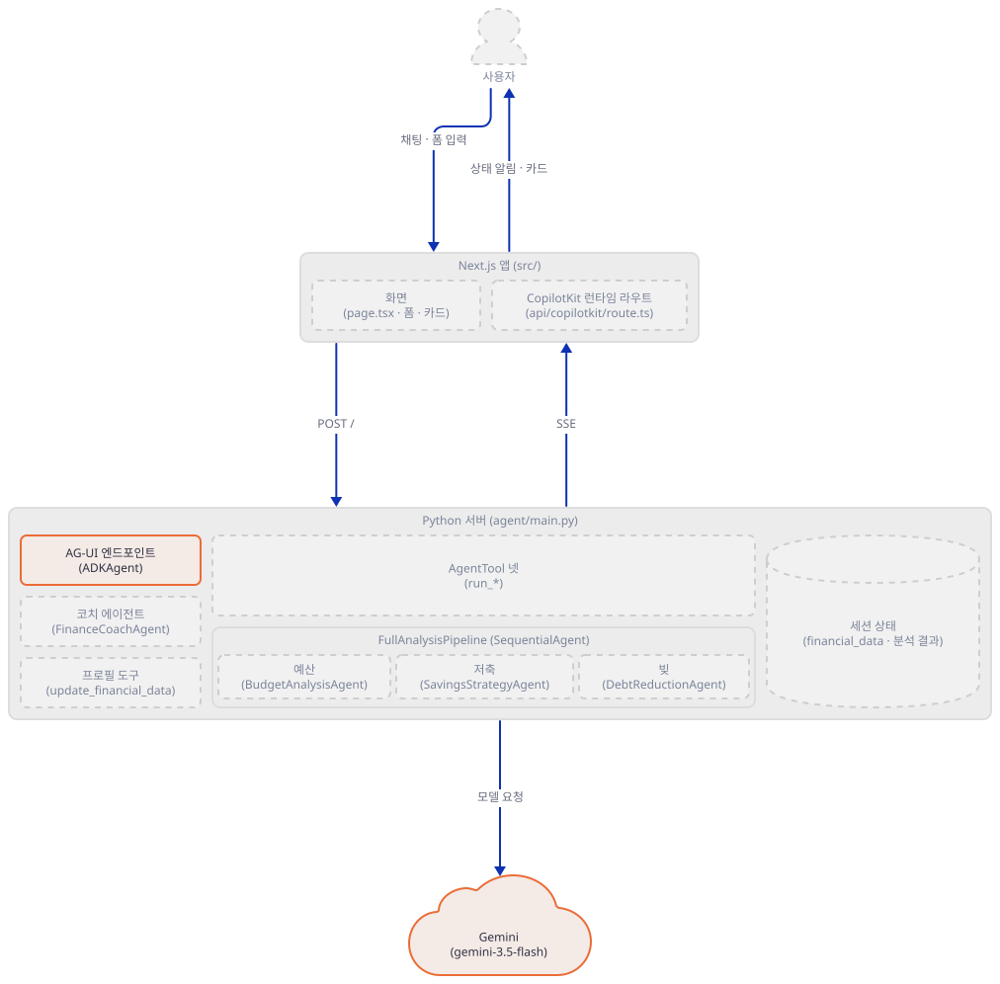

**확인.** 터미널 C에서 가짜 서버가 살아 있는지 봅니다. 아직 요청을 보내지 않았으니 `fake.jsonl`은 없어야 합니다.

```bash
ls fake.jsonl
```

기대 출력은 `ls: cannot access 'fake.jsonl': No such file or directory`입니다.

### Step 3. 상태와 스키마 — 모델 없이 읽기

**목적.** 서버가 만들어졌을 때의 구성(에이전트·도구·출력 키)과, 전문 에이전트가 받는 프롬프트 머리를 모델 호출 없이 눈으로 봅니다.

**할 일.** 전문 에이전트 셋은 같은 모양입니다. 이름과 모델, 출력 스키마(`output_schema`), 결과를 상태에 쓰는 키(`output_key`), 그리고 프롬프트에 상태를 넣는 콜백(`before_model_callback`)입니다. 예산 에이전트가 첫 번째입니다.

`generative_ui_agents/ai-financial-coach-agent/agent/main.py:168-188`

```python
budget_agent = LlmAgent(
    name="BudgetAnalysisAgent",
    model="gemini-3.5-flash",
    description="Analyzes financial data to categorize spending patterns and recommend budget improvements.",
    instruction="""You are a Budget Analysis Agent. Read FINANCIAL DATA above.

Your tasks:
1. Categorize ALL expenses from the user's financial data into logical groups, with percentages summing to 100%.
2. Identify spending patterns and trends across categories.
3. Provide 3-5 specific, actionable recommendations with quantified potential monthly savings.

Consider:
- Number of dependants when evaluating household expenses.
- Typical spending ratios for the income level (housing ~30%, food ~15%).
- Essential vs discretionary spending separation.

Respond strictly using the BudgetAnalysis schema.""",
    output_schema=BudgetAnalysis,
    output_key="budget_analysis",
    before_model_callback=_make_state_injector([]),
)
```

콜백이 만드는 것은 `financial_data`와 앞 에이전트들의 결과를 읽기 좋게 이어 붙인 글입니다. 저축 에이전트는 `["budget_analysis"]`를, 빚 에이전트는 `["budget_analysis", "savings_strategy"]`를 받고 예산 에이전트는 아무것도 받지 않습니다(`generative_ui_agents/ai-financial-coach-agent/agent/main.py`의 187·210·238행). 콜백은 이 글을 시스템 지시문 **앞에** 붙입니다.

`generative_ui_agents/ai-financial-coach-agent/agent/main.py:138-162`

```python
def _make_state_injector(prior_keys: List[str]):
    """Build a before_model_callback that prepends financial state to system instruction."""

    def modifier(callback_context: CallbackContext, llm_request: LlmRequest):
        context = _state_context(callback_context.state, prior_keys)
        prefix = (
            "The user's financial information and prior agent outputs are below. "
            "Use them to produce your structured response.\n\n"
            f"{context}\n\n---\n"
        )

        original = llm_request.config.system_instruction or types.Content(
            role="system", parts=[]
        )
        if not isinstance(original, types.Content):
            original = types.Content(
                role="system", parts=[types.Part(text=str(original))]
            )
        if not original.parts:
            original.parts = [types.Part(text="")]
        original.parts[0].text = prefix + (original.parts[0].text or "")
        llm_request.config.system_instruction = original
        return None

    return modifier
```

세 에이전트를 순서대로 묶은 것이 `FullAnalysisPipeline`(`SequentialAgent`)입니다(`generative_ui_agents/ai-financial-coach-agent/agent/main.py:242-246`). 그것들을 코치의 도구로 감싸는 `AgentTool`은 Step 5에서 봅니다.

`peek.py`를 저장하고 돌립니다. 모델 요청 없이 모듈을 import해 구성을 찍고, 저축 에이전트가 받을 머리를 샘플 상태로 만들어 보여 줍니다.

```bash
cat > peek.py <<'PY'
"""모델 없이 main.py의 구성을 읽는다: 에이전트 넷의 모델·도구·출력 키, 그리고 전문 에이전트가 받는 프롬프트 머리."""
import os
import sys

from guard import apply_fake_env, problems

apply_fake_env("http://127.0.0.1:9")   # import만 하므로 모델 요청은 없다. 그래도 진짜 키·주소는 두지 않는다.

import main  # noqa: E402

if problems(os.environ):
    sys.exit("peek 실패: " + "; ".join(problems(os.environ)))

for a in (main.coach_agent, main.budget_agent, main.savings_agent, main.debt_agent):
    tools = [getattr(t, "name", getattr(t, "__name__", str(t))) for t in (getattr(a, "tools", None) or [])]
    print(f"{a.name:22} model={a.model:17} output_key={a.output_key or '-':16} 도구={tools}")
print("파이프라인 순서:", [a.name for a in main.full_analysis_pipeline.sub_agents])

fd = {"monthly_income": 8000, "dependants": 2, "manual_expenses": {"Housing": 2400}, "debts": []}
state = {"financial_data": fd, "budget_analysis": {"total_expenses": 2400}}
print("--- 저축 에이전트의 프롬프트 머리 (_state_context) ---")
print(main._state_context(state, ["budget_analysis"]))
print("--- 예산 결과 스키마의 최상위 필드 ---")
print(list(main.BudgetAnalysis.model_json_schema()["properties"]))
PY
```

```bash
uv run --no-project python peek.py
```

```text
FinanceCoachAgent      model=gemini-3.5-flash  output_key=-                도구=['update_financial_data', 'BudgetAnalysisAgent', 'SavingsStrategyAgent', 'DebtReductionAgent', 'FullAnalysisPipeline']
BudgetAnalysisAgent    model=gemini-3.5-flash  output_key=budget_analysis  도구=[]
SavingsStrategyAgent   model=gemini-3.5-flash  output_key=savings_strategy 도구=[]
DebtReductionAgent     model=gemini-3.5-flash  output_key=debt_reduction   도구=[]
파이프라인 순서: ['BudgetAnalysisAgent', 'SavingsStrategyAgent', 'DebtReductionAgent']
--- 저축 에이전트의 프롬프트 머리 (_state_context) ---
FINANCIAL DATA:
{
  "monthly_income": 8000,
  "dependants": 2,
  "manual_expenses": {
    "Housing": 2400
  },
  "debts": []
}

BUDGET_ANALYSIS:
{
  "total_expenses": 2400
}
--- 예산 결과 스키마의 최상위 필드 ---
['total_expenses', 'monthly_income', 'spending_categories', 'recommendations']
```

(직접 확인) 코치는 도구 다섯을 갖고 출력 키가 없으며, 분석 에이전트 셋은 도구가 없고 출력 키가 하나씩입니다. 첫 줄의 모델 이름이 네 곳 모두 같습니다.

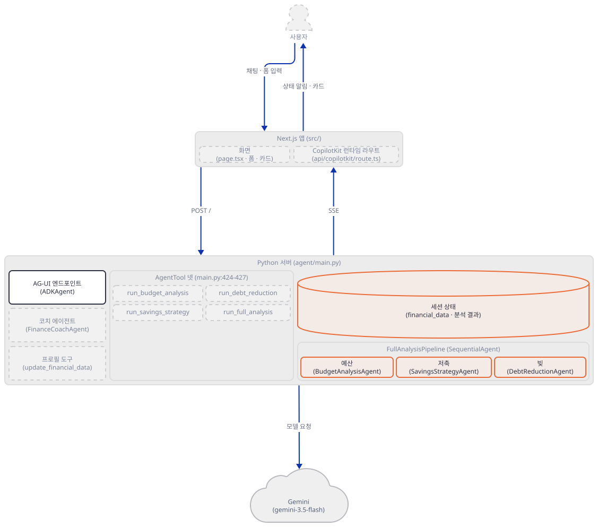

**확인.** `peek.py`의 첫 줄이 도구 다섯을 보여 주고, 저축 에이전트의 머리에 `FINANCIAL DATA:`와 `BUDGET_ANALYSIS:`가 이 순서로 있으면 됩니다. 이 확인은 `main.py`를 import하지만 서버를 띄우지 않으므로 모델 요청이 없습니다. 그래도 `peek.py`는 첫머리에서 가드와 같은 가짜 값을 덮습니다.

### Step 4. 코치와 프로필 도구 — 첫 AG-UI 한 턴

**목적.** 코치가 사용자의 말을 어떻게 도구로 보내는지 읽고, 프로필 도구의 규칙을 모델 없이 직접 부르고, 화면이 보내는 요청 한 건을 `ask.py`로 흉내 내 AG-UI 이벤트를 봅니다.

**할 일.** 코치의 지시문은 도구 다섯과 규칙 다섯입니다. 규칙은 "가장 작은 도구를 고른다"입니다. 사실을 말하면 프로필 도구, 특정 보고서를 청하면 그 도구, 전체를 청하면 파이프라인, 잡담이면 도구 없이 답, 그리고 한 턴에 도구 둘을 부르지 않는다는 것입니다.

`generative_ui_agents/ai-financial-coach-agent/agent/main.py:446-455`

```python
Routing rules — pick the SMALLEST tool that satisfies the request:
1. If the user states a fact about their finances (e.g. "my income is $8k", "my rent is $2400", "I just paid off the car loan", "add a $500 student loan at 5%"), call update_financial_data with only the fields they mentioned. To add a new debt, use add_debts (which appends). To remove a paid-off debt, use remove_debt_names. Never overwrite the entire profile.
2. If the user asks for a specific report ("analyze my budget", "what should I save?", "plan my debt payoff"), call the matching single tool.
3. If the user asks for a full review ("analyze my finances", "give me the full picture", "run a full review"), call FullAnalysisPipeline.
4. If the user asks a general question or chats, just answer in plain text — DO NOT call a tool.
5. Never call multiple tools in the same turn unless explicitly asked. Never call an analysis tool to confirm a profile update.

After a tool call:
- For update_financial_data: reply in 1 short sentence confirming what changed and (if relevant) suggest a next step.
- For analysis tools: the card renders automatically. Reply in 1-2 sentences highlighting the most important takeaway. Do NOT restate the full JSON.
```

프로필 도구는 모델이 준 자유로운 이름을 아홉 가지 표준 범주로 바꿉니다(`generative_ui_agents/ai-financial-coach-agent/agent/main.py:252-321`). `check_tools.py`가 `tool_context` 자리에 `.state`만 가진 대역을 두고 도구를 직접 여덟 번 부릅니다.

```bash
cat > check_tools.py <<'PY'
"""모델 없이 update_financial_data를 직접 부른다. tool_context 자리에는 .state 딕셔너리만 가진 대역을 쓴다."""
import os
import sys

from guard import apply_fake_env, problems

apply_fake_env("http://127.0.0.1:9")   # import만 하므로 모델 요청은 없다. 그래도 진짜 키·주소는 두지 않는다.

import main  # noqa: E402

if problems(os.environ):
    sys.exit("check_tools 실패: " + "; ".join(problems(os.environ)))


class Ctx:
    def __init__(self):
        self.state = {}


def show(label, out):
    print(f"{label:28} {out['changes']}")


c = Ctx()
show("1 소득·부양가족", main.update_financial_data(c, monthly_income=8000, dependants=2))
show("2 별칭 rent+mortgage", main.update_financial_data(c, expenses_patch={"rent": 2000, "mortgage": 400, "Groceries": 700}))
print("   manual_expenses =", c.state["financial_data"]["manual_expenses"])
show("3 Housing을 다시 2000", main.update_financial_data(c, expenses_patch={"housing": 2000}))
print("   manual_expenses =", c.state["financial_data"]["manual_expenses"])
show("4 모르는 이름", main.update_financial_data(c, expenses_patch={"pets": 90}))
d = {"name": "Card", "amount": 1200, "interest_rate": 22}
show("5 빚 추가", main.update_financial_data(c, add_debts=[d]))
show("6 같은 빚 또 추가", main.update_financial_data(c, add_debts=[d]))
print("   debts =", [x["name"] for x in c.state["financial_data"]["debts"]], "| min_payment =", c.state["financial_data"]["debts"][0]["min_payment"])
show("7 대소문자 달리 삭제", main.update_financial_data(c, remove_debt_names=["card"]))
print("   debts =", c.state["financial_data"]["debts"])
show("8 인자 없음", main.update_financial_data(c))
print("   _normalize_category:", [main._normalize_category(k) for k in ("Gas", "gas_bill", "personal care", "FOOD", "")])
PY
```

```bash
uv run --no-project python check_tools.py
```

```text
1 소득·부양가족                    ['income → $8,000', 'dependants → 2']
2 별칭 rent+mortgage           ['expenses {Housing=$2,400, Food=$700}']
   manual_expenses = {'Housing': 2400.0, 'Food': 700.0}
3 Housing을 다시 2000           ['expenses {Housing=$2,000}']
   manual_expenses = {'Housing': 2000.0, 'Food': 700.0}
4 모르는 이름                     ['expenses {Other=$90}']
5 빚 추가                       ['+1 debt(s): Card ($1,200 @ 22.0%)']
6 같은 빚 또 추가                  ['+1 debt(s): Card ($1,200 @ 22.0%)']
   debts = ['Card', 'Card'] | min_payment = None
7 대소문자 달리 삭제                 ['-2 debt(s) removed: card']
   debts = []
8 인자 없음                      ['no-op']
   _normalize_category: ['Transportation', 'Utilities', 'Personal', 'Food', 'Other']
```

(직접 확인) 읽을 점이 넷입니다. 둘째 줄에서 `rent`와 `mortgage`가 같은 `Housing`으로 합쳐지고(2,000+400), `Groceries`는 `Food`가 됩니다. 셋째 줄에서 같은 범주를 다시 주면 더해지지 않고 **바뀝니다**(집세를 2,000으로 말하면 2,400이 아니라 2,000). 넷째 줄처럼 모르는 이름은 `Other`로 갑니다. 다섯째·여섯째 줄에서 같은 빚을 두 번 말하면 두 건이 쌓이고(이름 중복 검사 없음, `generative_ui_agents/ai-financial-coach-agent/agent/main.py:380-398`), 일곱째 줄에서 이름으로 지우면 이름이 같은 건이 모두 지워집니다(대소문자 무시).

이제 `ask.py`를 저장합니다. 화면(CopilotKit)이 에이전트에 보내는 것은 AG-UI의 `RunAgentInput` 한 건입니다. 앱의 런타임 라우트가 쓰는 `HttpAgent`는 그것을 JSON으로 `POST`하고 `Accept: text/event-stream`을 달아 이벤트 흐름을 받습니다(`@ag-ui/client` 0.0.52의 `HttpAgent.requestInit`, 소스로 확인). 필드는 스레드·실행 아이디, 지금까지의 `messages`, 화면의 `state`, `tools`, `context`, `forwardedProps`입니다. `ask.py`는 상태 파일에 대화 기록과 화면의 상태를 두고, 이벤트를 받아 화면처럼 상태를 갱신합니다. `STATE_DELTA`는 JSON 패치(추가·교체·삭제)입니다.

```bash
cat > ask.py <<'PY'
"""CopilotKit 화면이 하는 일을 흉내 낸다: AG-UI 요청(RunAgentInput) 한 건을 보내고 이벤트를 요약해 찍는다.

사용: python ask.py <에이전트 주소> <상태 파일> "<사용자 메시지>"
httpx의 기본값(trust_env)은 셸의 HTTP_PROXY를 따라 루프백 요청도 프록시로 보낼 수 있어서 끈다.
상태 파일에는 화면의 useCoAgent 상태(처음엔 DEFAULT_FINANCIAL_DATA)와 대화 기록을 둔다.
STATE_SNAPSHOT·STATE_DELTA를 받으면 화면처럼 상태를 갱신해 다시 저장한다.
"""
import json
import os
import sys
import uuid

import httpx

from guard import loopback


def apply_patch(doc, ops):
    """JSON Patch의 add·replace·remove만 처리한다 (화면은 fast-json-patch가 한다)."""
    for op in ops:
        parts = [p.replace("~1", "/").replace("~0", "~") for p in op["path"].split("/")[1:]]
        node = doc
        for p in parts[:-1]:
            node = node[int(p)] if isinstance(node, list) else node[p]
        key = parts[-1]
        if isinstance(node, list):
            key = len(node) if key == "-" else int(key)
        if op["op"] == "remove":
            del node[key]
        elif op["op"] == "add" and isinstance(node, list):
            node.insert(key, op["value"])
        elif op["op"] in ("add", "replace"):
            node[key] = op["value"]
        else:
            raise ValueError("처리하지 않는 op: " + op["op"])
    return doc


url, state_file, text = sys.argv[1], sys.argv[2], sys.argv[3]
if not loopback(url):
    sys.exit(f"ask 실패: 에이전트 주소가 루프백이 아님: {url}")

if os.path.exists(state_file):
    saved = json.load(open(state_file, encoding="utf-8"))
else:
    saved = {"thread": "t-" + uuid.uuid4().hex[:8],
             "state": {"financial_data": {"monthly_income": 0, "dependants": 0, "manual_expenses": {}, "debts": []}},
             "messages": []}
saved["messages"].append({"id": "m-" + uuid.uuid4().hex[:8], "role": "user", "content": text})
body = {"threadId": saved["thread"], "runId": "r-" + uuid.uuid4().hex[:8], "state": saved["state"],
        "messages": saved["messages"], "tools": json.loads(os.environ.get("ASK_TOOLS", "[]")),
        "context": [], "forwardedProps": {}}

calls, results, said = {}, {}, ""
with httpx.Client(timeout=60, trust_env=False) as c, c.stream("POST", url, json=body, headers={"Accept": "text/event-stream"}) as r:
    print("HTTP", r.status_code, r.headers.get("content-type"))
    for line in r.iter_lines():
        if not line.startswith("data:"):
            continue
        ev = json.loads(line[5:])
        t = ev["type"]
        if t == "TOOL_CALL_START":
            calls[ev["toolCallId"]] = {"name": ev["toolCallName"], "args": ""}
            print(f"{t:22} {ev['toolCallName']}")
        elif t == "TOOL_CALL_ARGS":
            calls[ev["toolCallId"]]["args"] += ev["delta"]
            print(f"{t:22} {ev['delta'][:90]}")
        elif t == "TOOL_CALL_RESULT":
            results[ev["toolCallId"]] = ev["content"]
            print(f"{t:22} {ev['content'][:90]}")
        elif t == "TEXT_MESSAGE_CONTENT":
            said += ev["delta"]
            print(f"{t:22} {ev['delta'][:90]}")
        elif t == "STATE_SNAPSHOT":
            saved["state"] = ev["snapshot"]
            print(f"{t:22} keys={sorted(ev['snapshot'])}")
        elif t == "STATE_DELTA":
            saved["state"] = apply_patch(saved["state"], ev["delta"])
            print(f"{t:22} {[(o['op'], o['path']) for o in ev['delta']]}")
        elif t == "RUN_ERROR":
            print(f"{t:22} {ev.get('code')} {ev.get('message', '')[:140]}")
        else:
            print(t)

if calls or said:
    saved["messages"].append({"id": "a-" + uuid.uuid4().hex[:8], "role": "assistant", "content": said or None,
        "toolCalls": [{"id": i, "type": "function", "function": {"name": v["name"], "arguments": v["args"]}} for i, v in calls.items()]})
    for i in calls:
        if i in results:
            saved["messages"].append({"id": "x-" + uuid.uuid4().hex[:8], "role": "tool", "toolCallId": i, "content": results[i]})
json.dump(saved, open(state_file, "w", encoding="utf-8"), ensure_ascii=False, indent=1)
print("상태 키:", sorted(saved["state"]))
PY
```

```bash
uv run --no-project python ask.py http://127.0.0.1:54048/ st.json "My monthly income is \$8,000, I have 2 dependants, my rent is \$2,400 and groceries are \$700."
```

(PowerShell에서는 큰따옴표 안의 `$` 앞에 이스케이프 문자(백틱)를 붙이거나 작은따옴표 문자열을 씁니다. 실행해 보지 못했습니다.)

```text
HTTP 200 text/event-stream; charset=utf-8
RUN_STARTED
TOOL_CALL_START        update_financial_data
TOOL_CALL_ARGS         {"monthly_income": 8000.0, "dependants": 2, "expenses_patch": {"rent": 2400.0, "groceries"
TOOL_CALL_END
TOOL_CALL_RESULT       {"status": "updated", "changes": ["income → $8,000", "dependants → 2", "expenses {Housing=
STATE_DELTA            [('add', '/financial_data')]
TEXT_MESSAGE_START
TEXT_MESSAGE_CONTENT   Done. Your profile is updated, so you can ask for a review next.
TEXT_MESSAGE_END
STATE_SNAPSHOT         keys=['_ag_ui_app_name', '_ag_ui_thread_id', '_ag_ui_user_id', 'financial_data']
RUN_FINISHED
상태 키: ['_ag_ui_app_name', '_ag_ui_thread_id', '_ag_ui_user_id', 'financial_data']
```

(직접 확인) 이벤트의 순서가 앱의 구조를 그대로 보여 줍니다. `TOOL_CALL_START`·`ARGS`·`END`가 코치의 함수 호출이고, `TOOL_CALL_RESULT`는 `update_financial_data`가 돌려준 딕셔너리(`changes` 포함)입니다. 화면의 알림 알약이 `result.changes`를 이어 붙여 보여 주는 바로 그 값입니다. 이어서 `STATE_DELTA`가 `/financial_data`를 더하고, 코치의 한 문장 답이 `TEXT_MESSAGE_*`로 흐르고, 마지막에 `STATE_SNAPSHOT`이 상태 전체를 보냅니다. 스냅샷에는 앱이 넣지 않은 키 셋(`_ag_ui_app_name`·`_ag_ui_thread_id`·`_ag_ui_user_id`)이 있습니다. ag-ui-adk가 세션 식별용으로 넣는 것이고, 화면은 이 상태를 그대로 다음 요청에 되돌려 보냅니다. 이 턴에서 모델은 두 번 불렸습니다. 서버 기록입니다.

`summarize.py`를 저장합니다. 가짜 서버 기록(`fake.jsonl`)을 한 줄씩 요약해, 줄 번호·누가 불렀는지(`kind`)·무엇을 보냈는지(`sent`)·직전 내용·내용 수·시스템 지시문 길이·상태 주입 여부·소득·예산 합계·도구 선언 수·키 앞 여섯 자를 찍습니다. 둘째 인자는 건너뛸 줄 수입니다.

```bash
cat > summarize.py <<'PY'
"""가짜 서버 기록(jsonl)을 한 줄씩 요약한다. 사용: python summarize.py fake.jsonl [건너뛸 줄 수]"""
import json
import sys

skip = int(sys.argv[2]) if len(sys.argv) > 2 else 0
for n, line in enumerate(open(sys.argv[1], encoding="utf-8"), 1):
    if n <= skip:
        continue
    r = json.loads(line)
    print(f"{n:2} {r['kind']:7} 보냄={r['sent']:22} 직전={r['last']:16} 내용수={r['n_contents']:2} 지시문={r['system_chars']:5}자 "
          f"상태주입={'O' if r['has_fd'] else '-'} 소득={r['income']} 예산={r['budget_total']} 도구={len(r['tools'])}개 키={r['key']}")
PY
```

```bash
uv run --no-project python summarize.py fake.jsonl
```

```text
 1 coach   보냄=update_financial_data  직전=text             내용수= 1 지시문= 2549자 상태주입=- 소득=None 예산=None 도구=5개 키=fake-k
 2 coach   보냄=text                   직전=functionResponse 내용수= 3 지시문= 2549자 상태주입=- 소득=None 예산=None 도구=5개 키=fake-k
```

첫 호출(함수 호출을 고르는 요청)과 둘째 호출(함수 결과를 받아 답하는 요청)입니다. 둘 다 코치의 호출이고 `상태주입`이 `-`입니다. 코치의 시스템 지시문은 2,549자로 고정이고 `FINANCIAL DATA`가 없습니다. 코치는 사용자의 프로필을 프롬프트로 받지 않고, 대화 기록(앞 도구 호출과 결과)으로만 압니다. 도구는 다섯 개로 선언되었고 키 앞 여섯 자는 `fake-k`입니다(가드가 건 가짜 키).

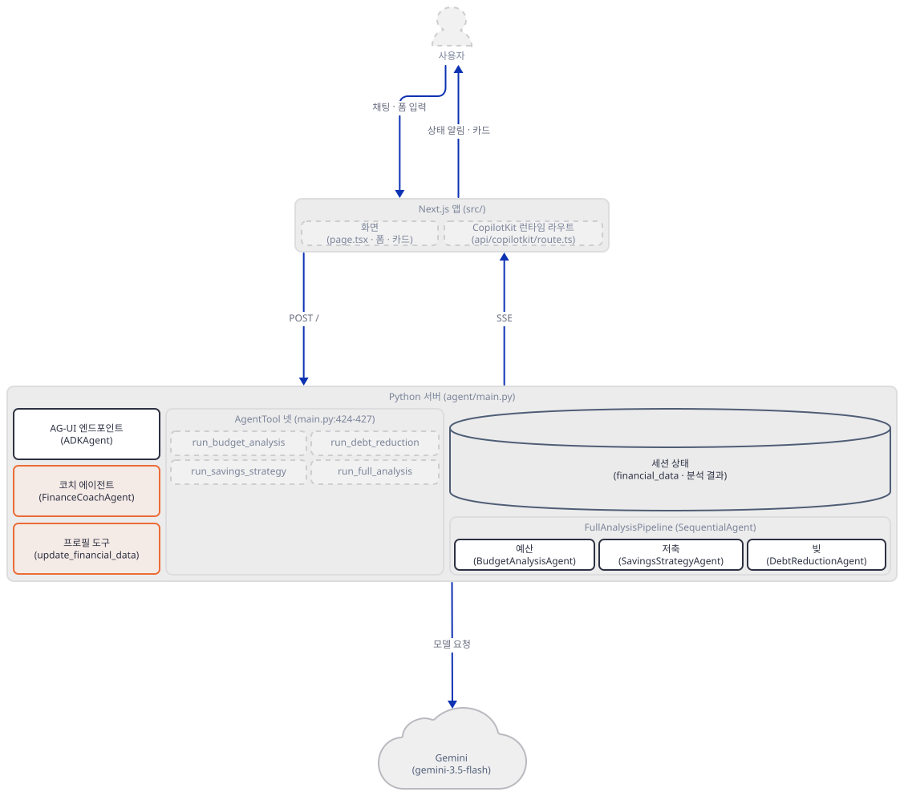

**확인.** `HTTP 200 text/event-stream`, `TOOL_CALL_START update_financial_data`, `STATE_DELTA`, `RUN_FINISHED`가 보이고 `fake.jsonl`이 두 줄이어야 합니다. `st.json`의 `state.financial_data`에 `Housing`이 2400, `Food`가 700(`rent`·`groceries`가 바뀐 이름)이어야 합니다. 상태 파일은 `show_state.py`로 요약해 봅니다.

```bash
cat > show_state.py <<'PY'
"""상태 파일의 화면 상태를 요약해 찍는다. 사용: python show_state.py <상태 파일>"""
import json
import sys

s = json.load(open(sys.argv[1], encoding="utf-8"))["state"]
print("financial_data", s["financial_data"])
for k in ("budget_analysis", "savings_strategy", "debt_reduction"):
    if k in s:
        print(k, json.dumps(s[k], ensure_ascii=False)[:230])
PY
```

```bash
uv run --no-project python show_state.py st.json
```

```text
financial_data {'monthly_income': 8000.0, 'dependants': 2, 'manual_expenses': {'Housing': 2400.0, 'Food': 700.0}, 'debts': []}
```

### Step 5. 전문 에이전트와 전체 검토 — 상태가 흘러가는 길

**목적.** 분석 요청 하나가 코치 → 파이프라인 → 전문 에이전트 셋을 지나며 상태를 읽고 쓰는 것을 서버 기록으로 확인하고, 앞 Step에서 예고한 특이점 다섯을 하나씩 재현합니다.

**할 일.** 먼저 도구 쪽을 읽습니다. 예산·저축·빚 에이전트를 하나씩, 그리고 파이프라인을 하나, 모두 넷을 `AgentTool`로 감싸 코치의 도구로 씁니다. 감싼 줄 위의 주석이 `skip_summarization=True`의 의도를 말합니다.

`generative_ui_agents/ai-financial-coach-agent/agent/main.py:421-427`

```python
# Wrap each phase as an AgentTool. skip_summarization=True keeps the coach from
# re-narrating the full JSON (which already lands in shared state via output_key
# and renders as a card in the UI).
run_budget_analysis = AgentTool(agent=budget_agent, skip_summarization=True)
run_savings_strategy = AgentTool(agent=savings_agent, skip_summarization=True)
run_debt_reduction = AgentTool(agent=debt_agent, skip_summarization=True)
run_full_analysis = AgentTool(agent=full_analysis_pipeline, skip_summarization=True)
```

소스로 확인한 것이 둘입니다. `AgentTool`은 부를 때마다 자식 세션을 새로 만들면서 부모 상태를 복사해 주고(`_adk`로 시작하는 내부 키만 뺌), 자식이 쓴 상태 변화를 부모 상태에 되돌려 줍니다(google-adk 1.26.0의 `google/adk/tools/agent_tool.py`, `run_async`). `skip_summarization`이 참이면 그 도구 호출 이벤트가 최종 응답으로 취급되어 흐름이 거기서 끝납니다(같은 패키지의 `events/event.py`, `is_final_response`). 이 두 사실이 아래 관찰을 설명합니다.

이제 빚을 둘 더하고(`add_debts`는 이어 붙입니다), 전체 검토를 청합니다.

```bash
uv run --no-project python ask.py http://127.0.0.1:54048/ st.json "Add a \$5,000 student loan at 6%."
uv run --no-project python ask.py http://127.0.0.1:54048/ st.json "I also have an \$800 car loan at 3%."
uv run --no-project python ask.py http://127.0.0.1:54048/ st.json "Run a full financial review."
```

```text
HTTP 200 text/event-stream; charset=utf-8
RUN_STARTED
TOOL_CALL_START        FullAnalysisPipeline
TOOL_CALL_ARGS         {"request": "Run a full financial review."}
TOOL_CALL_END
TOOL_CALL_RESULT       {"total_debt": 5800.0, "debts": [{"name": "Student Loan", "amount": 5000.0, "interest_rate
STATE_DELTA            [('add', '/budget_analysis'), ('add', '/savings_strategy'), ('add', '/debt_reduction')]
STATE_SNAPSHOT         keys=['_ag_ui_app_name', '_ag_ui_thread_id', '_ag_ui_user_id', 'budget_analysis', 'debt_reduction', 'financial_data', 'savings_strategy']
RUN_FINISHED
상태 키: ['_ag_ui_app_name', '_ag_ui_thread_id', '_ag_ui_user_id', 'budget_analysis', 'debt_reduction', 'financial_data', 'savings_strategy']
```

(직접 확인, 셋째 줄 명령의 출력) 이벤트에서 알 점이 셋입니다. 코치의 도구 호출은 하나(`FullAnalysisPipeline`)입니다. 안쪽에서 일어난 세 에이전트의 호출은 AG-UI 이벤트로 나오지 않고 `TOOL_CALL_RESULT`에 마지막 에이전트(빚)의 JSON만 실립니다. 대신 `STATE_DELTA`가 `budget_analysis`·`savings_strategy`·`debt_reduction` 셋을 한꺼번에 더합니다. 이 항목 셋이 화면의 카드를 그립니다. 그리고 `TEXT_MESSAGE_*`가 없습니다. 코치는 분석 뒤 한 문장도 말하지 않았습니다. 서버 기록이 이유를 보여 줍니다.

```bash
uv run --no-project python summarize.py fake.jsonl 6
```

```text
 7 coach   보냄=FullAnalysisPipeline   직전=text             내용수=13 지시문= 2549자 상태주입=- 소득=None 예산=None 도구=5개 키=fake-k
 8 budget  보냄=json                   직전=text             내용수= 1 지시문= 1281자 상태주입=O 소득=8000.0 예산=None 도구=0개 키=fake-k
 9 savings 보냄=json                   직전=text             내용수= 2 지시문= 1873자 상태주입=O 소득=8000.0 예산=3100.0 도구=0개 키=fake-k
10 debt    보냄=json                   직전=text             내용수= 3 지시문= 2620자 상태주입=O 소득=8000.0 예산=3100.0 도구=0개 키=fake-k
```

(직접 확인) 일곱째 줄이 코치의 호출이고, 그 뒤 세 줄이 전문 에이전트입니다. 코치는 이 턴에 모델을 **한 번만** 불렀습니다. 함수 결과를 받은 뒤 다시 부르는 요청이 없습니다. `AgentTool(skip_summarization=True)`가 도구 결과를 최종 응답으로 취급해 흐름을 끝내기 때문입니다(Step 3). 코치의 지시문이 말하는 "분석 도구 뒤에 한두 문장으로 핵심을 짚는다"(`generative_ui_agents/ai-financial-coach-agent/agent/main.py:455`)는 이 설정과 맞지 않아 지켜질 수 없습니다. 반대로 프로필 도구는 `skip_summarization`이 없어서 Step 4처럼 한 문장 답이 옵니다.

세 에이전트가 상태를 받는 것도 보입니다. 모두 `상태주입=O`이고 소득 8000.0이 들어 있습니다. 저축은 예산 결과(`예산=3100.0`)를, 빚은 예산과 저축을 받습니다(`generative_ui_agents/ai-financial-coach-agent/agent/main.py`의 187·210·238행에 적힌 키 목록 그대로). 내용 수가 1·2·3으로 늘어나는 것은 `SequentialAgent`가 한 세션 안에서 앞 에이전트의 응답을 기록으로 이어 받기 때문입니다. 코치의 내용 수는 13으로, 앞선 턴들의 도구 호출과 결과가 쌓인 값입니다. 상태에 쓰인 결과를 봅니다.

```bash
uv run --no-project python show_state.py st.json
```

```text
financial_data {'monthly_income': 8000.0, 'dependants': 2, 'manual_expenses': {'Housing': 2400.0, 'Food': 700.0}, 'debts': [{'name': 'Student Loan', 'amount': 5000.0, 'interest_rate': 6.0, 'min_payment': 50.0}, {'name': 'Car Loan', 'amount': 800.0, 'interest_rate': 3.0, 'min_payment': 50.0}]}
budget_analysis {"total_expenses": 3100.0, "monthly_income": 8000.0, "spending_categories": [{"category": "Housing", "amount": 2400.0, "percentage": 77.4}, {"category": "Food", "amount": 700.0, "percentage": 22.6}], "recommendations": [{"category
savings_strategy {"emergency_fund": {"recommended_amount": 18600.0, "current_amount": 0.0, "current_status": "Not started"}, "recommendations": [{"category": "Emergency", "amount": 800.0, "rationale": "Script: 10% of income."}, {"category": "Retir
debt_reduction {"total_debt": 5800.0, "debts": [{"name": "Student Loan", "amount": 5000.0, "interest_rate": 6.0, "min_payment": 50.0}, {"name": "Car Loan", "amount": 800.0, "interest_rate": 3.0, "min_payment": 50.0}], "payoff_plans": {"avalanche
```

대본이 계산한 값입니다. 빚 상환은 눈사태(이율 높은 것 먼저)와 눈덩이(잔액 작은 것 먼저)를 나란히 냅니다. `debt-reduction-card.tsx`의 비교 탭은 `a.total_interest <= s.total_interest`로 더 나은 쪽을 고릅니다(`generative_ui_agents/ai-financial-coach-agent/src/components/debt-reduction-card.tsx:195`).

이제 특이점을 재현합니다. 첫째는 **화면의 폼이 서버 상태를 덮어쓰는 것**입니다. 화면은 폼에서 고친 값을 `setState({ ...(state ?? {}), financial_data: next })`로 에이전트 상태에 쓰고(`generative_ui_agents/ai-financial-coach-agent/src/app/page.tsx:182`), 상태는 매 요청의 `state`로 서버에 갑니다. ag-ui-adk는 요청마다 `input.state`로 세션 상태를 덮어씁니다(ag-ui-adk 0.5.0의 `adk_agent.py` `_run_adk_in_background`, 소스로 확인). 폼을 흉내 내는 `edit_state.py`를 저장하고 소득을 9,000으로 고친 뒤 예산만 청합니다.

```bash
cat > edit_state.py <<'PY'
"""화면의 Profile 탭에서 값을 고친 것처럼 상태 파일의 financial_data를 바꾼다. 사용: python edit_state.py <상태 파일> 키 값 [키 값 ...]  (키: income 또는 Housing 같은 지출 이름)"""
import json
import sys

path, pairs = sys.argv[1], sys.argv[2:]
s = json.load(open(path, encoding="utf-8"))
fd = s["state"]["financial_data"]
for k, v in zip(pairs[::2], pairs[1::2]):
    if k == "income":
        fd["monthly_income"] = float(v)
    else:
        fd["manual_expenses"][k] = float(v)
json.dump(s, open(path, "w", encoding="utf-8"), ensure_ascii=False, indent=1)
print("고침:", {k: fd[k] for k in ("monthly_income", "manual_expenses")})
PY
```

```bash
uv run --no-project python edit_state.py st.json income 9000
uv run --no-project python ask.py http://127.0.0.1:54048/ st.json "Analyze my budget."
```

```text
고침: {'monthly_income': 9000.0, 'manual_expenses': {'Housing': 2400.0, 'Food': 700.0}}
HTTP 200 text/event-stream; charset=utf-8
RUN_STARTED
TOOL_CALL_START        BudgetAnalysisAgent
TOOL_CALL_ARGS         {"request": "Analyze my budget."}
TOOL_CALL_END
TOOL_CALL_RESULT       {"total_expenses": 3100.0, "monthly_income": 9000.0, "spending_categories": [{"category": 
STATE_DELTA            [('add', '/budget_analysis')]
STATE_SNAPSHOT         keys=['_ag_ui_app_name', '_ag_ui_thread_id', '_ag_ui_user_id', 'budget_analysis', 'debt_reduction', 'financial_data', 'savings_strategy']
RUN_FINISHED
상태 키: ['_ag_ui_app_name', '_ag_ui_thread_id', '_ag_ui_user_id', 'budget_analysis', 'debt_reduction', 'financial_data', 'savings_strategy']
```

```bash
uv run --no-project python summarize.py fake.jsonl 10
```

```text
11 coach   보냄=BudgetAnalysisAgent    직전=text             내용수=16 지시문= 2549자 상태주입=- 소득=None 예산=None 도구=5개 키=fake-k
12 budget  보냄=json                   직전=text             내용수= 1 지시문= 1281자 상태주입=O 소득=9000.0 예산=None 도구=0개 키=fake-k
```

(직접 확인) 예산 에이전트가 받은 소득이 8000이 아니라 9000.0입니다. 채팅으로 말하지 않고 폼에서만 고친 값이 모델의 프롬프트에 닿았습니다. 둘째는 **옛 분석이 남는 것**입니다. 이번에는 집세를 3,000으로 고치고 빚만 청합니다.

```bash
uv run --no-project python edit_state.py st.json Housing 3000
uv run --no-project python ask.py http://127.0.0.1:54048/ st.json "Just plan my debt payoff strategy."
```

```text
고침: {'monthly_income': 9000.0, 'manual_expenses': {'Housing': 3000.0, 'Food': 700.0}}
HTTP 200 text/event-stream; charset=utf-8
RUN_STARTED
TOOL_CALL_START        DebtReductionAgent
TOOL_CALL_ARGS         {"request": "Just plan my debt payoff strategy."}
TOOL_CALL_END
TOOL_CALL_RESULT       {"total_debt": 5800.0, "debts": [{"name": "Student Loan", "amount": 5000.0, "interest_rate
STATE_DELTA            [('add', '/debt_reduction')]
STATE_SNAPSHOT         keys=['_ag_ui_app_name', '_ag_ui_thread_id', '_ag_ui_user_id', 'budget_analysis', 'debt_reduction', 'financial_data', 'savings_strategy']
RUN_FINISHED
상태 키: ['_ag_ui_app_name', '_ag_ui_thread_id', '_ag_ui_user_id', 'budget_analysis', 'debt_reduction', 'financial_data', 'savings_strategy']
```

```bash
uv run --no-project python summarize.py fake.jsonl 12
```

```text
13 coach   보냄=DebtReductionAgent     직전=text             내용수=19 지시문= 2549자 상태주입=- 소득=None 예산=None 도구=5개 키=fake-k
14 debt    보냄=json                   직전=text             내용수= 1 지시문= 2620자 상태주입=O 소득=9000.0 예산=3100.0 도구=0개 키=fake-k
```

(직접 확인) 빚 에이전트의 프롬프트에 `예산=3100.0`이 들어갔습니다. 집세가 3,000인 지금 지출 합계는 3,700인데, 상태에 남은 옛 예산 분석(2,400+700)이 그대로 주입된 것입니다. 앱의 어디에서도 `budget_analysis`를 지우거나 낡았다고 표시하는 코드가 없습니다(`main.py`와 `page.tsx`를 `budget_analysis`로 찾으면 쓰기·읽기뿐, 소스로 확인). 화면의 Report 탭도 같은 옛 값을 계속 보여 줍니다. 셋째는 **화면이 보내는 도구 목록이 무시되는 것**입니다. 화면의 `useCopilotAction({ available: "remote" })`는 CopilotKit 1.56.4에서 프런트엔드 도구로 등록됩니다(`@copilotkit/react-core`의 `useCopilotAction`, 소스로 확인). 그러면 같은 이름의 도구가 `tools`로 서버에 올 수 있습니다. 이름이 겹치는 도구 둘을 `tools`에 실어 보내 봅니다.

```bash
ASK_TOOLS='[{"name":"update_financial_data","description":"","parameters":{"type":"object","properties":{}}},{"name":"BudgetAnalysisAgent","description":"","parameters":{"type":"object","properties":{}}}]' uv run --no-project python ask.py http://127.0.0.1:54048/ st.json "Hello, what can you do?"
```

```powershell
$env:ASK_TOOLS = '[{"name":"update_financial_data","description":"","parameters":{"type":"object","properties":{}}},{"name":"BudgetAnalysisAgent","description":"","parameters":{"type":"object","properties":{}}}]'
uv run --no-project python ask.py http://127.0.0.1:54048/ st.json "Hello, what can you do?"
Remove-Item Env:ASK_TOOLS
```

(PowerShell 줄은 실행해 보지 못했습니다.)

```bash
uv run --no-project python summarize.py fake.jsonl 14
```

```text
15 coach   보냄=text                   직전=text             내용수=22 지시문= 2549자 상태주입=- 소득=None 예산=None 도구=5개 키=fake-k
```

(직접 확인) 코치에 선언된 도구가 여전히 다섯입니다. ag-ui-adk는 화면의 `tools`를 `AGUIToolset`이 달린 에이전트에만 붙이는데(ag-ui-adk 0.5.0의 `adk_agent.py` `_update_agent_tools_recursive`, 소스로 확인), 이 앱의 코치는 그것을 쓰지 않으므로 화면이 보낸 목록은 무시됩니다. 이름이 겹쳐도 충돌하지 않는 까닭입니다.

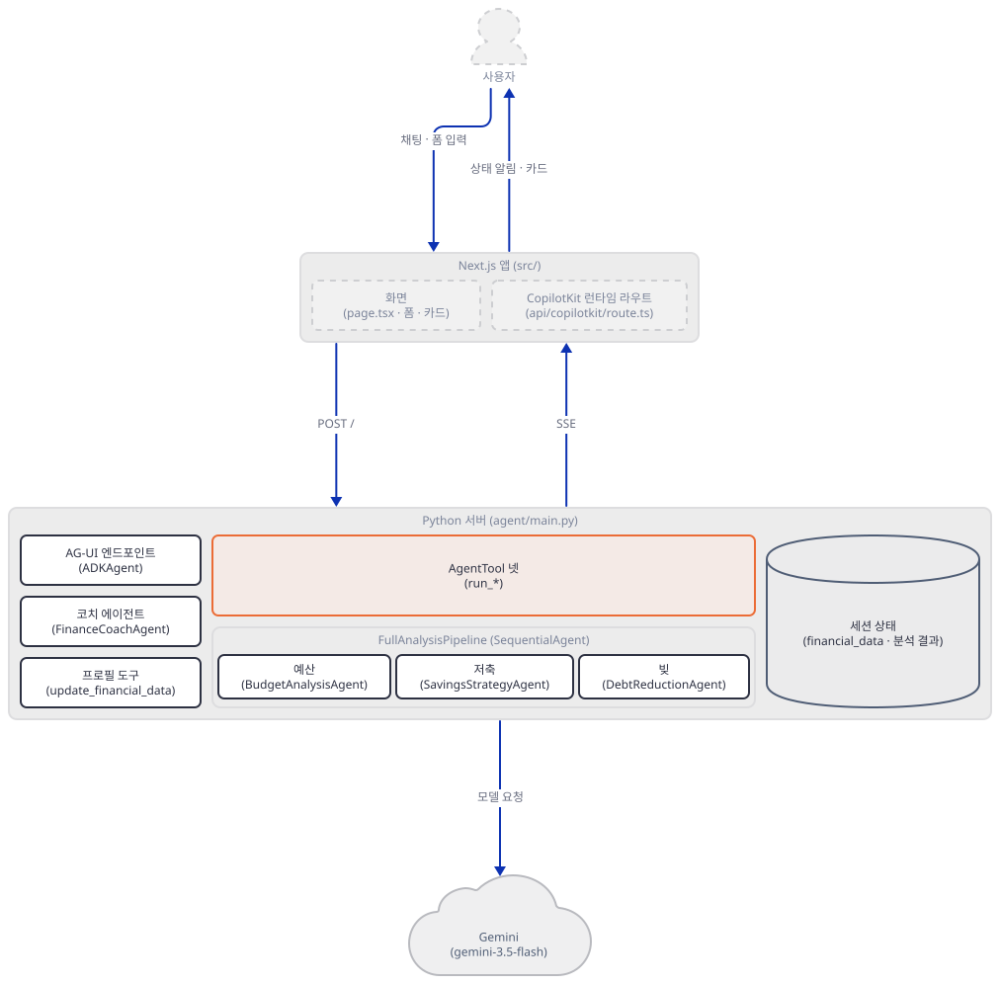

**확인.** 전체 검토 뒤 `fake.jsonl`에 `coach`·`budget`·`savings`·`debt`가 이 순서로 있고, 코치 줄은 하나이며, 저축·빚 줄의 `예산`이 3100.0이어야 합니다. `st.json`의 `state`에 `budget_analysis`·`savings_strategy`·`debt_reduction`이 있어야 합니다.

### Step 6. 화면 — 소스로만 읽습니다

**목적.** Node 쪽을 실행하지 않고, 화면이 Step 4·5의 이벤트를 어떻게 알림 알약과 카드로 바꾸는지 소스로 따라갑니다. 독자가 직접 띄우려면 무엇을 조심해야 하는지 알립니다.

**할 일.** 화면의 연결은 이름 하나로 이어집니다. 레이아웃이 `agent="my_agent"`를 걸고, 런타임 라우트가 같은 이름 `my_agent`에 `HttpAgent`를 달고, 화면의 `useCoAgent`도 같은 이름을 씁니다. 라우트가 주소를 정합니다.

`generative_ui_agents/ai-financial-coach-agent/src/app/api/copilotkit/route.ts:13-22`

```typescript
// 2. Create the CopilotRuntime instance and utilize the AG-UI client
//    to setup the connection with the ADK agent.
const runtime = new CopilotRuntime({
  agents: {
    // Our FastAPI endpoint URL
    my_agent: new HttpAgent({
      url: process.env.AGENT_URL || "http://localhost:8000/",
    }),
  },
});
```

주소는 `AGENT_URL`이고 없으면 `http://localhost:8000/`입니다. 화면은 이 에이전트 상태를 `useCoAgent`로 읽고 씁니다.

`generative_ui_agents/ai-financial-coach-agent/src/app/page.tsx:54-59`

```tsx
  const { state, setState, running } = useCoAgent<AgentState>({
    name: "my_agent",
    initialState: {
      financial_data: DEFAULT_FINANCIAL_DATA,
    },
  });
```

도구 호출은 `useCopilotAction`으로 "이 이름의 호출이 오면 이렇게 그려라"를 등록합니다. 프로필 도구는 결과의 `changes`를 이어 붙여 알약 옆에 보여 주고, 분석 도구 넷은 진행 중과 완료 문구만 바꿉니다. 첫 등록입니다.

`generative_ui_agents/ai-financial-coach-agent/src/app/page.tsx:67-83`

```tsx
  useCopilotAction({
    name: "update_financial_data",
    available: "remote",
    render: ({ status, result }) => (
      <ToolStatusCard
        icon="🔧"
        inProgressLabel="Updating profile…"
        completeLabel="Profile updated"
        status={status}
        detail={
          status === "complete" && Array.isArray(result?.changes)
            ? result.changes.join(" · ")
            : undefined
        }
      />
    ),
  });
```

카드는 이 도구 호출 이벤트로 그려지지 않습니다. 카드는 `state.budget_analysis` 같은 **상태 항목**이 생겨야 그려집니다(`generative_ui_agents/ai-financial-coach-agent/src/app/page.tsx:189-199`). Step 5의 `STATE_DELTA`가 그 항목을 더하는 이벤트입니다. 그래서 알약과 카드는 서로 다른 이벤트에서 나옵니다. 분석이 끝나면 탭이 저절로 바뀝니다.

`generative_ui_agents/ai-financial-coach-agent/src/app/page.tsx:140-151`

```tsx
  const hasReport =
    !!state?.budget_analysis ||
    !!state?.savings_strategy ||
    !!state?.debt_reduction;

  // Auto-switch to Report tab when an analysis run finishes.
  useEffect(() => {
    if (prevRunning.current && !running && hasReport) {
      setTab("report");
    }
    prevRunning.current = !!running;
  }, [running, hasReport]);
```

읽으면 두 가지가 보입니다. 이 효과는 "실행이 끝났고 보고서가 하나라도 있다"만 보므로, 보고서가 이미 있는 상태에서 프로필 도구만 부른 턴이 끝나도 Report 탭으로 넘어갑니다. 또 "Analyze My Finances" 버튼은 메시지를 직접 만들어 채팅에 보냅니다(`generative_ui_agents/ai-financial-coach-agent/src/app/page.tsx:153-161`). 문구가 `FullAnalysisPipeline`이라는 도구 이름을 담고 있어 코치가 그 도구를 고르기 쉽게 합니다. 실제 모델이 어떻게 고르는지는 확인하지 못했습니다.

화면이 서버에 요청하는 길은 이렇습니다. 브라우저는 `/api/copilotkit`에 요청하고, 라우트의 CopilotKit 런타임 1.56.4(`createCopilotEndpointSingleRoute`)가 에이전트를 복제해 메시지와 상태를 얹어 `HttpAgent`로 파이썬 서버를 부릅니다(`@copilotkit/runtime`의 `handle-run.ts`, 소스로 확인). 파이썬 서버의 이벤트는 같은 SSE로 브라우저까지 이어집니다.

**독자가 직접 띄운다면 (이 문서는 실행하지 않았습니다).** 세 가지를 확인했습니다.

첫째, `npm install`은 설치 스크립트 셋을 돌립니다. 잠금 파일에서 `hasInstallScript`가 붙은 것이 루트(`postinstall` → `uv sync`), `@scarf/scarf`, `sharp`입니다. `@scarf/scarf` 1.4.0의 `postinstall`(`report.js`)은 설치 환경(운영체제·CPU·Node 버전·의존성 정보)을 `scarf.sh`에 `POST`하는 설치 통계 스크립트이고, `@copilotkit/react-core`와 `@copilotkit/runtime`이 이것에 의존합니다(둘 다 `scarfSettings`를 지정하지 않아 기본이 "보냄"인 것을 소스로 확인). `SCARF_ANALYTICS=false`나 `DO_NOT_TRACK=1`을 걸면 보내지 않습니다(`report.js`가 이 변수들을 읽음). 둘째, CopilotKit 런타임은 실행 중에도 사용 통계를 보냅니다. `@copilotkit/shared`의 `TelemetryClient`가 이벤트의 5%를 표본으로 뽑아 Segment에 보내고, 뽑힌 이벤트마다 `copilotkit.gateway.scarf.sh`에도 `GET`합니다. `COPILOTKIT_TELEMETRY_DISABLED=true`나 `DO_NOT_TRACK=1`로 끕니다(소스로 확인). 이 앱의 라우트는 요청마다 `copilotRuntimeNextJSAppRouterEndpoint`를 부르므로(`generative_ui_agents/ai-financial-coach-agent/src/app/api/copilotkit/route.ts:25-30`) 그때마다 생성 이벤트가 표본 대상이 됩니다. 셋째, Next.js 자체도 익명 통계를 모읍니다. `NEXT_TELEMETRY_DISABLED=1`로 끕니다(https://nextjs.org/telemetry). 또 `next dev`의 기본 호스트는 `0.0.0.0`입니다(https://nextjs.org/docs/app/api-reference/cli/next, `-H` 옵션). 세 가지를 모두 막으려면 이렇게 시작합니다(실행해 보지 못했습니다).

```bash
cd <저장소>/generative_ui_agents/ai-financial-coach-agent
export SCARF_ANALYTICS=false DO_NOT_TRACK=1 NEXT_TELEMETRY_DISABLED=1 COPILOTKIT_TELEMETRY_DISABLED=true
npm install --ignore-scripts
AGENT_URL=http://127.0.0.1:54048/ npm run dev:ui -- -H 127.0.0.1
```

`--ignore-scripts`는 `sharp`의 설치 스크립트도 건너뛰므로 이미지 최적화가 필요한 화면에는 영향이 있을 수 있는데, 이 앱의 `src/`에는 이미지 컴포넌트가 없습니다(소스 검색으로 확인). 이 조합이 실제로 뜨는지는 확인하지 못했습니다. 에이전트는 `npm run dev:agent`가 아니라 Step 2의 터미널 B 줄(진짜 키를 쓰려면 가짜 서버 대신 `run_agent.py`를 쓰지 말고 `uv run --no-project python -m uvicorn main:app --host 127.0.0.1 --port 54048`)로 띄웁니다. 진짜 키는 셸이 아니라 그 명령 앞에 `GOOGLE_API_KEY=...`로 한 번만 주세요.

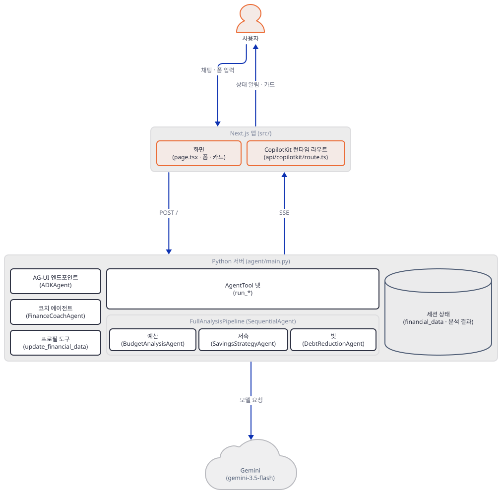

**확인.** 이 Step은 소스 읽기라 서버를 띄우지 않습니다. 같은 이름 `my_agent`가 세 곳에 있는지 찾아 봅니다(`<저장소>`로 먼저 `cd` 합니다).

```bash
cd <저장소>
grep -rn "my_agent" generative_ui_agents/ai-financial-coach-agent/src
git status --short -- generative_ui_agents/ai-financial-coach-agent
```

```text
generative_ui_agents/ai-financial-coach-agent/src/app/api/copilotkit/route.ts:18:    my_agent: new HttpAgent({
generative_ui_agents/ai-financial-coach-agent/src/app/layout.tsx:21:        <CopilotKit runtimeUrl="/api/copilotkit" agent="my_agent">
generative_ui_agents/ai-financial-coach-agent/src/app/page.tsx:55:    name: "my_agent",
```

(직접 확인) `route.ts`·`layout.tsx`·`page.tsx`에 한 줄씩 나오고, `git status`는 아무것도 찍지 않습니다. 카드가 `state` 항목으로 그려지는지는 위 코드에서 눈으로 확인하세요. 이어지는 Step 7의 명령은 다시 `coach-work/agent`에서 실행합니다.

### Step 7. 키 없음·재시작·배포 파일 — 경계 확인

**목적.** 서버가 키 없이 어떻게 실패하는지, 서버를 껐다 켰을 때 무슨 일이 일어나는지, 배포·시험 파일이 무엇인지, 앱이 재정 조언이 아님을 밝히는지 확인합니다.

**할 일.** 첫째, **키가 없을 때**입니다. 터미널 B를 그대로 두고 새 터미널 D(`coach-work/agent`, `PYTHONIOENCODING` 줄 포함)에서 다른 포트로 키 없는 서버를 하나 더 띄웁니다. `run_agent.py`의 `nokey` 인자가 `GOOGLE_API_KEY`를 빈 값으로 덮습니다.

```bash
uv run --no-project python run_agent.py 52611 http://127.0.0.1:51397 nokey
```

터미널 C에서 요청합니다. 요청 앞뒤로 가짜 서버 기록의 줄 수를 셉니다.

```bash
wc -l < fake.jsonl
rm -f st_nokey.json
uv run --no-project python ask.py http://127.0.0.1:52611/ st_nokey.json "Hello"
wc -l < fake.jsonl
```

```text
15
HTTP 200 text/event-stream; charset=utf-8
RUN_STARTED
RUN_ERROR              BACKGROUND_EXECUTION_ERROR No API key was provided. Please pass a valid API key. Learn how to create an API key at https://ai.google.dev/gemini-api/docs/api-key.
RUN_FINISHED
상태 키: ['financial_data']
15
```

(직접 확인) 서버는 죽지 않고 `RUN_ERROR`를 이벤트로 돌려준 뒤 `RUN_FINISHED`까지 보냅니다. google-genai가 모델을 부르기 전에 키가 없다고 거절하므로 가짜 서버에는 요청이 가지 않았습니다(앞뒤 줄 수가 같음). 화면에는 오류 알림이 올 텐데 어떻게 그려지는지는 확인하지 못했습니다. 다만 `@ag-ui/client` 0.0.52의 이벤트 검증기는 `RUN_ERROR` 뒤에 오는 이벤트를 "The run has already errored with 'RUN_ERROR'. No further events can be sent."로 거부합니다(`verify`, 소스로 확인). 서버가 `RUN_ERROR` 뒤에 `RUN_FINISHED`를 보내는 이 순서가 실제 화면에서는 오류로 처리될 수 있는데, 어떻게 보이는지는 확인하지 못했습니다. `main.py`가 키가 없다고 경고하는 문구(`generative_ui_agents/ai-financial-coach-agent/agent/main.py:500-504`)는 `__main__`에서만 돌기 때문에 `uvicorn main:app`으로 띄우면 나오지 않습니다. 터미널 D는 `Ctrl+C`로 끕니다.

둘째, **서버를 껐다 켠 뒤**입니다. 터미널 B에서 `Ctrl+C`로 끄고 같은 줄로 다시 띄운 뒤, 앞 Step의 대화(`st.json`)에 이어 말합니다. 브라우저를 새로 고치지 않은 채 서버만 다시 띄운 상황입니다. 화면(CopilotKit)이 대화 기록을 싣는다고 보고 `ask.py`도 그렇게 합니다.

```bash
uv run --no-project python ask.py http://127.0.0.1:54048/ st.json "Hello again"
uv run --no-project python summarize.py fake.jsonl 15
```

```text
HTTP 200 text/event-stream; charset=utf-8
RUN_STARTED
TOOL_CALL_START        update_financial_data
TOOL_CALL_ARGS         {"monthly_income": 8000.0, "dependants": 2, "expenses_patch": {"rent": 2400.0, "groceries"
TOOL_CALL_END
TOOL_CALL_RESULT       {"status": "updated", "changes": ["income → $8,000", "dependants → 2", "expenses {Housing=
STATE_DELTA            [('add', '/financial_data')]
TEXT_MESSAGE_START
TEXT_MESSAGE_CONTENT   Done. Your profile is updated, so you can ask for a review next.
TEXT_MESSAGE_END
STATE_SNAPSHOT         keys=['_ag_ui_app_name', '_ag_ui_thread_id', '_ag_ui_user_id', 'budget_analysis', 'debt_reduction', 'financial_data', 'savings_strategy']
RUN_FINISHED
RUN_STARTED
TEXT_MESSAGE_START
TEXT_MESSAGE_CONTENT   Happy to help. Tell me your income, expenses or debts, or ask for a review.
TEXT_MESSAGE_END
STATE_SNAPSHOT         keys=['_ag_ui_app_name', '_ag_ui_thread_id', '_ag_ui_user_id', 'budget_analysis', 'debt_reduction', 'financial_data', 'savings_strategy']
RUN_FINISHED
상태 키: ['_ag_ui_app_name', '_ag_ui_thread_id', '_ag_ui_user_id', 'budget_analysis', 'debt_reduction', 'financial_data', 'savings_strategy']
16 coach   보냄=update_financial_data  직전=text             내용수= 1 지시문= 2549자 상태주입=- 소득=None 예산=None 도구=5개 키=fake-k
17 coach   보냄=text                   직전=functionResponse 내용수= 3 지시문= 2549자 상태주입=- 소득=None 예산=None 도구=5개 키=fake-k
18 coach   보냄=text                   직전=text             내용수= 5 지시문= 2549자 상태주입=- 소득=None 예산=None 도구=5개 키=fake-k
```

(직접 확인) 한 문장 인사에 모델 호출이 세 번(16~18행) 일어났습니다. 서버의 세션이 메모리뿐(`use_in_memory_services=True`, `generative_ui_agents/ai-financial-coach-agent/agent/main.py:479-484`)이라 껐다 켜면 처리한 메시지 기록이 사라지고, ag-ui-adk가 화면이 보낸 기록 가운데 처리 안 된 사용자 메시지를 다시 처리합니다. 16행이 첫 요청의 낡은 재생이고(`내용수=1`, 프로필 도구를 다시 부름), 마지막 줄이 이번 인사입니다. 이벤트도 그렇게 나옵니다. 스트림에 `RUN_STARTED`부터 `RUN_FINISHED`까지가 두 번 있고, 첫 실행의 `STATE_DELTA`가 재생된 옛 값(소득 8000·Housing 2400)으로 `financial_data`를 잠깐 되돌렸다가 둘째 실행이 화면의 상태로 다시 덮습니다. 이 대화에서는 상태가 망가지지 않았습니다. 매 처리 직전에 화면의 `state`로 세션 상태를 다시 덮기 때문입니다(`st.json`의 소득은 9000 그대로). 그래도 도구 알림 알약이 한 번 더 뜨고 모델 호출은 그만큼 돈이 듭니다. 분석 요청이 기록 앞쪽에 있었다면 어땠는지는 시험하지 못했습니다. 왜 첫 메시지만 재생됐는지도 ag-ui-adk가 도구 결과가 이어지는 옛 요청을 건너뛰는 규칙(`adk_agent.py`의 `run`)을 읽고 짐작할 뿐 확인하지 못했으니 일반 규칙으로 받아들이지 마세요. 화면(CopilotKit)이 매 요청에 대화 기록을 싣는지도 브라우저에서 확인하지 못했고, `ask.py`가 AG-UI 규약대로 싣는 것을 따랐습니다.

셋째, **서버 문**입니다. 앱은 `GET /health`를 하나 더 달았습니다(`generative_ui_agents/ai-financial-coach-agent/agent/main.py:490-492`).

`curl`은 셸의 `http_proxy` 같은 변수를 따라 루프백 요청도 프록시로 보내므로 `--noproxy '*'`를 붙입니다. 이 문서의 모든 `curl`이 그렇습니다.

```bash
curl --noproxy '*' -s http://127.0.0.1:54048/health; echo
curl --noproxy '*' -s -o /dev/null -w "docs=%{http_code}\n" http://127.0.0.1:54048/docs
curl --noproxy '*' -s -o /dev/null -w "openapi=%{http_code}\n" http://127.0.0.1:54048/openapi.json
```

```text
{"status":"ok"}
docs=200
openapi=200
```

앱은 CORS 설정과 인증이 없고 FastAPI의 `/docs`가 열려 있습니다. 화면의 런타임 라우트가 서버에서 서버로 부르므로 브라우저가 직접 파이썬 서버를 부르지 않아 CORS가 필요 없는 구조입니다. 그래서 더더욱 `0.0.0.0`에 열 이유가 없습니다.

넷째, **배포·시험 파일**입니다. 읽기만 했고 `docker`는 실행하지 않았습니다. 루트 `Dockerfile`은 화면을 빌드한 뒤 파이썬과 Node를 한 이미지에 넣고 `entrypoint.sh`가 둘을 함께 띄웁니다. 에이전트는 `PORT=8000 python main.py`로, 곧 `0.0.0.0`입니다(`generative_ui_agents/ai-financial-coach-agent/entrypoint.sh:19-21`). `docker/`의 두 파일은 앱별 이미지이고, `docker-compose.test.yml`은 템플릿 저장소의 스모크 테스트용입니다. 모의 모델 이미지(`ghcr.io/copilotkit/aimock`)와 시험 컨테이너가 이 저장소에 없는 경로(`../../../showcase/tests`)를 마운트하고, 주석이 가리키는 CI 설정(`.github/workflows/test_smoke-starter.yml`)도 이 저장소의 `.github/workflows/`에 없습니다. `fixtures/default.json`은 재정 데이터가 아니라 그 모의 모델의 대답 두 개입니다.

`generative_ui_agents/ai-financial-coach-agent/fixtures/default.json:1-16`

```json
{
  "fixtures": [
    {
      "match": { "userMessage": "Hello" },
      "response": {
        "content": "Hello! I'm the adk AI assistant. How can I help you?"
      }
    },
    {
      "match": {},
      "response": {
        "content": "You're currently running against aimock (a mock LLM server). This response is a catch-all for requests that don't match any test fixture. To use a real LLM: (1) Add your GOOGLE_API_KEY to .env, (2) Restart with `pnpm dev`."
      }
    }
  ]
}
```

둘째 대답은 "pnpm dev"로 다시 띄우라고 안내하지만 이 앱의 스크립트는 npm입니다. 앱의 `package-lock.json`은 이름이 `adk-starter`이고 파이썬 `pyproject.toml`은 `proverbs-agent`·"ADK Proverbs Agent with shared state"입니다. 이 앱이 CopilotKit의 ADK 시작 템플릿에서 왔고 이름이 덜 바뀐 흔적입니다.

다섯째, **재정 조언 고지**입니다. 소스 전체와 README에서 찾아 봅니다.

```bash
grep -rn -i -E "advice|disclaimer|not financial|informational|educational" <저장소>/generative_ui_agents/ai-financial-coach-agent/src <저장소>/generative_ui_agents/ai-financial-coach-agent/agent/main.py <저장소>/generative_ui_agents/ai-financial-coach-agent/README.md
echo "exit=$?"
```

```text
exit=1
```

(직접 확인) 일치가 없습니다. 앱 화면의 문구는 "Fill in your details, then ask the coach to analyze"뿐이고, 코치의 지시문은 "friendly, concise AI Financial Coach"입니다. 이 앱이 내놓는 예산·저축·빚 상환 숫자가 면허 있는 전문가의 조언이 아니라는 안내는 앱 어디에도 없습니다. 그래서 이 문서는 모델의 숫자를 판단의 근거로 쓰지 말라고 적습니다. 실제 모델이 틀린 이자나 상환 기간을 내놓을 수 있고, 이 앱은 그 값을 검산하는 코드가 없습니다(`output_schema`는 모양만 묶고 값은 확인하지 않음).

마지막으로 서버를 모두 끕니다. 터미널 A·B에서 `Ctrl+C`를 누르고, 포트가 비었는지 봅니다.

```bash
netstat -ano | grep LISTEN | grep -E "127.0.0.1:(51397|54048|52611) " || echo "포트 비었음"
```

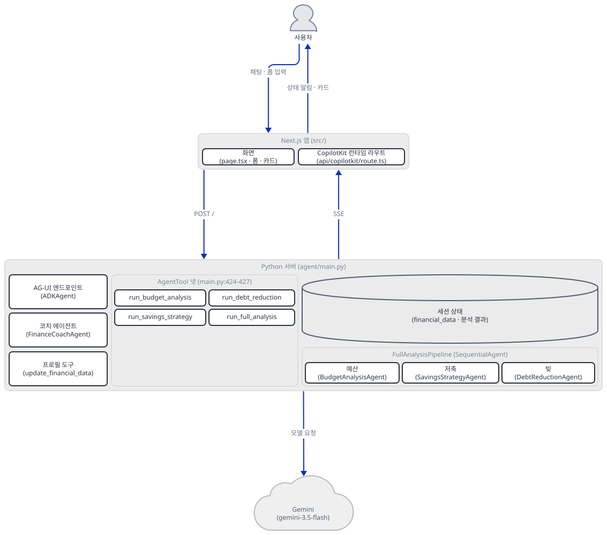

**확인.** `run_agent.py ... nokey`의 요청이 `RUN_ERROR`를 돌려주고 가짜 서버 기록이 늘지 않아야 합니다(`wc -l` 앞뒤 값이 같음). 재시작 뒤 같은 대화의 첫 요청이 모델 호출을 여러 번 일으킨다는 것과, 위 `grep`이 아무것도 찾지 못한다는 것을 확인하면 됩니다. 마지막 `netstat`은 `포트 비었음`이어야 합니다.

## 요청 한 건이 흐르는 과정

사용자가 Profile 탭에서 "Analyze My Finances"를 누르는 한 건을 따라갑니다. 27개 메시지를 시간 순서대로 여덟 그림에 나눠 그렸습니다. 첫 그림은 클릭에서 코치가 불리기까지입니다. 화면이 라우트에 `{메시지, state}`를 보내고 라우트가 `RunAgentInput`을 서버에 `POST`합니다. 서버는 먼저 `input.state`로 세션 상태를 덮어쓰고(폼에서 고친 값이 여기서 서버에 닿습니다) 코치를 실행합니다.

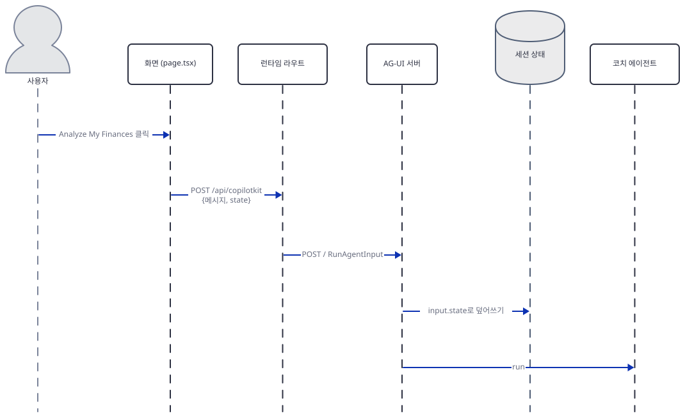

코치는 지시문과 도구 다섯 선언을 담아 Gemini를 부르고, 모델은 `FullAnalysisPipeline` 함수 호출을 돌려줍니다.

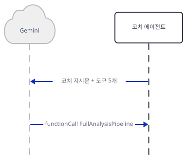

이 함수 호출 이벤트는 분석이 시작되기도 전에 화면으로 흐릅니다. 서버가 `TOOL_CALL_START`·`ARGS`·`END`를 라우트에 보내면 라우트가 같은 SSE를 화면에 전달하고, 화면은 "진행 중" 알약을 띄웁니다. 이 시각을 직접 쟀습니다. 이 문서의 `fake_gemini.py`에서 전문 에이전트에 답하기 전에 `await asyncio.sleep(2)` 한 줄을 더한 복사본과, 이벤트마다 경과 시간을 앞에 찍는 `ask.py` 복사본으로 전체 검토 한 건을 보냈습니다(문서의 스크립트에는 넣지 않았습니다). 이 요청의 `RUN_STARTED` 기준으로 `TOOL_CALL_START`가 약 0.6초, `TOOL_CALL_ARGS`·`END`가 약 1.4초에 왔고, 그 뒤 7초 넘게 이벤트가 없다가 `TOOL_CALL_RESULT`·`STATE_DELTA`·`STATE_SNAPSHOT`·`RUN_FINISHED`가 8.9초에 한꺼번에 왔습니다(새 서버라 앞에 프로필 재생 실행이 하나 붙은 상태였습니다. Step 7의 재시작과 같은 현상입니다). 진행 중 알약은 분석이 끝나기 한참 전에 뜨고, 카드 셋은 끝에 한꺼번에 뜹니다.

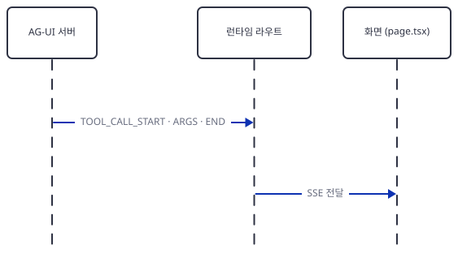

그 뒤에 코치가 `AgentTool`을 부르고, 파이프라인이 첫째로 예산 에이전트를 실행합니다.

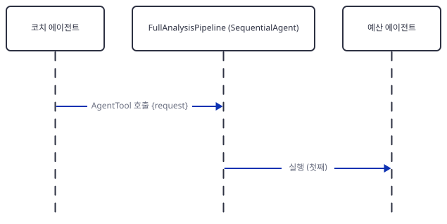

예산 에이전트는 지시문 머리에 `FINANCIAL DATA`가 주입된 요청을 보내 `BudgetAnalysis` JSON을 받고 `budget_analysis`를 상태에 씁니다. 이어 파이프라인이 둘째로 저축 에이전트를 실행합니다.

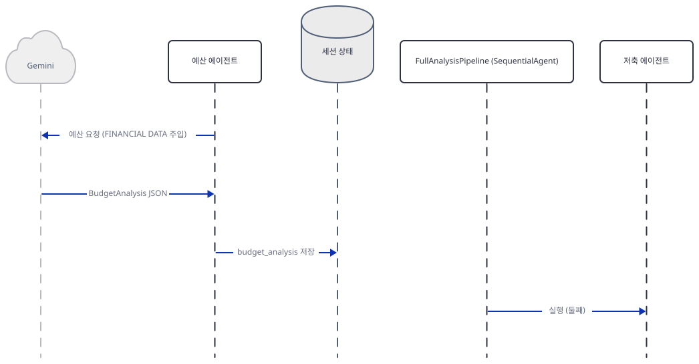

저축 에이전트는 예산 결과까지 받아 같은 일을 하고 `savings_strategy`를 씁니다. 이어 파이프라인이 셋째로 빚 에이전트를 실행합니다.

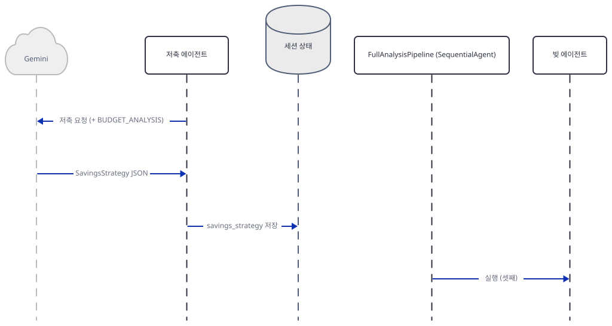

빚 에이전트는 예산과 저축을 모두 받아 `DebtReduction` JSON을 돌려주고 `debt_reduction`을 씁니다.

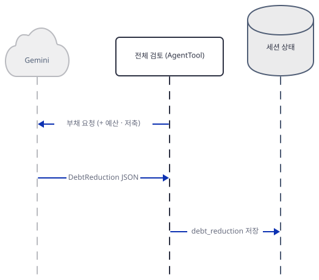

마지막 그림은 돌아오는 길입니다. 파이프라인의 결과(빚 JSON)가 코치에 도구 결과로 돌아가지만 `skip_summarization` 때문에 코치는 모델을 다시 부르지 않고 끝납니다. 서버가 `TOOL_CALL_RESULT`·`STATE_DELTA`·`STATE_SNAPSHOT`·`RUN_FINISHED`를 한꺼번에 라우트에 흘리고, 라우트가 같은 SSE를 화면에 전달하면, 화면은 알약을 "Full review complete"로 바꾸고 상태에 보고서가 생겼으므로 Report 탭으로 넘어가 카드 세 장을 그립니다. 카드 셋이 한꺼번에 나타나는 까닭입니다.

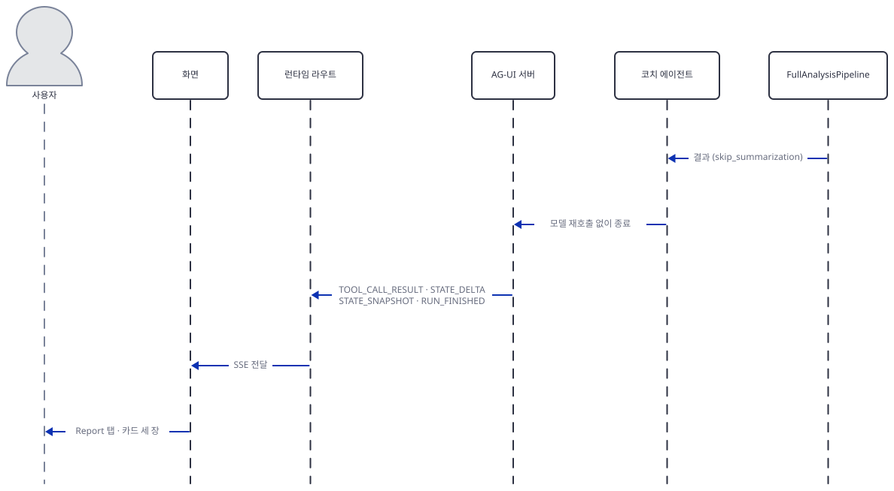

## 실행 체크리스트

- [ ] `uv sync`가 125개를 설치했고 `google-adk 1.26.0`·`ag-ui-adk 0.5.0`·`google-genai 1.65.0`이 보입니다(Step 1).
- [ ] `guard.py`의 `loopback`이 진짜 주소와 흉내 낸 주소 셋을 막고 `http://127.0.0.1:51397`만 통과시키며, `problems`가 프록시 변수를 이유로 잡습니다(Step 2).
- [ ] `run_agent.py`가 `run_agent 통과`를 찍고, `netstat`에서 두 포트가 `127.0.0.1`에만 열려 있습니다(Step 2).
- [ ] `peek.py`가 도구 다섯과 `output_key` 셋을 보여 줍니다(Step 3).
- [ ] `check_tools.py`가 별칭 합치기·범주 바뀜·중복 빚·이름 삭제를 보여 줍니다(Step 4).
- [ ] 프로필 한 턴이 `TOOL_CALL_START update_financial_data`·`STATE_DELTA`·`RUN_FINISHED`를 돌려주고 `fake.jsonl`이 두 줄입니다(Step 4).
- [ ] 전체 검토에서 코치 호출이 하나이고 `TEXT_MESSAGE_*`가 없으며 상태에 분석 항목 셋이 생깁니다(Step 5).
- [ ] 폼에서 고친 소득 9000이 예산 에이전트의 프롬프트에 닿고, 집세를 고친 뒤에도 빚 에이전트의 `예산`이 3100.0으로 남습니다(Step 5).
- [ ] `tools`로 보낸 도구 둘이 있어도 코치의 선언은 다섯입니다(Step 5).
- [ ] 키 없는 서버가 `RUN_ERROR`를 돌려주고 가짜 서버 기록의 줄 수가 요청 앞뒤로 같습니다(Step 7).
- [ ] 재시작 뒤 같은 대화의 첫 요청에 모델 호출이 세 번 일어납니다(Step 7).
- [ ] `grep`이 재정 조언 고지를 찾지 못합니다(Step 7).
- [ ] 서버를 모두 끄고 `netstat`에 포트가 없고, `git status --short -- generative_ui_agents/ai-financial-coach-agent`가 비어 있습니다.

## 문제 해결

| 증상 | 원인 | 해결 |
|---|---|---|
| `run_agent 실패: ...` 로 서버가 뜨지 않음 | 가드가 루프백이 아닌 주소나 가짜가 아닌 키를 잡음 | 찍힌 이유대로 가짜 서버 주소(`http://127.0.0.1:<포트>`)를 고칩니다. 가드를 건너뛰고 `main.py`를 직접 돌리지 않습니다 |
| `RUN_ERROR BACKGROUND_EXECUTION_ERROR No API key was provided` | 서버의 `GOOGLE_API_KEY`가 비어 있음(`nokey`로 띄웠거나, 진짜 서버에서 키를 안 줌) | 가짜 서버 길은 `run_agent.py`의 `nokey`를 빼고, 진짜로 쓸 때는 그 명령 앞에 `GOOGLE_API_KEY=...`를 줍니다 |
| 분석을 청했는데 채팅에 문장이 없고 알약만 뜸 | `AgentTool(skip_summarization=True)`가 도구 결과를 최종 응답으로 끝냄(Step 5) | 정상 동작입니다. 코치의 요약 문장을 원하면 `generative_ui_agents/ai-financial-coach-agent/agent/main.py:424-427`의 인자를 바꿔야 합니다(이 문서는 시험하지 못했습니다) |
| 프로필·지출을 고쳤는데 카드와 다음 분석이 옛 값을 씀 | 옛 `budget_analysis` 등이 상태에 남아 다음 프롬프트에 주입됨(Step 5) | 고친 뒤 전체 검토를 다시 청합니다. 앱에는 낡은 결과를 지우는 길이 없습니다 |
| 서버를 껐다 켠 뒤 첫 말에 알약이 다시 뜨고 호출이 늘어남 | 세션이 메모리뿐이라 ag-ui-adk가 화면이 보낸 기록을 다시 처리함(Step 7) | 서버를 껐다 켠 뒤에는 브라우저를 새로 고쳐 대화를 비웁니다(화면에서 시험하지 못했습니다) |
| `npm run dev:agent`가 `0.0.0.0`으로 뜸 | `scripts/run-agent.sh`가 `uv run main.py`를 부르고 `main.py:507`이 `0.0.0.0`을 줌 | 에이전트는 `uv run --no-project python -m uvicorn main:app --host 127.0.0.1 --port <포트>`로 띄우고, 화면은 `AGENT_URL`을 그 주소로 줍니다 |
| `npm install` 뒤 저장소에 `agent/.venv`가 생김 | 루트 `postinstall`이 `uv sync`를 부름(Step 1) | 의도된 동작입니다. 파이썬을 따로 두려면 `--ignore-scripts`를 쓰고 이 문서처럼 복사본에서 `uv sync`합니다 |
| `docker compose -f docker-compose.test.yml up`이 시험 컨테이너에서 실패할 것으로 보임 | 마운트하는 `../../../showcase/tests`와 안내하는 CI 설정이 이 저장소에 없음(Step 7) | 이 파일은 이 앱의 실행 경로가 아닙니다. 이 문서는 실행하지 않았습니다 |
| 한국어 Windows에서 출력이 깨짐 | 파이프·파일로 받을 때 기본 인코딩 `cp949` | 터미널마다 `PYTHONIOENCODING=utf-8`을 겁니다(사전 준비) |
| 서버가 이미 있는 포트에 뜨지 않음 | 다른 프로그램이 같은 포트를 씀 | `netstat -ano \| grep :<포트>`로 보고 다른 임의의 높은 번호를 씁니다 |

## 더 해보기

- 프로필 도구의 중복 빚 문제를 직접 고쳐 봅니다. `generative_ui_agents/ai-financial-coach-agent/agent/main.py:380-398`의 추가 단계에서 같은 이름이 이미 있으면 갱신하게 바꾸고, `check_tools.py`의 여섯째 줄이 한 건만 남기는지 확인하세요.
- 분석 도구의 `skip_summarization`을 꺼 보세요(`generative_ui_agents/ai-financial-coach-agent/agent/main.py:424-427`). 전체 검토 한 번의 코치 호출이 몇 번으로 바뀌는지 `summarize.py`로 세어, 코치의 요약 문장이 나오는 대가가 호출 한 번과 도구 결과 전체를 모델이 다시 읽는 입력 토큰임을 확인하세요.
- 낡은 분석을 다루는 방법을 정해 봅니다. 프로필 도구가 끝날 때 `budget_analysis` 등을 상태에서 지우는 줄을 넣으면 화면의 카드와 다음 분석이 어떻게 달라질지 `ask.py`로 시험하고, 지우기보다 "낡음" 표시를 두는 편이 낫지 않은지 생각해 보세요.

## 다음 날 예고

[Day 143 · 🗂️ Generative UI Starter Project](../day143-genui-generative-ui-starter-project/README.md) — 오늘의 ADK 에이전트와 CopilotKit 화면이 AG-UI로 이어지는 구조를 LangGraph 위에서 다시 봅니다. 원본 앱 `generative_ui_agents/generative-ui-starter-project`는 파이썬 에이전트(`agent/main.py` 45줄, `agent/src/`의 `a2ui_dynamic_schema.py` 103줄 등)와 Next.js 화면에 Docker용 대체 서버 `serve.py`(58줄)와 저장소 안 안내 문서 `CLAUDE.md`(284줄)가 더해진 약 4,200줄입니다. 기본 모델은 `gpt-5.5`(`generative_ui_agents/generative-ui-starter-project/agent/main.py:19`)이고, 앱 README는 이것을 칸반 보드와 채팅이 같은 할 일 목록을 만지는 앱이자 에이전트가 JSON으로 화면을 서술하는 A2UI의 시작점이라고 소개합니다. `scripts/run-agent.sh`가 `npx @langchain/langgraph-cli dev`를 부르고 `serve.py`는 `0.0.0.0`에 열리므로, 내일도 원본의 실행 줄은 그대로 쓰지 않습니다.
