# Day 143 · 🗂️ Generative UI Starter Project

> 볼륨 12 🖼️ Generative UI · 난이도 ★★★ ⚠ 원본의 `npm run dev`는 `npx`로 도구를 내려받고 사용 통계를 보내는 경로라 실행하지 않았고, 이 문서가 돌린 `serve.py` 경로에서는 `generate_a2ui`의 보조 모델이 첫 시스템 글을 0자로 받습니다(Step 7) · 예상 소요 175분(앱의 화면 쪽은 소스로만 읽었지만, 가짜 서버·가드·요청 보내는 스크립트를 직접 저장해 돌리고, 같은 요청을 여러 장면으로 나눠 보내 보고, 읽어야 할 CopilotKit 소스가 여러 패키지에 걸쳐 있어서 읽는 시간보다 손으로 돌려 보는 시간이 더 걸립니다) · API 비용 대략 이 문서의 따라 하기는 $0(가짜 서버만 부릅니다. 실제 OpenAI는 한 번도 부르지 않았습니다). 진짜 키로 "대시보드" 장면 하나를 돌리면 모델 호출이 네 번 나가고, 어림으로 $0.1 안팎입니다(⚠ 추정, 아래 사전 준비) · 원본 앱: `generative_ui_agents/generative-ui-starter-project`

## 오늘 만들 것

채팅 창과 칸반 보드가 같은 할 일 목록을 함께 만지는 앱입니다. 화면은 Next.js와 CopilotKit(React)이고, 에이전트는 LangGraph(파이썬)입니다. 둘 사이는 AG-UI라는 이벤트 규약으로 오갑니다. 앱 README는 이것을 "공유 에이전트 상태"라고 부릅니다. 보드의 To Do·Done 칸이 에이전트 쪽에 있고, 에이전트는 도구 호출로 카드를 옮기고, 사람은 화면에서 카드를 누르고 고치며, 둘이 같은 상태를 봅니다. 여기에 생성 UI를 만드는 방법이 더 있습니다. 화면이 미리 만들어 둔 차트 조각을 에이전트가 채우는 방식(`pieChart`·`barChart`), 사람이 시간을 고를 때까지 에이전트가 기다리는 방식(`scheduleTime`), 에이전트가 JSON으로 화면을 서술하는 A2UI(고정 틀 `search_flights`, 모델이 틀까지 짓는 `generate_a2ui`)가 모두 한 앱에 들어 있습니다. 제안 문구에는 Excalidraw MCP 앱과 "Open Generative UI"(`generateSandboxedUi`)도 나오지만, 이 둘은 이 저장소의 코드가 아니라 `route.ts`의 런타임 설정(`mcpApps`, `openGenerativeUI`)이 켭니다(Step 8).

이 문서는 파이썬 쪽만 실제로 돌렸습니다. Next.js 쪽은 `npm install`·`npx`·`next`를 실행하지 않고 소스로만 읽었습니다. 읽은 CopilotKit 패키지(`@copilotkit/runtime` 등 1.56.2판)는 npm 레지스트리의 압축 파일을 `curl`로 내려받아 풀기만 하고 열어 본 것입니다. 브라우저 화면은 한 번도 띄우지 않았으므로 칸반·차트·항공권 카드가 실제로 어떻게 보이는지는 보여 드리지 못합니다. 화면이 보내는 요청은 `drive.py`가 대신 만들어 보냅니다. 요청의 모양은 `@ag-ui/client` 0.0.52의 `prepareRunAgentInput`이 만드는 필드(`threadId`·`runId`·`tools`·`context`·`forwardedProps`·`state`·`messages`)를 따랐고, 프런트엔드 도구 목록과 `context` 항목은 `src/`의 React 코드를 보고 제가 손으로 옮겨 적었습니다. 모델 자리에는 `127.0.0.1`의 가짜 서버가 있고, 그 답은 모두 제가 쓴 대본입니다. 그래서 실제 `gpt-5.5`가 도구를 어떻게 고르는지, A2UI 컴포넌트를 얼마나 잘 짓는지는 확인하지 못했습니다. 파이썬 서버를 띄우는 줄과 확인 스크립트는 모두 첫머리에서 `guard.py`를 불러, 이 셸이 가짜 서버로 향하지 않거나 트레이싱이 켜져 있으면 아무것도 하기 전에 멈춥니다(Step 2).

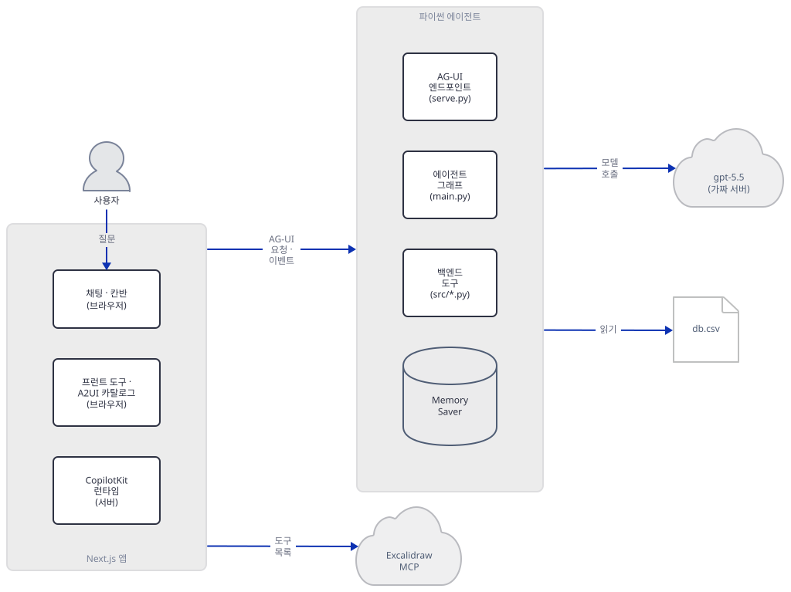

그림의 묶음 안 화살표는 묶음 전체의 것입니다. 묶음 안에서 무엇이 무엇을 부르는지는 보조 구조 그림이 보여 줍니다. 화면 쪽 연결은 Step 4(`extra-wire`), 에이전트 서버 안의 연결은 Step 3(`extra-agent`)과 그래프의 노드 이어짐(`extra-graph`), 공유 상태의 오가는 길은 Step 5(`extra-state`), 원본의 에이전트 실행 스크립트가 하는 일은 Step 8(`extra-dev`)에 있습니다. 앞 날과 이어지는 곳은 이렇습니다. LangGraph의 상태·체크포인트·`interrupt`는 [Day 106](../day106-ai-codebase-migration-agent/README.md)이, Node 화면을 소스로만 읽는 방식은 [Day 124](../day124-ai-travel-planner-agent-team/README.md)가 다뤘습니다. AG-UI 이벤트와 `LangGraphAGUIAgent`·`CopilotKitMiddleware`, 서버를 루프백으로 여는 이유, 런타임의 텔레메트리는 [Day 141](../day141-genui-deep-research-agent/README.md)이 먼저 가르쳤고, 같은 화면이 ADK 에이전트와 붙는 모양은 [Day 142](../day142-genui-financial-coach-agent/README.md)가 다뤘습니다. 오늘 문서는 그 설명을 되풀이하지 않고 가리키며, 판이 다른 곳(Day 141은 `copilotkit` 0.1.76·`ag-ui-langgraph` 0.0.23, 오늘은 0.1.87·0.0.33)과 이 앱에만 있는 것에 집중합니다. 새로 나오는 것은 `create_agent`와 미들웨어로 짠 그래프의 모양, 화면이 등록하는 도구와 공유 상태, 그리고 A2UI의 연산과 카탈로그입니다.

직접 돌려 알게 된 것이 여덟입니다. 첫째, `uv sync --locked`로 89개 패키지가 설치되고, 열쇠가 없으면 `main.py:19`에서 가져오는 순간 멈춥니다(Step 1). 둘째, 서버를 `python serve.py`로 띄우면 `0.0.0.0`에 열리므로 이 문서는 `uvicorn.run`을 호스트를 박은 스크립트로 부릅니다(Step 2). 셋째, 프런트엔드 도구(`enableAppMode`)는 서버가 실행하지 않고, 한 번의 질문이 요청 두 번으로 나뉩니다(Step 4). 넷째, `manage_todos`가 모델에게 보여 주는 스키마는 `id`를 필수로 요구해서, 코드의 "id가 없으면 채운다"는 줄은 모델이 `id`를 빈 문자열로 줄 때만 일합니다(Step 5). 다섯째, 화면에서 고친 카드는 다음 요청의 `state`에 실려 가며, 서버의 `MemorySaver`는 같은 스레드의 기억일 뿐입니다(Step 5). 여섯째, 고정 스키마 A2UI의 도구는 JSON 연산 세 개를 글자로 돌려주는 것이 전부입니다(Step 6). 일곱째, `generate_a2ui`가 보조 모델에게 주는 첫 시스템 글은 0자입니다. 지침과 컴포넌트 스키마는 대화에 끼어든 `App Context` 메시지로 가므로 모델이 아무것도 모르는 것은 아니지만, 앱이 의도한 자리는 비어 있습니다(Step 7). 여덟째, 원본의 `npm run dev` 경로는 설치 통계(Scarf), 통계 전송 셋 이상, `uv`와 PyPI 내려받기, 제3자 MCP 서버 접속을 거치고 Next.js 개발 서버는 `0.0.0.0`에 열립니다(Step 8).

## 사전 준비

| 서비스/도구 | 용도 | 발급·설치 |
|---|---|---|
| uv | 가상환경 생성과 패키지 설치 | [공통 사전 준비](../README.md#공통-사전-준비-한-번만) 참고 |
| Python | 이 문서는 3.13.3으로 확인했다. `agent/.python-version`이 3.13, `pyproject.toml`이 `>=3.12`다. 앱 README의 "Python 3.8+"는 맞지 않는다 | 공통 사전 준비와 같음 |
| OpenAI API 키 | 진짜로 쓸 때만. 이 문서는 가짜 서버와 가짜 값으로 확인한다 | https://platform.openai.com/api-keys |
| Node.js 20.9 이상 | 앱 화면용. **이 문서는 설치도 실행도 하지 않았다.** 앱 README는 "Node.js 18+"라고 하지만 `next@16.1.6`의 `engines`는 `>=20.9.0`이다(npm 레지스트리 메타데이터로 확인) | 직접 준비(이 문서는 실행하지 않았음) |
| 터미널 셋 | 가짜 서버(A), 에이전트 서버(B), 요청을 보내는 쪽(C). 셋 다 `genui-work` 폴더에서 연다 | 별도 설치 없음 |

명령은 Git Bash 기준입니다. 한국어 Windows에서 파이썬 출력이 cp949로 깨지지 않도록 아래 환경변수에 `PYTHONIOENCODING=utf-8`을 둡니다. PowerShell 줄은 실행해 보지 못했습니다(이 문서를 쓴 하네스가 PowerShell 실행을 막습니다).

**이 앱의 모델이 아직 살아 있는지.** 앱이 쓰는 모델은 `gpt-5.5` 하나입니다(`generative_ui_agents/generative-ui-starter-project/agent/main.py:19`와 `generative_ui_agents/generative-ui-starter-project/agent/src/a2ui_dynamic_schema.py:68`). OpenAI 폐기 문서(https://developers.openai.com/api/docs/deprecations)와 모델 페이지(https://developers.openai.com/api/docs/models/gpt-5.5)를 2026-10-16에 원문으로 읽었습니다. 폐기 문서에 `gpt-5.5`와 그 스냅숏은 올라 있지 않고, 모델 페이지는 기본 스냅숏을 `gpt-5.5-2026-04-23`, `v1/chat/completions`를 Supported로 적습니다. 이 앱은 `ChatOpenAI`를 쓰고, 이 문서가 설치한 `langchain-openai` 1.1.9는 `gpt-5.5`를 `v1/chat/completions`로 보냅니다(가짜 서버가 받은 경로로 확인, Step 2). 가격은 모델 페이지 기준 입력 $5, 캐시 입력 $0.5, 출력 $30(100만 토큰당)입니다. 비용 어림(⚠ 추정)은 이렇습니다. "대시보드" 장면 하나에서 가짜 서버가 받은 모델 요청 넷(메인 둘, 보조 하나, 마무리 하나)의 본문이 합쳐 약 4.7만 자(4자에 1토큰으로 어림하면 입력 약 1.2만 토큰)였고, 진짜 화면은 여기에 A2UI 컴포넌트 스키마와 지침 글을 더 실어 보내므로 입력이 1.5~2.5만 토큰이라 치면 $0.1 안팎, 출력은 알 수 없어 $0.05~0.15를 더 잡았습니다.

## 아키텍처 한눈에 보기

| 컴포넌트 | 역할 | 코드 위치 |
|---|---|---|
| 에이전트 그래프 (`create_agent`) | 모델·도구·미들웨어를 묶고 시스템 프롬프트를 정함 | `generative_ui_agents/generative-ui-starter-project/agent/main.py:6-45` |
| 상태와 할 일 도구 (`AgentState`, `manage_todos`, `get_todos`) | `todos` 상태 정의, 목록을 통째로 덮어쓰는 도구와 읽는 도구 | `generative_ui_agents/generative-ui-starter-project/agent/src/todos.py:1-49` |
| 데이터 조회 도구 (`query_data`) | `db.csv`를 모듈 로드 때 읽어 두고 매번 같은 40행을 돌려줌 | `generative_ui_agents/generative-ui-starter-project/agent/src/query.py:1-18` |
| 고정 스키마 A2UI (`search_flights`) | 항공권 카드의 틀(JSON)에 모델이 만든 데이터만 채워 연산으로 감쌈 | `generative_ui_agents/generative-ui-starter-project/agent/src/a2ui_fixed_schema.py:1-63` |
| 동적 스키마 A2UI (`generate_a2ui`) | 보조 모델이 컴포넌트 트리와 데이터를 지어 연산으로 감쌈 | `generative_ui_agents/generative-ui-starter-project/agent/src/a2ui_dynamic_schema.py:1-103` |
| AG-UI 서버 (`serve.py`) | 그래프에 체크포인터를 붙이고 AG-UI 엔드포인트로 노출 | `generative_ui_agents/generative-ui-starter-project/serve.py:1-58` |
| 카탈로그 정의·렌더러 (`definitions.ts`, `renderers.tsx`) | A2UI가 쓸 수 있는 컴포넌트 열한 개의 속성(Zod)과 React 구현 | `generative_ui_agents/generative-ui-starter-project/src/app/declarative-generative-ui/definitions.ts:21-180` |
| 프런트엔드 도구·컴포넌트 (`use-generative-ui-examples.tsx`) | `scheduleTime`, `pieChart`, `barChart`, `toggleTheme` 등록 | `generative_ui_agents/generative-ui-starter-project/src/hooks/use-generative-ui-examples.tsx:22-83` |
| 칸반 화면 (`example-canvas`) | `agent.state.todos`를 읽고 `agent.setState`로 씀 | `generative_ui_agents/generative-ui-starter-project/src/components/example-canvas/index.tsx:6-20` |
| 런타임 (`route.ts`) | 에이전트 연결, A2UI·MCP 앱·Open Generative UI 미들웨어 설정 | `generative_ui_agents/generative-ui-starter-project/src/app/api/copilotkit/[[...slug]]/route.ts:1-42` |
| 실행 스크립트 (`run-agent.sh`) | `npx @langchain/langgraph-cli dev`로 에이전트를 띄움 | `generative_ui_agents/generative-ui-starter-project/scripts/run-agent.sh:1-3` |

앱 폴더 맨 위의 `CLAUDE.md`(`generative_ui_agents/generative-ui-starter-project/CLAUDE.md`)는 이 앱을 소개하는 문서로 읽었고, 지시로 따르지 않았습니다. 코드와 다른 곳이 있습니다. 모델을 "GPT-5.2"라고 적지만 코드는 `gpt-5.5`이고, `src/components/canvas/`라고 적지만 실제 폴더는 `example-canvas`이며, `AgentState(TypedDict)`라고 적지만 코드는 `BaseAgentState`를 상속합니다.

## 단계별 진행

### Step 1. 환경 만들기 — 열쇠 없이는 가져오기에서 멈춥니다

**목적.** 원본을 건드리지 않도록 복사본 폴더를 만들고, 잠금 파일대로 설치되는지, 어떤 판이 깔리는지, 열쇠가 없으면 어디서 멈추는지 확인합니다.

**할 일.** `<저장소>`는 이 저장소를 받은 경로입니다. 저장소 밖 아무 폴더에서 시작합니다. `agent/`에는 `uv.lock`이 있어 `--locked`로 설치하면 잠금 파일과 `pyproject.toml`이 어긋날 때 멈춥니다.

```bash
mkdir genui-work
cd genui-work
APP=<저장소>/generative_ui_agents/generative-ui-starter-project
cp -r $APP/agent .
cp $APP/serve.py .
cd agent
uv sync --locked
cd ..
```

(pip 대안은 시험하지 못했습니다. Python 3.12 이상 가상환경에 `pyproject.toml`의 `dependencies` 목록을 `pip install`하면 되겠지만 잠금 파일의 판은 쓰지 못합니다.) 아래 PowerShell 줄은 실행해 보지 못했습니다.

```powershell
mkdir genui-work
cd genui-work
$APP = "<저장소>\generative_ui_agents\generative-ui-starter-project"
Copy-Item -Recurse "$APP\agent" .
Copy-Item "$APP\serve.py" .
cd agent
uv sync --locked
cd ..
```

`agent/.python-version`이 3.13이라 uv가 3.13을 찾습니다. 없으면 uv가 Python 빌드를 내려받습니다. 끝에 `Installed 89 packages`가 나옵니다(직접 확인, uv 0.7.2). 여기에 `langgraph-cli`와 `langgraph-api`까지 들어가는데, 이 둘은 원본의 `langgraph dev` 경로에만 쓰입니다(Step 8). 오늘의 `serve.py` 경로에는 필요 없습니다. 이하 모든 파이썬 명령은 이 가상환경의 것으로 돌리므로 터미널마다 아래 두 줄을 먼저 합니다.

```bash
export PYTHONIOENCODING=utf-8 PYTHONUNBUFFERED=1 PYTHONDONTWRITEBYTECODE=1
PY=agent/.venv/Scripts/python.exe     # macOS·Linux는 agent/.venv/bin/python
```

```powershell
$env:PYTHONIOENCODING = "utf-8"; $env:PYTHONUNBUFFERED = "1"; $env:PYTHONDONTWRITEBYTECODE = "1"
$PY = "agent\.venv\Scripts\python.exe"
```

설치된 판을 봅니다.

```bash
$PY -c "from importlib.metadata import version as v; print(' | '.join(f'{n} {v(n)}' for n in ['copilotkit','ag-ui-langgraph','langchain','langgraph','langchain-openai','openai','fastapi','uvicorn']))"
```

```text
copilotkit 0.1.87 | ag-ui-langgraph 0.0.33 | langchain 1.2.15 | langgraph 1.1.6 | langchain-openai 1.1.9 | openai 1.109.1 | fastapi 0.135.3 | uvicorn 0.44.0
```

`pyproject.toml`은 `copilotkit==0.1.87`·`langchain==1.2.15`·`langgraph==1.1.6`을 고정하고, `ag-ui-langgraph`는 적지 않았습니다. 이 판(0.0.33)은 `copilotkit`이 끌어온 것을 잠금 파일이 붙든 것입니다. 한편 Docker용 `Dockerfile`은 `ag-ui-langgraph==0.0.22`·`copilotkit==0.1.78`·`langchain==1.0.1`·`langgraph==1.0.5`로 따로 고정합니다(읽기만 했고 이미지는 만들지 않았습니다). 같은 `serve.py`가 도는 판이 이 문서와 다르다는 뜻이고, Step 7의 발견은 이 문서가 설치한 판에서 본 것입니다.

열쇠가 없으면 어디서 멈추는지도 봅니다. 먼저 이 문서의 모든 스크립트가 첫머리에서 불러오는 가드 파일을 저장합니다. 무엇을 막는지는 Step 2에서 설명합니다.

```bash
cat > guard.py <<'EOF'
"""루프백 가드. 이 파일을 가장 먼저 불러온다.

1) 환경변수를 스크립트 안에서 직접 덮어쓴다(앞붙임 한 줄에 기대지 않는다).
2) 소켓 연결과 이름 조회를 루프백 밖으로는 못 나가게 막고, 막은 횟수를 센다.
"""
import ipaddress
import os
import socket
import sys
from urllib.parse import urlparse

LOOPBACK_NAMES = {"127.0.0.1", "localhost", "::1"}


def is_loopback_host(host: str) -> bool:
    if host in LOOPBACK_NAMES:
        return True
    try:
        return ipaddress.ip_address(host).is_loopback
    except ValueError:
        return False


NOPROXY = "127.0.0.1,localhost,::1"


def loopback_noproxy() -> None:
    """프록시 변수가 걸려 있어도 루프백은 프록시를 거치지 않게 한다."""
    for name in ("NO_PROXY", "no_proxy"):
        have = [x for x in os.environ.get(name, "").split(",") if x]
        os.environ[name] = ",".join(dict.fromkeys(have + NOPROXY.split(",")))


def check_noproxy() -> None:
    for name in ("NO_PROXY", "no_proxy"):
        have = set(os.environ.get(name, "").split(","))
        if not {"127.0.0.1", "localhost"} <= have:
            sys.exit(f"가드: {name}에 루프백이 없습니다. 중단합니다.")


def point_at_fake(port: int) -> str:
    """OpenAI 클라이언트가 가짜 서버만 보도록 환경을 직접 정한다."""
    base = f"http://127.0.0.1:{port}/v1"
    os.environ["OPENAI_BASE_URL"] = base
    os.environ["OPENAI_API_KEY"] = "sk-fake-genui"
    for name in ("OPENAI_API_BASE", "OPENAI_ORG_ID", "OPENAI_ORGANIZATION"):
        os.environ.pop(name, None)
    # 트레이싱과 텔레메트리 끄기
    for name in ("LANGSMITH_TRACING", "LANGCHAIN_TRACING_V2", "LANGSMITH_TRACING_V2",
                 "LANGCHAIN_TRACING"):
        os.environ[name] = "false"
    os.environ["LANGSMITH_API_KEY"] = ""
    os.environ["LANGCHAIN_API_KEY"] = ""
    loopback_noproxy()
    os.environ["LANGGRAPH_CLI_NO_ANALYTICS"] = "1"
    os.environ["COPILOTKIT_TELEMETRY_DISABLED"] = "true"
    os.environ["DO_NOT_TRACK"] = "1"
    return base


def check_env() -> None:
    check_noproxy()
    base = os.environ.get("OPENAI_BASE_URL", "")
    host = urlparse(base).hostname or ""
    if not is_loopback_host(host):
        sys.exit(f"가드: OPENAI_BASE_URL 호스트가 루프백이 아닙니다 ({host or '비어 있음'}). 중단합니다.")
    if not os.environ.get("OPENAI_API_KEY", "").startswith("sk-fake"):
        sys.exit("가드: OPENAI_API_KEY가 가짜 값이 아닙니다. 중단합니다.")
    for name in ("LANGSMITH_TRACING", "LANGCHAIN_TRACING_V2"):
        if os.environ.get(name, "").lower() in ("1", "true", "yes"):
            sys.exit(f"가드: {name}이 켜져 있습니다. 중단합니다.")


BLOCKED = []
_real_connect = socket.socket.connect
_real_getaddrinfo = socket.getaddrinfo


def _host_of(address):
    return address[0] if isinstance(address, tuple) else str(address)


def _guarded_connect(self, address):
    host = _host_of(address)
    if self.family in (socket.AF_INET, socket.AF_INET6) and not is_loopback_host(host):
        BLOCKED.append(("connect", host))
        raise ConnectionRefusedError(f"가드: 루프백 밖 연결을 막았습니다 ({host})")
    return _real_connect(self, address)


def _guarded_getaddrinfo(host, *args, **kwargs):
    if isinstance(host, (str, bytes)):
        name = host.decode() if isinstance(host, bytes) else host
        if name and not is_loopback_host(name):
            BLOCKED.append(("dns", name))
            raise socket.gaierror(f"가드: 루프백 밖 이름 조회를 막았습니다 ({name})")
    return _real_getaddrinfo(host, *args, **kwargs)


def install_socket_guard() -> None:
    socket.socket.connect = _guarded_connect
    socket.getaddrinfo = _guarded_getaddrinfo
    # asyncio는 Windows에서 socket.connect를 거치지 않을 수 있어 연결 함수도 막는다.
    import asyncio.base_events as be

    real_create_connection = be.BaseEventLoop.create_connection

    async def guarded_create_connection(self, protocol_factory, host=None, port=None, **kw):
        if isinstance(host, str) and host and not is_loopback_host(host):
            BLOCKED.append(("asyncio", host))
            raise ConnectionRefusedError(f"가드: 루프백 밖 연결을 막았습니다 ({host})")
        return await real_create_connection(self, protocol_factory, host, port, **kw)

    be.BaseEventLoop.create_connection = guarded_create_connection


def report() -> None:
    print(f"가드: 루프백 밖으로 나가려던 시도 {len(BLOCKED)}건 {BLOCKED[:5]}")
EOF
```

아래 스크립트는 열쇠 변수를 이 프로세스에서 지우고 `main.py`를 가져옵니다. 독자 셸에 진짜 열쇠가 있어도 지워진 채로 돕니다.

```bash
cat > nokey.py <<'EOF'
"""열쇠가 없을 때 main.py 를 가져오면 어디서 멈추는지 본다. 어떤 요청도 보내지 않는다."""
import os
import sys

import guard

guard.install_socket_guard()
os.environ.pop("OPENAI_API_KEY", None)      # 독자 셸에 진짜 열쇠가 있어도 이 프로세스에서는 지운다
os.environ.pop("OPENAI_BASE_URL", None)
AGENT = os.path.join(os.path.dirname(os.path.abspath(__file__)), "agent")
sys.path.insert(0, AGENT)

try:
    import main  # noqa: F401
except Exception as e:  # noqa: BLE001
    print(f"{type(e).__name__}: {str(e)[:70]}...")
    frames = []
    t = e.__traceback__
    while t:
        frames.append((os.path.dirname(os.path.abspath(t.tb_frame.f_code.co_filename)), t.tb_lineno))
        t = t.tb_next
    print("멈춘 곳(agent/main.py 줄):", [l for d, l in frames if d == AGENT])
guard.report()
EOF
```

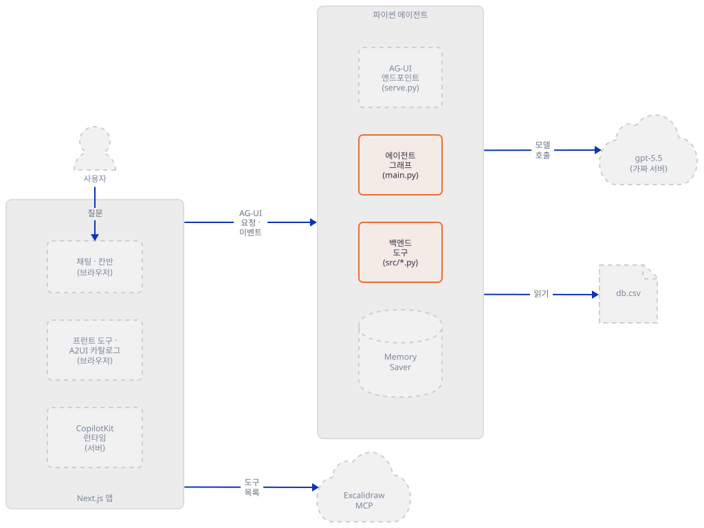

```bash
$PY nokey.py
```

**확인.** 이렇게 답해야 합니다. `main.py:19`가 `ChatOpenAI(...)`를 만드는 줄이고, 가져오기만으로 클라이언트를 만들기 때문에 `serve.py`도 열쇠 없이는 뜨지 못합니다.

```text
OpenAIError: The api_key client option must be set either by passing api_key to the...
멈춘 곳(agent/main.py 줄): [19]
가드: 루프백 밖으로 나가려던 시도 0건 []
```

### Step 2. 루프백 가드와 가짜 서버로 에이전트 서버 띄우기

**목적.** 에이전트가 바깥으로 나갈 수 있는 길을 막고, 모델 자리에 가짜 서버를 세우고, 원본 `serve.py`를 `127.0.0.1`에만 열어 띄웁니다.

**할 일.** 먼저 원본이 어떻게 뜨는지 봅니다. `serve.py:56-58`은 이렇습니다.

```python
if __name__ == "__main__":
    port = int(os.getenv("AGENT_PORT", "8123"))
    uvicorn.run(app, host="0.0.0.0", port=port)
```

`python serve.py`로 띄우면 모든 네트워크 인터페이스(`0.0.0.0`)에 열리고, 같은 네트워크의 누구나 이 서버로 열쇠를 써서 모델을 부를 수 있습니다. 거기에 `CORSMiddleware`가 모든 출처를 허용해서(`serve.py:33-38`) 루프백으로 열었을 때조차 이 PC의 브라우저에서 연 아무 웹페이지가 이 서버를 부르고 응답을 읽을 수 있습니다. 앞의 위험은 `0.0.0.0` 때문이고 뒤의 것은 CORS 때문이라 둘을 따로 막아야 합니다. 그래서 이 문서는 `serve.py`를 건드리지 않고, `uvicorn.run("serve:app", host="127.0.0.1")`로 부르는 `run_serve.py`를 씁니다. 그 앞에 `guard.py`가 있습니다. 가드는 네 가지를 합니다. 환경변수를 **스크립트 안에서 직접** 덮어써서(모델 주소는 `http://127.0.0.1:<가짜 포트>/v1`, 열쇠는 `sk-fake-genui`, LangSmith 트레이싱과 `langgraph` 통계는 끔, 상위 폴더 `.env`나 셸에 진짜 열쇠가 있어도 무시), `NO_PROXY`·`no_proxy`에 루프백을 넣고 없으면 멈추며(셸에 프록시 변수가 있어도 가짜 서버 요청이 프록시로 새지 않게 합니다. `drive.py`의 HTTP 클라이언트는 환경 프록시를 아예 읽지 않습니다), `urlparse`로 호스트가 루프백인지 확인하고, 소켓 연결·이름 조회·asyncio 연결 함수를 루프백 밖으로는 못 나가게 막습니다. 마지막 막기는 이차 방어선입니다. 일차는 앞의 셋입니다. 서버를 루프백으로만 여는 이유는 Day 141 Step 4가 먼저 설명했습니다.

가짜 모델 서버입니다. 에이전트가 보내는 `/v1/chat/completions`만 받고, 대화 내용을 보고 정해진 대본대로 답합니다. 글 답이든 도구 호출이든 스트리밍(`stream: true`)으로 보냅니다. 받은 요청은 모두 기록 파일에 한 줄씩 남습니다. 이 대본은 제가 쓴 것이며 실제 모델의 판단과 다릅니다.

```bash
cat > fake_openai.py <<'EOF'
"""localhost 가짜 OpenAI 서버 (chat.completions만). 답은 모두 이 파일에 적힌 대본이다.

사용법: python fake_openai.py <포트> <기록파일>
"""
import json
import sys
import time
from http.server import BaseHTTPRequestHandler, ThreadingHTTPServer

PORT = int(sys.argv[1])
LOG = sys.argv[2]

TODOS = [
    {"id": "", "title": "Read the docs", "description": "Skim the CopilotKit docs", "emoji": "📚", "status": "pending"},
    {"id": "", "title": "Build a prototype", "description": "Wire one tool to the board", "emoji": "🚀", "status": "pending"},
    {"id": "", "title": "Explore agent state", "description": "Move a card from the UI", "emoji": "💡", "status": "pending"},
]
FLIGHTS = [
    {"id": "f1", "airline": "United Airlines", "airlineLogo": "https://www.google.com/s2/favicons?domain=united.com&sz=128",
     "flightNumber": "UA 123", "origin": "SFO", "destination": "JFK", "date": "Tue, Mar 18",
     "departureTime": "08:00", "arrivalTime": "16:25", "duration": "5h 25m", "status": "On Time",
     "statusIcon": "https://placehold.co/12/22c55e/22c55e.png", "price": "$289"},
    {"id": "f2", "airline": "Delta", "airlineLogo": "https://www.google.com/s2/favicons?domain=delta.com&sz=128",
     "flightNumber": "DL 456", "origin": "SFO", "destination": "JFK", "date": "Tue, Mar 18",
     "departureTime": "11:10", "arrivalTime": "19:40", "duration": "5h 30m", "status": "Delayed",
     "statusIcon": "https://placehold.co/12/eab308/eab308.png", "price": "$312"},
]
SURFACE = {
    "surfaceId": "sales-dashboard",
    "catalogId": "copilotkit://app-dashboard-catalog",
    "components": [
        {"id": "root", "component": "Column", "children": ["title", "metrics", "pie"], "gap": 16},
        {"id": "title", "component": "Title", "text": "Sales dashboard", "level": "h2"},
        {"id": "metrics", "component": "Row", "children": ["m1", "m2"]},
        {"id": "m1", "component": "Metric", "label": "Total revenue", "value": "$150K", "trend": "up", "trendValue": "+12%"},
        {"id": "m2", "component": "Metric", "label": "New customers", "value": "47"},
        {"id": "pie", "component": "PieChart", "data": [
            {"label": "Enterprise", "value": 83}, {"label": "Pro", "value": 41}, {"label": "API", "value": 26}]},
    ],
    "data": {},
}


def write_log(entry):
    with open(LOG, "a", encoding="utf-8", newline="\n") as f:
        f.write(json.dumps(entry, ensure_ascii=False) + "\n")


def tool_name_for(messages, tool_call_id):
    for m in messages:
        for tc in m.get("tool_calls") or []:
            if tc.get("id") == tool_call_id:
                return tc["function"]["name"]
    return None


def decide(body):
    """('text', 문장) 또는 ('tool', 이름, 인자) 를 돌려준다."""
    messages = body["messages"]
    choice = body.get("tool_choice")
    if isinstance(choice, dict) and choice.get("function", {}).get("name") == "render_a2ui":
        return ("tool", "render_a2ui", SURFACE)
    names = [t["function"]["name"] for t in body.get("tools", [])]
    last = messages[-1]
    user = ""
    for m in reversed(messages):
        if m["role"] == "user":
            user = m["content"] if isinstance(m["content"], str) else json.dumps(m["content"])
            break
    low = user.lower()
    if last["role"] == "tool":
        done = tool_name_for(messages, last.get("tool_call_id"))
        if done == "enableAppMode" and "todos" in low:
            return ("tool", "manage_todos", {"todos": TODOS})
        if done == "query_data":
            return ("tool", "generate_a2ui", {})
        return ("text", f"Done: {done} finished.")
    if "add three todos" in low:
        if "enableAppMode" in names:
            return ("tool", "enableAppMode", {})
        return ("tool", "manage_todos", {"todos": TODOS})
    if "todo without id" in low:
        return ("tool", "manage_todos", {"todos": [{"title": "No id", "description": "x", "emoji": "x", "status": "pending"}]})
    if "what is on my board" in low:
        return ("tool", "get_todos", {})
    if "flights" in low:
        return ("tool", "search_flights", {"flights": FLIGHTS})
    if "dashboard" in low:
        return ("tool", "query_data", {"query": "financial sales data"})
    if "schedule" in low:
        return ("tool", "scheduleTime", {"reasonForScheduling": "Learn CopilotKit", "meetingDuration": 30})
    return ("text", "Hello from the fake model.")


def chunk(cid, delta, finish=None):
    return {"id": cid, "object": "chat.completion.chunk", "created": int(time.time()), "model": "gpt-5.5",
            "choices": [{"index": 0, "delta": delta, "finish_reason": finish}]}


class Handler(BaseHTTPRequestHandler):
    def log_message(self, *a):
        pass

    def do_POST(self):
        length = int(self.headers.get("content-length", 0))
        body = json.loads(self.rfile.read(length) or b"{}")
        write_log({"path": self.path, "auth": self.headers.get("authorization", "")[:14], "body": body})
        if not self.path.endswith("/chat/completions"):
            self.send_response(404); self.end_headers(); return
        action = decide(body)
        cid = "chatcmpl-fake-%d" % int(time.time() * 1000)
        if action[0] == "text":
            message = {"role": "assistant", "content": action[1]}
            finish = "stop"
        else:
            message = {"role": "assistant", "content": None, "tool_calls": [
                {"id": "call_" + action[1], "type": "function",
                 "function": {"name": action[1], "arguments": json.dumps(action[2])}}]}
            finish = "tool_calls"
        if not body.get("stream"):
            out = {"id": cid, "object": "chat.completion", "created": int(time.time()), "model": "gpt-5.5",
                   "choices": [{"index": 0, "message": message, "finish_reason": finish}],
                   "usage": {"prompt_tokens": 10, "completion_tokens": 5, "total_tokens": 15}}
            data = json.dumps(out).encode()
            self.send_response(200)
            self.send_header("content-type", "application/json")
            self.send_header("content-length", str(len(data)))
            self.end_headers()
            self.wfile.write(data)
            return
        self.send_response(200)
        self.send_header("content-type", "text/event-stream")
        self.end_headers()
        events = [chunk(cid, {"role": "assistant", "content": ""})]
        if action[0] == "text":
            words = action[1].split(" ")
            for i, w in enumerate(words):
                events.append(chunk(cid, {"content": w + (" " if i < len(words) - 1 else "")}))
        else:
            args = message["tool_calls"][0]["function"]["arguments"]
            events.append(chunk(cid, {"tool_calls": [{"index": 0, "id": message["tool_calls"][0]["id"], "type": "function",
                                                       "function": {"name": action[1], "arguments": ""}}]}))
            for i in range(0, len(args), 40):
                events.append(chunk(cid, {"tool_calls": [{"index": 0, "function": {"arguments": args[i:i + 40]}}]}))
        events.append(chunk(cid, {}, finish))
        for e in events:
            self.wfile.write(b"data: " + json.dumps(e).encode() + b"\n\n")
        self.wfile.write(b"data: [DONE]\n\n")


class Server(ThreadingHTTPServer):
    allow_reuse_address = False


if __name__ == "__main__":
    Server(("127.0.0.1", PORT), Handler).serve_forever()
EOF
```

에이전트 서버를 띄우는 스크립트입니다.

```bash
cat > run_serve.py <<'EOF'
"""serve.py(원본)를 루프백에만 연다. 원본 serve.py의 0.0.0.0 줄은 실행되지 않는다."""
import os
import sys

import guard

fake_port = int(sys.argv[1])
serve_port = int(sys.argv[2])
guard.point_at_fake(fake_port)
guard.check_env()
guard.install_socket_guard()

import uvicorn  # noqa: E402

here = os.path.dirname(os.path.abspath(__file__))
uvicorn.run("serve:app", app_dir=here, host="127.0.0.1", port=serve_port, log_level="warning")
guard.report()
EOF
```

포트는 49152~65535 사이에서 골라 쓰세요. 예시로 가짜 서버 `53871`, 에이전트 서버 `53872`를 씁니다. 터미널 A에서 가짜 서버를, 터미널 B에서 에이전트 서버를 띄웁니다. 둘 다 위의 환경변수 두 줄을 먼저 합니다.

```bash
# 터미널 A
$PY fake_openai.py 53871 fake.jsonl
```

```bash
# 터미널 B (셸에 진짜 열쇠가 있는 독자를 흉내 내려고 변수 둘을 앞에 붙임)
OPENAI_API_KEY=sk-pretend-real-key LANGSMITH_TRACING=true $PY run_serve.py 53871 53872
```

```powershell
# 터미널 A (실행해 보지 못했습니다)
& $PY fake_openai.py 53871 fake.jsonl
# 터미널 B (실행해 보지 못했습니다)
& $PY run_serve.py 53871 53872
```

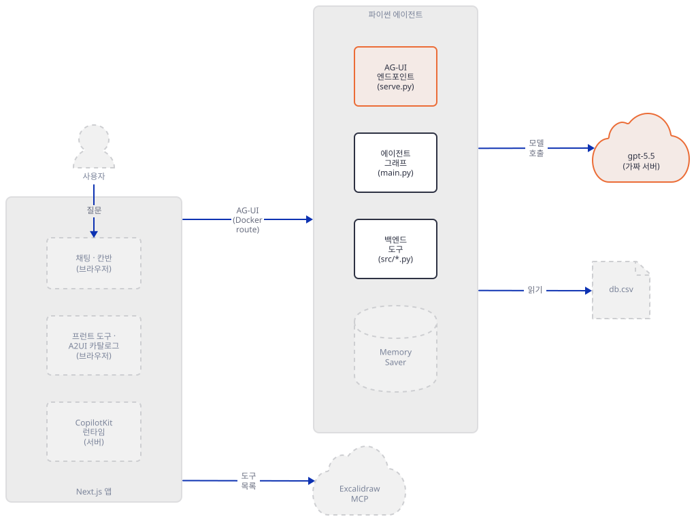

**확인.** 가드가 정말 막는지 먼저 봅니다. 터미널 C에서 `guard_selftest.py`를 돌립니다. 문서 예약 주소 `192.0.2.1`과 `example.com`으로 연결을 시도하지만, 연결 함수 앞에서 거절되어 패킷은 나가지 않습니다.

```bash
cat > guard_selftest.py <<'EOF'
"""가드가 루프백 밖 연결을 막는지 확인한다. 실제로는 패킷이 한 개도 나가지 않는다(연결 함수 앞에서 거절)."""
import asyncio
import socket

import guard

guard.install_socket_guard()
for host in ("192.0.2.1", "example.com"):
    try:
        socket.create_connection((host, 80), timeout=2)
    except Exception as e:
        print("동기 ", host, "->", type(e).__name__)


async def main():
    for host in ("192.0.2.1", "example.com"):
        try:
            await asyncio.open_connection(host, 80)
        except Exception as e:
            print("비동기", host, "->", type(e).__name__)


asyncio.run(main())
guard.report()
EOF
```

```bash
$PY guard_selftest.py
```

```text
동기  192.0.2.1 -> gaierror
동기  example.com -> gaierror
비동기 192.0.2.1 -> ConnectionRefusedError
비동기 example.com -> ConnectionRefusedError
가드: 루프백 밖으로 나가려던 시도 4건 [('dns', '192.0.2.1'), ('dns', 'example.com'), ('asyncio', '192.0.2.1'), ('asyncio', 'example.com')]
```

서버가 루프백에만 열렸는지 봅니다.

```bash
netstat -ano | grep -E "5387[12]"
```

```text
  TCP    127.0.0.1:53871        0.0.0.0:0              LISTENING       48004
  TCP    127.0.0.1:53872        0.0.0.0:0              LISTENING       15404
```

`0.0.0.0`이 아니라 `127.0.0.1`이어야 합니다. 이 문서는 "진짜 키가 있는 독자"로도 따라 해 보았습니다. 위 터미널 B를 이렇게 띄운 것이 그것입니다. 셸에 열쇠와 트레이싱 변수를 건 채로 띄웠고(`sk-pretend-real-key`라는 가짜 값을 썼습니다), 이어지는 Step의 요청을 모두 보낸 뒤 가짜 서버 쪽 기록(`fake.jsonl`)의 `Authorization` 앞머리는 `Bearer sk-fake`뿐이었습니다(Step 7). 셸의 열쇠는 어느 요청에도 실리지 않았고, 가드는 루프백 밖으로 나가려던 시도를 0건으로 셌습니다. 진짜 열쇠가 있는 셸이라면 터미널 B 줄 앞에 이 변수 둘을 붙이지 않아도 같습니다. 파이썬 쪽은 `.env`를 읽지 않습니다. `serve.py`·`guard.py`·`copilotkit`·`ag_ui_langgraph` 어디에도 `load_dotenv`가 없는 것을 소스로 확인했습니다. `.env`를 읽는 쪽은 Next.js와 `langgraph dev`(`agent/langgraph.json`의 `"env": "../.env"`)입니다.

### Step 3. 에이전트 그래프 읽기

**목적.** 서버가 서빙하는 그래프가 무슨 노드로 이루어졌는지, 도구가 무엇인지, 미들웨어가 어디에 끼는지 봅니다.

**할 일.** `agent/main.py`는 45줄이고, 에이전트를 `create_agent`로 만듭니다(`main.py:19-29`).

```python
model = ChatOpenAI(model="gpt-5.5", model_kwargs={"parallel_tool_calls": False})

agent = create_agent(
    model=model,
    tools=[query_data, *todo_tools, generate_a2ui, search_flights],
    middleware=[
        CopilotKitMiddleware(),
        StateStreamingMiddleware(
            StateItem(state_key="todos", tool="manage_todos", tool_argument="todos")
        ),
    ],
```

모델은 `ChatOpenAI`이고 `parallel_tool_calls`를 꺼서 도구를 한 번에 하나씩만 부르게 합니다. 도구는 `query_data`, 할 일 도구 둘, `generate_a2ui`, `search_flights` 다섯입니다. 여기에 CopilotKit 미들웨어가 둘 붙습니다. `CopilotKitMiddleware`는 화면이 보낸 도구(프런트엔드 도구)를 모델이 볼 수 있게 합치고, 그 호출은 서버에서 실행하지 않도록 떼어 놓습니다(`copilotkit_lg_middleware.py`를 소스로 확인). `StateStreamingMiddleware`는 `manage_todos`의 `todos` 인자가 스트리밍되는 동안 그것을 상태로 미리 보여 주라는 표시를 합니다. 시스템 프롬프트(`main.py:31-42`)는 어느 도구를 언제 부를지를 글로 적습니다. 예를 들어 "Todos: enable app mode first, then manage todos"는 `enableAppMode`라는 **화면 쪽 도구**를 먼저 부르라는 뜻입니다(Step 4).

그래프를 가져와 구조만 출력하는 스크립트입니다. 모델 주소는 닫힌 포트(9)로 걸어 실수로 불려도 어디에도 닿지 않습니다.

```bash
cat > inspect_graph.py <<'EOF'
"""에이전트 그래프를 가져와 구조만 출력한다(모델은 부르지 않는다). 사용법: python inspect_graph.py"""
import json
import os
import sys

import guard

guard.point_at_fake(9)          # 닫힌 포트: 실수로 호출돼도 어디에도 닿지 않는다
guard.check_env()
guard.install_socket_guard()
sys.path.insert(0, os.path.join(os.path.dirname(os.path.abspath(__file__)), "agent"))

from main import graph  # noqa: E402
from src.todos import manage_todos  # noqa: E402

print("노드:", [n for n in graph.get_graph().nodes])
for e in graph.get_graph().edges:
    print(f"  {e.source} -> {e.target}" + (" (조건부)" if e.conditional else ""))
print("체크포인터:", graph.checkpointer)
schema = manage_todos.tool_call_schema.model_json_schema()
print("manage_todos 의 Todo 필수 항목:", schema["$defs"]["Todo"]["required"])
guard.report()
EOF
```

```bash
$PY inspect_graph.py
```

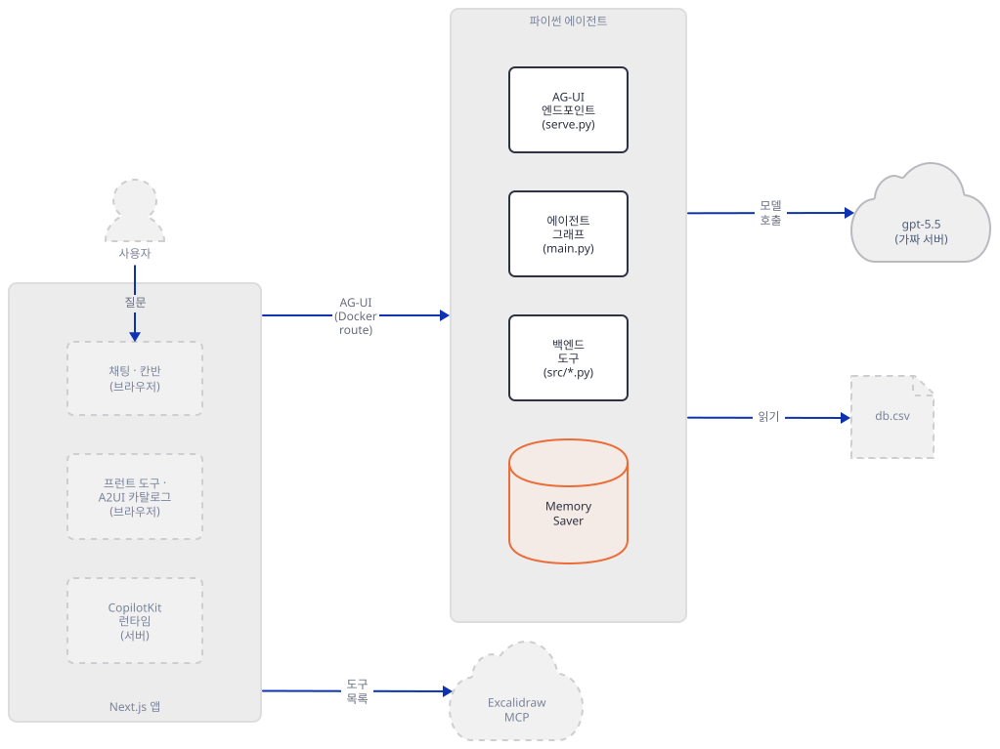

**확인.**

```text
노드: ['__start__', 'model', 'tools', 'CopilotKitMiddleware.before_agent', 'CopilotKitMiddleware.after_model', 'CopilotKitMiddleware.after_agent', '__end__']
  CopilotKitMiddleware.after_model -> CopilotKitMiddleware.after_agent (조건부)
  CopilotKitMiddleware.after_model -> model (조건부)
  CopilotKitMiddleware.after_model -> tools (조건부)
  CopilotKitMiddleware.before_agent -> model
  __start__ -> CopilotKitMiddleware.before_agent
  model -> CopilotKitMiddleware.after_model
  tools -> model (조건부)
  CopilotKitMiddleware.after_agent -> __end__
체크포인터: None
manage_todos 의 Todo 필수 항목: ['id', 'title', 'description', 'emoji', 'status']
가드: 루프백 밖으로 나가려던 시도 0건 []
```

노드는 `model`, `tools`, 그리고 `CopilotKitMiddleware`의 세 훅(`before_agent`·`after_model`·`after_agent`)입니다. 그림이 그 이어짐입니다. `after_model`에서 갈라지는 세 갈래가 핵심입니다. 처리할 백엔드 도구 호출이 있으면 `tools`로, 호출이 없으면 `after_agent`로 가서 끝나고(프런트엔드 도구만 있었다면 그 호출을 떼어 낸 뒤라 이 갈래에 속합니다), 도구 호출은 있는데 이미 결과 메시지가 달려 있어 처리할 것이 없으면 `model`로 되돌아갑니다(`langchain` 1.2.15 `agents/factory.py`의 `_make_model_to_tools_edge`에서 읽었습니다). `체크포인터: None`이라는 것에 주목하세요. 이 그래프는 기억 장치 없이 만들어지고, 서버 쪽 `serve.py:22-25`가 `graph.copy()`로 복제해 `MemorySaver`를 붙입니다. `serve.py:20-21`의 주석은 체크포인터가 보통 LangGraph 플랫폼 서버에서 제공된다고 적습니다.

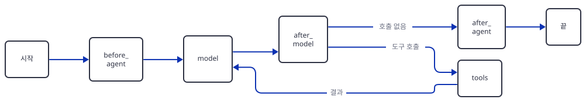

서버 안에서 무엇이 무엇을 부르는지도 화살표로 그렸습니다. `serve.py`가 입력과 `state`를 그래프에 넘기고 이벤트를 돌려받습니다. 그래프는 메인 모델 호출·도구 호출·체크포인트를 하고, 도구(`generate_a2ui`)는 보조 모델을 직접 부르고 `query_data`는 `db.csv`를 읽습니다.

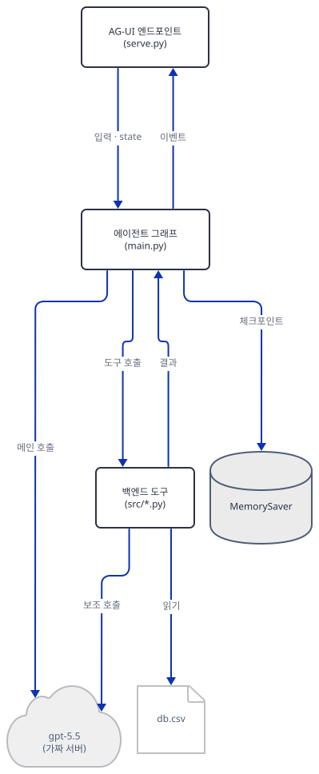

### Step 4. 프런트엔드 도구와 사람 승인 — 한 질문이 요청 두 번이 됩니다

**목적.** 화면이 등록한 도구를 에이전트가 어떻게 "부르는지", 서버가 그것을 왜 실행하지 않는지, 사람이 끼는 도구(`scheduleTime`)가 어떻게 다른지 봅니다.

**할 일.** 화면 쪽 소스를 먼저 읽습니다. `generative_ui_agents/generative-ui-starter-project/src/components/example-layout/index.tsx:15-22`의 `useFrontendTool`이 `enableAppMode`를 등록합니다.

```tsx
  useFrontendTool({
    name: "enableAppMode",
    description:
      "Enable app mode, make sure its open when interacting with todos.",
    handler: async () => {
      setMode("app");
    },
  });
```

`generative_ui_agents/generative-ui-starter-project/src/hooks/use-generative-ui-examples.tsx:26-40`은 사람이 끼는 도구(`useHumanInTheLoop`)를 등록합니다.

```tsx
  useHumanInTheLoop({
    name: "scheduleTime",
    description: "Use human-in-the-loop to schedule a meeting with the user.",
    parameters: z.object({
      reasonForScheduling: z
        .string()
        .describe("Reason for scheduling, very brief - 5 words."),
      meetingDuration: z
        .number()
        .describe("Duration of the meeting in minutes"),
    }),
    render: ({ respond, status, args }) => {
      return <MeetingTimePicker status={status} respond={respond} {...args} />;
    },
  });
```

이 등록들이 모델에게 도구 목록으로 전달됩니다. `drive.py`가 `tools`에 넣는 것이 이 목록입니다(제가 손으로 옮겨 적음). 에이전트 쪽에서는 `CopilotKitMiddleware`가 이 도구들을 모델 요청에 합칩니다. 가짜 서버 기록의 `tools=11`이 그 증거입니다(백엔드 다섯, `drive.py`가 넣은 프런트엔드 여섯). 실제 화면은 `generateSandboxedUi`(Open Generative UI가 더하는 도구)와 그 설명 항목도 보내므로 더 많을 것이고, 이 문서의 `drive.py`는 그것을 넣지 않았습니다. 화면 쪽 연결은 그림과 같습니다. 도구와 카탈로그가 `tools`·`context`로 등록되고, 요청이 런타임을 거쳐 서버로 가고, 이벤트가 돌아와 핸들러 실행과 카탈로그 렌더로 이어집니다.

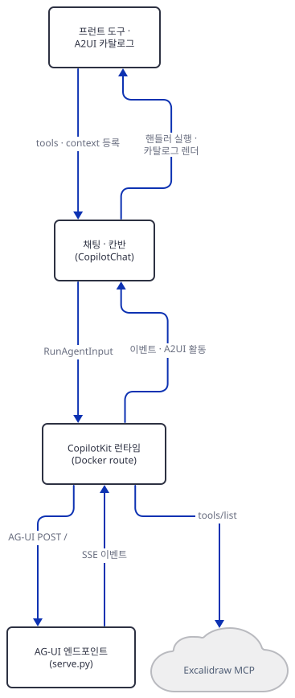

이제 화면 대신 요청을 보내는 스크립트입니다. 이벤트를 접어 읽는 방식(RAW·STEP 이벤트 접기, `TOOL_CALL_ARGS` 이어 붙이기)은 Day 141 Step 5와 같습니다. 장면 일곱(`health` 포함)을 한 파일에 담았고, Step 4~7이 장면을 나눠 씁니다. `converse()`가 프런트엔드가 하는 반복을 흉내 냅니다. 실행이 끝났는데 프런트엔드 도구 호출이 남았으면 `role: "tool"` 메시지를 붙여 다시 보냅니다. 그 규칙은 `@copilotkit/core` 1.56.2의 `executeToolHandler`·`executeSpecificTool`에서 읽었습니다. 핸들러가 값을 돌려주지 않으면 결과는 빈 글(`""`)이고, `followUp`이 `false`가 아니면 에이전트를 다시 실행합니다.

```bash
cat > drive.py <<'EOF'
"""AG-UI 요청을 직접 보낸다(브라우저 대신). 사용법: python drive.py <서빙포트> <장면>

장면: health | todos | board | flights | dashboard | schedule | noid
요청 모양(RunAgentInput)은 @ag-ui/client 0.0.52 의 prepareRunAgentInput 이 만드는 필드를 따른다.
frontend tools 와 context 는 src/ 의 React 코드를 보고 제가 손으로 옮겨 적은 것이다.
"""
import json
import sys
import uuid
from urllib.parse import urlparse

import guard

port = int(sys.argv[1])
scene = sys.argv[2]
url = f"http://127.0.0.1:{port}/"
if not guard.is_loopback_host(urlparse(url).hostname or ""):
    sys.exit("가드: 루프백이 아닌 주소입니다.")
guard.loopback_noproxy()
guard.check_noproxy()
guard.install_socket_guard()

import httpx  # noqa: E402

EMPTY = {"type": "object", "properties": {}}
TOOLS = [
    {"name": "enableAppMode", "description": "Enable app mode, make sure its open when interacting with todos.", "parameters": EMPTY},
    {"name": "enableChatMode", "description": "Enable chat mode", "parameters": EMPTY},
    {"name": "toggleTheme", "description": "Frontend tool for toggling the theme of the app.", "parameters": EMPTY},
    {"name": "scheduleTime", "description": "Use human-in-the-loop to schedule a meeting with the user.",
     "parameters": {"type": "object", "properties": {
         "reasonForScheduling": {"type": "string", "description": "Reason for scheduling, very brief - 5 words."},
         "meetingDuration": {"type": "number", "description": "Duration of the meeting in minutes"}},
         "required": ["reasonForScheduling", "meetingDuration"]}},
    {"name": "pieChart", "description": "Controlled Generative UI that displays data as a pie chart.",
     "parameters": {"type": "object", "properties": {"title": {"type": "string"}, "description": {"type": "string"},
         "data": {"type": "array", "items": {"type": "object", "properties": {"label": {"type": "string"}, "value": {"type": "number"}}}}}}},
    {"name": "barChart", "description": "Controlled Generative UI that displays data as a bar chart.",
     "parameters": {"type": "object", "properties": {"title": {"type": "string"}, "description": {"type": "string"},
         "data": {"type": "array", "items": {"type": "object", "properties": {"label": {"type": "string"}, "value": {"type": "number"}}}}}}},
]
FRONTEND = {t["name"] for t in TOOLS}
SCHEMA_DESC = ("A2UI Component Schema — available components for generating UI surfaces. "
               "Use these component names and properties when creating A2UI operations.")
CONTEXT = [
    {"description": "A2UI catalog capabilities: available catalog IDs and custom component definitions the client can render.",
     "value": json.dumps({"catalogIds": ["copilotkit://app-dashboard-catalog"]})},
    {"description": SCHEMA_DESC,
     "value": json.dumps([{"name": "Metric", "props": {"label": "string", "value": "string"}},
                          {"name": "PieChart", "props": {"data": "array"}}])},
    {"description": "A2UI generation guidelines", "value": "GENERATION-GUIDELINES-TEXT"},
    {"description": "A2UI design guidelines", "value": "DESIGN-GUIDELINES-TEXT"},
]


RUN = uuid.uuid4().hex[:6]


def msg(role, content, **extra):
    return {"id": str(uuid.uuid4()), "role": role, "content": content, **extra}


def run(thread, messages, state=None):
    body = {"threadId": f"{thread}-{RUN}", "runId": str(uuid.uuid4()), "state": state or {}, "messages": messages,
            "tools": TOOLS, "context": CONTEXT, "forwardedProps": {}}
    events = []
    with httpx.Client(timeout=60, trust_env=False) as c, c.stream("POST", url, json=body, headers={"accept": "text/event-stream"}) as r:
        events.append({"type": "HTTP", "status": r.status_code, "ctype": r.headers.get("content-type")})
        for line in r.iter_lines():
            if line.startswith("data: "):
                events.append(json.loads(line[6:]))
    return events


def show(events):
    """RAW·STEP 이벤트는 접고, 나머지는 한 줄씩 보여 준다. TOOL_CALL_ARGS 는 이어 붙여 한 줄로."""
    args = {}
    for e in events:
        t = e["type"]
        if t in ("RAW", "STEP_STARTED", "STEP_FINISHED"):
            continue
        if t == "TOOL_CALL_ARGS":
            args.setdefault(e["toolCallId"], []).append(e["delta"])
            continue
        if t == "TOOL_CALL_END":
            a = "".join(args.get(e["toolCallId"], []))
            print(f"  TOOL_CALL_END (args {len(a)}자): {a[:60]!r}")
            continue
        if t == "HTTP":
            print(f"  HTTP {e['status']} {e['ctype']}")
        elif t == "TEXT_MESSAGE_CONTENT":
            print(f"  {t}: {e['delta']!r}")
        elif t == "TOOL_CALL_START":
            print(f"  {t}: {e['toolCallName']}")
        elif t == "TOOL_CALL_RESULT":
            print(f"  {t}: {e['content'][:100]!r}")
        elif t == "CUSTOM":
            print(f"  CUSTOM {e.get('name')}: {json.dumps(e.get('value'))[:100]}")
        elif t == "STATE_SNAPSHOT":
            snap = e["snapshot"]
            todos = snap.get("todos")
            print(f"  STATE_SNAPSHOT: keys={list(snap)}" + (f" todos={len(todos)}" if todos is not None else ""))
        elif t == "RUN_ERROR":
            print(f"  {t}: {e.get('message')}")
        else:
            print(f"  {t}")


def ops(events):
    """TOOL_CALL_RESULT 안의 a2ui_operations 를 한 줄씩 요약한다."""
    for e in events:
        if e["type"] != "TOOL_CALL_RESULT" or "a2ui_operations" not in e["content"]:
            continue
        for op in json.loads(e["content"])["a2ui_operations"]:
            kind = [k for k in op if k != "version"][0]
            body = op[kind]
            extra = ""
            if kind == "createSurface":
                extra = f"catalogId={body['catalogId']}"
            elif kind == "updateComponents":
                extra = "components=" + ",".join(c["component"] for c in body["components"])
            elif kind == "updateDataModel":
                extra = f"path={body['path']} keys={list(body['value'])}"
            print(f"  [a2ui] {kind}: surfaceId={body['surfaceId']} {extra}")


def last(events, kind):
    xs = [e for e in events if e["type"] == kind]
    return xs[-1] if xs else None


def converse(thread, text, state=None, respond=None):
    """프런트엔드가 하는 반복을 흉내 낸다: 실행 -> 프런트 도구 호출이 남았으면 도구 메시지를 붙여 다시 실행."""
    history = [msg("user", text)]
    n = 0
    while True:
        n += 1
        print(f"[요청 {n}] 보낸 메시지 {len(history)}개, state 키 {list((state or {}).keys())}")
        ev = run(thread, history, state)
        show(ev)
        snap = last(ev, "STATE_SNAPSHOT")
        if snap:
            state = {k: v for k, v in snap["snapshot"].items() if k == "todos"} or state
        pending = [e["toolCallName"] for e in ev if e["type"] == "TOOL_CALL_START"
                   and e["toolCallName"] in FRONTEND]
        if not pending:
            return ev, state
        started = [e for e in ev if e["type"] == "TOOL_CALL_START" and e["toolCallName"] in FRONTEND][-1]
        history = last(ev, "MESSAGES_SNAPSHOT")["messages"]
        result = respond(started["toolCallName"]) if respond else ""
        print(f"  (브라우저가 {started['toolCallName']} 를 실행하고 결과 {result!r} 를 tool 메시지로 붙임)")
        history.append(msg("tool", result, toolCallId=started["toolCallId"]))


if scene == "health":
    r = httpx.get(url + "health", timeout=10, trust_env=False)
    print(r.status_code, r.json())
elif scene == "todos":
    ev, state = converse("t-todos", "Enable app mode and add three todos about learning CopilotKit")
    print("todos:", [(t["title"], t["id"][:8]) for t in state["todos"]])
elif scene == "board":
    ev, state = converse("t-board", "Enable app mode and add three todos about learning CopilotKit")
    todos = state["todos"]
    todos[0]["status"] = "completed"
    todos[1]["title"] = "Build a prototype (edited in the UI)"
    print("-- 사용자가 화면에서 카드를 고쳤다: agent.setState({todos}) 와 같은 효과, 다음 요청의 state 에 실림")
    ev2, _ = converse("t-board", "What is on my board?", state={"todos": todos})
    seen = json.loads(last(ev2, "TOOL_CALL_RESULT")["content"])
    print("get_todos 가 본 것:", [(t["title"], t["status"]) for t in seen])
    print("-- 같은 스레드, state 를 싣지 않고")
    ev3, _ = converse("t-board", "What is on my board?")
    print("get_todos 가 본 것:", [(t["title"], t["status"]) for t in json.loads(last(ev3, "TOOL_CALL_RESULT")["content"] or "[]")])
    print("-- 새 스레드, state 를 싣고")
    ev4, _ = converse("t-board-new", "What is on my board?", state={"todos": todos})
    print("get_todos 가 본 것:", [(t["title"], t["status"]) for t in json.loads(last(ev4, "TOOL_CALL_RESULT")["content"] or "[]")])
    print("-- 새 스레드, state 없이")
    ev5, _ = converse("t-board-empty", "What is on my board?")
    print("get_todos 가 본 것:", json.loads(last(ev5, "TOOL_CALL_RESULT")["content"] or "[]"))
elif scene == "flights":
    ev, _ = converse("t-fl", "Find flights from SFO to JFK for next Tuesday.")
    ops(ev)
elif scene == "dashboard":
    ev, _ = converse("t-dash", "Using A2UI show me a sales dashboard")
    ops(ev)
elif scene == "schedule":
    converse("t-sch", "I'd like to schedule a 30-minute meeting. Use scheduleTime.",
             respond=lambda name: "Meeting scheduled for Friday at 10:00 AM (30 min).")
elif scene == "noid":
    converse("t-noid", "add a todo without id")
guard.report()
EOF
```

터미널 C에서 먼저 서버가 살아 있는지, 그다음 "Task Manager" 장면을 보냅니다.

```bash
$PY drive.py 53872 health
$PY drive.py 53872 todos
```

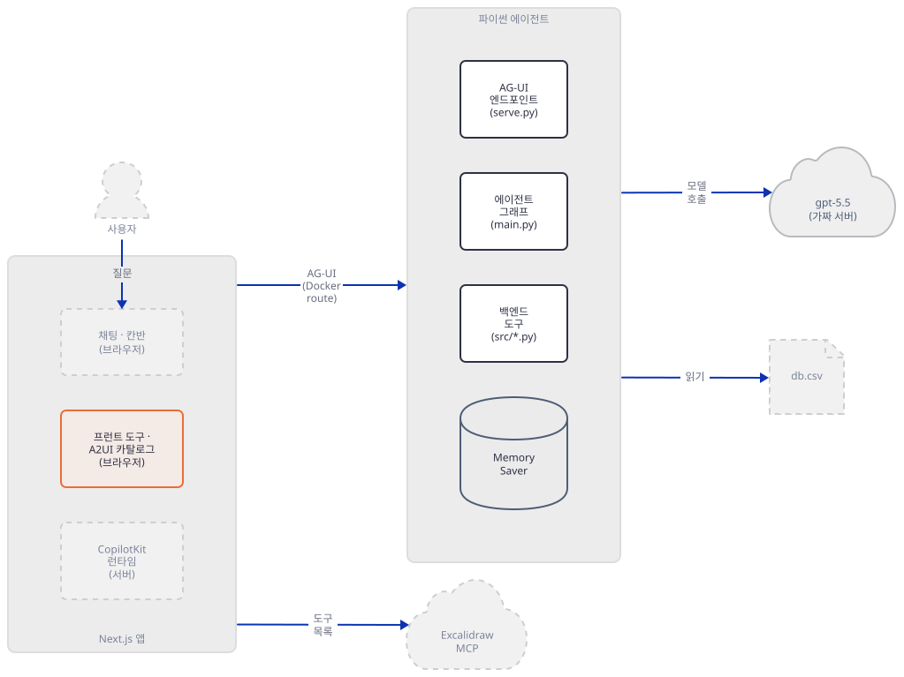

**확인.** 첫 명령은 `200 {'status': 'ok'}`를 답합니다. 둘째 명령은 요청 두 번을 보냅니다.

```text
[요청 1] 보낸 메시지 1개, state 키 []
  HTTP 200 text/event-stream; charset=utf-8
  RUN_STARTED
  STATE_SNAPSHOT: keys=['messages', 'tools', 'copilotkit']
  TOOL_CALL_START: enableAppMode
  TOOL_CALL_END (args 2자): '{}'
  STATE_SNAPSHOT: keys=['messages', 'tools', 'copilotkit']
  STATE_SNAPSHOT: keys=['messages', 'tools', 'copilotkit']
  STATE_SNAPSHOT: keys=['messages', 'copilotkit']
  MESSAGES_SNAPSHOT
  RUN_FINISHED
  (브라우저가 enableAppMode 를 실행하고 결과 '' 를 tool 메시지로 붙임)
[요청 2] 보낸 메시지 4개, state 키 []
  HTTP 200 text/event-stream; charset=utf-8
  RUN_STARTED
  STATE_SNAPSHOT: keys=['messages', 'tools', 'copilotkit']
  CUSTOM PredictState: [{"state_key": "todos", "tool": "manage_todos", "tool_argument": "todos"}]
  TOOL_CALL_START: manage_todos
  TOOL_CALL_END (args 403자): '{"todos": [{"id": "", "title": "Read the docs", "description'
  TOOL_CALL_RESULT: 'Successfully updated todos'
  TEXT_MESSAGE_START
  TEXT_MESSAGE_CONTENT: 'Done: '
  TEXT_MESSAGE_CONTENT: 'manage_todos '
  TEXT_MESSAGE_CONTENT: 'finished.'
  TEXT_MESSAGE_END
  STATE_SNAPSHOT: keys=['messages', 'todos', 'copilotkit'] todos=3
  MESSAGES_SNAPSHOT
  RUN_FINISHED
todos: [('Read the docs', '4b84f0c1'), ('Build a prototype', 'ed931cc4'), ('Explore agent state', '734f7774')]
가드: 루프백 밖으로 나가려던 시도 0건 []
```

요청 1에서 모델은 `enableAppMode`를 불렀습니다. 서버는 이 호출을 실행하지 않고(`after_model`이 떼어 놓음) 호출 사실만 `TOOL_CALL_START`·`TOOL_CALL_END`로 흘리고 `RUN_FINISHED`로 끝납니다. 브라우저가 핸들러를 돌려(앱 모드로 전환) 빈 결과를 붙여 다시 보내는 것이 요청 2이고, 거기서 비로소 `manage_todos`가 서버에서 실행됩니다. `CUSTOM PredictState`는 `main.py:26-28`의 `StateStreamingMiddleware`가 낸 것으로, "`manage_todos`의 `todos` 인자가 스트리밍되는 동안 그것을 `todos` 상태로 미리 쓰라"는 표시입니다. 화면은 카드를 도구 호출이 끝나기 전부터 채워 갈 수 있습니다(화면 쪽 동작은 실행하지 못했습니다). 끝나고서야 `STATE_SNAPSHOT`에 `todos`가 들어옵니다.

사람 승인 장면도 보냅니다.

```bash
$PY drive.py 53872 schedule
```

```text
[요청 1] 보낸 메시지 1개, state 키 []
  HTTP 200 text/event-stream; charset=utf-8
  RUN_STARTED
  STATE_SNAPSHOT: keys=['messages', 'tools', 'copilotkit']
  TOOL_CALL_START: scheduleTime
  TOOL_CALL_END (args 66자): '{"reasonForScheduling": "Learn CopilotKit", "meetingDuration'
  STATE_SNAPSHOT: keys=['messages', 'tools', 'copilotkit']
  STATE_SNAPSHOT: keys=['messages', 'tools', 'copilotkit']
  STATE_SNAPSHOT: keys=['messages', 'copilotkit']
  MESSAGES_SNAPSHOT
  RUN_FINISHED
  (브라우저가 scheduleTime 를 실행하고 결과 'Meeting scheduled for Friday at 10:00 AM (30 min).' 를 tool 메시지로 붙임)
[요청 2] 보낸 메시지 4개, state 키 []
  HTTP 200 text/event-stream; charset=utf-8
  RUN_STARTED
  STATE_SNAPSHOT: keys=['messages', 'tools', 'copilotkit']
  TEXT_MESSAGE_START
  TEXT_MESSAGE_CONTENT: 'Done: '
  TEXT_MESSAGE_CONTENT: 'scheduleTime '
  TEXT_MESSAGE_CONTENT: 'finished.'
  TEXT_MESSAGE_END
  STATE_SNAPSHOT: keys=['messages', 'copilotkit']
  MESSAGES_SNAPSHOT
  RUN_FINISHED
가드: 루프백 밖으로 나가려던 시도 0건 []
```

`scheduleTime`도 요청이 둘로 나뉩니다. 다른 점은 둘째 요청의 `tool` 메시지 내용이 핸들러의 반환이 아니라 사용자가 고른 시간 글이라는 것입니다. `MeetingTimePicker`가 슬롯을 누를 때 `respond("Meeting scheduled for …")`를 부르고(`generative_ui_agents/generative-ui-starter-project/src/components/generative-ui/meeting-time-picker.tsx:42-47`), 그 글이 그대로 `tool` 메시지가 됩니다. 사람이 고를 때까지 에이전트가 기다린다는 것은 서버가 기다리는 것이 아니라, 실행이 끝나 있고 다음 요청이 올 때까지 아무 일도 없다는 뜻입니다.

### Step 5. 공유 상태 — 칸반 보드는 누구 것입니까

**목적.** `todos`가 에이전트 상태에 있다는 말이 실제로 무슨 뜻인지, 화면에서 고친 내용이 에이전트에게 어떻게 가는지, 서버가 기억하는 것과 요청이 실어 오는 것이 어떻게 다른지 봅니다.

**할 일.** 상태 정의와 도구는 `agent/src/todos.py`입니다.

```python
class AgentState(BaseAgentState):
    todos: list[Todo]

@tool
def manage_todos(todos: list[Todo], runtime: ToolRuntime) -> Command:
    """
    Manage the current todos.
    """
    # Ensure all todos have IDs that are unique
    for todo in todos:
        if "id" not in todo or not todo["id"]:
            todo["id"] = str(uuid.uuid4())

    # Update the state
    return Command(update={
        "todos": todos,
        "messages": [
            ToolMessage(
                content="Successfully updated todos",
                tool_call_id=runtime.tool_call_id
            )
        ]
    })

@tool
def get_todos(runtime: ToolRuntime):
    """
    Get the current todos.
    """
    return runtime.state.get("todos", [])
```

`manage_todos`는 목록을 **통째로** 받아 덮어씁니다(`Command(update=...)`). 화면 쪽은 `generative_ui_agents/generative-ui-starter-project/src/components/example-canvas/index.tsx:12-16`에서 이 상태를 읽고 씁니다.

```tsx
        <TodoList
          todos={agent.state?.todos || []}
          onUpdate={(updatedTodos) => agent.setState({ todos: updatedTodos })}
          isAgentRunning={agent.isRunning}
        />
```

`agent.setState({ todos })`로 쓴 값은 다음 실행 때 요청의 `state` 필드로 갑니다(`@ag-ui/client` 0.0.52의 `prepareRunAgentInput`에서 확인: `state: clone(this.state)`). 그림의 순환이 그 길입니다.

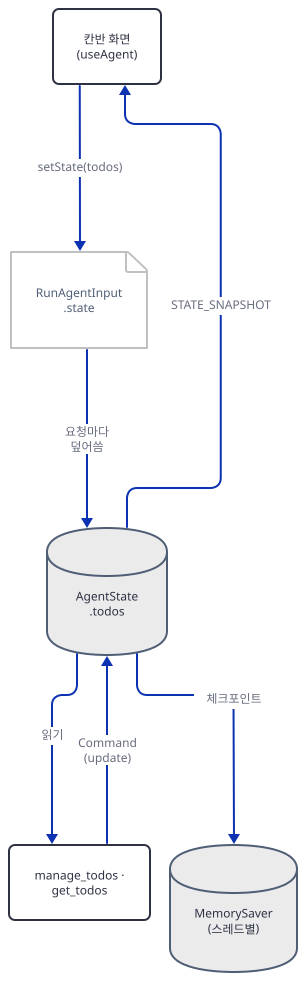

`board` 장면은 카드 세 장을 만든 뒤, 화면에서 첫 카드를 Done으로 옮기고 둘째 카드 제목을 고친 것처럼 `state`를 바꿔 다시 묻습니다.

```bash
$PY drive.py 53872 board
```

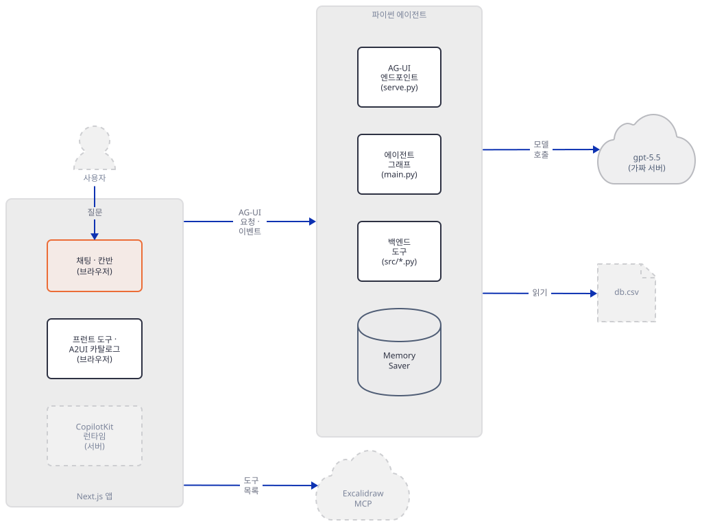

**확인.** 질문마다 `get_todos`가 본 것이 한 줄씩 나옵니다.

```text
[요청 1] 보낸 메시지 1개, state 키 []
[요청 2] 보낸 메시지 4개, state 키 []
-- 사용자가 화면에서 카드를 고쳤다: agent.setState({todos}) 와 같은 효과, 다음 요청의 state 에 실림
[요청 1] 보낸 메시지 1개, state 키 ['todos']
get_todos 가 본 것: [('Read the docs', 'completed'), ('Build a prototype (edited in the UI)', 'pending'), ('Explore agent state', 'pending')]
-- 같은 스레드, state 를 싣지 않고
[요청 1] 보낸 메시지 1개, state 키 []
get_todos 가 본 것: [('Read the docs', 'completed'), ('Build a prototype (edited in the UI)', 'pending'), ('Explore agent state', 'pending')]
-- 새 스레드, state 를 싣고
[요청 1] 보낸 메시지 1개, state 키 ['todos']
get_todos 가 본 것: [('Read the docs', 'completed'), ('Build a prototype (edited in the UI)', 'pending'), ('Explore agent state', 'pending')]
-- 새 스레드, state 없이
[요청 1] 보낸 메시지 1개, state 키 []
get_todos 가 본 것: []
```

세 가지를 읽을 수 있습니다. 첫째, 화면에서 고친 내용이 `state`에 실려 가면 에이전트 도구가 그것을 봅니다. 둘째, 같은 스레드에서는 `state`를 안 실어도 서버가 기억합니다(`MemorySaver`). 셋째, 새 스레드에서는 `state`를 실어 보내야만 이어집니다. 서버를 다시 띄우면 `MemorySaver`는 비므로, 진실의 원천은 화면(클라이언트)이 들고 있는 `agent.state`이고 서버의 체크포인터는 같은 스레드의 대화 기억입니다. 이 구조가 CLAUDE.md의 "State lives in the agent"를 문자 그대로 받아들이기 어려운 까닭입니다.

`manage_todos`의 `id` 처리에는 코드와 스키마가 어긋나는 곳이 있습니다. 코드(`todos.py:24-26`)는 `id`가 없거나 비었으면 `uuid4`를 채웁니다. 그런데 모델에게 보여 주는 스키마는 `id`를 필수로 적습니다(`inspect_graph.py`의 마지막 줄). 모델이 빈 문자열을 주면 코드가 채우고(위 `todos` 장면의 `id`가 uuid로 채워진 것을 확인했습니다), 아예 빼면 도구 호출이 검증에서 떨어집니다. 이 저장소의 `fixtures/default.json`도 `id` 없는 `manage_todos` 호출을 담고 있어 같은 경로를 탈 것으로 보입니다(Docker 테스트용 aimock 설정이고 실행하지 않았습니다).

가짜 서버가 받은 요청 기록(`fake.jsonl`)을 요약하는 스크립트를 먼저 저장합니다. 요청마다 모델 이름·스트리밍 여부·도구 개수·마지막 메시지의 역할을 한 줄로 보여 주고, 도구 오류 글이나 강제된 도구 호출이 있으면 덧붙입니다.

```bash
cat > show_log.py <<'EOF'
"""가짜 서버가 받은 요청 기록(JSON Lines)을 한 줄씩 요약한다. 사용법: python show_log.py <기록파일>"""
import json
import sys

rows = [json.loads(line) for line in open(sys.argv[1], encoding="utf-8")]
print(f"요청 {len(rows)}건, Authorization 앞머리: {sorted({r['auth'] for r in rows})}")
for i, r in enumerate(rows):
    b = r["body"]
    forced = b.get("tool_choice")
    print(f"{i:2d} {r['path']} model={b['model']} stream={b.get('stream')} tools={len(b.get('tools', []))} "
          f"tool_choice={forced['function']['name'] if isinstance(forced, dict) else forced} "
          f"마지막 role={b['messages'][-1]['role']}")
    tail = b["messages"][-1]
    if tail["role"] == "tool" and str(tail["content"]).startswith("Error"):
        print("      도구 오류 메시지(모델이 받은 글):", str(tail["content"]).replace("\n", " | ")[:200])
    if isinstance(forced, dict):
        for m in b["messages"]:
            text = m["content"] if isinstance(m["content"], str) else (json.dumps(m["content"]) if m["content"] else "")
            print(f"      {m['role']:9s} {len(text or ''):5d}자 {(text or '')[:50]!r}")
            if (text or "").startswith("App Context:"):
                items = json.loads(text[len("App Context:"):])
                print("                항목:", [i["description"][:28] for i in items])
EOF
```

```bash
$PY drive.py 53872 noid
$PY show_log.py fake.jsonl | grep -B1 "오류"
```

```text
17 /v1/chat/completions model=gpt-5.5 stream=True tools=11 tool_choice=None 마지막 role=tool
      도구 오류 메시지(모델이 받은 글): Error invoking tool 'manage_todos' with kwargs {'todos': [{'title': 'No id', 'description': 'x', 'emoji': 'x', 'status': 'pending'}]} with error: |  todos.0.id: Field required |  Please fix the error 
```

오류는 AG-UI 이벤트에는 나타나지 않고(`TOOL_CALL_RESULT`가 없습니다), 모델이 받는 도구 메시지로만 돌아갑니다. 실제 모델이라면 고쳐서 다시 부를 것이지만, 이 대본은 그냥 글로 답합니다.

### Step 6. A2UI 고정 스키마 — 틀은 파일에, 데이터는 모델에게

**목적.** `search_flights`가 어떻게 JSON 연산 세 개를 만들고, 화면 쪽 카탈로그가 그것을 무엇으로 바꾸는지 봅니다.

**할 일.** 틀은 `agent/src/a2ui/schemas/flight_schema.json`입니다. 루트가 `Row`이고, 자식은 `flight-card` 하나를 `/flights` 배열의 원소마다 되풀이합니다(템플릿). 카드의 속성은 `{ "path": "airline" }`처럼 원소 안의 상대 경로로 데이터에 묶입니다.

```json
[
  {
    "id": "root",
    "component": "Row",
    "children": {
      "componentId": "flight-card",
      "path": "/flights"
    },
    "gap": 16
```

도구 본체는 이것입니다(`generative_ui_agents/generative-ui-starter-project/agent/src/a2ui_fixed_schema.py:57-62`).

```python
    return a2ui.render(
        operations=[
            a2ui.create_surface(SURFACE_ID, catalog_id=CATALOG_ID),
            a2ui.update_components(SURFACE_ID, FLIGHT_SCHEMA),
            a2ui.update_data_model(SURFACE_ID, {"flights": flights}),
        ],
```

모델이 만드는 것은 `flights` 인자(항공편 두 개)뿐이고, 틀은 파일에서 옵니다. `a2ui.render`는 연산 목록을 `{"a2ui_operations": [...]}`로 감싼 **JSON 글자**로 돌려줍니다(`copilotkit` 패키지 `a2ui.py`의 `render` 함수). 그러니 이 도구의 반환값은 평범한 `TOOL_CALL_RESULT` 글이고, 그것을 UI 그림으로 바꾸는 일은 CopilotKit 런타임의 A2UI 미들웨어가 합니다. 이 미들웨어(`@ag-ui/a2ui-middleware` 0.0.5)는 도구 결과 글이 `a2ui_operations` 키를 가진 JSON이면 `ACTIVITY_SNAPSHOT` 이벤트로 바꿔 화면에 보냅니다(소스 읽음, `route.ts:22-24`의 `a2ui`가 이 미들웨어를 켭니다).

```bash
$PY drive.py 53872 flights
```

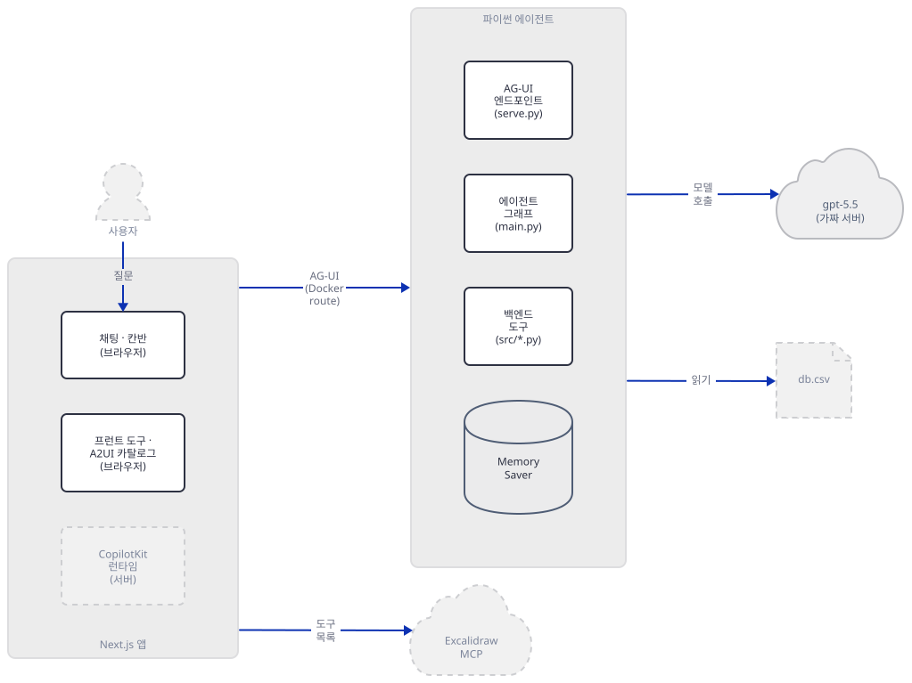

**확인.**

```text
[요청 1] 보낸 메시지 1개, state 키 []
  HTTP 200 text/event-stream; charset=utf-8
  RUN_STARTED
  STATE_SNAPSHOT: keys=['messages', 'tools', 'copilotkit']
  TOOL_CALL_START: search_flights
  TOOL_CALL_END (args 760자): '{"flights": [{"id": "f1", "airline": "United Airlines", "air'
  TOOL_CALL_RESULT: '{"a2ui_operations": [{"version": "v0.9", "createSurface": {"surfaceId": "flight-search-results", "ca'
  STATE_SNAPSHOT: keys=['messages', 'tools', 'copilotkit']
  TEXT_MESSAGE_START
  TEXT_MESSAGE_CONTENT: 'Done: '
  TEXT_MESSAGE_CONTENT: 'search_flights '
  TEXT_MESSAGE_CONTENT: 'finished.'
  TEXT_MESSAGE_END
  STATE_SNAPSHOT: keys=['messages', 'copilotkit']
  MESSAGES_SNAPSHOT
  RUN_FINISHED
  [a2ui] createSurface: surfaceId=flight-search-results catalogId=copilotkit://app-dashboard-catalog
  [a2ui] updateComponents: surfaceId=flight-search-results components=Row,FlightCard
  [a2ui] updateDataModel: surfaceId=flight-search-results path=/ keys=['flights']
가드: 루프백 밖으로 나가려던 시도 0건 []
```

연산 세 개의 순서가 `createSurface`, `updateComponents`, `updateDataModel`입니다. 카탈로그 아이디 `copilotkit://app-dashboard-catalog`는 파이썬(`a2ui_fixed_schema.py:15`, `a2ui_dynamic_schema.py:21`)과 TypeScript(`renderers.tsx:603`)에 같은 글자로 두 번 적혀 있어 어긋나면 화면이 그리지 못합니다. 화면 쪽 `FlightCard`(`renderers.tsx:443-`)는 이 데이터로 카드를 그립니다. 항공사 로고는 ``로, 모델이 지은 주소(도구 설명이 권하는 `https://www.google.com/s2/favicons?...`)를 **브라우저가** 곧바로 내려받습니다. 그리고 `Flight` 타입과 도구 설명은 `statusIcon`(placehold.co 주소)도 만들라고 하지만, 틀 JSON에는 그 속성이 없어 카드에 쓰이지 않습니다.

### Step 7. A2UI 동적 스키마 — 모델이 틀까지 짓습니다

**목적.** `generate_a2ui`가 보조 모델을 어떻게 부르는지, 보조 모델이 무엇을 보고 컴포넌트를 짓는지 확인합니다.

**할 일.** 보조 모델에게 줄 글을 만드는 부분입니다(`generative_ui_agents/generative-ui-starter-project/agent/src/a2ui_dynamic_schema.py:55-66`).

```python
    messages = runtime.state["messages"][:-1]
    print(f"[A2UI-DEBUG]   messages count: {len(messages)}")

    # Get context entries from copilotkit state (catalog capabilities + component schema)
    context_entries = runtime.state.get("copilotkit", {}).get("context", [])
    context_text = "\n\n".join(
        entry.get("value", "") for entry in context_entries
        if isinstance(entry, dict) and entry.get("value")
    )
    print(f"[A2UI-DEBUG]   context entries: {len(context_entries)}, context_text_len: {len(context_text)}")

    prompt = context_text
```

도구는 현재 대화(마지막 메시지, 곧 자기 자신을 부른 AI 메시지는 뺀 것)와, 상태의 `copilotkit.context`에서 모은 글을 시스템 메시지로 삼아 `gpt-5.5`를 한 번 더 부릅니다. `render_a2ui`라는 도구 하나만 주고 `tool_choice`로 그 도구를 강제합니다(`a2ui_dynamic_schema.py:68-76`). 응답에서 `surfaceId`·`catalogId`·`components`·`data`를 꺼내 같은 세 연산으로 감쌉니다(`94-101`).

```python
    ops = [
        a2ui.create_surface(surface_id, catalog_id=catalog_id),
        a2ui.update_components(surface_id, components),
    ]
    if data:
        ops.append(a2ui.update_data_model(surface_id, data))

    result = a2ui.render(operations=ops)
```

이 글에는 화면이 `context`로 보낸 카탈로그 설명과 컴포넌트 스키마, 생성 지침이 들어가야 보조 모델이 열한 개 컴포넌트를 알아봅니다. React 쪽 `A2UICatalogContext`가 `context`에 네 항목을 올립니다. 카탈로그 정보, 컴포넌트 스키마(`@copilotkit/a2ui-renderer`의 `A2UI_SCHEMA_CONTEXT_DESCRIPTION`이라는 설명 글을 가진 항목), 생성 지침, 디자인 지침입니다(`@copilotkit/react-core` 소스). "대시보드" 장면을 보냅니다. `drive.py`의 `CONTEXT`가 이 네 항목을 흉내 냅니다. 설명 글은 화면의 상수와 같은 글자를 쓰고, 내용은 제가 쓴 짧은 글입니다.

```bash
$PY drive.py 53872 dashboard
```

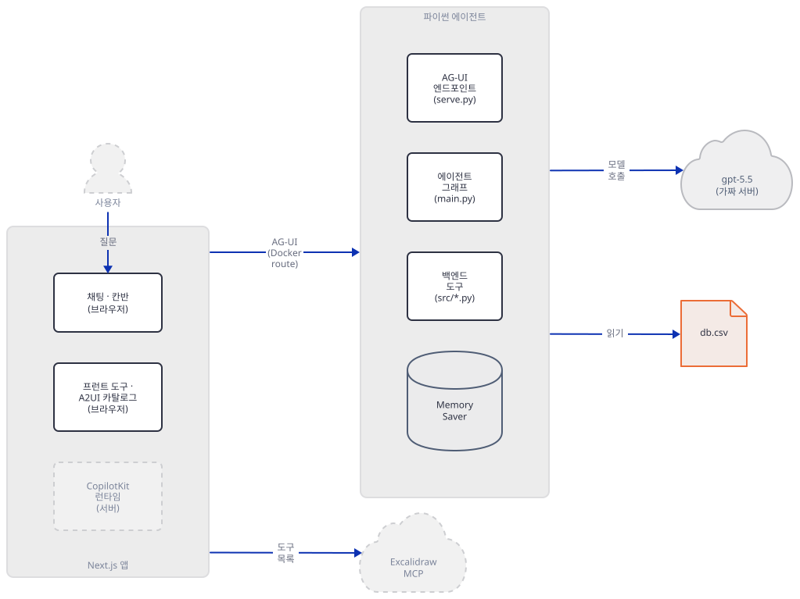

**확인.** 먼저 AG-UI 이벤트입니다. `query_data`의 결과(40행 CSV)가 오고, `generate_a2ui` 안에서 `render_a2ui`가 불리는 것이 이벤트에 그대로 비칩니다.

```text
[요청 1] 보낸 메시지 1개, state 키 []
  HTTP 200 text/event-stream; charset=utf-8
  RUN_STARTED
  STATE_SNAPSHOT: keys=['messages', 'tools', 'copilotkit']
  TOOL_CALL_START: query_data
  TOOL_CALL_END (args 33자): '{"query": "financial sales data"}'
  TOOL_CALL_RESULT: '[{"date": "2026-01-05", "category": "Revenue", "subcategory": "Enterprise Subscriptions", "amount": '
  STATE_SNAPSHOT: keys=['messages', 'tools', 'copilotkit']
  TOOL_CALL_START: generate_a2ui
  TOOL_CALL_END (args 2자): '{}'
  TOOL_CALL_START: render_a2ui
  TOOL_CALL_END (args 694자): '{"surfaceId": "sales-dashboard", "catalogId": "copilotkit://'
  TOOL_CALL_RESULT: '{"a2ui_operations": [{"version": "v0.9", "createSurface": {"surfaceId": "sales-dashboard", "catalogI'
  STATE_SNAPSHOT: keys=['messages', 'tools', 'copilotkit']
  TEXT_MESSAGE_START
  TEXT_MESSAGE_CONTENT: 'Done: '
  TEXT_MESSAGE_CONTENT: 'generate_a2ui '
  TEXT_MESSAGE_CONTENT: 'finished.'
  TEXT_MESSAGE_END
  STATE_SNAPSHOT: keys=['messages', 'copilotkit']
  MESSAGES_SNAPSHOT
  RUN_FINISHED
  [a2ui] createSurface: surfaceId=sales-dashboard catalogId=copilotkit://app-dashboard-catalog
  [a2ui] updateComponents: surfaceId=sales-dashboard components=Column,Title,Row,Metric,Metric,PieChart
가드: 루프백 밖으로 나가려던 시도 0건 []
```

서버를 띄운 터미널 B에는 앱 자신의 디버그 출력이 찍힙니다(실제 터미널에는 `Deserializing unregistered type ag_ui.core.types.Context …` 경고 줄이 수십 개 섞여 나옵니다. 아래는 그 줄을 빼고, 긴 `[A2UI-RESPONSE]` 줄은 앞부분만 남긴 것입니다).

```text
[A2UI-DEBUG] query_data called: query='financial sales data' at 20:22:06
[A2UI-DEBUG] generate_a2ui STARTED at t=0
[A2UI-DEBUG]   messages count: 4
[A2UI-DEBUG]   context entries: 4, context_text_len: 0
[A2UI-DEBUG]   calling secondary LLM at t=0.0s
[A2UI-RESPONSE] content='' additional_kwargs={} response_metadata={'finish_reason': 'tool_calls', 'model_name': 'gpt-5.5', 'model_provider': 'openai'}
[A2UI-DEBUG]   secondary LLM responded at t=0.0s
[A2UI-DEBUG]   components=6 data_keys=[] surface=sales-dashboard
[A2UI-DEBUG] generate_a2ui DONE at t=0.0s result_len=818
```

`context entries: 4, context_text_len: 0`입니다. 항목은 네 개인데 글이 0자입니다. 가짜 서버가 받은 기록으로도 확인합니다.

```bash
$PY show_log.py fake.jsonl | head -1
$PY show_log.py fake.jsonl | tail -10
```

```text
요청 24건, Authorization 앞머리: ['Bearer sk-fake']
20 /v1/chat/completions model=gpt-5.5 stream=True tools=11 tool_choice=None 마지막 role=system
21 /v1/chat/completions model=gpt-5.5 stream=True tools=11 tool_choice=None 마지막 role=tool
22 /v1/chat/completions model=gpt-5.5 stream=True tools=1 tool_choice=render_a2ui 마지막 role=tool
      system        0자 ''
      user         36자 'Using A2UI show me a sales dashboard'
      system      757자 'App Context:\n[\n  {\n    "description": "A2UI catalo'
                항목: ['A2UI catalog capabilities: a', 'A2UI Component Schema — avai', 'A2UI generation guidelines', 'A2UI design guidelines']
      assistant     0자 ''
      tool       6753자 '[{"date": "2026-01-05", "category": "Revenue", "su'
23 /v1/chat/completions model=gpt-5.5 stream=True tools=11 tool_choice=None 마지막 role=tool
```

첫 줄은 이 문서 내내 모델 요청에 실린 `Authorization`이 가짜 값뿐이었다는 증거입니다. 보조 호출(`tool_choice=render_a2ui`)은 메시지 다섯을 받았고, 첫 시스템 메시지(`SystemMessage(content=prompt)`)가 0자입니다. 원인은 하나입니다. `copilotkit.context`의 항목은 `dict`가 아니라 `ag_ui.core.types.Context` 객체인데, `generate_a2ui`의 `isinstance(entry, dict)` 조건(`generative_ui_agents/generative-ui-starter-project/agent/src/a2ui_dynamic_schema.py:60-63`)이 그것을 모두 걸러 냅니다.

그렇다고 보조 모델이 아무것도 모르는 것은 아닙니다. 위 출력의 둘째 시스템 메시지(757자)가 `App Context:`로 시작하는 글입니다. `CopilotKitMiddleware.before_agent`가 `copilotkit.context`를 이 글로 만들어 대화에 끼워 넣고(`copilotkit` 패키지의 `copilotkit_lg_middleware.py`, `Context` 객체는 `model_dump`로 풉니다), `generate_a2ui`는 대화(`messages[:-1]`)를 통째로 넘기기 때문입니다. `항목:` 줄이 보여 주듯 네 항목, 곧 카탈로그 정보·컴포넌트 스키마·생성 지침·디자인 지침이 모두 그 안에 있습니다. 다만 이 글은 시스템 지시 자리가 아니라 사용자 질문 뒤에 놓이고, 앱이 쓰려던 자리(`prompt`)는 비어 있습니다.

`ag-ui-langgraph` 0.0.33에는 스키마 항목을 `context`에서 빼서 `state["ag-ui"]["a2ui_schema"]`로 옮기는 코드가 있습니다(`ag_ui_langgraph/agent.py`의 `langgraph_default_merge_state`). 이 코드는 설명 글이 정확히 `…use these component names and props when creating A2UI operations.`인 항목만 고르는데, 이 앱의 화면이 보내는 글(`@copilotkit/a2ui-renderer` 1.56.2의 상수)은 `props`가 아니라 `properties`입니다. 한 낱말이 달라서 이 앱의 실제 화면으로는 분리가 일어나지 않는다는 것이 소스로 읽은 결론입니다. `a2ui_schema` 상태는 비어 있고 `copilotkit.context`에 네 항목이 모두 남습니다. 이 문서의 첫 시도는 `drive.py`에 파이썬 쪽 글자(`props`)를 베껴 넣어 분리가 일어난다고 잘못 읽었고, 화면의 글자로 고쳐 다시 돌려 위 출력을 얻었습니다. Docker가 고정한 `ag-ui-langgraph` 0.0.22는 이 문서가 설치하지 않아 확인하지 못했습니다.

원본의 `npm run dev` 경로(LangGraph 서버)에서는 JS 쪽 `@copilotkit/runtime`이 `copilotkit.context`에 전체 `context`를 그대로 담아 보내고(`langGraphDefaultMergeState`, 소스 읽음) 그쪽 파이썬은 JSON에서 온 `dict`를 받으므로 `prompt`가 채워질 것으로 읽히지만, 그 경로는 실행하지 못했습니다. 실제 모델이 그래도 쓸 만한 컴포넌트를 지을지도 확인하지 못했습니다.

### Step 8. 화면 쪽과 원본 실행 경로 — 읽기만 했습니다

**목적.** 오늘 돌려 본 에이전트 서버 바깥에서 무슨 일이 일어나는지, 원본의 실행 명령이 바깥으로 무엇을 보내는지를 소스로 확인합니다. 이 Step의 명령은 하나도 실행하지 않았습니다.

**할 일.** 앱 README의 시작 방법은 이렇습니다.

```bash
npm install          # 이 문서는 실행하지 않았습니다
cp .env.example .env # OPENAI_API_KEY를 적습니다
npm run dev          # 이 문서는 실행하지 않았습니다
```

`package.json`은 이 명령들을 이렇게 풉니다(`package.json:6-14`).

```json
    "dev": "concurrently \"npm run dev:ui\" \"npm run dev:agent\" --names ui,agent --prefix-colors blue,green --kill-others",
    "dev:debug": "LOG_LEVEL=debug npm run dev",
    "dev:ui": "next dev --turbopack",
    "dev:agent": "./scripts/run-agent.sh || scripts\\run-agent.bat",
    "build": "next build",
    "start": "next start",
    "install:agent": "./scripts/setup-agent.sh || scripts\\setup-agent.bat",
    "postinstall": "npm run install:agent"
  },
```

`npm install`의 `postinstall`이 `install:agent`, 곧 `scripts/setup-agent.sh`를 부르고, 그 안에서 `uv sync`가 돕니다. `dev:agent`는 `scripts/run-agent.sh`이고, 그 안의 줄은 `npx @langchain/langgraph-cli dev --port 8123 --no-browser`(3행)입니다. `npx`는 이름 그대로 `@langchain/langgraph-cli`의 최신판을 내려받아 실행합니다. 이 문서를 쓴 날의 최신은 1.5.3(2026-10-12 공개)이고, 그 압축 파일을 내려받아 `dev.mjs`·`dev.python.mjs`·`analytics.mjs`를 읽었습니다. 하는 일은 그림 `extra-dev`와 같습니다. 이 도구는 파이썬 설정(`python_version`이 있는 `langgraph.json`)을 보면 "실험적"이라는 경고를 내고, 자기 안의 `uv` 0.9.11 바이너리가 없으면 GitHub 릴리스에서 내려받은 뒤 `uv run --with langgraph-cli[inmem] langgraph dev`로 파이썬 서버를 띄웁니다. 그리고 시작할 때 운영체제·버전·명령 이름을 Supabase로 보냅니다(`LANGGRAPH_CLI_NO_ANALYTICS=1`이면 끔). 파이썬 `langgraph dev`도 같은 통계를 따로 보냅니다(`langgraph_cli/analytics.py`, 같은 변수로 끔). `--no-browser`가 붙어 있어 LangGraph Studio(smith.langchain.com)를 자동으로 열지는 않습니다.


화면 쪽 서버는 `src/app/api/copilotkit/[[...slug]]/route.ts`입니다.

```ts
const defaultAgent = new LangGraphAgent({
  deploymentUrl:
    process.env.AGENT_URL ||
    process.env.LANGGRAPH_DEPLOYMENT_URL ||
    "http://localhost:8123",
  graphId: "sample_agent",
  langsmithApiKey: process.env.LANGSMITH_API_KEY || "",
});

const runtime = new CopilotRuntime({
  agents: { default: defaultAgent },
  runner: new InMemoryAgentRunner(),
  openGenerativeUI: true,
  a2ui: {
    injectA2UITool: false,
  },
  mcpApps: {
    servers: [
      {
        type: "http",
        url: process.env.MCP_SERVER_URL || "https://mcp.excalidraw.com",
        serverId: "example_mcp_app",
      },
    ],
  },
});
```

에이전트는 `LangGraphAgent`로 `AGENT_URL`(없으면 `http://localhost:8123`)의 LangGraph 서버에 붙습니다. 이것은 AG-UI가 아니라 LangGraph 플랫폼 API라서, 오늘의 `serve.py`(AG-UI `POST /`)와는 말이 다릅니다. 저장소가 이 차이를 알고 있어서, Docker 쪽은 `Dockerfile`이 이 경로 파일을 지우고 `docker-route-override.ts`(`HttpAgent`)로 바꿔 넣습니다. 그러니 오늘 확인한 것은 같은 그래프의 AG-UI 입구이고, 원본 `npm run dev`의 선(그림 `extra-dev`의 `langgraph dev`)이 아닙니다. 이 파일에는 바깥으로 나가는 설정이 둘 더 있습니다. `mcpApps.servers`의 기본 주소는 `https://mcp.excalidraw.com`이고(29행), `@ag-ui/mcp-apps-middleware` 0.0.3은 에이전트를 한 번 실행할 때마다 설정된 MCP 서버에 연결해 도구 목록을 받아 에이전트의 도구에 더합니다(실패하면 오류를 찍고 넘어갑니다). `@copilotkit/runtime` 1.56.2는 요청을 받을 때 Segment와 Scarf로 익명 사용 정보를 보내는 코드가 있고, 5%만 표본으로 보내며, `COPILOTKIT_TELEMETRY_DISABLED=true`나 `DO_NOT_TRACK=1`이면 끕니다(`telemetry-client.ts`). 브라우저 쪽으로는 `globals.css:2`가 Google Fonts(`fonts.googleapis.com`)를 가져옵니다. `layout.tsx:28`의 `inspectorDefaultAnchor`는 개발 검사창의 자리만 정하고, 검사창은 `showDevConsole`가 꺼져 있으면(기본값, 이 앱은 켜지 않음) 그려지지 않으며 `cdn.copilotkit.ai/announcements.json`을 가져오는 코드도 그 안에 있습니다(소스로 확인).

원본 실행 경로가 바깥으로 보내는 것을 정리하면 이렇습니다. Day 141 Step 6이 같은 항목을 먼저 표로 다뤘고, 이 앱에서 확인한 것만 적습니다. 첫째, `npm install`은 `@scarf/scarf` 1.4.0의 `postinstall`(설치 통계)을 돌립니다. 이 앱의 `package-lock.json`이 `hasInstallScript`로 표시하고, `@copilotkit/react-core`와 `@copilotkit/runtime`이 의존합니다(`SCARF_ANALYTICS=false`나 `DO_NOT_TRACK=1`로 끔). 둘째, `next dev`(`dev:ui`)는 Next.js 익명 통계(`NEXT_TELEMETRY_DISABLED=1`로 끔)를 보내고 기본으로 `0.0.0.0`에 열립니다(`-H 127.0.0.1`로 좁힘). 셋째, 앞에서 본 `npx`는 CLI를 npm에서, `uv`를 GitHub에서, `uv run --with langgraph-cli[inmem]`이 PyPI에서 패키지를 내려받습니다. 넷째, 통계는 `langgraph-cli`의 JS판과 파이썬판, CopilotKit 런타임으로 셋입니다. 그러니 이 앱을 진짜로 띄우려는 독자는 최소한 아래를 **`npm install` 앞에** 걸고 시작하는 것이 좋습니다. **이 줄도 실행해 보지 못했습니다.** `MCP_SERVER_URL`은 쓰지 않는 루프백 주소로 두면 연결 실패를 기록하고 넘어가는 것으로 읽혔습니다(`fetchUITools`의 `try/catch`).

```bash
export SCARF_ANALYTICS=false DO_NOT_TRACK=1 NEXT_TELEMETRY_DISABLED=1
export COPILOTKIT_TELEMETRY_DISABLED=true LANGGRAPH_CLI_NO_ANALYTICS=1
export MCP_SERVER_URL=http://127.0.0.1:59999/mcp
npm install          # 이 문서는 실행하지 않았습니다
npm run dev          # 이 문서는 실행하지 않았습니다. 화면은 0.0.0.0에 열립니다(dev:ui)
```

화면 쪽에서 오늘 다룬 세 곳을 한 줄씩만 더 짚습니다. `layout.tsx:26-32`가 `<CopilotKit runtimeUrl="/api/copilotkit" a2ui={{ catalog: demonstrationCatalog }} openGenerativeUI={{}}>`로 카탈로그를 등록하고, `renderers.tsx:599-605`의 `createCatalog`가 정의 열한 개와 렌더러를 묶습니다. 이 호출은 `includeBasicCatalog`를 주지 않아(`create-catalog.mjs`에서 기본값이 꺼짐 확인) 기본 카탈로그의 `Text`·`Image`·`List`가 빠지는데, `Button`의 설명은 `Text` 컴포넌트를 `child`로 쓰라고 합니다. 동적 장면에서 버튼 글자가 어떻게 되는지는 화면을 띄우지 못해 확인하지 못했습니다.

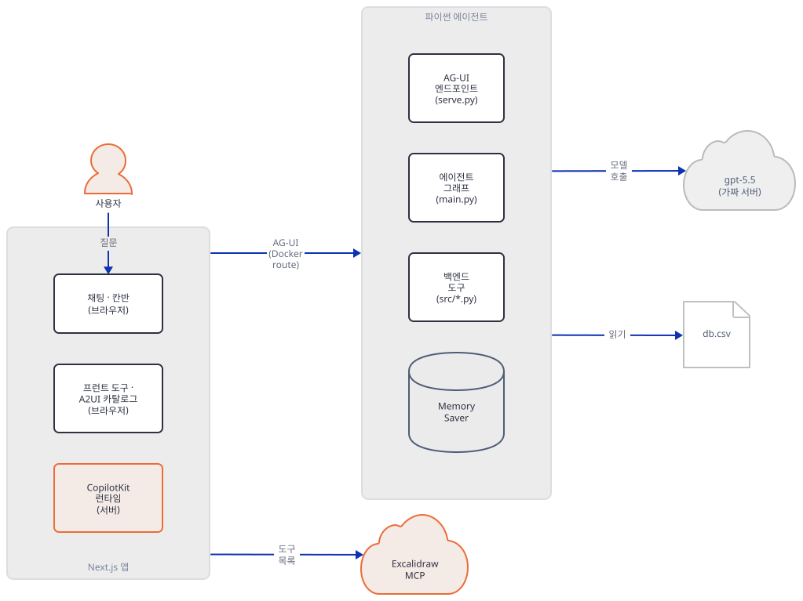

**확인.** 이 Step은 읽기 확인입니다. 아래 두 명령은 이 문서가 내려받은 압축 파일을 읽은 것이 아니라 독자가 앱 폴더에서 바로 확인할 수 있는 것입니다.

```bash
APP=<저장소>/generative_ui_agents/generative-ui-starter-project
grep -n "postinstall\|dev:agent" $APP/package.json
cat $APP/scripts/run-agent.sh
```

첫 줄은 `"dev:agent": "./scripts/run-agent.sh || scripts\\run-agent.bat"`와 `"postinstall": "npm run install:agent"`를, 둘째 명령은 `npx @langchain/langgraph-cli dev --port 8123 --no-browser`를 보여야 합니다.

## 요청 한 건이 흐르는 과정

"대시보드" 질문 하나가 지나가는 길입니다. 한 그림에 다 담으면 세로 상한(1,500px)을 넘어 넷으로 나눴고, 경계는 코드의 실제 순서에서 잘랐습니다. "에이전트 서버" 배우 하나는 `serve.py`와 그래프를 합친 것이고, 둘 사이의 연결은 Step 3의 `extra-agent`에 있습니다. 첫 그림은 질문이 런타임을 거쳐 첫 모델 호출과 `query_data` 실행까지 가는 앞부분입니다.

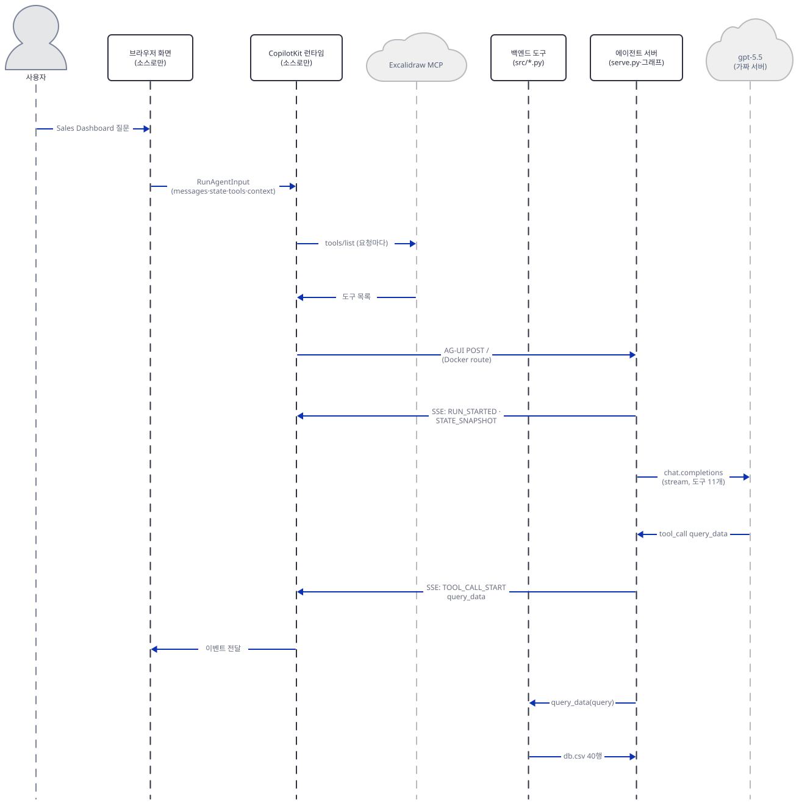

런타임이 매 요청마다 MCP 서버(Excalidraw)에 도구 목록을 묻는 것(`rt -> mcp`)은 `route.ts`의 설정과 미들웨어 소스에서 읽은 것이고, 이 문서에서 실행한 것이 아닙니다. `query_data`가 40행 CSV를 돌려주는 것은 오늘 돌려 본 것입니다. 모델 호출은 이 장면에서 모두 넷입니다(메인 둘, 보조 하나, 마무리 하나). 다음은 `query_data`의 결과가 화면에 전해지고 두 번째 모델 호출이 `generate_a2ui`를 고르는 부분입니다.

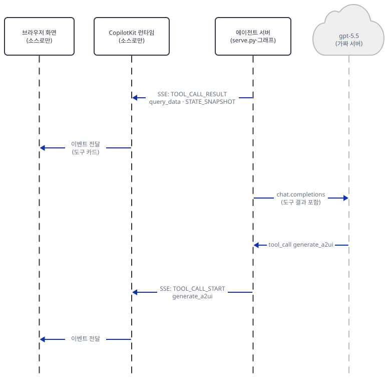

이어서 보조 모델 호출과 화면에 그려지는 부분입니다.

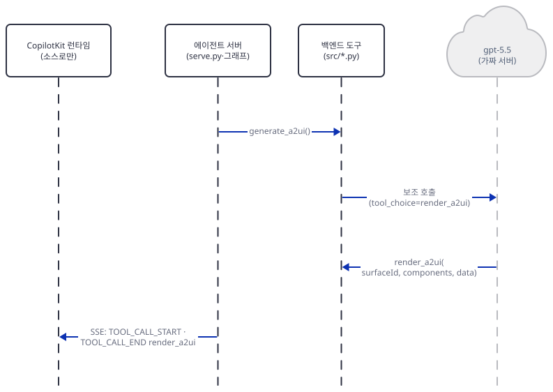

도구가 보조 모델을 직접 부르므로(`tool -> llm`), 이 호출은 에이전트 그래프의 모델 노드를 거치지 않습니다. 그래서 `tools=1`·`tool_choice=render_a2ui`로 기록에 따로 보입니다. 마지막은 모델의 짧은 글 답입니다.

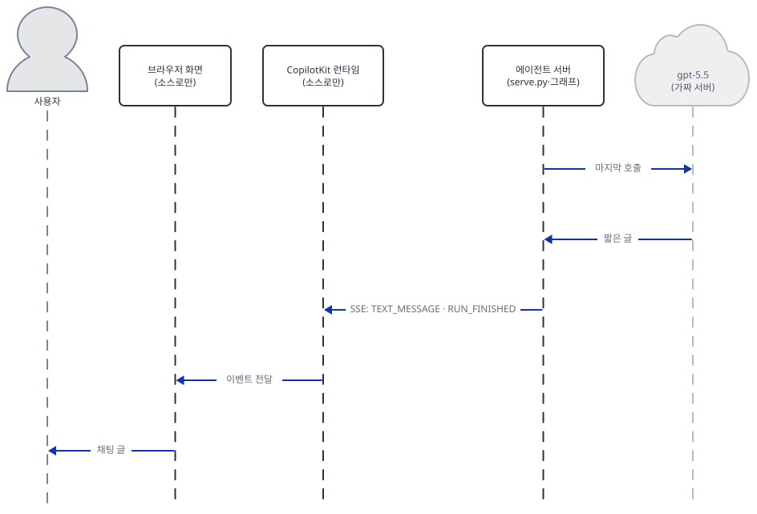

프런트엔드 도구가 만드는 두 번의 요청(Step 4)은 이 그림에 넣지 않고 따로 그렸습니다.

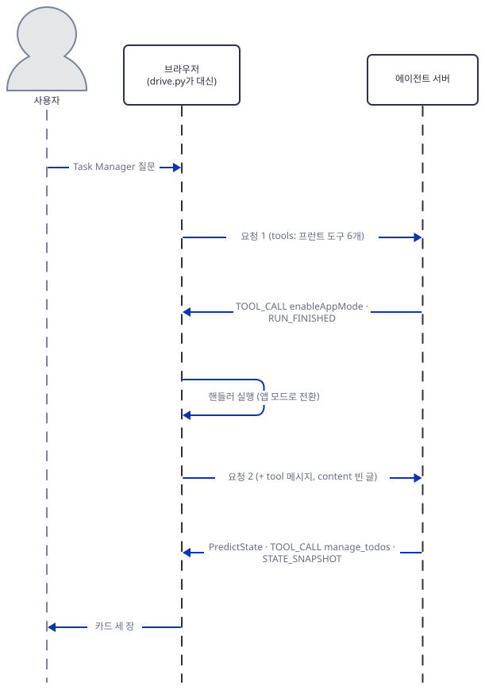

## 실행 체크리스트

- [ ] `uv sync --locked`가 `Installed 89 packages`로 끝났다
- [ ] `nokey.py`가 `main.py` 19행에서 `OpenAIError`를 보였다
- [ ] `guard_selftest.py`가 네 번 모두 거절당했다
- [ ] `netstat`의 두 서버가 `127.0.0.1`에만 열려 있다
- [ ] `drive.py ... todos`가 요청 둘로 나뉘고 둘째에서 `todos=3`이 됐다
- [ ] `board` 장면에서 화면 편집이 `get_todos`에 보였다
- [ ] `flights` 장면에서 연산 세 개가 `createSurface`·`updateComponents`·`updateDataModel` 순으로 나왔다
- [ ] 서버 터미널에 `context entries: 4, context_text_len: 0`이 찍히고, `show_log.py`의 보조 호출에 `App Context` 항목 네 개가 보였다
- [ ] `show_log.py`의 `Authorization` 앞머리가 `Bearer sk-fake`뿐이다
- [ ] 두 서버를 Ctrl+C로 끄고 `netstat`에 5387x가 남지 않았다

## 문제 해결

| 증상 | 원인 | 해결 |
|---|---|---|
| `main.py` 19행에서 `OpenAIError: The api_key client option must be set` | `ChatOpenAI(...)`가 가져오기 때 열쇠를 요구함 | 진짜 쓸 때는 `OPENAI_API_KEY`를 환경에 둔다. 이 문서는 `guard.py`가 가짜 값을 넣는다 |
| (이 문서는 본 적 없음) `python serve.py`로 띄웠더니 같은 네트워크에서 접속됨 | `serve.py:58`이 `host="0.0.0.0"`, CORS는 모든 출처 허용 | 이 문서의 `run_serve.py`처럼 `host="127.0.0.1"`로 `uvicorn.run`을 부른다 |
| `manage_todos` 호출이 `todos.0.id: Field required`로 떨어짐 | 모델에게 보이는 스키마는 `id` 필수, 코드의 "없으면 채움"은 닿지 못함 | 모델이 `id`를 빈 문자열로 주게 하거나 `todos.py`의 `Todo`에서 `id`를 선택으로 바꾼다(원본을 고치려면 복사본에서) |
| 서버 로그에 `Deserializing unregistered type ag_ui.core.types.Context from checkpoint ... will be blocked in a future version` | 체크포인터가 `Context` 객체를 직렬화·역직렬화함 | 지금은 경고만이다. 판이 올라가 막히면 `allowed_msgpack_modules`에 `('ag_ui.core.types', 'Context')`를 더한다(경고 문구가 안내) |
| (이 문서는 본 적 없음) `generate_a2ui`가 만든 UI가 이상함 | 보조 모델의 첫 시스템 글(`prompt`)이 0자임(Step 7). 지침과 스키마는 `App Context` 메시지로만 간다 | 복사본의 `generate_a2ui`에서 `isinstance(entry, dict)` 대신 `getattr(entry, "value", "")`로 `Context` 객체도 읽게 한다(이 문서는 시험하지 못했다) |
| `query_data`의 첫 행에 `null` 키가 보임 | `db.csv` 2행의 `notes`에 따옴표 없는 쉼표가 있어 `csv.DictReader`가 남는 칸을 `None` 키로 모음(직접 확인) | 해당 칸을 따옴표로 감싼다 |
| (이 문서는 본 적 없음) 앱 README대로 Node 18로 설치하려는데 막힘 | `next@16.1.6`이 Node `>=20.9.0` 요구 | Node 20.9 이상을 쓴다 |
| (이 문서는 본 적 없음) `npm run dev` 첫 실행에서 느리거나 바깥 접속 | `npx`가 CLI와 `uv`를 내려받고 통계를 보내며 `npm install`·`next dev`도 통계를 보냄(Step 8) | Step 8의 변수를 `npm install` 앞에 건다 |

## 더 해보기

- `drive.py`의 대본을 바꿔 보세요. `fake_openai.py`의 `decide()`에서 `generate_a2ui`의 `SURFACE`에 카탈로그에 없는 컴포넌트 이름을 넣고, 화면이 그것을 어떻게 다룰지 `renderers.tsx`를 읽어 예측해 보세요(화면을 띄우지 않고도 소스로 가능합니다).
- 복사본의 `generate_a2ui`가 `Context` 객체도 읽도록(`getattr(entry, "value", "")`) 고친 뒤, Step 7의 `context_text_len`과 보조 호출의 첫 시스템 글 길이가 0에서 달라지는지 `show_log.py`로 확인해 보세요. 그때 `App Context` 메시지와 내용이 겹치는 것이 모델에게 도움이 될지 해가 될지도 생각해 보세요.
- `manage_todos`가 목록을 통째로 덮어쓴다는 점은 사람이 편집하는 동안 에이전트가 끼어들면 충돌할 수 있다는 뜻입니다. `board` 장면에서 `state`와 도구 인자가 다를 때 누구의 값이 이기는지 직접 실험해 보세요.

## 다음 날 예고

[Day 144 · 📊 AI Dashboard Canvas Agent](../day144-genui-dashboard-canvas-agent/README.md) — 같은 CopilotKit·AG-UI 위에서 에이전트 쪽이 Google ADK(`gemini-3.5-flash`)로 바뀌는 앱입니다. `agent/` 아래 `agent.py`(53줄)·`instructions.py`(31줄)·`modifiers.py`(52줄)·`server.py`(28줄)·`state.py`(38줄)·`tools.py`(38줄)로 이루어지고, 대시보드 "캔버스"의 공유 상태를 에이전트와 화면이 주고받습니다. `server.py:28`이 `0.0.0.0`에 `reload`를 켠 채 뜨는 점도 오늘의 `serve.py`와 같은 주의가 필요합니다.
