# Day 144 · 📊 AI Dashboard Canvas Agent

> 볼륨 12 🖼️ Generative UI · 난이도 ★★★ ⚠ 오늘 설치되는 `ag-ui-adk` 0.9.0에서는 이 앱의 차트 화면 도구가 모델에게 선언되지 않아 차트가 그려지지 않고(Step 6), 원본의 `dev:agent`는 에이전트 서버를 모든 네트워크 인터페이스(`0.0.0.0`)에 `reload`로 열고(Step 4), `next dev`도 기본이 `0.0.0.0`이며 통계를 보냅니다(Step 7). 또 Google 폐기 표에는 `gemini-3.5-flash` 요청이 `gemini-3.6-flash`로 처리된다고 적혀 있습니다(사전 준비) · 예상 소요 205분(원본은 파이썬 248줄과 화면 약 3,000줄이고, 가짜 Gemini 서버를 포함한 파일 아홉을 직접 저장하고 터미널 셋을 오가며 이벤트와 요청 기록을 맞대 읽는 손 시간이 본문을 읽는 시간보다 큽니다) · API 비용 대략 이 문서의 따라 하기는 $0(가짜 서버만 부르고 실제 Google은 한 번도 부르지 않았습니다. 진짜 키로 "다시 만들기" 한 번은 모델 호출이 최소 넷이고, 가격표로 어림하면 $0.1 이하입니다. 추정이고 호출해 확인한 값이 아닙니다. 사전 준비의 표) · 원본 앱: `generative_ui_agents/ai-dashboard-canvas-agent`

## 오늘 만들 것

채팅은 얇은 사이드바이고, 진짜 화면은 에이전트가 글을 쓰는 대시보드(캔버스)인 앱입니다. 사용자가 "피자 업계 동향 대시보드를 다시 만들어 줘"라고 치면 에이전트가 Google 검색으로 자료를 모아 지표 카드(pinned metrics)를 채우고, 차트(선·막대·원)는 사용자에게 [Add] 버튼으로 승인을 받아 더합니다. 앱 README 9행은 얇은 사이드바와 캔버스만 말하고, 검색과 승인은 소스(`generative_ui_agents/ai-dashboard-canvas-agent/agent/agent.py:23-44`, `generative_ui_agents/ai-dashboard-canvas-agent/src/components/chat/actions/charts.tsx:77-92`)에서 읽은 것입니다. 에이전트는 Google ADK(Agent Development Kit), 화면은 Next.js와 CopilotKit이고 둘 사이는 AG-UI 프로토콜로 이어집니다. AG-UI는 에이전트가 화면에 보내는 일을 글 조각만이 아니라 도구 호출·상태 갱신 같은 이벤트의 흐름(SSE)으로 정한 약속입니다. 오늘 배우는 것은 셋입니다. 에이전트와 화면이 같은 상태 하나를 주고받는 법, 에이전트의 도구가 화면의 부품을 그리게 하는 법, 그리고 그 약속이 실제 설치에서 어디서 끊기는지입니다.

앞 날들과 이어지는 부분과 새로운 부분은 이렇습니다. ADK 에이전트는 Day 014~023이 다뤘습니다. Day 017은 내장 `google_search`를, Day 018은 세션 상태를, Day 019는 `before_model`·`after_model` 같은 콜백을, Day 021은 `AgentTool`로 에이전트를 도구처럼 부르는 법을 다뤘고 오늘 앱은 그 넷을 모두 씁니다. 같은 ADK와 `ag-ui-adk` 어댑터를 쓰는 Day 142(앱 소스 `generative_ui_agents/ai-financial-coach-agent/agent/main.py:8`, `generative_ui_agents/ai-financial-coach-agent/agent/main.py:487`)가 이미 확인한 것이 많아서, 이 문서는 그것을 되풀이하지 않고 가리킵니다. 가짜 Gemini 서버를 `GOOGLE_GEMINI_BASE_URL`로 가리키는 방법은 Day 140(Live 소켓 때문에 TLS)과 Day 142(REST뿐이라 TLS 없음)가 보였고 오늘은 Day 142 쪽입니다. 요청마다 `input.state`가 세션 상태를 덮는 것과 `_ag_ui_*` 내부 키는 Day 142 Step 4·5가, `AGUIToolset`이 없으면 화면 도구가 무시되는 것은 Day 142 Step 5가, 메모리 세션과 재시작은 Step 7이, CopilotKit 통계는 Step 6이, 루프백 관문은 Step 2가 다뤘습니다. 다른 점은 판입니다. Day 142는 잠금 파일로 `ag-ui-adk` 0.5.0·`google-adk` 1.26.0·`google-genai` 1.65.0에 묶였고, 이 앱은 버전을 하나도 고정하지 않아 오늘 0.9.0·2.12.0·2.31.0이 설치됩니다. 오늘의 새것은 같은 규칙이 이 앱에서는 핵심 기능(차트)을 끊는다는 것, 0.9.0의 경고 로그와 한 줄 패치, 0.4.2와의 비교, `before_model`의 `State` 객체 출력, 지침의 없는 이름입니다. 새로운 것은 화면입니다. Day 124처럼 Node 쪽은 실행하지 않고 소스로만 읽습니다. 이 문서는 `pnpm install`도 `next`도 실행하지 않았고 브라우저로 화면을 열지도 않았습니다.

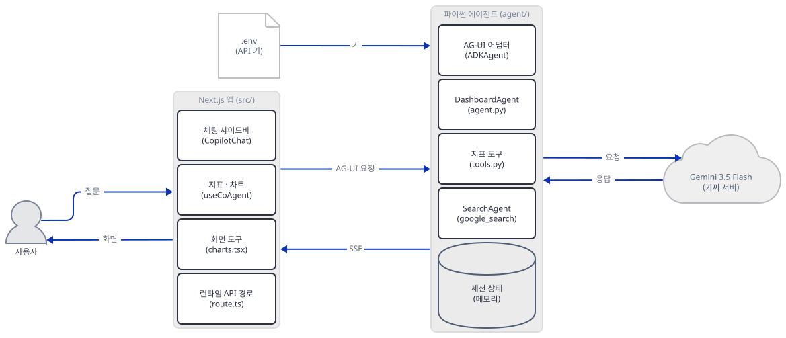

그림의 "Next.js 앱" 묶음 안 네 부품 가운데 앞 셋은 브라우저에서, `route.ts`는 Node 서버에서 도는데 그림은 한 묶음으로 보여 줍니다. 묶음에 달린 "AG-UI 요청"은 묶음 전체의 것입니다. 실제로는 브라우저가 `/api/copilotkit`를 부르고 그 경로의 코드가 파이썬 서버를 다시 부르는 두 번의 HTTP입니다(Step 7의 구조 그림). 파이썬 묶음 안 다섯 부품은 한 프로세스입니다. "Gemini"는 이 문서에서는 제가 쓴 가짜 서버입니다. 그림에서는 화살표가 파이썬 묶음의 한 칸에 붙어 보이지만 묶음 전체의 것입니다. Gemini를 부르는 것은 `DashboardAgent`와 `SearchAgent` 둘이고(아래 구조 그림), `.env`를 읽는 것은 `server.py`입니다.

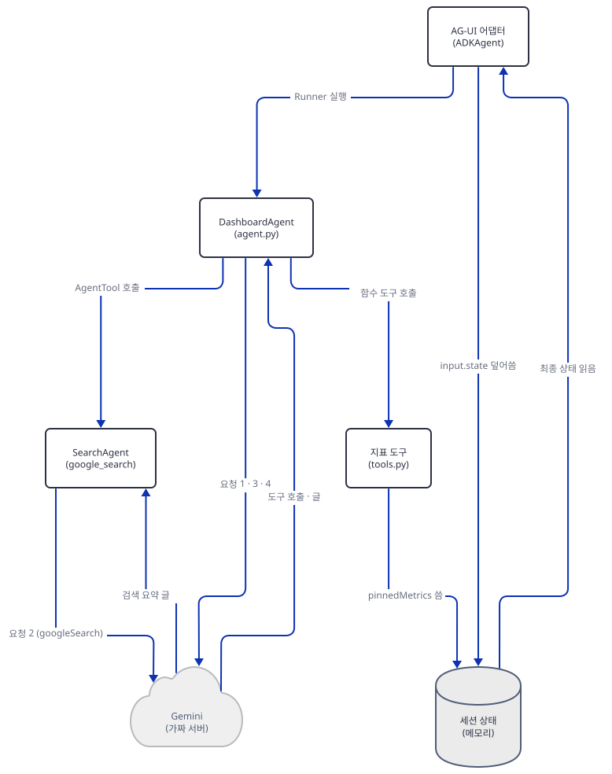

`ADKAgent`가 `DashboardAgent`를 돌리고 세션 상태를 읽고 씁니다. `DashboardAgent`는 지표 도구를 부르고 `SearchAgent`를 `AgentTool`로 부르며, 도구는 세션 상태에 `pinnedMetrics`를 씁니다. 모델 호출은 `DashboardAgent`가 하고 `SearchAgent`도 따로 합니다.

**요청 경로를 무엇으로 정했는가.** "다시 만들기" 한 번이 사용자 글에서 지표 카드가 화면에 뜨기까지 지나는 길을 중심으로 합니다. 파이썬 쪽이 248줄로 작아서 거의 전부가 이 길에 놓이고, 화면 쪽의 상태 갱신·도구 호출·승인이 같은 길 위에 있기 때문입니다. 차트를 그리는 `recharts` 부분과 shadcn 기본 부품(`src/components/ui/`, 1,233줄)은 컴포넌트 표에 역할만 적었습니다.

**이 문서가 하지 않은 것.** 실제 Google(Gemini)에는 한 번도 접속하지 않았습니다. 가짜 서버는 모델이 아니라 대본이어서(정해진 순서로 정해진 도구를 부릅니다), 진짜 모델이 어떤 도구를 언제 부르는지, 검색 품질, 지표 숫자가 맞는지는 확인하지 못했습니다. Tavily도 부르지 않았습니다. 화면은 실행하지 않았고, CopilotKit이 실제로 보내는 요청의 바이트는 확인하지 못했습니다. 대신 구동기 `drive.py`가 화면이 하는 일을 손으로 흉내 내 AG-UI 요청을 보냅니다. 흉내의 모양은 npm 패키지(잠금 파일이 가리키는 `@copilotkit/react-core`·`@copilotkit/runtime`·`@copilotkit/shared` 1.59.2와 `@ag-ui/client` 0.0.53)의 배포 코드를 내려받아 읽고 맞췄습니다. 받기만 했고 실행하지 않았습니다.

앱이 스스로 밝히는 한계는 찾지 못했습니다. 지침은 "실제 데이터에 근거하라"(`generative_ui_agents/ai-dashboard-canvas-agent/agent/instructions.py:18`)이지만, 숫자의 정확성을 보증하거나 보증하지 않는다는 말은 코드와 README 어디에도 없습니다(`grep`으로 확인). 지표는 모델이 쓴 글이므로 틀릴 수 있습니다.

직접 돌려 보고 알게 된 특이점은 다섯입니다.

- 오늘 설치되는 `ag-ui-adk` 0.9.0에서는 화면의 차트 도구(`add_chart` 등)가 모델에게 선언되지 않습니다. 에이전트에 `AGUIToolset()`이 없기 때문이고, Day 142가 0.5.0에서 확인한 같은 규칙입니다. 이 앱은 그 도구로 차트를 그리게 설계되었는데 모델이 차트 도구를 아예 보지 못합니다(Step 6).
- 지침이 없는 도구와 상태 키를 말합니다. `add_charts`·`set_chart_data`라는 도구와 `dashboard.charts`·`chartData`라는 키는 코드 어디에도 없습니다(Step 3).
- `before_model` 콜백이 시스템 지침 앞에 붙이는 "Current dashboard"는 상태 대신 `<google.adk.sessions.state.State object at 0x…>`라는 객체 이름이 나갑니다(Step 5).
- 화면으로 가는 상태 스냅숏(Day 142 Step 4가 본 것)에 더해 모델 지침에도 `_ag_ui_thread_id` 같은 내부 키가 섞여 나갑니다(Step 5).
- `python server.py`(앱의 `dev:agent`)는 모든 네트워크 인터페이스(`0.0.0.0`)에 열고 `reload=True`로 뜹니다(Step 4). 그리고 `requirements.txt`의 `tavily-python`은 코드 어디에서도 쓰지 않습니다(`grep`).

## 사전 준비

| 서비스/도구 | 용도 | 발급·설치 |
|---|---|---|
| uv | 가상환경 생성과 패키지 설치 | [공통 사전 준비](../README.md#공통-사전-준비-한-번만) 참고 |
| Python 3.12 | 앱 README는 3.8 이상이라고 하지만 `google-adk`의 `Requires-Python`이 `>=3.11`이라 3.8은 설치되지 않습니다(직접 확인, 메타데이터). 이 문서는 3.12.10으로 돌렸습니다 | 공통 사전 준비와 같음 |
| Node.js 18.18+·pnpm | 화면(`pnpm run dev`)용. 앱 README는 18+라고 하지만 `next@15.3.2`의 `engines.node`는 `^18.18.0 || ^19.8.0 || >= 20.0.0`입니다(npm 레지스트리 메타데이터). **이 문서는 설치하지도 실행하지도 않았습니다.** 앱 README의 명령은 Step 7에 그대로 옮겼습니다 | https://nodejs.org (필요할 때만) |
| Google API 키 | 진짜로 쓸 때만. 이 문서는 가짜 값 `fake-key`만 씁니다 | https://aistudio.google.com/apikey |
| Tavily 키 | 필요 없습니다. 앱의 요구 목록에는 있지만 코드가 쓰지 않습니다 | 해당 없음 |
| 터미널 셋 | 가짜 Gemini 서버(A), 앱 서버(B), 나머지(C). 셋 다 `canvas-work` 폴더(Step 1에서 만듭니다)에서 엽니다 | 별도 설치 없음 |

한국어 Windows의 Git Bash에서 파이썬 출력이 cp949로 깨지는 것을 막으려고 `envfake.sh`가 `PYTHONIOENCODING=utf-8`을 겁니다. 이 문서의 파일 저장(`cat > … <<`)은 bash 문법이어서 Windows에서는 Git Bash로 따라 합니다. PowerShell 줄은 실행해 보지 못했고(이 문서를 쓴 하네스가 PowerShell 실행을 막습니다) 그렇게 표시했습니다.

**앱이 쓰는 모델(2026-10-16).** 앱은 `gemini-3.5-flash`를 두 곳에 씁니다(`generative_ui_agents/ai-dashboard-canvas-agent/agent/agent.py:24`, `generative_ui_agents/ai-dashboard-canvas-agent/agent/agent.py:34`). Google의 폐기 표(https://ai.google.dev/gemini-api/docs/deprecations, "Last updated 2026-10-12 UTC")를 `curl`로 받은 HTML에서 읽은 행은 이렇습니다. `gemini-3.5-flash` | May 19, 2026 | N/A | `gemini-3.6-flash` (not available to select in Google AI Studio; the endpoint is not shutting down and automatically routes API requests to `gemini-3.6-flash`). 종료일이 "N/A"이고 엔드포인트가 닫히지 않으므로 종료 예정이 아니라고 읽어 종료 ⚠는 달지 않았습니다. 다만 요청이 3.6으로 처리되므로 응답이 3.5와 같다고 가정하지 않는 편이 낫습니다(머리말에 한 줄 둔 까닭입니다). 모델 목록 페이지(https://ai.google.dev/gemini-api/docs/models)와 가격표(https://ai.google.dev/gemini-api/docs/pricing)에는 `gemini-3.5-flash`가 나오지 않아 가격은 `gemini-3.6-flash` 행으로 어림했습니다(이 둘은 WebFetch로 읽은 요약이라 원문 대조는 못 했습니다). 가격표의 `gemini-3.6-flash`는 입력 100만 토큰당 $0.75, 출력 $3.75(2026-12-31까지)이고 Google 검색 근거(grounding)는 달마다 5,000건까지 무료이며 그 뒤 1,000건에 $14입니다(검색 근거는 무료 등급에서 쓸 수 없다고 적혀 있습니다). 이 앱의 "다시 만들기" 한 번은 지침과 상태가 담긴 모델 호출이 셋 이상이고 검색 하나가 붙으니(Step 5), 호출당 입력 수천 토큰으로 어림하면 몇 센트입니다. 호출해 확인한 값이 아닙니다.

## 아키텍처 한눈에 보기

| 컴포넌트 | 역할 | 코드 위치 |
|---|---|---|
| 에이전트 정의 | `DashboardAgent`(도구 셋 + `SearchAgent`를 감싼 `AgentTool`), 콜백 둘, `ADKAgent`로 감싸 AG-UI에 연결 | `generative_ui_agents/ai-dashboard-canvas-agent/agent/agent.py:23-53` |
| 지침 | 지침 함수. 현재 상태와 날짜를 글에 끼워 넣음 | `generative_ui_agents/ai-dashboard-canvas-agent/agent/instructions.py:6-31` |
| 지표 도구 | `add_pinned_metrics`(덧붙임)·`update_pinned_metrics`(통째로 바꿈), 세션 상태의 `pinnedMetrics`를 씀 | `generative_ui_agents/ai-dashboard-canvas-agent/agent/tools.py:9-38` |
| 상태 모델 | `Metric`(도구가 쓰는 것). `Chart`·`Dashboard`는 어디서도 쓰이지 않음 | `generative_ui_agents/ai-dashboard-canvas-agent/agent/state.py:13-38` |
| 콜백 | `before_model`이 지침 앞에 글을 붙임, `after_model`이 글 응답 뒤 호출을 끝냄 | `generative_ui_agents/ai-dashboard-canvas-agent/agent/modifiers.py:8-52` |
| 서버 | FastAPI 앱 + `add_adk_fastapi_endpoint`, `__main__`이 `0.0.0.0`·reload로 띄움 | `generative_ui_agents/ai-dashboard-canvas-agent/agent/server.py:1-28` |
| 화면 제공자 | `<CopilotKit runtimeUrl="/api/copilotkit" agent="my_agent">` | `generative_ui_agents/ai-dashboard-canvas-agent/src/app/layout.tsx:28-33` |
| 런타임 경로 | `CopilotRuntime`에 `HttpAgent`(`AGENT_URL`)를 `my_agent`로 등록 | `generative_ui_agents/ai-dashboard-canvas-agent/src/app/api/copilotkit/route.ts:15-33` |
| 페이지 | 채팅 사이드바와 대시보드의 2단 배치(좁은 화면은 `CopilotSidebar`) | `generative_ui_agents/ai-dashboard-canvas-agent/src/app/page.tsx:9-24` |
| 채팅 | `CopilotChat`에 제안 버튼 셋(피자·AI·음악) | `generative_ui_agents/ai-dashboard-canvas-agent/src/components/chat/chat.tsx:12-48` |
| 대시보드와 상태 | `useCoAgent`로 에이전트와 상태를 공유하고 화면 도구를 등록 | `generative_ui_agents/ai-dashboard-canvas-agent/src/components/dashboard/dashboard.tsx:8-27` |
| 지표 카드 | 추가·수정·삭제 버튼, `setState`로 상태를 직접 고침 | `generative_ui_agents/ai-dashboard-canvas-agent/src/components/dashboard/layout/metrics.tsx:21-50` |
| 차트 목록 | 차트 카드 격자, 수정 창, 삭제 | `generative_ui_agents/ai-dashboard-canvas-agent/src/components/dashboard/charts/chart-grid.tsx:23-164` |
| 차트 그리기 | `recharts`로 선·막대·원 | `generative_ui_agents/ai-dashboard-canvas-agent/src/components/dashboard/charts/chart-renderer.tsx:1-185` |
| 화면 도구 | `add_chart`·`update_chart`·`delete_chart`, 승인 카드를 그리고 사용자의 답을 기다림 | `generative_ui_agents/ai-dashboard-canvas-agent/src/components/chat/actions/charts.tsx:20-311` |
| 검색 표시 | 백엔드 도구 `SearchAgent`의 호출을 "검색 중" 카드로 그림 | `generative_ui_agents/ai-dashboard-canvas-agent/src/components/chat/actions/search.tsx:5-37` |
| 타입 | 화면 상태의 모양. `initialState`(예시 데이터)는 어디서도 가져다 쓰지 않음 | `generative_ui_agents/ai-dashboard-canvas-agent/src/lib/types.ts:1-79` |
| 실행 스크립트 | `dev`가 화면과 에이전트를 함께 띄움, `postinstall`이 파이썬 의존성을 설치 | `generative_ui_agents/ai-dashboard-canvas-agent/package.json:5-15` |

## 단계별 진행

### Step 1. 환경과 가짜 Gemini 서버

**목적.** 원본을 건드리지 않도록 복사본과 가상환경을 만들고, 모델 자리에 가짜 서버를 세우고, 이 터미널이 가짜 서버로만 향하는지 검사하는 장치를 둡니다.

**할 일.** `<저장소>`는 이 저장소를 받은 경로입니다. 저장소 밖 아무 폴더에서 시작합니다. 원본 폴더에는 아무것도 쓰지 않고, `.env`도 만들지 않습니다(키는 셸 환경변수로 줍니다).

```bash
mkdir canvas-work
cd canvas-work
cp -r <저장소>/generative_ui_agents/ai-dashboard-canvas-agent/agent .
uv venv --python 3.12
uv pip install -r agent/requirements.txt
```

(pip 대안: `python3.12 -m venv .venv`로 만들고 활성화한 뒤 `pip install -r agent/requirements.txt`.) 아래 PowerShell 줄은 실행해 보지 못했습니다.

```powershell
mkdir canvas-work
cd canvas-work
Copy-Item -Recurse <저장소>\generative_ui_agents\ai-dashboard-canvas-agent\agent .
uv venv --python 3.12
uv pip install -r agent/requirements.txt
```

앱의 요구 목록은 여덟 줄이고 버전은 하나도 고정되어 있지 않습니다.

`generative_ui_agents/ai-dashboard-canvas-agent/agent/requirements.txt:1-8`

```text
fastapi
uvicorn[standard]
python-dotenv
pydantic
google-adk
google-genai
ag-ui-adk
tavily-python
```

오늘 uv는 아래로 풀었고 설치는 막힘 없이 끝났습니다(직접 확인, 패키지 75개).

```bash
uv pip list | grep -E "^(google-adk|google-genai|ag-ui-adk|ag-ui-protocol|fastapi|uvicorn|pydantic|python-dotenv|tavily-python|sse-starlette) "
```

```text
ag-ui-adk                          0.9.0
ag-ui-protocol                     1.0.0
fastapi                            0.141.1
google-adk                         2.12.0
google-genai                       2.31.0
pydantic                           2.14.1
python-dotenv                      1.2.4
sse-starlette                      3.5.0
tavily-python                      0.8.5
uvicorn                            0.54.0
```

`tavily-python`은 설치되지만 `grep -rn -i tavily agent`는 `requirements.txt`의 한 줄만 찾습니다. 코드가 쓰지 않는 의존성입니다.

이제 가짜 서버가 SDK에 닿는 길을 만듭니다. google-genai 2.31.0은 `Client()`에 주소를 안 주면 환경변수 `GOOGLE_GEMINI_BASE_URL`을 읽습니다(`google/genai/_base_url.py`의 `get_base_url`, 소스로 확인). 이 앱은 Gemini에 REST만 쓰므로(Live 소켓이 없습니다) Day 140은 Live 소켓 때문에 TLS 인증서를 만들었지만 이 앱은 Day 142처럼 `http://127.0.0.1:<포트>`면 됩니다. ADK의 모델 클라이언트가 같은 변수를 따르는지는 Step 5에서 가짜 서버가 실제로 요청을 받는 것으로 직접 확인합니다. 아래 `envfake.sh`는 이 터미널을 가짜 서버로 향하게 합니다. 키는 `fake-key`이고, 진짜 키·Vertex·검색 키·OpenTelemetry 주소가 셸에 있을 수 있으니 빈 값으로 덮습니다(`unset`이 아니라 빈 값으로 덮는 까닭은 Step 4). 셸에 프록시 변수(`HTTP_PROXY` 등)가 있으면 httpx와 google-genai가 그것을 따라 루프백 요청도 프록시로 보낼 수 있으므로(Day 142 Step 2가 소스로 확인) 프록시 변수를 비우고 `NO_PROXY`에 `127.0.0.1`을 겁니다. 검사 장치도 이것을 봅니다.

```bash
cat > envfake.sh <<'EOF'
# 가짜 Gemini 서버(127.0.0.1:56217)로만 부르는 환경. 앱 코드를 돌리는 터미널마다 먼저 읽는다: . ./envfake.sh
export PYTHONIOENCODING=utf-8
export GOOGLE_GEMINI_BASE_URL=http://127.0.0.1:56217
export GOOGLE_API_KEY=fake-key
export GEMINI_API_KEY=
export GOOGLE_GENAI_USE_VERTEXAI=False
export GOOGLE_CLOUD_PROJECT=
export GOOGLE_CLOUD_LOCATION=
export GOOGLE_VERTEX_BASE_URL=
export GOOGLE_APPLICATION_CREDENTIALS=
export TAVILY_API_KEY=
export OTEL_EXPORTER_OTLP_ENDPOINT=
export OTEL_EXPORTER_OTLP_TRACES_ENDPOINT=
export HTTP_PROXY= HTTPS_PROXY= ALL_PROXY= http_proxy= https_proxy= all_proxy= grpc_proxy=
export NO_PROXY=127.0.0.1,localhost no_proxy=127.0.0.1,localhost
export FAKE_LOG=fake/fake.jsonl
echo "GOOGLE_API_KEY=${GOOGLE_API_KEY:0:6}  GOOGLE_GEMINI_BASE_URL=$GOOGLE_GEMINI_BASE_URL"
EOF
```

포트 56217(가짜 Gemini)·56218(앱)·56219(Step 6의 고친 앱)은 제가 임의로 고른 높은 번호입니다. 쓰고 있는 프로그램이 없는지 먼저 봅니다. `LISTENING` 줄이 하나도 나오지 않아야 하고, 나오면 이 문서의 숫자를 모두 같은 다른 번호로 바꿉니다. Windows에서는 쓰는 포트에 오류 없이 겹쳐 뜰 수 있습니다(Day 110). `netstat`은 Windows의 Git Bash에서 확인했고 macOS·Linux에서는 `lsof -i :56217`이 같은 일을 하지만 돌려 보지 못했습니다.

```bash
netstat -ano | grep -E ":5621[789] " | grep LISTENING
```

다음은 검사 장치입니다. 이 프로세스의 환경이 가짜 서버로만 향하는지 보는 `check_env.py`입니다. 주소의 호스트를 `urlparse`로 뽑아 루프백인지 비교하므로 `http://127.0.0.1@example.invalid` 같은 주소도 통과하지 못합니다.

```bash
cat > check_env.py <<'PY'
"""이 프로세스가 가짜 서버로만 향하는지 검사한다. 어긋나면 이유를 찍고 종료 코드 1.
쓰는 법: 다른 스크립트가 `from check_env import check`로 부른다. 직접 돌려도 된다(`python check_env.py`).
검사하는 값은 호출한 프로세스의 os.environ이다. 앱이 .env를 읽은 뒤에 부르면 .env가 채운 값까지 본다."""
import os
import sys
from urllib.parse import urlparse

LOOPBACK = ("127.0.0.1", "localhost", "::1")
MUST_BE_EMPTY = (
    "GEMINI_API_KEY",
    "GOOGLE_CLOUD_PROJECT",
    "GOOGLE_CLOUD_LOCATION",
    "GOOGLE_VERTEX_BASE_URL",
    "GOOGLE_APPLICATION_CREDENTIALS",
    "TAVILY_API_KEY",
    "OTEL_EXPORTER_OTLP_ENDPOINT",
    "OTEL_EXPORTER_OTLP_TRACES_ENDPOINT",
)
PROXY_VARS = ("HTTP_PROXY", "HTTPS_PROXY", "ALL_PROXY", "http_proxy", "https_proxy", "all_proxy", "grpc_proxy")


def problems(env=None):
    env = os.environ if env is None else env
    out = []
    host = urlparse(env.get("GOOGLE_GEMINI_BASE_URL", "")).hostname
    if host not in LOOPBACK:
        out.append(f"GOOGLE_GEMINI_BASE_URL의 호스트가 루프백이 아님: {host!r}")
    if not env.get("GOOGLE_API_KEY", "").startswith("fake-"):
        out.append("GOOGLE_API_KEY가 가짜 값(fake-...)이 아님")
    if env.get("GOOGLE_GENAI_USE_VERTEXAI", "").strip().lower() in ("1", "true", "yes"):
        out.append("GOOGLE_GENAI_USE_VERTEXAI가 켜져 있음")
    for name in MUST_BE_EMPTY:
        if env.get(name, "").strip():
            out.append(f"{name}에 값이 있음 (셸 또는 agent 폴더 위쪽의 .env)")
    for name in PROXY_VARS:
        if env.get(name, "").strip():
            out.append(f"{name}에 값이 있음 (프록시를 거치면 루프백 요청도 프록시로 나갈 수 있습니다)")
    for name in ("NO_PROXY", "no_proxy"):
        if "127.0.0.1" not in [x.strip() for x in env.get(name, "").split(",")]:
            out.append(f"{name}에 127.0.0.1이 없음")
    return out


def check(quiet=False):
    found = problems()
    for line in found:
        print("check_env 실패:", line, file=sys.stderr)
    if found:
        sys.exit(1)
    if not quiet:
        print("check_env 통과: 가짜 서버로만 향함")


if __name__ == "__main__":
    check()
PY
```

가짜 Gemini 서버와 그것을 띄우는 한 줄짜리 스크립트도 저장합니다. 서버는 받은 요청의 요약(모델 이름·키 앞 다섯 글자·선언된 도구 이름·지침 글자 수·마지막 내용의 종류)을 `fake/fake.jsonl`에 한 줄씩 남깁니다. 대본은 파일 머리 주석에 있습니다. 서버가 뜨는 호스트는 `serve_fake.py`에 `127.0.0.1`로 박혀 있습니다.

```bash
cat > fake_gemini.py <<'PY'
"""가짜 Gemini 서버. 모델이 아니라 대본이다. 127.0.0.1에서만 받고, 받은 요청의 요약을 fake/fake.jsonl에 한 줄씩 남긴다.

대본(마지막 user 내용으로 고른다):
  - 사용자 글             -> SearchAgent 도구 호출
  - SearchAgent의 응답    -> add_pinned_metrics 호출(add_chart가 선언돼 있으면 add_chart도 한 번 더)
  - add_pinned_metrics 응답 -> 글 한 줄
  - add_chart 응답         -> 글 한 줄
  - googleSearch 도구가 선언된 요청(SearchAgent 안쪽) -> 가짜 검색 요약 글
  - 사용자 글이 "Which metrics"로 시작 -> 시스템 지시문의 "Current dashboard state"에서 id를 뽑아 글 한 줄로 되풀이
    (모델이 무엇을 보았는지 눈으로 확인하려는 용도)
"""
import json
import os
import re
import time
from pathlib import Path

from fastapi import FastAPI, Request
from fastapi.responses import JSONResponse, StreamingResponse

LOG = Path(os.environ.get("FAKE_LOG", "fake/fake.jsonl"))
LOG.parent.mkdir(parents=True, exist_ok=True)
app = FastAPI()


def _part_kind(part):
    if "functionResponse" in part:
        return "functionResponse:" + part["functionResponse"].get("name", "")
    if "functionCall" in part:
        return "functionCall:" + part["functionCall"].get("name", "")
    if "text" in part:
        return "text"
    return "other"


def summarize(model, body, key):
    tools = body.get("tools") or []
    fn_names, builtin = [], []
    for t in tools:
        for d in t.get("functionDeclarations") or []:
            fn_names.append(d.get("name"))
        for k in t:
            if k != "functionDeclarations":
                builtin.append(k)
    si = body.get("systemInstruction") or {}
    si_text = "".join(p.get("text", "") for p in si.get("parts", []))
    contents = body.get("contents") or []
    return {
        "t": round(time.time(), 3),
        "model": model,
        "key_prefix": (key or "")[:5],
        "functionDeclarations": fn_names,
        "builtinTools": builtin,
        "system_chars": len(si_text),
        "system": si_text,
        "contents": [
            {"role": c.get("role"), "parts": [_part_kind(p) for p in c.get("parts", [])]} for c in contents
        ],
    }


def last_kinds(body):
    contents = body.get("contents") or []
    if not contents:
        return []
    return [_part_kind(p) for p in contents[-1].get("parts", [])]


def script(body):
    tools = body.get("tools") or []
    declared = {d.get("name") for t in tools for d in (t.get("functionDeclarations") or [])}
    is_search = any("googleSearch" in t or "google_search" in t for t in tools)
    if is_search:
        return [{"text": "Fake search summary: pizza chains report steady demand; delivery share keeps rising. (made up by the fake server)"}]
    kinds = last_kinds(body)
    contents = body.get("contents") or []
    last_text = ""
    if contents and contents[-1].get("role") == "user":
        last_text = "".join(p.get("text", "") for p in contents[-1].get("parts", []))
    if last_text.startswith("Explain first"):
        return [
            {"text": "First, a sentence of explanation."},
            {
                "functionCall": {
                    "name": "add_pinned_metrics",
                    "args": {"new_pinned_metrics": [{"id": "x1", "title": "After-text metric", "value": "1"}]},
                }
            },
        ]
    if last_text.startswith("Which metrics"):
        si = body.get("systemInstruction") or {}
        si_text = "".join(p.get("text", "") for p in si.get("parts", []))
        m = re.search(r"Current dashboard state: (.*)", si_text)
        q = "['\"]"  # 따옴표 한 글자
        ids = re.findall(rf"(?<![A-Za-z_])id{q}?[:=] ?{q}(\w+){q}", m.group(1)) if m else []
        return [{"text": "I can see these pinned metric ids in my instruction: " + ", ".join(ids)}]
    if any(k == "functionResponse:SearchAgent" for k in kinds):
        parts = [
            {
                "functionCall": {
                    "name": "add_pinned_metrics",
                    "args": {
                        "new_pinned_metrics": [
                            {"id": "m1", "title": "Pizza market (fake)", "value": "$50B", "hint": "made up by the fake server"},
                            {"id": "m2", "title": "Delivery share (fake)", "value": "41%", "hint": "made up by the fake server"},
                            {"id": "m3", "title": "Top topping (fake)", "value": "Pepperoni", "hint": "made up by the fake server"},
                        ]
                    },
                }
            }
        ]
        if "add_chart" in declared:
            parts.append(
                {
                    "functionCall": {
                        "name": "add_chart",
                        "args": {
                            "type": "bar",
                            "title": "Sales by region (fake)",
                            "x": "region",
                            "y": "sales",
                            "data": [{"region": "North", "sales": 10}, {"region": "South", "sales": 20}],
                        },
                    }
                }
            )
        return parts
    if any(k == "functionResponse:add_pinned_metrics" for k in kinds) or any(
        k == "functionResponse:add_chart" for k in kinds
    ):
        return [{"text": "Dashboard updated (fake reply)."}]
    return [
        {
            "functionCall": {
                "name": "SearchAgent",
                "args": {"request": "current trends in the pizza industry"},
            }
        }
    ]


def chunk(parts):
    return {
        "candidates": [{"content": {"role": "model", "parts": parts}, "finishReason": "STOP", "index": 0}],
        "usageMetadata": {"promptTokenCount": 10, "candidatesTokenCount": 5, "totalTokenCount": 15},
        "modelVersion": "fake",
    }


async def handle(model: str, request: Request, stream: bool):
    body = await request.json()
    key = request.headers.get("x-goog-api-key")
    with LOG.open("a", encoding="utf-8") as f:
        f.write(json.dumps(summarize(model, body, key), ensure_ascii=False) + "\n")
    payload = chunk(script(body))
    if stream:
        def gen():
            yield "data: " + json.dumps(payload) + "\r\n\r\n"
        return StreamingResponse(gen(), media_type="text/event-stream")
    return JSONResponse(payload)


@app.post("/v1beta/models/{model_action}")
async def models(model_action: str, request: Request):
    model, _, action = model_action.partition(":")
    return await handle(model, request, stream=action == "streamGenerateContent")


@app.api_route("/{path:path}", methods=["GET", "POST", "PUT", "DELETE"])
async def other(path: str, request: Request):
    with LOG.open("a", encoding="utf-8") as f:
        f.write(json.dumps({"t": round(time.time(), 3), "unexpected": request.method + " /" + path}) + "\n")
    return JSONResponse({"error": {"code": 404, "message": "not found", "status": "NOT_FOUND"}}, status_code=404)
PY
```

```bash
cat > serve_fake.py <<'PY'
"""가짜 Gemini 서버를 루프백(127.0.0.1)에만 띄운다. 호스트는 이 파일에 박혀 있다.
쓰는 법: python serve_fake.py <포트>"""
import sys

import uvicorn

port = int(sys.argv[1])
uvicorn.run("fake_gemini:app", host="127.0.0.1", port=port, reload=False, log_level="warning")
PY
```

터미널 A에서 가짜 서버를 띄웁니다.

```bash
. ./envfake.sh
mkdir -p fake
uv run --no-project python check_env.py && uv run --no-project python serve_fake.py 56217
```

PowerShell은 `envfake.sh` 대신 아래 줄을 붙여 넣고 `$LASTEXITCODE`로 같은 일을 합니다(실행해 보지 못했습니다).

```powershell
$env:PYTHONIOENCODING = "utf-8"
$env:GOOGLE_GEMINI_BASE_URL = "http://127.0.0.1:56217"
$env:GOOGLE_API_KEY = "fake-key"
$env:GOOGLE_GENAI_USE_VERTEXAI = "False"
$env:NO_PROXY = "127.0.0.1,localhost"
$env:no_proxy = "127.0.0.1,localhost"
Remove-Item Env:HTTP_PROXY, Env:HTTPS_PROXY, Env:ALL_PROXY, Env:http_proxy, Env:https_proxy, Env:all_proxy, Env:grpc_proxy -ErrorAction SilentlyContinue
$env:FAKE_LOG = "fake/fake.jsonl"
mkdir fake -Force
uv run --no-project python check_env.py
if ($LASTEXITCODE -eq 0) { uv run --no-project python serve_fake.py 56217 }
```

PowerShell에서 빈 값 대입(`$env:X = ""`)은 변수를 지우는 것으로 알려져 있어(확인하지 못했습니다) 위 줄은 `envfake.sh`처럼 나머지 변수를 빈 값으로 덮지 못합니다. 그래도 안전한 것은 앱 서버(Step 4)의 `serve_local.py`가 `.env`까지 읽은 다음의 환경을 검사해 어긋나면 서버를 세우지 않기 때문입니다.

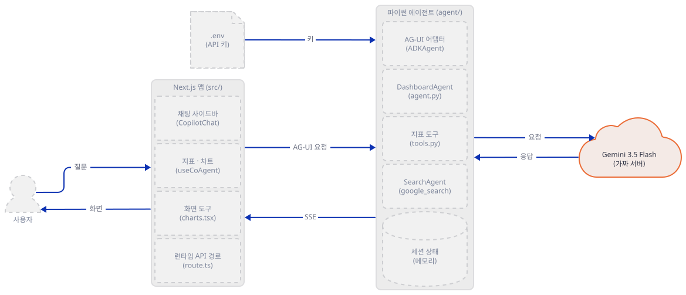

**확인.** 터미널 C에서(`. ./envfake.sh`를 읽고) 서버가 사는지 봅니다. 모르는 경로는 404이고, 서버는 그 요청을 `unexpected`로 기록합니다.

```bash
curl -s -o /dev/null -w "%{http_code}\n" http://127.0.0.1:56217/nothing
uv run --no-project python show_log.py
```

```text
404
1 예상 밖 요청: GET /nothing
```

### Step 2. 상태와 도구

**목적.** 에이전트가 화면에 쓰는 것이 무엇인지, 도구 둘이 모델에게 어떻게 보이는지 봅니다.

**할 일.** 에이전트가 쓰는 상태의 모양은 `Metric` 하나입니다. 화면의 타입(`generative_ui_agents/ai-dashboard-canvas-agent/src/lib/types.ts:15-21`)에는 `icon`이 있지만 파이썬 쪽에는 주석 처리되어 있어서 모델이 만든 지표에는 아이콘이 없습니다. 그래서 화면의 `MetricIcon`은 모든 지표에 기본 핀 아이콘을 그립니다.

`generative_ui_agents/ai-dashboard-canvas-agent/agent/state.py:12-20`

```python
# A single metric description in the dashboard spec, matching src/lib/types.ts
class Metric(BaseModel):
    """A single metric in the dashboard state, should always have a unique id."""
    id: str
    title: str
    value: str
    hint: Optional[str] = None
    # icon: Optional[IconType] = None

```

도구 둘은 세션 상태(`tool_context.state`)의 `pinnedMetrics`를 읽고 씁니다.

`generative_ui_agents/ai-dashboard-canvas-agent/agent/tools.py:9-21`

```python
def add_pinned_metrics(tool_context: ToolContext, new_pinned_metrics: List[Metric]) -> Dict[str, str]:
    """
    Add a list of new metrics to the dashboard.

    Make sure the metrics all have a unique id.
    """
    try:
        current_metrics = tool_context.state.get("pinnedMetrics", [])
        tool_context.state["pinnedMetrics"] = current_metrics + new_pinned_metrics
        return {"status": "success", "message": "Pinned metrics set successfully"}

    except Exception as e:
        return {"status": "error", "message": f"Error updating pinned metrics: {str(e)}"}
```

`update_pinned_metrics`(23~32행)는 목록을 통째로 바꿉니다. 아래 `tools` 목록이 모델에게 주는 도구입니다.

`generative_ui_agents/ai-dashboard-canvas-agent/agent/tools.py:34-38`

```python
tools = [
    # UI owns charts. Agent can provide pinned metrics and do searches.
    FunctionTool(func=add_pinned_metrics),
    FunctionTool(func=update_pinned_metrics),
]
```

주석(35행)대로 차트는 도구가 아닙니다. 에이전트는 지표와 검색만 맡고 차트는 화면이 맡습니다(Step 6). `tools.py`가 `state.py`에서 가져오는 것은 `Metric` 하나뿐이고 `Chart`·`Dashboard` 클래스는 어디서도 쓰이지 않습니다(`grep`).

아래 `show_decl.py`는 모델·네트워크 없이 모델이 보는 선언과 도구 함수의 동작을 확인합니다. 도구 함수에는 `state` 딕셔너리만 가진 대역(`SimpleNamespace`)을 넘깁니다.

```bash
cat > show_decl.py <<'PY'
"""에이전트 폴더의 도구가 모델에게 어떤 선언으로 보이는지 찍는다. 모델·네트워크를 쓰지 않는다.
쓰는 법: python show_decl.py   (canvas-work 폴더에서)"""
import json
import os
import sys

sys.path.insert(0, os.path.abspath("agent"))

from tools import tools  # noqa: E402
from state import Metric  # noqa: E402

for t in tools:
    d = t._get_declaration()
    schema = d.parameters_json_schema or (d.parameters.model_dump(exclude_none=True) if d.parameters else None)
    print(t.name, "->", json.dumps(schema, ensure_ascii=False)[:300])
print("Metric 필드:", {k: ("필수" if v.is_required() else "선택") for k, v in Metric.model_fields.items()})

# 도구 함수를 직접 불러 동작을 본다. tool_context 자리에는 state 딕셔너리만 가진 대역을 둔다.
from types import SimpleNamespace  # noqa: E402

from tools import add_pinned_metrics  # noqa: E402

m = Metric(id="m1", title="t", value="v")
ctx = SimpleNamespace(state={})
add_pinned_metrics(ctx, [m])
add_pinned_metrics(ctx, [m])
print("같은 id로 두 번 더하면:", len(ctx.state["pinnedMetrics"]), "개")
ctx = SimpleNamespace(state={"pinnedMetrics": [{"id": "m0", "title": "화면이 보낸 것", "value": "1"}]})
add_pinned_metrics(ctx, [m])
print("화면이 보낸 dict 뒤에 더하면:", [type(x).__name__ for x in ctx.state["pinnedMetrics"]])
PY
```

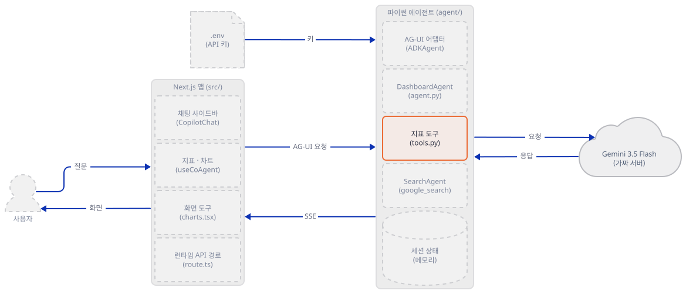

**확인.**

```bash
uv run --no-project python show_decl.py 2>/dev/null | cut -c1-150
```

```text
add_pinned_metrics -> {"$defs": {"Metric": {"description": "A single metric in the dashboard state, should always have a unique id.", "properties": {"
update_pinned_metrics -> {"$defs": {"Metric": {"description": "A single metric in the dashboard state, should always have a unique id.", "properties":
Metric 필드: {'id': '필수', 'title': '필수', 'value': '필수', 'hint': '선택'}
같은 id로 두 번 더하면: 2 개
화면이 보낸 dict 뒤에 더하면: ['dict', 'Metric']
```

선언에는 `Metric`의 JSON Schema가 `$defs`로 들어갑니다(`id`·`title`·`value`는 필수, `hint`는 선택). 같은 `id`로 두 번 더하면 두 개가 됩니다. `add_pinned_metrics`는 `current + new`로 덧붙일 뿐 중복을 보지 않습니다(`generative_ui_agents/ai-dashboard-canvas-agent/agent/tools.py:16-17`). "id는 유일해야 한다"는 것은 도구 설명(독스트링)이 모델에게 하는 부탁일 뿐입니다. 화면은 지표 카드를 `key={i}`로 그려서(`generative_ui_agents/ai-dashboard-canvas-agent/src/components/dashboard/layout/metrics.tsx:44-46`) 중복 id가 있어도 그려지기는 하지만, 카드 하나를 지우면 같은 id의 카드가 함께 지워지고(`generative_ui_agents/ai-dashboard-canvas-agent/src/components/dashboard/metrics/pinnedMetrics.tsx:64-66`) 하나를 고치면 같은 id의 카드가 모두 같은 값으로 바뀝니다(`generative_ui_agents/ai-dashboard-canvas-agent/src/components/dashboard/metrics/pinnedMetrics.tsx:100-102`). 소스로 읽은 것이고 화면은 실행하지 않았습니다. 둘째 줄은 화면이 보낸 상태(딕셔너리)와 도구가 더한 것(`Metric` 객체)이 한 목록에 섞인다는 것입니다. 나중에 JSON으로 나갈 때는 둘 다 같은 모양이 되지만(Step 5의 `STATE_DELTA`), 지침에 찍힐 때는 다르게 보입니다.

### Step 3. 에이전트, 검색 에이전트, 지침, 콜백

**목적.** 모델이 어떤 구성으로 불리는지 읽습니다.

**할 일.** `agent.py`는 두 덩어리입니다. 하나는 Google 검색만 아는 `SearchAgent`(`google_search`는 Gemini의 내장 도구라서 Google 서버 안에서 검색이 돕니다. Day 017)이고, 하나는 지표 도구 둘과 그 `SearchAgent`를 `AgentTool`로 감싼 것을 가진 `DashboardAgent`입니다. 앱 코드는 `SearchAgent`를 따로 세운 까닭을 적지 않았습니다. `google_search`가 함수 도구와 한 에이전트에 섞이기 어려운 점(Day 017)과 `AgentTool`로 부르는 방식(Day 021)으로 보아 그 이유로 추정합니다.

`generative_ui_agents/ai-dashboard-canvas-agent/agent/agent.py:23-53`

```python
search_agent = Agent(
    model='gemini-3.5-flash',
    name='SearchAgent',
    instruction="""
    You're a specialist in Google Search
    """,
    tools=[google_search],
)

dashboard_agent = Agent(
  name="DashboardAgent",
  model="gemini-3.5-flash",
  tools=tools + [AgentTool(agent=search_agent)],

  # run-loop modifiers
  before_agent_callback=on_before_agent,
  before_model_callback=before_model,
  after_model_callback = after_model,
  
  # system instructions
  instruction=instruction_provider,
)

# Create ADK middleware agent instance
dashboard_agent = ADKAgent(
  adk_agent=dashboard_agent,
  app_name="dashboard_app",
  user_id="demo_user",
  session_timeout_seconds=3600,
  use_in_memory_services=True
)
```

`ADKAgent`가 ADK 에이전트를 AG-UI에 맞추는 감싸개입니다. `user_id="demo_user"`를 고정하므로 브라우저가 몇이든 같은 사용자입니다(대화는 AG-UI의 `thread_id`로 갈립니다). `use_in_memory_services=True`라서 서버를 다시 띄우면 세션과 상태가 사라집니다. `on_before_agent`는 "상태를 초기화한다"는 독스트링과 달리 아무것도 하지 않고 `None`을 돌려줍니다(17~21행).

지침은 함수입니다. 호출될 때마다 현재 상태와 날짜를 글에 끼워 넣습니다.

`generative_ui_agents/ai-dashboard-canvas-agent/agent/instructions.py:6-26`

```python
def instruction_provider(context: ReadonlyContext) -> str:
    return f"""
    You are an intelligent dashboard agent designed to assist users in building and managing interactive dashboards.

    Current dashboard state: {context.state}

    The current date is {datetime.now().strftime("%Y-%m-%d")}.

    **Key Guidelines:**
    - Your primary source of truth is the `context.state` and information retrieved via the `SearchAgent`. Do not infer data from message history.
    - When asked to build or edit the dashboard, always use the `SearchAgent` to gather necessary data.
    - For new dashboards or "rebuild" requests, ensure all old data is cleared before populating with new information.
    - Always provide responses grounded in real data. Only generate speculative content if explicitly instructed by the user.

    **Dashboard Elements & Tools:**
    - Supported chart types:
        - `line`: requires `x` (category) and `y` (value)
        - `bar`: requires `x` (category) and `y` (value)
        - `pie`: requires `x` (category) and `y` (value)
    - UI state keys: `pinnedMetrics`, `dashboard.charts`, and `chartData` (a map keyed by chart title).
    - Use `add_charts` to provide chart specifications and `set_chart_data` to provide datasets.
```

여기 두 줄이 코드와 맞지 않습니다. 25행은 "UI state keys: `pinnedMetrics`, `dashboard.charts`, and `chartData`"라고 하지만 화면의 상태는 `title`·`charts`·`pinnedMetrics`입니다(`generative_ui_agents/ai-dashboard-canvas-agent/src/lib/types.ts:27-31`). `chartData`는 화면이 읽기만 하고(`generative_ui_agents/ai-dashboard-canvas-agent/src/components/dashboard/layout/charts.tsx:80-82`) 쓰는 곳은 없으며, `ChartGrid`는 그 값을 받아도 쓰지 않습니다(`generative_ui_agents/ai-dashboard-canvas-agent/src/components/dashboard/charts/chart-grid.tsx:23-27`). 26행은 `add_charts`와 `set_chart_data`를 쓰라고 하지만 그런 도구는 없고 화면 도구의 이름은 `add_chart`·`update_chart`·`delete_chart`입니다. 모델이 존재하지 않는 도구 이름을 지침에서 읽는 셈입니다(Step 6).

콜백은 둘입니다. 둘 다 에이전트 이름이 `DashboardAgent`일 때만 일합니다(그래서 `SearchAgent`는 건드리지 않습니다).

`generative_ui_agents/ai-dashboard-canvas-agent/agent/modifiers.py:8-32`

```python
def before_model( callback_context: CallbackContext, llm_request: LlmRequest) -> Optional[LlmResponse]:
    """
    Inspects/modifies the LLM request or skips the call.
    """

    agent_name = callback_context.agent_name
    if agent_name == "DashboardAgent":
        original_instruction = llm_request.config.system_instruction or types.Content(role="system", parts=[])
        prefix = f"""
You manage a dashboard for a user. 

Current dashboard: {callback_context.state}

When asked for the current dashboard, pinned metrics or chart please reference the current dashboard and respond.
"""
        if not isinstance(original_instruction, types.Content):
            original_instruction = types.Content(role="system", parts=[types.Part(text=str(original_instruction))])
        if not original_instruction.parts:
            original_instruction.parts.append(types.Part(text=""))

        modified_text = prefix + (original_instruction.parts[0].text or "")
        original_instruction.parts[0].text = modified_text
        llm_request.config.system_instruction = original_instruction

    return None
```

`before_model`은 시스템 지침 앞에 "Current dashboard: {callback_context.state}"를 붙입니다. 이 글이 모델에게 실제로 어떻게 나가는지는 Step 5에서 가짜 서버의 기록으로 봅니다. `after_model`(36~52행)은 모델의 응답이 글로 시작하면 `end_invocation`을 켜서 그 뒤의 모델 호출을 끝냅니다. 독스트링은 "연속 도구 호출을 멈춘다"입니다.

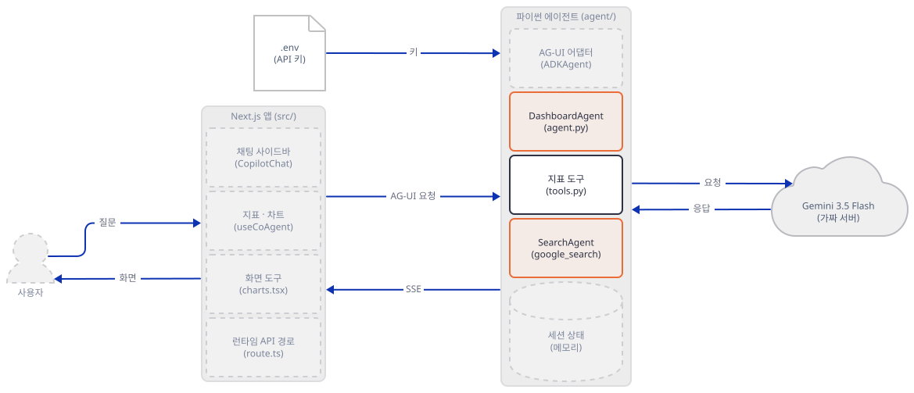

**확인.** 에이전트 모듈이 만들어지고 도구 목록이 위와 같은지 봅니다. `ADKAgent`의 안쪽 에이전트는 비공개 속성(`_adk_agent`)이라 확인용으로만 읽습니다. 환경변수 없이 만드는 것이라 `envfake.sh`를 읽은 터미널에서 합니다.

```bash
uv run --no-project python -c "import sys; sys.path.insert(0, 'agent'); import agent; print([getattr(t, 'name', type(t).__name__) for t in agent.dashboard_agent._adk_agent.tools])" 2>/dev/null
```

```text
['add_pinned_metrics', 'update_pinned_metrics', 'SearchAgent']
```

### Step 4. AG-UI 어댑터와 루프백 서버

**목적.** 에이전트를 HTTP 서버로 세우고, 원본이 그것을 어떻게 여는지 보고, 루프백에만 여는 길을 만듭니다.

**할 일.** `server.py`는 28줄입니다. 위쪽 14줄이 앱을 만들고 `add_adk_fastapi_endpoint(app, dashboard_agent, path="/")`로 AG-UI 입구를 붙입니다.

`generative_ui_agents/ai-dashboard-canvas-agent/agent/server.py:1-14`

```python
from fastapi import FastAPI
from ag_ui_adk import add_adk_fastapi_endpoint

from agent import dashboard_agent

from dotenv import load_dotenv
load_dotenv()


# Create FastAPI app
app = FastAPI(title="ADK Middleware Dashboard Agent")

# Add the ADK endpoint
add_adk_fastapi_endpoint(app, dashboard_agent, path="/")
```

`ag-ui-adk` 0.9.0의 `add_adk_fastapi_endpoint`는 길 셋을 등록합니다(`endpoint.py`, 소스로 확인). `POST /`가 AG-UI 실행 요청(JSON 본문 `RunAgentInput`)을 받아 `text/event-stream`(SSE)으로 이벤트를 돌려주고, `GET /capabilities`와 실험 기능 `POST /agents/state`가 있습니다. `load_dotenv()`는 `agent`를 가져온 다음 줄에서 돕니다(6~7행). 모델 클라이언트는 첫 요청 때 만들어지므로 그때는 이미 `.env`가 읽힌 뒤입니다. `load_dotenv()`는 `server.py`가 있는 폴더에서 위로 올라가며 `.env`를 찾기 때문에, 앱 폴더 바로 위(앱 README가 `cp .env.example .env`로 만드는 곳)뿐 아니라 그 위 폴더의 `.env`도 읽습니다(`python-dotenv` 1.2.4, 소스로 확인).

아래쪽이 문제입니다.

`generative_ui_agents/ai-dashboard-canvas-agent/agent/server.py:16-28`

```python
if __name__ == "__main__":
    import os
    import uvicorn

    if not os.getenv("GOOGLE_API_KEY"):
        print("⚠️  Warning: GOOGLE_API_KEY environment variable not set!")
        print("   Set it with: export GOOGLE_API_KEY='your-key-here'")
        print("   Get a key from: https://makersuite.google.com/app/apikey")
        print()

    port = int(os.getenv("PORT", 8000))
    should_reload = not (os.getenv("AGENT_RELOAD", "true").lower() == "false")
    uvicorn.run("server:app", host="0.0.0.0", port=port, reload=should_reload)
```

`python server.py`는 `host="0.0.0.0"`으로 모든 네트워크 인터페이스에 열고, `AGENT_RELOAD`가 `false`가 아니면(기본) `reload=True`입니다. `AGENT_RELOAD=false`는 reload만 끌 뿐 `0.0.0.0`은 그대로입니다. 이 서버에는 인증이 없어서 같은 네트워크의 누구나 `POST /`로 에이전트(와 그 뒤의 키)를 쓸 수 있습니다. 그리고 앱의 `dev:agent` 스크립트가 바로 이 줄을 실행합니다. `package.json`의 `dev:agent`는 `./scripts/run-agent.sh || scripts/run-agent.bat`이고(`generative_ui_agents/ai-dashboard-canvas-agent/package.json:8`), 그 스크립트가 `.venv/bin/python server.py`를 부릅니다(`generative_ui_agents/ai-dashboard-canvas-agent/scripts/run-agent.sh:10`). 앱 README의 `pnpm run dev`로 띄우면 이 서버가 열립니다. 또 `postinstall`이 `npm run install:agent`를 불러(`generative_ui_agents/ai-dashboard-canvas-agent/package.json:14`) 의존성 설치가 끝나면 `agent/.venv`를 만들고 `pip install -r requirements.txt`까지 합니다. README가 `pnpm install:agent`를 따로 적은 것은 중복입니다. 원본은 고치지 않으므로, 아래 `serve_local.py`가 같은 `server.app`을 `127.0.0.1`에, `reload` 없이 띄웁니다. 이 스크립트는 앱을 가져와 `load_dotenv()`가 돈 다음의 환경을 `check_env.py`로 검사하고, 통과해야만 서버를 세웁니다. 그래서 `envfake.sh`를 빼먹거나 셸·상위 `.env`에 진짜 키가 있어도 바깥으로 나가는 길이 서지 않습니다.

```bash
cat > serve_local.py <<'PY'
"""원본 agent/server.py의 app을 루프백에만 띄운다(원본 __main__은 0.0.0.0, reload=True).
앱을 가져오면 server.py의 load_dotenv()가 .env를 읽는다. 그 뒤의 os.environ을 검사하고 통과해야만 서버가 선다.
쓰는 법: python serve_local.py <포트> [에이전트 폴더 이름, 기본 agent]   (canvas-work 폴더에서)"""
import os
import sys

HERE = os.path.dirname(os.path.abspath(__file__))
agent_dir = os.path.join(HERE, sys.argv[2] if len(sys.argv) > 2 else "agent")
sys.path.insert(0, agent_dir)
os.chdir(agent_dir)

import server  # noqa: E402  (load_dotenv()가 여기서 돈다)
from check_env import check  # noqa: E402

check()

import uvicorn  # noqa: E402

port = int(sys.argv[1])
uvicorn.run(server.app, host="127.0.0.1", port=port, reload=False, log_level="info")
PY
```

터미널 B에서 앱 서버를 띄웁니다.

```bash
. ./envfake.sh
uv run --no-project python serve_local.py 56218
```

PowerShell은 Step 1의 환경 줄을 먼저 붙여 넣은 뒤 `uv run --no-project python serve_local.py 56218`을 씁니다(실행해 보지 못했습니다). 서버는 실패하면 이유를 찍고 종료 코드 1로 끝납니다. 시작할 때 `UserWarning: [EXPERIMENTAL] …`가 몇 줄 나오는데 ADK와 ag-ui-adk의 실험 기능 안내이고 무해합니다.

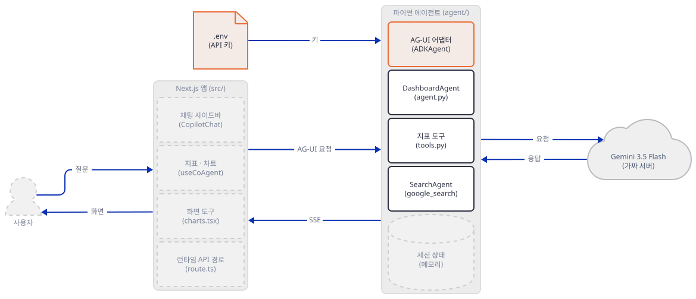

**확인.** 터미널 C에서 서버가 루프백에만 열렸는지, 입구가 사는지 봅니다.

```bash
netstat -ano | grep ":56218 " | grep LISTENING
curl -s http://127.0.0.1:56218/capabilities; echo
curl -s -X POST http://127.0.0.1:56218/ -H "Content-Type: application/json" -d '{}' | cut -c1-160; echo
```

```text
  TCP    127.0.0.1:56218        0.0.0.0:0              LISTENING       27556
{}
{"detail":[{"type":"missing","loc":["body","threadId"],"msg":"Field required","input":{}},{"type":"missing","loc":["body","runId"],"msg":"Field required","input
```

`LISTENING` 줄이 `127.0.0.1:56218`이어야 합니다. `0.0.0.0:56218`이면 어딘가 잘못된 것입니다. 이어서 안전 장치를 시험합니다. 먼저 `envfake.sh`를 읽지 않은 셸에 진짜처럼 보이는 키를 두고, 앱 폴더 위에 진짜처럼 보이는 설정이 든 `.env`를 만들어 둔 채 서버를 띄워 봅니다(키는 가짜 문자열이고, 이 시험은 요청을 보내지 않고 검사에서 끝납니다). 그다음 `envfake.sh`를 읽고 같은 `.env`로 환경이 어떻게 보이는지 봅니다.

```bash
cat > .env <<'EOF2'
GOOGLE_API_KEY=AIzaSyREALISH0000000000000000000000000
GOOGLE_GENAI_USE_VERTEXAI=true
GOOGLE_CLOUD_PROJECT=my-real-project
GOOGLE_GEMINI_BASE_URL=https://generativelanguage.googleapis.com
TAVILY_API_KEY=tvly-REALISH
EOF2
(unset GOOGLE_GEMINI_BASE_URL GOOGLE_GENAI_USE_VERTEXAI GOOGLE_CLOUD_PROJECT TAVILY_API_KEY; export GOOGLE_API_KEY=AIzaSyREALISHshell0000; uv run --no-project python serve_local.py 56220 2>&1 | grep "check_env"; echo "종료 코드: ${PIPESTATUS[0]}")
uv run --no-project python -c "import os, sys; sys.path.insert(0, 'agent'); os.chdir('agent'); import server; print({k: os.environ.get(k, '')[:10] for k in ['GOOGLE_API_KEY', 'GOOGLE_GENAI_USE_VERTEXAI', 'GOOGLE_CLOUD_PROJECT', 'GOOGLE_GEMINI_BASE_URL', 'TAVILY_API_KEY']})" 2>/dev/null
rm .env
```

```text
check_env 실패: GOOGLE_GEMINI_BASE_URL의 호스트가 루프백이 아님: 'generativelanguage.googleapis.com'
check_env 실패: GOOGLE_API_KEY가 가짜 값(fake-...)이 아님
check_env 실패: GOOGLE_GENAI_USE_VERTEXAI가 켜져 있음
check_env 실패: GOOGLE_CLOUD_PROJECT에 값이 있음 (셸 또는 agent 폴더 위쪽의 .env)
check_env 실패: TAVILY_API_KEY에 값이 있음 (셸 또는 agent 폴더 위쪽의 .env)
종료 코드: 1
{'GOOGLE_API_KEY': 'fake-key', 'GOOGLE_GENAI_USE_VERTEXAI': 'False', 'GOOGLE_CLOUD_PROJECT': '', 'GOOGLE_GEMINI_BASE_URL': 'http://127', 'TAVILY_API_KEY': ''}
```

첫 시험은 이유 다섯을 찍고 종료 코드 1로 끝납니다. 둘째 시험에서는 `.env`에 진짜처럼 보이는 값이 있어도 셸의 값이 이겨서 가짜 서버만 가리킵니다. `load_dotenv()`는 환경에 이미 있는 변수를 덮지 않으며, 빈 값도 "있는 것"으로 칩니다. `envfake.sh`가 `unset`이 아니라 빈 값(`GEMINI_API_KEY=`)으로 덮는 까닭이 이것입니다. 시험이 끝났으니 `.env`는 지워졌습니다(위 블록 마지막 줄).

### Step 5. 한 턴: 이벤트와 상태

**목적.** "다시 만들기" 한 번에 에이전트가 화면에 무엇을 보내는지, 모델이 무엇을 받는지, 상태가 양쪽으로 어떻게 오가는지 봅니다.

**할 일.** 화면이 하는 일을 대신하는 구동기 `drive.py`를 저장합니다. 화면이 처음 보내는 상태는 `{}`이고(`useCoAgent`에 초기 상태를 주지 않습니다. `types.ts`의 `initialState`는 가져다 쓰는 곳이 없습니다), 메시지에는 사용자의 글 하나가 있습니다. 구동기는 이벤트를 받는 대로 한 줄씩 찍습니다. 긴 아이디는 `call#1`·`msg#1`처럼 별명으로 바꿔 찍습니다. 주소는 루프백만 받습니다. 시나리오는 넷(`plain`·`sync`·`textfirst`·`hitl`)인데 `hitl`은 Step 6에서 씁니다.

```bash
cat > drive.py <<'PY'
"""CopilotKit 대신 AG-UI 요청을 직접 보내는 구동기. 화면(브라우저)이 하는 일을 손으로 흉내 낸다.
쓰는 법: python drive.py <시나리오> <에이전트 주소>
  plain   한 턴. 화면의 첫 상태({})와 사용자 글 하나를 보내고 받은 이벤트를 찍는다.
  sync    한 턴 뒤, 사용자가 화면에서 지표 하나를 지운 상태로 두 번째 턴을 보낸다(화면 -> 에이전트 상태 전달).
  textfirst  모델이 글 한 줄과 도구 호출을 한 응답에 함께 돌려줄 때 어떻게 되는지(after_model의 end_invocation)
  hitl    화면 도구(add_chart 등)를 선언해 보낸다. 에이전트가 add_chart를 부르면 사용자가 [Add]를 눌렀다고 치고
          결과를 되돌려 보낸다(renderAndWaitForResponse의 respond).
주소는 루프백만 받고, 셸의 프록시 변수는 읽지 않는다(trust_env=False)."""
import json
import sys
import uuid
from urllib.parse import urlparse

import httpx

USER_TEXT = "Please rebuild the dashboard to help me keep track of the current trends in the Pizza industry."

# 화면의 useCopilotAction(...)이 선언한 도구를 AG-UI의 tools 모양(name, description, JSON Schema)으로 손으로 적었다.
# 실제 CopilotKit이 보내는 바이트와 세부가 다를 수 있다(src/components/chat/actions/charts.tsx:22-34, 107-120, 223-229).
FRONTEND_TOOLS = [
    {
        "name": "add_chart",
        "description": "Add a chart to the dashboard by type. You *must* populate the data, do not create empty charts.",
        "parameters": {
            "type": "object",
            "properties": {
                "type": {"type": "string"},
                "title": {"type": "string"},
                "x": {"type": "string"},
                "y": {"type": "string"},
                "data": {"type": "array", "items": {"type": "object"}},
            },
            "required": ["type", "title"],
        },
    },
    {
        "name": "update_chart",
        "description": "Update an existing chart on the dashboard. Provide the current title to identify which chart to update.",
        "parameters": {
            "type": "object",
            "properties": {
                "currentTitle": {"type": "string"},
                "type": {"type": "string"},
                "title": {"type": "string"},
                "x": {"type": "string"},
                "y": {"type": "string"},
                "data": {"type": "array", "items": {"type": "object"}},
            },
            "required": ["currentTitle"],
        },
    },
    {
        "name": "delete_chart",
        "description": "Delete a chart from the dashboard. Provide the title of the chart to delete.",
        "parameters": {"type": "object", "properties": {"title": {"type": "string"}}, "required": ["title"]},
    },
]


def short(obj, n=150):
    s = obj if isinstance(obj, str) else json.dumps(obj, ensure_ascii=False)
    return s if len(s) <= n else s[: n - 3] + "..."


_alias = {}


def alias(kind, value):
    """실행마다 달라지는 긴 아이디를 call#1, msg#1처럼 처음 나온 순서의 별명으로 바꿔 찍는다."""
    return f"{kind}#{_alias.setdefault((kind, value), len([k for k in _alias if k[0] == kind]) + 1)}"


def fmt(ev):
    t = ev["type"]
    if t.startswith("TOOL_CALL"):
        out = alias("call", ev["toolCallId"])
        if t == "TOOL_CALL_START":
            out += " " + ev["toolCallName"]
        elif t == "TOOL_CALL_ARGS":
            out += " " + short(ev["delta"], 70)
        elif t == "TOOL_CALL_RESULT":
            out += " " + short(ev["content"], 60)
        return out
    if t.startswith("TEXT_MESSAGE"):
        return alias("msg", ev["messageId"]) + (" " + ev["delta"] if "delta" in ev else "")
    if t == "STATE_DELTA":
        return "; ".join(
            f"{d['op']} {d['path']} ({len(d['value'])}개)" if isinstance(d["value"], list) else f"{d['op']} {d['path']}"
            for d in ev["delta"]
        )
    if t == "RUN_ERROR":
        return short(ev.get("message", ""), 150)
    if t == "STATE_SNAPSHOT":
        return "키 " + str(sorted(ev["snapshot"]))
    return ""


def post_run(url, body, label):
    """SSE로 받은 이벤트를 찍고 (이벤트 목록, 도구 호출 목록, 글)을 돌려준다."""
    events, calls, text = [], {}, []
    print(f"--- {label}: 화면 도구={[t['name'] for t in body['tools']]} state 키={sorted(body['state'])} 메시지={len(body['messages'])}")
    with httpx.stream(
        "POST", url, json=body, headers={"Accept": "text/event-stream"}, timeout=60, trust_env=False
    ) as resp:
        print("HTTP", resp.status_code, resp.headers.get("content-type"))
        for line in resp.iter_lines():
            if not line.startswith("data:"):
                continue
            ev = json.loads(line[5:])
            events.append(ev)
            t = ev["type"]
            if t == "TOOL_CALL_START":
                calls[ev["toolCallId"]] = {"name": ev["toolCallName"], "args": ""}
            elif t == "TOOL_CALL_ARGS":
                calls[ev["toolCallId"]]["args"] += ev["delta"]
            elif t == "TEXT_MESSAGE_CONTENT":
                text.append(ev["delta"])
            print(f"{t:20s} {fmt(ev)}")
    return events, calls, text_join(text)


def text_join(parts):
    return "".join(parts)


def new_body(state, messages, tools, thread):
    return {
        "threadId": thread,
        "runId": "run-" + uuid.uuid4().hex[:8],
        "state": state,
        "messages": messages,
        "tools": tools,
        "context": [],
        "forwardedProps": {},
    }


def user_msg(text):
    return {"id": "u-" + uuid.uuid4().hex[:6], "role": "user", "content": text}


def last_snapshot(events):
    snaps = [e["snapshot"] for e in events if e["type"] == "STATE_SNAPSHOT"]
    return snaps[-1] if snaps else None


def main():
    scenario, url = sys.argv[1], sys.argv[2]
    if urlparse(url).hostname not in ("127.0.0.1", "localhost"):
        sys.exit(f"drive.py: 루프백 주소만 받습니다: {url}")
    thread = "thread-" + uuid.uuid4().hex[:6]
    msgs = [user_msg(USER_TEXT)]

    if scenario == "plain":
        ev, calls, text = post_run(url, new_body({}, msgs, [], thread), "run 1")
        snap = last_snapshot(ev)
        print("최종 상태 키:", sorted(snap or {}))
        print("pinnedMetrics:", short((snap or {}).get("pinnedMetrics"), 400))
        print("글:", text)

    elif scenario == "sync":
        ev, calls, text = post_run(url, new_body({}, msgs, [], thread), "run 1")
        snap = last_snapshot(ev)
        ui_state = {k: v for k, v in snap.items() if not k.startswith("_")}
        ui_state["pinnedMetrics"] = [m for m in ui_state["pinnedMetrics"] if m["id"] != "m2"]
        print("화면에서 m2를 지움 ->", [m["id"] for m in ui_state["pinnedMetrics"]])
        msgs2 = msgs + [
            {"id": "a-" + uuid.uuid4().hex[:6], "role": "assistant", "content": text},
            user_msg("Which metrics are pinned right now?"),
        ]
        ev2, _, _ = post_run(url, new_body(ui_state, msgs2, [], thread), "run 2")
        snap2 = last_snapshot(ev2)
        print("run 2 뒤 pinnedMetrics id:", [m["id"] for m in snap2["pinnedMetrics"]])

    elif scenario == "hitl":
        ev, calls, text = post_run(url, new_body({}, msgs, FRONTEND_TOOLS, thread), "run 1")
        chart_calls = {i: c for i, c in calls.items() if c["name"] == "add_chart"}
        if not chart_calls:
            print("add_chart 호출 없음 (모델이 화면 도구를 받지 못했거나 부르지 않음)")
            return
        snap = last_snapshot(ev) or {}
        ui_state = {k: v for k, v in snap.items() if not k.startswith("_")}
        call_id, call = next(iter(chart_calls.items()))
        args = json.loads(call["args"])
        # 사용자가 [Add]를 눌렀다고 치고 화면이 하는 두 가지: setState로 charts에 더하고, respond로 결과를 돌려준다
        ui_state["charts"] = ui_state.get("charts", []) + [
            {"type": args["type"], "title": args["title"], "x": args["x"], "y": args["y"], "data": args["data"]}
        ]
        assistant = {
            "id": "a-" + uuid.uuid4().hex[:6],
            "role": "assistant",
            "toolCalls": [
                {
                    "id": i,
                    "type": "function",
                    "function": {"name": c["name"], "arguments": c["args"]},
                }
                for i, c in calls.items()
                if c["name"] == "add_chart"
            ],
        }
        tool = {
            "id": "t-" + uuid.uuid4().hex[:6],
            "role": "tool",
            "toolCallId": call_id,
            "content": json.dumps({"status": "success", "message": "Added chart successfully!"}),
        }
        print("사용자가 [Add]를 누름 -> charts:", [c["title"] for c in ui_state["charts"]])
        ev2, calls2, text2 = post_run(url, new_body(ui_state, msgs + [assistant, tool], FRONTEND_TOOLS, thread), "run 2")
        snap2 = last_snapshot(ev2)
        if snap2 is None:
            print("run 2에 STATE_SNAPSHOT 없음")
            return
        print("run 2 뒤 charts:", [c["title"] for c in snap2.get("charts", [])], "pinnedMetrics:", len(snap2.get("pinnedMetrics", [])))
        print("글:", text2)
    elif scenario == "textfirst":
        msgs = [user_msg("Explain first, then add one metric.")]
        ev, calls, text = post_run(url, new_body({}, msgs, [], thread), "run 1")
        snap = last_snapshot(ev) or {}
        print("부른 도구:", [c["name"] for c in calls.values()], "pinnedMetrics:", len(snap.get("pinnedMetrics", [])))
    else:
        sys.exit("시나리오: plain | sync | hitl | textfirst")


if __name__ == "__main__":
    main()
PY
```

요청 로그를 읽는 `show_log.py`도 저장합니다.

```bash
cat > show_log.py <<'PY'
"""가짜 Gemini 서버가 받은 요청을 한 줄씩 요약한다. 쓰는 법: python show_log.py [fake/fake.jsonl] [--system N]"""
import json
import sys

args = [a for a in sys.argv[1:] if not a.startswith("--")]
path = args[0] if args else "fake/fake.jsonl"
if "--system" in sys.argv:  # 쓰는 법: python show_log.py fake/fake.jsonl --system 1  (그 번째 요청의 시스템 지시문 전체)
    n = int(sys.argv[sys.argv.index("--system") + 1])
    print(json.loads(open(path, encoding="utf-8").readlines()[n - 1])["system"])
    raise SystemExit
for i, line in enumerate(open(path, encoding="utf-8"), 1):
    d = json.loads(line)
    if "unexpected" in d:
        print(i, "예상 밖 요청:", d["unexpected"])
        continue
    last = d["contents"][-1]["parts"] if d["contents"] else []
    print(
        f"{i} {d['model']} key={d['key_prefix']} 함수선언={d['functionDeclarations']} 내장={d['builtinTools']} "
        f"시스템 {d['system_chars']}자 마지막={last}"
    )
PY
```

가짜 서버의 기록을 비우고 한 턴을 돌립니다(터미널 C, `envfake.sh`를 읽은 곳).

```bash
rm -f fake/fake.jsonl
uv run --no-project python drive.py plain http://127.0.0.1:56218/ | cut -c1-150
```

```text
--- run 1: 화면 도구=[] state 키=[] 메시지=1
HTTP 200 text/event-stream; charset=utf-8
RUN_STARTED          
TOOL_CALL_START      call#1 SearchAgent
TOOL_CALL_ARGS       call#1 {"request":"current trends in the pizza industry"}
TOOL_CALL_END        call#1
TOOL_CALL_RESULT     call#1 {"result": "Fake search summary: pizza chains report stea...
TOOL_CALL_START      call#2 add_pinned_metrics
TOOL_CALL_ARGS       call#2 {"new_pinned_metrics":[{"id":"m1","title":"Pizza market (fake)","va...
TOOL_CALL_END        call#2
TOOL_CALL_RESULT     call#2 {"status": "success", "message": "Pinned metrics set succ...
STATE_DELTA          add /pinnedMetrics (3개)
TEXT_MESSAGE_START   msg#1
TEXT_MESSAGE_CONTENT msg#1 Dashboard updated (fake reply).
TEXT_MESSAGE_END     msg#1
STATE_SNAPSHOT       키 ['_ag_ui_app_name', '_ag_ui_thread_id', '_ag_ui_user_id', 'pinnedMetrics']
RUN_FINISHED         
최종 상태 키: ['_ag_ui_app_name', '_ag_ui_thread_id', '_ag_ui_user_id', 'pinnedMetrics']
pinnedMetrics: [{"id": "m1", "title": "Pizza market (fake)", "value": "$50B", "hint": "made up by the fake server"}, {"id": "m2", "title": "Delivery s
글: Dashboard updated (fake reply).
```

이벤트 열다섯 줄이 이 한 턴의 AG-UI 전부입니다. 아이디(`thread-…`)와 주소(`0x…`)는 실행마다 다릅니다. `RUN_STARTED`~`RUN_FINISHED`가 한 번의 실행을 감쌉니다. 도구 호출은 백엔드 도구(`SearchAgent`, `add_pinned_metrics`)도 `TOOL_CALL_START`·`ARGS`·`END`·`RESULT`로 화면에 흘러갑니다. 화면이 그것을 그리는 곳이 `search.tsx`이고, `available: "disabled"`이면 화면은 그 도구를 실행하지 않고 호출을 그리기만 합니다(`generative_ui_agents/ai-dashboard-canvas-agent/src/components/chat/actions/search.tsx:6-10`, CopilotKit `useCopilotAction`의 분기는 소스로 확인). `STATE_DELTA`는 도구가 상태를 쓴 순간 나가는 JSON Patch(`add /pinnedMetrics`)이고, 실행이 끝날 때 `STATE_SNAPSHOT`이 전체 상태를 보냅니다. 화면은 이 둘을 받는 대로 자기 상태를 바꿉니다(`@ag-ui/client`의 이벤트 처리, 소스로 확인). 스냅숏의 키에 `_ag_ui_app_name`·`_ag_ui_thread_id`·`_ag_ui_user_id`가 보입니다. ag-ui-adk가 세션에 적어 두는 내부 키가 화면의 상태에 그대로 섞여 들어갑니다(Day 142 Step 4가 같은 키를 봤습니다. Step 6의 스냅숏에는 `pending_tool_calls`도 보입니다).

상태가 오가는 길은 구조로 보면 이렇습니다.

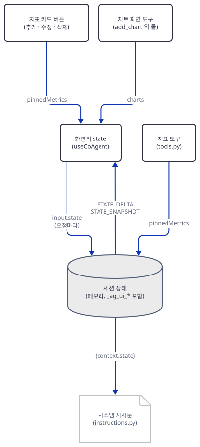

화면의 부품(지표 카드 버튼, 차트 도구)은 화면의 상태를 고치고, 그 상태는 요청마다 `input.state`로 에이전트에게 갑니다. ag-ui-adk는 그것을 세션 상태에 덮어씁니다(Day 142 Step 5가 `_run_adk_in_background`에서 확인했고, 아래 `sync`가 0.9.0에서도 같은지 봅니다). 에이전트의 도구는 같은 세션 상태에 쓰고, 그것이 `STATE_DELTA`·`STATE_SNAPSHOT`으로 화면에 돌아갑니다. 지침 함수도 같은 세션 상태를 글에 끼웁니다. 화면과 에이전트 어느 쪽이 "원본"인지는 정해져 있지 않고, 마지막에 쓴 쪽이 이깁니다.

이제 모델이 무엇을 받았는지 가짜 서버의 기록으로 봅니다.

```bash
uv run --no-project python show_log.py
```

```text
1 gemini-3.5-flash key=fake- 함수선언=['add_pinned_metrics', 'update_pinned_metrics', 'SearchAgent'] 내장=[] 시스템 1875자 마지막=['text']
2 gemini-3.5-flash key=fake- 함수선언=[] 내장=['googleSearch'] 시스템 102자 마지막=['text']
3 gemini-3.5-flash key=fake- 함수선언=['add_pinned_metrics', 'update_pinned_metrics', 'SearchAgent'] 내장=[] 시스템 1875자 마지막=['functionResponse:SearchAgent']
4 gemini-3.5-flash key=fake- 함수선언=['add_pinned_metrics', 'update_pinned_metrics', 'SearchAgent'] 내장=[] 시스템 2184자 마지막=['functionResponse:add_pinned_metrics']
```

요청이 넷입니다. 1번이 `DashboardAgent`의 첫 호출이고 도구 선언은 셋(`add_pinned_metrics`·`update_pinned_metrics`·`SearchAgent`)뿐입니다. 2번은 `AgentTool`이 연 `SearchAgent`의 호출이고 `googleSearch` 내장 도구만 있습니다. 3번이 검색 결과를 받은 두 번째 호출, 4번이 지표 도구의 결과를 받은 세 번째 호출입니다. 가짜 서버가 `key=fake-`를 보았으니 ADK의 모델 클라이언트도 `GOOGLE_GEMINI_BASE_URL`과 환경의 키를 그대로 따랐다는 것(직접 확인)이고, 예상 밖 요청은 없습니다. 4번의 지침이 1번보다 긴 것(1875자 → 2184자)은 상태에 지표가 들어갔기 때문입니다. 1번 요청의 시스템 지침 앞부분을 봅니다.

```bash
uv run --no-project python show_log.py fake/fake.jsonl --system 1 | sed -n 2,13p | cut -c1-170
```

```text
You manage a dashboard for a user. 

Current dashboard: <google.adk.sessions.state.State object at 0x000001F7FC4D9670>

When asked for the current dashboard, pinned metrics or chart please reference the current dashboard and respond.

    You are an intelligent dashboard agent designed to assist users in building and managing interactive dashboards.

    Current dashboard state: {'_ag_ui_thread_id': 'thread-0a121b', '_ag_ui_app_name': 'dashboard_app', '_ag_ui_user_id': 'demo_user', '_ag_ui_processed_message:u-7bba3c':

    The current date is 2026-10-16.
```

맨 위 "Current dashboard:" 줄이 `before_model`의 접두이고 값이 `<google.adk.sessions.state.State object at 0x…>`입니다. `callback_context.state`는 `State` 객체이고 f-string은 그 이름만 찍습니다. 상태의 내용은 모델에게 가지 않습니다. 모델이 상태를 보는 것은 아래 `instruction_provider`가 끼운 "Current dashboard state: {…}" 한 번뿐이고(이쪽은 `context.state`가 읽기 전용 매핑이라 딕셔너리처럼 찍힙니다), 거기에 `_ag_ui_*` 내부 키와 `_ag_ui_processed_message:…`가 함께 보입니다. 4번 요청에서는 같은 자리에 `pinnedMetrics`가 `Metric(id='m1', …)`로 찍힙니다. 화면이 보낸 상태는 딕셔너리로 찍히는 차이입니다. 모델은 이 문자열을 읽고 판단하므로, 지침에 찍히는 모양은 곧 모델의 입력입니다.

Day 142가 소스로 본 덮어쓰기가 이 판에서도 같은지만 `sync`로 한 번 봅니다. 화면에서 카드를 지운 뒤 다시 물으면 어떻게 되는지입니다. 구동기는 첫 턴 뒤의 상태에서 `m2` 카드를 지운 상태를 둘째 요청에 실어 보냅니다.

```bash
rm -f fake/fake.jsonl
uv run --no-project python drive.py sync http://127.0.0.1:56218/ | sed -n '/화면에서 m2/,$p' | cut -c1-150
```

```text
화면에서 m2를 지움 -> ['m1', 'm3']
--- run 2: 화면 도구=[] state 키=['pinnedMetrics'] 메시지=3
HTTP 200 text/event-stream; charset=utf-8
RUN_STARTED          
TEXT_MESSAGE_START   msg#2
TEXT_MESSAGE_CONTENT msg#2 I can see these pinned metric ids in my instruction: m1, m3
TEXT_MESSAGE_END     msg#2
STATE_SNAPSHOT       키 ['_ag_ui_app_name', '_ag_ui_thread_id', '_ag_ui_user_id', 'pinnedMetrics']
RUN_FINISHED         
run 2 뒤 pinnedMetrics id: ['m1', 'm3']
```

모델은 `m1`·`m3`만 봤습니다. 화면에서 지운 것이 요청마다 세션 상태를 덮어쓰기 때문입니다. 재시작은 Day 142 Step 7이 다뤘고 여기서는 다시 띄워 보지 않았습니다.

끝으로 `after_model`을 봅니다. 모델이 글 한 줄과 도구 호출을 한 응답에 함께 주면 어떻게 되는지 `textfirst`로 봅니다.

```bash
rm -f fake/fake.jsonl
uv run --no-project python drive.py textfirst http://127.0.0.1:56218/ | cut -c1-150
uv run --no-project python show_log.py
```

```text
--- run 1: 화면 도구=[] state 키=[] 메시지=1
HTTP 200 text/event-stream; charset=utf-8
RUN_STARTED          
TEXT_MESSAGE_START   msg#1
TEXT_MESSAGE_CONTENT msg#1 First, a sentence of explanation.
TEXT_MESSAGE_END     msg#1
TOOL_CALL_START      call#1 add_pinned_metrics
TOOL_CALL_ARGS       call#1 {"new_pinned_metrics":[{"id":"x1","title":"After-text metric","valu...
TOOL_CALL_END        call#1
TOOL_CALL_RESULT     call#1 {"status": "success", "message": "Pinned metrics set succ...
STATE_DELTA          add /pinnedMetrics (1개)
STATE_SNAPSHOT       키 ['_ag_ui_app_name', '_ag_ui_thread_id', '_ag_ui_user_id', 'pinnedMetrics']
RUN_FINISHED         
부른 도구: ['add_pinned_metrics'] pinnedMetrics: 1
1 gemini-3.5-flash key=fake- 함수선언=['add_pinned_metrics', 'update_pinned_metrics', 'SearchAgent'] 내장=[] 시스템 1875자 마지막=['text']
```

글이 먼저 나가고 도구도 실행됐고 상태도 바뀌었습니다. 그러니 `end_invocation`이 끊는 것은 이미 한 응답에 든 도구 호출이 아니라 그 다음의 모델 호출입니다. 즉 도구 결과를 읽은 모델이 마무리 글을 쓰는 호출이 생략됩니다. 가짜 서버가 받은 요청이 하나뿐인 것으로 보입니다(`show_log.py`).

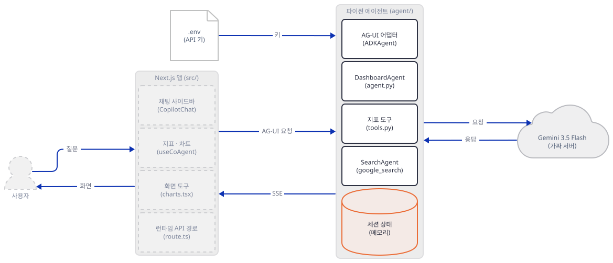

**확인.** 위 `plain`의 마지막 줄들(`최종 상태 키`, `pinnedMetrics`)이 나오고 `show_log.py`가 요청 넷을 보이면 됩니다.

### Step 6. 화면 도구: 모델에게 보이지 않는 차트

**목적.** 차트는 에이전트의 도구가 아니라 화면이 가진 "화면 도구"입니다. 그 도구가 모델에게 닿는 길을 확인합니다.

**할 일.** 화면은 `useCopilotAction`으로 도구 셋을 등록합니다. `add_chart`는 이름·설명·매개변수를 선언하고, `renderAndWaitForResponse`로 승인 카드를 그립니다.

`generative_ui_agents/ai-dashboard-canvas-agent/src/components/chat/actions/charts.tsx:22-35`

```tsx
  useCopilotAction(
    {
      name: "add_chart",
      description:
        "Add a chart to the dashboard by type. You *must* populate the data, do not create empty charts.",
      parameters: [
        { name: "type", type: "string", required: true },
        { name: "title", type: "string", required: true },
        { name: "x", type: "string", required: false },
        { name: "y", type: "string", required: false },
        { name: "data", type: "object[]", required: false },
      ],
      renderAndWaitForResponse: ({ args, respond, status }) => {
        const { type, title, x, y, data } = args as {
```

사용자가 [Add]를 누르면 `setState`로 `charts`에 차트를 더하고 `respond`로 결과를 돌려줍니다(`generative_ui_agents/ai-dashboard-canvas-agent/src/components/chat/actions/charts.tsx:77-92`).

`renderAndWaitForResponse`가 도구가 되는 길은 이렇습니다. `useCopilotAction`은 이 형태를 "hitl"(사람이 끼는 도구)로 분류해 `useHumanInTheLoop`을 부르고, 이 훅이 도구의 처리 함수로 "사용자가 `respond`를 부를 때까지 끝나지 않는 약속(Promise)"을 둡니다(`@copilotkit/react-core` 1.59.2의 `getActionConfig`·`useHumanInTheLoop`, 소스로 확인). 매개변수 목록은 JSON Schema로 바뀌어 요청의 `tools`에 실립니다(`@copilotkit/shared`의 `actionParametersToJsonSchema`, 소스로 확인). 그러니 모델이 `add_chart`를 부르면 이벤트가 화면에 가고, 화면이 카드를 그린 채 사용자의 답을 기다리고, 답이 도구 결과 메시지로 다음 요청에 실려 돌아옵니다. `drive.py`의 `FRONTEND_TOOLS`는 이 모양을 손으로 적은 것이고, 실제 바이트와 세부가 다를 수 있습니다.

이제 현재 앱(`agent/`)에 화면 도구 셋을 실어 보내 봅니다. 서버(터미널 B)가 떠 있어야 합니다.

```bash
rm -f fake/fake.jsonl
uv run --no-project python drive.py hitl http://127.0.0.1:56218/ | cut -c1-150
uv run --no-project python show_log.py
```

```text
--- run 1: 화면 도구=['add_chart', 'update_chart', 'delete_chart'] state 키=[] 메시지=1
HTTP 200 text/event-stream; charset=utf-8
RUN_STARTED          
TOOL_CALL_START      call#1 SearchAgent
TOOL_CALL_ARGS       call#1 {"request":"current trends in the pizza industry"}
TOOL_CALL_END        call#1
TOOL_CALL_RESULT     call#1 {"result": "Fake search summary: pizza chains report stea...
TOOL_CALL_START      call#2 add_pinned_metrics
TOOL_CALL_ARGS       call#2 {"new_pinned_metrics":[{"id":"m1","title":"Pizza market (fake)","va...
TOOL_CALL_END        call#2
TOOL_CALL_RESULT     call#2 {"status": "success", "message": "Pinned metrics set succ...
STATE_DELTA          add /pinnedMetrics (3개)
TEXT_MESSAGE_START   msg#1
TEXT_MESSAGE_CONTENT msg#1 Dashboard updated (fake reply).
TEXT_MESSAGE_END     msg#1
STATE_SNAPSHOT       키 ['_ag_ui_app_name', '_ag_ui_thread_id', '_ag_ui_user_id', 'pinnedMetrics']
RUN_FINISHED         
add_chart 호출 없음 (모델이 화면 도구를 받지 못했거나 부르지 않음)
1 gemini-3.5-flash key=fake- 함수선언=['add_pinned_metrics', 'update_pinned_metrics', 'SearchAgent'] 내장=[] 시스템 1875자 마지막=['text']
2 gemini-3.5-flash key=fake- 함수선언=[] 내장=['googleSearch'] 시스템 102자 마지막=['text']
3 gemini-3.5-flash key=fake- 함수선언=['add_pinned_metrics', 'update_pinned_metrics', 'SearchAgent'] 내장=[] 시스템 1875자 마지막=['functionResponse:SearchAgent']
4 gemini-3.5-flash key=fake- 함수선언=['add_pinned_metrics', 'update_pinned_metrics', 'SearchAgent'] 내장=[] 시스템 2184자 마지막=['functionResponse:add_pinned_metrics']
```

모델은 `add_chart`를 부르지 못했습니다. 요청의 `tools`에 셋이 실려 갔는데(맨 윗줄) 첫 응답에서 이벤트 흐름에는 `SearchAgent`와 `add_pinned_metrics`만 있습니다. 가짜 서버의 기록(`show_log.py`)도 같습니다. 선언된 도구는 세 개뿐입니다. 터미널 B(서버)에는 이유가 한 줄로 찍혀 있습니다.

```text
Frontend tools ['add_chart', 'delete_chart', 'update_chart'] were sent with this run but the agent tree has no AGUIToolset, so they will not be declared to the model. Add AGUIToolset() to the agent's tools to expose them.
```

Day 142 Step 5가 0.5.0에서 확인한 규칙입니다. `ag-ui-adk`는 0.5.0부터 화면 도구를 에이전트의 도구 목록에 자동으로 넣지 않고, 에이전트가 `AGUIToolset()`을 도구 목록에 직접 넣어야 모델에게 선언합니다(0.9.0의 마이그레이션 안내 "Migrating from v0.4.x", 소스로 확인). 이 앱의 `requirements.txt`는 버전을 고정하지 않아서 오늘 설치는 0.9.0(2026-10-10 공개)이 됩니다. `ag-ui-adk` 0.5.0은 2026-02-23, 앱의 의존성 목록이 들어온 커밋은 2026-04-28이어서(`git log`) 그때 설치했어도 같았을 것으로 추정하지만, 그 시점의 설치를 재현하지는 못했습니다.

앱을 고치지 않고 한 줄만 더한 복사본으로 같은 시험을 합니다. `patch_agui.py`는 `agent/`를 `agent_patched/`로 복사하면서 `AGUIToolset`을 가져오는 줄과 도구 목록의 한 줄만 바꿉니다.

```bash
cat > patch_agui.py <<'PY'
"""agent/agent.py를 agent_patched/agent.py로 복사하면서 AGUIToolset() 한 줄만 더한다. 원본은 건드리지 않는다.
쓰는 법: python patch_agui.py   (canvas-work 폴더에서). 줄 끝은 바이트 그대로 둔다."""
import shutil
from pathlib import Path

src, dst = Path("agent"), Path("agent_patched")
if dst.exists():
    raise SystemExit("agent_patched가 이미 있음: 지우고 다시 하거나 그대로 쓰세요")
shutil.copytree(src, dst)
path = dst / "agent.py"
text = path.read_bytes().decode("utf-8")
old_import = "from ag_ui_adk import ADKAgent\n"
old_tools = "tools=tools + [AgentTool(agent=search_agent)],"
assert text.count(old_import) == 1 and text.count(old_tools) == 1, "원본이 예상과 다름"
text = text.replace(old_import, "from ag_ui_adk import ADKAgent, AGUIToolset\n")
text = text.replace(old_tools, "tools=tools + [AGUIToolset(), AgentTool(agent=search_agent)],")
path.write_bytes(text.encode("utf-8"))
print("agent_patched/agent.py 만듦: AGUIToolset() 한 줄 추가")
PY
```

```bash
uv run --no-project python patch_agui.py
diff agent/agent.py agent_patched/agent.py
```

```text
agent_patched/agent.py 만듦: AGUIToolset() 한 줄 추가
4c4
< from ag_ui_adk import ADKAgent
---
> from ag_ui_adk import ADKAgent, AGUIToolset
35c35
<   tools=tools + [AgentTool(agent=search_agent)],
---
>   tools=tools + [AGUIToolset(), AgentTool(agent=search_agent)],
```

고친 복사본을 띄웁니다. 새 터미널 D를 열고 환경 줄을 다시 읽은 뒤, `serve_local.py`에 둘째 인자로 폴더 이름을 줍니다. 앱의 방식(`cd agent_patched`로 들어가 `python server.py`)으로 띄우지 마세요. 그러면 검사 없이 `0.0.0.0`·`reload`로 뜹니다.

```bash
. ./envfake.sh
uv run --no-project python serve_local.py 56219 agent_patched
```

PowerShell은 터미널 B와 같은 환경 줄(Step 1)을 붙여 넣은 뒤 아래 한 줄입니다(실행해 보지 못했습니다).

```powershell
uv run --no-project python serve_local.py 56219 agent_patched
```

같은 시험을 돌립니다(터미널 C).

```bash
rm -f fake/fake.jsonl
uv run --no-project python drive.py hitl http://127.0.0.1:56219/ | cut -c1-150
uv run --no-project python show_log.py
```

```text
--- run 1: 화면 도구=['add_chart', 'update_chart', 'delete_chart'] state 키=[] 메시지=1
HTTP 200 text/event-stream; charset=utf-8
RUN_STARTED          
TOOL_CALL_START      call#1 SearchAgent
TOOL_CALL_ARGS       call#1 {"request":"current trends in the pizza industry"}
TOOL_CALL_END        call#1
TOOL_CALL_RESULT     call#1 {"result": "Fake search summary: pizza chains report stea...
TOOL_CALL_START      call#2 add_chart
TOOL_CALL_ARGS       call#2 {"type":"bar","title":"Sales by region (fake)","x":"region","y":"sa...
TOOL_CALL_END        call#2
RUN_FINISHED         
사용자가 [Add]를 누름 -> charts: ['Sales by region (fake)']
--- run 2: 화면 도구=['add_chart', 'update_chart', 'delete_chart'] state 키=['charts'] 메시지=3
HTTP 200 text/event-stream; charset=utf-8
RUN_STARTED          
TOOL_CALL_RESULT     call#3 {"status": "success", "message": "Pinned metrics set succ...
STATE_DELTA          add /pinnedMetrics (3개)
TEXT_MESSAGE_START   msg#1
TEXT_MESSAGE_CONTENT msg#1 Dashboard updated (fake reply).
TEXT_MESSAGE_END     msg#1
STATE_SNAPSHOT       키 ['_ag_ui_app_name', '_ag_ui_thread_id', '_ag_ui_user_id', 'charts', 'pending_tool_calls', 'pinnedMetrics']
RUN_FINISHED         
run 2 뒤 charts: ['Sales by region (fake)'] pinnedMetrics: 3
글: Dashboard updated (fake reply).
1 gemini-3.5-flash key=fake- 함수선언=['add_pinned_metrics', 'update_pinned_metrics', 'add_chart', 'update_chart', 'delete_chart', 'SearchAgent'] 내장=[] 시스템 1875자 마지막=['text']
2 gemini-3.5-flash key=fake- 함수선언=[] 내장=['googleSearch'] 시스템 102자 마지막=['text']
3 gemini-3.5-flash key=fake- 함수선언=['add_pinned_metrics', 'update_pinned_metrics', 'add_chart', 'update_chart', 'delete_chart', 'SearchAgent'] 내장=[] 시스템 1875자 마지막=['functionResponse:SearchAgent']
4 gemini-3.5-flash key=fake- 함수선언=['add_pinned_metrics', 'update_pinned_metrics', 'add_chart', 'update_chart', 'delete_chart', 'SearchAgent'] 내장=[] 시스템 2542자 마지막=['functionResponse:add_chart', 'functionResponse:add_pinned_metrics']
```

이번에는 도구 선언이 여섯(셋 + `add_chart`·`update_chart`·`delete_chart`)이고 모델의 `add_chart` 호출이 화면까지 왔습니다.

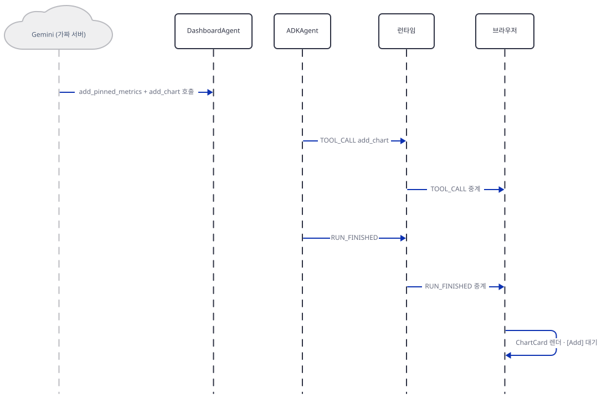

첫 실행은 `add_chart`의 `TOOL_CALL_END` 바로 뒤에 `RUN_FINISHED`로 끝납니다. 같은 응답에 있던 `add_pinned_metrics`는 두 실행 어디에도 `TOOL_CALL_START`·`ARGS`·`END`가 나오지 않고, 둘째 실행에 `START` 없는 `TOOL_CALL_RESULT`(`call#3`)만 나옵니다. 결과와 상태 변경이 미뤄졌을 뿐 아니라 호출 자체가 화면에 흐르지 않았습니다. `@ag-ui/client` 0.0.53의 검증 코드는 `TOOL_CALL_START`·`ARGS`·`END`의 짝만 따지고 `RESULT`는 따지지 않는 것으로 읽혀(배포 코드를 읽음) 화면이 오류를 내지는 않을 것으로 보이지만 실행해 보지는 못했습니다. 이 구동기가 한 응답에 두 호출을 함께 시켰기 때문일 수 있고, 진짜 모델이 어떻게 부를지는 확인하지 못했습니다. 화면은 승인 카드를 그리고 기다립니다. 사용자가 [Add]를 누르면 화면은 `charts`에 차트를 더한 새 상태와 도구 결과 메시지를 실어 새 요청을 보내고, 에이전트가 이어받습니다.

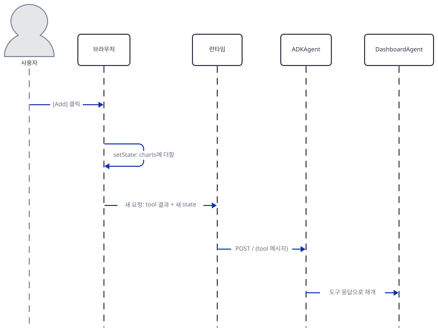

둘째 실행은 `add_pinned_metrics`의 `TOOL_CALL_RESULT`·`STATE_DELTA`부터 시작하고(앞 실행이 미룬 것), 그 뒤에 넷째 요청과 글이 옵니다.

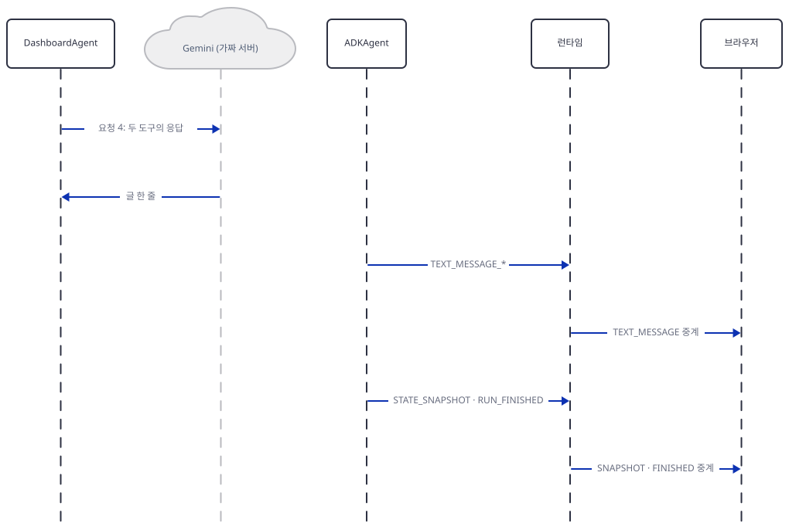

실행은 글과 스냅숏으로 끝나고, 스냅숏에는 화면이 더한 차트가 남았습니다. 가짜 서버가 받은 넷째 요청에는 두 도구의 응답이 함께 들어 있습니다(기록의 마지막 줄).

예전 판은 어땠는지도 확인했습니다. 터미널 D의 서버를 멈추고(Ctrl+C), 판만 바꾼 가상환경을 따로 만듭니다(`ag-ui-protocol`을 1.0 미만으로 눌러야 0.4.2가 가져와집니다. macOS·Linux는 `v042/bin/python`).

```bash
uv venv --python 3.12 v042
uv pip install --python v042/Scripts/python.exe -r agent/requirements.txt "ag-ui-adk==0.4.2" "ag-ui-protocol<1.0"
```

그 환경으로 같은 앱(`agent/`, 패치 없음)을 같은 줄 방식으로 띄우고(터미널 D에서 `. ./envfake.sh` 뒤) 시험합니다.

```bash
. ./envfake.sh
v042/Scripts/python.exe serve_local.py 56221
```

```bash
rm -f fake/fake.jsonl
uv run --no-project python drive.py hitl http://127.0.0.1:56221/ | cut -c1-150 | sed -E 's/adk-[0-9a-f-]{36}/adk-X/'
uv run --no-project python show_log.py | head -3
```

```text
--- run 1: 화면 도구=['add_chart', 'update_chart', 'delete_chart'] state 키=[] 메시지=1
HTTP 200 text/event-stream; charset=utf-8
RUN_STARTED          
TOOL_CALL_START      call#1 SearchAgent
TOOL_CALL_ARGS       call#1 {"request": "current trends in the pizza industry"}
TOOL_CALL_END        call#1
TOOL_CALL_RESULT     call#1 {"result": "Fake search summary: pizza chains report stea...
TOOL_CALL_START      call#2 add_chart
TOOL_CALL_ARGS       call#2 {"type": "bar", "title": "Sales by region (fake)", "x": "region", "...
TOOL_CALL_END        call#2
RUN_FINISHED         
사용자가 [Add]를 누름 -> charts: ['Sales by region (fake)']
--- run 2: 화면 도구=['add_chart', 'update_chart', 'delete_chart'] state 키=['charts'] 메시지=3
HTTP 200 text/event-stream; charset=utf-8
RUN_STARTED          
RUN_ERROR            Function call not found for function response ids: {'adk-X'}. Ensure each function response ID
RUN_FINISHED         
run 2에 STATE_SNAPSHOT 없음
1 gemini-3.5-flash key=fake- 함수선언=['add_pinned_metrics', 'update_pinned_metrics', 'SearchAgent', 'add_chart', 'update_chart', 'delete_chart'] 내장=[] 시스템 1832자 마지막=['text']
2 gemini-3.5-flash key=fake- 함수선언=[] 내장=['googleSearch'] 시스템 102자 마지막=['text']
3 gemini-3.5-flash key=fake- 함수선언=['add_pinned_metrics', 'update_pinned_metrics', 'SearchAgent', 'add_chart', 'update_chart', 'delete_chart'] 내장=[] 시스템 1832자 마지막=['functionResponse:SearchAgent']
```

도구 선언이 여섯(`add_chart` 포함)으로 나왔습니다(직접 확인). 다만 첫 실행 뒤 도구 결과를 실어 보낸 둘째 요청은 `Function call not found for function response ids …`로 실패했습니다. 오늘의 `google-adk` 2.12.0과 0.4.2의 조합 문제로 추정하고 원인은 확인하지 못했습니다. 판을 내려서는 해결되지 않고, `AGUIToolset()`을 더하는 쪽이 이 조합에서 끝까지 도는 길이었습니다(고친 복사본의 둘째 실행). 시험이 끝나면 터미널 D의 서버를 멈춥니다.

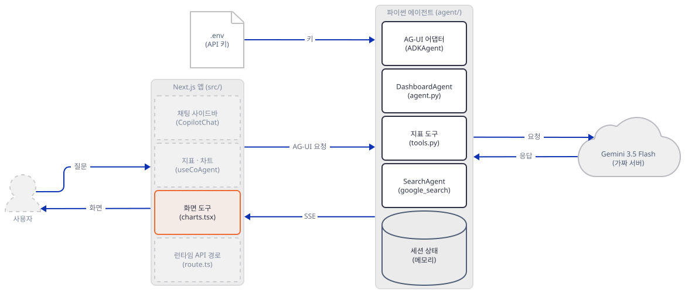

**확인.** 원본 에이전트에서는 도구 호출이 `SearchAgent`·`add_pinned_metrics`뿐이고 `add_chart 호출 없음`이 찍히고, 고친 복사본에서는 `add_chart`가 보이고 둘째 실행 뒤 `charts: ['Sales by region (fake)']`가 나오면 됩니다.

### Step 7. 화면: 소스로만 읽습니다

**목적.** Node 쪽을 실행하지 않고 소스로 읽어, 위에서 구동기가 흉내 낸 일을 화면이 어디서 하는지 짚습니다. 앱 README의 실행 명령도 그대로 옮깁니다.

**할 일.** 화면 쪽 연결은 구조로 보면 이렇습니다.

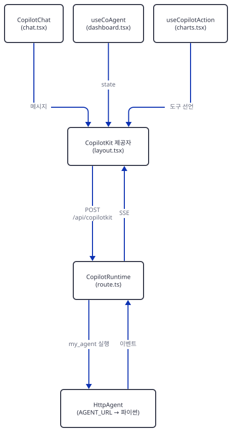

`layout.tsx`가 `CopilotKit` 제공자로 앱 전체를 감싸고 `runtimeUrl="/api/copilotkit"`·`agent="my_agent"`를 줍니다.

`generative_ui_agents/ai-dashboard-canvas-agent/src/app/layout.tsx:28-33`

```tsx
        <CopilotKit
          runtimeUrl="/api/copilotkit"
          agent="my_agent"
          showDevConsole={false}
        >
          {children}
```

`/api/copilotkit`의 처리는 `route.ts`입니다. 모델 어댑터는 비어 있고(`ExperimentalEmptyAdapter`, 에이전트 하나만 쓰므로), `my_agent`라는 이름으로 `HttpAgent`를 등록합니다. 주소는 `AGENT_URL`이고 없으면 `http://localhost:8000/`입니다.

`generative_ui_agents/ai-dashboard-canvas-agent/src/app/api/copilotkit/route.ts:15-22`

```ts
const runtime = new CopilotRuntime({
  agents: {
    // Our FastAPI endpoint URL
    my_agent: new HttpAgent({
      url: process.env.AGENT_URL || "http://localhost:8000/",
    }),
  },
});
```

`HttpAgent`(`@ag-ui/client` 0.0.53)는 실행 요청을 JSON(`threadId`·`runId`·`tools`·`context`·`forwardedProps`·`state`·`messages`)으로 만들어 `Accept: text/event-stream`으로 POST하고(`prepareRunAgentInput`·`requestInit`, 소스로 확인) 받은 이벤트를 다시 화면으로 흘립니다. 구동기의 본문 모양을 이 필드에 맞췄습니다. 이름 `my_agent`는 `layout.tsx`의 `agent="my_agent"`, `useCoAgent`의 `name`과 같아야 합니다.

대시보드의 `useCoAgent`가 에이전트와 상태를 공유하는 부분입니다. 같은 파일에서 화면 도구와 검색 표시를 등록합니다.

`generative_ui_agents/ai-dashboard-canvas-agent/src/components/dashboard/dashboard.tsx:8-15`

```tsx
export function MainLayout({ className }: { className?: string }) {
  const { state, setState } = useCoAgent<AgentState>({
    name: "my_agent",
  });

  // Setup tool rendering and front-end tools
  useChartActions({ state, setState });
  useSearchActions();
```

화면 도구가 승인 카드를 그리는 `ChartCard`는 차트 그리기(`recharts`)와 [Add]·[Cancel] 버튼을 한 컴포넌트에 둡니다(`generative_ui_agents/ai-dashboard-canvas-agent/src/components/dashboard/charts/chart-card.tsx:16-60`). 이 컴포넌트가 채팅 말풍선 안에 그려지는 길은 `AssistantBubble`이 `message.generativeUI?.()`를 부르는 것입니다(`generative_ui_agents/ai-dashboard-canvas-agent/src/components/chat/layout/assistant-message.tsx:26`). 생성 UI(Generative UI)라는 말의 실체가 이것입니다. 모델이 고르는 것은 도구 이름과 인자이고, 어떤 모양의 부품이 그려질지는 화면의 코드가 정합니다.

화면의 코드에서 눈에 띈 것을 적습니다. 모두 소스로 읽은 것이고 실행해 보지는 않았습니다.

- `PinnedMetricCard`의 `onHumanInput`·`status` 속성은 부르는 곳이 없어서 [Add] 버튼 갈래는 쓰이지 않습니다(`generative_ui_agents/ai-dashboard-canvas-agent/src/components/dashboard/metrics/pinnedMetrics.tsx:35-36`, `generative_ui_agents/ai-dashboard-canvas-agent/src/components/dashboard/metrics/pinnedMetrics.tsx:108-116`, 부르는 쪽은 `generative_ui_agents/ai-dashboard-canvas-agent/src/components/dashboard/layout/metrics.tsx:45`).
- 차트 수정 창의 "Steps" 입력은 어디에도 쓰이지 않는 옛 필드입니다(`generative_ui_agents/ai-dashboard-canvas-agent/src/components/dashboard/charts/chart-grid.tsx:104-106`, `generative_ui_agents/ai-dashboard-canvas-agent/src/components/dashboard/charts/chart-grid.tsx:144-153`).
- 차트 [Add]는 `setState({...state, charts: [...]})`로 상태 전체를 새 값으로 덮습니다(`generative_ui_agents/ai-dashboard-canvas-agent/src/components/chat/actions/charts.tsx:84-87`). 승인 카드가 그려진 뒤 에이전트가 상태를 바꾸면 그 변경이 덮일 수 있습니다. 확인하지는 못했습니다.

화면 쪽 통계는 Day 142 Step 6이 자세히 다뤘으니(`copilotkit.gateway.scarf.sh` 호출 포함) 이 앱에서의 요점만 적습니다. 모두 소스로 읽은 것입니다. `route.ts`는 요청마다 `copilotRuntimeNextJSAppRouterEndpoint(...)`를 부르는데(`generative_ui_agents/ai-dashboard-canvas-agent/src/app/api/copilotkit/route.ts:26-30`), 그 안에서 `@copilotkit/runtime` 1.59.2가 `oss.runtime.instance_created` 이벤트를 `telemetryClient.capture`로 보냅니다(`dist/lib/integrations/nextjs/app-router.mjs`). 이 클라이언트(`@copilotkit/shared`)는 기본으로 5% 표본만 `https://telemetry.copilotkit.ai/ingest`와 Segment로 보내고, 보내는 내용은 도구·에이전트 개수와 엔드포인트 종류 같은 설정 요약입니다(`getRuntimeInstanceTelemetryInfo`). `COPILOTKIT_TELEMETRY_DISABLED=true`나 `DO_NOT_TRACK=1`이면 보내지 않습니다. 런타임이 시작할 때 "anonymous telemetry enabled" 한 줄을 로그로 알리는 코드도 있습니다(`telemetry-disclosure.mjs`). 또 의존성 트리에 `@scarf/scarf` 1.4.0이 있는데(잠금 파일), 이 패키지는 `postinstall`로 `report.js`를 돌리고 설치 통계를 `scarf.sh`로 보냅니다. `SCARF_ANALYTICS=false`나 `DO_NOT_TRACK=1`로 끕니다. 의존성의 설치 스크립트를 패키지 관리자가 돌리는지는 도구와 판에 달려 있고 이 문서는 확인하지 못했습니다.

화면을 띄우면 더 있습니다. 모두 소스와 문서로 읽은 것이고 실행하지 않았습니다. 첫째, `next dev`는 Next.js 익명 통계를 보내고(https://nextjs.org/telemetry, `NEXT_TELEMETRY_DISABLED=1`로 끕니다) 기본 호스트가 `0.0.0.0`이라, 에이전트로 이어지는 `/api/copilotkit`이 같은 네트워크에 열립니다(`-H 127.0.0.1`로 막습니다. Day 141 Step 6과 Day 142 Step 6도 적은 점입니다). 둘째, 개발 검사창입니다. `layout.tsx`는 `showDevConsole={false}`만 주는데(`generative_ui_agents/ai-dashboard-canvas-agent/src/app/layout.tsx:28-33`), `@copilotkit/react-core` 1.59.2의 `CopilotKit`은 이 값을 오류 알림에만 쓰고 검사창은 `enableInspector`로 따로 정합니다. 그 값이 없으면 호스트 이름이 `localhost`·`127.0.0.1`·`0.0.0.0`일 때 켜집니다(`shouldShowDevConsole`·`isLocalhost`). 검사창(`@copilotkit/web-inspector` 1.59.2)은 붙을 때 `https://cdn.copilotkit.ai/announcements.json`을 `fetch`합니다. 그러니 `localhost:3000`으로 열면 `showDevConsole={false}`인데도 이 요청이 나갑니다(브라우저로 확인하지는 못했습니다). 끄려면 `layout.tsx`의 `<CopilotKit>`에 `enableInspector={false}`를 더해야 하고, 이것은 원본 코드를 고치는 일이라 이 문서는 하지 않았습니다.

앱 README의 실행 명령은 아래와 같습니다. **이 문서는 이 명령을 실행하지 않았습니다.**

```bash
cd generative_ui_agents/ai-dashboard-canvas-agent
pnpm install
pnpm install:agent
cp .env.example .env
pnpm run dev
```

`pnpm run dev`는 `next dev --turbopack`(포트 3000)과 앞서 본 `server.py`를 함께 띄웁니다. 그러니 이 명령을 그대로 쓰면 에이전트가 `0.0.0.0`에 열리고(Step 4) 진짜 키로 Google에 요청이 갑니다. 화면을 직접 띄워 보려면 `dev`가 아니라 `dev:ui`만 쓰고, 설치 스크립트와 통계를 끄고, 호스트를 막습니다(`--` 뒤 인자는 `next`로 갑니다). 에이전트는 이 문서의 `serve_local.py`로 루프백에 띄우고 `AGENT_URL`이 그곳을 가리키게 합니다.

```bash
export NEXT_TELEMETRY_DISABLED=1 COPILOTKIT_TELEMETRY_DISABLED=true SCARF_ANALYTICS=false DO_NOT_TRACK=1
pnpm install --ignore-scripts
AGENT_URL=http://127.0.0.1:56219/ pnpm run dev:ui -- -H 127.0.0.1
```

`--ignore-scripts`는 루트의 `postinstall`(파이썬 의존성 설치)과 `@scarf/scarf`의 설치 스크립트를 함께 건너뜁니다. 검사창은 위처럼 코드를 고치지 않으면 `localhost`에서 켜집니다. 화면을 가짜 서버로 돌리면 모델 대본이 이 문서의 것이어서 화면이 실제 모델처럼 움직이지는 않습니다. 이 조합도 시험하지 않았습니다.

앱 README의 "Lockfiles … are gitignored"는 사실이 아닙니다. 폴더에는 `pnpm-lock.yaml`이 올라와 있고 `.gitignore`가 막는 것은 `package-lock.json`·`yarn.lock`·`bun.lockb`뿐입니다. 앱의 `AGENTS.md`는 `eslint.config.mjs`와 `NEXT_PUBLIC_CPK_ENDPOINT`를 말하지만 이 폴더에는 그런 파일도 변수를 쓰는 코드도 없습니다(`grep`, 문서로만 읽었습니다).

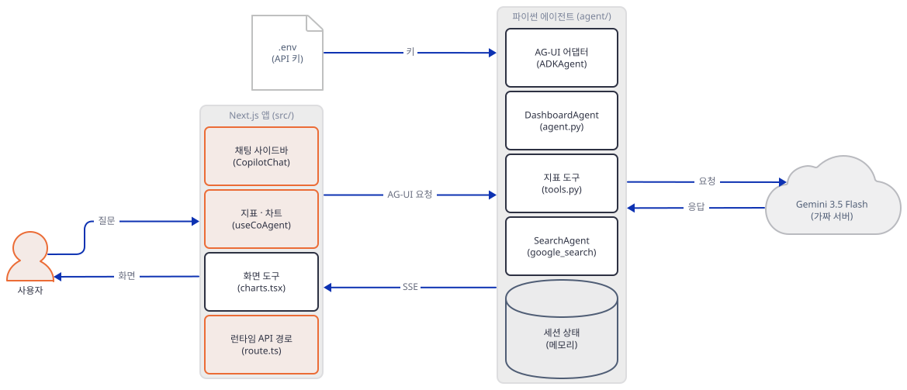

**확인.** 이 Step은 소스를 읽는 것이라 실행 확인이 없습니다. 위 파일을 열어 `agent="my_agent"`가 `layout.tsx`·`route.ts`·`dashboard.tsx`에서 같은지 봅니다. 마지막으로 실습을 끝내고 서버를 멈춥니다(각 터미널에서 Ctrl+C). 아래가 아무것도 내지 않아야 합니다.

```bash
netstat -ano | grep -E ":5621[789] " | grep LISTENING
```

(PowerShell: `netstat -ano | Select-String "LISTENING" | Select-String ":5621[789]"`, 실행해 보지 못했습니다.) `canvas-work/fake`에는 가짜 서버의 기록만 있고, 앱은 디스크에 아무것도 쓰지 않았습니다(원본 폴더 `git status`가 비어 있음).

## 요청 한 건이 흐르는 과정

"다시 만들기" 한 번을 코드의 순서대로 따라갑니다. 브라우저와 런타임 사이의 메시지는 소스에서 읽은 것이고 이 문서가 실행한 것은 어댑터 이하입니다. 같은 메시지는 처음 나오는 한 그림에만 있고, 그림 여섯 장이 이어집니다. 이벤트는 어댑터가 만드는 대로 런타임을 거쳐 화면에 흐르므로 `adk -> rt`마다 `rt -> ui` 중계를 짝으로 그렸습니다. 이벤트와 모델 호출 사이의 정확한 선후는 가짜 서버의 요청 순서와 이벤트 출력(Step 5)에서 읽을 수 있는 만큼만 따랐습니다.

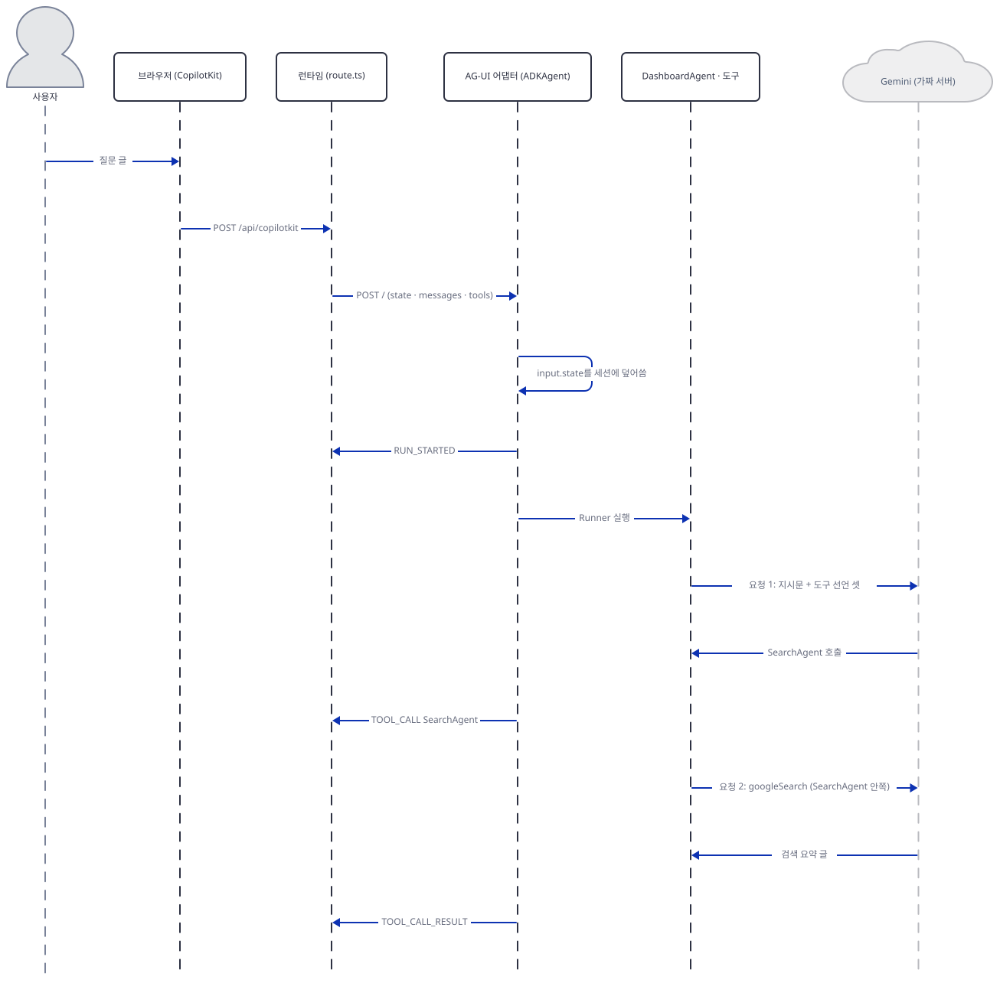

사용자의 글이 `CopilotChat`을 거쳐 `POST /api/copilotkit`가 되고, 런타임이 `HttpAgent`로 파이썬 서버의 `POST /`에 실행 요청을 새로 만들어 보냅니다(소스로 읽음. 브라우저와 런타임 사이의 본문은 CopilotKit의 것이고, 이 문서가 맞춘 것은 `HttpAgent`가 파이썬 쪽으로 보내는 본문뿐입니다). 어댑터는 요청의 `state`를 세션에 덮어쓰고 `RUN_STARTED`를 내보낸 뒤 `Runner`로 `DashboardAgent`를 돌립니다. 첫 모델 호출은 지침과 도구 선언 셋을 실어 가고, 모델은 `SearchAgent`를 부릅니다. 화면은 그 호출을 받는 대로 "검색 중" 카드를 그립니다(`search.tsx`).

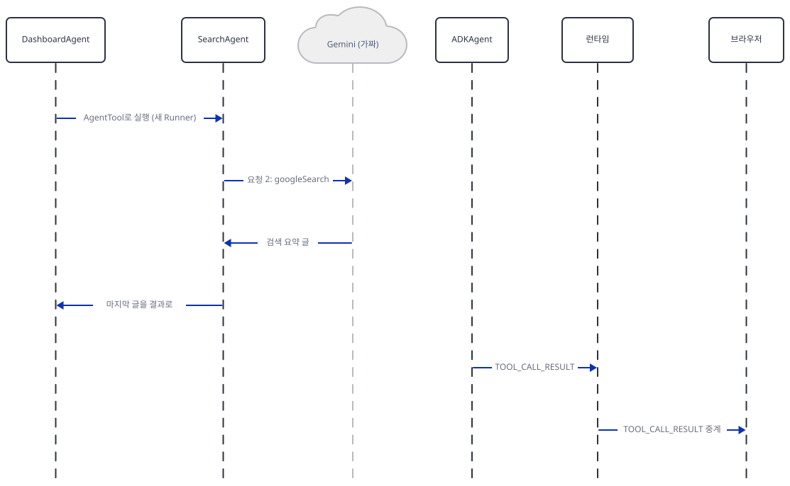

`AgentTool`이 새 `Runner`로 `SearchAgent`를 돌리고(Day 021), 안쪽 모델 호출(`googleSearch`)이 요약 글을 받아 옵니다. 그 글이 `DashboardAgent`에게 결과로 가고, 어댑터는 `TOOL_CALL_RESULT`를 화면에 흘립니다.

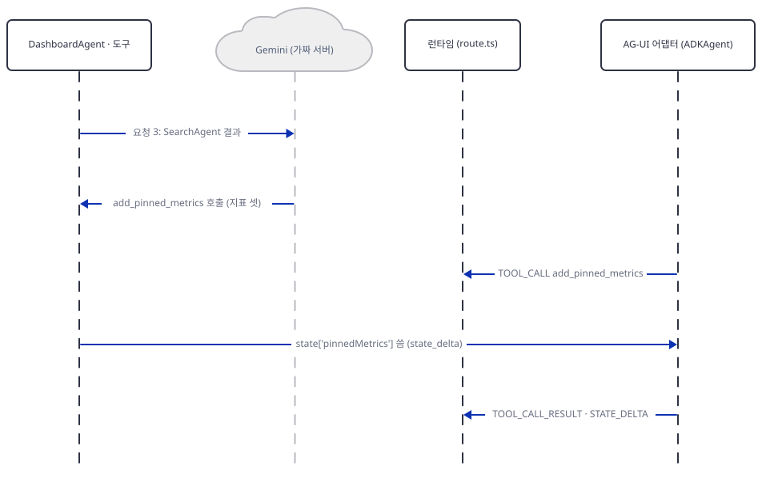

검색 결과를 받은 세 번째 요청에서 모델이 `add_pinned_metrics`를 부르고 그 호출이 화면에 흐릅니다.

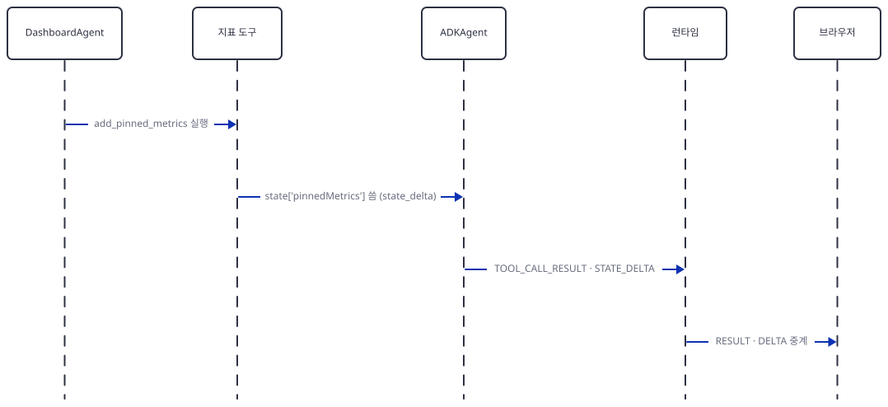

지표 도구가 세션 상태에 `pinnedMetrics`를 쓰면 ADK가 상태 변경 이벤트를 내고, 어댑터가 도구 결과와 `STATE_DELTA`로 바꿔 화면에 보냅니다.

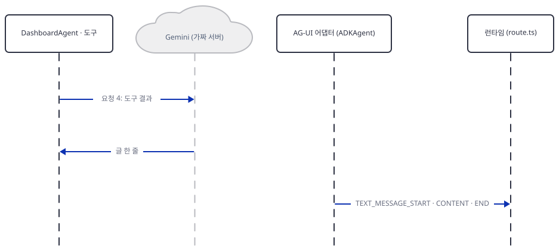

도구 결과를 받은 네 번째 요청에서 모델이 글 한 줄을 돌려주고, `after_model`이 글 응답 뒤의 호출을 끝냅니다(`end_invocation`). 글은 `TEXT_MESSAGE_*`로 화면에 갑니다.

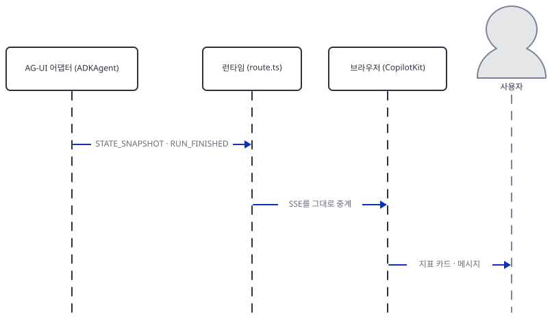

마지막으로 어댑터가 전체 상태를 `STATE_SNAPSHOT`으로, 이어서 `RUN_FINISHED`로 보냅니다. 런타임은 둘을 그대로 브라우저에 넘기고(소스로 읽음, 이 문서는 실행하지 않았음) `useCoAgent`의 상태가 바뀌면서 지표 카드가 그려집니다. 화면이 처음 한 번 `{}`에서 시작해 상태가 채워지는 것이 "캔버스에 쓴다"는 말의 전부입니다.

## 실행 체크리스트

- [ ] `canvas-work`에서 `uv pip install`이 끝났고 `uv pip list`에 `google-adk 2.12.0`·`ag-ui-adk 0.9.0`이 보입니다(Step 1).
- [ ] 터미널 A·B·C가 모두 `envfake.sh`를 읽었고 첫 줄에 `GOOGLE_API_KEY=fake-k`가 보입니다.
- [ ] 가짜 서버(56217)와 앱 서버(56218)가 `127.0.0.1`에만 열려 있습니다(`netstat`에 `0.0.0.0` 없음).
- [ ] `show_decl.py`가 같은 id를 두 번 더하면 2개가 된다고 보입니다(Step 2).
- [ ] `drive.py plain`이 `RUN_STARTED`~`RUN_FINISHED`와 `STATE_DELTA`·`STATE_SNAPSHOT`을 보이고, 가짜 서버가 요청 넷을 기록했습니다(Step 5).
- [ ] 첫 요청의 시스템 지침에서 `State object at 0x…`와 `_ag_ui_*` 키를 확인했습니다.
- [ ] 원본 에이전트에서는 `add_chart`가 호출되지 않고(`add_chart 호출 없음`), `agent_patched`에서는 호출되어 둘째 실행 뒤 차트가 상태에 남습니다(Step 6).
- [ ] `envfake.sh` 없이 `serve_local.py`를 돌리면 `check_env 실패`와 종료 코드 1로 끝납니다(Step 4).
- [ ] 마지막에 서버 둘(셋)이 멈췄고 포트가 비었습니다.

## 문제 해결

| 증상 | 원인 | 해결 |
|---|---|---|
| `check_env 실패: GOOGLE_GEMINI_BASE_URL의 호스트가 루프백이 아님`·`GOOGLE_API_KEY가 가짜 값이 아님` | 이 터미널이 `envfake.sh`를 읽지 않았거나, 셸·`.env`의 진짜 값이 이겼음 | `. ./envfake.sh`를 읽고 다시 합니다. 검사를 건너뛰고 서버를 띄우지 않습니다(직접 확인) |
| 서버 로그의 `Frontend tools [...] were sent with this run but the agent tree has no AGUIToolset`이고 모델이 차트 도구를 부르지 않음 | 에이전트의 `tools`에 `AGUIToolset()`이 없음. ag-ui-adk 0.5.0부터 필요 | `agent/agent.py`의 도구 목록에 `AGUIToolset()`을 더합니다(Step 6의 `patch_agui.py`가 하는 일, 직접 확인) |
| `ag-ui-adk==0.4.2`로 내리면 `ImportError: cannot import name 'ThinkingStartEvent' from 'ag_ui.core'` | 0.4.2가 `ag-ui-protocol` 1.0에 없는 이름을 가져옴 | `ag-ui-protocol<1.0`도 함께 설치합니다. 그래도 둘째 요청이 `Function call not found for function response ids`로 실패했습니다(직접 확인). 판을 내리는 길은 권하지 않습니다 |
| 첫 요청의 시스템 지침 맨 위가 `Current dashboard: <google.adk.sessions.state.State object at 0x…>` | `before_model`이 `State` 객체를 f-string에 그대로 넣음(`generative_ui_agents/ai-dashboard-canvas-agent/agent/modifiers.py:19`) | 상태가 필요하면 `dict(callback_context.state)`나 JSON으로 바꿔 넣어야 합니다. 이 문서는 고치지 않았습니다(원본 코드) |
| 모델이 `add_charts`·`set_chart_data`를 부르려 함(진짜 모델에서 생길 수 있는 증상, 이 문서는 본 적 없음) | 지침이 없는 도구 이름을 말함(`generative_ui_agents/ai-dashboard-canvas-agent/agent/instructions.py:26`) | 지침의 이름을 `add_chart`·`update_chart`·`delete_chart`로 맞춥니다 |
| `python server.py`나 `pnpm run dev`로 띄운 에이전트가 같은 네트워크의 다른 기기에서 열림(본 증상이 아니라 소스로 읽은 예방 안내이고 이 문서는 띄워 보지 않았습니다) | `host="0.0.0.0"`(`generative_ui_agents/ai-dashboard-canvas-agent/agent/server.py:28`) | `serve_local.py`처럼 `127.0.0.1`로 띄웁니다. 원본 줄은 고치지 않았습니다 |
| `pip install`이 3.8·3.9·3.10에서 `google-adk`를 못 찾음(메타데이터로 읽은 것이고 그 판으로 설치해 보지는 않았습니다) | `google-adk`의 `Requires-Python >=3.11` | 3.11 이상으로 가상환경을 만듭니다. 앱 README의 "Python 3.8+"는 맞지 않습니다 |
| 서버를 껐다 켜자 대시보드가 비어 있음(소스로 읽은 것이고 재시작해 보지는 않았습니다) | `use_in_memory_services=True`라 세션이 메모리에만 있음(`generative_ui_agents/ai-dashboard-canvas-agent/agent/agent.py:52`) | 화면이 열려 있으면 다음 요청에 자기 상태를 다시 실어 보냅니다. 영구 저장이 필요하면 ADK의 세션 서비스를 따로 붙여야 합니다 |

## 더 해보기

1. `agent_patched/agent.py`의 `SearchAgent`와 `DashboardAgent`가 같은 모델을 쓰는 곳(`generative_ui_agents/ai-dashboard-canvas-agent/agent/agent.py:24`, `generative_ui_agents/ai-dashboard-canvas-agent/agent/agent.py:34`)을 환경변수로 바꿔, 가짜 서버가 받는 `model`이 바뀌는지 `show_log.py`로 확인해 보세요.
2. `before_model`이 상태 객체의 이름 대신 내용을 보내도록 복사본의 `generative_ui_agents/ai-dashboard-canvas-agent/agent/modifiers.py:19`를 고치고, 지침에 상태가 두 번 들어가는 것이 모델의 입력을 얼마나 늘리는지(`system` 글자 수) 재 보세요.
3. `add_pinned_metrics`가 같은 `id`를 건너뛰도록 복사본의 `generative_ui_agents/ai-dashboard-canvas-agent/agent/tools.py:16-17`을 고치고 `show_decl.py`의 첫 줄이 1로 바뀌는지 보세요.

## 다음 날 예고

[Day 145 · ✈️ MCP Apps Generative UI Showcase](../day145-genui-mcp-apps-generative-ui-showcase/README.md) — 오늘은 파이썬 에이전트가 있었지만 내일 앱 `generative_ui_agents/mcp-apps-generative-ui-showcase`는 파이썬이 없고 TypeScript만 있습니다(12,584줄, 추적 파일에서 잠금 파일과 이미지를 뺀 `wc -l` 합). Next.js 화면(`generative_ui_agents/mcp-apps-generative-ui-showcase/src/app/page.tsx` 343줄)과 `mcp-server/`의 MCP 서버(`generative_ui_agents/mcp-apps-generative-ui-showcase/mcp-server/server.ts` 1,136줄)로 이루어지고, 앱 README는 MCP 도구가 `_meta["ui/resourceUri"]`로 가리킨 HTML 앱을 채팅 안의 샌드박스 iframe으로 띄운다고 소개합니다. 오늘 화면 도구가 "화면의 코드가 부품을 정한다"였다면 내일은 도구를 가진 서버가 화면 조각(HTML)까지 함께 보냅니다. 모델·키는 `generative_ui_agents/mcp-apps-generative-ui-showcase/src/app/api/copilotkit/[[...slug]]/route.ts`의 `OPENAI_API_KEY`가 있을 때 OpenAI를 고르는 것으로 보입니다(17~19행). 실행할 수 있는 것이 거의 없어 소스를 읽는 날입니다.
