# Day 145 · ✈️ MCP Apps Generative UI Showcase

> 볼륨 12 🖼️ Generative UI · 난이도 ★★★ ⚠ 앱 화면도 서버도 실행하지 않은 날입니다. 소스와 내려받은 패키지 압축 파일을 읽고, 읽은 내용을 `grep`과 작은 Node 스크립트로 확인합니다. 앱이 보내는 크기 알림 이름(`size-change`)이 읽은 호스트가 듣는 이름(`size-changed`)과 달라 보이는데, 화면으로 보지는 못했습니다(Step 5) · 예상 소요 165분(실행할 앱이 없어 손으로 돌려 보는 일은 적지만, 읽어야 하는 소스가 앱 파일 여섯 개에 패키지 여럿의 소스맵까지 이어지고, 같은 요청이 브라우저·런타임·MCP 서버를 세 번씩 오가서 한 줄씩 따라가야 하며, 마지막 Step에서 바깥으로 나가는 길을 막는 확인 스크립트를 저장해 돌려 보고 읽기 때문입니다) · API 비용 대략 이 문서의 따라 하기는 $0(앱을 띄우지 않으니 모델은 한 번도 부르지 않습니다). 진짜 키로 앱을 돌린다면 질문 한 번에 모델 호출이 한 번이고 어림으로 $0.01~0.05입니다(⚠ 추정, 아래 Step 4) · 원본 앱: `generative_ui_agents/mcp-apps-generative-ui-showcase`

## 오늘 만들 것

채팅 사이드바에서 "JFK에서 LAX로 1월 20일에 두 명 예약해 줘"라고 하면 대화 안에 항공권 예약 마법사가 뜨는 앱입니다. 마법사는 항공편 검색, 항공편 선택, 좌석 선택, 승객 정보, 예약 확인의 다섯 단계이고, 호텔 예약·투자 시뮬레이터·칸반 보드까지 모두 네 가지 앱이 있습니다. 앱 README는 이것을 "sandboxed in-chat apps over a tool protocol"이라고 부릅니다. 지난 날들의 생성 UI는 화면 쪽 코드가 부품을 정하고 에이전트가 거기에 값을 채우는 모양이었다면, 오늘은 **도구를 가진 서버가 화면 조각(HTML 한 장)까지 함께 줍니다.** MCP 서버의 도구가 `_meta["ui/resourceUri"]`로 HTML 자원을 가리키고, CopilotKit이 그것을 채팅 안 iframe으로 띄우며, iframe 안의 앱은 `postMessage`로 도구를 직접 부릅니다. 이 약속이 MCP Apps Extension(SEP-1865)입니다.

이 문서는 앱을 실행하지 않았습니다. 앱은 파이썬 쪽이 없고 TypeScript만 있습니다. `npm install`·`pnpm install`·`npx`·`next`·`vite`는 한 번도 실행하지 않았고, 원본 README의 설치 명령은 아래 Step 1에 그대로 보여 드릴 뿐 이 문서는 그 명령을 실행하지 않았습니다. 대신 앱이 의존하는 세 패키지(`@ag-ui/mcp-apps-middleware` 0.0.3, `@copilotkit/react-core` 1.59.2, `@copilotkit/runtime` 1.59.2)를 npm 레지스트리에서 압축 파일로 `curl`로 받아 풀기만 하고, 패키지에 들어 있는 소스맵에서 원래 소스를 꺼내 읽었습니다. 브라우저로 화면을 연 적도 없습니다. 그래서 마법사가 실제로 어떻게 보이는지, 높이가 맞는지, 진짜 `gpt-5.5`가 네 도구 가운데 무엇을 고르는지는 보여 드리지 못합니다. 이 문서에서 "직접 확인"은 Step마다 있는 `grep`·`wc`·Node 스크립트의 출력을 말하고, 나머지는 "소스로 확인"입니다.

앞 날과 이어지는 곳은 이렇습니다. Next.js와 Node 쪽을 소스로만 읽는 방식은 [Day 124](../day124-ai-travel-planner-agent-team/README.md)가 다뤘습니다. CopilotKit 런타임의 `route.ts`와 AG-UI 이벤트는 [Day 143](../day143-genui-generative-ui-starter-project/README.md)이 파이썬 에이전트 쪽에서 다뤘고, 그 날 Step 8에는 런타임 설정 `mcpApps`가 MCP 앱을 켠다는 말이 나옵니다. 오늘은 같은 일을 설정 옵션이 아니라 `@ag-ui/mcp-apps-middleware`라는 미들웨어를 직접 끼워서 합니다. MCP를 HTTP로 붙이는 클라이언트는 [Day 130](../day130-openai-remote-mcp-bridge/README.md)이 파이썬(`streamable_http_client`)으로 다뤘고, 오늘은 같은 프로토콜을 TypeScript 서버와 TypeScript 클라이언트로 봅니다. 새로 나오는 것은 세 가지입니다. 도구가 화면 조각을 가리키는 약속(`ui/resourceUri`), 그 조각을 가두는 이중 iframe, 그리고 iframe이 모델을 거치지 않고 도구를 부르는 우회 경로입니다.

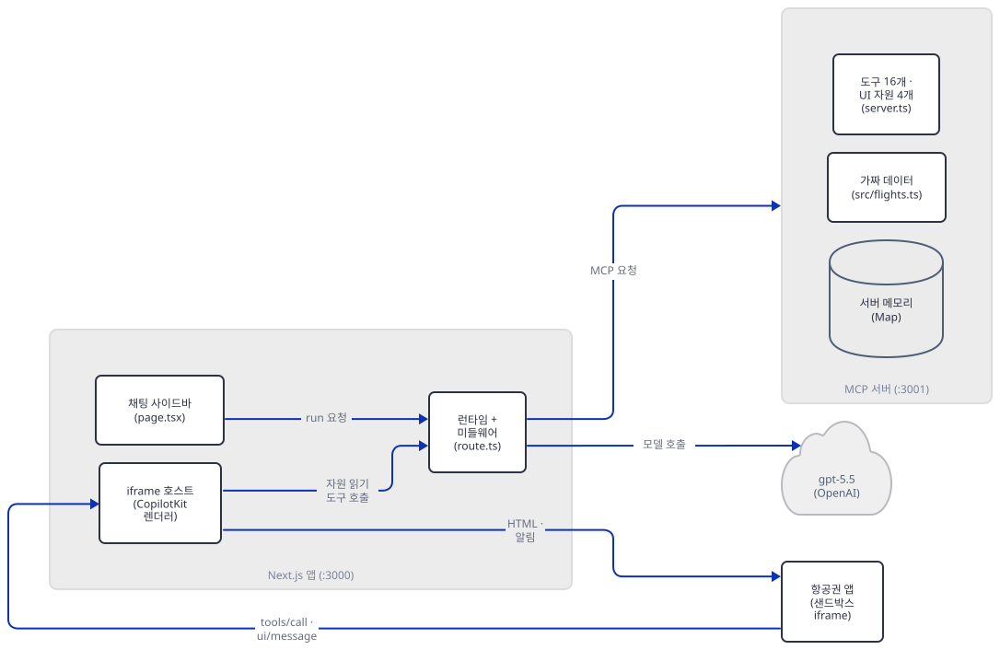

그림이 한 장에 담기 어려워 보조 구조 그림이 따로 있습니다. 사용자와 앱의 관계는 Step 5의 `extra-sandbox`, MCP 서버 안의 관계는 Step 3의 `extra-server`, 모델 경로와 iframe 경로는 Step 4의 `extra-tools`, 바깥으로 나가는 요청은 Step 7의 `extra-outbound`입니다. 런타임에서 MCP 서버로 가는 화살표는 서버 묶음 전체로 갑니다. 앱 iframe은 브라우저 안에서 도는 것이지만 믿는 범위가 달라 묶음 밖에 그렸습니다.

직접 읽어서 알게 된 것이 여덟입니다. 첫째, 모델에게 보이는 도구는 MCP 서버의 도구 열여섯 가운데 `ui/resourceUri`가 달린 네 개뿐입니다. 시스템 프롬프트가 이름을 대는 도우미 도구 열둘은 모델에게 주어지지 않고 iframe만 부릅니다(Step 4). 둘째, 모델은 질문 한 번에 한 번 불리고, 마법사 안의 클릭은 모델을 거치지 않고 런타임의 "프록시 요청" 길로 MCP 서버에 갑니다(Step 4·6). 셋째, 미들웨어는 MCP 연결을 요청마다 새로 맺고 닫습니다. 질문 하나에 두 번(앱을 띄우는 자원 읽기까지 세 번), 서버는 연결마다 HTML 네 장을 디스크에서 다시 읽습니다(Step 2·4). 넷째, 항공편·호텔·종목은 모두 지어낸 데이터이고 서버 메모리에만 있습니다(Step 3). 다섯째, iframe의 `sandbox` 속성은 `allow-scripts allow-same-origin`을 함께 켜 둡니다. 사양은 호스트와 샌드박스의 출처가 달라야 한다고 적는데, 이 구현은 `srcdoc`으로 만들어 HTML 규격상 호스트 페이지와 같은 출처가 되고, 안쪽 앱의 스크립트는 채팅 페이지에도 닿습니다(Step 5). 여섯째, `postMessage`는 양쪽 모두 `"*"`로 보내고 `event.origin`을 보지 않습니다. 호스트와 프록시는 보낸 창(`event.source`)만 보고, 앱은 그것도 보지 않습니다(Step 5·6). 일곱째, 앱이 보내는 크기 알림 이름과 호스트가 듣는 이름이 한 글자 다릅니다(Step 5). 여덟째, MCP 서버는 모든 네트워크 인터페이스에 열리고 CORS가 `*`이며 인증이 없고, 설치와 화면 검사창까지 합치면 바깥으로 나가는 요청이 다섯 갈래입니다(Step 7).

## 사전 준비

| 서비스/도구 | 용도 | 발급·설치 |
|---|---|---|
| Node.js 18 이상 | 이 문서의 읽기 스크립트(`unmap.mjs`·`count.mjs`)용(내장 모듈만 씁니다). **앱 자체는 설치도 실행도 하지 않았습니다.** 앱을 돌리려면 더 높은 버전이 필요합니다. 앱 README는 Node 버전을 적지 않습니다. `next@16.1.1`의 `engines`는 `>=20.9.0`, `vite@7.3.1`은 `^20.19.0 \|\| >=22.12.0`입니다(npm 레지스트리 메타데이터로 직접 확인). `mcp-server/.nixpacks`의 `NODE_VERSION=20.18.1`은 vite의 하한보다 낮습니다 | https://nodejs.org |
| `curl`·`tar`·`grep` | 패키지 압축 파일을 받아 풀고 소스를 검색 | Git Bash에 들어 있음 |
| OpenAI API 키 | **이 문서는 쓰지 않습니다.** 앱을 진짜로 돌릴 때만 필요합니다 | https://platform.openai.com/api-keys |

명령은 Git Bash 기준입니다. PowerShell 줄은 실행해 보지 못했습니다(이 문서를 쓴 하네스가 PowerShell 실행을 막습니다). 이 문서의 어떤 명령도 API 키를 읽거나 서버를 띄우지 않습니다. 셸에 진짜 키가 있어도 닿는 곳은 `registry.npmjs.org` 하나이고, 받은 압축 파일은 풀기만 합니다(설치 스크립트가 없습니다).

**이 앱의 모델이 아직 살아 있는지.** 키가 있으면 앱은 `openai/gpt-5.5`를 씁니다(`generative_ui_agents/mcp-apps-generative-ui-showcase/src/app/api/copilotkit/[[...slug]]/route.ts:18-29`). OpenAI 폐기 문서(https://developers.openai.com/api/docs/deprecations)와 모델 페이지(https://developers.openai.com/api/docs/models/gpt-5.5)를 2026-10-16에 원문으로 읽었습니다. 폐기 문서에 `gpt-5.5`와 그 스냅숏은 올라 있지 않고, 모델 페이지는 기본 스냅숏을 `gpt-5.5-2026-04-23`, Chat Completions와 Responses를 지원으로 적습니다. 가격은 입력 $5, 캐시 입력 $0.5, 출력 $30(100만 토큰당)입니다. OpenAI 키가 없을 때 고르는 `anthropic/claude-sonnet-4-6`은 Anthropic 폐기 문서(https://platform.claude.com/docs/en/about-claude/model-deprecations)에서 Active, 퇴역은 2027-02-17보다 빠르지 않다고 적혀 있고, `google/gemini-3.1-pro-preview`는 Google 폐기 문서(https://ai.google.dev/gemini-api/docs/deprecations)에 종료일이 없다고 올라 있습니다. 비용 어림(⚠ 추정)은 Step 4에 있습니다.

## 아키텍처 한눈에 보기

| 컴포넌트 | 역할 | 코드 위치 |
|---|---|---|
| 채팅 페이지 (`page.tsx`) | `CopilotKitProvider`와 사이드바. 예시 문구 단추가 메시지를 넣고 에이전트를 돌림 | `generative_ui_agents/mcp-apps-generative-ui-showcase/src/app/page.tsx:160-188` |
| 런타임 (`route.ts`) | 모델 고르기, 시스템 프롬프트, `MCPAppsMiddleware`, `/api/copilotkit` 엔드포인트 | `generative_ui_agents/mcp-apps-generative-ui-showcase/src/app/api/copilotkit/[[...slug]]/route.ts:18-93` |
| MCP 서버 (`server.ts`) | 도구 열여섯, UI 자원 넷, `/mcp`(Streamable HTTP)와 `/health` | `generative_ui_agents/mcp-apps-generative-ui-showcase/mcp-server/server.ts:98-1136` |
| 항공권 데이터 (`flights.ts`) | 공항 15·항공사 6, 검색·좌석·예약을 난수로 짓고 `Map`에 담음 | `generative_ui_agents/mcp-apps-generative-ui-showcase/mcp-server/src/flights.ts:176-667` |
| 앱 HTML (`flights-app.html` 외 셋) | 마법사 화면과 `postMessage` 통신 모듈. Vite 단일 파일로 묶여 `apps/dist/`에서 서빙됨 | `generative_ui_agents/mcp-apps-generative-ui-showcase/mcp-server/apps/flights-app.html:1096-1786` |
| 호스트 렌더러 (`MCPAppsActivityRenderer`) | 자원을 받아 이중 iframe에 넣고 JSON-RPC를 중개. 앱 저장소 밖(`@copilotkit/react-core` 1.59.2) | 소스로 확인(소스맵) |
| 미들웨어 (`MCPAppsMiddleware`) | UI 도구만 골라 모델에 주고, 모델이 부른 도구를 대신 실행하고, iframe의 요청을 MCP 서버로 전달. 앱 저장소 밖(`@ag-ui/mcp-apps-middleware` 0.0.3) | 소스로 확인(소스맵) |

폴더에서 눈여겨볼 점이 둘 있습니다. `public/sandbox.html`(101줄)은 이중 iframe의 프록시 페이지와 같은 구조의 파일인데, 앱 코드 어디에서도 가리키지 않고 `@copilotkit/react-core` 소스에도 `sandbox.html`이라는 이름이 없습니다(Step 5). 이름과 문구에는 템플릿 흔적이 남아 있습니다. `generative_ui_agents/mcp-apps-generative-ui-showcase/src/app/layout.tsx:17`의 페이지 제목은 "AI Fitness Coach"이고, 앱 README 7행은 존재하지 않는 도구 `workout-generator`를 예로 들며, `generative_ui_agents/mcp-apps-generative-ui-showcase/mcp-server/apps/vite.config.ts:5`의 기본 빌드 대상은 `fitness-app`입니다.

## 단계별 진행

### Step 1. 읽을 준비 — 실행하지 않는 명령과 받아서 풀 패키지

**목적.** 이 앱이 프로세스 둘(Next.js 3000, MCP 서버 3001)이라는 것을 확인하고, 앱 README의 설치 명령을 실행하지 않는 까닭을 밝히고, 읽을 세 패키지의 소스를 꺼냅니다.

**할 일.** 원본 앱 README가 알려 주는 실행 순서는 이렇습니다(`generative_ui_agents/mcp-apps-generative-ui-showcase/README.md:46-54`, 앞뒤의 코드 펜스 줄은 뺐습니다).

```bash
# Terminal 1: Build and run MCP Server
cd mcp-server
npm run build
npm run dev
# Server runs at http://localhost:3001/mcp

# Terminal 2: Run Next.js Frontend (from mcp-apps directory)
npm run dev
# Frontend at http://localhost:3000
```

이 문서는 위 명령도, 그 앞의 `npm install`도 실행하지 않았습니다. 까닭은 셋입니다. 루트에는 `pnpm-lock.yaml`만 있고 `package-lock.json`이 없어서 `npm install`은 잠금 없이 새로 풉니다. 의존성이 많습니다. `pnpm-lock.yaml`의 `packages:` 절은 788개 항목(제가 센 값)이고 `mcp-server/package-lock.json`은 176개입니다. 그중 `esbuild`(0.27.2)는 `hasInstallScript`가 켜져 있어 설치 때 스크립트가 돌고, 루트 쪽에서는 `@copilotkit/react-core`·`@copilotkit/runtime`이 끌어오는 `@scarf/scarf` 1.4.0의 `postinstall`(`node ./report.js`)이 `scarf.sh`로 설치 통계를 보냅니다(소스로 확인, 끄는 변수는 Step 7). 그리고 `npm run build`가 부르는 `build:app`(`generative_ui_agents/mcp-apps-generative-ui-showcase/mcp-server/package.json:17`)은 `rm -rf dist && BUILD_APP=flights-app vite build`처럼 POSIX 셸 문법입니다. npm 문서(`script-shell` 설정)의 원문은 기본값이 POSIX에서 `/bin/sh`, Windows에서 `cmd.exe`라고 적으므로, Windows에서는 Git Bash 안에서 `npm run`을 불러도 이 줄이 `cmd.exe`에서 돌아 `BUILD_APP=…`에서 막힐 것으로 읽힙니다. 실행하지 않아 확인하지는 못했습니다. 처방은 Step 7에 있습니다.

이제 읽을 패키지를 받습니다. `<저장소>`는 이 저장소를 받은 경로입니다. 저장소 밖 아무 폴더에서 시작합니다.

```bash
mkdir genui-read
cd genui-read
APP=<저장소>/generative_ui_agents/mcp-apps-generative-ui-showcase
mkdir pkg
for spec in "@ag-ui/mcp-apps-middleware/-/mcp-apps-middleware-0.0.3" "@copilotkit/react-core/-/react-core-1.59.2" "@copilotkit/runtime/-/runtime-1.59.2"; do
  name=$(basename "$spec")
  mkdir "pkg/$name"
  curl -sSfL -o "pkg/$name.tgz" "https://registry.npmjs.org/$spec.tgz"
  tar -xzf "pkg/$name.tgz" -C "pkg/$name"
done
ls pkg
```

```powershell
mkdir genui-read
cd genui-read
$APP = "<저장소>\generative_ui_agents\mcp-apps-generative-ui-showcase"
mkdir pkg
foreach ($spec in "@ag-ui/mcp-apps-middleware/-/mcp-apps-middleware-0.0.3", "@copilotkit/react-core/-/react-core-1.59.2", "@copilotkit/runtime/-/runtime-1.59.2") {
  $name = Split-Path $spec -Leaf
  mkdir "pkg\$name"
  curl.exe -sSfL -o "pkg\$name.tgz" "https://registry.npmjs.org/$spec.tgz"
  tar -xzf "pkg\$name.tgz" -C "pkg\$name"
}
ls pkg
```

(`npm pack`이나 `npm install`로도 받을 수 있지만 둘 다 npm을 실행하는 길이라 쓰지 않았습니다. 이 문서는 `curl`로만 받았습니다.) 이 패키지들은 번들되어 있어 소스가 `dist/*.mjs`에 한 줄로 뭉쳐 있습니다. 대신 `.map` 파일의 `sourcesContent`에 원래 TypeScript가 들어 있으니 그것을 꺼내는 스크립트를 저장합니다.

```bash
cat > unmap.mjs <<'EOF'
// 소스맵의 sourcesContent를 이어 붙여 출력한다. JSON을 읽기만 하고 아무것도 실행하지 않는다.
import { readFileSync } from "node:fs";

const map = JSON.parse(readFileSync(process.argv[2], "utf8"));
map.sources.forEach((src, i) => {
  console.log("=== " + src);
  console.log(map.sourcesContent[i]);
});
EOF
node unmap.mjs pkg/mcp-apps-middleware-0.0.3/package/dist/index.mjs.map > mw.txt
node unmap.mjs pkg/react-core-1.59.2/package/dist/copilotkit-B5RsC6la.mjs.map > rc.txt
node unmap.mjs pkg/runtime-1.59.2/package/dist/agent/index.mjs.map > agent.txt
sed -n '4021,4837p' rc.txt > host.txt
```

`host.txt`는 `rc.txt`에서 `MCPAppsActivityRenderer.tsx` 한 파일만 잘라 낸 것입니다. 이 줄 범위는 위 `.map` 파일에서만 맞습니다.

**확인.** 압축 파일이 풀렸고 소스가 나왔는지 봅니다.

```bash
ls pkg
wc -l mw.txt rc.txt agent.txt host.txt
grep -c "" "$APP/src/app/page.tsx" "$APP/mcp-server/server.ts" "$APP/mcp-server/src/flights.ts"
```

```text
mcp-apps-middleware-0.0.3
mcp-apps-middleware-0.0.3.tgz
react-core-1.59.2
react-core-1.59.2.tgz
runtime-1.59.2
runtime-1.59.2.tgz
   615 mw.txt
 19162 rc.txt
  1745 agent.txt
   817 host.txt
 22339 total
/…/page.tsx:343
/…/server.ts:1136
/…/flights.ts:667
```

(앞 줄 경로는 줄여 적었습니다. `ls`는 환경에 따라 순서가 다를 수 있습니다.)

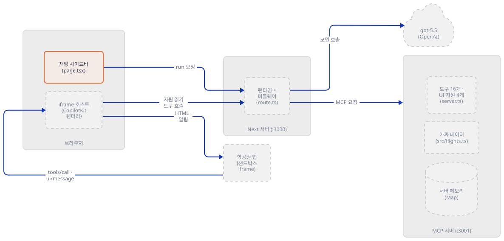

### Step 2. MCP 서버 — 도구가 화면 조각을 가리키는 법

**목적.** 서버가 도구 열여섯과 HTML 자원 넷을 어떻게 등록하는지, 도구와 자원이 어떻게 이어지는지 읽습니다.

**할 일.** 서버는 `@modelcontextprotocol/sdk` 1.25.2의 `McpServer`로 도구를 등록합니다(`generative_ui_agents/mcp-apps-generative-ui-showcase/mcp-server/server.ts:98-105`). 자원 등록은 헬퍼 하나가 하고, 항공권 자원은 `generative_ui_agents/mcp-apps-generative-ui-showcase/mcp-server/server.ts:133-143`입니다.

```ts
  const flightsResource = registerResource(
    {
      name: "flights-app-template",
      uri: "ui://flights/flights-app.html",
      title: "Airline Booking",
      description:
        "Interactive flight search and booking wizard with seat selection",
      mimeType: "text/html+mcp",
    },
    flightsAppHtml,
  );
```

`mimeType: "text/html+mcp"`가 이 자원이 MCP 앱의 HTML이라는 표시이고, 주소는 `ui://flights/flights-app.html`입니다. 도구 쪽은 `generative_ui_agents/mcp-apps-generative-ui-showcase/mcp-server/server.ts:207-215`에서 `_meta`에 이 주소를 답니다.

```ts
        cabinClass: z
          .enum(["economy", "business", "first"])
          .optional()
          .describe("Cabin class (default: economy)"),
      },
      _meta: {
        [RESOURCE_URI_META_KEY]: flightsResource.uri,
      },
    },
```

이 연결을 단 도구는 넷입니다. 나머지 열둘에는 `_meta`가 없습니다.

| 앱 | UI 도구(`_meta` 있음) | 도우미 도구(`_meta` 없음) |
|---|---|---|
| 항공권 | `search-flights` | `select-flight`·`select-seats`·`book-flight` |
| 호텔 | `search-hotels` | `select-hotel`·`select-room`·`book-hotel` |
| 투자 시뮬레이터 | `create-portfolio` | `execute-trade`·`refresh-prices` |
| 칸반 | `create-board` | `move-card`·`add-card`·`update-card`·`delete-card` |

HTML은 소스 폴더의 `apps/flights-app.html`을 그대로 주지 않습니다. `loadHtml`은 `apps/dist/<이름>.html`을 읽고, 없으면 "Loading... The app UI needs to be built" 문구가 든 자리표시 HTML을 돌려줍니다(`generative_ui_agents/mcp-apps-generative-ui-showcase/mcp-server/server.ts:74-95`). `dist/`는 `build:app`이 Vite 단일 파일 플러그인으로 만듭니다. 그리고 `getServer`(98행)는 새 MCP 연결이 시작될 때마다 불려서 네 파일을 처음부터 다시 읽습니다(`generative_ui_agents/mcp-apps-generative-ui-showcase/mcp-server/server.ts:108-111`). 호출하는 곳은 `initialize` 요청을 받는 분기(`generative_ui_agents/mcp-apps-generative-ui-showcase/mcp-server/server.ts:1030-1051`)입니다.

**확인.** 도구 수와 `_meta`를 단 도구 수, 자원의 MIME 표시를 셉니다.

```bash
grep -c "server.registerTool(" $APP/mcp-server/server.ts
grep -c "\[RESOURCE_URI_META_KEY\]" $APP/mcp-server/server.ts
grep -c 'mimeType: "text/html+mcp"' $APP/mcp-server/server.ts
```

```text
16
4
4
```

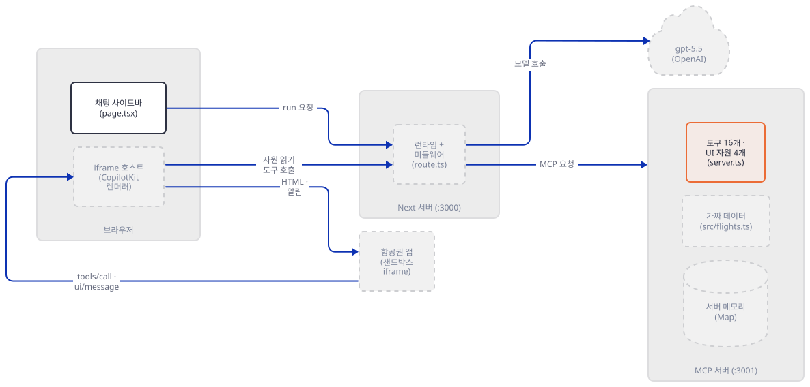

### Step 3. 가짜 데이터 — 항공권은 요청마다 난수로 지어집니다

**목적.** 이 앱의 항공권·호텔·종목이 실제 데이터가 아니라는 것과 어디에 사는지를 확인합니다.

**할 일.** `flights.ts`의 머리 주석이 "mock airport/airline data"라고 밝힙니다(`generative_ui_agents/mcp-apps-generative-ui-showcase/mcp-server/src/flights.ts:1-4`). 항공편은 검색할 때마다 지어집니다. 편수는 5~8개 무작위이고, 항공사는 여섯을 돌려 가며 고르고, 편명 번호·경유 횟수·남은 좌석도 `Math.random()`입니다(`generative_ui_agents/mcp-apps-generative-ui-showcase/mcp-server/src/flights.ts:405-413`). 가격은 비행시간에 비례하는 값에 ±20% 난수를 곱합니다(`generative_ui_agents/mcp-apps-generative-ui-showcase/mcp-server/src/flights.ts:364-365`). 그래서 같은 질문을 두 번 하면 다른 항공편이 나옵니다. 좌석 배치는 항공편 아이디를 씨앗으로 하는 난수라 같은 편에서는 같습니다(`generative_ui_agents/mcp-apps-generative-ui-showcase/mcp-server/src/flights.ts:489-537`). 검색과 예약은 모듈 안의 `Map` 둘에 쌓이고(`generative_ui_agents/mcp-apps-generative-ui-showcase/mcp-server/src/flights.ts:176-177`), 예약이 끝나면 그 검색은 지워집니다(`generative_ui_agents/mcp-apps-generative-ui-showcase/mcp-server/src/flights.ts:653`). 결제는 어디에도 없습니다. 서버 프로세스가 죽으면 모두 사라집니다.

서버는 포트폴리오와 칸반 보드도 "세션별로 저장한다"고 주석을 달지만(`generative_ui_agents/mcp-apps-generative-ui-showcase/mcp-server/server.ts:66-70`) 저장소는 `Map` 하나이고 키는 포트폴리오·보드 아이디입니다. MCP 세션과 무관합니다. 연결마다 세션이 새로 생겨도 데이터가 이어지는 까닭이 이것입니다(Step 4). 서버 안의 관계는 아래 그림입니다. `server.ts`가 데이터 파일의 함수를 부르고(`generative_ui_agents/mcp-apps-generative-ui-showcase/mcp-server/server.ts:26-31`), 데이터 파일이 자기 `Map`에 쌓고, `server.ts`가 포트폴리오·보드용 `Map` 둘을 따로 가집니다.

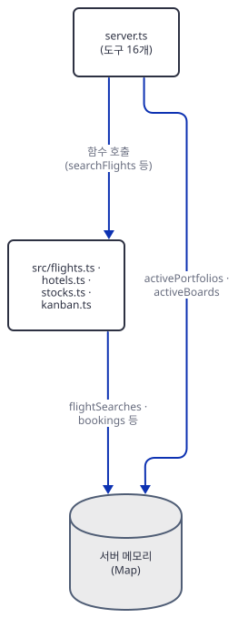

데이터의 수는 원본 README가 적은 숫자(공항 15·도시 10·호텔 30·종목 18)와 맞는지 셉니다. 아래 스크립트를 저장해 돌립니다.

```bash
cat > count.mjs <<'EOF'
// 가짜 데이터 파일에서 항목 수를 센다. 파일을 읽기만 하고 앱 코드는 실행하지 않는다.
import { readFileSync } from "node:fs";

const dir = process.argv[2];
const read = (name) => readFileSync(`${dir}/${name}`, "utf8");
const between = (text, from, to) => text.slice(text.indexOf(from), text.indexOf(to));
const count = (text, re) => (text.match(re) || []).length;

const flights = read("flights.ts");
console.log("공항", count(between(flights, "const AIRPORTS", "const AIRLINES"), /code: "/g));
console.log("항공사", count(between(flights, "const AIRLINES", "const AIRCRAFT_TYPES"), /code: "/g));

const hotels = read("hotels.ts");
console.log("도시", count(between(hotels, "const CITIES", "const ROOM_CONFIGS"), /name: "/g));
console.log("호텔", count(between(hotels, "const HOTELS", "export const hotelSearches"), /^ {6}name: "/gm));

const stocks = read("stocks.ts");
console.log("종목", count(between(stocks, "const STOCKS", "const portfolios"), /symbol: "/g));

console.log("flights.ts의 Math.random 호출", count(flights, /Math\.random\(\)/g));
EOF
node count.mjs $APP/mcp-server/src
```

**확인.**

```text
공항 15
항공사 6
도시 10
호텔 30
종목 18
flights.ts의 Math.random 호출 11
```

앱 README의 숫자와 같고, 항공편이 난수라는 것도 보입니다(열한 곳).

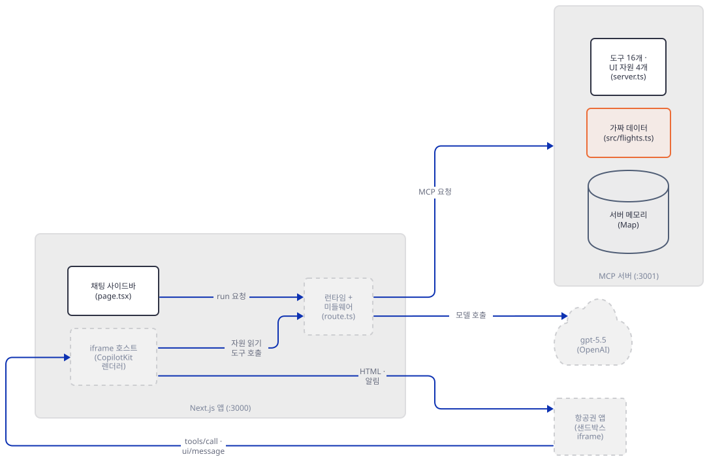

### Step 4. 런타임과 미들웨어 — 모델에게는 UI 도구 넷만 보입니다

**목적.** 모델을 고르는 곳, 모델이 보는 도구, 모델이 도구를 부른 뒤 일어나는 일을 읽습니다.

**할 일.** 모델은 환경변수의 키 순서로 정합니다(`generative_ui_agents/mcp-apps-generative-ui-showcase/src/app/api/copilotkit/[[...slug]]/route.ts:18-29`).

```ts
const determineModel = () => {
  if (process.env.OPENAI_API_KEY?.trim()) {
    return "openai/gpt-5.5";
  }
  if (process.env.ANTHROPIC_API_KEY?.trim()) {
    return "anthropic/claude-sonnet-4-6";
  }
  if (process.env.GOOGLE_API_KEY?.trim()) {
    return "google/gemini-3.1-pro-preview";
  }
  return "openai/gpt-5.5";
};
```

셸에 OpenAI 키가 없고 다른 제공자 키가 있으면 그쪽으로 갑니다. 셋 다 없으면 `openai/gpt-5.5`인 채로 요청 때 키가 없다고 실패할 것으로 읽힙니다(`@copilotkit/runtime`의 `resolveModel`이 `process.env.OPENAI_API_KEY!`를 그대로 넘깁니다, 소스로 확인). 같은 파일의 시스템 프롬프트는 네 앱을 설명하고 도우미 도구 이름도 댑니다(`generative_ui_agents/mcp-apps-generative-ui-showcase/src/app/api/copilotkit/[[...slug]]/route.ts:42`·`generative_ui_agents/mcp-apps-generative-ui-showcase/src/app/api/copilotkit/[[...slug]]/route.ts:48`·`generative_ui_agents/mcp-apps-generative-ui-showcase/src/app/api/copilotkit/[[...slug]]/route.ts:54`·`generative_ui_agents/mcp-apps-generative-ui-showcase/src/app/api/copilotkit/[[...slug]]/route.ts:60`). 그런데 모델에게 실제로 주어지는 도구는 이 이름들이 아닙니다. 미들웨어가 끼는 곳은 이렇습니다(`generative_ui_agents/mcp-apps-generative-ui-showcase/src/app/api/copilotkit/[[...slug]]/route.ts:67-76`).

```ts
}).use(
  new MCPAppsMiddleware({
    mcpServers: [
      {
        type: "http",
        url: process.env.MCP_SERVER_URL || "http://localhost:3001/mcp",
      },
    ],
  }),
);
```

`MCPAppsMiddleware`(0.0.3)의 `run`은 요청이 올 때마다 MCP 서버에 붙어 `tools/list`를 받고, `_meta["ui/resourceUri"]`가 문자열인 도구만 남겨(`hasUIResource`) 모델에게 가는 도구 목록에 더합니다. 이 앱이 `page.tsx`에서 프런트엔드 도구를 따로 등록하지 않으므로(소스로 확인) 모델의 도구는 `search-flights`·`search-hotels`·`create-portfolio`·`create-board` 넷이 전부입니다. 도우미 열둘은 모델에게 보이지 않고, 시스템 프롬프트가 이름을 대고 있어도 모델이 부를 수 없습니다. 모델이 그 넷 가운데 하나를 부르면, 미들웨어는 모델이 내보내는 이벤트(`RUN_STARTED`, 도구 호출의 시작·인자·끝)를 그대로 브라우저로 넘기고 `RUN_FINISHED`만 붙잡아 둡니다. 스트림이 끝나면 그 도구 호출에 결과가 없는 것을 찾아 직접 MCP 서버에 `tools/call`을 하고, 이벤트 둘을 따로 내보낸 뒤 붙잡아 둔 `RUN_FINISHED`를 마지막에 보냅니다. 글로 된 결과(`TOOL_CALL_RESULT`)와 `activityType: "mcp-apps"`인 `ACTIVITY_SNAPSHOT`입니다. 스냅숏의 내용은 도구 결과, `resourceUri`, 서버 해시, 모델이 준 인자(`toolInput`)입니다. HTML은 싣지 않고 주소만 싣습니다. 모델이 보는 길과 iframe이 부르는 길이 어디서 갈라지는지는 아래 그림입니다. 질문 한 번이 지나는 순서는 아래 "요청 한 건이 흐르는 과정"의 세 장입니다.

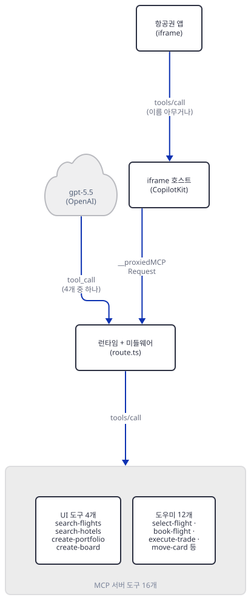

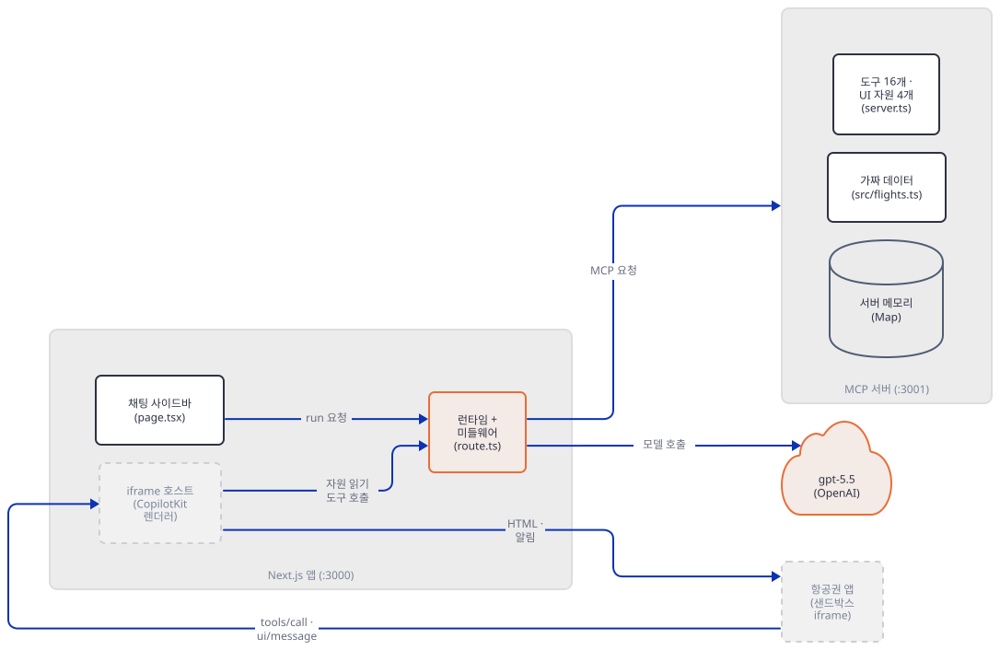

**확인.** 소스 맵에서 꺼낸 미들웨어 소스로 위 설명을 확인합니다.

```bash
grep -n 'hasUIResource\|new Client(\|client.connect\|case "\|MCP method not allowed' mw.txt
```

```text
107:function hasUIResource(tool: { _meta?: Record<string, unknown> }): boolean {
289:    const client = new Client(
303:      await client.connect(transport);
308:        case "tools/call":
312:        case "resources/read":
314:        case "notifications/message":
321:        case "ping":
325:            `MCP method not allowed for UI proxy: ${method}`
468:    const client = new Client(
482:      await client.connect(transport);
579:    const client = new Client(
594:      await client.connect(transport);
601:        .filter(hasUIResource)
```

읽을 곳은 세 가지입니다. `new Client(`가 세 군데(289·468·579행)이고 모두 바로 뒤에서 `client.connect`를 하고 `finally`에서 닫으므로 MCP 연결은 쓰일 때마다 새로 맺고 닫습니다. 목록 받기(579행 아래)와 도구 실행(468행 아래)이 질문 한 번에 연결을 둘 쓰고, 뒤에 나오는 자원 읽기(289행 아래, Step 5)가 하나 더입니다. 601행이 필터이고, 308~323행의 `case`들이 `__proxiedMCPRequest`로 미들웨어에 들어올 수 있는 메서드의 전부입니다(`tools/call`·`resources/read`·`notifications/message`·`ping`). 이 가운데 호스트가 iframe의 요청으로 넘기는 것은 `tools/call` 하나입니다(`resources/read`는 호스트가 자기 일로 쓰고, 그 밖의 메서드는 "Method not found"를 받습니다, Step 5). 그러나 `/api/copilotkit`에 이 필드를 직접 실어 보내는 쪽에는 넷 모두 열려 있습니다. 허용하는 **도구 이름**을 거르는 곳은 어디에도 없습니다. iframe은 UI 도구가 아닌 도우미 열둘도, UI 도구도 이름만 알면 부를 수 있습니다.

모델 호출이 한 번이라는 것은 이렇게 읽습니다. `BuiltInAgent`의 `maxSteps`는 설정하지 않았고 그 설정의 주석이 기본을 1이라 적습니다(`agent.txt`, 소스로 확인). 같은 실행 안에서 도구 결과가 모델에게 돌아가 다시 답하게 하는 호출은 소스에 보이지 않고, 결과는 대화에만 남는 것으로 읽힙니다. 비용은 이렇게 어림합니다(⚠ 추정). 시스템 프롬프트는 261낱말·1,926자이고(`route.ts` 34~66행의 `wc`), 4자에 1토큰으로 어림하면 약 500토큰입니다. 도구 넷의 설명과 스키마, 대화 내용을 더해 한 번에 입력 1,500~2,500토큰 정도로 잡으면 입력이 $0.01 안팎입니다. 출력은 도구 호출 한 줄이지만 모델 페이지는 `gpt-5.5`가 추론 토큰을 쓰고 추론 강도 기본값이 `medium`이라고 적고, 런타임은 `providerOptions`를 주지 않습니다(`@copilotkit/runtime` 1.59.2, 소스로 확인). 추론 토큰은 출력 단가로 붙으므로, 출력 쪽은 알 수 없는 만큼 범위를 넓혀 질문 한 번에 $0.01~0.05쯤으로 잡는 편이 안전합니다. 이 숫자는 대화가 길어질수록 커집니다. 마법사 안의 클릭에는 모델 비용이 붙지 않습니다. 단 마법사 마지막 화면의 [Add to Calendar] 단추는 예외입니다. 이 단추는 `ui/message`로 "Add this flight to my calendar"라는 사용자 메시지를 채팅에 넣고(`generative_ui_agents/mcp-apps-generative-ui-showcase/mcp-server/apps/flights-app.html:1716-1721`) 에이전트를 다시 돌리는데, 모델의 도구 가운데 일정 도구는 없으므로 말로만 답할 것으로 읽힙니다.

### Step 5. 호스트 쪽 — 이중 iframe, 출처, 크기 알림

**목적.** 브라우저가 자원을 받아 어떻게 가두는지, 사양이 말하는 것과 이 구현이 하는 것이 어디서 갈리는지 읽습니다.

**할 일.** 스냅숏이 오면 `MCPAppsActivityRenderer`(react-core 1.59.2, 저장소 밖)가 두 가지를 합니다. 먼저 HTML을 가져옵니다. 에이전트를 한 번 더 `runAgent`로 부르되 `forwardedProps.__proxiedMCPRequest`에 `resources/read`와 주소를 실어 보내고, 미들웨어는 이 요청을 모델로 보내지 않고 MCP 서버에 `resources/read`로 전달해 HTML 한 장을 돌려줍니다.

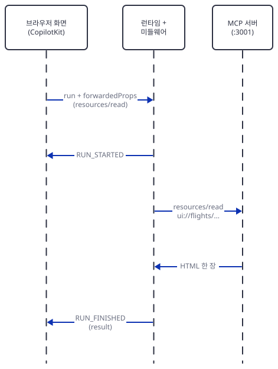

그다음 iframe을 둘 만듭니다. 바깥 iframe은 프록시 HTML을 `srcdoc`으로 가지고, 그 안에서 안쪽 iframe이 앱 HTML을 `srcdoc`으로 가집니다. 둘의 `sandbox` 값은 같습니다. 프록시가 뜨면 먼저 `sandbox-proxy-ready`를 호스트에 보내고, 호스트는 그것을 기다린 뒤 `sandbox-resource-ready`에 HTML을 실어 **프록시에** 보냅니다. 프록시는 그 HTML을 메시지로 넘기지 않고 안쪽 iframe의 `srcdoc` 속성에 넣습니다.

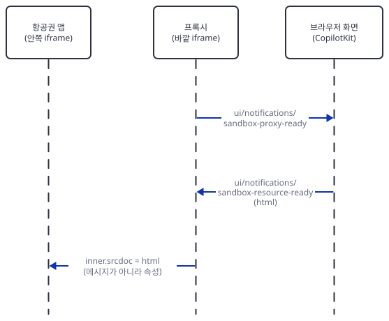

구조는 아래 그림입니다. 사용자는 채팅 사이드바에 질문하고, 마법사 안에서는 안쪽 iframe을 직접 누르고 입력합니다.

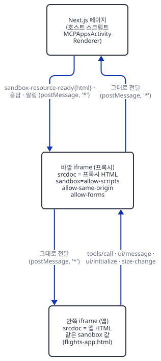

호스트의 소스는 이렇습니다. 저장소 밖 소스라 줄 범위는 `host.txt` 기준이고(450~453행, 496행, 289행), 세 곳을 `...`로 이어 붙였습니다.

```text
          iframe.setAttribute(
            "sandbox",
            "allow-scripts allow-same-origin allow-forms",
          );
...
            if (event.source !== iframe.contentWindow) return;
...
        iframeRef.current.contentWindow.postMessage(msg, "*");
```

세 줄이 말하는 것은 이렇습니다. 첫째, 사양(SEP-1865, https://github.com/modelcontextprotocol/ext-apps/blob/main/specification/2026-01-26/apps.mdx 를 2026-10-16에 읽음)은 웹 호스트의 샌드박스에 `allow-scripts`와 `allow-same-origin`을 요구하면서 "호스트와 샌드박스는 출처가 달라야 한다(MUST)"고 적습니다. 이 구현은 프록시를 별도 출처의 주소가 아니라 `srcdoc` 문자열로 만듭니다. HTML 규격(https://html.spec.whatwg.org/multipage/document-sequences.html)의 출처 결정 절은 URL이 `about:srcdoc`이면 만든 쪽의 출처를 그대로 돌려주고, 샌드박스 출처 플래그(`allow-same-origin`이 없을 때 켜지는 것)가 있을 때만 새 불투명 출처를 줍니다. 그러니 `allow-same-origin`을 켠 두 겹의 `srcdoc` iframe은 모두 **호스트 페이지와 같은 출처**입니다. 안쪽 앱의 스크립트는 부모(프록시)만이 아니라 같은 출처인 최상위 창, 곧 채팅 페이지에도 직접 닿습니다. 규격의 iframe 절(https://html.spec.whatwg.org/multipage/iframe-embed-object.html)도 MDN과 같은 경고를 적습니다. 두 값을 함께 켜고 같은 출처이면 안의 페이지가 `sandbox` 속성을 지우고 다시 불러 샌드박스를 완전히 벗어날 수 있다는 것입니다. 이 문서가 직접 보지 못한 것은 브라우저의 실제 동작뿐입니다. 앱 폴더의 `public/sandbox.html`은 같은 일을 하는 파일이지만 이 버전의 호스트는 쓰지 않습니다(아래 확인). 그 파일을 쓰더라도 Next의 `public/`에서 서빙하면 그것도 `localhost:3000`, 곧 같은 출처라 달라지지 않습니다. 사양의 위협 모델은 "악성 서버가 해로운 HTML을 보냄", "앱이 호스트의 민감한 데이터를 빼냄"을 막으려는 것인데(`apps.mdx`의 보안 절), 이 호스트 판은 그 둘을 막지 못합니다. 이 쇼케이스의 HTML은 같은 저장소의 MCP 서버가 주므로 실제 위험은 그 서버를 믿느냐에 달렸습니다. 둘째, 호스트의 메시지 처리는 **보낸 창**(`event.source`)이 방금 만든 iframe인지만 보고 `event.origin`은 보지 않습니다. 셋째, 호스트가 iframe에 보낼 때 대상 출처가 `"*"`입니다. 사양 문서의 예시도 `'*'`를 쓰고 출처 검사를 정하지 않으니 사양을 벗어난 것은 아닙니다.

크기 알림이 하나 어긋납니다. 호스트가 듣는 이름은 `ui/notifications/size-changed`이고 그 알림이 와야 iframe 높이를 바꿉니다. 처음 높이는 100px입니다. 네 앱이 모두 `ui/notifications/size-change`로 보냅니다(`generative_ui_agents/mcp-apps-generative-ui-showcase/mcp-server/apps/flights-app.html:1695-1703`). 공식 사양 문서에도 호스트에도 앞의 이름은 없습니다. 1.59.2 호스트에서 iframe 높이가 바뀌는 길은 이 알림이 정하는 `iframeSize` 하나뿐이라(소스로 확인), 소스로는 iframe이 100px에 머무는 것으로 읽힙니다. 남는 불확실성은 화면에서의 모습뿐이고, 이 문서는 화면을 열지 않았으므로 단정하지 않습니다(문제 해결 표).

앱이 열리면 앱이 먼저 `ui/initialize`를 보내고 호스트가 답한 뒤 앱이 `initialized`를 보냅니다. 그다음 호스트가 따로 도는 두 효과에서 `tool-input`과 `tool-result`를 차례로 보내고, 앱은 크기를 `size-change`로 알립니다(앞에서 본 이름 불일치). 프록시가 중계하는 메시지는 사양의 생명주기 그림처럼 앱과 호스트 사이에 곧바로 그렸고, 프록시 자신이 보내는 것은 앞의 프록시 시퀀스에 있습니다. 호스트가 받아 주는 앱의 요청은 `ui/initialize`·`ui/message`·`ui/open-link`·`tools/call` 넷이고, 그 밖의 메서드에는 "Method not found" 오류를 돌려줍니다. 이 가운데 `tools/call`만 런타임으로 넘어갑니다.

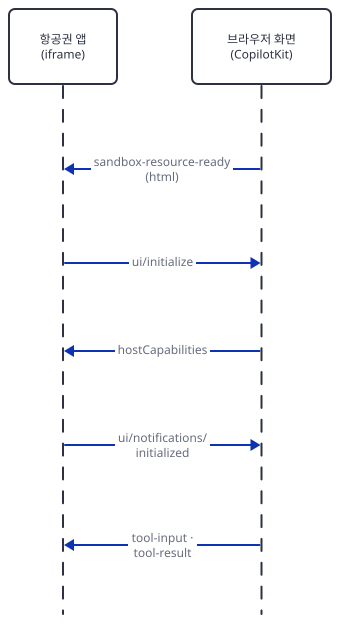

**확인.** 위 세 줄과 이름 불일치를 직접 찾아봅니다. (`host.txt`는 Step 1에서 만들었습니다.)

```bash
grep -n 'allow-scripts allow-same-origin allow-forms' host.txt
grep -n 'event.source !== iframe.contentWindow' host.txt
grep -c 'event.origin' host.txt
grep -n 'size-changed"' host.txt
grep -c 'size-change"' host.txt
grep -rn 'ui/notifications/size-change"' $APP/mcp-server/apps | cut -d: -f1,2 | sed 's#.*/##'
grep -c "sandbox.html" rc.txt
grep -rn "sandbox.html" $APP/src $APP/next.config.ts $APP/mcp-server/server.ts
```

```text
33:inner.setAttribute("sandbox","allow-scripts allow-same-origin allow-forms");
452:            "allow-scripts allow-same-origin allow-forms",
496:            if (event.source !== iframe.contentWindow) return;
0
676:                case "ui/notifications/size-changed": {
0
flights-app.html:1698
hotels-app.html:1685
kanban-app.html:1144
trading-app.html:1130
0
```

(마지막 `grep -rn`은 아무것도 출력하지 않습니다. 줄 번호는 `host.txt` 기준입니다.) 앱 쪽 이름은 네 파일 모두 `size-change"`이고 호스트는 `size-changed"`입니다.

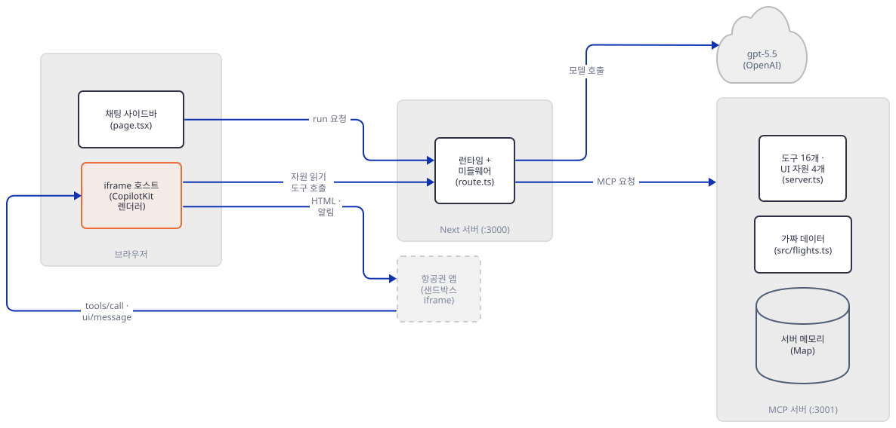

### Step 6. 앱 안 — 마법사가 모델 없이 도구를 부르는 법

**목적.** iframe 안의 앱이 호스트와 어떻게 이야기하는지, 마법사 한 단계가 어떤 길을 지나는지 읽습니다.

**할 일.** 앱의 통신 모듈은 요청과 응답을 번호로 짝짓는 작은 JSON-RPC입니다. 받는 쪽은 `generative_ui_agents/mcp-apps-generative-ui-showcase/mcp-server/apps/flights-app.html:1107-1109`입니다.

```js
        window.addEventListener("message", (event) => {
          const msg = event.data;
          if (!msg || typeof msg !== "object") return;
```

메시지가 어디서 왔는지(`event.source`·`event.origin`)를 보지 않고, 객체이기만 하면 받습니다. 보내는 쪽은 `generative_ui_agents/mcp-apps-generative-ui-showcase/mcp-server/apps/flights-app.html:1131-1140`입니다.

```js
          sendRequest(method, params) {
            const id = requestId++;
            return new Promise((resolve, reject) => {
              pendingRequests.set(id, { resolve, reject });
              window.parent.postMessage(
                { jsonrpc: "2.0", id, method, params },
                "*",
              );
            });
          },
```

`window.parent.postMessage(…, "*")`입니다. 부모는 바깥 iframe(프록시)이고, 프록시는 `event.source`가 안쪽 iframe일 때만 위로 전달합니다. 마법사의 각 단계가 부르는 도구는 네 번입니다. 검색은 `search-flights`(`generative_ui_agents/mcp-apps-generative-ui-showcase/mcp-server/apps/flights-app.html:1313-1322`)인데, 모델이 이미 한 검색이 `tool-result`로 먼저 와 있으면 그 결과로 곧바로 2단계를 그립니다. 이어서 항공편을 고르면 `select-flight`, 좌석을 확정하면 `select-seats`, 승객 정보를 넣으면 `book-flight`입니다. 세 번 모두 같은 길을 지납니다. 앱이 `tools/call`을 보내면 호스트가 `agent.runAgent`에 `__proxiedMCPRequest`를 실어 런타임으로 보내고, 미들웨어가 모델 없이 MCP 서버에 `tools/call`을 하고, 결과가 `RUN_FINISHED`의 `result`로 돌아와 호스트가 앱에 JSON-RPC 응답으로 넘깁니다. 호스트는 이런 요청을 큐에 넣어 하나씩 처리하고 에이전트가 실행 중이면 끝나기를 기다립니다.

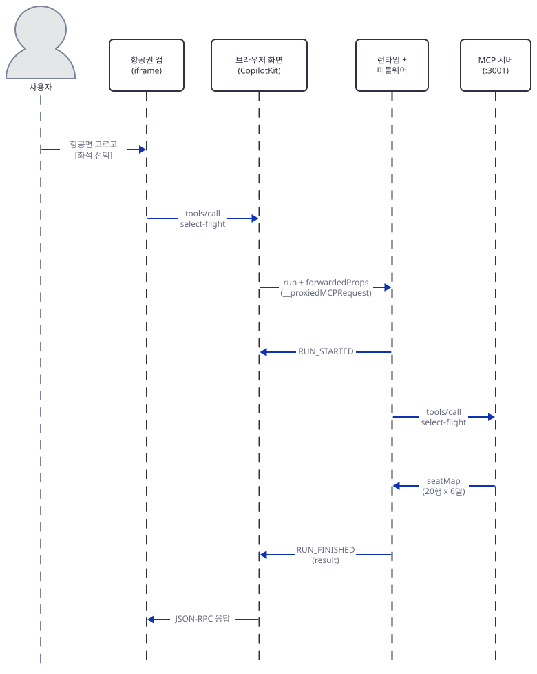

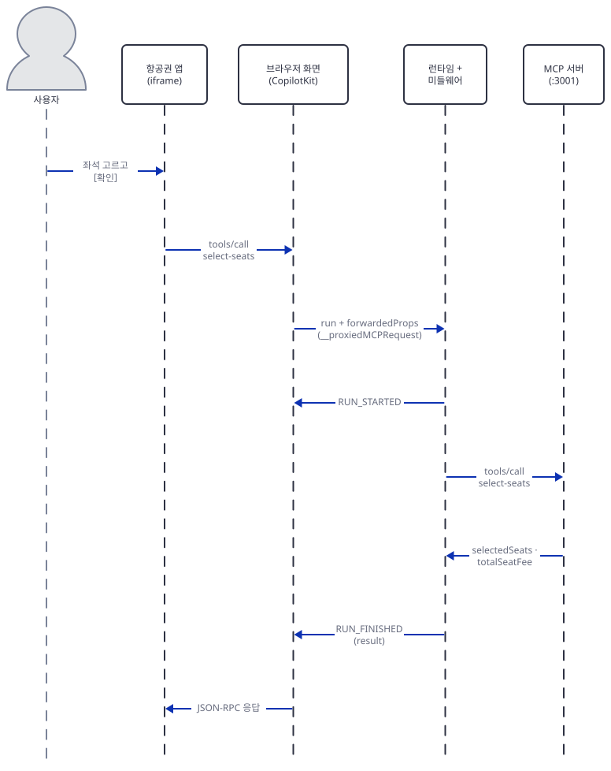

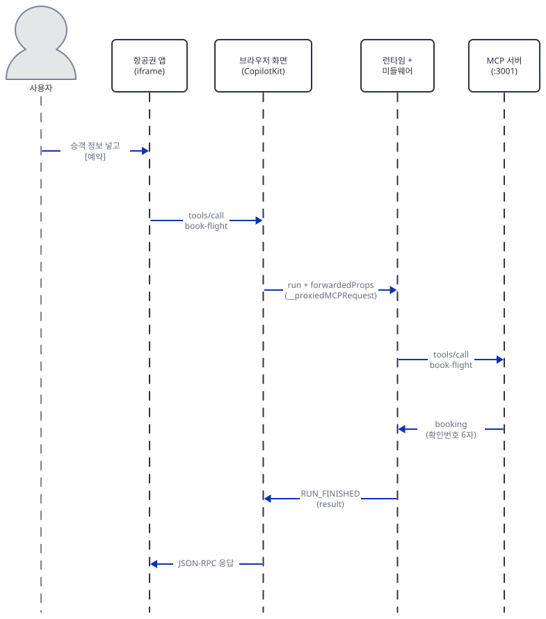

서버 쪽에서는 `select-flight`가 검색을 찾아 `selectedFlightId`를 적고 좌석표를 만들고, `select-seats`는 그 항공편이 선택된 것인지와 좌석이 비었는지 보고 요금을 합치고, `book-flight`는 승객 수가 검색의 인원과도, 고른 좌석 수와도 같을 때만 예약을 만듭니다(`generative_ui_agents/mcp-apps-generative-ui-showcase/mcp-server/src/flights.ts:467-483`·`generative_ui_agents/mcp-apps-generative-ui-showcase/mcp-server/src/flights.ts:542-586`·`generative_ui_agents/mcp-apps-generative-ui-showcase/mcp-server/src/flights.ts:591-660`). 칸반 앱은 값을 이스케이프 없이 `innerHTML`로 넣습니다. 모델이 정하는 `create-board` 인자는 `projectName`과 `template` 둘뿐이고(`generative_ui_agents/mcp-apps-generative-ui-showcase/mcp-server/server.ts:775-781`), 그중 이스케이프 없이 들어가는 것은 보드 제목입니다(`generative_ui_agents/mcp-apps-generative-ui-showcase/mcp-server/apps/kanban-app.html:1181`, 대입은 `generative_ui_agents/mcp-apps-generative-ui-showcase/mcp-server/apps/kanban-app.html:1255`). 카드 제목·설명은 서버 템플릿(`generative_ui_agents/mcp-apps-generative-ui-showcase/mcp-server/src/kanban.ts:265-273`)이나 보드 화면에서 사람이 넣은 `add-card`·`update-card` 인자에서 오고 같은 방식으로 들어갑니다(`generative_ui_agents/mcp-apps-generative-ui-showcase/mcp-server/apps/kanban-app.html:1216-1218`). 앱 코드가 정제하지 않으니 가두는 일은 iframe이 맡는데, 그 iframe은 Step 5에서 본 대로 호스트와 같은 출처라 가두지 못합니다. 거기서 도는 스크립트는 채팅 페이지에도 닿습니다. 이 쇼케이스에서는 HTML을 같은 저장소의 서버가 주므로 당장의 위험은 작지만, 다른 서버의 앱을 붙이는 순간 위험은 그 서버를 믿느냐에 달린 것이 됩니다.

**확인.** 앱이 부르는 도구 이름과 통신 모듈의 검사를 찾아봅니다.

```bash
grep -h -A1 'sendRequest("tools/call"' $APP/mcp-server/apps/flights-app.html | grep -o 'name: "[a-z-]*"'
grep -c "event.origin\|event.source" $APP/mcp-server/apps/flights-app.html
grep -c 'postMessage' $APP/mcp-server/apps/flights-app.html
```

```text
name: "search-flights"
name: "select-flight"
name: "select-seats"
name: "book-flight"
0
2
```

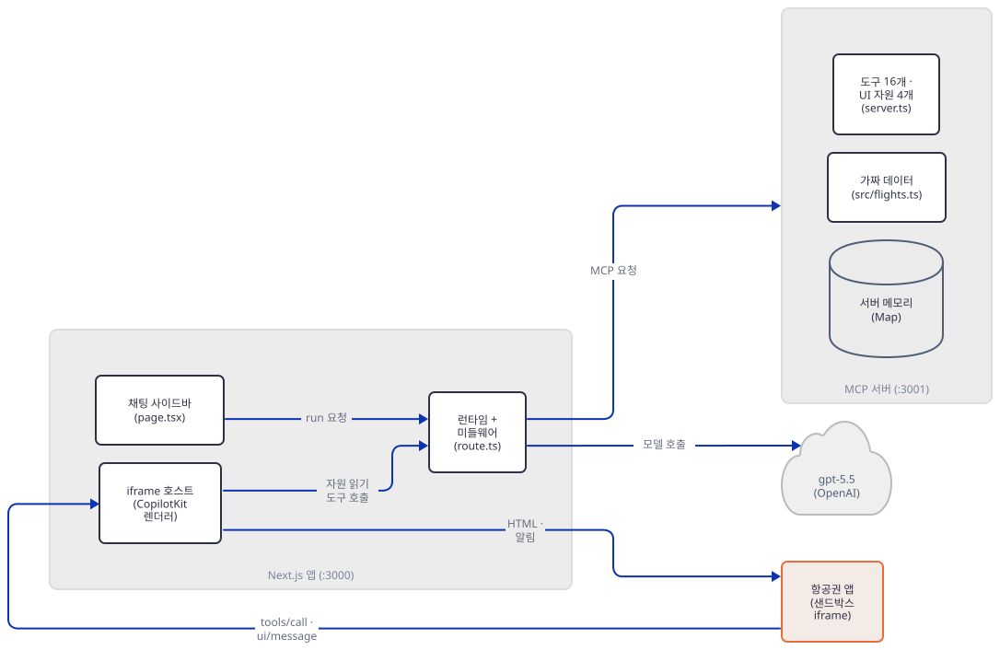

### Step 7. 직접 돌린다면 — 바깥으로 나가는 길을 막고 띄우기

**목적.** 이 문서가 실행하지 않은 부분을 독자가 실행할 때 무엇이 바깥에 닿는지 소스로 적고, 그것을 줄 하나를 빠뜨려도 막는 확인 스크립트(`launch.mjs`)를 만듭니다. 이 문서는 스크립트의 확인 부분을 `--dry`로 돌려 보았을 뿐, 설치·서버·화면 명령은 하나도 실행하지 않았습니다.

**할 일.** 먼저 무엇이 열리고 무엇이 나가는지입니다. 같은 네트워크에 열리는 것은 바인딩 때문입니다. MCP 서버는 `app.listen(PORT)`이라 호스트를 정하지 않아 모든 인터페이스에 열리고(`generative_ui_agents/mcp-apps-generative-ui-showcase/mcp-server/server.ts:1117`), `next dev`와 `next start`의 호스트 기본값도 `0.0.0.0`입니다(Next.js CLI 문서를 2026-10-16에 읽음). `/mcp`와 `/api/copilotkit`에는 인증이 없어서 같은 네트워크의 누구나 도구 열여섯과 키가 든 런타임을 부를 수 있습니다. CORS는 이와 별개입니다. MCP 서버는 `origin: "*"`이고(`generative_ui_agents/mcp-apps-generative-ui-showcase/mcp-server/server.ts:1010-1015`), 런타임 엔드포인트도 `cors`를 주지 않으면 모든 출처를 허용합니다(소스로 확인). 그래서 루프백에만 열어도, 독자 브라우저에 열려 있는 아무 웹사이트가 `localhost:3000`·`3001`에 요청해 응답을 읽을 수 있습니다(브라우저의 로컬 네트워크 제한이 허락하는 한).

바깥으로 나가는 요청은 다섯 갈래입니다.

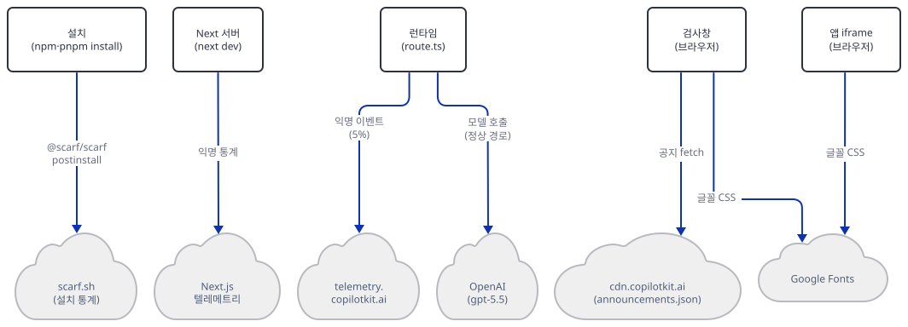

- 설치: `@scarf/scarf` 1.4.0의 `postinstall`이 `scarf.sh`로 설치 통계를 보냅니다. 두 CopilotKit 패키지에 `scarfSettings`가 없어 기본은 보내는 쪽입니다. `SCARF_ANALYTICS=false`·`SCARF_NO_ANALYTICS=true`·`DO_NOT_TRACK=1` 가운데 하나로 끕니다(`@scarf/scarf` 1.4.0 `report.js`, 소스로 확인).
- CopilotKit 런타임: `https://telemetry.copilotkit.ai/ingest`로 익명 이벤트의 5%를 보내고, 실행 요청마다 `copilot_request_created` 이벤트를 만듭니다. `DO_NOT_TRACK=1`이나 `COPILOTKIT_TELEMETRY_DISABLED=true`로 끕니다(소스로 확인).
- Next.js: 익명 텔레메트리를 `NEXT_TELEMETRY_DISABLED=1`로 끕니다(Next 문서).
- 화면의 검사창: `page.tsx`의 `showDevConsole="auto"`(`generative_ui_agents/mcp-apps-generative-ui-showcase/src/app/page.tsx:162`)는 `localhost`·`127.0.0.1`에서 `@copilotkit/web-inspector` 1.59.2를 불러오고, 이것이 붙을 때 Google Fonts 링크를 넣고 `https://cdn.copilotkit.ai/announcements.json`을 가져옵니다. 끄는 환경변수는 없고 `showDevConsole={false}`로 바꿔야 합니다(소스로 확인).
- 앱 iframe: 열릴 때 Google Fonts에서 글꼴을 받습니다(`generative_ui_agents/mcp-apps-generative-ui-showcase/mcp-server/apps/flights-app.html:7-10`). `layout.tsx`가 가져오는 `next/font/google`도 Google 글꼴을 쓰는 경로입니다(Next가 언제 무엇을 내려받는지는 확인하지 않았습니다). 이 둘은 막는 방법이 없고 아래 스크립트도 막지 못합니다.

이를 막는 쪽으로 시작합니다. 복사본에 패치를 하고, 패치와 환경을 확인한 뒤에만 명령을 부르는 스크립트를 둡니다. `<저장소>`와 `$APP`은 Step 1의 것입니다. 패치는 `sed`로 하고 `grep -c`로 확인합니다.

```bash
cp -r $APP app-copy
sed -i 's/app.listen(PORT, () => {/app.listen(PORT, "127.0.0.1", () => {/' app-copy/mcp-server/server.ts
sed -i 's/showDevConsole="auto"/showDevConsole={false}/' app-copy/src/app/page.tsx
grep -c 'app.listen(PORT, "127.0.0.1"' app-copy/mcp-server/server.ts
grep -c 'showDevConsole={false}' app-copy/src/app/page.tsx
```

```text
1
1
```

```powershell
Copy-Item -Recurse $APP app-copy
$f = "app-copy\mcp-server\server.ts"
(Get-Content $f -Raw).Replace('app.listen(PORT, () => {', 'app.listen(PORT, "127.0.0.1", () => {') | Set-Content -NoNewline -Encoding utf8 $f
$f = "app-copy\src\app\page.tsx"
(Get-Content $f -Raw).Replace('showDevConsole="auto"', 'showDevConsole={false}') | Set-Content -NoNewline -Encoding utf8 $f
(Select-String -Path app-copy\mcp-server\server.ts -SimpleMatch 'app.listen(PORT, "127.0.0.1"').Count
(Select-String -Path app-copy\src\app\page.tsx -SimpleMatch 'showDevConsole={false}').Count
```

위 PowerShell 줄은 실행해 보지 못했습니다. 이어서 스크립트를 저장합니다. 환경변수는 터미널의 `export`에 기대지 않고 스크립트가 직접 정해 자식 프로세스에 넘기므로, 터미널이 달라도 같습니다. 화면의 `-H 127.0.0.1`도 스크립트 안에 고정되어 있습니다.

```bash
cat > launch.mjs <<'EOF'
// 복사본 폴더의 패치와 환경을 확인한 뒤에만 설치·서버·화면 명령을 부른다.
// 사용법: node launch.mjs <install|mcp|web> <복사본 폴더> [--dry]
// --dry 는 확인만 하고 아무것도 실행하지 않는다.
import { readFileSync } from "node:fs";
import { spawnSync } from "node:child_process";
import { join } from "node:path";

const [mode, dir, flag] = process.argv.slice(2);
const fail = (msg) => {
  console.error("멈춥니다: " + msg);
  process.exit(1);
};
if (!["install", "mcp", "web"].includes(mode) || !dir) {
  fail("사용법: node launch.mjs <install|mcp|web> <복사본 폴더> [--dry]");
}

// 1. 환경은 이 스크립트가 직접 정한다. 터미널에 export가 없어도, 다른 터미널이어도 같다.
const env = {
  ...process.env,
  DO_NOT_TRACK: "1",
  COPILOTKIT_TELEMETRY_DISABLED: "true",
  NEXT_TELEMETRY_DISABLED: "1",
  SCARF_ANALYTICS: "false",
  NO_PROXY: "localhost,127.0.0.1",
  no_proxy: "localhost,127.0.0.1",
};

// 2. 셸에 이미 있는 값이 앱을 바깥으로 돌리지 않는지 본다.
const url = process.env.MCP_SERVER_URL;
if (url) {
  let host = "";
  try {
    host = new URL(url).hostname;
  } catch {
    fail(`MCP_SERVER_URL을 읽을 수 없습니다: ${url}`);
  }
  if (!["localhost", "127.0.0.1"].includes(host)) {
    fail(`MCP_SERVER_URL의 호스트가 루프백이 아닙니다: ${host}`);
  }
}

// 3. 복사본에 패치가 들어갔는지 본다. 하나라도 빠지면 멈춘다.
const read = (rel) => readFileSync(join(dir, rel), "utf8");
if (!read("mcp-server/server.ts").includes('app.listen(PORT, "127.0.0.1"')) {
  fail('mcp-server/server.ts에 app.listen(PORT, "127.0.0.1", ...) 패치가 없습니다');
}
const page = read("src/app/page.tsx");
if (!page.includes("showDevConsole={false}") || page.includes('showDevConsole="auto"')) {
  fail("src/app/page.tsx의 showDevConsole 패치가 없습니다");
}

// 4. 모드마다 명령은 이 표에 고정되어 있다. 화면은 항상 -H 127.0.0.1이다.
const plans = {
  install: [
    { cwd: join(dir, "mcp-server"), cmd: "npm", args: ["ci"] },
    { cwd: dir, cmd: "npm", args: ["install"] },
  ],
  mcp: [{ cwd: join(dir, "mcp-server"), cmd: "npm", args: ["run", "dev"] }],
  web: [{ cwd: dir, cmd: "npm", args: ["run", "dev", "--", "-H", "127.0.0.1"] }],
}[mode];

console.log("확인 통과: MCP 서버 루프백 패치, 검사창 끔, 환경 넷과 NO_PROXY, MCP_SERVER_URL " + (url ? "루프백" : "없음"));
for (const p of plans) {
  console.log(`${flag === "--dry" ? "(실행하지 않음) " : ""}${p.cwd} 에서: ${p.cmd} ${p.args.join(" ")}`);
}
if (flag === "--dry") process.exit(0);

for (const p of plans) {
  const r = spawnSync(p.cmd, p.args, { cwd: p.cwd, env, stdio: "inherit", shell: process.platform === "win32" });
  if (r.status !== 0) process.exit(r.status ?? 1);
}
EOF
node launch.mjs web app-copy --dry
```

**확인.** 패치된 복사본에서 `--dry`는 이렇게 나옵니다(이 문서가 직접 돌려 본 출력입니다. 줄 끝의 경로 구분자는 Windows에서 `\`입니다).

```text
확인 통과: MCP 서버 루프백 패치, 검사창 끔, 환경 넷과 NO_PROXY, MCP_SERVER_URL 없음
(실행하지 않음) app-copy\mcp-server 에서: npm run dev
```

위는 `mcp` 모드의 출력이고, `web` 모드는 둘째 줄이 `app-copy 에서: npm run dev -- -H 127.0.0.1`입니다. 패치를 빠뜨리거나 바깥 주소를 주면 멈추는지도 봤습니다.

```text
멈춥니다: mcp-server/server.ts에 app.listen(PORT, "127.0.0.1", ...) 패치가 없습니다        (둘 다 안 했을 때)
멈춥니다: src/app/page.tsx의 showDevConsole 패치가 없습니다                                   (서버 패치만 했을 때)
멈춥니다: MCP_SERVER_URL의 호스트가 루프백이 아닙니다: evil.example                          (MCP_SERVER_URL=https://evil.example/mcp)
```

멈출 때 종료 코드는 1이고 아무 명령도 부르지 않습니다. 이 스크립트가 **막지 못하는 것**은 앱 iframe·`next/font`의 Google 글꼴 요청, 그리고 OpenAI 호출 자체(`.env.local`에 키를 넣으면 질문마다 Step 4의 어림 비용이 듭니다)입니다. 셸에 `ANTHROPIC_API_KEY`나 `GOOGLE_API_KEY`가 있고 OpenAI 키가 없으면 그 제공자로 요청이 가는 것도(`generative_ui_agents/mcp-apps-generative-ui-showcase/src/app/api/copilotkit/[[...slug]]/route.ts:18-29`) 스크립트는 보지 않습니다. 진짜로 띄우는 순서는 이렇습니다. 아래는 이 문서가 실행해 보지 못한 것입니다.

```bash
node launch.mjs install app-copy
cd app-copy/mcp-server
npm run build --script-shell "<Git 설치 경로>/bin/bash.exe"
cd ../..
node launch.mjs mcp app-copy
```

```bash
node launch.mjs web app-copy
```

두 터미널에서 각각 위 줄만 칩니다. `npm run build`의 `--script-shell`은 Windows에서 npm이 스크립트를 돌릴 셸을 Git Bash의 `bash.exe`로 바꾸는 설정입니다(npm 문서 `script-shell`, 이 문서는 해 보지 못했습니다). macOS·Linux에서는 기본 셸이 `/bin/sh`라 이 옵션이 필요 없습니다. 옵션을 쓰지 않는 길은 `mcp-server/apps`에서 `BUILD_APP=flights-app npx vite build`를 네 앱에 대해 따로 돌리는 것인데, `npx`를 쓰므로 독자가 진짜로 돌릴 때만 해당하고 이 문서는 해 보지 못했습니다.

이 문서가 읽은 것과 읽지 못한 것을 나눕니다.

- 직접 확인한 것: 위 `grep`·`wc`·`count.mjs` 출력, `launch.mjs`의 `--dry` 확인과 멈춤 세 경우, 레지스트리 메타데이터(`engines`), 잠금 파일의 항목 수.
- 소스로 확인한 것: 서버·런타임·앱 HTML·패키지(미들웨어·react-core·runtime·web-inspector·scarf·MCP SDK)의 동작. 모두 읽기였고 실행하지 않았습니다.
- 확인하지 못한 것: 화면에서 마법사가 어떻게 보이는지, iframe 높이, 브라우저가 실제로 `srcdoc` iframe에 주는 출처, 진짜 모델이 도구를 고르는 모습, `npm`·`pnpm` 설치와 `vite build`의 성공 여부, `--script-shell`의 동작, `/health`의 세션 수가 실제로 늘어나는지.

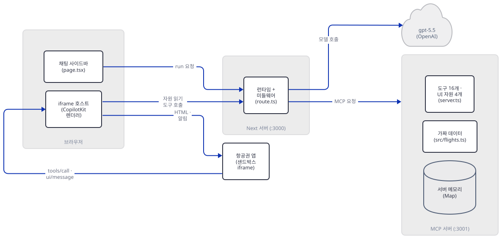

## 요청 한 건이 흐르는 과정

"예시 문구 클릭"에서 도구 호출 결과까지는 시퀀스가 세 장입니다. 첫 장은 질문이 MCP 서버에서 도구를 받아 오기까지입니다. `page.tsx`의 단추가 메시지를 넣고 `copilotkit.runAgent`를 부르면(`generative_ui_agents/mcp-apps-generative-ui-showcase/src/app/page.tsx:175-188`) 브라우저가 `/api/copilotkit`에 `POST`하고, 미들웨어가 먼저 MCP 서버에 `initialize`로 새 세션을 열어(서버는 이때 HTML 네 장을 다시 읽습니다) `tools/list`를 받습니다.

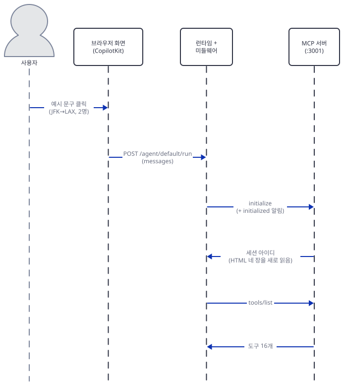

둘째 장은 모델 호출입니다. 미들웨어가 UI 도구 넷만 얹어 모델을 부르고, 모델이 내보내는 이벤트를 그대로 브라우저로 넘깁니다.

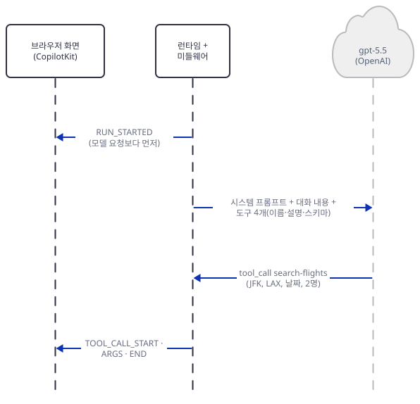

셋째 장은 스트림이 끝난 뒤입니다. 미들웨어가 새 세션을 열어 도구를 실행하고, 결과와 `mcp-apps` 스냅숏을 따로 보낸 뒤 붙잡아 둔 `RUN_FINISHED`를 보냅니다.

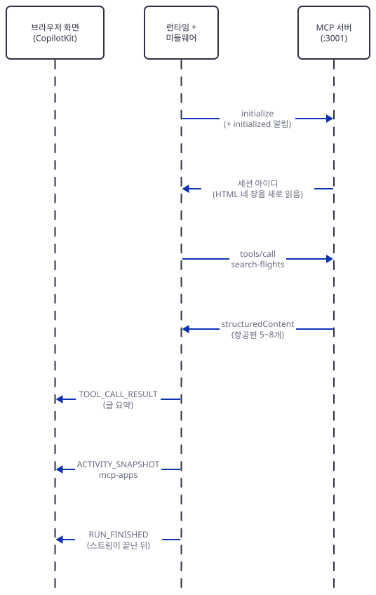

이 한 번의 질문에 모델 호출은 한 번, MCP 연결은 둘입니다. 이어지는 자원 읽기(Step 5)가 하나를 더 쓰고, 앱이 열려 `tool-result`를 받으면 곧바로 검색 결과 화면(2단계)을 그립니다(Step 6). 그다음부터는 마법사의 클릭마다 같은 우회 길(Step 6의 세 그림)을 한 번씩 지나, 항공권 하나를 예약하기까지 MCP 연결이 모두 여섯 번 열립니다. 모델은 처음 한 번 말고는 관여하지 않습니다. 연결을 여섯 번 맺고도 서버가 어떻게 되는지는 소스로 읽을 수 있습니다. `@modelcontextprotocol/sdk` 1.25.2 클라이언트의 `close()`는 요청을 취소(abort)할 뿐 DELETE를 보내지 않고(`terminateSession`은 따로 있습니다), 서버의 전송 객체는 DELETE를 받거나 서버가 닫을 때만 `close()`되어 `onclose`가 불립니다. 따라서 `generative_ui_agents/mcp-apps-generative-ui-showcase/mcp-server/server.ts:1018`의 `transports`에 연결마다 항목(과 HTML 네 장을 든 `McpServer`)이 쌓이는 것으로 읽힙니다. 서버의 `/health`가 보여 주는 `sessions` 수가 늘어나는지로 확인할 수 있지만 이 문서는 서버를 띄우지 않아 확인하지 못했습니다.

## 실행 체크리스트

- [ ] Step 1: 세 패키지를 받아 풀고 `mw.txt`·`rc.txt`·`agent.txt`·`host.txt`의 줄 수가 615·19162·1745·817인지 확인했다
- [ ] Step 2: `registerTool`이 16개이고 `_meta`를 단 도구가 4개인 것을 확인했다
- [ ] Step 3: `count.mjs`가 공항 15·항공사 6·도시 10·호텔 30·종목 18을 낸다
- [ ] Step 4: 미들웨어 소스에서 `hasUIResource` 필터와 `new Client(` 세 곳을 찾았다
- [ ] Step 5: `host.txt`에서 `sandbox` 값과 `size-changed`를, 앱에서 `size-change`를 찾아 이름이 다른 것을 확인했다
- [ ] Step 6: 앱이 부르는 도구 이름 넷과 `event.origin` 검사가 0건인 것을 확인했다
- [ ] Step 7: 원본을 그대로 띄우면 모든 인터페이스에 열린다는 것, 바깥으로 나가는 요청 다섯 갈래를 이해했고, `launch.mjs --dry`가 패치된 복사본에서 통과하고 패치를 빠뜨리면 멈추는 것을 확인했다
- [ ] 앱을 띄우지 않았고 `npm install`·`npx`를 실행하지 않았다(`ls $APP`에 `node_modules`가 없다)

## 문제 해결

표의 증상은 모두 이 문서가 소스에서 읽은 것이고, 화면에서 직접 본 것은 없습니다.

| 증상 | 원인 | 해결 |
|---|---|---|
| 앱 자리에 "flights-app Loading... The app UI needs to be built"가 뜬다 | `apps/dist/`가 없다. `loadHtml`이 자리표시 HTML을 돌려준다(`generative_ui_agents/mcp-apps-generative-ui-showcase/mcp-server/server.ts:74-95`) | `mcp-server`에서 `npm run build`. Windows에서는 npm이 기본으로 `cmd.exe`에서 스크립트를 돌려 `build:app`이 막힐 수 있으므로 `npm run build --script-shell "<Git 설치 경로>/bin/bash.exe"`로 셸을 바꾼다(npm 문서의 `script-shell`, 해 보지 못함). Git Bash에서 npm을 부르는 것만으로는 바뀌지 않는다 |
| 마법사가 100px 높이로 잘려 보인다 | 앱은 `size-change`를, 호스트(react-core 1.59.2)는 `size-changed`를 듣는다(Step 5) ⚠ 소스로 읽은 추정 | 복사본의 `apps/*.html` 네 곳의 알림 이름을 `size-changed`로 고치고 다시 빌드. 고치기 전 높이와 비교해 본다 |
| `Invalid airport code: XXX` | 공항 코드는 15개뿐이다(`generative_ui_agents/mcp-apps-generative-ui-showcase/mcp-server/src/flights.ts:395-399`) | JFK·LAX·LHR·CDG·NRT·DXB·SIN·SFO·ORD·MIA·SEA·BOS·FRA·HKG·SYD 중에서 고른다 |
| 서버를 다시 띄운 뒤 열려 있던 마법사에서 항공편을 고르면 "Flight or search not found." | 검색과 예약은 서버 `Map`에만 있어 재시작하면 사라진다(`generative_ui_agents/mcp-apps-generative-ui-showcase/mcp-server/src/flights.ts:176-177`, 메시지는 `generative_ui_agents/mcp-apps-generative-ui-showcase/mcp-server/server.ts:287-294`) | 새로 검색한다 |
| `launch.mjs`가 "멈춥니다"라고 한다 | 복사본 패치가 빠졌거나 `MCP_SERVER_URL`이 루프백이 아니다(Step 7) | 메시지가 가리키는 패치를 하거나 `MCP_SERVER_URL`을 지운다 |
| [Add to Calendar]를 눌러도 일정이 안 생긴다 | 단추는 채팅에 문장만 넣고, 모델의 도구에 일정 도구가 없다(Step 4) | 일정 도구를 가진 MCP 서버를 `mcpServers`에 더하거나 단추를 지운다 |
| 키가 없는데 질문하면 실패한다 | OpenAI·Anthropic·Google 키가 모두 비어 있으면 `openai/gpt-5.5`가 키 없이 불린다(`generative_ui_agents/mcp-apps-generative-ui-showcase/src/app/api/copilotkit/[[...slug]]/route.ts:28`) | `.env.local`에 `OPENAI_API_KEY` |
| `vite`가 Node 버전 경고나 오류를 낸다(⚠ `engines`에서 읽은 것) | `vite@7.3.1`은 Node `^20.19.0 \|\| >=22.12.0`이 필요한데 `mcp-server/.nixpacks`는 20.18.1이다 | Node 20.19 이상으로 맞춘다 |
| 페이지 제목이 "AI Fitness Coach"로 보인다 | 템플릿 이름이 남았다(`generative_ui_agents/mcp-apps-generative-ui-showcase/src/app/layout.tsx:17`) | 코드에 영향 없음. 필요하면 고친다 |

## 더 해보기

- **크기 알림 이름을 고쳐 본다.** 복사본에서 `generative_ui_agents/mcp-apps-generative-ui-showcase/mcp-server/apps/flights-app.html:1698`의 `size-change`를 `size-changed`로 바꾸고 다시 빌드해 iframe 높이가 달라지는지 본다(이 문서는 해 보지 못했습니다).
- **iframe이 부를 수 있는 도구에 허용 목록을 둔다.** 미들웨어는 도구 이름을 거르지 않습니다(Step 4). `generative_ui_agents/mcp-apps-generative-ui-showcase/src/app/api/copilotkit/[[...slug]]/route.ts:67-76`의 `MCPAppsMiddleware`를 상속해 `run`에서 `forwardedProps.__proxiedMCPRequest`의 `params.name`이 허용된 이름일 때만 부모를 부르게 해 보고, 허용되지 않은 `book-flight`가 어떻게 막히는지 적어 본다.
- **새 앱을 하나 더한다.** 항공권과 같은 모양으로 `search-trains` 도구와 `ui://trains/trains-app.html` 자원을 `generative_ui_agents/mcp-apps-generative-ui-showcase/mcp-server/server.ts:133-143`·`generative_ui_agents/mcp-apps-generative-ui-showcase/mcp-server/server.ts:188-215`처럼 등록하고, `build:app`(`generative_ui_agents/mcp-apps-generative-ui-showcase/mcp-server/package.json:17`)에 빌드 줄을 더한다. 시스템 프롬프트(`generative_ui_agents/mcp-apps-generative-ui-showcase/src/app/api/copilotkit/[[...slug]]/route.ts:34-66`)에 안 적어도 모델이 새 도구를 고르는지 본다.

## 다음 날 예고

[Day 146 · 🛠️ AI MCP App Builder](../day146-genui-mcp-app-builder/README.md) — 오늘은 서버가 미리 만든 HTML 네 장을 띄웠다면 내일은 **에이전트가 MCP 앱 자체를 지어 냅니다.** 원본 `generative_ui_agents/ai-mcp-app-builder`는 pnpm 모노레포이고, 락 파일과 이미지를 뺀 추적 파일 135개의 `wc -l` 합계가 21,782줄입니다. 그중 51개(13,388줄)는 `apps/mcp-use-server/.agent/`의 스킬 문서이고, 코드는 `.ts`·`.tsx`·`.js`·`.jsx`가 7,122줄입니다. 중심은 `apps/web/app/api/mastra-agent/route.ts`(920줄)의 Mastra 에이전트와 `apps/web/app/api/workspace/` 아래 라우트 일곱(`download`·`edit-file`·`exec`·`info`·`provision`·`read-file`·`write-file`), 그리고 `apps/web/app/components/McpAppPreview.tsx`(204줄)의 미리보기입니다. 이 미리보기도 `sandbox="allow-scripts allow-same-origin"`인 iframe입니다(199행). 에이전트가 지은 MCP 서버는 E2B 클라우드 샌드박스(`E2B_API_KEY`)에서 돌아가며 이 문서의 규칙대로 소스로만 읽습니다. 모델은 `OPENAI_MODEL`이 없으면 `gpt-5.5`입니다(`generative_ui_agents/ai-mcp-app-builder/apps/web/app/api/mastra-agent/route.ts:783`).
