# Day 146 · 🛠️ AI MCP App Builder

> 볼륨 12 🖼️ Generative UI · 난이도 ★★★ · 예상 소요 210분(원본은 추적 파일 21,782줄이지만 코드는 7,275줄이고 이 문서는 요청 경로 하나만 따라갑니다. 그래도 서드파티 패키지 열한 개를 받아 해시를 맞추고 읽고, 내가 쓴 Node 스크립트 셋을 저장해 돌려 보고, 그림 스무 장을 오가며 소스와 맞대 읽는 시간이 본문 낱말 수보다 큽니다) · API 비용 대략 이 문서의 따라 하기는 $0(OpenAI·E2B·Excalidraw 어디에도 요청을 보내지 않았고, 바깥 접속은 npm 레지스트리에서 공개 압축 파일을 받는 것뿐입니다. 진짜 키로 원본을 쓸 때의 어림은 사전 준비의 표) · 원본 앱: `generative_ui_agents/ai-mcp-app-builder`

## 오늘 만들 것

채팅창에 "팁 계산기 위젯을 만들어 줘"라고 치면 에이전트가 원격 샌드박스에 MCP 서버를 짓고, 그 서버가 내놓는 화면을 채팅 옆에서 바로 보여 주는 앱입니다. 앱 README는 이것을 "agent-generated apps"라고 부릅니다. 볼륨 12의 앞 날들은 에이전트가 미리 만들어 둔 부품 가운데서 고르거나(차트·칸반·카드) 부품을 조립했습니다. 이 앱은 한 걸음 더 가서, 에이전트가 내놓는 "컴포넌트"가 앱 한 개 전체입니다(앱 README 5행). 구성은 이렇습니다. 화면은 Next.js와 CopilotKit이고, 에이전트는 Mastra(TypeScript 에이전트 라이브러리)이며 OpenAI `gpt-5.5`를 부르고, 에이전트의 손은 E2B 클라우드 샌드박스(원격 가상 머신)에 파일을 쓰고 명령을 돌리는 도구 여덟입니다. 만들어지는 서버는 `mcp-use`라는 라이브러리로 쓴 MCP 서버이고, 그 서버의 도구가 `_meta["ui/resourceUri"]`로 HTML 화면을 가리키는 MCP Apps 방식입니다.

오늘 배우는 것은 셋입니다. 에이전트의 도구가 서버(모델 호출 안)와 브라우저(화면)로 나뉘어 불리는 모양, 에이전트가 쓴 코드가 도는 곳이 어디이고 거기서 무엇이 바깥으로 나가는지, 그리고 MCP Apps 화면이 iframe으로 뜨는 두 경로(사이드바 미리보기와 채팅 안 위젯)가 각각 무엇을 믿는지입니다.

앞 날들과 이어지는 부분은 이렇습니다. AG-UI 이벤트(`RUN_STARTED`·`TOOL_CALL_*` 같은 줄)는 Day 141이, 화면이 등록한 도구를 에이전트가 부르는 모양은 Day 143 Step 4가, CopilotKit으로 이은 화면을 소스로만 읽는 법은 Day 144 Step 7이 다뤘습니다. Node 쪽을 실행하지 않고 읽는 방식은 Day 124부터 같습니다. MCP 서버 쪽은 Day 127~133이 파이썬 에이전트에서 다뤘습니다. 같은 볼륨의 [Day 145](../day145-genui-mcp-apps-generative-ui-showcase/README.md)(✈️ MCP Apps Generative UI Showcase)는 같은 MCP Apps 확장을 서버가 미리 만든 HTML 네 장으로 보였고, 같은 호스트 렌더러를 1.59.2판으로 읽었습니다(그 날 Step 5). 이 문서가 읽은 1.54.1판과 iframe 속성·메시지 검사가 같습니다. 오늘 새로운 것은 그 HTML을 에이전트가 직접 쓴다는 점, TypeScript 에이전트(Mastra), 그리고 에이전트가 원격 샌드박스에서 코드를 쓰고 돌리는 구조입니다.

**이 문서는 Node 쪽을 실행하지 않았습니다.** `pnpm install`·`npm install`·`npx`·`next`·`turbo`를 한 번도 돌리지 않았고 브라우저로 화면을 열지도 않았습니다. E2B 샌드박스는 한 개도 만들지 않았습니다(`E2B_API_KEY`가 이 문서의 어느 셸에도 없습니다). 독자용으로는 앱 README의 설치 명령을 Step 7에 그대로 옮기되 이 문서가 그것을 실행하지 않았다고 밝힙니다. 한 일은 셋입니다. (1) 소스를 읽고 줄 번호를 맞췄습니다. (2) 앱 소스가 부르는 서드파티 패키지(CopilotKit·Mastra·mcp-use·E2B SDK 등 열한 개)를 npm 레지스트리에서 압축 파일로 내려받아 잠금 파일(`pnpm-lock.yaml`)의 `integrity` 해시와 맞춘 뒤 풀어서 읽기만 했습니다. 설치하지도 실행하지도 않았습니다. (3) 앱이 서버와 주고받는 MCP의 모양은 내가 Node 내장 모듈만으로 쓴 가짜 MCP 서버와 읽기 스크립트로 보였습니다. 앱 코드도 MCP SDK도 아닌 내 흉내입니다. 앱 코드를 옮겨 적은 곳은 그렇다고 밝혔습니다.

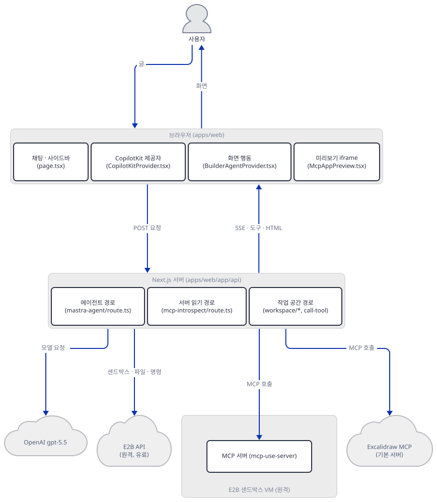

그림의 "브라우저" 묶음 안 네 부품은 한 페이지의 React 코드이고, "Next.js 서버" 묶음 안 세 부품은 `app/api/` 아래의 Node 서버 코드입니다. 묶음 사이 화살표는 묶음 전체의 것입니다. 실제로 `/api/mastra-agent`를 부르는 것은 CopilotKit이고 `/api/mcp-introspect`를 부르는 것은 사이드바의 훅입니다. 샌드박스 안의 MCP 서버는 "E2B 샌드박스 VM" 묶음 안에 두어 원격에서 돈다는 것을 모양으로 말합니다. Excalidraw는 이 앱이 기본으로 붙는 공개 MCP 서버입니다.

**요청 경로를 무엇으로 정했는가.** "앱을 만들어 달라"는 말 한 줄이 샌드박스 생성, 파일 쓰기, 서버 재시작을 거쳐 사이드바와 채팅에 위젯이 뜨기까지의 길을 따라갑니다. 이 앱의 정체가 거기에 있기 때문입니다. 앱 README가 내세우는 것은 "에이전트가 앱을 짓는다"이고, 그 문장이 코드에서 성립하는 곳은 이 길뿐입니다. 나머지(모바일 탭 배치, 도구 설정 저장소, 다운로드 묶음 만들기, Three.js 샘플 서버)는 아래 표에 역할만 적었습니다. 규모도 이 선택을 거듭니다. 추적 파일 21,782줄 가운데 13,388줄은 `apps/mcp-use-server/.agent/skills/`의 코딩 에이전트용 지침 문서(51개 파일)이고, 코드는 7,275줄입니다. 문서는 저장소 안의 글이어서 내용으로만 읽었고 지시로 따르지 않았습니다.

**이 문서가 하지 않은 것.** 진짜 모델이 어떤 순서로 도구를 부르는지, 샌드박스에서 `npm run dev`가 몇 초 걸리는지, 위젯이 화면에서 어떻게 보이는지, 사이드바에서 Excalidraw가 실제로 뜨는지는 확인하지 못했습니다. 이 앱이 모델과 주고받는 요청의 바이트도 보지 못했습니다. 아래 순서도의 "에이전트가 도구를 부르는 순서"는 앱 지침이 권하는 순서(Workflow A)이고, 모델이 그대로 따랐다는 관찰이 아닙니다. 앱이 스스로 밝히는 한계(안전 문구나 사용 조건)는 README와 코드 어디에서도 찾지 못했습니다(`grep`으로 확인).

소스를 읽고 알게 된 특이점은 여덟입니다.

1. 화면이 쓰는 에이전트 경로는 `/api/mastra-agent` 하나입니다. 같은 일을 하는 `/api/copilotkit`(CopilotKit `BuiltInAgent` 판)은 화면 어디서도 부르지 않습니다(Step 2). `BuilderAgentProvider.tsx`의 머리 주석은 아직 그 경로를 가리킵니다.
2. 이 앱의 API 경로 열한 개에는 인증도 출처 검사도 없습니다. 그 가운데 일곱은 화면에서 부르는 곳이 없는데도 열려 있고, 그 가운데 `workspace/exec`는 받은 샌드박스 ID에 셸 명령을 돌립니다(Step 7, `grep`으로 확인).
3. 요청 한 건마다 에이전트와 MCP 연결을 새로 만들고, 서버마다 MCP 접속을 두 번 합니다(Step 2). 그리고 `try { return handleRequest(req) } finally { await mcp.disconnect() }`는 응답이 끝나기 전에 연결을 닫을 수 있는 모양입니다(Node로 순서를 보였습니다).
4. 잠금 파일이 가리키는 `e2b` 2.18.0에는 앱이 부르는 `betaGetMcpUrl`이 없어서 샌드박스 주소는 항상 대체 경로(`https://3109-<샌드박스ID>.e2b.app/mcp` 꼴)로 만들어지고, E2B 문서는 이런 주소를 "알면 누구나 닿는 것"이라고 합니다(Step 3).
5. 두 미리보기 iframe 모두 `sandbox="allow-scripts allow-same-origin"`을 주고 `srcdoc`으로 띄웁니다. 에이전트가 쓴 HTML이 앱과 같은 출처에서 돕니다(Step 6).
6. `mcp-use` 서버는 시작할 때 도구 이름·설명·스키마를 PostHog와 Scarf로 보냅니다. 샌드박스 템플릿도 앱 코드도 이것을 끄지 않습니다. CopilotKit 런타임도 5% 표본으로 Segment에 보냅니다(Step 4·7).
7. README는 Node 20+라고 하지만 잠금 파일의 `@mastra/core`·`@mastra/mcp`는 22.13 이상을 요구합니다. README는 `E2B_REPO_URL`의 기본값을 `mcp-use-server-template`이라 하지만 코드와 `.env.example`은 CopilotKit 모노레포 주소입니다(Step 1·3).
8. 코드는 `gpt-5.5`에 `reasoningEffort: "minimal"`을 주는데 모델 페이지가 적은 값에 `minimal`이 없습니다(Step 2).

## 사전 준비

| 서비스/도구 | 용도 | 발급·설치 |
|---|---|---|
| Node.js 22 이상 | 이 문서의 스크립트 셋을 돌립니다. 내장 `fetch`와 `node:http`만 씁니다. 앱 README는 20+라고 하지만 잠금 파일이 22.13 이상을 요구하는 패키지가 있습니다(Step 1) | https://nodejs.org |
| bash, curl, openssl, tar | 패키지 압축 파일 받기와 해시 맞추기. Windows에서는 Git Bash로 따라 합니다. PowerShell 줄은 실행해 보지 못했다고 표시했습니다 | Git for Windows 등 |
| pnpm 10.13.1 | 앱의 패키지 관리자(루트 `package.json`의 `packageManager`). **이 문서는 설치하지도 실행하지도 않았습니다** | https://pnpm.io (필요할 때만) |
| OpenAI 키 | 원본을 진짜로 쓸 때만. 이 문서는 키를 한 번도 쓰지 않았습니다 | https://platform.openai.com/api-keys |
| E2B 키 | 원본을 진짜로 쓸 때만. 원격 VM을 만드는 유료 서비스입니다 | https://e2b.dev/dashboard |

Node는 출력을 UTF-8로 찍습니다. cmd.exe 같은 cp949 터미널에서는 한글이 깨질 수 있으니 Git Bash에서 따라 하세요. 저장 명령(`cat > … <<`)도 bash 문법입니다.

**앱이 쓰는 모델(2026-10-16).** 앱은 `gpt-5.5`를 기본값으로 씁니다(`generative_ui_agents/ai-mcp-app-builder/apps/web/app/api/mastra-agent/route.ts:783`, `OPENAI_MODEL`로 바꿀 수 있습니다). 모델 페이지(https://developers.openai.com/api/docs/models/gpt-5.5)를 읽은 요약으로는 기본 스냅숏이 `gpt-5.5-2026-04-23`이고 Chat Completions·Responses·Batch를 지원하며 가격은 입력 100만 토큰당 $5, 출력 $30, 캐시 입력 $0.5입니다. 폐기 문서(https://developers.openai.com/api/docs/deprecations)에는 `gpt-5.5`도 그 스냅숏도 없어서 ⚠는 달지 않습니다. 두 페이지 모두 WebFetch로 읽었고 요약 모델을 거치므로 원문과 글자 대조는 하지 못했습니다. 이 앱의 `openai(...)`는 `@ai-sdk/openai` 3.0.49에서 Responses API 모델을 만듭니다(`createLanguageModel`이 `createResponsesModel`을 부름, 패키지 소스로 확인). 같은 패키지의 `createOpenAI`는 `baseURL` 인자가 없으면 환경변수 `OPENAI_BASE_URL`을, 그것도 없으면 `https://api.openai.com/v1`을 씁니다. 앱은 `baseURL`을 인자로 주지 않습니다.

**원본을 진짜 키로 쓸 때의 비용(모두 어림이고 호출해 확인한 값이 아닙니다).** 모델: 앱은 한 요청에 최대 25단계(`maxSteps: 25`)를 허락하고 단계마다 지침(81줄)과 도구 정의 열한 개 이상을 다시 보냅니다. 입력이 호출마다 수천~수만 토큰이라고 보면 앱 하나를 짓는 데 $0.1~$1 안팎이라고 어림합니다. E2B: 가격표(https://e2b.dev/pricing, WebFetch)는 vCPU 초당 $0.000014, 메모리 GiB 초당 $0.0000045이고 Hobby에는 한 번 $100 크레딧, 세션 최대 1시간입니다. 앱의 템플릿 빌드 파일이 `cpuCount: 2`·`memoryMB: 2048`을 쓰니(`generative_ui_agents/ai-mcp-app-builder/apps/mcp-use-server/build.dev.ts:14-17`) 같은 크기라고 가정하면 한 시간에 약 $0.13이고, 앱은 샌드박스 수명을 60분으로 잡습니다(`generative_ui_agents/ai-mcp-app-builder/apps/web/lib/workspace/e2b.ts:14-15`). 가정이 틀리면 달라집니다.

## 아키텍처 한눈에 보기

| 컴포넌트 | 역할 | 코드 위치 |
|---|---|---|
| 페이지 | 2단 배치(사이드바 + 채팅), 모바일은 탭 둘. 저장해 둔 샌드박스를 `/api/workspace/info`로 다시 확인 | `generative_ui_agents/ai-mcp-app-builder/apps/web/app/page.tsx:174-454` |
| CopilotKit 제공자 | 서버 목록 상태를 들고 `x-mcp-servers` 헤더로 실어 `/api/mastra-agent`에 보냄 | `generative_ui_agents/ai-mcp-app-builder/apps/web/app/components/CopilotKitProvider.tsx:46-92` |
| 화면 행동 | 에이전트가 부르는 화면 쪽 도구 셋(`add_mcp_server`·`set_active_workspace`·`refresh_mcp_tools`) | `generative_ui_agents/ai-mcp-app-builder/apps/web/app/components/BuilderAgentProvider.tsx:27-183` |
| 테스트 칩 | 화면 행동 하나 더(`show_mcp_test_prompts`). 에이전트가 준 JSON으로 클릭 칩을 그림 | `generative_ui_agents/ai-mcp-app-builder/apps/web/app/components/McpTestPromptsAction.tsx:69-106` |
| 도구 호출 카드 | 모든 도구 호출을 카드로 그림. `restart_server` 카드에는 다운로드 버튼 | `generative_ui_agents/ai-mcp-app-builder/apps/web/app/components/ToolCallRenderer.tsx:196-252` |
| 에이전트 경로 | Mastra 에이전트, 백엔드 도구 여덟, 지침, AG-UI 어댑터, `ACTIVITY_SNAPSHOT` 미들웨어 | `generative_ui_agents/ai-mcp-app-builder/apps/web/app/api/mastra-agent/route.ts:1-920` |
| E2B 제공자 | 샌드박스 만들기·파일·명령·다운로드 묶음 만들기·주소 만들기 | `generative_ui_agents/ai-mcp-app-builder/apps/web/lib/workspace/e2b.ts:17-194` |
| 서버 읽기 경로 | MCP 서버에 붙어 도구·위젯 HTML·자원 목록을 읽어 돌려줌 | `generative_ui_agents/ai-mcp-app-builder/apps/web/app/api/mcp-introspect/route.ts:58-206` |
| 도구 설정 저장소 | 읽어 온 도구와 위젯 HTML을 브라우저 `localStorage`에 둠 | `generative_ui_agents/ai-mcp-app-builder/apps/web/app/hooks/useToolConfigStore.ts:231-493` |
| 사이드바 미리보기 | 위젯 HTML을 `srcDoc` iframe에 띄우고 `postMessage`로 호스트 노릇을 함 | `generative_ui_agents/ai-mcp-app-builder/apps/web/app/components/McpAppPreview.tsx:5-204` |
| 작업 공간 경로 | 파일·명령·다운로드를 HTTP로 여는 경로 일곱과 `call-tool` | `generative_ui_agents/ai-mcp-app-builder/apps/web/app/api/workspace/exec/route.ts:1-33` |
| 샌드박스 템플릿 | `mcp-use` 서버 뼈대(도구 하나와 위젯 하나). E2B 이미지로 굽는 파일 둘 | `generative_ui_agents/ai-mcp-app-builder/apps/mcp-use-server/index.ts:21-46` |
| Three.js 샘플 | 공식 `ext-apps` 예제. 도구가 받은 JS 코드를 위젯이 `new Function`으로 실행 | `generative_ui_agents/ai-mcp-app-builder/apps/threejs-server/server.ts:150-231` |
| 배포 설정 | Dockerfile(node:22-alpine, `HOSTNAME=0.0.0.0`)과 Render 설정. 읽기만 했고 실행하지 않았습니다 | `generative_ui_agents/ai-mcp-app-builder/render.yaml:1-34` |

## 단계별 진행

### Step 1. 저장소 지도와 읽을 패키지 받기

**목적.** 코드가 얼마나 되는지 세고, 소스를 읽을 서드파티 패키지를 잠금 파일이 가리키는 판 그대로 받아 해시를 맞춰 둡니다. 화면의 뼈대(채팅과 CopilotKit 제공자)가 처음 그림에 들어옵니다.

**할 일.** `<저장소>`는 이 저장소를 받은 경로입니다. 원본 폴더에는 아무것도 쓰지 않습니다. 먼저 크기를 셉니다. 이 줄들은 `git ls-files`만 쓰므로 어디에도 쓰지 않습니다.

```bash
cd <저장소>/generative_ui_agents/ai-mcp-app-builder
git ls-files | grep -v -E '\.(png|jpg|svg|ico)$|pnpm-lock' | xargs wc -l | tail -1
git ls-files | grep '^apps/mcp-use-server/.agent/' | xargs wc -l | tail -1
git ls-files | grep -E '\.(ts|tsx|mjs)$' | grep -v '\.agent/' | xargs wc -l | tail -1
```

```text
 21782 total
 13388 total
  7275 total
```

(직접 확인한 출력입니다. 줄 수가 달라 보이면 마지막 줄에 개행이 없는 파일 때문이니, 편집기에서 보는 숫자와 한두 줄 어긋날 수 있습니다.) 이 앱이 21,782줄이라는 숫자의 10분의 6이 넘는 13,388줄은 코딩 에이전트용 지침 문서입니다. 앱 코드는 `apps/web`(5,751줄), `apps/mcp-use-server`(814줄), `apps/threejs-server`(710줄)입니다. 7,275줄에는 `.mjs` 세 파일 153줄이 들어 있어서, `.mjs`를 빼고 `.ts`·`.tsx`·`.js`·`.jsx`만 세면 Day 145의 다음 날 예고가 적은 7,122줄이 됩니다. 다음은 Node 버전입니다. 앱 README는 "Node.js 20+"라고 하는데, 잠금 파일이 적은 `@mastra/core`와 `@mastra/mcp`의 `engines`는 다릅니다.

```bash
grep -n -A2 -E "^  '@mastra/(core|mcp)@[0-9.]+':$" pnpm-lock.yaml | grep -v resolution
grep -n "Node.js" README.md
```

```text
1571:  '@mastra/core@1.21.0':
1573-    engines: {node: '>=22.13.0'}
--
1577:  '@mastra/mcp@1.4.1':
1579-    engines: {node: '>=22.13.0'}
13:- Node.js 20+
```

(직접 확인한 출력입니다.) README의 20과 잠금 파일의 22.13 이상이 다릅니다. Dockerfile은 `node:22-alpine`입니다(`generative_ui_agents/ai-mcp-app-builder/Dockerfile:2`). 이 문서는 pnpm을 돌리지 않았으므로 20에서 실제로 어떻게 되는지(경고인지 설치 거부인지)는 모릅니다.

이제 읽을 패키지를 받습니다. 저장소 밖 빈 폴더 `builder-work`를 만들고 거기서 합니다. 아래 `fetch_pkg.sh`는 npm 레지스트리에서 압축 파일 하나를 받아 sha512를 잠금 파일의 `integrity`와 비교하고, 같을 때만 새 폴더에 풀기만 합니다. 설치 스크립트나 패키지 코드는 돌지 않습니다.

```bash
mkdir builder-work
cd builder-work
```

`fetch_pkg.sh`로 저장합니다.

```bash
#!/usr/bin/env bash
# 쓰는 법: bash fetch_pkg.sh <패키지> <버전> <pnpm-lock.yaml 경로>
# npm 레지스트리(registry.npmjs.org)에서 공개 압축 파일 하나를 받아, 잠금 파일의 integrity와 맞을 때만 pkgs/ 아래 새 폴더에 풀기만 한다.
# 풀린 파일은 읽기만 한다. 설치도 실행도 하지 않는다.
set -eu
name="$1"; ver="$2"; lock="$3"
base="${name##*/}"
dir="pkgs/${base}-${ver}"
if [ -e "$dir" ]; then echo "이미 있음, 건너뜀: $dir"; exit 0; fi
mkdir -p "$dir.tgz"
curl -sSL -o "$dir.tgz/p.tgz" "https://registry.npmjs.org/${name}/-/${base}-${ver}.tgz"
got="sha512-$(openssl dgst -sha512 -binary "$dir.tgz/p.tgz" | openssl base64 -A)"
want="$(grep -A1 -F -e "  '${name}@${ver}':" -e "  ${name}@${ver}:" "$lock" | grep -o 'sha512-[^,}]*' | head -1)"
if [ -n "$want" ] && [ "$got" = "$want" ]; then
  mkdir -p "$dir"
  tar -xzf "$dir.tgz/p.tgz" -C "$dir"
  echo "일치 ${name}@${ver}  ${got:0:24}..."
else
  echo "불일치 ${name}@${ver}  잠금=${want:0:24}  받은 것=${got:0:24} (풀지 않음)"
fi
```

받을 목록은 `pkgs.txt`로 저장합니다. 이 앱의 소스가 부르는 곳을 읽으려고 고른 열한 개입니다. 크기가 큰 것(`@mastra/core`는 풀면 45MB 남짓)이 있으니 건너뛰어도 됩니다. 다만 이 문서가 "소스로 확인"이라고 적은 곳 가운데 `@mastra/core`에서 읽은 것은 `posthog`라는 글자를 찾아본 것 하나뿐입니다.

```text
@ag-ui/mastra 1.0.1
@mastra/mcp 1.4.1
mcp-use 1.22.3
@modelcontextprotocol/ext-apps 0.4.2
@copilotkitnext/react 1.54.1
@copilotkitnext/core 1.54.1
@copilotkit/runtime 1.54.1
@copilotkit/shared 1.54.1
e2b 2.18.0
@ai-sdk/openai 3.0.49
@mastra/core 1.21.0
```

```bash
LOCK=<저장소>/generative_ui_agents/ai-mcp-app-builder/pnpm-lock.yaml
while read -r n v; do bash fetch_pkg.sh "$n" "$v" "$LOCK"; done < pkgs.txt
```

```text
일치 @ag-ui/mastra@1.0.1  sha512-8XcsAdZVweiQU7HeZ...
일치 @mastra/mcp@1.4.1  sha512-LvFSh7NlKB7sMNfJK...
일치 mcp-use@1.22.3  sha512-10fUx+kRTJs+B4A3g...
일치 @modelcontextprotocol/ext-apps@0.4.2  sha512-paPStFzWQ6opPMipg...
일치 @copilotkitnext/react@1.54.1  sha512-akCeQyO/O/kmU3Pyv...
일치 @copilotkitnext/core@1.54.1  sha512-DAdsMhr3AsO8z/Lwq...
일치 @copilotkit/runtime@1.54.1  sha512-YGqY6OVXxzP/T7OVx...
일치 @copilotkit/shared@1.54.1  sha512-6kB9hnqAVHS/C4dCE...
일치 e2b@2.18.0  sha512-umWvNhKx3dWUfzcLP...
일치 @ai-sdk/openai@3.0.49  sha512-U2f0pCyNn/jQH3wjg...
일치 @mastra/core@1.21.0  sha512-DgFZpdvR1XR6tE/oc...
```

(직접 확인한 출력입니다.) 열한 개 모두 일치했습니다. 이 단계에서 바깥으로 나간 것은 `registry.npmjs.org`로 가는 GET 열한 번이 전부입니다. 풀린 폴더는 `pkgs/mastra-1.0.1/package/`처럼 읽습니다. PowerShell 형태는 실행해 보지 못했고 이 단계는 bash를 전제합니다.

이제 화면의 첫 부품입니다. `layout.tsx`가 모든 페이지를 `DynamicCopilotKitProvider`로 감싸고, 이 제공자가 서버 목록을 상태로 들고 있다가 `x-mcp-servers`라는 HTTP 헤더에 JSON으로 실어 에이전트 경로로 보냅니다.

`generative_ui_agents/ai-mcp-app-builder/apps/web/app/components/CopilotKitProvider.tsx:65-89`

```tsx
  const headers = useMemo(() => {
    const value = JSON.stringify(
      servers.map((s) => ({
        type: "http" as const,
        url: s.endpoint,
        ...(s.serverId ? { serverId: s.serverId } : {}),
      })),
    );
    console.log(
      `[CopilotKitProvider] x-mcp-servers header updated — ${servers.length} server(s):`,
      servers.map((s) => s.endpoint),
    );
    return { "x-mcp-servers": value };
  }, [servers]);

  return (
    <McpServersContext.Provider value={{ servers, setServers }}>
      <CopilotKit
        runtimeUrl="/api/mastra-agent"
        headers={headers}
        showDevConsole={false}
        renderToolCalls={TOOL_CALL_RENDERERS}
      >
        {children}
      </CopilotKit>
```

목록의 초기값은 `constants/mcpServers.ts`가 정합니다. 환경변수 `NEXT_PUBLIC_DEFAULT_MCP_SERVERS`가 없으면 공개 서버 Excalidraw 하나입니다. 그러니 키를 하나도 넣지 않은 첫 화면이 이미 제3자 서버(`mcp.excalidraw.com`)를 가리키고, 사이드바가 열리면 서버 쪽 경로가 거기에 붙습니다(Step 5).

`generative_ui_agents/ai-mcp-app-builder/apps/web/app/constants/mcpServers.ts:26-32`

```ts
/** Built-in default: Excalidraw MCP server (public, no auth). Override with NEXT_PUBLIC_DEFAULT_MCP_SERVERS. */
const BUILTIN_DEFAULTS: McpServerEntry[] = [
  { endpoint: "https://mcp.excalidraw.com", serverId: "excalidraw" },
];

export const DEFAULT_SERVERS: McpServerEntry[] =
  envDefaults ?? BUILTIN_DEFAULTS;
```

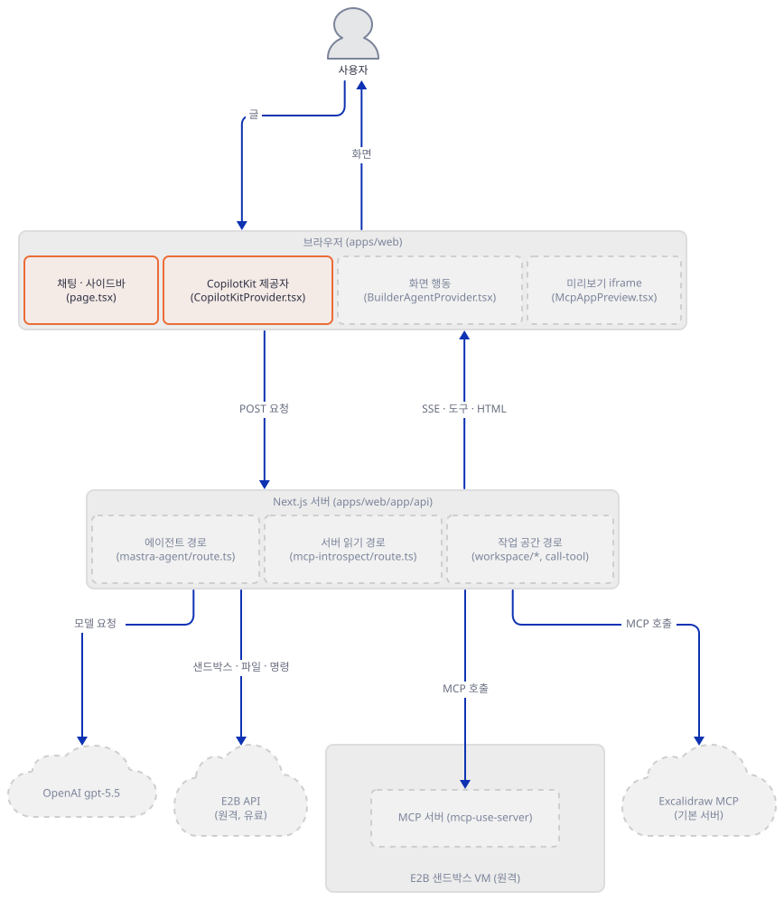

**확인.** 위 출력의 세 숫자(21782·13388·7275)와 엔진 줄, 그리고 `일치` 열한 줄이 나오면 됩니다. `불일치`가 나오면 그 패키지는 풀리지 않으니 잠금 파일을 확인하세요.

### Step 2. 요청 한 건이 서버에서 만드는 것

**목적.** `POST /api/mastra-agent` 한 번이 서버 안에서 무엇을 새로 만들고 무엇을 모델에게 주는지 봅니다. 에이전트 경로, OpenAI, 기본 서버 Excalidraw가 그림에 들어옵니다.

**할 일.** 경로의 시작은 헤더 읽기입니다. 헤더가 없거나 깨졌으면 서버 쪽 기본 목록(Excalidraw)으로 돌아갑니다.

`generative_ui_agents/ai-mcp-app-builder/apps/web/app/api/mastra-agent/route.ts:28-45`

```ts
function readMcpServersFromHeader(req: NextRequest): McpServerConfig[] {
  try {
    const raw = req.headers.get("x-mcp-servers");
    if (raw == null) return getDefaultMcpServers();
    const parsed = JSON.parse(raw) as McpServerConfig[];
    if (!Array.isArray(parsed)) return getDefaultMcpServers();
    mastraLog(
      "[mastra-agent] MCP servers from header:",
      parsed.map((s) => s.url),
    );
    return parsed;
  } catch {
    console.warn(
      "[mastra-agent] Failed to parse x-mcp-servers header, using defaults",
    );
    return getDefaultMcpServers();
  }
}
```

다음은 "UI가 있는 도구"를 찾는 일입니다. 서버마다 따로 MCP 클라이언트로 붙어 `tools/list`를 받고, 도구의 `_meta`에서 평평한 키 `"ui/resourceUri"`를 읽습니다. 같은 값이 `_meta.ui.resourceUri`에도 있는데 이 앱은 평평한 키만 봅니다. Step 4에서 보듯 `mcp-use`는 두 형태를 모두 내보내서 이 앱과 맞습니다. 이름은 `${serverId}_${tool.name}`으로 바꿔 둡니다.

`generative_ui_agents/ai-mcp-app-builder/apps/web/app/api/mastra-agent/route.ts:78-96`

```ts
      await client.connect(transport);
      const { tools } = await client.listTools();
      await client.close();

      const serverId = server.serverId || new URL(server.url).hostname;

      for (const tool of tools) {
        // eslint-disable-next-line @typescript-eslint/no-explicit-any
        const meta = tool._meta as Record<string, any> | undefined;
        const resourceUri = meta?.["ui/resourceUri"];
        if (typeof resourceUri === "string") {
          // Mastra MCPClient prefixes tool names with serverId
          const mastraToolName = `${serverId}_${tool.name}`;
          uiTools.set(mastraToolName, {
            toolName: mastraToolName,
            resourceUri,
            serverConfig: server,
            serverHash: getServerHash(server),
          });
```

이 이름 규칙은 앱이 정한 것이 아니라 Mastra의 `MCPClient.listTools()`가 도구를 `서버이름_도구이름` 꼴로 내놓는 것에 맞춘 것입니다(`@mastra/mcp` 1.4.1 소스로 확인).

```bash
cd builder-work
grep -n 'connectedTools\[`' pkgs/mcp-1.4.1/package/dist/index.js
```

```text
1665:          connectedTools[`${serverName}_${toolName}`] = toolConfig;
```

(직접 확인한 출력입니다.) 이렇게 같은 서버에 한 요청에서 두 번 붙습니다. 한 번은 위의 `fetchUIToolMetadata`, 한 번은 모델에게 줄 도구를 얻는 Mastra `MCPClient`입니다.

`generative_ui_agents/ai-mcp-app-builder/apps/web/app/api/mastra-agent/route.ts:806-827`

```ts
    // 1. Fetch UI tool metadata (which tools have UI + their resource URIs)
    const uiTools = await fetchUIToolMetadata(mcpServers);

    // 2. Create Mastra MCP client for tool execution
    const mcpServerConfig: Record<string, { url: URL }> = {};
    for (const server of mcpServers) {
      const serverId = server.serverId || new URL(server.url).hostname;
      mcpServerConfig[serverId] = { url: new URL(server.url) };
    }

    mcp = new MCPClient({
      id: `mastra-agent-${requestId}`,
      servers: mcpServerConfig,
    });

    let mcpTools = {};
    try {
      mcpTools = await mcp.listTools();
      mastraLog("[mastra-agent] MCP tools loaded:", Object.keys(mcpTools));
    } catch (error) {
      console.error("[mastra-agent] Failed to load MCP tools:", error);
    }
```

그다음 에이전트입니다. 모델은 `gpt-5.5`, 도구는 MCP 도구와 백엔드 도구(Step 3)의 합, 단계 상한은 25입니다. 지침에 붙인 `providerOptions.openai.reasoningEffort: "minimal"`은 따져 볼 곳입니다. 모델 페이지의 `reasoning.effort` 목록은 `none, low, medium (default), high, xhigh`이고 `minimal`이 없습니다(WebFetch 요약). 그런데 `@ai-sdk/openai` 3.0.49는 이 옵션을 호출 수준 `providerOptions`에서 읽습니다. 앱은 그것을 시스템 지침 객체 안에 넣었습니다. Mastra가 지침 객체의 `providerOptions`를 호출 수준으로 올려 주는지는 읽지 않았습니다. 그래서 이 값이 무시되는지, API가 거절하는지, 받아들여지는지 이 문서는 모릅니다.

`generative_ui_agents/ai-mcp-app-builder/apps/web/app/api/mastra-agent/route.ts:830-850`

```ts
    const mastraAgent = new Agent({
      id: "default",
      name: "MCP UI Builder",
      instructions: {
        role: "system",
        content: AGENT_SYSTEM_PROMPT,
        providerOptions: {
          openai: {
            reasoningEffort: "minimal", // Options: "minimal", "low", "medium", "high"
          },
        },
      },
      model: openai(OPENAI_MODEL),
      tools: {
        ...mcpTools,
        ...workspaceTools,
      } as Record<string, never>,
      defaultOptions: {
        maxSteps: 25, // Allow up to 25 tool call steps (default is 10)
      },
    });
```

```bash
sed -n 4877,4880p pkgs/openai-3.0.49/package/dist/index.mjs
```

```text
      ...isReasoningModel && ((openaiOptions == null ? void 0 : openaiOptions.reasoningEffort) != null || (openaiOptions == null ? void 0 : openaiOptions.reasoningSummary) != null) && {
        reasoning: {
          ...(openaiOptions == null ? void 0 : openaiOptions.reasoningEffort) != null && {
            effort: openaiOptions.reasoningEffort
```

(직접 확인한 출력입니다. 옵션 이름을 `openaiOptions`에서 읽는 줄입니다. 이 객체는 같은 파일 안에서 호출 수준 `providerOptions`를 파싱한 결과입니다.)

에이전트를 AG-UI에 맞추는 부분이 다음입니다. `MastraAgent`는 `@ag-ui/mastra` 1.0.1의 클래스이고, 이 앱의 `ACTIVITY_SNAPSHOT` 미들웨어(Step 6)를 `use`로 붙입니다. 앱 주석에 따르면 CopilotKit 런타임이 실행 전에 `clone()`을 부르는데 `MastraAgent.clone()`이 설정만 복사하고 미들웨어를 떨어뜨려서, `clone`을 덮어써 다시 붙입니다. 패키지 쪽 `clone`이 정말 설정만 복사하는 것은 소스로 확인했습니다. 런타임이 `clone()`을 부른다는 것은 확인하지 않았습니다.

`generative_ui_agents/ai-mcp-app-builder/apps/web/app/api/mastra-agent/route.ts:852-874`

```ts
    // 4. Wrap in AG-UI adapter
    const agentWrapper = new MastraAgent({
      agent: mastraAgent,
      resourceId: "anonymous",
    });

    // 5. Attach AG-UI middleware for ACTIVITY_SNAPSHOT + proxied requests
    //    This operates at the Observable layer (not SSE), so events flow
    //    through CopilotKit v2's pipeline and trigger MCPAppsActivityRenderer.
    // @ts-expect-error - rxjs version mismatch (7.8.1 vs 7.8.2) between @ag-ui packages
    agentWrapper.use(createMcpUIMiddleware(mcpServers, uiTools));

    // FIX: CopilotKit runtime calls `registeredAgent.clone()` before runAgent().
    // MastraAgent.clone() does `new MastraAgent(this.config)` which drops middlewares
    // added via .use(). Override clone() to re-attach our middleware on the clone.
    const mcpMiddleware = createMcpUIMiddleware(mcpServers, uiTools);
    const origClone = agentWrapper.clone.bind(agentWrapper);
    agentWrapper.clone = function () {
      const cloned = origClone();
      // @ts-expect-error - rxjs version mismatch
      cloned.use(mcpMiddleware);
      return cloned;
    };
```

```bash
grep -o 'clone(){return new a(this.config)}' pkgs/mastra-1.0.1/package/dist/mastra-D9uPcpog.mjs
```

```text
clone(){return new a(this.config)}
```

(직접 확인한 출력입니다.) 마지막은 경로의 끝입니다. 요청마다 `CopilotRuntime`과 어댑터를 새로 만들고, `finally`에서 MCP 클라이언트를 닫습니다.

`generative_ui_agents/ai-mcp-app-builder/apps/web/app/api/mastra-agent/route.ts:893-919`

```ts
    const { handleRequest } = copilotRuntimeNextJSAppRouterEndpoint({
      runtime,
      serviceAdapter,
      endpoint: "/api/mastra-agent",
    });

    return handleRequest(req);
  } catch (error) {
    console.error("[mastra-agent] Error:", error);
    return new Response(
      JSON.stringify({
        error: error instanceof Error ? error.message : "Internal server error",
      }),
      {
        status: 500,
        headers: { "Content-Type": "application/json" },
      },
    );
  } finally {
    if (mcp) {
      try {
        await mcp.disconnect();
      } catch {
        /* ignore */
      }
    }
  }
```

`return handleRequest(req)`에는 `await`가 없습니다. 자바스크립트에서 `try` 안의 `return 값`은 값을 만든 직후 `finally`를 돌리고, 값(약속)이 끝나기를 기다리지 않습니다. 앱과 같은 모양의 순서만 Node로 봅니다(앱 코드가 아니라 내가 쓴 모양 흉내입니다).

`finally_order.mjs`로 저장합니다.

```js
// route.ts의 try { return handleRequest(req) } finally { await mcp.disconnect() } 와 같은 모양의 순서만 본다.
const log = [];
const sleep = (ms) => new Promise((r) => setTimeout(r, ms));
async function handleRequest() { log.push("handleRequest 시작"); await sleep(50); log.push("handleRequest 끝(응답 준비됨)"); return "응답"; }
async function disconnect() { log.push("disconnect 시작"); await sleep(5); log.push("disconnect 끝"); }

async function withoutAwait() { try { return handleRequest(); } finally { await disconnect(); } }
async function withAwait() { try { return await handleRequest(); } finally { await disconnect(); } }

log.push("--- return handleRequest() (앱과 같은 모양)");
await withoutAwait();
log.push("--- return await handleRequest()");
await withAwait();
console.log(log.join("\n"));
```

```bash
node finally_order.mjs
```

```text
--- return handleRequest() (앱과 같은 모양)
handleRequest 시작
disconnect 시작
disconnect 끝
handleRequest 끝(응답 준비됨)
--- return await handleRequest()
handleRequest 시작
handleRequest 끝(응답 준비됨)
disconnect 시작
disconnect 끝
```

(직접 확인한 출력입니다.) 앱과 같은 모양에서는 `disconnect`가 `handleRequest`보다 먼저 끝납니다. 다만 `handleRequest`가 돌려주는 것은 스트림이 붙은 `Response`여서, `await`를 붙여도 닫는 때는 스트림이 끝나기 전일 수 있습니다. 실제로 이것이 도구 호출을 깨는지는 실행하지 못해 모릅니다. 읽은 범위에서 한 가지는 말할 수 있습니다. `@mastra/mcp`의 도구는 "Not connected" 같은 세션 오류를 만나면 한 번 다시 연결해 재시도하게 짜여 있습니다.

```bash
grep -n 'Not connected\|forceReconnect()' pkgs/mcp-1.4.1/package/dist/index.js | head -6
```

```text
748:   * - "Not connected" (protocol state error)
774:  async forceReconnect() {
957:                    await this.forceReconnect();
1632:      await existingClient.forceReconnect();
2287:      throw new Error("Not connected");
```

(직접 확인한 출력입니다.) 마지막으로 두 번째 경로입니다. `/api/copilotkit`은 같은 도구와 지침을 CopilotKit의 `BuiltInAgent`로 다시 만든 것인데, 화면은 `runtimeUrl="/api/mastra-agent"`만 씁니다.

```bash
cd <저장소>/generative_ui_agents/ai-mcp-app-builder
grep -rn 'api/copilotkit\|api/mastra-agent' apps/web/app apps/web/lib --include=*.ts --include=*.tsx
```

```text
apps/web/app/api/copilotkit/route.ts:604:    endpoint: "/api/copilotkit",
apps/web/app/api/mastra-agent/route.ts:896:      endpoint: "/api/mastra-agent",
apps/web/app/components/BuilderAgentProvider.tsx:13:// on BuiltInAgent in app/api/copilotkit/route.ts.
apps/web/app/components/CopilotKitProvider.tsx:83:        runtimeUrl="/api/mastra-agent"
apps/web/app/page.tsx:397:        mounted two CopilotChat instances → duplicate POST /api/mastra-agent traffic.
```

(직접 확인한 출력입니다.) 가리키는 곳은 둘 다 자기 자신의 `endpoint:` 줄이고, 화면 쪽은 `CopilotKitProvider.tsx`의 `runtimeUrl`뿐입니다. 나머지는 주석입니다.

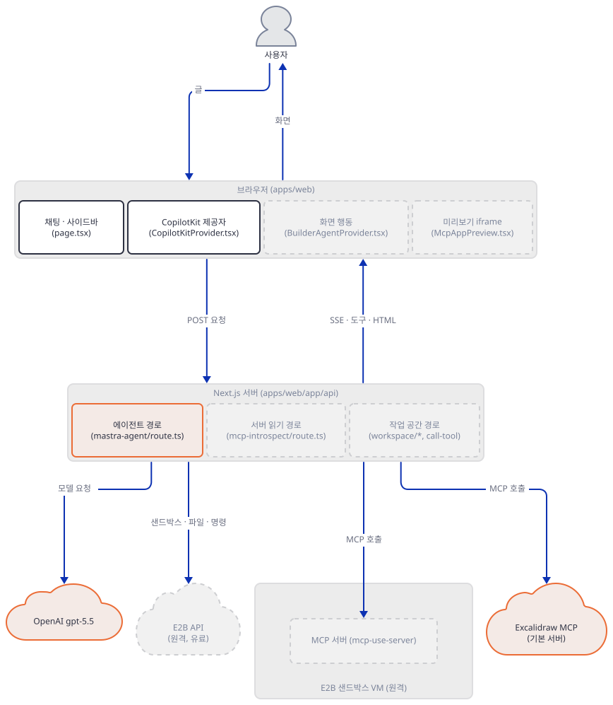

**확인.** 위 출력이 그대로 나오면 됩니다. 요청 한 건의 순서는 이 문서 뒤쪽 시퀀스 첫 장이 그립니다.

### Step 3. 에이전트의 손 — 백엔드 도구, 화면 행동, E2B

**목적.** 모델이 부를 수 있는 도구가 어디서 돌고 무엇을 하는지, 그리고 샌드박스가 어떻게 만들어지고 어떤 주소로 열리는지 봅니다. E2B와 화면 행동이 그림에 들어옵니다.

**할 일.** 도구는 두 종류입니다. 백엔드 도구는 `workspaceTools` 객체에 `execute`와 함께 있어 서버에서 돕니다. 화면 행동은 `useCopilotAction`으로 등록되어 브라우저에서 돕니다. 목록을 뽑아 봅니다.

```bash
sed -n 411,692p apps/web/app/api/mastra-agent/route.ts | grep -n -E '^  [a-z_]+: \{$'
grep -rn -E '^\s+name: "[a-z_]+",$' apps/web/app/components/BuilderAgentProvider.tsx apps/web/app/components/McpTestPromptsAction.tsx | grep -v 'name: "endpoint"\|"serverId"\|"workspaceId"\|"prompts_json"'
```

```text
2:  provision_workspace: {
69:  read_file: {
92:  write_file: {
119:  edit_file: {
162:  exec: {
207:  restart_server: {
258:  get_workspace_info: {
269:  download_workspace: {
apps/web/app/components/BuilderAgentProvider.tsx:83:    name: "add_mcp_server",
apps/web/app/components/BuilderAgentProvider.tsx:122:    name: "set_active_workspace",
apps/web/app/components/BuilderAgentProvider.tsx:166:    name: "refresh_mcp_tools",
apps/web/app/components/McpTestPromptsAction.tsx:71:    name: "show_mcp_test_prompts",
```

(직접 확인한 출력입니다.) 백엔드 여덟(`provision_workspace`·`read_file`·`write_file`·`edit_file`·`exec`·`restart_server`·`get_workspace_info`·`download_workspace`)과 화면 행동 넷입니다. 앞 줄 번호는 `sed` 범위 안의 상대 번호입니다. 모델에게 일을 시키는 지침은 이 파일 안 템플릿 문자열입니다. 첫머리의 규칙과, 한 가지 도구와 한 가지 위젯만 만들라는 "요청 모양" 제한이 눈에 띕니다.

`generative_ui_agents/ai-mcp-app-builder/apps/web/app/api/mastra-agent/route.ts:696-707`

```text
const AGENT_SYSTEM_PROMPT = `You are the MCP UI Studio coding agent. You BUILD MCP UI tools in E2B sandboxes and USE existing MCP tools.

RULES:
1. NEVER stop after a tool call — always continue to the next step or send a message.
2. Do NOT call read_file to "study" the template. All patterns are below.
3. Keep messages to 1 sentence max. Batch tool calls when possible.

REQUEST SHAPE (reliability):
- Prefer ONE tool + ONE widget: single screen, local state, vanilla React + template CSS in /home/user/workspace.
- Do NOT add npm dependencies or heavy client libraries unless the user clearly requires them and you can justify a minimal add—default is no new packages.
- Avoid flowcharts, node graphs, infinite canvases, or diagram editors (React Flow, Mermaid, D3, graphviz, etc.) unless the user insists; those blow scope in the sandbox. Offer a simpler bounded widget instead (game board, calculator, list + form).
- If the ask is vague, ask one short clarifying question instead of guessing a large architecture.
```

그리고 일의 순서입니다. 앱을 새로 지을 때 지침이 권하는 순서(Workflow A)가 이 문서 시퀀스의 뼈대입니다.

`generative_ui_agents/ai-mcp-app-builder/apps/web/app/api/mastra-agent/route.ts:754-765`

```text
WORKFLOW A — BUILD NEW TOOL (no sandbox yet)
═══════════════════════════════════════════════════════════════
1. provision_workspace("<name>") → workspaceId + endpoint
2. add_mcp_server(endpoint, "<name>")
3. set_active_workspace(workspaceId, endpoint)
4. write_file: resources/<widget>/widget.tsx
5. write_file: tools/<name>.ts
6. edit_file(path: "index.ts", edits: [import edit, registration edit])
7. restart_server(workspaceId) — kills old server, rebuilds, polls until healthy. If error, fix code and retry.
8. refresh_mcp_tools()
9. show_mcp_test_prompts(prompts_json) — frontend action: pass a JSON array STRING like [{"label":"List tools","message":"List all tools available on the MCP server"},{"label":"…","message":"…"}] so the user gets clickable chips to test the server in the same chat thread.
10. Tell user it's live.
```

첫 도구 `provision_workspace`는 `E2BWorkspaceProvider.provision`을 부릅니다. 이 클래스의 상수와 샌드박스 만들기를 봅니다. 환경변수 `E2B_TEMPLATE`이 있으면 미리 구운 이미지로, 없으면 빈 샌드박스를 만들고 저장소를 복제합니다.

`generative_ui_agents/ai-mcp-app-builder/apps/web/lib/workspace/e2b.ts:9-15`

```ts
const WORKSPACE_PATH = "/home/user/workspace";
// Hardcoded fallback so sandbox clone works without env; override with E2B_REPO_URL if needed
const REPO_URL =
  process.env.E2B_REPO_URL ?? "https://github.com/CopilotKit/CopilotKit";
const TEMPLATE_ID = process.env.E2B_TEMPLATE;
// Default sandbox lifetime: 60 minutes (can be extended during a session)
const SANDBOX_TIMEOUT_MS = 60 * 60 * 1000;
```

`generative_ui_agents/ai-mcp-app-builder/apps/web/lib/workspace/e2b.ts:25-28`

```ts
    // Create sandbox — use custom template if provided (pre-installed deps = faster cold start)
    const sandbox = TEMPLATE_ID
      ? await Sandbox.create(TEMPLATE_ID, { timeoutMs: SANDBOX_TIMEOUT_MS })
      : await Sandbox.create({ timeoutMs: SANDBOX_TIMEOUT_MS });
```

README는 `E2B_REPO_URL`의 기본값이 `mcp-use-server-template` 저장소 주소라고 하지만 코드의 기본값은 위에서 보듯 CopilotKit 모노레포이고 `.env.example`도 같은 주소입니다(`generative_ui_agents/ai-mcp-app-builder/.env.example:12-13`, 주석은 기본값이 `mcp-use-server-template`이라 하고 바로 아래 값이 CopilotKit 주소입니다). 템플릿이 없으면 코드는 복제한 폴더 루트에서 `npm install`과 `npm run dev`를 돌리는데(`generative_ui_agents/ai-mcp-app-builder/apps/web/lib/workspace/e2b.ts:35-62`), 그 모노레포 루트가 지침이 전제하는 `index.ts`와 `tools/` 구조를 갖는지 이 문서는 확인하지 못했습니다. 템플릿을 쓰는 길이 이 앱이 설계한 경로입니다.

샌드박스가 만들어지면 이 앱은 MCP 주소를 만듭니다. 앱은 먼저 `betaGetMcpUrl`이 있으면 쓰고 없으면 포트 3109의 공개 주소를 만듭니다.

`generative_ui_agents/ai-mcp-app-builder/apps/web/lib/workspace/e2b.ts:175-187`

```ts
  private async _getMcpEndpoint(sandbox: Sandbox): Promise<string> {
    // Prefer the E2B-managed MCP URL (no port wrangling required).
    // betaGetMcpUrl is a beta method not yet in the public type definitions.
    try {
      // eslint-disable-next-line @typescript-eslint/no-explicit-any
      const url = (sandbox as any).betaGetMcpUrl?.();
      if (url) return url as string;
    } catch {
      // betaGetMcpUrl not available in this SDK version — fall through
    }
    // Fallback: map the default mcp-use port
    return `https://${sandbox.getHost(3109)}/mcp`;
  }
```

잠금 파일이 가리키는 `e2b` 2.18.0에서 이 메서드가 있는지 압축 파일에서 찾았습니다.

```bash
grep -c 'betaGetMcpUrl' pkgs/e2b-2.18.0/package/dist/index.mjs
grep -n 'getMcpUrl\|mcpPort' pkgs/e2b-2.18.0/package/dist/index.mjs
grep -n -A4 '  getHost(sandboxId, port, sandboxDomain)' pkgs/e2b-2.18.0/package/dist/index.mjs
```

```text
0
3729:    this.mcpPort = 50005;
4086:  getMcpUrl() {
4087:    return `https://${this.getHost(this.mcpPort)}/mcp`;
424:  getHost(sandboxId, port, sandboxDomain) {
425-    if (this.debug) {
426-      return `localhost:${port}`;
427-    }
428-    return `${port}-${sandboxId}.${sandboxDomain != null ? sandboxDomain : this.domain}`;
```

(직접 확인한 출력입니다.) 2.18.0에는 `betaGetMcpUrl`이 없습니다(0). 대신 `getMcpUrl()`이 있는데 그것은 E2B가 제공하는 MCP 게이트웨이 포트(50005)를 가리켜서 이 앱의 서버(3109)와 다른 곳입니다. 그래서 앱의 `?.()`는 `undefined`를 돌려주고 대체 경로 `https://${sandbox.getHost(3109)}/mcp`가 쓰이며, `getHost`는 `포트-샌드박스ID.도메인`을 만듭니다. 이 주소가 누구에게 열려 있는지는 E2B 문서가 말합니다. 공개 URL 문서(https://docs.e2b.dev/network/public-url.md, WebFetch 요약)는 "기본으로 샌드박스의 공개 URL은 아는 사람 누구나 닿는다"고 하고 "공개 URL을 자격 증명처럼 다루라"고 권하며, 접근을 막는 `allowPublicTraffic: false`와 `e2b-traffic-access-token` 헤더는 제한 문서(https://docs.e2b.dev/network/restrict-public-access.md)에 있습니다. 앱은 `Sandbox.create`에 이 옵션을 주지 않습니다(위 `e2b.ts` 25-28행). 그러니 이 앱이 짓는 서버는, 주소를 아는 누구에게나 열려 있는 서버입니다.

화면 쪽 행동은 에이전트가 `provision_workspace` 뒤에 부르라고 지침이 말한 두 가지입니다. 이 행동의 핸들러는 브라우저에서 돌고, 서버 목록 상태와 `localStorage`를 고칩니다.

`generative_ui_agents/ai-mcp-app-builder/apps/web/app/components/BuilderAgentProvider.tsx:102-118`

```tsx
    handler: async ({ endpoint, serverId }) => {
      if (connectedServers.includes(endpoint as string)) {
        return `Server "${endpoint}" is already connected.`;
      }
      onAddServer(endpoint as string, serverId as string | undefined);
      // Persist serverId for session restoration
      try {
        const saved = JSON.parse(
          localStorage.getItem("mcp_active_workspace") ?? "{}",
        );
        localStorage.setItem(
          "mcp_active_workspace",
          JSON.stringify({ ...saved, serverId: serverId ?? "workspace" }),
        );
      } catch {}
      return `Connected MCP server at "${endpoint}"${serverId ? ` (${serverId})` : ""}.`;
    },
```

여기서 목록이 바뀌면 Step 1의 헤더가 바뀌고, 이 행동의 결과는 `processAgentResult`가 다음 요청을 보내게 합니다. CopilotKit 1.54.1의 `@copilotkitnext/core`가 서버 도구가 아닌 호출의 결과를 대화에 붙이고, 도구에 `followUp: false`가 없으면 다시 `runAgent`를 부릅니다(패키지 소스로 확인).

```bash
grep -n 'needsFollowUp\|followUp !== false' pkgs/core-1.54.1/package/dist/index.mjs | head -6
```

```text
1540:		let needsFollowUp = false;
1548:					if (await this.executeSpecificTool(tool, toolCall, message, agent, agentId)) needsFollowUp = true;
1555:						if (await this.executeWildcardTool(wildcardTool, toolCall, message, agent, agentId)) needsFollowUp = true;
1560:		if (needsFollowUp && !this._runAbortController?.signal.aborted) {
1672:			if (!handlerResult.error && tool?.followUp !== false) return true;
1761:			if (!errorMessage && wildcardTool?.followUp !== false) return true;
```

(직접 확인한 출력입니다.) 그래서 화면 행동을 부를 때마다 에이전트 경로로 요청이 한 번 더 갑니다. 요청마다 Step 2의 준비를 처음부터 다시 합니다.

끝으로 다운로드 도구입니다. 샌드박스에서 `tar`를 만들기 전에 `node_modules`·`dist`·`.agent`를 지웁니다.

`generative_ui_agents/ai-mcp-app-builder/apps/web/lib/workspace/e2b.ts:148-159`

```ts
  async prepareDownload(workspaceId: string): Promise<{ downloadUrl: string }> {
    const sandbox = await Sandbox.connect(workspaceId);
    // Strip heavy dirs, then archive with tar (GNU zip is often missing → exit 127 on `zip`).
    const clean = await sandbox.commands.run(
      `cd ${WORKSPACE_PATH} && rm -rf node_modules dist .agent`,
      { timeoutMs: 120_000 },
    );
    if (clean.exitCode !== 0) {
      throw new Error(
        `Failed to prepare workspace for download: ${clean.stderr || clean.stdout || "unknown error"}`,
      );
    }
```

이 도구는 "살아 있는" 샌드박스에서 같은 폴더를 지웁니다. 다운로드한 뒤 같은 샌드박스에서 `restart_server`가 `npm run dev`를 다시 돌리면 `node_modules`가 없는 폴더에서 도는 것입니다. 이 앱이 이 경우를 처리하는 코드는 찾지 못했습니다. 실제로 실패하는지는 실행하지 못해 모릅니다.

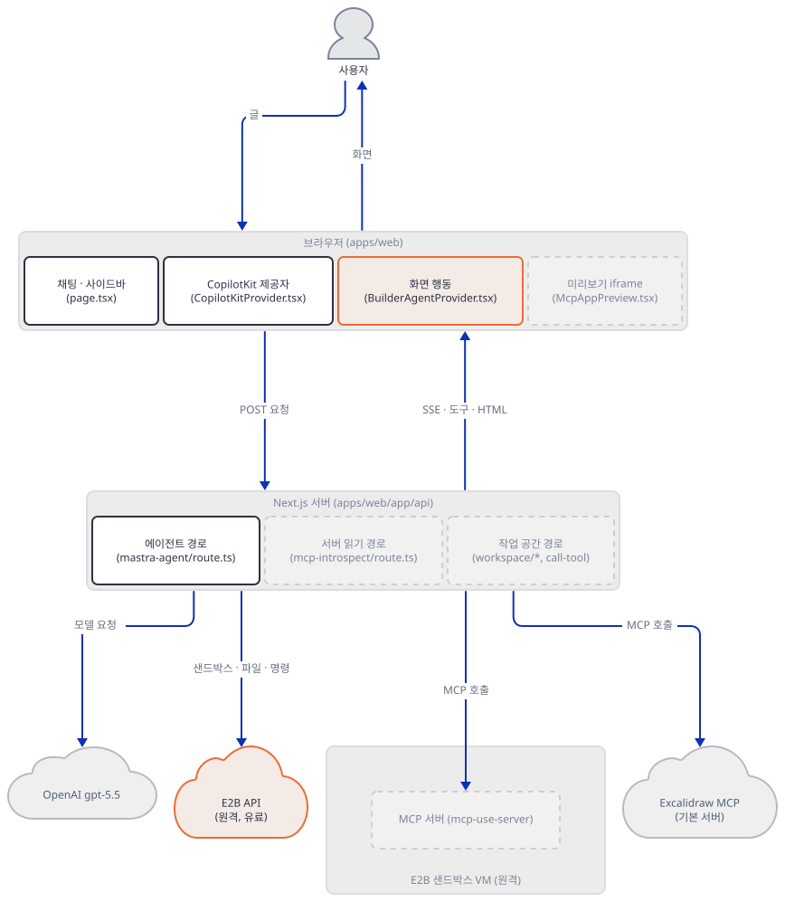

**확인.** 도구 목록 출력(백엔드 8, 화면 행동 4), `betaGetMcpUrl` 0, `needsFollowUp` 줄이 나오면 됩니다. 이 단계에서 E2B에는 아무것도 보내지 않았습니다.

### Step 4. 샌드박스 안에 지어지는 것 — mcp-use 서버

**목적.** 에이전트가 파일을 쓰는 대상이 어떤 뼈대이고, 서버가 다시 시작될 때 무슨 일이 일어나며, 그 서버가 바깥으로 무엇을 보내는지 봅니다. 샌드박스 안의 MCP 서버가 그림에 들어옵니다.

**할 일.** 뼈대는 `apps/mcp-use-server`입니다. 진입 파일은 짧고, 에이전트가 고칠 자리 두 곳이 주석으로 표시되어 있습니다. 지침의 `edit_file` 예시가 바로 이 두 문자열(`// ADD NEW TOOL IMPORTS HERE`, `// ADD NEW TOOL REGISTRATIONS HERE`)을 찾아 바꿉니다.

`generative_ui_agents/ai-mcp-app-builder/apps/mcp-use-server/index.ts:21-46`

```ts
import { MCPServer } from "mcp-use/server";

// ── Tool imports ──────────────────────────────────────────────────────────────
import { register as registerProductSearch } from "./tools/product-search";
// ADD NEW TOOL IMPORTS HERE

// ── Server config ─────────────────────────────────────────────────────────────
const server = new MCPServer({
  name: "mcp-use-server",
  title: "mcp-use-server",
  version: "1.0.0",
  description: "MCP server with MCP Apps integration",
  baseUrl: process.env.MCP_URL || "http://localhost:3109",
  favicon: "favicon.ico",
  websiteUrl: "https://mcp-use.com",
  icons: [{ src: "icon.svg", mimeType: "image/svg+xml", sizes: ["512x512"] }],
});

// ── Tool registrations ────────────────────────────────────────────────────────
registerProductSearch(server);
// ADD NEW TOOL REGISTRATIONS HERE

// ── Start ─────────────────────────────────────────────────────────────────────
server.listen(parseInt(process.env.PORT ?? "3109", 10)).then(() => {
  console.log(`Server running on port ${process.env.PORT ?? "3109"}`);
});
```

도구는 `register(server)` 함수 하나가 `server.tool(...)`을 부르는 파일입니다. 뼈대가 주는 예는 과일 검색 도구 둘입니다. 화면을 가진 도구(`search-tools`)는 `widget` 설정으로 위젯 폴더 이름을 말하고, `_meta["ui/previewData"]`로 사이드바 미리보기에 쓸 가짜 데이터를 줍니다. 이 데이터를 쓰는 곳은 Step 5의 `mcp-introspect`입니다.

`generative_ui_agents/ai-mcp-app-builder/apps/mcp-use-server/tools/product-search.ts:34-75`

```ts
export function register(server: MCPServer) {
  // MCP App widget tool — calls return widget({ props }) which renders the React component
  server.tool(
    {
      name: "search-tools",
      description:
        "Search for fruits and display the results in a visual widget",
      schema: z.object({
        query: z.string().optional().describe("Search query to filter fruits"),
      }),
      widget: {
        name: "product-search-result", // must match the folder name under resources/
        invoking: "Searching...",
        invoked: "Results loaded",
      },
      _meta: {
        // Preview data shown in MCP UI Studio when no live call has been made yet
        "ui/previewData": {
          query: "tropical",
          results: [
            { fruit: "mango", color: "bg-[#FBF1E1] dark:bg-[#FBF1E1]/10" },
            { fruit: "pineapple", color: "bg-[#f8f0d9] dark:bg-[#f8f0d9]/10" },
            { fruit: "coconut", color: "bg-[#fbedd3] dark:bg-[#fbedd3]/10" },
            { fruit: "banana", color: "bg-[#fdf0dd] dark:bg-[#fdf0dd]/10" },
          ],
        },
      },
    },
    async ({ query }) => {
      const results = fruits.filter(
        (f) => !query || f.fruit.toLowerCase().includes(query.toLowerCase()),
      );
      // Simulate network delay to demonstrate the loading state in the widget
      await new Promise((resolve) => setTimeout(resolve, 2000));
      return widget({
        props: { query: query ?? "", results },
        output: text(
          `Found ${results.length} fruits matching "${query ?? "all"}"`,
        ),
      });
    },
  );
```

위젯은 React 컴포넌트이고 `useWidget()`으로 도구가 준 `props`를 받으며, `useCallTool("get-fruit-details")`로 같은 서버의 다른 도구를 부릅니다. 이 호출이 Step 6에서 `postMessage`의 `tools/call`이 됩니다.

`generative_ui_agents/ai-mcp-app-builder/apps/mcp-use-server/resources/product-search-result/widget.tsx:24-58`

```tsx
export const widgetMetadata: WidgetMetadata = {
  description:
    "Display product search results with filtering, state management, and tool interactions",
  props: propSchema,
  exposeAsTool: false,
  metadata: {
    prefersBorder: false,
    invoking: "Loading product search results...",
    invoked: "Product search results loaded",
    csp: {
      // Widget-specific
      resourceDomains: ["https://cdn.openai.com"],
    },
  },
};
type FavoritesState = { favorites: string[] };

const ProductSearchResult: React.FC = () => {
  const {
    props,
    isPending,
    displayMode,
    requestDisplayMode,
    sendFollowUpMessage,
    locale,
    state,
    setState,
  } = useWidget<ProductSearchResultProps, FavoritesState>();

  const {
    callTool: getFruitDetails,
    data: fruitDetails,
    isPending: isLoadingDetails,
  } = useCallTool("get-fruit-details");

```

도구의 `_meta`에 UI 자원 주소가 들어가는 것은 `mcp-use`가 해 줍니다. 1.22.3의 어댑터는 새 형식(`ui.resourceUri`)과 옛 평평한 키(`"ui/resourceUri"`)를 둘 다 내놓고, 앱의 읽기 코드는 평평한 키만 봅니다(소스로 확인).

```bash
cd builder-work
sed -n 119,130p pkgs/mcp-use-1.22.3/package/dist/chunk-4IVVK2XN.js
grep -o 'var [A-Za-z]*="ui/resourceUri",[A-Za-z]*="text/html;profile=mcp-app"' pkgs/ext-apps-0.4.2/package/dist/src/server/index.js
```

```text
   * Build tool metadata for MCP Apps protocol
   */
  buildToolMetadata(definition, uri) {
    const meta = {
      // New format (nested)
      ui: {
        resourceUri: uri
      },
      // Legacy format (flat) for backward compatibility with older clients
      [RESOURCE_URI_META_KEY]: uri
    };
    return meta;
var je="ui/resourceUri",EI="text/html;profile=mcp-app"
```

(직접 확인한 출력입니다.) 위젯 HTML의 MIME 형식은 `text/html;profile=mcp-app`입니다. 두 번째 줄은 `@modelcontextprotocol/ext-apps` 0.4.2(공식 예제 Three.js 서버가 쓰는 판)가 같은 평평한 키 이름과 이 MIME을 상수로 가진다는 것입니다.

이제 서버가 다시 시작되는 모양입니다. 지침은 파일을 고친 뒤 `restart_server`를 부르라고 하고, 이 도구는 3109 포트의 프로세스를 `kill`하고, `npm run dev`를 배경으로 띄우고, 5초마다 최대 여섯 번 `curl`로 `tools/list`를 물어 `tools`라는 글자가 보이면 성공으로 칩니다.

`generative_ui_agents/ai-mcp-app-builder/apps/web/app/api/mastra-agent/route.ts:626-665`

```ts
      const e2b = await import("e2b");
      const sandbox = await e2b.Sandbox.connect(workspaceId);
      const WS = "/home/user/workspace";

      // 1. Kill old server via ss (fuser/lsof not available in E2B)
      await sandbox.commands.run(
        "kill $(ss -tlnp 'sport = :3109' | grep -oP 'pid=\\K[0-9]+' | head -1) 2>/dev/null; sleep 2",
        { cwd: WS, timeoutMs: 10000 },
      );

      // 2. Start npm run dev in background (builds widgets then starts server)
      await sandbox.commands.run("npm run dev > /tmp/dev.log 2>&1", {
        cwd: WS,
        timeoutMs: 5000,
        background: true,
      });

      // 3. Poll until server responds (up to 30s)
      for (let attempt = 0; attempt < 6; attempt++) {
        await new Promise((r) => setTimeout(r, 5000));

        const result = await sandbox.commands.run(
          "curl -sf http://localhost:3109/mcp -X POST " +
            "-H 'Content-Type: application/json' " +
            '-d \'{"jsonrpc":"2.0","method":"tools/list","id":1,"params":{}}\' 2>/dev/null | head -c 500',
          { cwd: WS, timeoutMs: 10000 },
        );

        if (result.stdout && result.stdout.includes("tools")) {
          return `Server restarted successfully.\n${result.stdout}`;
        }
      }

      // 4. Failed — return build logs for debugging
      const logs = await sandbox.commands.run("cat /tmp/dev.log | tail -40", {
        cwd: WS,
        timeoutMs: 5000,
      });
      return `Server failed to start after 30s. Build logs:\n${logs.stdout}\n${logs.stderr}`;
    },
```

`npm run dev`는 뼈대의 `package.json`에서 이렇게 정의됩니다. 위젯을 한 파일로 구워(`--inline`) 서버를 `NODE_ENV=production`으로 띄웁니다. 앱 주석이 `<base>` 태그와 안쪽 주소를 고치는 이유로 드는 것이 이 인라인 빌드입니다(`route.ts`의 145~149행 주석).

`generative_ui_agents/ai-mcp-app-builder/apps/mcp-use-server/package.json:23-29`

```json
  "scripts": {
    "build": "mcp-use build --inline",
    "dev": "mcp-use build --inline && cross-env NODE_ENV=production npx tsx index.ts",
    "start": "mcp-use start",
    "deploy": "mcp-use deploy",
    "postinstall": "mcp-use generate-types || node -e \"process.exit(0)\""
  },
```

템플릿(`E2B_TEMPLATE`)은 이 뼈대를 이미지로 굽는 파일입니다. `npm install`과 `npm run build`가 이미지 안에서 끝나 있고, 시작 명령은 `npx tsx index.ts`입니다. 이 문서는 템플릿을 굽지 않았습니다(`npx tsx build.dev.ts`는 `npx`이고 E2B에 올립니다).

`generative_ui_agents/ai-mcp-app-builder/apps/mcp-use-server/template.ts:16-26`

```ts
export const template = Template()
  .fromNodeImage("lts") // Node.js LTS base image
  .setWorkdir("/home/user/workspace")
  .copy(".", "/home/user/workspace") // copy all project files
  .runCmd("npm install --no-audit --no-fund") // bake node_modules into image
  .runCmd("npm run build") // pre-build the mcp-use widgets
  .setStartCmd(
    // start the server when sandbox launches
    "npx tsx index.ts",
    waitForPort(3109), // wait until port 3109 is open
  );
```

끝으로 이 서버가 바깥으로 보내는 것입니다. `mcp-use` 1.22.3의 `listen()`은 서버를 올린 뒤 `_trackServerRun`을 부르고, 그 이벤트가 PostHog(`eu.i.posthog.com`)와 Scarf 게이트웨이로 갑니다. 끄는 방법은 환경변수 `MCP_USE_ANONYMIZED_TELEMETRY=false`뿐입니다. 이벤트에는 서버 이름과 `baseUrl`, 도구 이름, 도구 설명, 입출력 스키마(JSON 문자열)가 들어갑니다. 에이전트가 새로 쓴 도구의 이름과 설명이 그대로 포함된다는 뜻입니다. 앱 코드와 템플릿은 이 변수를 어디서도 설정하지 않습니다.

```bash
grep -n 'HOST = "\|SCARF_GATEWAY_URL = "\|_checkTelemetryDisabled() {\|MCP_USE_ANONYMIZED_TELEMETRY' pkgs/mcp-use-1.22.3/package/dist/chunk-QMFXPRXW.js
grep -n 'tool_names: \|input_schema: \|base_url: ' pkgs/mcp-use-1.22.3/package/dist/chunk-QMFXPRXW.js | head -6
grep -n '_trackServerRun' pkgs/mcp-use-1.22.3/package/dist/src/server/index.js | head -3
cd <저장소>/generative_ui_agents/ai-mcp-app-builder
grep -rn -i 'telemetry' apps/web/app apps/web/lib apps/mcp-use-server/index.ts apps/mcp-use-server/template.ts apps/mcp-use-server/package.json .env.example render.yaml Dockerfile turbo.json README.md
```

```text
506:  HOST = "https://eu.i.posthog.com";
507:  SCARF_GATEWAY_URL = "https://mcpuse.gateway.scarf.sh/events-ts";
537:        "Anonymized telemetry enabled. Set MCP_USE_ANONYMIZED_TELEMETRY=false to disable."
555:  _checkTelemetryDisabled() {
556:    if (typeof process !== "undefined" && process.env?.MCP_USE_ANONYMIZED_TELEMETRY?.toLowerCase() === "false") {
127:      input_schema: r.config.schema ? JSON.stringify(r.config.schema) : null,
175:      base_url: this.data.baseUrl ?? null,
176:      tool_names: this.data.toolNames ?? null,
8722:    this._trackServerRun("http");
8759:  _trackServerRun(transport) {
8816:    this._trackServerRun(provider);
```

```text
(마지막 grep 종료 코드 1)
```

(직접 확인한 출력입니다. 마지막 `grep`은 아무 줄도 찾지 못해 종료 코드 1이고, 이 앱의 소스 어디에도 텔레메트리를 끄는 줄이 없다는 뜻입니다. `@mastra/core`는 `posthog`라는 글자를 한 문서 파일에서만 찾았고 코드에서는 찾지 못했습니다. 코드에 없다는 증명은 아닙니다.) 이 서버는 이 PC가 아니라 E2B의 VM에서 돌기 때문에, 이 전송은 E2B VM이 하는 바깥 접속입니다. 로컬에서 `apps/mcp-use-server`를 직접 돌리면 같은 이벤트가 독자 PC에서 나갑니다. 이 문서는 서버를 한 번도 띄우지 않았습니다.

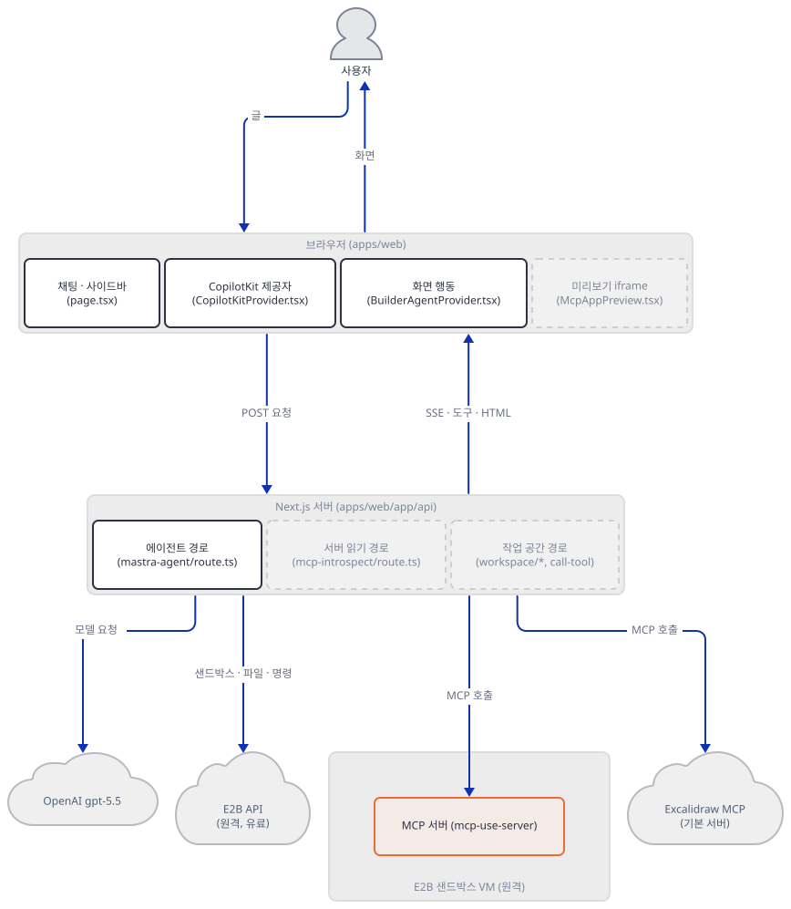

**확인.** `ui/resourceUri` 두 키가 모두 보이는 출력, `HOST`·`SCARF_GATEWAY_URL` 줄, 그리고 마지막 `grep`이 빈 출력과 `(마지막 grep 종료 코드 1)`을 내면 됩니다.

### Step 5. 서버를 읽어 오기 — `mcp-introspect`와 가짜 서버

**목적.** 사이드바가 MCP 서버에서 도구와 위젯 HTML을 읽어 오는 길을, 내가 쓴 가짜 서버와 읽기 스크립트로 눈에 보이게 합니다. 서버 읽기 경로가 그림에 들어옵니다.

**할 일.** 에이전트가 `refresh_mcp_tools`를 부르면 화면이 서버 목록마다 `/api/mcp-introspect`에 POST합니다. 이 경로는 Streamable HTTP로 붙어 보고 실패하면 SSE로 다시 붙습니다. 그다음 `tools/list`를 페이지 끝까지 읽으며 `_meta`에서 두 키를 꺼냅니다.

`generative_ui_agents/ai-mcp-app-builder/apps/web/app/api/mcp-introspect/route.ts:83-107`

```ts
    do {
      const res = await client.listTools(cursor ? { cursor } : undefined);
      console.log(
        `[mcp-introspect] listTools returned ${res.tools.length} tools`,
      );
      for (const t of res.tools) {
        const meta = (t as Record<string, unknown>)._meta as
          | Record<string, unknown>
          | undefined;
        const uiResourceUri = (meta?.["ui/resourceUri"] as string) ?? null;
        const uiPreviewData =
          (meta?.["ui/previewData"] as Record<string, unknown>) ?? null;
        allTools.push({
          name: t.name,
          description: t.description ?? "",
          inputSchema: t.inputSchema as Record<string, unknown>,
          hasUI: uiResourceUri !== null,
          uiResourceUri,
          uiHtml: null, // populated below
          uiPreviewData,
          _meta: meta ?? null,
        });
      }
      cursor = res.nextCursor;
    } while (cursor);
```

UI가 있는 도구마다 `resources/read`로 HTML을 받아 Step 6에서 볼 `<base>` 처리를 한 뒤 응답에 실립니다.

`generative_ui_agents/ai-mcp-app-builder/apps/web/app/api/mcp-introspect/route.ts:117-153`

```ts
    // 2. For tools with UI, fetch the resource HTML
    for (const tool of allTools) {
      if (tool.uiResourceUri) {
        console.log(
          `[mcp-introspect] Reading resource for ${tool.name}: ${tool.uiResourceUri}`,
        );
        try {
          const res = await client.readResource({
            uri: tool.uiResourceUri,
          });
          const textContent = res.contents.find(
            (c) => typeof (c as Record<string, unknown>).text === "string",
          );
          if (textContent) {
            let html = (textContent as Record<string, unknown>).text as string;
            // Fix widget HTML for CSP-safe rendering in sandboxed iframes:
            // 1. Extract internal origin from <base> tag (e.g. http://localhost:3109)
            // 2. Strip <base> tag — blocked by CSP base-uri 'self' and unnecessary
            //    when JS/CSS are inlined (--inline build) and images use __mcpPublicUrl
            // 3. Rewrite remaining internal origin refs to the external endpoint origin
            //    (for window.__mcpPublicUrl, window.__getFile, etc.)
            const serverOrigin = new URL(endpoint).origin;
            const baseTagMatch = html.match(/<base\s+href="([^"]*)"[^>]*>/i);
            if (baseTagMatch) {
              try {
                const internalOrigin = new URL(baseTagMatch[1]).origin;
                // Strip <base> tag (violates CSP base-uri 'self')
                html = html.replace(/<base\b[^>]*>/gi, "");
                // Rewrite all remaining internal origin references
                if (internalOrigin !== serverOrigin) {
                  html = html.replaceAll(internalOrigin, serverOrigin);
                }
              } catch {
                /* ignore malformed base href */
              }
            }
            tool.uiHtml = html;
```

받은 도구는 브라우저 `localStorage`의 `mcp-builder-configs` 키에 도구 이름을 키로 저장됩니다(`generative_ui_agents/ai-mcp-app-builder/apps/web/app/hooks/useToolConfigStore.ts:229`). 키가 이름뿐이라서 서로 다른 서버에 같은 이름의 도구가 있으면 한 항목으로 겹칩니다(소스로 읽은 것이고 실행해 보지 못했습니다). HTML도 함께 저장되므로 위젯이 크면 `localStorage` 용량을 씁니다.

이제 이 길을 흉내 냅니다. 앞에서 만든 `builder-work` 안에 가짜 MCP 서버를 저장합니다. `127.0.0.1`에서만 받고, 받은 JSON-RPC 메서드를 `requests.log`에 한 줄씩 남깁니다. 도구 둘을 내놓는데 하나는 `_meta`에 위젯 주소와 미리보기 데이터를 갖습니다. 도구 이름과 모양은 내가 지었습니다. 실제 `mcp-use` 서버가 내놓는 모양을 베낀 것이 아니고, 앞 단계에서 읽은 키 이름만 맞췄습니다.

`fake_mcp.mjs`로 저장합니다.

```js
// 가짜 MCP 서버. 내장 모듈만 쓴다. 127.0.0.1에서만 받고, 받은 JSON-RPC 메서드를 서버 쪽 기록(requests.log)에 한 줄씩 남긴다.
import http from "node:http";
import fs from "node:fs";

const HOST = "127.0.0.1";
const PORT = Number(process.env.PORT || 58146);
if (HOST !== "127.0.0.1") throw new Error("루프백이 아님");

const URI = "ui://widget/tip-calculator.html";
const HTML = `<!doctype html><html><head><base href="http://localhost:3109/"><meta charset="utf-8"></head>
<body><div id="root">tip calculator</div></body></html>`;

const TOOLS = [
  {
    name: "tip-calculator",
    description: "Show a tip calculator widget",
    inputSchema: { type: "object", properties: { bill: { type: "number" } } },
    _meta: {
      ui: { resourceUri: URI },
      "ui/resourceUri": URI,
      "ui/previewData": { bill: 80 },
    },
  },
  { name: "get-details", description: "plain data tool", inputSchema: { type: "object", properties: {} } },
];

function reply(res, id, result) {
  res.writeHead(200, { "content-type": "application/json" });
  res.end(JSON.stringify({ jsonrpc: "2.0", id, result }));
}

const server = http.createServer((req, res) => {
  if (req.method !== "POST" || req.url !== "/mcp") { res.writeHead(404).end(); return; }
  let body = "";
  req.on("data", (c) => (body += c));
  req.on("end", () => {
    const msg = JSON.parse(body);
    fs.appendFileSync("requests.log", msg.method + "\n");
    switch (msg.method) {
      case "initialize":
        return reply(res, msg.id, {
          protocolVersion: msg.params.protocolVersion,
          capabilities: { tools: {}, resources: {} },
          serverInfo: { name: "fake-mcp", version: "0.0.1" },
        });
      case "notifications/initialized":
        res.writeHead(202).end(); return;
      case "tools/list":
        return reply(res, msg.id, { tools: TOOLS });
      case "resources/list":
        return reply(res, msg.id, { resources: [{ uri: URI, name: "tip-calculator", mimeType: "text/html;profile=mcp-app" }] });
      case "resources/read":
        return reply(res, msg.id, { contents: [{ uri: URI, mimeType: "text/html;profile=mcp-app", text: HTML }] });
      case "tools/call": {
        const bill = msg.params.arguments?.bill ?? 0;
        const props = { bill, tip: +(bill * 0.2).toFixed(2) };
        return reply(res, msg.id, { content: [{ type: "text", text: "tip computed" }], structuredContent: props });
      }
      default:
        res.writeHead(200, { "content-type": "application/json" });
        res.end(JSON.stringify({ jsonrpc: "2.0", id: msg.id, error: { code: -32601, message: "no " + msg.method } }));
    }
  });
});
server.listen(PORT, HOST, () => console.log(`fake MCP on http://${HOST}:${PORT}/mcp`));
```

다음은 읽는 쪽입니다. 사이드바가 하는 순서(`initialize` → `tools/list` → `resources/read` → `resources/list`)를 JSON-RPC로 직접 보냅니다. 첫머리에서 호스트가 루프백인지 `URL`로 뽑아 비교하므로 `http://127.0.0.1@example.invalid/mcp`처럼 꾸민 주소도 지나가지 못합니다. 아래쯤에서 `<base>` 처리는 앱의 정규식을 내가 다시 적은 것이고 앱 코드를 실행한 것이 아닙니다. 마지막 `tools/call`은 사이드바가 아니라 Step 6의 채팅 경로가 하는 일을 보이려고 내가 덧붙인 호출입니다.

`probe.mjs`로 저장합니다.

```js
// 사이드바가 서버를 읽는 순서(initialize -> tools/list -> resources/read -> resources/list)를 JSON-RPC로 직접 흉내 낸다.
// 앱 코드도 MCP SDK도 아니다. 내가 쓴 클라이언트다. 내장 fetch만 쓴다.
import { URL } from "node:url";

const endpoint = process.argv[2];
const host = new URL(endpoint).hostname;
if (!["127.0.0.1", "localhost", "::1", "[::1]"].includes(host)) {
  console.error("루프백이 아니어서 멈춥니다:", host);
  process.exit(1);
}
let id = 0;
async function rpc(method, params) {
  const r = await fetch(endpoint, {
    method: "POST",
    headers: { "content-type": "application/json", accept: "application/json, text/event-stream" },
    body: JSON.stringify({ jsonrpc: "2.0", id: ++id, method, params }),
  });
  return (await r.json()).result;
}
await rpc("initialize", { protocolVersion: "2025-06-18", capabilities: {}, clientInfo: { name: "probe", version: "0" } });
await fetch(endpoint, { method: "POST", headers: { "content-type": "application/json" }, body: JSON.stringify({ jsonrpc: "2.0", method: "notifications/initialized" }) });

const { tools } = await rpc("tools/list", {});
for (const t of tools) {
  const uri = t._meta?.["ui/resourceUri"] ?? null;
  console.log(`tool ${t.name}  hasUI=${uri !== null}  uri=${uri}  previewData=${JSON.stringify(t._meta?.["ui/previewData"] ?? null)}`);
}
const ui = tools.find((t) => t._meta?.["ui/resourceUri"]);
const res = await rpc("resources/read", { uri: ui._meta["ui/resourceUri"] });
let html = res.contents[0].text;

// route.ts:150-167의 <base> 처리와 같은 일을 내가 다시 적은 것(앱 코드를 실행한 것이 아님). 공개 주소는 이 프로브가 붙은 주소로 가정한다.
const serverOrigin = new URL(endpoint).origin;
const m = html.match(/<base\s+href="([^"]*)"[^>]*>/i);
const internal = new URL(m[1]).origin;
html = html.replace(/<base\b[^>]*>/gi, "");
if (internal !== serverOrigin) html = html.replaceAll(internal, serverOrigin);
console.log("내부 주소:", internal, "-> 바깥 주소:", serverOrigin);
console.log("base 태그 남음:", /<base/i.test(html), " img:", html.match(/ r.uri).join(","));
```

```bash
node fake_mcp.mjs &
sleep 1
node probe.mjs http://127.0.0.1:58146/mcp
cat requests.log
kill %1
```

포트 58146은 내가 임의로 고른 높은 번호입니다. 쓰고 있는 프로그램이 없는지 먼저 `netstat -ano | grep :58146`로 보고(`LISTENING`이 없어야 합니다), 있으면 두 파일의 번호를 같은 다른 번호로 바꾸세요. Windows에서는 쓰는 포트에 오류 없이 겹쳐 뜰 수 있습니다(Day 110). 다음은 내가 같은 파일로 돌려 본 출력입니다.

```text
tool tip-calculator  hasUI=true  uri=ui://widget/tip-calculator.html  previewData={"bill":80}
tool get-details  hasUI=false  uri=null  previewData=null
내부 주소: http://localhost:3109 -> 바깥 주소: http://127.0.0.1:58146
base 태그 남음: false  img: http://127.0.0.1:58146/public/icon.png
tools/call structuredContent: {"bill":80,"tip":16}
snapshot.result: {"content":[{"type":"text","text":"{\"bill\":80,\"tip\":16}"}],"structuredContent":{"bill":80,"tip":16}}
resources: ui://widget/tip-calculator.html
--- requests.log
initialize
notifications/initialized
tools/list
resources/read
tools/call
resources/list
```

(직접 확인한 출력입니다.) 가짜 서버가 받은 순서는 `initialize`·`notifications/initialized`·`tools/list`·`resources/read`·`tools/call`·`resources/list`입니다. `tools/call`은 내가 중간에 끼운 것이라 사이드바 경로의 순서가 아닙니다. 읽은 값이 세 가지입니다. UI 도구는 `uri=ui://…`로, 일반 도구는 `null`로 갈립니다. `ui/previewData`는 사이드바 미리보기가 쓰는 가짜 데이터가 됩니다. 그리고 위젯 HTML 안의 `http://localhost:3109`는 읽는 쪽이 아는 바깥 주소로 바뀌고 `<base>` 태그는 사라집니다. 샌드박스 서버는 자기 `baseUrl`을 `MCP_URL`이나 `http://localhost:3109`로 알고 있어서 HTML 안에 그 주소가 박히는데, 브라우저는 그 주소에 닿을 수 없기 때문입니다(앱 주석이 같은 이유를 적습니다).

루프백이 아닌 주소를 주면 스크립트가 접속하기 전에 멈춥니다. 이것도 직접 돌려 본 것입니다.

```bash
node probe.mjs http://example.invalid/mcp
```

```text
종료 코드 1
```

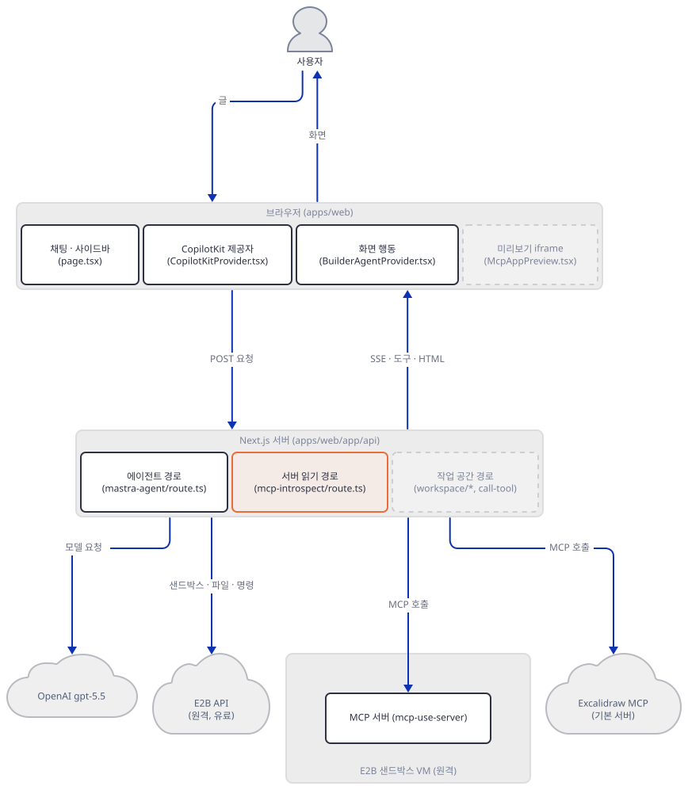

**확인.** `hasUI=true`인 도구 하나, 바뀐 주소 줄, `base 태그 남음: false`가 나오고, 포트 점검이 비어 있으면 됩니다. `requests.log`의 여섯 줄이 위 순서와 같아야 합니다.

### Step 6. 미리보기 두 곳 — 누가 무엇을 믿는가

**목적.** 같은 위젯 HTML이 뜨는 두 길(사이드바 미리보기, 채팅 안 위젯)의 iframe 설정과 `postMessage` 검사를 소스로 읽고 사실대로 적습니다. 사이드바 미리보기가 그림에 들어옵니다.

**할 일.** 첫째는 사이드바입니다. `McpAppPreview`는 HTML을 `srcDoc`으로 넣고 `sandbox`에 `allow-scripts allow-same-origin`을 줍니다.

`generative_ui_agents/ai-mcp-app-builder/apps/web/app/components/McpAppPreview.tsx:195-201`

```tsx
      <iframe
        ref={iframeRef}
        srcDoc={htmlSource}
        className="h-full w-full border-0"
        sandbox="allow-scripts allow-same-origin"
        title={`Preview: ${toolName}`}
      />
```

메시지 처리의 검사는 보낸 창이 이 iframe의 창이고 JSON-RPC 모양인지 보는 것뿐이고, 출처(`event.origin`)는 보지 않습니다. 답은 `postMessage(…, "*")`로 보냅니다.

`generative_ui_agents/ai-mcp-app-builder/apps/web/app/components/McpAppPreview.tsx:32-40`

```tsx
    const handleMessage = (event: MessageEvent) => {
      if (disposed) return;
      if (event.source !== iframeRef.current?.contentWindow) return;

      const msg = event.data;
      if (!msg || msg.jsonrpc !== "2.0") return;

      const iframe = iframeRef.current?.contentWindow;
      if (!iframe) return;
```

위젯이 `tools/call`을 보내도 서버에 가지 않고 고정 답이 나옵니다. 사이드바 미리보기는 서버 호출 없이 가짜 데이터로만 돕니다.

`generative_ui_agents/ai-mcp-app-builder/apps/web/app/components/McpAppPreview.tsx:115-128`

```tsx
      if (msg.method === "tools/call" && msg.id !== undefined) {
        iframe.postMessage(
          {
            jsonrpc: "2.0",
            id: msg.id,
            result: {
              content: [{ type: "text", text: "Mock result" }],
              isError: false,
            },
          },
          "*",
        );
        return;
      }
```

둘째는 채팅 안 위젯입니다. 모델이 MCP UI 도구를 부르면 Step 2의 미들웨어가 도구 결과를 받아 `ACTIVITY_SNAPSHOT`이라는 AG-UI 이벤트를 하나 더 내보냅니다. 위젯 주소와 서버 해시, 도구 입력, 도구 결과를 싣습니다.

`generative_ui_agents/ai-mcp-app-builder/apps/web/app/api/mastra-agent/route.ts:374-395`

```ts
              const result = {
                content: [{ type: "text" as const, text: resultText }],
                structuredContent: rawResult,
              };

              mastraLog(
                `[mastra-agent] Emitting ACTIVITY_SNAPSHOT for: ${toolName}`,
              );
              subscriber.next({
                type: "ACTIVITY_SNAPSHOT",
                messageId: crypto.randomUUID(),
                activityType: "mcp-apps",
                content: {
                  result,
                  resourceUri: info.resourceUri,
                  serverHash: info.serverHash,
                  serverId: info.serverConfig.serverId,
                  toolInput,
                },
                replace: true,
              });
            }
```

이 이벤트를 그리는 것은 앱이 아니라 CopilotKit `@copilotkitnext/react` 1.54.1의 `MCPAppsActivityRenderer`입니다. 이 렌더러가 iframe을 어떻게 만들고 어떤 검사를 하는지 압축 파일에서 찾았습니다.

```bash
cd builder-work
R=pkgs/react-1.54.1/package/dist/components/MCPAppsActivityRenderer.mjs
grep -n 'setAttribute("sandbox"' $R
grep -n 'event.source' $R
grep -c 'event.origin' $R
grep -n 'const baseScriptSrc' $R | cut -c1-180
grep -n 'postMessage(' $R
```

```text
25:inner.setAttribute("sandbox","allow-scripts allow-same-origin allow-forms");
31:if(typeof sandbox==="string")inner.setAttribute("sandbox",sandbox);
258:				iframe.setAttribute("sandbox", "allow-scripts allow-same-origin allow-forms");
28:if(event.source===window.parent){
36:}else if(event.source===inner.contentWindow){
261:						if (event.source === iframe.contentWindow) {
288:					if (event.source !== iframe.contentWindow) return;
0
10:	const baseScriptSrc = "'self' 'wasm-unsafe-eval' 'unsafe-inline' 'unsafe-eval' blob: data: http://localhost:* https://localhost:*";
34:inner.contentWindow.postMessage(event.data,"*");
37:window.parent.postMessage(event.data,"*");
40:window.parent.postMessage({jsonrpc:"2.0",method:"ui/notifications/sandbox-proxy-ready",params:{}},"*");
165:			iframeRef.current.contentWindow.postMessage(msg, "*");
```

(직접 확인한 출력입니다.) 읽은 것을 정리합니다. 바깥 iframe(`srcdoc`에 샌드박스용 HTML을 넣은 것)과 그 안쪽 iframe(위젯 HTML을 `srcdoc`으로 받는 것) 모두 `sandbox="allow-scripts allow-same-origin allow-forms"`입니다. 메시지는 `event.source`가 기대한 창인지만 보고 `event.origin`은 한 번도 보지 않습니다(0). 보내는 쪽은 `"*"`입니다. 바깥 문서의 CSP(`meta`)는 `script-src`에 `'unsafe-inline' 'unsafe-eval'`을, `connect-src`에 `*`을 허용합니다. 안쪽이 이 CSP를 물려받는지는 확인하지 못했습니다. 위젯이 `tools/call`을 보내면 렌더러가 `forwardedProps.__proxiedMCPRequest`를 실은 새 실행을 에이전트 경로에 보내고, Step 2의 미들웨어가 그것을 받아 서버에 대신 붙습니다. 허용하는 메서드는 넷뿐입니다.

```bash
cd <저장소>/generative_ui_agents/ai-mcp-app-builder
grep -n 'case "\|default:' apps/web/app/api/mastra-agent/route.ts | sed -n 1,6p
```

```text
139:      case "tools/call":
143:      case "resources/read": {
175:      case "notifications/message":
181:      case "ping":
183:      default:
889:        default: agentWrapper as any,
```

(직접 확인한 출력입니다.) 서버를 고르는 열쇠 `serverId`·`serverHash`는 위젯 쪽이 보낸 값이고, 서버는 요청 헤더가 준 목록 안에서 찾습니다. 목록은 브라우저가 정합니다.

두 길 모두 "샌드박스" 속성에 `allow-same-origin`이 같이 있다는 점이 핵심입니다. MDN은 같은 출처인 문서에 `allow-scripts`와 `allow-same-origin`을 함께 쓰면 안쪽 문서가 `sandbox` 속성을 스스로 떼어 낼 수 있어 `sandbox`를 안 쓴 것과 다를 게 없다고 경고합니다(WebFetch 요약). HTML 명세는 `allow-same-origin`이 없을 때만 내용을 불투명 출처로 만들고, `about:srcdoc` 문서의 출처는 이를 연 쪽의 출처에서 정해진다고 읽힙니다(WebFetch 요약. 이 두 번째 문장은 명세 전체를 읽지는 못했습니다). 이 앱에서 iframe을 연 쪽은 앱 페이지(사이드바) 또는 앱이 만든 바깥 iframe(채팅)입니다. MCP Apps 소개 문서는 호스트의 sandbox가 앱이 부모 DOM·쿠키·`localStorage`를 보는 것을 막는다고 말하는데, 이 두 속성 조합은 그 말과 맞지 않게 읽힙니다. 사양 본문이 호스트와 샌드박스의 출처를 달리하라고 요구하는 문장(MUST)은 [Day 145](../day145-genui-mcp-apps-generative-ui-showcase/README.md) Step 5가 SEP-1865 원문에서 읽어 적었습니다. 그 날이 읽은 1.59.2판 렌더러도 같은 속성 값, `event.origin` 0건, `"*"` 전송이었습니다. 에이전트가 쓴 HTML이 앱과 같은 출처에서 돌면 이론상 그 코드가 `fetch("/api/workspace/exec")`를 부르거나 `localStorage`를 읽을 수 있습니다. 브라우저를 열지 않아서 이 문서는 실제로 해 보지 못했습니다. 그림 속 "미리보기 iframe"은 에이전트가 쓴 코드가 도는 곳입니다.

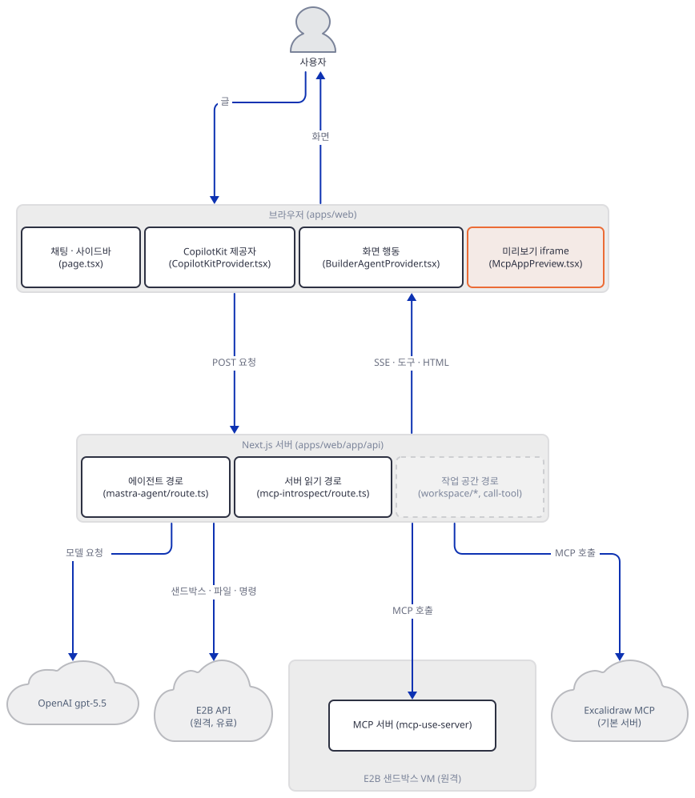

**확인.** `setAttribute("sandbox"` 줄 둘, `event.origin` 개수 0, `case` 줄이 `tools/call`·`resources/read`·`notifications/message`·`ping`과 `default`로 이어지면 됩니다.

### Step 7. 문을 잠그지 않은 길과 바깥으로 나가는 것

**목적.** 이 앱의 HTTP 경로가 누구에게 열려 있는지, 요청 한 건이 어떤 바깥 서비스에 닿는지 정리하고, 원본을 직접 띄우려는 독자를 위해 명령을 옮겨 둡니다. 작업 공간 경로가 그림에 들어와 그림이 완성됩니다.

**할 일.** 경로는 열한 개이고 인증 코드는 없습니다. `auth`·`cookie`·`bearer`·`session`·`token`·`allowlist`를 `app/api`와 `lib`에서 찾으면 주석 둘뿐이고, 미들웨어 파일도 없습니다.

```bash
cd <저장소>/generative_ui_agents/ai-mcp-app-builder
find apps/web/app/api -name route.ts | sort
grep -rniE 'auth|cookie|bearer|session|token|allowlist' apps/web/app/api apps/web/lib
ls apps/web/middleware.ts apps/web/proxy.ts 2>/dev/null || echo "미들웨어 파일 없음"
```

```text
apps/web/app/api/call-tool/route.ts
apps/web/app/api/copilotkit/route.ts
apps/web/app/api/mastra-agent/route.ts
apps/web/app/api/mcp-introspect/route.ts
apps/web/app/api/workspace/download/route.ts
apps/web/app/api/workspace/edit-file/route.ts
apps/web/app/api/workspace/exec/route.ts
apps/web/app/api/workspace/info/route.ts
apps/web/app/api/workspace/provision/route.ts
apps/web/app/api/workspace/read-file/route.ts
apps/web/app/api/workspace/write-file/route.ts
apps/web/lib/mcp-defaults.ts:12:/** Built-in default: Excalidraw MCP server (public, no auth). Override with DEFAULT_MCP_SERVERS env. */
apps/web/lib/workspace/e2b.ts:14:// Default sandbox lifetime: 60 minutes (can be extended during a session)
미들웨어 파일 없음
```

(직접 확인한 출력입니다. 가운데 두 줄이 찾은 주석 둘이고 코드가 아닙니다.) 이 가운데 화면이 실제로 부르는 것은 넷(`mastra-agent`·`mcp-introspect`·`workspace/download`·`workspace/info`)입니다.

```bash
grep -rn 'api/workspace\|api/call-tool\|api/mcp-introspect\|api/copilotkit' apps/web/app apps/web/lib --include=*.ts --include=*.tsx | grep -v '^apps/web/app/api/'
```

```text
apps/web/app/components/BuilderAgentProvider.tsx:13:// on BuiltInAgent in app/api/copilotkit/route.ts.
apps/web/app/components/McpServerManager.tsx:179:              const res = await fetch("/api/workspace/download", {
apps/web/app/components/ToolCallRenderer.tsx:18:      const res = await fetch("/api/workspace/download", {
apps/web/app/hooks/useMcpIntrospect.ts:5:/** Mirrors the shape returned by /api/mcp-introspect */
apps/web/app/hooks/useMcpIntrospect.ts:34: * `/api/mcp-introspect` proxy route.
apps/web/app/hooks/useMcpIntrospect.ts:79:          const res = await fetch("/api/mcp-introspect", {
apps/web/app/page.tsx:226:      fetch("/api/workspace/info", {
apps/web/lib/open-download.ts:3: * Works after async fetch when the response is same-origin (e.g. /api/workspace/download?stream).
```

(직접 확인한 출력입니다.) `workspace/provision`·`exec`·`read-file`·`write-file`·`edit-file`·`call-tool`·`copilotkit`은 화면에서 부르는 곳이 없습니다. 앞의 다섯은 에이전트 도구와 같은 일을 HTTP로 한 번 더 열어 둔 것으로 읽힙니다. 이 가운데 가장 센 것은 `exec`입니다.

`generative_ui_agents/ai-mcp-app-builder/apps/web/app/api/workspace/exec/route.ts:4-29`

```ts
export async function POST(req: NextRequest) {
  try {
    const { workspaceId, cmd, background, cwd, timeoutMs } =
      (await req.json()) as {
        workspaceId?: string;
        cmd?: string;
        background?: boolean;
        cwd?: string;
        timeoutMs?: number;
      };
    if (!workspaceId || !cmd) {
      return NextResponse.json(
        { error: "workspaceId and cmd are required" },
        { status: 400 },
      );
    }

    const provider = getProvider();
    const result = await provider.exec(workspaceId, cmd, {
      background,
      cwd,
      timeoutMs,
    });
    return NextResponse.json(result);
  } catch (err) {
    const message = err instanceof Error ? err.message : String(err);
```

`workspaceId`는 요청이 주는 문자열이고, 이 서버가 `E2B_API_KEY`로 그 샌드박스에 붙어 명령을 돌립니다. 앱은 호출한 사람이 그 샌드박스의 주인인지 묻지 않습니다. 샌드박스 ID와 요청 한 줄을 아는 사람은 누구든 이 앱의 E2B 계정 안의 샌드박스에 명령을 돌릴 수 있는 모양입니다(소스로 읽었고 실행해 보지 못했습니다). 앱을 공개 주소(`render.yaml`의 `web` 서비스)로 띄우면 그대로 열려 있다고 읽힙니다. 서버가 요청이 준 주소에 접속하는 길도 셋입니다. 본문의 `endpoint`(`mcp-introspect`·`call-tool`)와 헤더의 `x-mcp-servers`(`mastra-agent`)입니다. 서버와 같은 망의 내부 주소도 목적지가 될 수 있습니다(시험하지 않았습니다).

그다음은 요청 한 건이 닿는 바깥입니다. 위 Step들에서 읽은 것을 표로 모읍니다.

| 어디로 | 누가 보내나 | 무엇이 | 끄는 법 |
|---|---|---|---|
| OpenAI (`api.openai.com`) | 에이전트 경로(서버) | 지침, 대화, 도구 결과(파일 내용 포함) | 쓰지 않으려면 `OPENAI_BASE_URL`을 로컬 서버로 |
| E2B API | 에이전트 경로(서버) | 샌드박스 만들기, 파일 내용, 명령 | `E2B_API_KEY`를 비움(키가 없으면 SDK가 "API key is required"로 멈춤, 소스로 확인) |
| 샌드박스 공개 주소 | 서버와 화면 | MCP 호출, 위젯 HTML 안의 자원 | 앱에 옵션이 없음 |
| `mcp.excalidraw.com` | 서버(요청마다 둘, 사이드바 읽기 하나) | MCP 접속, `tools/list` | 클라이언트 `NEXT_PUBLIC_DEFAULT_MCP_SERVERS=[]` |
| PostHog·Scarf | 샌드박스 안 `mcp-use` 서버 | 서버 이름, 도구 이름·설명·스키마, `baseUrl` | `MCP_USE_ANONYMIZED_TELEMETRY=false`(샌드박스 안에) |
| Segment·Scarf | CopilotKit 런타임(서버, 요청마다 한 번 시도, 5% 표본) | 런타임 인스턴스 정보 | `COPILOTKIT_TELEMETRY_DISABLED=true` 또는 `DO_NOT_TRACK=1` |
| Next.js 텔레메트리 | `next` | 익명 사용 통계 | `NEXT_TELEMETRY_DISABLED=1` |

CopilotKit 런타임 텔레메트리는 `@copilotkit/shared` 1.54.1의 `TelemetryClient`에서 읽었습니다.

```bash
grep -n 'COPILOTKIT_TELEMETRY_DISABLED\|DO_NOT_TRACK\|sampleRate = \|new Analytics' pkgs/shared-1.54.1/package/dist/telemetry/telemetry-client.mjs | head -8
grep -n 'telemetryClient.capture' pkgs/runtime-1.54.1/package/dist/lib/integrations/nextjs/app-router.mjs
```

```text
10:* - COPILOTKIT_TELEMETRY_DISABLED=true or COPILOTKIT_TELEMETRY_DISABLED=1
11:* - DO_NOT_TRACK=true or DO_NOT_TRACK=1
14:	return process.env.COPILOTKIT_TELEMETRY_DISABLED === "true" || process.env.COPILOTKIT_TELEMETRY_DISABLED === "1" || process.env.DO_NOT_TRACK === "true" || process.env.DO_NOT_TRACK === "1";
21:		this.sampleRate = .05;
28:		this.segment = new Analytics({ writeKey: process.env.COPILOTKIT_SEGMENT_WRITE_KEY || "n7XAZtQCGS2v1vvBy3LgBCv2h3Y8whja" });
71:		_sampleRate = sampleRate ?? .05;
72:		if (process.env.COPILOTKIT_TELEMETRY_SAMPLE_RATE) _sampleRate = parseFloat(process.env.COPILOTKIT_TELEMETRY_SAMPLE_RATE);
74:		this.sampleRate = _sampleRate;
12:	telemetryClient.capture("oss.runtime.instance_created", getRuntimeInstanceTelemetryInfo(options));
```

(직접 확인한 출력입니다.) 앱은 요청마다 `copilotRuntimeNextJSAppRouterEndpoint`를 새로 부르므로 이 `capture`도 요청마다 시도됩니다. Next.js의 변수는 Next.js 문서(https://nextjs.org/telemetry)에서 읽었습니다.

끝으로 독자용 명령입니다. 앱 README의 시작 명령은 이렇고, **이 문서는 이 명령을 실행하지 않았습니다**. PowerShell 줄은 앱 README에서 옮긴 것입니다.

```powershell
pnpm i
Copy-Item .env.example .env
# Edit .env: set OPENAI_API_KEY=sk-proj-... at minimum; add E2B_* for sandbox provisioning (see below)
pnpm dev
```

내가 읽은 바로 이 명령을 그대로 쓰기 전에 알아 둘 것이 다섯입니다. (1) `pnpm dev`는 터보가 세 앱의 `dev`를 한꺼번에 띄웁니다. 웹은 `next dev --turbopack`이고 Next 문서의 `-H` 기본값이 `0.0.0.0`이어서 모든 네트워크 인터페이스에 열립니다. Three.js 샘플 서버는 코드에서 `createMcpExpressApp({ host: "0.0.0.0" })`와 `cors()`로 열립니다(`generative_ui_agents/ai-mcp-app-builder/apps/threejs-server/server-utils.ts:23-24`). (2) 앱 안에서 `.env`의 `E2B_REPO_URL` 줄은 주석에 "default: mcp-use-server-template"이라 적고 바로 아래 값은 CopilotKit 주소입니다(`generative_ui_agents/ai-mcp-app-builder/.env.example:12-13`). `cp`한 그대로면 그 주소가 쓰입니다. (3) `OPENAI_API_KEY`가 비면 `createOpenAI`가 키 없이 만들어지고 첫 요청에서 실패합니다. (4) 서버 쪽 `DEFAULT_MCP_SERVERS=[]`는 빈 목록이 아니라 Excalidraw로 되돌아갑니다(`generative_ui_agents/ai-mcp-app-builder/apps/web/lib/mcp-defaults.ts:29`). 비우려면 클라이언트 쪽 `NEXT_PUBLIC_DEFAULT_MCP_SERVERS=[]`를 씁니다. (5) 루프백으로만 열고 텔레메트리를 끄려면 웹 앱만, 이렇게 띄우는 것이 내가 읽은 범위의 안전한 형태입니다. 이것도 **실행해 보지 못했습니다**.

```bash
cd <저장소>/generative_ui_agents/ai-mcp-app-builder
NEXT_TELEMETRY_DISABLED=1 COPILOTKIT_TELEMETRY_DISABLED=true NEXT_PUBLIC_DEFAULT_MCP_SERVERS='[]' \
  pnpm --filter web dev -H 127.0.0.1 -p 58147
```

(Next 문서가 `pnpm`은 `--` 없이 플래그를 넘긴다고 합니다. 포트 58147은 임의로 고른 번호입니다.) `E2B_API_KEY`를 비워 두면 샌드박스는 만들어지지 않습니다. 이 구성에서도 에이전트에게 앱을 지으라고 하려면 키를 넣어야 하고, 그 순간 원격 VM과 비용이 생기며 Step 3~4의 공개 주소와 텔레메트리가 따라옵니다.

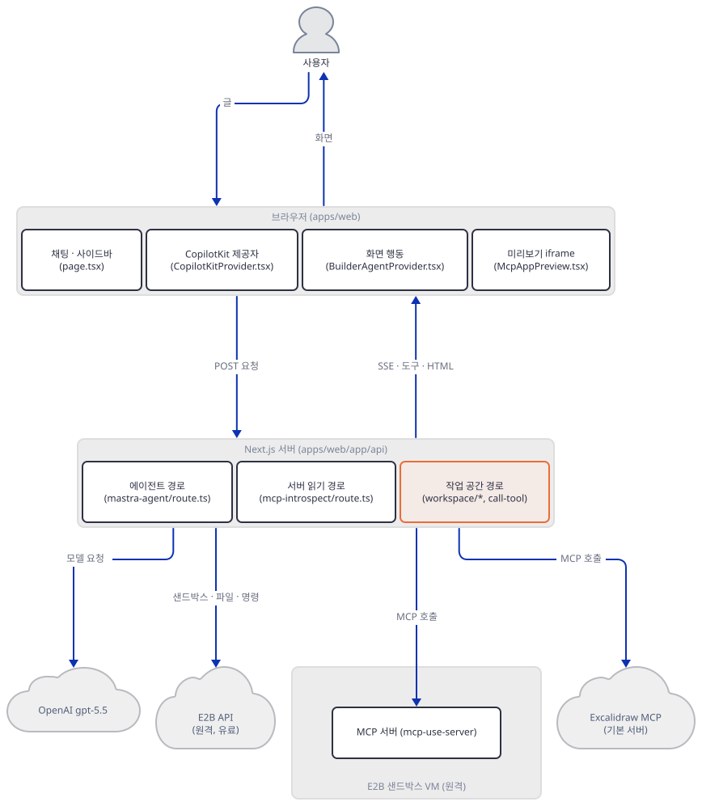

**확인.** `route.ts` 열한 줄, 인증 줄 없음, 화면이 부르는 네 경로(`workspace/download`·`workspace/info`·`mcp-introspect`와 제공자의 `mastra-agent`)가 나오면 됩니다.

## 요청 한 건이 흐르는 과정

"팁 계산기 위젯 만들어 줘" 한 줄이 위젯이 되어 뜨기까지를 시간 순서로 그렸습니다. 길이 길어서 열두 장으로 나눴고, 경계는 배우가 바뀌는 곳입니다. 메시지는 모두 정확히 한 그림에 코드의 순서대로 있습니다. 두 가지를 먼저 밝힙니다. 모델이 도구를 부르는 순서는 앱 지침이 권하는 순서(Workflow A)입니다. 모델이 그대로 따랐다는 관찰이 아닙니다. 그리고 화면 행동(`add_mcp_server` 같은 것)이 끼면 에이전트 경로로 요청이 한 번 더 가고(Step 3), 그때마다 Step 2의 준비(헤더 읽기, MCP 두 번 접속, 에이전트 새로 만들기)를 처음부터 합니다. 그림은 그 반복을 모두 그리지 않고 요청의 경계를 말로 적습니다.

첫 장은 서버가 요청 하나를 받아 모델을 부르기 전까지입니다. 같은 서버에 두 번 붙는 것과, `return` 직후 `finally`가 연결을 닫는 것이 이 그림의 일곱 메시지입니다. 닫는 때는 모델 호출과 겹칠 수 있어서 이 메시지를 이 자리에 둔 것은 코드 위치(응답 객체를 만든 직후)를 따른 것입니다.

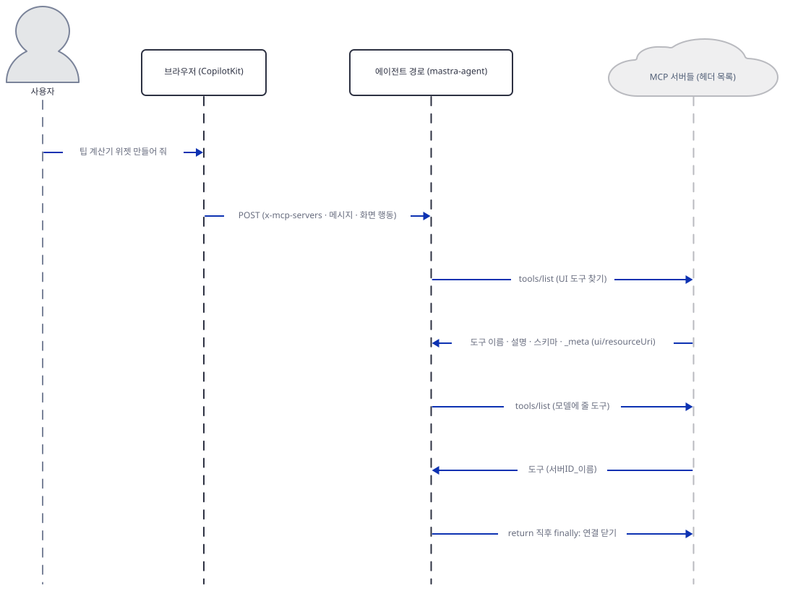

둘째 장은 모델 호출입니다. 지침과 도구와 대화가 한 번에 가고, 모델이 `provision_workspace`를 부르면 서버는 그 호출을 화면에도 이벤트로 흘립니다. 백엔드 도구라서 결과는 서버가 직접 만들어 모델에게 되돌립니다.

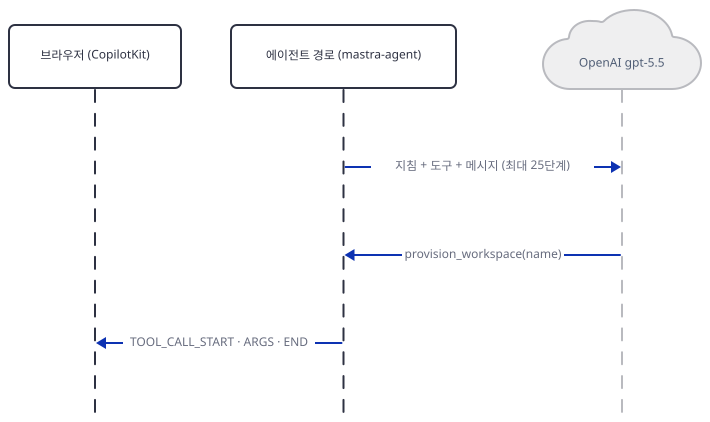

셋째 장은 샌드박스 만들기입니다. 이 도구의 설명은 템플릿이 있으면 약 3초라고 하는데(`generative_ui_agents/ai-mcp-app-builder/apps/web/app/api/mastra-agent/route.ts:414-415`) 이 문서는 재지 못했습니다. 만든 직후 서버는 뼈대의 기본 도구(`product-search`)가 있으면 지우고 서버를 다시 띄웁니다. 이 정리가 실패해도 경고만 남기고 결과를 돌려줍니다.

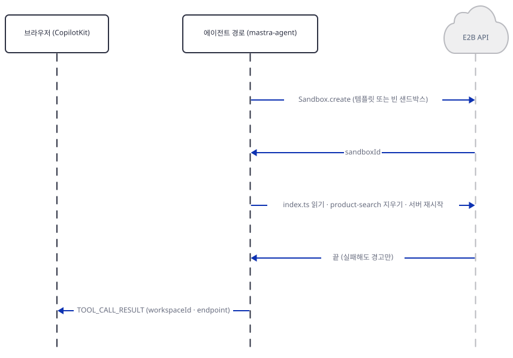

넷째 장은 화면 행동입니다. 모델이 `add_mcp_server`를 부르면 서버는 그 호출을 이벤트로 내보내고 실행을 끝냅니다. 도구를 실행하는 쪽은 브라우저입니다. 핸들러가 서버 목록을 고치면 Step 1의 헤더가 바뀌고, CopilotKit이 결과를 대화에 붙여 후속 요청을 보냅니다. 이 장의 마지막 메시지가 다음 요청의 시작입니다.

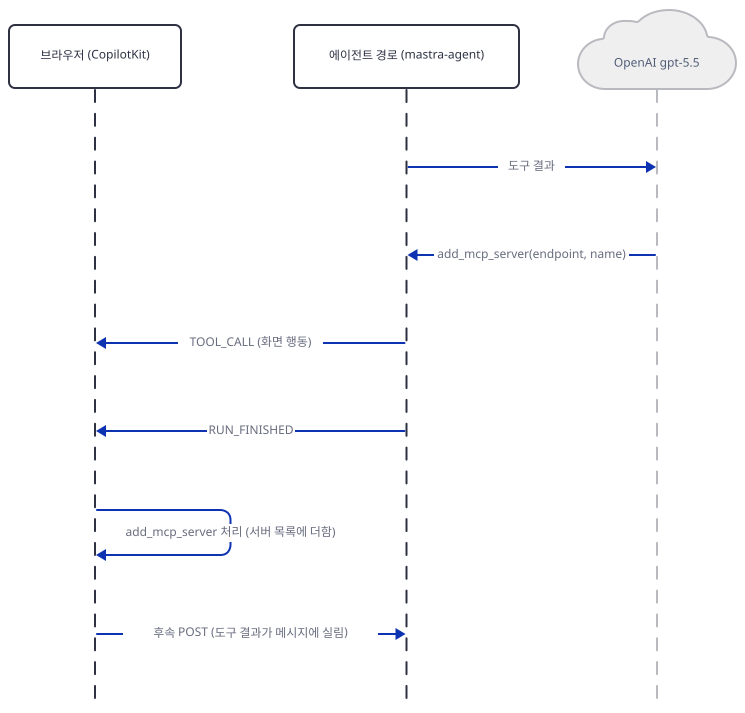

다섯째 장은 파일 쓰기입니다. 지침의 4~6단계입니다. `write_file`은 샌드박스에 붙어 상위 폴더를 만들고 쓰고, `edit_file`은 파일을 읽어 문자열이 있으면 바꿔 다시 씁니다. 못 찾은 편집은 `SKIP`으로 표시하고 계속 갑니다. 모델에게 가는 결과 문자열이 그 표시를 담습니다.

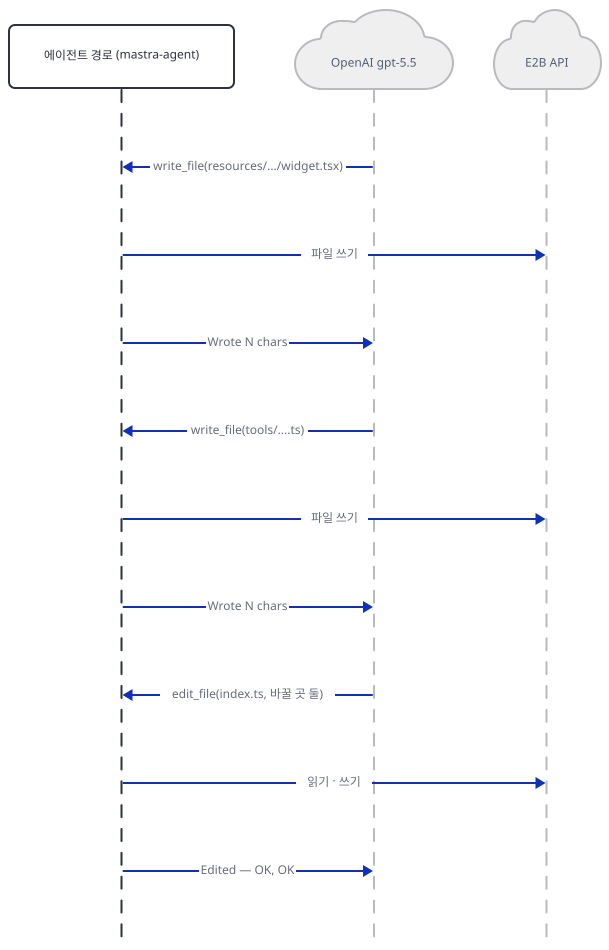

여섯째 장은 서버 다시 시작입니다. Step 4의 순서(끄기, 배경으로 띄우기, 5초 간격 확인)입니다. 성공이면 `tools/list` 응답 앞 500자를, 실패면 빌드 로그 끝 40줄을 모델에게 돌려줍니다. 이어서 `refresh_mcp_tools`가 화면 행동으로 나가고 요청이 끝납니다.

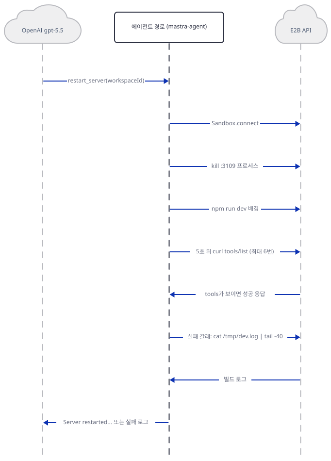

일곱째 장부터는 브라우저 쪽입니다. 화면이 `refresh_mcp_tools`를 처리하면 서버마다 `/api/mcp-introspect`로 읽어 옵니다. 이 장은 Step 5의 가짜 서버로 보인 바로 그 순서입니다.

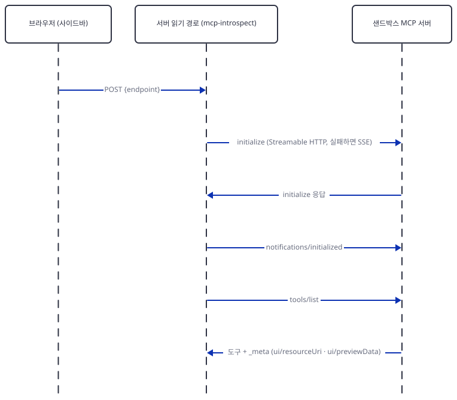

여덟째 장은 사이드바 미리보기입니다. `srcDoc`으로 넣은 위젯과 호스트 노릇을 하는 `McpAppPreview`가 주고받는 메시지를 그렸습니다. 위젯의 `tools/call`은 서버에 가지 않고 고정 답을 받습니다.

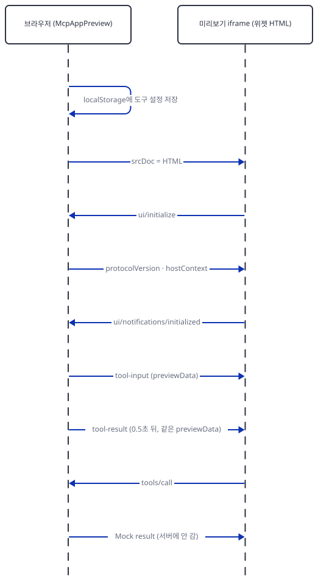

아홉째 장부터는 채팅 안의 위젯입니다. 사용자가 만든 도구를 써 보라고 하면 모델이 그 도구(`서버ID_이름`)를 부르는 길입니다. 이 호출은 에이전트의 일반 도구 호출과 같습니다.

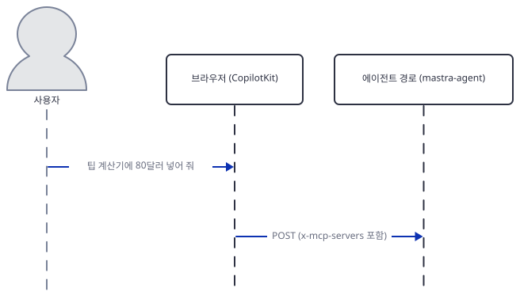

열째 장에서 서버가 MCP 서버를 부르고, 결과(`structuredContent`)를 AG-UI 이벤트로 흘린 뒤 `ACTIVITY_SNAPSHOT`을 하나 더 냅니다. 이 이벤트가 위젯을 그리라는 신호이고, 같은 때 모델에게는 도구 결과가 갑니다.

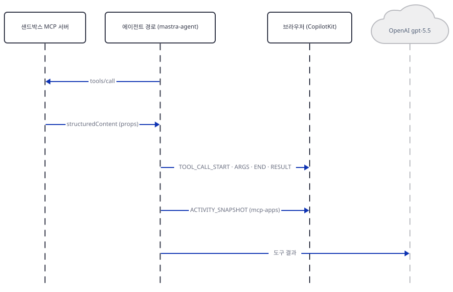

열한째 장은 위젯 HTML을 가져와 iframe을 띄우는 길입니다. 렌더러는 서버에서 HTML을 받으려고 `forwardedProps`에 요청을 실은 새 실행을 보냅니다. 서버는 이것을 에이전트 없이 MCP 요청으로 대신 처리하고 `RUN_FINISHED`의 `result`에 담아 돌려줍니다. 그다음 바깥 iframe과 안쪽 위젯의 `ui/initialize` 악수가 이어집니다.

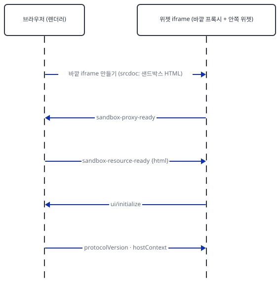

열두째 장은 위젯이 서버를 부르는 길입니다. 위젯의 `tools/call`이 렌더러를 거쳐 다시 에이전트 경로에 `forwardedProps` 요청으로 가고, 서버가 MCP 서버에 대신 붙어 결과를 돌려줍니다. 이 길에는 모델이 끼지 않습니다. 사용자가 위젯의 버튼을 누를 때마다 서버 요청이 한 번씩 가고, 요청마다 연결을 새로 맺습니다.

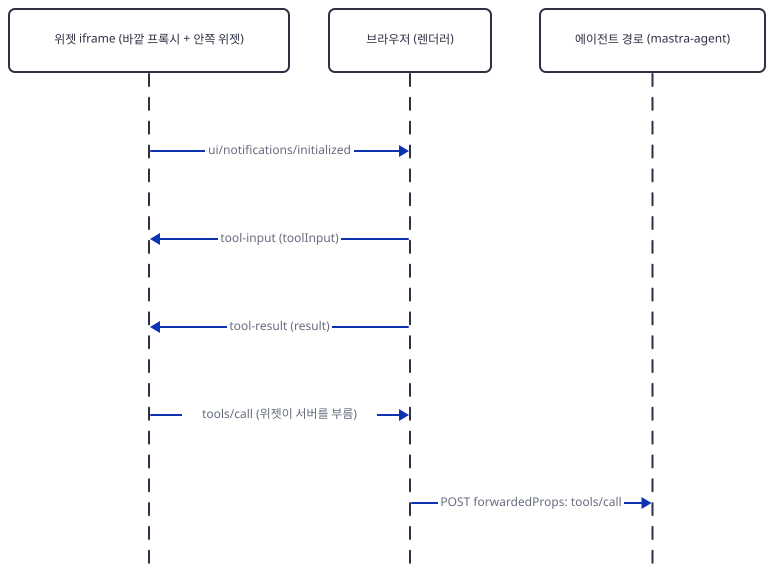

## 실행 체크리스트

- [ ] Step 1의 세 숫자가 21782·13388·7275로 나온다
- [ ] 엔진 줄이 `>=22.13.0`이고 README 줄이 `Node.js 20+`이다
- [ ] `fetch_pkg.sh`가 열한 패키지 모두에 `일치`를 찍는다
- [ ] `finally_order.mjs`에서 앱과 같은 모양은 `disconnect 끝`이 `handleRequest 끝`보다 앞이다
- [ ] 가짜 서버가 받은 메서드가 여섯 줄이고, `probe.mjs`가 `hasUI=true` 도구 하나와 주소 바꾸기를 보인다
- [ ] 루프백이 아닌 주소를 주면 `probe.mjs`가 접속 전에 종료 코드 1로 멈춘다
- [ ] 끝난 뒤 58146 포트를 쓰는 프로세스가 없다 (`netstat -ano | grep :58146`)
- [ ] 이 문서를 따라 하는 동안 `pnpm`·`npx`·`next`·`turbo`를 돌리지 않았고 셸에 `E2B_API_KEY`·`OPENAI_API_KEY`가 없다 (`env | grep -c 'E2B_API_KEY\|OPENAI_API_KEY'`가 0)
- [ ] `builder-work`를 지울 때는 그 폴더 하나만 정확한 경로로 지웠다 (와일드카드 없이)

## 문제 해결

아래는 소스에서 읽은 것이고, 이 문서가 앱을 실행해서 본 증상은 없습니다. 원인 칸의 괄호에 확인한 정도를 적었습니다.

| 증상 | 원인 | 해결 |
|---|---|---|
| `pnpm i`에서 엔진 경고나 설치 거부(예상) | README는 Node 20+라고 하지만 `@mastra/core`·`@mastra/mcp`가 22.13 이상을 요구(잠금 파일, 확인함. 실제 설치는 못 함) | Node 22.13 이상으로 |
| 첫 요청에서 모델 오류(예상) | `route.ts:838`의 `reasoningEffort: "minimal"`이 모델 페이지의 `gpt-5.5` 목록에 없음(확인함. 오류가 실제로 나는지는 못 봄) | 그 줄을 지우거나 `low`로 |
| 앱을 지으라고 했는데 한참 걸리거나 지침과 안 맞는 폴더가 나옴(예상) | `E2B_TEMPLATE`이 없어 CopilotKit 모노레포를 복제하는 경로로 감(`.env.example:13`, 확인함. 폴더 구조는 못 봄) | 템플릿을 굽거나(`build.dev.ts`, 이 문서는 안 함) `E2B_REPO_URL`을 `mcp-use-server-template` 저장소로 |
| 사이드바에 Excalidraw가 계속 보임 | 클라이언트 기본값이 Excalidraw이고, 서버 `DEFAULT_MCP_SERVERS=[]`는 다시 Excalidraw로 돌아감(`mcp-defaults.ts:29`, 확인함) | `NEXT_PUBLIC_DEFAULT_MCP_SERVERS=[]` |
| 다운로드 뒤 `restart_server`가 실패(예상) | 다운로드가 살아 있는 샌드박스의 `node_modules`·`dist`를 지움(`e2b.ts:152`, 확인함. 그 뒤 실패는 못 봄) | `exec` 도구로 샌드박스에서 `npm install`을 시키거나 새 샌드박스로 |
| 서버가 둘인데 같은 이름의 도구가 한 칸에 겹침(예상) | 도구 설정 저장소의 키가 도구 이름뿐(`useToolConfigStore.ts`, 확인함. 실제 화면은 못 봄) | 서버마다 도구 이름을 달리 |
| `npm run test:download-kit`이 파일을 못 찾음 | `package.json`이 가리키는 `apps/web/test/` 폴더가 저장소에 없음 | 직접 확인했습니다(`ls apps/web/test`가 "No such file"). 그 스크립트는 쓸 수 없음 |

## 더 해보기

- `fake_mcp.mjs`의 위젯 HTML을 20줄짜리 스크립트로 바꿔 `ui/initialize` 요청을 `postMessage`로 보내게 하고, `generative_ui_agents/ai-mcp-app-builder/apps/web/app/components/McpAppPreview.tsx:42-73`이 돌려주는 답(`protocolVersion`·`hostContext`)과 렌더러가 돌려주는 답을 맞대 보세요. 두 호스트가 서로 다른 `protocolVersion`을 말합니다(앱 `2025-11-21`, 렌더러 `2025-06-18`). 브라우저가 필요한 일이어서 이 문서는 하지 않았습니다.
- 화면이 부르지 않는 경로 일곱을 지워도 되는지 `grep`으로 확인하고, `generative_ui_agents/ai-mcp-app-builder/apps/web/app/api/workspace/exec/route.ts:4-29`처럼 열려 있는 것들 가운데 에이전트 경로가 같은 일을 하는 것을 골라 어떻게 닫을지 설계해 보세요. 닫은 뒤에도 사이드바 다운로드(`download`)와 상태 확인(`info`)은 화면이 부르므로 남깁니다.
- 위 표의 텔레메트리 끄기 변수 셋을 `generative_ui_agents/ai-mcp-app-builder/.env.example`과 Dockerfile·`render.yaml`의 어디에 넣으면 샌드박스 안 `mcp-use` 서버까지 닿는지 설계해 보세요. 샌드박스는 이 앱이 환경변수를 넘겨 주는 코드가 없다는 점(`generative_ui_agents/ai-mcp-app-builder/apps/web/lib/workspace/e2b.ts:25-28`)이 출발점입니다.

## 다음 날 예고

[Day 147 · 🎛️ AI Shadcn Component Generator](../day147-genui-shadcn-component-generator/README.md) — 오늘은 모델이 앱 한 개를 짓는 쪽의 끝이었다면 내일은 반대편입니다. 앱 README(`generative_ui_agents/ai-shadcn-component-generator/README.md` 9행)는 shadcn 컴포넌트의 전체 스키마를 에이전트 문맥으로 넘기고 모델이 그 부품들의 트리를 내놓는 구조라고 소개합니다. 이 앱은 pnpm 모노레포이고 서비스가 셋입니다. 추적 파일은 8,505줄(잠금 파일과 이미지 제외)입니다. 에이전트는 파이썬 LangGraph(`apps/agent/main.py`, 모델 `openai:gpt-5.5`가 31행)이고, 런타임은 Hono와 CopilotKit(`apps/runtime/server.ts`의 기본 포트 4000)이며, 화면은 Vite입니다. 루트 `package.json`의 `dev:agent`는 `cd apps/agent && uv sync && uv run python main.py`이고, `main.py`는 이 서버를 `host="0.0.0.0"`과 `reload=True`로 띄웁니다(`generative_ui_agents/ai-shadcn-component-generator/apps/agent/main.py:58-66`). 이 줄을 독자 명령으로 그대로 쓰면 모든 네트워크 인터페이스에 열린다는 것이 내일 앱의 주의점입니다. 볼륨 12를 닫는 날입니다.
