# Day 148 · 📰 Always-on Hacker News Briefing Agent

> 볼륨 13 🛰️ Always-on Agents · 난이도 ★★☆ ⚠ requirements.txt만 설치하면 Windows에서는 `scout.py`를 불러오는 순간 `ZoneInfoNotFoundError`로 멈추고(Step 1), 앱 README의 실행 예는 스케줄러 API를 모든 네트워크 인터페이스(`--host 0.0.0.0`)에 여는데 엔드포인트에는 인증 코드가 한 줄도 없습니다(Step 5) · 예상 소요 190분(앱은 파이썬 다섯 파일 755줄로 작지만, 대역 서버 둘과 래퍼를 직접 저장해 터미널 셋 이상을 오가며 요청 기록을 맞대어 읽는 손 시간이 본문 읽는 시간보다 큽니다) · API 비용 대략 이 문서의 따라 하기는 $0(Hacker News·Gmail·Gemini 어디에도 요청을 보내지 않았습니다). 스케줄러 경로는 모델을 부르지 않아 모델 비용이 0이고, 진짜 키로 ADK에게 브리핑을 한 번 물으면 모델 호출이 두 번 나가 0.003달러 안팎입니다(⚠ 추정, 아래 사전 준비) · 원본 앱: `always_on_agents/always_on_hn_briefing_agent`

## 오늘 만들 것

Hacker News 첫 페이지에서 AI 에이전트·MCP·코딩 에이전트 이야기를 골라 순위를 매기고, 글과 HTML 브리핑으로 만들어 메일이나 웹훅으로 보내는 앱을 따라 봅니다. 앱 README는 "상시 실행"을 이렇게 풀어 씁니다. 같은 코드가 대화형 ADK 에이전트로도, 스케줄러가 깨우는 백엔드 서비스로도 돕니다. 후자는 "run like an always-on backend service", 곧 "the same surface you can deploy behind Cloud Run and trigger from Cloud Scheduler"라고 합니다. `always_on_agents/` 폴더에는 자체 README가 없고 앱이 둘(오늘과 Day 149)입니다.

오늘이 볼륨 13의 첫날입니다. 볼륨 12(Day 141~147)의 앱은 모두 사람이 연 화면과 에이전트 서버를 가졌습니다. 오늘은 화면이 없고, 호출하는 쪽이 스케줄러입니다. Day 147의 "다음 날 예고"는 "ADK 에이전트가 Hacker News를 훑어 브리핑을 만든다"고 했는데, 이것은 사람이 묻는 ADK 경로에서만 맞고 상시 실행 경로는 모델 없이 돕니다(Step 2·6). 그 예고가 말한 줄 수(`agent.py` 46, `scout.py` 388, `delivery.py` 202, `scheduler_api.py` 116)와 모델 줄(`agent.py:25`의 `gemini-3-flash-preview`)은 소스와 같았습니다(`wc -l`·`grep -n`으로 직접 확인). 새 것은 세 가지입니다. 첫째, 같은 ADK 에이전트를 쓰지만 이 앱의 일은 모델이 아니라 스케줄러 경로가 합니다. 둘째, 앱이 바깥으로 보냅니다. Day 120의 채용 앱처럼 실제 메일이 나가는 코드가 있습니다. 셋째, 진입점이 사람이 아니라 HTTP·Pub/Sub 메시지입니다. ADK 에이전트와 함수 도구는 Day 014~023(특히 함수 도구는 Day 017)이, 가짜 Gemini 서버를 `GOOGLE_GEMINI_BASE_URL`로 가리키는 방법은 Day 142·144가, `adk web`과 `.adk/` 저장소는 Day 122·125가 다뤘으니 이 문서는 되풀이하지 않고 가리킵니다.

직접 돌려 보고 소스를 읽어 알게 된 것이 일곱입니다.

1. Windows에서는 `requirements.txt`(세 줄)만으로 `scout.py`가 import되지 않습니다. 시간대 데이터(`tzdata`)가 빠져 있습니다(Step 1).
2. 단위 테스트 아홉 개는 모두 표본 데이터만 시험합니다. 둘은 `AGENTSCOUT_LIVE_HN` 환경변수가 켜져 있으면 실제 Hacker News로 나갑니다(Step 1).
3. "순위"는 산수입니다. 낱말 판정이 제목의 글자 조각에 걸리고(`Decoding`이 `coding`에), 모델은 어디에도 끼지 않습니다(Step 2).
4. 라이브 모드의 "AI 이야기만 고르는 필터"는 아무것도 거르지 않습니다. 요약 글이 항상 `agent`를 품기 때문입니다(Step 3).
5. 연결 거부·HTTP 오류로 전송이 실패하면 API는 200 안의 `sent: false`로만 알리고, 웹훅 응답 시간 초과나 JSON이 아닌 Gmail 응답은 잡히지 않아 500입니다. Hacker News가 실패해도 500입니다(Step 3·4).
6. 엔드포인트에는 인증이 없습니다. Pub/Sub 푸시도 서명을 보지 않고, 같은 메시지는 같은 전송을 두 번 일으킵니다(Step 5).
7. `tests/eval/eval_config.yaml`은 ADK가 읽는 평가 세트가 아니고, `adk eval`은 requirements에 없는 추가 패키지를 요구합니다(Step 7).

이 문서는 Hacker News, Gmail, Google 토큰 서버, Gemini 어디에도 요청을 보내지 않았습니다. 그 자리에는 `127.0.0.1`의 대역 서버를 두었고, 키는 모두 `fake-` 값이며, 앱을 띄우는 모든 줄 앞에 루프백 가드(`check_env.py`)를 두었습니다. 앱이 바깥으로 나가는 `urllib.request.urlopen` 호출 셋은 래퍼(`serve_local.py`)가 호스트 이름을 대역 서버 주소로 바꿔 끼워 돌렸습니다. Gmail 코드 경로를 돌린 것은 바로 이 방식이고, 진짜 Gmail과 Google 토큰 서버에는 한 번도 닿지 않았습니다. 대역의 답(Hacker News 페이지 모양, 토큰, 메일 응답)은 모두 내가 쓴 것이라 진짜 서비스가 어떻게 답하는지의 근거가 아닙니다. 아래는 완성된 아키텍처입니다.

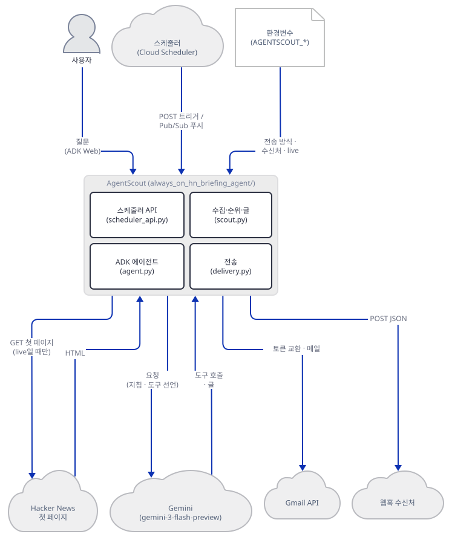

위 그림은 묶음끼리만 이었습니다. 묶음 안의 관계는 아래 그림입니다. 스케줄러 API와 ADK 에이전트가 모두 `scout.py`를 부르고, 전송은 스케줄러 API만 부르며, 모델(Gemini)을 부르는 것은 ADK 에이전트뿐입니다. ADK 에이전트에서는 전송으로 가는 길이 없고, 스케줄러 경로에는 모델로 가는 길이 없습니다.

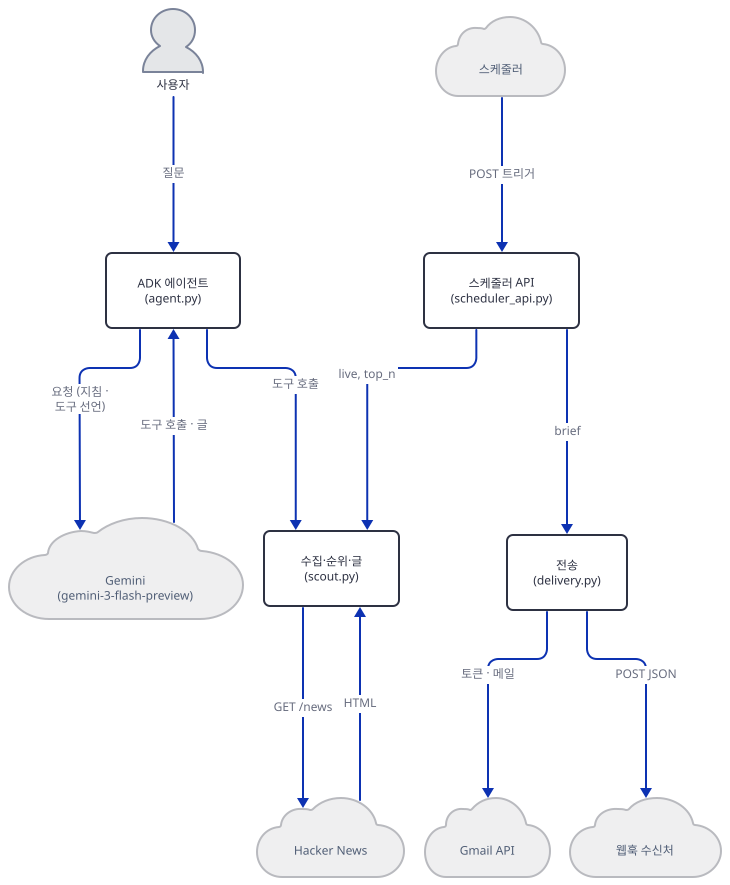

## 사전 준비

| 서비스/도구 | 용도 | 발급·설치 |
|---|---|---|
| uv | 가상환경 생성과 패키지 설치 | [공통 사전 준비](../README.md#공통-사전-준비-한-번만) 절 참고 |
| Python 3.12 | 앱 README는 3.10 이상이라고 하지만 오늘 풀리는 `google-adk` 2.12.0은 `Requires-Python >=3.11`입니다(설치된 패키지의 METADATA, 직접 확인). 3.10에서는 `uv pip compile --python-version 3.10`이 `google-adk==2.11.0`으로 풀었고(직접 확인, 3.12는 2.12.0) 이 문서는 3.12.10으로만 돌렸습니다. 2.11.0의 `.env` 로더는 2.12.0과 같은 규칙입니다(Step 6, 소스로 확인하지 못했고 3.10·3.11은 시험하지 못했습니다) | 공통 사전 준비와 같음 |
| Gemini API 키 | 진짜로 `adk web`을 쓸 때만(`GOOGLE_API_KEY`). 이 문서는 가짜 값만 씁니다 | https://aistudio.google.com/apikey |
| Gmail OAuth 갱신 토큰, 웹훅 주소 | 진짜로 전송할 때만. **이 문서는 쓰지 않았고, 독자도 이 문서를 따라 할 때는 쓰지 마세요** | 앱 README의 Gmail Delivery 절 |
| 새 작업 폴더 `hn-lab` | 앱 복사본과 가상환경, 대역 서버 파일을 둡니다 | Step 1에서 만듭니다 |
| `PYTHONIOENCODING=utf-8` | 한국어 Windows 콘솔(cp949)에서 출력이 깨지지 않게 합니다 | `envfake.sh`가 겁니다(PowerShell은 Step 1) |

모델은 `gemini-3-flash-preview`입니다. 모델 페이지(https://ai.google.dev/gemini-api/docs/models, 2026-10-17 확인)는 상태를 "Preview"로 적고 "Points to a preview model which may be used for production", 그리고 preview 모델은 "at least 2 weeks notice"로 폐기된다고 합니다. 폐기 문서(https://ai.google.dev/gemini-api/docs/deprecations, 같은 날, 페이지 갱신 2026-10-12)의 이 모델 행은 출시일 2025-12-17, 종료일 "No shutdown date announced", 권장 대체 `gemini-3.6-flash`입니다. 종료 예정이 아니니 ⚠는 달지 않습니다. 요금표(https://ai.google.dev/gemini-api/docs/pricing, 2026-10-17 확인)의 유료 단계는 입력 $0.50, 출력(추론 토큰 포함) $3.00(백만 토큰당)이고 무료 단계가 있습니다. 한 질문의 비용 어림은 Step 6에 있습니다.

## 아키텍처 한눈에 보기

| 컴포넌트 | 역할 | 코드 위치 |
|---|---|---|
| 에이전트 (`root_agent`) | 지침과 도구 하나(`preview_agent_builder_brief`)를 가진 `LlmAgent`. 모델 `gemini-3-flash-preview` | `always_on_agents/always_on_hn_briefing_agent/agent.py:23-46` |
| 도구 함수 | `run_ambient_scout(live=None, top_n)`을 그대로 부른다 | `always_on_agents/always_on_hn_briefing_agent/agent.py:10-21` |
| 수집·순위 | 표본 이야기(`sample_stories`), 첫 페이지 가져오기·파서, 점수, 요약 글 | `always_on_agents/always_on_hn_briefing_agent/scout.py:68-288` |
| 글 만들기 | 텍스트와 HTML 브리핑, 다음 행동 셋, 결과 딕셔너리 | `always_on_agents/always_on_hn_briefing_agent/scout.py:291-388` |
| 전송 | Gmail(토큰 교환 + 전송)과 웹훅, 방식 고르기 | `always_on_agents/always_on_hn_briefing_agent/delivery.py:24-202` |
| 스케줄러 API | FastAPI. `/health`, `/agent-scout/dry-run`, `/agent-scout/trigger`, `/agent-scout/pubsub` | `always_on_agents/always_on_hn_briefing_agent/scheduler_api.py:23-116` |
| 단위 테스트 | 표본 데이터로 순위·글(셋)과 API·전송 설정(여섯)을 시험(9개) | `always_on_agents/always_on_hn_briefing_agent/tests/unit/test_scout.py:12-42`, `always_on_agents/always_on_hn_briefing_agent/tests/unit/test_scheduler_api.py:9-86` |
| 평가 설정 | 프롬프트 셋과 기대 행동을 글로 적은 YAML | `always_on_agents/always_on_hn_briefing_agent/tests/eval/eval_config.yaml:1-20` |
| Hacker News·Gmail·웹훅·Gemini | 가져오기, 메일, 알림, 모델 | 코드 없음 (외부 서비스) |

원본 폴더의 추적 파일은 11개이고 이미지(`assets/`)를 뺀 파이썬이 `__init__.py` 3줄, `agent.py` 46줄, `scout.py` 388줄, `delivery.py` 202줄, `scheduler_api.py` 116줄입니다(`git ls-files`와 `wc -l`로 직접 확인).

## 단계별 진행

명령은 bash 기준이고 앱을 띄우는 터미널마다 환경변수를 다시 줍니다. PowerShell은 `&&`와 `. ./envfake.sh`가 달라 따로 적었고 실행해 보지 못했습니다. 저장소 루트에는 `pyproject.toml`이 있어서 모든 `uv run`에 `--no-project`를 붙입니다. 포트 `52711`(대역 서버)·`52712`(스케줄러 API)·`52713`(가짜 Gemini)·`52714`(`adk web`)는 내 PC에서 비어 있던 값이고, 다른 번호를 써도 됩니다.

### Step 1. 환경 만들기 — 설치는 되는데 import가 안 되고, 테스트는 표본만 본다

**목적.** 앱 폴더를 복사해 설치하고, 오늘 어떤 판이 풀리는지와 앱이 실제로 불러지는지, 그리고 앱의 단위 테스트가 무엇을 시험하는지 확인합니다.

**할 일.** `<저장소>`는 이 저장소를 받은 경로입니다. 저장소 밖 아무 폴더에서 시작합니다. 원본 폴더에는 아무것도 쓰지 않고 복사본에서만 돌립니다(`adk web`이 `.adk/`를 앱 폴더 안에 만듭니다).

```bash
mkdir hn-lab
cd hn-lab
cp -r <저장소>/always_on_agents/always_on_hn_briefing_agent .
uv venv --python 3.12
uv pip install -r always_on_hn_briefing_agent/requirements.txt
```

(pip 대안: `python3.12 -m venv .venv`를 만들고 활성화한 뒤 `pip install -r always_on_hn_briefing_agent/requirements.txt`.) 요구 목록은 세 줄이고 버전은 하나도 고정되어 있지 않습니다.

`always_on_agents/always_on_hn_briefing_agent/requirements.txt:1-3`

```text
google-adk
fastapi
uvicorn
```

오늘 uv는 패키지 48개를 막힘 없이 깔았고 핵심 판은 이렇습니다(직접 확인). Day 144가 확인한 판과 같습니다.

```bash
uv pip list | grep -E "^(google-adk|google-genai|fastapi|uvicorn|starlette|httpx|pydantic) "
```

```text
fastapi                            0.141.1
google-adk                         2.12.0
google-genai                       2.31.0
httpx                              0.28.1
pydantic                           2.14.1
starlette                          1.8.0
uvicorn                            0.54.0
```

이제 앱 패키지를 불러 봅니다. 패키지의 `__init__.py`가 `agent.py`를, `agent.py`가 `scout.py`를 불러오고, `scout.py`는 위쪽에서 시간대 객체를 만듭니다.

`always_on_agents/always_on_hn_briefing_agent/scout.py:19-21`

```python
from zoneinfo import ZoneInfo

PACIFIC = ZoneInfo("America/Los_Angeles")
```

```bash
uv run --no-project python -B -c "import always_on_hn_briefing_agent" 2>&1 | tail -1
```

직접 확인한 출력입니다.

```text
zoneinfo._common.ZoneInfoNotFoundError: 'No time zone found with key America/Los_Angeles'
```

`ZoneInfo("America/Los_Angeles")`는 import 때 시간대 데이터베이스를 찾습니다. macOS·리눅스에는 보통 시스템에 있지만 Windows에는 없어서 파이썬 패키지 `tzdata`가 있어야 하고, `requirements.txt`에도 `google-adk` 등의 의존성에도 없습니다(설치 목록에서 직접 확인). `scheduler_api.py`도 `scout.py`를 불러오므로(소스로 확인) ADK 에이전트도 스케줄러 API도 뜨지 않습니다. 이 문서는 Windows에서만 돌렸고 macOS·리눅스에서는 시험하지 못했습니다. 이 단계에서 `tzdata`와 테스트 도구 `pytest`를 함께 설치합니다.

```bash
uv pip install tzdata pytest
uv run --no-project python -B -c "import always_on_hn_briefing_agent.scout as s; print(s.PACIFIC)"
```

```text
Resolved 7 packages in 31ms
Installed 6 packages in 458ms
 + colorama==0.4.6
 + iniconfig==2.3.1
 + pluggy==1.7.0
 + pygments==2.21.0
 + pytest==9.1.1
 + tzdata==2026.5
America/Los_Angeles
```

테스트를 돌리기 전에 가드를 둡니다. 아래 `check_env.py`는 이 프로세스의 환경이 대역 서버로만 향하는지 검사합니다. 주소의 호스트를 `urlparse`로 뽑아 루프백인지 비교하므로 `http://127.0.0.1@example.invalid` 같은 주소도 통과하지 못하고, 프록시 변수가 있거나 `NO_PROXY`에 `127.0.0.1`이 없으면 막습니다. Gmail 변수는 비어 있거나 `fake-`로 시작할 때만 통과합니다. `AGENTSCOUT_LIVE_HN`이 켜져 있으면 막는 까닭은 아래 테스트에 있습니다.

`check_env.py`

```bash
cat > check_env.py <<'PY'
"""이 프로세스가 대역 서버로만 향하는지 검사한다. 어긋나면 이유를 찍고 종료 코드 1.
쓰는 법: 다른 스크립트가 `from check_env import check`로 부르거나, 앱 앞에 `python check_env.py && ...`로 둔다.
검사하는 값은 호출한 프로세스의 os.environ이다."""
import os
import sys
from urllib.parse import urlparse

LOOPBACK = ("127.0.0.1", "localhost", "::1")
MUST_BE_EMPTY = (
    "GEMINI_API_KEY",
    "GOOGLE_CLOUD_PROJECT",
    "GOOGLE_CLOUD_LOCATION",
    "GOOGLE_APPLICATION_CREDENTIALS",
    "GOOGLE_VERTEX_BASE_URL",
    "AGENTSCOUT_LIVE_HN",
    "OTEL_EXPORTER_OTLP_ENDPOINT",
    "OTEL_EXPORTER_OTLP_TRACES_ENDPOINT",
    "OTEL_EXPORTER_OTLP_METRICS_ENDPOINT",
    "OTEL_EXPORTER_OTLP_LOGS_ENDPOINT",
    "GOOGLE_GENAI_USE_ENTERPRISE",
)
FAKE_OR_EMPTY = (
    "AGENTSCOUT_GMAIL_CLIENT_ID",
    "AGENTSCOUT_GMAIL_CLIENT_SECRET",
    "AGENTSCOUT_GMAIL_REFRESH_TOKEN",
    "AGENTSCOUT_WEBHOOK_TOKEN",
)
PROXY_VARS = ("HTTP_PROXY", "HTTPS_PROXY", "ALL_PROXY", "http_proxy", "https_proxy", "all_proxy", "grpc_proxy")


def problems(env=None):
    env = os.environ if env is None else env
    out = []
    host = urlparse(env.get("GOOGLE_GEMINI_BASE_URL", "")).hostname
    if host not in LOOPBACK:
        out.append(f"GOOGLE_GEMINI_BASE_URL의 호스트가 루프백이 아님: {host!r}")
    if not env.get("GOOGLE_API_KEY", "").startswith("fake-"):
        out.append("GOOGLE_API_KEY가 가짜 값(fake-...)이 아님")
    if env.get("GOOGLE_GENAI_USE_VERTEXAI", "").strip().lower() in ("1", "true", "yes"):
        out.append("GOOGLE_GENAI_USE_VERTEXAI가 켜져 있음")
    for name in MUST_BE_EMPTY:
        if env.get(name, "").strip():
            out.append(f"{name}에 값이 있음 (이 셸)")
    for name in FAKE_OR_EMPTY:
        value = env.get(name, "").strip()
        if value and not value.startswith("fake-"):
            out.append(f"{name}가 비어 있지도 fake-로 시작하지도 않음")
    if env.get("ADK_DISABLE_LOAD_DOTENV", "").strip().lower() not in ("1", "true"):
        out.append("ADK_DISABLE_LOAD_DOTENV가 1이 아님 (adk가 .env로 빈 값을 다시 채울 수 있음)")
    hook = env.get("AGENTSCOUT_WEBHOOK_URL", "").strip()
    if hook and urlparse(hook).hostname not in LOOPBACK:
        out.append(f"AGENTSCOUT_WEBHOOK_URL의 호스트가 루프백이 아님: {urlparse(hook).hostname!r}")
    for name in PROXY_VARS:
        if env.get(name, "").strip():
            out.append(f"{name}에 값이 있음 (프록시를 거치면 루프백 요청도 프록시로 나갈 수 있습니다)")
    for name in ("NO_PROXY", "no_proxy"):
        if "127.0.0.1" not in [x.strip() for x in env.get(name, "").split(",")]:
            out.append(f"{name}에 127.0.0.1이 없음")
    return out


def check(quiet=False):
    found = problems()
    for line in found:
        print("check_env 실패:", line, file=sys.stderr)
    if found:
        sys.exit(1)
    if not quiet:
        print("check_env 통과: 대역 서버로만 향함")


if __name__ == "__main__":
    check()
PY
```

`envfake.sh`는 터미널마다 먼저 읽는 환경입니다. 진짜 키·Vertex·전송 설정·프록시가 셸에 있을 수 있으니 **빈 값으로 덮어씁니다**(`unset`이 아니라 빈 값이어야 나중에 `.env`를 읽는 코드가 다시 채우지 못합니다).

`envfake.sh`

```bash
cat > envfake.sh <<'EOF'
# 대역 서버(127.0.0.1:52711, 가짜 Gemini 52713)로만 향하는 환경. 앱 코드를 돌리는 터미널마다 먼저 읽는다: . ./envfake.sh
export PYTHONIOENCODING=utf-8
export GOOGLE_GEMINI_BASE_URL=http://127.0.0.1:52713
export GOOGLE_API_KEY=fake-key
export GEMINI_API_KEY=
export GOOGLE_GENAI_USE_VERTEXAI=False
export GOOGLE_CLOUD_PROJECT=
export GOOGLE_CLOUD_LOCATION=
export GOOGLE_APPLICATION_CREDENTIALS=
export GOOGLE_VERTEX_BASE_URL=
export AGENTSCOUT_LIVE_HN=
export AGENTSCOUT_DELIVERY=
export AGENTSCOUT_WEBHOOK_URL=
export AGENTSCOUT_WEBHOOK_TOKEN=
export AGENTSCOUT_EMAIL_TO= AGENTSCOUT_EMAIL_FROM=
export AGENTSCOUT_GMAIL_CLIENT_ID= AGENTSCOUT_GMAIL_CLIENT_SECRET= AGENTSCOUT_GMAIL_REFRESH_TOKEN=
export GOOGLE_GENAI_USE_ENTERPRISE=
export OTEL_EXPORTER_OTLP_ENDPOINT= OTEL_EXPORTER_OTLP_TRACES_ENDPOINT= OTEL_EXPORTER_OTLP_METRICS_ENDPOINT= OTEL_EXPORTER_OTLP_LOGS_ENDPOINT=
export ADK_DISABLE_LOAD_DOTENV=1
export HTTP_PROXY= HTTPS_PROXY= ALL_PROXY= http_proxy= https_proxy= all_proxy= grpc_proxy=
export NO_PROXY=127.0.0.1,localhost no_proxy=127.0.0.1,localhost
export FAKE_LOG=fake/fakes.jsonl
echo "GOOGLE_API_KEY=${GOOGLE_API_KEY:0:6}  AGENTSCOUT_LIVE_HN='$AGENTSCOUT_LIVE_HN'  NO_PROXY=$NO_PROXY"
EOF
```

```powershell
# PowerShell(실행해 보지 못했습니다). envfake.sh와 같은 상태를 만들되, 빈 값 대신 변수를 지웁니다.
$env:PYTHONIOENCODING = "utf-8"
$env:GOOGLE_GEMINI_BASE_URL = "http://127.0.0.1:52713"; $env:GOOGLE_API_KEY = "fake-key"
foreach ($n in "GEMINI_API_KEY","GOOGLE_CLOUD_PROJECT","GOOGLE_CLOUD_LOCATION","GOOGLE_APPLICATION_CREDENTIALS","GOOGLE_VERTEX_BASE_URL","GOOGLE_GENAI_USE_ENTERPRISE","AGENTSCOUT_LIVE_HN","AGENTSCOUT_DELIVERY","AGENTSCOUT_WEBHOOK_URL","AGENTSCOUT_WEBHOOK_TOKEN","AGENTSCOUT_EMAIL_TO","AGENTSCOUT_EMAIL_FROM","AGENTSCOUT_GMAIL_CLIENT_ID","AGENTSCOUT_GMAIL_CLIENT_SECRET","AGENTSCOUT_GMAIL_REFRESH_TOKEN","OTEL_EXPORTER_OTLP_ENDPOINT","OTEL_EXPORTER_OTLP_TRACES_ENDPOINT","OTEL_EXPORTER_OTLP_METRICS_ENDPOINT","OTEL_EXPORTER_OTLP_LOGS_ENDPOINT","HTTP_PROXY","HTTPS_PROXY","ALL_PROXY","http_proxy","https_proxy","all_proxy","grpc_proxy") { Remove-Item "Env:$n" -ErrorAction SilentlyContinue }
$env:GOOGLE_GENAI_USE_VERTEXAI = "False"; $env:NO_PROXY = "127.0.0.1,localhost"; $env:no_proxy = "127.0.0.1,localhost"
$env:ADK_DISABLE_LOAD_DOTENV = "1"
```

PowerShell 블록이 bash와 다른 까닭이 있습니다. Windows PowerShell 5.1에서는 환경변수를 빈 문자열로 둘 수 없고, 빈 문자열을 넣으면 변수가 지워집니다(Microsoft 문서 about_Environment_Variables 5.1판, https://learn.microsoft.com/en-us/powershell/module/microsoft.powershell.core/about/about_environment_variables?view=powershell-5.1 , 2026-10-17 확인: "an environment variable can't be set to an empty string. Setting an environment variable to `$null` or an empty string removes it from the current session"). 그래서 위 블록은 `Remove-Item`으로 지웁니다. 지워진 변수는 `.env`가 채울 수 있는데, 이 앱의 스케줄러 경로는 `.env`를 읽지 않지만(`grep`으로 앱에 `dotenv`가 없음을 확인) `adk web`은 읽습니다. google-adk 2.12.0의 `.env` 로더(`cli/utils/envs.py`의 `load_dotenv_for_agent`)는 앱 폴더에서 위로 올라가며 처음 찾은 `.env`를 덮어쓰기로 읽되, 로드 직전에 셸에 있던 키는 값이 비어 있어도 되돌려 놓습니다(소스로 확인). 그래서 bash의 빈 값 덮어쓰기는 막아 주지만 PowerShell에서 지워진 변수는 막지 못합니다. 이 때문에 두 셸 모두 `ADK_DISABLE_LOAD_DOTENV=1`을 걸어 `adk`가 `.env`를 아예 읽지 않게 합니다(같은 파일에서 소스로 확인). PowerShell은 실행해 볼 수 없어서, bash에서 같은 변수들을 `unset`해 "변수가 지워진 상태"를 흉내 내 확인했습니다. 앱 폴더 `.env`에 `AGENTSCOUT_LIVE_HN=true`를 두고 `ADK_DISABLE_LOAD_DOTENV` 없이 `adk web`을 띄우면 도구가 실제 Hacker News로 가려 했고(소켓 감시가 막음), 이 변수를 걸면 `.env`를 읽지 않아 `watch_mode=sample`이었습니다.

두 파일을 저장한 뒤, 가드가 무엇을 막는지 환경 모양 여덟 개로 시험해 봅니다(프로세스 환경은 건드리지 않고 `problems()`에 딕셔너리를 넘깁니다).

```bash
uv run --no-project python -B -c "
from check_env import problems
ok = {'GOOGLE_GEMINI_BASE_URL': 'http://127.0.0.1:52713', 'GOOGLE_API_KEY': 'fake-key', 'NO_PROXY': '127.0.0.1', 'no_proxy': '127.0.0.1', 'ADK_DISABLE_LOAD_DOTENV': '1'}
cases = {
 '정상': ok,
 '주소 위장': {**ok, 'GOOGLE_GEMINI_BASE_URL': 'http://127.0.0.1@example.invalid'},
 '진짜 모양 키': {**ok, 'GOOGLE_API_KEY': 'AIzaSyREAL'},
 '웹훅이 바깥': {**ok, 'AGENTSCOUT_WEBHOOK_URL': 'https://hooks.example.invalid/x'},
 'Gmail 값이 진짜 모양': {**ok, 'AGENTSCOUT_GMAIL_REFRESH_TOKEN': '1//realtoken'},
 'live 켜짐': {**ok, 'AGENTSCOUT_LIVE_HN': 'true'},
 '프록시 변수': {**ok, 'HTTPS_PROXY': 'http://proxy.example.invalid:3128'},
 '.env 읽기가 켜짐': {k: v for k, v in ok.items() if k != 'ADK_DISABLE_LOAD_DOTENV'},
}
for name, env in cases.items():
    print(f'{name:18} -> {len(problems(env))}건', problems(env)[:1])
"
```

```text
정상                 -> 0건 []
주소 위장              -> 1건 ["GOOGLE_GEMINI_BASE_URL의 호스트가 루프백이 아님: 'example.invalid'"]
진짜 모양 키            -> 1건 ['GOOGLE_API_KEY가 가짜 값(fake-...)이 아님']
웹훅이 바깥             -> 1건 ["AGENTSCOUT_WEBHOOK_URL의 호스트가 루프백이 아님: 'hooks.example.invalid'"]
Gmail 값이 진짜 모양     -> 1건 ['AGENTSCOUT_GMAIL_REFRESH_TOKEN가 비어 있지도 fake-로 시작하지도 않음']
live 켜짐            -> 1건 ['AGENTSCOUT_LIVE_HN에 값이 있음 (이 셸)']
프록시 변수             -> 1건 ['HTTPS_PROXY에 값이 있음 (프록시를 거치면 루프백 요청도 프록시로 나갈 수 있습니다)']
.env 읽기가 켜짐        -> 1건 ['ADK_DISABLE_LOAD_DOTENV가 1이 아님 (adk가 .env로 빈 값을 다시 채울 수 있음)']
```

이제 앱의 단위 테스트를 돌립니다. 앱 README는 테스트를 안내하지 않고, 테스트 파일이 `always_on_hn_briefing_agent.scheduler_api`를 패키지 이름으로 불러서 **앱 폴더의 한 단계 위(`hn-lab`)에서 `python -m pytest`로** 돌려야 합니다(맨 `pytest`는 현재 폴더를 경로에 넣지 않아 `ModuleNotFoundError`, 아래 직접 확인).

```bash
. ./envfake.sh
uv run --no-project python check_env.py && uv run --no-project python -B -m pytest -p no:cacheprovider -q always_on_hn_briefing_agent/tests/unit
```

```text
GOOGLE_API_KEY=fake-k  AGENTSCOUT_LIVE_HN=''  NO_PROXY=127.0.0.1,localhost
check_env 통과: 대역 서버로만 향함
.........                                                                [100%]
============================== warnings summary ===============================
.venv\Lib\site-packages\fastapi\testclient.py:1
  <hn-lab>\.venv\Lib\site-packages\fastapi\testclient.py:1: StarletteDeprecationWarning: Using `httpx` with `starlette.testclient` is deprecated; install `httpx2` instead.
    from starlette.testclient import TestClient as TestClient  # noqa

-- Docs: https://docs.pytest.org/en/stable/how-to/capture-warnings.html
9 passed, 1 warning in 1.22s
```

아홉 개가 모두 통과했습니다. 경고는 `fastapi.testclient`가 `httpx`를 쓰는 것이 더는 권장되지 않는다는 알림입니다. 맨 `pytest`는 이렇게 됩니다.

```bash
uv run --no-project pytest -p no:cacheprovider -q always_on_hn_briefing_agent/tests/unit 2>&1 | grep -E "ModuleNotFoundError|errors? in" | sort -u
```

```text
1 warning, 2 errors in 0.64s
E   ModuleNotFoundError: No module named 'always_on_hn_briefing_agent'
```

이 테스트들이 무엇을 시험하는지가 중요합니다. 아홉 개는 모두 표본 이야기(`live=False`)나 기본값 경로만 거칩니다. 시험하지 않는 것을 소스에서 찾아 봅니다.

```bash
grep -rlE "HNFrontPageParser|fetch_hn_front_page|send_webhook|send_gmail|root_agent|preview_agent_builder_brief" always_on_hn_briefing_agent/tests/unit || echo "(없음)"
```

```text
(없음)
```

단위 테스트 폴더에는 Hacker News 파서(`HNFrontPageParser`)도, 가져오기(`fetch_hn_front_page`)도, 웹훅·Gmail 전송 성공 경로도, ADK 에이전트도 나오지 않습니다. 시험하는 것은 표본 순위와 글, 스케줄러 API의 모양(dry-run 기본, 빈 본문, Pub/Sub 디코딩), 전송 설정이 없을 때의 `skipped` 상태입니다. 그리고 두 테스트는 환경에 기댑니다.

`always_on_agents/always_on_hn_briefing_agent/tests/unit/test_scheduler_api.py:9-14`

```python
def test_scheduled_scout_defaults_to_dry_run():
    result = run_scheduled_scout({"top_n": 2})

    assert result["dry_run"] is True
    assert result["delivery"]["status"] == "dry_run"
    assert len(result["brief"]["stories"]) == 2
```

`run_scheduled_scout({"top_n": 2})`에는 `live`가 없어서 `curate_stories(live=None)`이 `AGENTSCOUT_LIVE_HN` 환경변수를 봅니다(`scout.py:278-279`). 앱 README는 이 변수를 `export`하라고 안내하니, 독자 셸에 남아 있으면 `test_scheduled_scout_defaults_to_dry_run`과 `test_trigger_endpoint_tolerates_empty_body` 둘이 실제 `news.ycombinator.com`으로 나갑니다. 이 문서는 그 실험을 소켓 감시 아래에서만 했고(변수를 `true`로 두면 이 둘이 `Could not fetch Hacker News`로 실패, 나머지 일곱은 통과, 바깥 요청은 감시가 막음), 독자 명령으로는 주지 않습니다. 그래서 `envfake.sh`가 이 변수를 비우고 `check_env.py`가 켜져 있으면 막습니다.

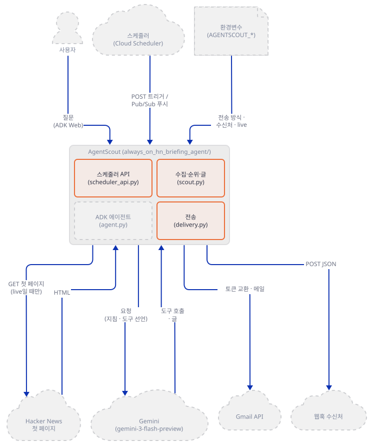

**확인.** `9 passed`가 나오고 `check_env 통과`가 먼저 찍혔습니다.

### Step 2. 순위 — 모델이 없는 점수 산수

**목적.** "에이전트가 고른다"는 말이 코드에서 무엇인지 봅니다. 표본 이야기 다섯 개가 어떻게 줄 서는지, 낱말 판정의 약점을 직접 확인합니다.

**할 일.** 순위는 `scout.py`의 작은 함수 넷이 정합니다.

`always_on_agents/always_on_hn_briefing_agent/scout.py:153-176`

```python
def _keyword_hits(title: str) -> set[str]:
    normalized = re.sub(r"[^a-z0-9]+", " ", title.lower())
    return {keyword for keyword in AGENT_KEYWORDS if keyword in normalized}


def _is_noise(title: str) -> bool:
    lowered = title.lower()
    return any(noise in lowered for noise in NOISE_WORDS)


def _score_story(story: Story) -> float:
    keyword_score = len(_keyword_hits(story.title)) * 16
    discussion_score = min(story.comments, 150) / 3
    points_score = min(story.points, 500) / 10
    freshness_score = max(0, 35 - story.rank)
    return keyword_score + discussion_score + points_score + freshness_score


def _summarize_story(story: Story) -> str:
    hits = sorted(_keyword_hits(story.title))
    if hits:
        signal = ", ".join(hits[:3])
        return f"Strong Hacker News signal around {signal}; review for architecture, tooling, or workflow ideas."
    return "Useful background item for agent builders; monitor discussion before promoting it to the daily brief."
```

점수는 `낱말 수 × 16`에 `댓글 최대 150을 3으로 나눈 값`, `점수 최대 500을 10으로 나눈 값`, `35 − 첫 페이지 순위`(0 아래로는 안 내려감)를 더한 것입니다. 낱말은 `AGENT_KEYWORDS` 열두 개(`scout.py:23-36`)이고, 제목을 소문자·영숫자로 바꾼 문자열에 그 낱말이 **글자 조각으로** 들어 있으면 맞은 것으로 칩니다(`keyword in normalized`). 단어 경계를 보지 않습니다. 요약 글(`_summarize_story`)은 모델이 쓰는 것이 아니라 맞은 낱말을 끼워 넣는 틀 한 줄입니다. 표본 이야기(`scout.py:179-228`)의 요약만 손으로 쓴 글입니다. 아래 `explain.py`는 원본을 고치지 않고 이 함수들을 불러 점수가 어디서 나오는지 찍습니다.

`explain.py`

```bash
cat > explain.py <<'PY'
"""scout.py의 순위 함수를 직접 불러 점수가 어디서 나오는지 찍는다(원본은 고치지 않는다). 네트워크 없음."""
import sys

sys.path.insert(0, "always_on_hn_briefing_agent")
import scout  # noqa: E402


def row(story):
    hits = sorted(scout._keyword_hits(story.title))
    kw = len(hits) * 16
    disc = min(story.comments, 150) / 3
    pts = min(story.points, 500) / 10
    fresh = max(0, 35 - story.rank)
    total = scout._score_story(story)
    print(f"{total:6.1f} = 낱말 {kw:>3} + 댓글 {disc:5.1f} + 점수 {pts:5.1f} + 순위 {fresh:>2}  {hits}  {story.title[:48]}")


print("== 표본 이야기(sample_stories) ==")
for s in scout.sample_stories():
    row(s)
print("== 낱말 판정이 제목의 글자 조각에 걸리는 예 ==")
for title in ["Decoding the PNG format by hand", "Stool samples and the microbiome", "Reagent prices fall again", "Toolkit for cooks"]:
    print(f"{sorted(scout._keyword_hits(title))!s:20} {title}")
print("== 라이브 모드의 요약 글은 항상 'agent'를 품는가 ==")
s = scout.Story("Roman concrete", "u", "h", 1, 1, 1, "")
print(scout._summarize_story(s))
print("'agent' in summary.lower():", "agent" in scout._summarize_story(s).lower())
PY
```

```bash
uv run --no-project python -B explain.py
```

직접 확인한 출력입니다.

```text
== 표본 이야기(sample_stories) ==
 163.5 = 낱말  48 + 댓글  38.7 + 점수  42.8 + 순위 34  ['agent', 'framework', 'workflow']  Show HN: An open-source framework for reliable A
 106.2 = 낱말  16 + 댓글  28.0 + 점수  31.2 + 순위 31  ['tool']  Model Context Protocol adoption in developer too
 124.9 = 낱말  48 + 댓글  24.3 + 점수  25.6 + 순위 27  ['agent', 'agents', 'coding']  Lessons from running coding agents on production
  71.1 = 낱말  16 + 댓글  13.7 + 점수  18.4 + 순위 23  ['automation']  Why long-running automation needs better human h
  73.8 = 낱말  32 + 댓글   9.7 + 점수  14.1 + 순위 18  ['llm', 'tool']  A lightweight eval harness for tool-using LLM ap
== 낱말 판정이 제목의 글자 조각에 걸리는 예 ==
['coding']           Decoding the PNG format by hand
['tool']             Stool samples and the microbiome
['agent']            Reagent prices fall again
['tool']             Toolkit for cooks
== 라이브 모드의 요약 글은 항상 'agent'를 품는가 ==
Useful background item for agent builders; monitor discussion before promoting it to the daily brief.
'agent' in summary.lower(): True
```

세 가지가 보입니다. 첫째, 표본의 1위(163.5)는 낱말 셋이 맞아 48점을 번 글이고, 낱말 점수가 전체에서 차지하는 몫은 15%(MCP 글, 106.2점)에서 43%(eval harness 글, 73.8점)까지이고 나머지는 인기와 첫 페이지 순위입니다. 둘째, `agent`와 `agents`가 서로 다른 낱말로 따로 세어져 "coding agents"라는 한 구절이 낱말 셋(48점)이 됩니다. 셋째, `Model Context Protocol adoption`은 `tools`가 `tool`에 걸려 16점일 뿐 `mcp`로는 맞지 않았습니다(제목에 `MCP`가 없습니다). 반대로 `Decoding the PNG format by hand`는 `coding`에, `Reagent prices`는 `agent`에, `Stool samples`는 `tool`에 걸립니다. 아래 맨 끝 두 줄은 Step 3에서 쓰는 사실입니다. 라이브 모드는 요약 글을 `_summarize_story`로 채우는데, 낱말이 하나도 안 맞은 제목의 요약도 `agent builders`라는 말을 품습니다.

브리핑 글 모양도 봅니다. `render_brief`(`scout.py:291-368`)가 이야기마다 제목, 요약, 신호, 링크 둘을 적고 끝에 "다음 행동" 셋을 붙입니다. 이 셋은 모든 브리핑에서 같은 문장입니다(`scout.py:302-306`).

```bash
uv run --no-project python -B -c "import sys; sys.path.insert(0, 'always_on_hn_briefing_agent'); import scout; print(scout.run_ambient_scout(live=False, top_n=2)['text'])"
```

```text
AgentScout Hacker News Engineering Brief
Generated: 2026-10-17T05:27:16-07:00
Watch mode: sample

Highest-signal agent-building stories:
1. Show HN: An open-source framework for reliable AI agent workflows
   Why it matters: Framework discussion with practical tradeoffs around orchestration, retries, state, and tool execution.
   Signal: 428 points, 116 comments, front-page rank 1
   Link: https://example.com/reliable-agent-workflows
   HN: https://news.ycombinator.com/item?id=40100001

2. Lessons from running coding agents on production repositories
   Why it matters: Operational report on code review loops, test gates, sandboxing, and human approval boundaries.
   Signal: 256 points, 73 comments, front-page rank 8
   Link: https://example.com/coding-agents-production
   HN: https://news.ycombinator.com/item?id=40100003

Next actions:
- Open the highest-comment thread and extract objections or implementation patterns.
- Promote only stories with clear engineering signal to the team digest.
- If this is running on a schedule, send the brief after human-readable rendering succeeds.
```

`Generated` 시각은 `America/Los_Angeles`로 찍히고 제목의 날짜도 그 시간대 기준입니다(`scout.py:299-301`). 스케줄러가 어느 시간대로 도는지와 무관합니다.

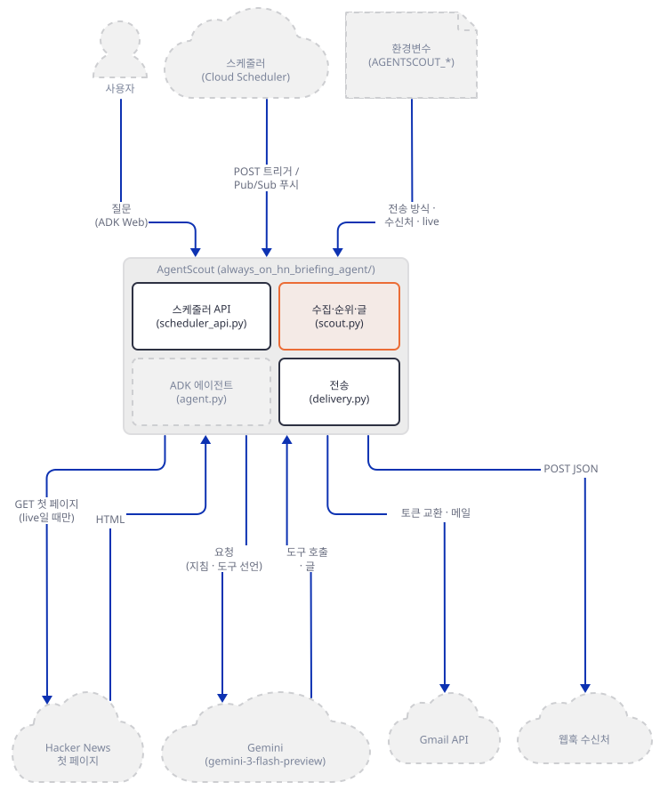

**확인.** 표본 순위가 163.5 → 124.9 → 106.2 → 73.8 → 71.1이고, 낱말 판정이 글자 조각에 걸리는 네 예가 찍힙니다.

### Step 3. 라이브 모드 — 가짜 Hacker News와 래퍼

**목적.** 환경변수 하나로 바깥에서 가져오는 "라이브" 경로를 실제 사이트 없이 끝까지 돌립니다. 필터와 파서가 실제로 하는 일, 그리고 실패했을 때 API가 보이는 모습을 봅니다.

**할 일.** 라이브 경로는 `urllib.request.urlopen`으로 `https://news.ycombinator.com/news`를 가져옵니다.

`always_on_agents/always_on_hn_briefing_agent/scout.py:231-244`

```python
def fetch_hn_front_page(timeout_seconds: int = 15) -> list[Story]:
    """Fetch and parse current Hacker News front-page stories."""

    request = urllib.request.Request(
        "https://news.ycombinator.com/news",
        headers={"User-Agent": "AgentScout ambient demo"},
    )
    try:
        with urllib.request.urlopen(request, timeout=timeout_seconds) as response:
            markup = response.read().decode("utf-8", errors="replace")
    except urllib.error.URLError as exc:
        raise RuntimeError(f"Could not fetch Hacker News: {exc}") from exc

    parser = HNFrontPageParser()
```

주소가 코드에 박혀 있고(환경변수로 못 바꿈) `urlopen`은 `HTTPS_PROXY` 같은 변수를 따릅니다(`HTTPS_PROXY`를 걸고 `urllib.request.getproxies()`를 불러 직접 확인). 그래서 환경변수만으로는 가짜 서버로 돌릴 수 없고, 래퍼가 필요합니다. 아래 `serve_local.py`는 `urllib.request.urlopen`을 바꿔 끼운 뒤 원본 `scheduler_api`의 `app`을 `127.0.0.1`에만 띄웁니다. 바꾼 함수는 세 가지만 합니다. `news.ycombinator.com`·`oauth2.googleapis.com`·`gmail.googleapis.com` 요청을 대역 서버 주소로 고쳐 쓰고, 호스트가 루프백이 아닌 나머지는 보내지 않고 오류를 내고, 프록시 변수를 보지 않습니다(`ProxyHandler({})`). 원본의 `uvicorn scheduler_api:app --host 0.0.0.0` 대신 래퍼가 `host="127.0.0.1"`을 박아 띄웁니다. 가드 `check_env()`가 래퍼 맨 앞에서 돕니다.

`serve_local.py`

```bash
cat > serve_local.py <<'PY'
"""원본 scheduler_api의 app을 루프백(127.0.0.1)에만 띄우는 래퍼. 원본의 실행 예는 --host 0.0.0.0이다.

앱 코드는 urllib.request.urlopen으로 바깥에 나간다(scout.py의 Hacker News, delivery.py의 Google 둘과 웹훅).
이 래퍼는 urlopen을 바꿔 끼운다. 바꾼 함수는
  - news.ycombinator.com, oauth2.googleapis.com, gmail.googleapis.com 요청을 루프백 대역 서버 주소로 고쳐 쓰고,
  - 호스트가 루프백이 아닌 나머지 요청은 보내지 않고 오류를 낸다.
  - 프록시 변수를 보지 않는다(ProxyHandler({})).
쓰는 법: python serve_local.py <앱 포트> <대역 서버 포트>   (hn-lab 폴더에서)"""
import os
import sys
import urllib.error
import urllib.parse
import urllib.request

from check_env import check

check()

APP_PORT, FAKE_PORT = int(sys.argv[1]), int(sys.argv[2])
LOOPBACK = ("127.0.0.1", "localhost", "::1")
REWRITE = {
    ("news.ycombinator.com", "/news"): "/hn/news",
    ("oauth2.googleapis.com", "/token"): "/google/token",
    ("gmail.googleapis.com", "/gmail/v1/users/me/messages/send"): "/google/gmail/send",
}
_opener = urllib.request.build_opener(urllib.request.ProxyHandler({}))


def guarded_urlopen(request, data=None, timeout=None, **kwargs):
    if isinstance(request, str):
        request = urllib.request.Request(request)
    url = request.full_url
    parts = urllib.parse.urlparse(url)
    target = REWRITE.get((parts.hostname, parts.path))
    if target is not None:
        new_url = f"http://127.0.0.1:{FAKE_PORT}{target}"
        print(f"[래퍼] {parts.hostname}{parts.path} -> {new_url}", flush=True)
        request = urllib.request.Request(new_url, data=request.data, headers=dict(request.header_items()),
                                         method=request.get_method())
    elif parts.hostname not in LOOPBACK:
        print(f"[래퍼] 막음: {parts.hostname}", flush=True)
        raise urllib.error.URLError(f"래퍼가 막음: {parts.hostname}")
    return _opener.open(request, data, timeout) if timeout is not None else _opener.open(request, data)


urllib.request.urlopen = guarded_urlopen
assert urllib.request.urlopen is guarded_urlopen

sys.path.insert(0, os.path.join(os.path.dirname(os.path.abspath(__file__)), "always_on_hn_briefing_agent"))
import scheduler_api  # noqa: E402  (패키지 밖에서 가져오면 상대 import가 ImportError로 빠지고 평평한 import로 간다)

import uvicorn  # noqa: E402

uvicorn.run(scheduler_api.app, host="127.0.0.1", port=APP_PORT, reload=False, log_level="info")
PY
```

`wrapcheck.py`는 서버를 띄우지 않고 래퍼가 `urlopen`을 어떻게 바꿨는지만 봅니다. 대역 서버가 없는 포트로 향하게 해서, 요청이 어디로 가려 했는지를 오류 글로 읽습니다.

`wrapcheck.py`

```bash
cat > wrapcheck.py <<'PY'
"""래퍼(serve_local.py)가 urlopen을 어떻게 바꿨는지 서버를 띄우지 않고 확인한다.
대역 서버가 없는 포트(52719)로 향하게 해서, 요청이 어디로 가려 했는지(오류 글)만 본다. 바깥으로는 아무것도 나가지 않는다.
쓰는 법: . ./envfake.sh 뒤에 python wrapcheck.py"""
import runpy
import sys
import urllib.error
import urllib.request

sys.path.insert(0, ".")
import uvicorn  # noqa: E402

uvicorn.run = lambda *args, **kwargs: None  # 서버는 띄우지 않는다
sys.argv = ["serve_local.py", "52712", "52719"]
runpy.run_path("serve_local.py", run_name="__main__")

for url in ["https://example.invalid/x", "https://oauth2.googleapis.com/token",
            "https://news.ycombinator.com/news", "https://gmail.googleapis.com/other"]:
    try:
        urllib.request.urlopen(url, timeout=3)
    except urllib.error.URLError as exc:
        print(f"{url} -> {exc.reason}")
PY
```

```bash
. ./envfake.sh
uv run --no-project python -B wrapcheck.py
```

```text
GOOGLE_API_KEY=fake-k  AGENTSCOUT_LIVE_HN=''  NO_PROXY=127.0.0.1,localhost
check_env 통과: 대역 서버로만 향함
[래퍼] 막음: example.invalid
https://example.invalid/x -> 래퍼가 막음: example.invalid
[래퍼] oauth2.googleapis.com/token -> http://127.0.0.1:52719/google/token
https://oauth2.googleapis.com/token -> [WinError 10061] 대상 컴퓨터에서 연결을 거부했으므로 연결하지 못했습니다
[래퍼] news.ycombinator.com/news -> http://127.0.0.1:52719/hn/news
https://news.ycombinator.com/news -> [WinError 10061] 대상 컴퓨터에서 연결을 거부했으므로 연결하지 못했습니다
[래퍼] 막음: gmail.googleapis.com
https://gmail.googleapis.com/other -> 래퍼가 막음: gmail.googleapis.com
```

바깥 주소(`example.invalid`)는 보내기 전에 막혔고, 두 Google 주소와 Hacker News는 `127.0.0.1`로 고쳐 쓰였으며(오류는 그 포트에 서버가 없어서입니다), 매핑에 없는 Gmail 주소(`/other`)도 막혔습니다(직접 확인).

대역 서버 `fakes.py`는 요청 넷을 받습니다. Hacker News 첫 페이지(일부러 AI와 무관한 글을 섞음), 웹훅, Google 토큰, Gmail 전송입니다. 받은 것의 요약만 `fake/fakes.jsonl`에 남기고 자격 증명은 앞 일곱 글자만 적습니다. 첫 페이지의 모양은 `fake/hn_mode.txt`의 낱말로 바꿉니다. 이 HTML은 파서(`scout.py:68-137`)가 기대하는 모양(`span.titleline`, `span.score`, `span.subtext`)으로 **내가 만든 것**이고, 진짜 Hacker News 페이지의 현재 마크업은 이 문서가 요청하지 않았으므로 확인하지 못했습니다. 제목 줄의 모양도 가정입니다. 제목 줄 안에 `<a href="from?site=…">` 링크가 하나 더 있으면 파서가 둘째 이야기부터 제목 앞에 앞 이야기의 사이트 이름을 붙이고 URL을 `from?site=` 링크로 바꾼다는 것을 파서만 따로 돌려 직접 확인했습니다(`scout.py:90-118`). 진짜 페이지가 지금 그런 모양인지는 모릅니다.

`fakes.py`

```bash
cat > fakes.py <<'PY'
"""루프백 대역 서버 하나. 앱이 바깥에 거는 요청 셋을 대신 받고, 받은 것의 요약을 fake/fakes.jsonl에 한 줄씩 남긴다.

  GET  /hn/news          Hacker News 첫 페이지 대역(HTML). fake/hn_mode.txt의 낱말(ok|subline|empty|503)로 모양을 바꾼다. 파일이 없으면 ok
  POST /hook             웹훅 대역. 받은 JSON의 키, 글자 수, Authorization 앞 몇 글자를 남긴다
  POST /google/token     Gmail OAuth 토큰 교환 대역(자격 증명 값은 앞 몇 글자만 남긴다)
  POST /google/gmail/send Gmail 전송 대역. raw를 풀어 헤더와 부분(part) 종류를 남긴다

사용법: python serve_fakes.py <포트>
"""
import base64
import email
import json
import os
import time
from email import policy
from pathlib import Path

from fastapi import FastAPI, Request
from fastapi.responses import HTMLResponse, JSONResponse

LOG = Path(os.environ.get("FAKE_LOG", "fake/fakes.jsonl"))
LOG.parent.mkdir(parents=True, exist_ok=True)
app = FastAPI()


def note(**kw):
    kw["t"] = round(time.time(), 3)
    with LOG.open("a", encoding="utf-8") as f:
        f.write(json.dumps(kw, ensure_ascii=False) + "\n")


# (제목, 점수, 댓글, 사이트) — 일부러 AI와 무관한 글을 섞었다
STORIES = [
    ("Show HN: A tiny MCP server for your notes", 321, 88, "example.org"),
    ("Why the Roman concrete lasted two thousand years", 905, 410, "example.net"),
    ("Decoding the PNG format by hand", 150, 40, "example.com"),
    ("Ask HN: Who is hiring? (October 2026)", 700, 500, "news.ycombinator.com"),
    ("Lessons from running coding agents in CI", 210, 66, "example.dev"),
    ("A field guide to sourdough starters", 640, 120, "example.io"),
]


def page(stories, subline=False):
    rows = []
    for i, (title, pts, com, site) in enumerate(stories, start=1):
        item = 41000000 + i
        rows.append(
            f'<tr class="athing submission" id="{item}"><td class="title"><span class="rank">{i}.</span></td>'
            f'<td class="title"><span class="titleline"><a href="https://{site}/{i}">{title}</a>'
            f'<span class="sitebit comhead"> (<span class="sitestr">{site}</span>)</span></span></td></tr>'
        )
        inner = (
            f'<span class="score" id="score_{item}">{pts} points</span> by someone | '
            f'<a href="item?id={item}">{com}&nbsp;comments</a>'
        )
        sub = f'<span class="subline">{inner}</span>' if subline else f'<span class="subtext">{inner}</span>'
        rows.append(f'<tr><td colspan="2"></td><td class="subtext">{sub}</td></tr>')
    return "<html><body><table>" + "".join(rows) + "</table></body></html>"


@app.get("/hn/news")
async def hn():
    mode_file = Path("fake/hn_mode.txt")
    mode = mode_file.read_text(encoding="utf-8").strip() if mode_file.exists() else "ok"
    note(kind="hn", mode=mode)
    if mode == "503":
        return HTMLResponse("busy", status_code=503)
    if mode == "empty":
        return HTMLResponse("<html><body>layout changed</body></html>")
    return HTMLResponse(page(STORIES, subline=(mode == "subline")))


@app.post("/hook")
async def hook(request: Request):
    body = await request.json()
    auth = request.headers.get("authorization", "")
    note(kind="webhook", keys=sorted(body), subject=body.get("subject"), text_chars=len(body.get("text", "")),
         html_chars=len(body.get("html", "")), stories=len(body.get("stories", [])),
         auth_prefix=auth[:10], content_type=request.headers.get("content-type"))
    return JSONResponse({"ok": True})


@app.post("/google/token")
async def token(request: Request):
    form = (await request.body()).decode()
    pairs = dict(p.split("=", 1) for p in form.split("&"))
    note(kind="token", fields={k: v[:7] for k, v in pairs.items()})
    return JSONResponse({"access_token": "fake-access-token", "expires_in": 3600})


@app.post("/google/gmail/send")
async def gmail(request: Request):
    body = await request.json()
    raw = base64.urlsafe_b64decode(body["raw"])
    msg = email.message_from_bytes(raw, policy=policy.default)
    parts = [(p.get_content_type(), len(p.get_content())) for p in msg.walk() if not p.is_multipart()]
    note(kind="gmail", auth_prefix=request.headers.get("authorization", "")[:12], to=msg["To"],
         sender=msg["From"], subject=msg["Subject"], content_type=msg.get_content_type(), parts=parts)
    return JSONResponse({"id": "fake-msg-1", "threadId": "fake-thread-1"})


@app.api_route("/{path:path}", methods=["GET", "POST", "PUT", "DELETE"])
async def other(path: str, request: Request):
    note(kind="unexpected", request=request.method + " /" + path)
    return JSONResponse({"error": "not found"}, status_code=404)
PY
```

`serve_fakes.py`

```bash
cat > serve_fakes.py <<'PY'
"""대역 서버(fakes.py)를 루프백(127.0.0.1)에만 띄운다. 호스트는 이 파일에 박혀 있다.
쓰는 법: python serve_fakes.py <포트>"""
import sys

import uvicorn

uvicorn.run("fakes:app", host="127.0.0.1", port=int(sys.argv[1]), reload=False, log_level="warning")
PY
```

`show.py`는 응답을 순위 몇 줄로 줄여 보여 줍니다.

`show.py`

```bash
cat > show.py <<'PY'
"""스케줄러 응답(JSON)을 stdin에서 받아 전송 결과와 순위 요약만 찍는다. 쓰는 법: curl ... | python show.py"""
import json
import sys

r = json.load(sys.stdin)
b = r["brief"]
d = {k: v for k, v in r["delivery"].items() if k not in ("detail", "response")}
print("watch_mode:", b["watch_mode"], "| 이야기:", len(b["stories"]), "| dry_run:", r["dry_run"])
print("delivery:", json.dumps(d, ensure_ascii=False))
for s in b["stories"]:
    print(f'  rank {s["rank"]:>2}  {s["points"]:>4} pts {s["comments"]:>4} com  {s["title"]}')
PY
```

터미널 둘에서 띄웁니다. 터미널 3은 Step 1을 한 터미널입니다(`hn-lab` 안, 이 문서의 모든 "터미널 3" 명령은 거기서 돌립니다). 먼저 `check_env 통과`가 찍혀야 하고, 래퍼는 가드가 실패하면 서버를 세우지 않습니다.

```bash
# 터미널 1 (대역 서버)
cd hn-lab
. ./envfake.sh
uv run --no-project python serve_fakes.py 52711
```

```bash
# 터미널 2 (스케줄러 API). 반드시 envfake를 먼저 읽는다
cd hn-lab
. ./envfake.sh
uv run --no-project python serve_local.py 52712 52711
```

```powershell
# PowerShell(실행해 보지 못했습니다). 각 터미널에서 먼저 위 환경 블록을 붙여 넣은 뒤
uv run --no-project python serve_fakes.py 52711
uv run --no-project python serve_local.py 52712 52711
```

터미널 3에서 라이브로 한 번 부릅니다(`curl`에는 `--noproxy '*'`를 줍니다. 앞 가드가 프록시 변수를 막지만 터미널 3에서는 `envfake.sh`를 읽지 않았을 수 있습니다).

```bash
curl -s --noproxy '*' "http://127.0.0.1:52712/agent-scout/dry-run?live=true&top_n=6" | uv run --no-project python show.py
```

직접 확인한 출력입니다. 터미널 2에는 `[래퍼] news.ycombinator.com/news -> http://127.0.0.1:52711/hn/news`가 찍혔습니다.

```text
watch_mode: live_hn | 이야기: 5 | dry_run: True
delivery: {"attempted": false, "sent": false, "status": "dry_run"}
  rank  2   905 pts  410 com  Why the Roman concrete lasted two thousand years
  rank  5   210 pts   66 com  Lessons from running coding agents in CI
  rank  6   640 pts  120 com  A field guide to sourdough starters
  rank  1   321 pts   88 com  Show HN: A tiny MCP server for your notes
  rank  3   150 pts   40 com  Decoding the PNG format by hand
```

대역이 여섯 이야기를 내놨는데 다섯만 나왔습니다. 빠진 하나는 `Ask HN: Who is hiring?`(`NOISE_WORDS`)입니다. 나머지를 보면 1위가 로마 콘크리트 글(AI와 무관, 905점·410댓글), 3위가 사워도우 글입니다. 필터의 한 줄이 이유입니다.

`always_on_agents/always_on_hn_briefing_agent/scout.py:278-288`

```python
    if live is None:
        live = os.environ.get("AGENTSCOUT_LIVE_HN", "").lower() in {"1", "true", "yes"}

    stories = fetch_hn_front_page() if live else sample_stories()
    candidates = [
        story
        for story in stories
        if not _is_noise(story.title)
        and (_keyword_hits(story.title) or "agent" in story.summary.lower())
    ]
    return sorted(candidates, key=_score_story, reverse=True)[:top_n]
```

후보는 `낱말이 맞았거나 요약에 "agent"가 있으면` 통과합니다. 라이브 모드에서 요약은 `_summarize_story`가 채우는데, 낱말이 안 맞은 제목의 요약도 "Useful background item for agent builders…"(Step 2의 마지막 두 줄)라서 `"agent" in story.summary.lower()`가 **항상 참**입니다. 그래서 라이브 모드에서는 "AI 이야기만 고른다"는 필터가 구인 글(`NOISE_WORDS`에 걸린 것)만 빼고 아무것도 거르지 않습니다. 순위만 남는데, 낱말이 하나도 안 맞은 로마 콘크리트 글이 점수 50(점수 905 → 상한 500의 10분의 1), 댓글 50(410 → 상한 150의 3분의 1), 순위 33(첫 페이지 2위)으로 133.0점을 받아, 낱말 하나(`mcp`, 16점)가 맞은 "tiny MCP server" 글의 111.4점을 앞섭니다(`explain.py`와 같은 함수로 직접 계산). 낱말 16점은 인기 점수에 쉽게 묻힙니다. 표본 모드(Step 2)는 같은 필터가 낱말만 보고 작동합니다. 의도가 다른 것일 수 있으니 이 차이를 기억해 두세요.

이제 대역의 모양을 바꿔 보며 실패 모습을 봅니다. 첫째, 댓글 수의 출처입니다. 파서는 댓글 링크를 `class="subtext"`인 **`span`** 안에서만 찾습니다(`scout.py:96-99`, `127-131`).

`always_on_agents/always_on_hn_briefing_agent/scout.py:93-99`

```python
        elif tag == "span" and class_name == "score":
            self._in_score = True
            self._current_text = []
        elif tag == "span" and class_name == "subtext":
            self._in_subtext = True
        elif self._in_subtext and tag == "a":
            self._subtext_link_text = ""
```

대역의 `subline` 모드는 같은 내용을 `<td class="subtext"><span class="subline">…</span></td>`에 담아 `span.subtext`가 없는 페이지를 흉내 냅니다. 그러면 점수(`span.score`)는 읽히지만 댓글은 모두 0이 됩니다.

```bash
echo subline > fake/hn_mode.txt
curl -s --noproxy '*' "http://127.0.0.1:52712/agent-scout/dry-run?live=true&top_n=3" | uv run --no-project python show.py
```

```text
watch_mode: live_hn | 이야기: 3 | dry_run: True
delivery: {"attempted": false, "sent": false, "status": "dry_run"}
  rank  5   210 pts    0 com  Lessons from running coding agents in CI
  rank  2   905 pts    0 com  Why the Roman concrete lasted two thousand years
  rank  1   321 pts    0 com  Show HN: A tiny MCP server for your notes
```

(이것은 파서가 어떤 모양에 기대는지 보인 것이고, 진짜 페이지가 지금 어느 모양인지는 모릅니다. 마크업이 바뀌면 이렇게 조용히 어긋날 수 있다는 뜻입니다.) 둘째, 파서가 아무것도 찾지 못하는 페이지(`empty`)입니다.

```bash
echo empty > fake/hn_mode.txt
curl -s --noproxy '*' "http://127.0.0.1:52712/agent-scout/dry-run?live=true&top_n=3" | uv run --no-project python show.py
```

```text
watch_mode: live_hn | 이야기: 0 | dry_run: True
delivery: {"attempted": false, "sent": false, "status": "dry_run"}
```

이야기 0개, HTTP 200입니다. 스케줄러가 `dry_run=false`로 불렀다면 "No high-signal agent-building stories found." 한 줄짜리 브리핑이 그대로 전송됩니다(`scout.py:346-348`, 렌더 뒤 전송은 Step 4). 셋째, 서버가 503을 줍니다.

```bash
echo 503 > fake/hn_mode.txt
curl -s --noproxy '*' -o /dev/null -w "%{http_code}\n" "http://127.0.0.1:52712/agent-scout/dry-run?live=true&top_n=3"
echo ok > fake/hn_mode.txt
```

```text
500
```

`fetch_hn_front_page`는 `URLError`(`HTTPError` 포함)를 `RuntimeError`로 감싸 던지고 어디서도 잡지 않아서 API는 HTTP 500으로 끝납니다(터미널 2에 스택이 찍힙니다). 이때 전송은 시도되지 않습니다. 읽기 도중의 타임아웃(`TimeoutError`)은 `URLError`가 아니라 감싸이지도 않지만 같은 500일 것으로 보이며 시험하지 못했습니다.

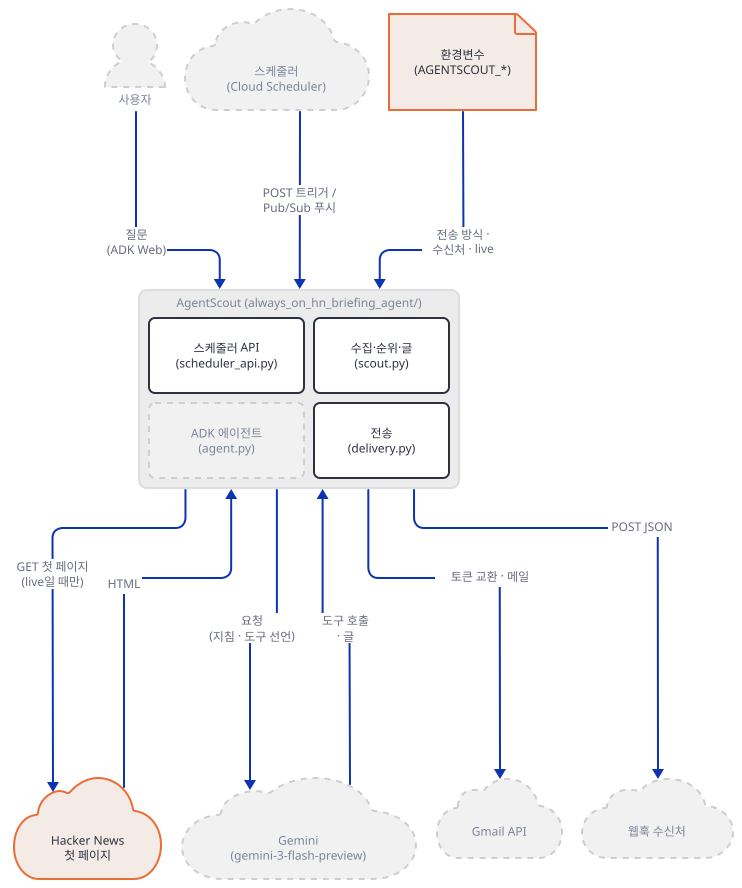

**확인.** 첫 호출은 이야기 다섯 개(`watch_mode: live_hn`), `subline` 모드는 모든 댓글 0, `empty` 모드는 0개, `503` 모드는 HTTP `500`입니다.

### Step 4. 전송 — 웹훅과 Gmail, 그리고 "200인데 못 보냈다"

**목적.** 브리핑이 밖으로 나가는 두 길을 대역 서버로 끝까지 돌려, 무엇이 어떤 모양으로 나가는지, 실패하면 어떻게 보이는지 확인합니다.

**할 일.** 방식은 `send_brief`가 고릅니다.

`always_on_agents/always_on_hn_briefing_agent/delivery.py:31-48`

```python
    delivery_mode = os.environ.get("AGENTSCOUT_DELIVERY", "auto").lower()
    if delivery_mode == "gmail":
        return send_gmail(payload)
    if delivery_mode == "webhook":
        return send_webhook(payload)
    if _gmail_configured():
        return send_gmail(payload)
    if os.environ.get("AGENTSCOUT_WEBHOOK_URL"):
        return send_webhook(payload)
    return {
        "configured": False,
        "sent": False,
        "status": "skipped_no_delivery",
        "detail": (
            "Set Gmail environment variables or AGENTSCOUT_WEBHOOK_URL to deliver "
            "scheduled briefs."
        ),
    }
```

`AGENTSCOUT_DELIVERY`가 `gmail`이나 `webhook`이면 그 길로, 비어 있으면 Gmail 변수 다섯이 모두 있을 때 Gmail, 아니면 `AGENTSCOUT_WEBHOOK_URL`이 있을 때 웹훅, 아니면 `skipped_no_delivery`입니다. 전송은 스케줄러 API가 `dry_run`이 **`False`로 판정될 때만** 부릅니다(`scheduler_api.py:51-80`). 판정은 `_as_bool`이 하는데 불리언이거나 `"1"/"true"/"yes"`·`"0"/"false"/"no"` 문자열만 알아보고 나머지(숫자 `0` 포함)는 모두 기본값 `True`(dry-run)가 됩니다. 이 따라 하기에서는 전송 설정을 바꿀 때마다 터미널 2의 앱을 `Ctrl+C`로 멈추고 다시 띄웁니다.

먼저 Gmail입니다. 길은 두 요청입니다. 갱신 토큰으로 액세스 토큰을 받고(`delivery.py:59-75`), 받은 토큰으로 메일을 보냅니다. 메일은 글 부분과 HTML 부분을 가진 `multipart`입니다(`delivery.py:93-110`).

`always_on_agents/always_on_hn_briefing_agent/delivery.py:91-110`

```python
    try:
        access_token = _fetch_gmail_access_token()
        message = EmailMessage()
        message["To"] = os.environ["AGENTSCOUT_EMAIL_TO"]
        message["From"] = os.environ["AGENTSCOUT_EMAIL_FROM"]
        message["Subject"] = payload["subject"]
        message.set_content(payload["text"])
        message.add_alternative(payload["html"], subtype="html")

        encoded_message = base64.urlsafe_b64encode(message.as_bytes()).decode("ascii")
        request = urllib.request.Request(
            "https://gmail.googleapis.com/gmail/v1/users/me/messages/send",
            data=json.dumps({"raw": encoded_message}).encode("utf-8"),
            headers={
                "Authorization": f"Bearer {access_token}",
                "Content-Type": "application/json",
            },
            method="POST",
        )
        with urllib.request.urlopen(request, timeout=20) as response:
```

이 길은 **래퍼가 두 Google 주소를 대역으로 바꿔 끼운 상태에서만** 돌렸습니다. 터미널 2를 멈추고 가짜 Gmail 값으로 다시 띄웁니다. 값 다섯 가운데 수신·발신 주소를 뺀 자격 증명 셋이 비어 있지도 `fake-`로 시작하지도 않으면 가드가 막습니다(주소는 예약 도메인 `.invalid`).

```bash
# 터미널 2 (가짜 Gmail 설정으로 다시. 이미 hn-lab 안)
. ./envfake.sh
AGENTSCOUT_DELIVERY=gmail AGENTSCOUT_EMAIL_TO=to@example.invalid AGENTSCOUT_EMAIL_FROM=from@example.invalid AGENTSCOUT_GMAIL_CLIENT_ID=fake-client-id AGENTSCOUT_GMAIL_CLIENT_SECRET=fake-client-secret AGENTSCOUT_GMAIL_REFRESH_TOKEN=fake-refresh-token uv run --no-project python serve_local.py 52712 52711
```

```powershell
# PowerShell(실행해 보지 못했습니다)
$env:AGENTSCOUT_DELIVERY = "gmail"; $env:AGENTSCOUT_EMAIL_TO = "to@example.invalid"; $env:AGENTSCOUT_EMAIL_FROM = "from@example.invalid"
$env:AGENTSCOUT_GMAIL_CLIENT_ID = "fake-client-id"; $env:AGENTSCOUT_GMAIL_CLIENT_SECRET = "fake-client-secret"; $env:AGENTSCOUT_GMAIL_REFRESH_TOKEN = "fake-refresh-token"
uv run --no-project python serve_local.py 52712 52711
```

터미널 3에서 `dry_run: false`로 트리거합니다. 스크립트가 먼저 대역의 기록을 비웁니다(`: > fake/fakes.jsonl`).

```bash
: > fake/fakes.jsonl
curl -s --noproxy '*' -X POST http://127.0.0.1:52712/agent-scout/trigger -H "Content-Type: application/json" -d '{"dry_run": false, "top_n": 2, "live": false}' | uv run --no-project python show.py
grep -E '"kind": "(token|gmail)"' fake/fakes.jsonl
```

직접 확인한 출력입니다.

```text
watch_mode: sample | 이야기: 2 | dry_run: False
delivery: {"attempted": true, "provider": "gmail", "configured": true, "sent": true, "status": "sent", "message_id": "fake-msg-1", "thread_id": "fake-thread-1"}
  rank  1   428 pts  116 com  Show HN: An open-source framework for reliable AI agent workflows
  rank  8   256 pts   73 com  Lessons from running coding agents on production repositories
{"kind": "token", "fields": {"client_id": "fake-cl", "client_secret": "fake-cl", "refresh_token": "fake-re", "grant_type": "refresh"}, "t": 1792240060.382}
{"kind": "gmail", "auth_prefix": "Bearer fake-", "to": "to@example.invalid", "sender": "from@example.invalid", "subject": "AgentScout Hacker News brief - 2026-10-17", "content_type": "multipart/alternative", "parts": [["text/plain", 1098], ["text/html", 1309]], "t": 1792240060.413}
```

토큰 요청에는 세 자격 증명과 `grant_type=refresh_token`이 갔고, 메일은 `multipart/alternative`에 `text/plain`(1,098자)과 `text/html`(1,309자) 두 부분이었습니다. 두 요청을 시퀀스로 보면 이렇습니다.

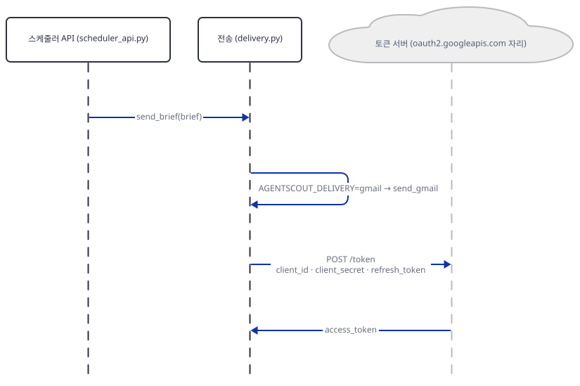

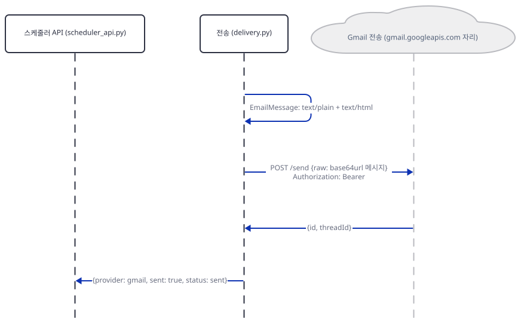

(위의 `sent: true`는 앱이 응답 본문을 믿은 결과입니다. 진짜 Gmail이 메일을 받아들이는지는 확인하지 못했습니다.)

다음은 웹훅입니다. 터미널 2를 멈추고 웹훅 설정으로 다시 띄웁니다. 웹훅 주소는 루프백이어야 하고 토큰은 `fake-`로 시작해야 가드가 통과시킵니다.

```bash
# 터미널 2 (웹훅 전송으로 다시. 이미 hn-lab 안)
. ./envfake.sh
AGENTSCOUT_DELIVERY=webhook AGENTSCOUT_WEBHOOK_URL=http://127.0.0.1:52711/hook AGENTSCOUT_WEBHOOK_TOKEN=fake-token-abc123 uv run --no-project python serve_local.py 52712 52711
```

```powershell
# PowerShell(실행해 보지 못했습니다)
$env:AGENTSCOUT_DELIVERY = "webhook"; $env:AGENTSCOUT_WEBHOOK_URL = "http://127.0.0.1:52711/hook"; $env:AGENTSCOUT_WEBHOOK_TOKEN = "fake-token-abc123"
$env:AGENTSCOUT_EMAIL_TO = ""; $env:AGENTSCOUT_EMAIL_FROM = ""; $env:AGENTSCOUT_GMAIL_CLIENT_ID = ""; $env:AGENTSCOUT_GMAIL_CLIENT_SECRET = ""; $env:AGENTSCOUT_GMAIL_REFRESH_TOKEN = ""
uv run --no-project python serve_local.py 52712 52711
```

```bash
: > fake/fakes.jsonl
curl -s --noproxy '*' -X POST http://127.0.0.1:52712/agent-scout/trigger -H "Content-Type: application/json" -d '{"dry_run": false, "top_n": 2, "live": false}' | uv run --no-project python show.py
grep '"kind": "webhook"' fake/fakes.jsonl
```

직접 확인한 출력입니다.

```text
watch_mode: sample | 이야기: 2 | dry_run: False
delivery: {"attempted": true, "provider": "webhook", "configured": true, "sent": true, "status": 200}
  rank  1   428 pts  116 com  Show HN: An open-source framework for reliable AI agent workflows
  rank  8   256 pts   73 com  Lessons from running coding agents on production repositories
{"kind": "webhook", "keys": ["html", "next_actions", "stories", "subject", "text"], "subject": "AgentScout Hacker News brief - 2026-10-17", "text_chars": 1097, "html_chars": 1308, "stories": 2, "auth_prefix": "Bearer fak", "content_type": "application/json", "t": 1792240069.186}
```

웹훅은 `subject`·`text`·`html`·`stories`·`next_actions` 다섯 키의 JSON을 받았고, 토큰은 `Authorization: Bearer …`로 갔습니다(대역은 앞 열 글자만 적었습니다). 이 본문을 Slack·Linear·Jira가 그대로 받아 주는지는 시험하지 않았습니다. 앱 README는 그 서비스들을 나열하지만 본문 모양은 위 다섯 키뿐입니다(`delivery.py:156-164`).

마지막으로 전송이 실패하는 모습입니다. 웹훅 설정의 터미널 2를 두고 터미널 1(대역 서버)만 `Ctrl+C`로 멈춘 뒤 같은 트리거를 보냅니다.

```bash
curl -s --noproxy '*' -X POST http://127.0.0.1:52712/agent-scout/trigger -H "Content-Type: application/json" -d '{"dry_run": false, "top_n": 2, "live": false}' | uv run --no-project python show.py
```

직접 확인한 출력입니다(웹훅 설정 앱, 대역 서버 없음).

```text
watch_mode: sample | 이야기: 2 | dry_run: False
delivery: {"attempted": true, "provider": "webhook", "configured": true, "sent": false, "status": "connection_error", "error": "<urlopen error [WinError 10061] 대상 컴퓨터에서 연결을 거부했으므로 연결하지 못했습니다>"}
  rank  1   428 pts  116 com  Show HN: An open-source framework for reliable AI agent workflows
  rank  8   256 pts   73 com  Lessons from running coding agents on production repositories
```

연결이 거부되면 HTTP 상태는 200이고 실패는 `delivery.status`와 `sent: false` 안에만 있습니다(`delivery.py:195-202`). 호출한 쪽이 응답 본문의 `sent`를 보지 않으면 실패를 모릅니다. 모든 실패가 이렇지는 않습니다. `send_webhook`은 `HTTPError`·`URLError`만, `send_gmail`은 `KeyError`·`URLError`·`TimeoutError`만 잡으므로(`delivery.py:186-202`, `129`) 웹훅 응답을 읽다가 시간이 초과되거나 Gmail 토큰 응답이 JSON이 아니면(`JSONDecodeError`) 예외가 올라가 API가 500을 냅니다. 아래 `fail500.py`는 네트워크 없이 `urlopen`을 함수로 바꿔 끼워 다섯 경우의 상태를 봅니다.

`fail500.py`

```bash
cat > fail500.py <<'PY'
"""전송 실패 종류마다 스케줄러 API가 돌려주는 HTTP 상태를 본다. 네트워크 없이 urlopen을 함수로 바꿔 끼운다.
쓰는 법: . ./envfake.sh 뒤에 python fail500.py   (hn-lab 폴더에서)"""
import os
import sys
import urllib.error
import urllib.request

from check_env import check

check(quiet=True)
sys.path.insert(0, "always_on_hn_briefing_agent")
from fastapi.testclient import TestClient  # noqa: E402

import scheduler_api  # noqa: E402

WEBHOOK = {"AGENTSCOUT_DELIVERY": "webhook", "AGENTSCOUT_WEBHOOK_URL": "http://127.0.0.1:52711/hook"}
GMAIL = {"AGENTSCOUT_DELIVERY": "gmail", "AGENTSCOUT_EMAIL_TO": "to@example.invalid",
         "AGENTSCOUT_EMAIL_FROM": "from@example.invalid", "AGENTSCOUT_GMAIL_CLIENT_ID": "fake-id",
         "AGENTSCOUT_GMAIL_CLIENT_SECRET": "fake-secret", "AGENTSCOUT_GMAIL_REFRESH_TOKEN": "fake-refresh"}


class Reply:
    status = 200

    def __init__(self, body, error):
        self.body, self.error = body, error

    def __enter__(self):
        return self

    def __exit__(self, *exc):
        return False

    def read(self):
        if self.error:
            raise self.error
        return self.body


def run(name, env, body=b"{}", error=None, connect_error=None):
    old = {k: os.environ.get(k) for k in env}
    os.environ.update(env)

    def fake_urlopen(*args, **kwargs):
        if connect_error:
            raise connect_error
        return Reply(body, error)

    urllib.request.urlopen = fake_urlopen
    client = TestClient(scheduler_api.app, raise_server_exceptions=False)
    r = client.post("/agent-scout/trigger", json={"dry_run": False, "top_n": 1, "live": False})
    detail = ""
    if r.status_code == 200:
        d = r.json()["delivery"]
        detail = f"sent={d.get('sent')} status={d.get('status')}"
    print(f"{name:34} -> HTTP {r.status_code} {detail}")
    for k, v in old.items():
        os.environ[k] = v or ""


run("웹훅, 연결 거부", WEBHOOK, connect_error=urllib.error.URLError("refused"))
run("웹훅, 응답 읽다가 시간 초과", WEBHOOK, error=TimeoutError("timed out"))
run("웹훅, 응답이 JSON이 아님", WEBHOOK, body=b"ok")
run("Gmail, 토큰 응답 읽다가 시간 초과", GMAIL, error=TimeoutError("timed out"))
run("Gmail, 토큰 응답이 JSON이 아님", GMAIL, body=b"<html>oops</html>")
PY
```

```bash
. ./envfake.sh
uv run --no-project python -B -W ignore fail500.py
```

직접 확인한 출력입니다.

```text
GOOGLE_API_KEY=fake-k  AGENTSCOUT_LIVE_HN=''  NO_PROXY=127.0.0.1,localhost
웹훅, 연결 거부                          -> HTTP 200 sent=False status=connection_error
웹훅, 응답 읽다가 시간 초과                   -> HTTP 500 
웹훅, 응답이 JSON이 아님                   -> HTTP 200 sent=True status=200
Gmail, 토큰 응답 읽다가 시간 초과             -> HTTP 200 sent=False status=connection_error
Gmail, 토큰 응답이 JSON이 아님             -> HTTP 500 
```

첫째·넷째 줄(연결 거부, Gmail 시간 초과)은 200 안의 실패라 Pub/Sub 푸시 구독은 확인 응답으로 받아들여 재전송 없이 사라집니다. 둘째·다섯째 줄(웹훅 시간 초과, JSON이 아닌 Gmail 응답)은 500이고, 앞의 경우는 받는 쪽이 이미 본문을 받은 뒤의 실패일 수 있습니다. Pub/Sub은 "any other status code"를 부정 확인으로 보고 메시지를 다시 보내므로 같은 브리핑이 두 번 갈 수 있습니다(Pub/Sub 문서와 소스로 확인했고 재전송 자체는 시험하지 못했습니다). 이 실험을 마치면 터미널 1을 다시 띄웁니다(`uv run --no-project python serve_fakes.py 52711`). 터미널 2의 웹훅 설정 앱은 그대로 둡니다(Step 5가 씁니다).

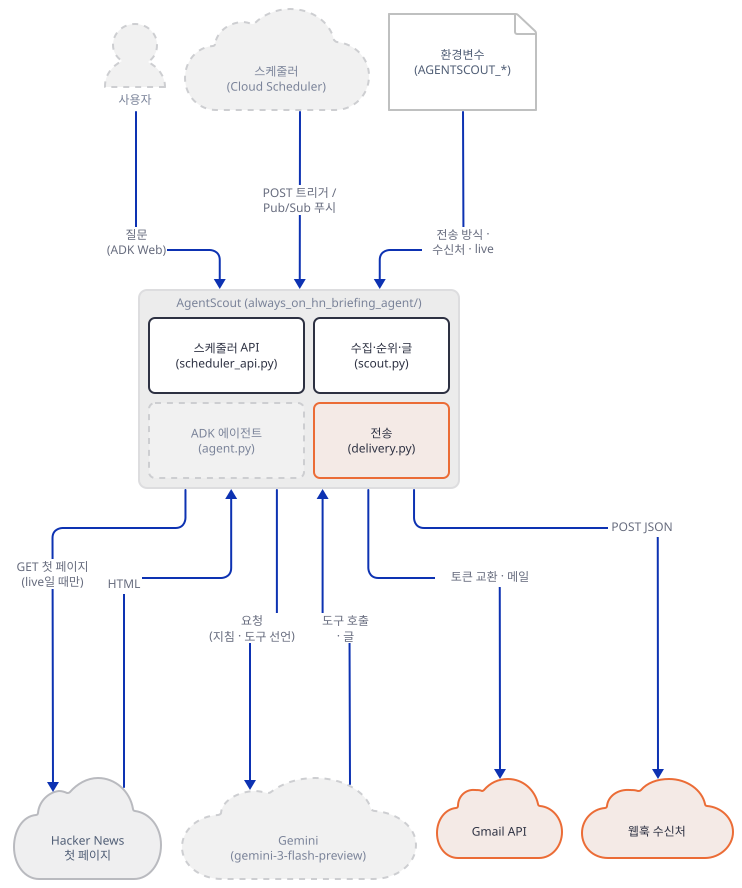

**확인.** 웹훅은 `sent: true, status: 200`과 다섯 키, Gmail은 `status: sent`와 `multipart/alternative`, 대역 서버가 죽었을 때는 `connection_error`와 HTTP 200, `fail500.py`는 200·500·200·200·500 순서(위 출력)입니다.

### Step 5. 스케줄러 API — 열려 있는 문

**목적.** 스케줄러가 부르는 네 엔드포인트의 약속과, 누가 부를 수 있는지를 봅니다.

**할 일.** 엔드포인트는 네 개입니다. `GET /health`, `GET /agent-scout/dry-run`(`top_n`·`live`를 쿼리로 받고 항상 dry-run), `POST /agent-scout/trigger`, `POST /agent-scout/pubsub`입니다. 둘이 같은 함수 `run_scheduled_scout`로 모입니다.

`always_on_agents/always_on_hn_briefing_agent/scheduler_api.py:51-80`

```python
def run_scheduled_scout(payload: dict[str, Any] | None = None) -> dict[str, Any]:
    """Run AgentScout from a scheduler payload.

    Payload fields:
        dry_run: defaults to true. Set false to call configured delivery.
        live: optional override for live Hacker News mode.
        top_n: number of stories, clamped to 1-10.
    """

    payload = payload if isinstance(payload, dict) else {}
    dry_run = _as_bool(payload.get("dry_run"), default=True)
    live = _as_bool(payload.get("live"), default=None)
    top_n = _as_top_n(payload.get("top_n"))

    brief = run_ambient_scout(live=live, top_n=top_n)
    delivery = {
        "attempted": False,
        "sent": False,
        "status": "dry_run",
        "detail": "Set dry_run=false to use configured Gmail or webhook delivery.",
    }
    if dry_run is False:
        delivery = {"attempted": True, **send_brief(brief)}

    return {
        "dry_run": dry_run,
        "top_n": top_n,
        "delivery": delivery,
        "brief": brief,
    }
```

본문 필드는 `dry_run`(기본 `True`), `live`(기본 환경변수), `top_n`(1~10으로 잘림)입니다. 전송 대상은 요청이 아니라 **환경변수가 정합니다**. 수신 주소(`AGENTSCOUT_EMAIL_TO`)나 웹훅 주소를 요청으로 바꿀 방법은 없습니다. 이제 인증 코드를 찾아 봅니다.

```bash
grep -nE "Authorization|Bearer|Depends|Security|secret|token|verify|jwt|JWT" always_on_hn_briefing_agent/scheduler_api.py || echo "(없음)"
```

```text
(없음)
```

`scheduler_api.py`에는 인증·토큰·서명 검사에 관한 줄이 하나도 없습니다(위 낱말을 찾아 아무것도 나오지 않았습니다. FastAPI 기본 `/docs`와 `/openapi.json`도 열려 있습니다). 앱 README의 실행 예(`uvicorn scheduler_api:app --host 0.0.0.0 --port 8000`)대로 띄우면 같은 네트워크의 누구나 이 주소를 부를 수 있고, 전송이 설정된 서비스라면 `POST /agent-scout/trigger`에 `{"dry_run": false}`만 보내면 설정된 수신자에게 브리핑이 나갑니다. 요청으로 바꿀 수 있는 것은 `top_n`, `live`, `dry_run`뿐이라 수신자를 바꾸거나 본문을 지어낼 수는 없지만, 반복해서 메일·웹훅을 일으키거나 서버가 Hacker News를 끊임없이 가져오게 할 수 있습니다. 이 문서는 `0.0.0.0`으로 띄워 보지 않았고 소스로만 확인했습니다. 이 문서의 래퍼는 `127.0.0.1`에 띄웁니다. 원본을 고치지 않고 띄우려면 `uvicorn scheduler_api:app --host 127.0.0.1 --port <포트>`입니다. 다만 이 줄은 `urlopen` 래퍼 밖이라 `live=true`나 `dry_run=false`와 함께 쓰면 진짜 Hacker News·Gmail·웹훅으로 나갑니다. 이 문서의 따라 하기에서는 쓰지 말고 `serve_local.py`를 쓰세요.

Step 4 끝에서 띄워 둔 웹훅 설정 앱(터미널 2)에 이상한 요청 열두 개를 보내 봅니다. 터미널 1(대역 서버)도 떠 있어야 합니다. `probe.py`는 루프백에만 연결하고, 스크립트가 먼저 대역의 기록을 비웁니다.

`probe.py`

```bash
cat > probe.py <<'PY'
"""스케줄러 API(웹훅이 설정된 앱)에 이상한 요청을 보내고 상태 코드와 전송 결과를 한 줄씩 찍는다. 루프백 주소만 받는다.
쓰는 법: python probe.py <앱 포트>"""
import base64
import http.client
import json
import sys

port = int(sys.argv[1])
HOST = "127.0.0.1"  # 이 파일은 루프백에만 연결한다. 프록시 변수를 보지 않는 http.client를 쓴다.


def send(method, path, body=None, headers=None, chunked=False):
    conn = http.client.HTTPConnection(HOST, port, timeout=20)
    headers = dict(headers or {})
    if body is not None:
        headers.setdefault("Content-Type", "application/json")
    conn.request(method, path, body=body, headers=headers, encode_chunked=chunked)
    resp = conn.getresponse()
    raw = resp.read().decode("utf-8", "replace")
    conn.close()
    try:
        delivery = json.loads(raw)["delivery"]["status"]
    except Exception:
        delivery = "-"
    return resp.status, delivery


def b64(obj):
    return base64.b64encode(json.dumps(obj).encode()).decode()


FALSE = {"dry_run": False, "top_n": 1, "live": False}
cases = [
    ("pubsub, dry_run=false, 서명 없음", lambda: send("POST", "/agent-scout/pubsub", json.dumps({"message": {"data": b64(FALSE)}}))),
    ("같은 pubsub 메시지 한 번 더", lambda: send("POST", "/agent-scout/pubsub", json.dumps({"message": {"data": b64(FALSE)}}))),
    ("pubsub, 본문이 JSON이 아님", lambda: send("POST", "/agent-scout/pubsub", "not json")),
    ("pubsub, message가 문자열", lambda: send("POST", "/agent-scout/pubsub", json.dumps({"message": "x"}))),
    ("pubsub, data가 base64가 아님", lambda: send("POST", "/agent-scout/pubsub", json.dumps({"message": {"data": "!!!"}}))),
    ("trigger, 청크 전송 + dry_run=false", lambda: send("POST", "/agent-scout/trigger", iter([json.dumps(FALSE).encode()]), chunked=True)),
    ("trigger, 같은 본문을 Content-Length로", lambda: send("POST", "/agent-scout/trigger", json.dumps(FALSE))),
    ("trigger, dry_run이 문자열 'false'", lambda: send("POST", "/agent-scout/trigger", json.dumps({**FALSE, "dry_run": "false"}))),
    ("trigger, dry_run이 숫자 0", lambda: send("POST", "/agent-scout/trigger", json.dumps({**FALSE, "dry_run": 0}))),
    ("GET dry-run, top_n=99", lambda: send("GET", "/agent-scout/dry-run?top_n=99&live=false")),
    ("GET dry-run, top_n=abc", lambda: send("GET", "/agent-scout/dry-run?top_n=abc")),
    ("GET /docs", lambda: send("GET", "/docs")),
]
for name, fn in cases:
    status, delivery = fn()
    print(f"{status}  delivery.status={str(delivery):12}  {name}")
PY
```

```bash
: > fake/fakes.jsonl
uv run --no-project python probe.py 52712
grep -c '"kind": "webhook"' fake/fakes.jsonl
```

직접 확인한 출력입니다.

```text
200  delivery.status=200           pubsub, dry_run=false, 서명 없음
200  delivery.status=200           같은 pubsub 메시지 한 번 더
500  delivery.status=-             pubsub, 본문이 JSON이 아님
500  delivery.status=-             pubsub, message가 문자열
200  delivery.status=dry_run       pubsub, data가 base64가 아님
200  delivery.status=dry_run       trigger, 청크 전송 + dry_run=false
200  delivery.status=200           trigger, 같은 본문을 Content-Length로
200  delivery.status=200           trigger, dry_run이 문자열 'false'
200  delivery.status=dry_run       trigger, dry_run이 숫자 0
200  delivery.status=dry_run       GET dry-run, top_n=99
422  delivery.status=-             GET dry-run, top_n=abc
200  delivery.status=-             GET /docs
4
```

읽는 법입니다. 첫째 줄과 둘째 줄: 서명이나 헤더 없는 Pub/Sub 모양의 요청이 `dry_run: false`를 실어 오면 전송(`delivery.status=200`은 웹훅의 HTTP 상태)이 일어났고, 같은 메시지를 한 번 더 보내면 한 번 더 일어났습니다. 마지막 줄의 `4`가 대역이 받은 웹훅 수입니다. 앱은 메시지를 알아보는 표(ID)나 중복 제거를 갖고 있지 않습니다. Pub/Sub 공식 문서는 푸시 요청에 Pub/Sub가 서명한 JWT를 `Authorization` 헤더로 싣고 받는 쪽이 "signature validation"과 "email and audience claims"를 확인해야 한다고 하며(https://docs.cloud.google.com/pubsub/docs/authenticate-push-subscriptions, 2026-10-17 확인), "Cloud Run … authenticate HTTP calls from Pub/Sub by verifying Pub/Sub-generated tokens … the only configuration that you require is to grant the necessary IAM roles"라고 적습니다. 앱 코드 자체는 아무것도 확인하지 않으므로 이 보호는 배포 환경이 해 주는 경우에만 있습니다. 이 문서는 배포하지 않았고 어느 쪽인지 확인하지 못했습니다.

둘째, 확인 응답입니다. 같은 문서가 푸시의 확인 응답 코드를 102·200·201·202·204로 정하고 "any other status code"는 부정 확인이라 Pub/Sub가 메시지를 다시 보낸다고 합니다(https://docs.cloud.google.com/pubsub/docs/push, 같은 날 확인). 그래서 셋이 이어집니다. 본문이 JSON이 아니거나(`not json`) `message`가 문자열이면 앱은 HTTP 500으로 끝나 메시지가 다시 옵니다(셋째·넷째 줄). 반대로 `data`가 base64가 아니면(다섯째) 조용히 `{}`로 처리해 dry-run으로 200을 돌려줍니다. 그리고 Step 4의 연결 실패는 200이라 재전송 없이 사라지고, 시간 초과 같은 500은 재전송을 부릅니다.

셋째, 본문 읽기입니다. 청크 전송 + `dry_run: false`(여섯째)는 dry-run으로 끝났습니다. `request.headers.get("content-length")`가 없으면 본문을 읽지 않고 `{}`로 처리하기 때문입니다(`scheduler_api.py:93-100`). 같은 본문을 `Content-Length`와 보내면(일곱째) 전송됩니다. `dry_run`이 문자열 `"false"`면 전송(여덟째), 숫자 `0`이면 dry-run(아홉째)입니다. `top_n=99`는 10으로 잘리지만 표본이 다섯 개뿐이라 이야기는 다섯입니다(열째). `top_n=abc`는 FastAPI가 422로 막습니다(열한째). `/docs`는 200입니다(열둘째).

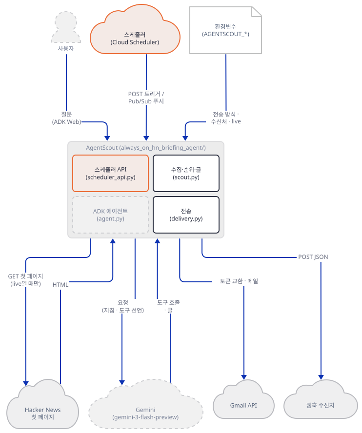

**확인.** `probe.py` 출력의 전송 줄(200)이 4개이고 마지막 `4`와 같습니다.

### Step 6. ADK 에이전트 — 모델이 하는 일은 도구 하나 부르기

**목적.** 사람이 `adk web`으로 묻는 경로에서 모델이 무엇을 받고 무엇을 하는지, 가짜 Gemini 서버가 받은 요청 기록으로 확인합니다.

**할 일.** 에이전트는 파일 하나(`agent.py`, 46줄)입니다. 도구는 `run_ambient_scout`를 부르는 함수 하나이고, 인자 `live`는 항상 `None`으로 고정됩니다.

`always_on_agents/always_on_hn_briefing_agent/agent.py:10-21`

```python
def preview_agent_builder_brief(top_n: int = 5) -> dict:
    """Preview the Hacker News briefing for agent builders.

    Args:
        top_n: Number of stories to include in the brief.

    Returns:
        A rendered daily brief with ranked stories, signal, and next actions.
    """

    return run_ambient_scout(live=None, top_n=top_n)

```

모델이 정할 수 있는 것은 `top_n` 하나뿐입니다. `live`가 `None`이므로 라이브 여부는 환경변수가 정합니다(모델은 못 바꿈). 지침은 그 아래에 있습니다.

`always_on_agents/always_on_hn_briefing_agent/agent.py:23-46`

```python
root_agent = LlmAgent(
    name="agent_scout",
    model="gemini-3-flash-preview",
    description=(
        "Always-on Hacker News briefing agent that watches for AI agent, MCP, "
        "coding agent, workflow automation, and LLM app stories."
    ),
    instruction="""
You are AgentScout, an always-on Hacker News briefing agent for teams building
AI agents and LLM apps.

Your job is to act like a focused daily briefing system:
- Curate only the highest-signal Hacker News items.
- Explain why each item matters to engineers and product builders.
- Separate observation from delivery; do not claim to send messages or schedule jobs.
- When asked for the current brief, daily digest, scouting run, or Hacker News
  update, call preview_agent_builder_brief.
- Keep responses concise and operational. Prefer ranked findings, signal, and next actions.

The tool returns rendered text and HTML that can be handed to email, Slack, or
ticketing automation in a production deployment.
""",
    tools=[preview_agent_builder_brief],
)
```

지침이 "전송이나 예약을 했다고 말하지 말라"고 합니다. 이 에이전트에는 전송 도구가 없고 도구는 이 함수 하나입니다. ADK 에이전트와 스케줄러 API가 `scout.py`를 함께 쓰지만 `delivery.py`는 스케줄러 API만 부릅니다(위 `extra-app` 그림, 두 파일의 import와 호출을 읽어 확인). 가짜 Gemini 서버 `fake_gemini.py`는 질문에 "Send this"가 있으면 도구 없이 글 한 줄, 아니면 도구 호출 한 번(글에 `top N`이 있으면 그 값을 `top_n`으로)과 그 결과를 되풀이하는 글로 답하는 대본입니다.

`fake_gemini.py`

```bash
cat > fake_gemini.py <<'PY'
"""가짜 Gemini 서버. 모델이 아니라 대본이다. 127.0.0.1에서만 받고, 받은 요청의 요약을 fake/gemini.jsonl에 한 줄씩 남긴다.

대본(마지막 내용으로 고른다):
  - 사용자 글에 "Send this"가 있으면   -> 도구 없이 글 한 줄(전송했다고 말하지 않는다)
  - 그 밖의 사용자 글                  -> preview_agent_builder_brief 호출(글에 "top N"이 있으면 top_n=N)
  - preview_agent_builder_brief 응답   -> 응답 속 이야기 제목들을 번호 붙여 되풀이하는 글
"""
import json
import os
import re
import time
from pathlib import Path

from fastapi import FastAPI, Request
from fastapi.responses import JSONResponse, StreamingResponse

LOG = Path(os.environ.get("FAKE_GEMINI_LOG", "fake/gemini.jsonl"))
LOG.parent.mkdir(parents=True, exist_ok=True)
app = FastAPI()


def kind(part):
    if "functionResponse" in part:
        return "functionResponse:" + part["functionResponse"].get("name", "")
    if "functionCall" in part:
        return "functionCall:" + part["functionCall"].get("name", "")
    return "text" if "text" in part else "other"


def summarize(model, body, key):
    decls = [d for t in (body.get("tools") or []) for d in (t.get("functionDeclarations") or [])]
    si = body.get("systemInstruction") or {}
    si_text = "".join(p.get("text", "") for p in si.get("parts", []))
    return {
        "t": round(time.time(), 3),
        "model": model,
        "key_prefix": (key or "")[:5],
        "functions": decls,
        "system_chars": len(si_text),
        "system": si_text,
        "contents": [{"role": c.get("role"), "parts": [kind(p) for p in c.get("parts", [])]} for c in body.get("contents") or []],
    }


def script(body):
    contents = body.get("contents") or []
    last = contents[-1] if contents else {}
    parts = last.get("parts", [])
    for p in parts:
        fr = p.get("functionResponse")
        if fr and fr.get("name") == "preview_agent_builder_brief":
            resp = fr.get("response") or {}
            titles = [s.get("title") for s in resp.get("stories", [])]
            lines = [f"{i}. {t}" for i, t in enumerate(titles, start=1)]
            return [{"text": "Brief (fake model, repeating the tool result):\n" + "\n".join(lines)}]
    text = "".join(p.get("text", "") for p in parts)
    if "Send this" in text:
        return [{"text": "I can't send messages, but here is handoff-ready text. (fake model)"}]
    m = re.search(r"top (\d+)", text)
    args = {"top_n": int(m.group(1))} if m else {}
    return [{"functionCall": {"name": "preview_agent_builder_brief", "args": args}}]


def chunk(parts):
    return {
        "candidates": [{"content": {"role": "model", "parts": parts}, "finishReason": "STOP", "index": 0}],
        "usageMetadata": {"promptTokenCount": 10, "candidatesTokenCount": 5, "totalTokenCount": 15},
        "modelVersion": "fake",
    }


async def handle(model, request, stream):
    body = await request.json()
    with LOG.open("a", encoding="utf-8") as f:
        f.write(json.dumps(summarize(model, body, request.headers.get("x-goog-api-key")), ensure_ascii=False) + "\n")
    payload = chunk(script(body))
    if stream:
        def gen():
            yield "data: " + json.dumps(payload) + "\r\n\r\n"
        return StreamingResponse(gen(), media_type="text/event-stream")
    return JSONResponse(payload)


@app.post("/v1beta/models/{model_action}")
async def models(model_action: str, request: Request):
    model, _, action = model_action.partition(":")
    return await handle(model, request, stream=action == "streamGenerateContent")


@app.api_route("/{path:path}", methods=["GET", "POST", "PUT", "DELETE"])
async def other(path: str, request: Request):
    with LOG.open("a", encoding="utf-8") as f:
        f.write(json.dumps({"t": round(time.time(), 3), "unexpected": request.method + " /" + path}) + "\n")
    return JSONResponse({"error": {"code": 404, "message": "not found", "status": "NOT_FOUND"}}, status_code=404)
PY
```

`serve_gemini.py`

```bash
cat > serve_gemini.py <<'PY'
"""가짜 Gemini 서버(fake_gemini.py)를 루프백(127.0.0.1)에만 띄운다. 쓰는 법: python serve_gemini.py <포트>"""
import sys

import uvicorn

uvicorn.run("fake_gemini:app", host="127.0.0.1", port=int(sys.argv[1]), reload=False, log_level="warning")
PY
```

`client.py`는 `adk web`의 `/run`으로 질문 한 건을 보내고 이벤트를 찍습니다. `show_gemini.py`는 가짜 서버가 남긴 요청 기록을 한 줄로 줄입니다.

`client.py`

```bash
cat > client.py <<'PY'
"""adk web의 /run 으로 요청 한 건을 보내고 이벤트를 한 줄씩 찍는다. 루프백 주소(127.0.0.1)에만 연결한다.
쓰는 법: python client.py <포트> <세션 이름> "<질문>" """
import http.client
import json
import sys

APP = "always_on_hn_briefing_agent"
port, session, text = int(sys.argv[1]), sys.argv[2], sys.argv[3]


def call(method, path, body=None):
    conn = http.client.HTTPConnection("127.0.0.1", port, timeout=60)
    data = None if body is None else json.dumps(body)
    conn.request(method, path, body=data, headers={"content-type": "application/json"})
    resp = conn.getresponse()
    raw = resp.read()
    conn.close()
    if resp.status >= 300:
        raise SystemExit(f"HTTP {resp.status}: {raw[:400]!r}")
    return json.loads(raw)


print("목록:", call("GET", "/list-apps"))
call("POST", f"/apps/{APP}/users/u1/sessions/{session}", {})
events = call("POST", "/run", {"app_name": APP, "user_id": "u1", "session_id": session,
                               "new_message": {"role": "user", "parts": [{"text": text}]}})
print(f"이벤트 {len(events)}개")
for e in events:
    for p in (e.get("content") or {}).get("parts", []):
        if "functionCall" in p:
            what = "호출 " + p["functionCall"]["name"] + " " + json.dumps(p["functionCall"].get("args"))
        elif "functionResponse" in p:
            r = p["functionResponse"]["response"]
            what = f"응답 {p['functionResponse']['name']}  watch_mode={r.get('watch_mode')} 이야기 {len(r.get('stories', []))}개"
        else:
            what = "글   " + p.get("text", "")[:400].replace("\n", " / ")
        print(f"{e['author']:12} {what}")
PY
```

`show_gemini.py`

```bash
cat > show_gemini.py <<'PY'
"""가짜 Gemini 서버가 남긴 fake/gemini.jsonl을 요청마다 한 줄로 요약한다. 쓰는 법: python show_gemini.py"""
import json

for i, line in enumerate(open("fake/gemini.jsonl", encoding="utf-8"), start=1):
    d = json.loads(line)
    fn = [(f["name"], f.get("parameters_json_schema", {}).get("properties")) for f in d["functions"]]
    seq = " > ".join(c["role"] + ":" + "+".join(c["parts"]) for c in d["contents"])
    print(f'요청 {i}: 모델={d["model"]} 키={d["key_prefix"]}… 지침 {d["system_chars"]}자 도구={fn}')
    print(f"        내용: {seq}")
PY
```

터미널 둘을 더 씁니다. 터미널 4는 가짜 Gemini, 터미널 5는 앱 폴더 **복사본 안**에서 `adk web`을 띄웁니다. 앱 README는 앱 폴더에서 `adk web .`를 안내하고, 목록에 `always_on_hn_briefing_agent`가 하나 뜹니다(아래 `client.py`가 `/list-apps`로 확인). 앞서 띄운 터미널 1·2는 이 단계에 필요 없으니 둬도 멈춰도 됩니다. `adk web`은 **이 폴더 안**에 `.adk/session.db`를 만들어서(저장소의 `.gitignore`가 `*.db`를 무시합니다) 원본이 아니라 복사본에서 돌립니다. `adk` 명령은 터미널이 대화형이고 동의 기록이 없으면 첫 실행에 "Enable telemetry? [Y/n]" 질문을 합니다. 문구는 기본값이 꺼짐이라고 하지만 코드는 Enter(빈 입력)와 `y`를 동의로 받아 `~/.adk/config.json`에 `telemetry: true`를 쓰고, 그 뒤 `adk` 명령이 끝날 때마다 사용 기록(하위 명령·플래그 이름, 실행 시간·종료 상태, OS·Python 판)을 `https://play.googleapis.com/log`로 보냅니다(google-adk 2.12.0의 `cli/cli_tools_click.py` 394~431행과 `cli/_telemetry/_metrics_reporter.py`, 소스로 확인). 그래서 질문에 기대지 않고 둘을 둡니다. 먼저 `adk telemetry disable`로 `false`를 기록합니다(이 문서에서 독자의 진짜 홈 `~/.adk/config.json`에 쓰는 유일한 명령이고, `adk telemetry status`로 상태를 봅니다). 그리고 `adk web`·`adk eval`의 입력을 `< /dev/null`로 닫아, 질문이 나와도 `input()`이 EOF로 끝나 아무것도 기록하지 않게 합니다(PowerShell은 `disable`이 그 몫을 합니다). `adk` 명령 앞뒤에서 `.env`는 `ADK_DISABLE_LOAD_DOTENV=1`(envfake.sh)이 읽지 못하게 합니다.

```bash
uv run --no-project adk telemetry disable < /dev/null
uv run --no-project adk telemetry status < /dev/null
```

```text
Telemetry collection has been disabled.
Telemetry collection is disabled.
```

```bash
# 터미널 4 (가짜 Gemini)
cd hn-lab
. ./envfake.sh
uv run --no-project python serve_gemini.py 52713
```

```bash
# 터미널 5 (adk web, 복사본의 앱 폴더 안에서). 가드가 실패하면 adk web이 뜨지 않는다
cd hn-lab/always_on_hn_briefing_agent
. ../envfake.sh
uv run --no-project python ../check_env.py && uv run --no-project adk web . --host 127.0.0.1 --port 52714 --no-reload < /dev/null
```

```powershell
# PowerShell(실행해 보지 못했습니다). 각 터미널에서 먼저 위 환경 블록을 붙여 넣은 뒤
uv run --no-project adk telemetry disable
uv run --no-project python serve_gemini.py 52713
# 다른 터미널, hn-lab\always_on_hn_briefing_agent 안에서
uv run --no-project python ..\check_env.py; if ($?) { uv run --no-project adk web . --host 127.0.0.1 --port 52714 --no-reload }
```

터미널 3에서 질문 셋을 보냅니다. 같은 세션 이름은 `HTTP Error 409`이니 다시 보낼 때는 `s4`처럼 바꾸세요.

```bash
: > fake/gemini.jsonl
uv run --no-project python client.py 52714 s1 "Give me today's AgentScout brief."
uv run --no-project python client.py 52714 s2 "Scout the top 3 Hacker News stories about AI agents and LLM apps."
uv run --no-project python client.py 52714 s3 "Send this to the team."
uv run --no-project python show_gemini.py
```

직접 확인한 출력입니다.

```text
목록: ['always_on_hn_briefing_agent']
이벤트 3개
agent_scout  호출 preview_agent_builder_brief {}
agent_scout  응답 preview_agent_builder_brief  watch_mode=sample 이야기 5개
agent_scout  글   Brief (fake model, repeating the tool result): / 1. Show HN: An open-source framework for reliable AI agent workflows / 2. Lessons from running coding agents on production repositories / 3. Model Context Protocol adoption in developer tools / 4. A lightweight eval harness for tool-using LLM applications / 5. Why long-running automation needs better human handoff states
목록: ['always_on_hn_briefing_agent']
이벤트 3개
agent_scout  호출 preview_agent_builder_brief {"top_n": 3}
agent_scout  응답 preview_agent_builder_brief  watch_mode=sample 이야기 3개
agent_scout  글   Brief (fake model, repeating the tool result): / 1. Show HN: An open-source framework for reliable AI agent workflows / 2. Lessons from running coding agents on production repositories / 3. Model Context Protocol adoption in developer tools
목록: ['always_on_hn_briefing_agent']
이벤트 1개
agent_scout  글   I can't send messages, but here is handoff-ready text. (fake model)
요청 1: 모델=gemini-3-flash-preview 키=fake-… 지침 924자 도구=[('preview_agent_builder_brief', {'top_n': {'default': 5, 'title': 'Top N', 'type': 'integer'}})]
        내용: user:text
요청 2: 모델=gemini-3-flash-preview 키=fake-… 지침 924자 도구=[('preview_agent_builder_brief', {'top_n': {'default': 5, 'title': 'Top N', 'type': 'integer'}})]
        내용: user:text > model:functionCall:preview_agent_builder_brief > user:functionResponse:preview_agent_builder_brief
요청 3: 모델=gemini-3-flash-preview 키=fake-… 지침 924자 도구=[('preview_agent_builder_brief', {'top_n': {'default': 5, 'title': 'Top N', 'type': 'integer'}})]
        내용: user:text
요청 4: 모델=gemini-3-flash-preview 키=fake-… 지침 924자 도구=[('preview_agent_builder_brief', {'top_n': {'default': 5, 'title': 'Top N', 'type': 'integer'}})]
        내용: user:text > model:functionCall:preview_agent_builder_brief > user:functionResponse:preview_agent_builder_brief
요청 5: 모델=gemini-3-flash-preview 키=fake-… 지침 924자 도구=[('preview_agent_builder_brief', {'top_n': {'default': 5, 'title': 'Top N', 'type': 'integer'}})]
        내용: user:text
```

읽는 법입니다. 첫 질문은 모델이 도구를 인자 없이(`{}`) 불러 기본값 `top_n=5`가 쓰였고, 둘째는 모델이 `top_n: 3`을 골랐으며, 셋째("Send this to the team.")는 도구 호출 없이 글 한 줄이었습니다. 이것은 **대본**이 한 일이고 진짜 모델이 같은 선택을 한다는 근거가 아닙니다. 확인할 수 있는 것은 구조입니다. 가짜 서버가 받은 요청 기록을 보면 질문 하나에 모델 호출이 둘입니다(도구를 부른 질문은 둘, 안 부른 질문은 하나). 요청 1은 지침(924자)과 도구 선언 하나(`top_n` 정수, 기본값 5, `agent.py`의 독스트링이 설명이 됨)와 질문만 싣고, 요청 2는 거기에 도구 호출과 도구 결과가 붙습니다. 도구 결과는 브리핑 **전체**(글·HTML·이야기 목록)입니다. 표본 5개일 때 `json.dumps`로 직접 재면 아래 글자 수입니다(ADK가 모델에 보내는 직렬화와 정확히 같다고는 확인하지 못했습니다).

```bash
uv run --no-project python -B -c "import sys, json; sys.path.insert(0, 'always_on_hn_briefing_agent'); import scout; print(len(json.dumps(scout.run_ambient_scout(live=False, top_n=5))))"
```

```text
6966
```

모델 이름은 요청 경로에서 `gemini-3-flash-preview`로 읽혔습니다.

비용을 어림합니다. 요청 1은 지침 924자와 도구 선언, 질문을 합쳐 1.2천 자쯤, 요청 2는 거기에 도구 결과 7천 자가 더해져 8천 자쯤이고, 글자 수를 4로 나눠 토큰으로 어림하면 입력이 합쳐 2.4천 토큰 안팎입니다. 출력은 브리핑 글 수백 토큰이라 치면 입력 $0.50/백만, 출력 $3.00/백만 요금표로 한 질문에 0.003달러 안팎입니다. ⚠ 추정입니다. 이 문서는 Gemini를 한 번도 부르지 않았고 토큰을 재지 못했으며, 추론 토큰이 출력 요금에 들어가는 만큼 실제는 더 클 수 있습니다. 반면 Step 3~5의 스케줄러 경로는 모델을 부르지 않으니 모델 비용이 0입니다. "에이전트"라는 이름과 달리 매일 아침 브리핑을 만드는 일에는 모델이 필요 없다는 뜻입니다. 모델이 더하는 것은 사람과 주고받는 대화뿐입니다.

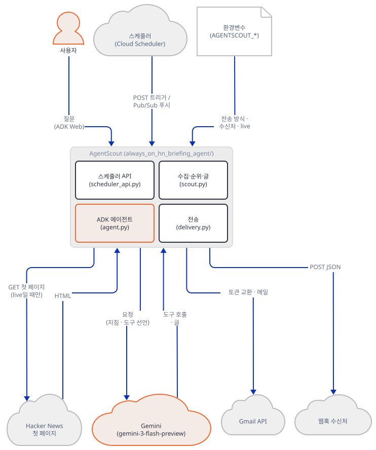

시퀀스로 보면 질문 하나는 아래 두 그림입니다.

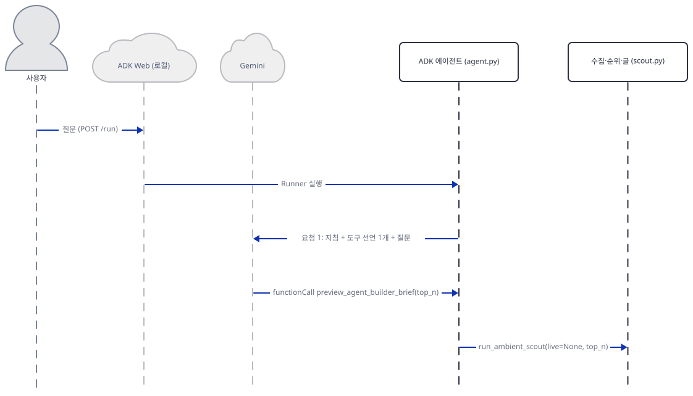

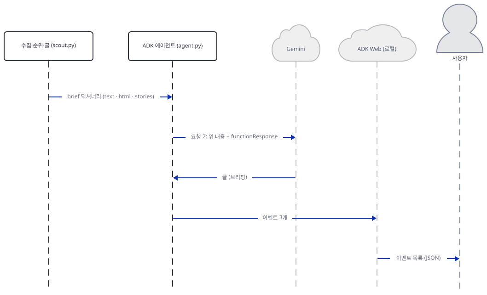

**확인.** `목록: ['always_on_hn_briefing_agent']`, 이벤트 셋(첫째·둘째 질문)과 하나(셋째), 요청 기록 다섯 줄.

### Step 7. 배포 구성과 평가 설정 읽기 — 실행하지 않은 것

**목적.** 앱 README가 말하는 배포 구성과, 앱이 상태를 남기는지, 평가 설정이 실제로 돌 수 있는 것인지 확인합니다. 이 단계는 읽기만 했고 배포하지 않았습니다.

**할 일.** 앱 README는 스케줄러 API를 Cloud Run 같은 HTTP 서비스 뒤에 두고 Cloud Scheduler가 `POST /agent-scout/trigger`(JSON 본문)를 부르거나, Pub/Sub 푸시로 `POST /agent-scout/pubsub`(base64 `data`)를 부르게 하라고 하며, 평일 9시 일정으로 `0 9 * * 1-5`를 권합니다. 설정(Gmail·웹훅)은 서비스 환경변수로 줍니다. 그림으로 그리면 이렇습니다.

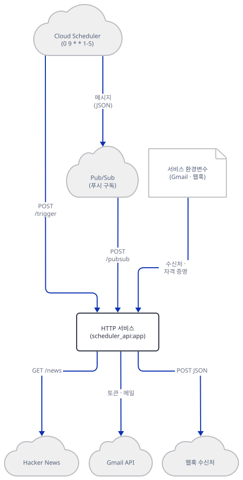

앱 폴더에는 `Dockerfile`이 없습니다(`ls`로 직접 확인). 컨테이너 이미지 만드는 법은 앱 README에도 없습니다. `gcloud scheduler jobs create http`의 `--time-zone` 설명은 "For UTC use the string \"utc\". Default is \"utc\"."입니다(https://docs.cloud.google.com/sdk/gcloud/reference/scheduler/jobs/create/http, 2026-10-17 확인. 같은 쪽의 플래그 머리에는 `default="Etc/UTC"`가 적혀 있고 둘의 차이는 설명되지 않습니다). 그렇다면 앱 README의 `0 9 * * 1-5`는 시간대를 따로 주지 않는 한 UTC 9시이고, 브리핑 제목의 날짜는 `America/Los_Angeles`로 고정되어 있어(`scout.py:299-301`) 날짜가 하루 어긋날 수 있습니다.

앱이 상태를 남기는지 소스에서 찾아 봅니다.

```bash
grep -nE "sqlite|shelve|pickle|write_text|\.write\(|[^l]open\(" always_on_hn_briefing_agent/*.py || echo "(없음)"
```

```text
(없음)
```

파일·DB에 쓰는 코드가 없습니다. 그래서 어제 보낸 이야기를 기억하지 못하고, 이야기가 다음 날까지 첫 페이지에 남아 있으면 같은 브리핑에 다시 들어갑니다(소스로 확인, 시험하지는 않음). 이전 실행과의 중복 제거나 "이미 보냈는가" 확인이 필요하면 직접 붙여야 합니다.

마지막으로 `tests/eval/eval_config.yaml`입니다. 세 케이스(`daily_brief`·`top_three`·`no_false_delivery`)가 프롬프트와 기대 행동을 글로 적었습니다.

`always_on_agents/always_on_hn_briefing_agent/tests/eval/eval_config.yaml:1-10`

```yaml
eval_set_id: agent_scout_ambient_brief
name: AgentScout ambient agent eval prompts
description: Prompts for checking that AgentScout behaves like a scouting and handoff agent.
eval_cases:
  - name: daily_brief
    prompt: Give me today's ambient AgentScout brief.
    expected_behavior:
      - Calls preview_agent_builder_brief.
      - Returns ranked stories with engineering relevance.
      - Includes concise next actions.
```

ADK의 평가 세트(`EvalSet`)는 JSON을 `model_validate_json`으로 읽고(`google/adk/evaluation/local_eval_sets_manager.py`의 `load_eval_set_from_file`, 소스로 확인) 케이스마다 `eval_id`(JSON 키는 `evalId`)가 필요합니다. 이 YAML의 케이스는 `name`·`prompt`·`expected_behavior`뿐입니다. 아래는 YAML을 읽어 `EvalSet`으로 검증하고, 같은 파일로 `adk eval`을 불러 본 결과입니다. 모델은 부르지 않습니다.

`evalcheck.py`

```bash
cat > evalcheck.py <<'PY'
"""eval_config.yaml을 ADK의 평가 세트(EvalSet) 모양으로 읽어 본다. 모델은 부르지 않는다.
(pyyaml은 google-adk가 함께 설치한다.)"""
import yaml
from google.adk.evaluation.eval_set import EvalSet

raw = yaml.safe_load(open("always_on_hn_briefing_agent/tests/eval/eval_config.yaml", encoding="utf-8"))
print("최상위 키:", sorted(raw))
print("케이스 키:", sorted(raw["eval_cases"][0]))
try:
    EvalSet.model_validate(raw)
    print("EvalSet 검증 통과")
except Exception as exc:
    lines = str(exc).splitlines()
    print("EvalSet 검증 실패:", lines[0])
    print("첫 오류:", lines[1], "-", lines[2].strip())
PY
```

```bash
uv run --no-project python -B evalcheck.py 2>&1 | head -8
uv run --no-project python check_env.py && uv run --no-project adk eval always_on_hn_briefing_agent always_on_hn_briefing_agent/tests/eval/eval_config.yaml < /dev/null 2>&1 | tail -1
```

```text
최상위 키: ['description', 'eval_cases', 'eval_set_id', 'name']
케이스 키: ['expected_behavior', 'name', 'prompt']
EvalSet 검증 실패: 3 validation errors for EvalSet
첫 오류: eval_cases.0.evalId - Field required [type=missing, input_value={'name': 'daily_brief', '...concise next actions.']}, input_type=dict]
check_env 통과: 대역 서버로만 향함
Error: Eval module is not installed, please install via `pip install "google-adk[eval]"`.
```

이 YAML은 사람이 읽는 시험 시나리오 목록이고 ADK가 그대로 돌릴 수 있는 평가 세트가 아닙니다. 그리고 `adk eval`은 `google-adk[eval]` 추가 패키지를 요구하는데 `requirements.txt`에는 `google-adk`뿐입니다. 이 문서는 그 추가 패키지를 설치하지 않았으니 평가가 실제 모델이나 평가 모델을 부르는지는 확인하지 못했습니다. 세 케이스의 기대 행동 가운데 "전송했다고 말하지 않는다"(`no_false_delivery`)는 Step 6의 지침이 겨냥하는 바로 그 동작이고, 이 문서에서는 대본이 그렇게 답했을 뿐입니다.

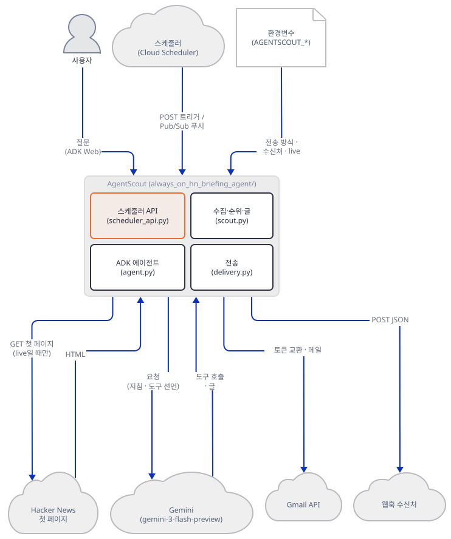

**확인.** `EvalSet 검증 실패`와 `Eval module is not installed`가 찍히고, 상태를 남기는 코드를 찾는 검색은 `(없음)`입니다.

## 요청 한 건이 흐르는 과정

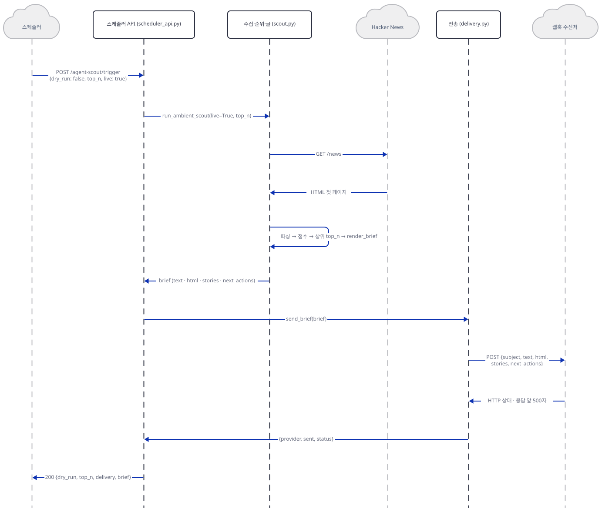

스케줄러가 `POST /agent-scout/trigger`에 `{"dry_run": false, "top_n": 5, "live": true}`를 보내면, API가 `run_ambient_scout`로 `scout.py`를 부르고 `scout.py`가 Hacker News 첫 페이지를 가져옵니다. 파싱해 점수를 매기고 상위 `top_n`을 골라 글과 HTML을 만든 뒤 `brief`를 API에 돌려줍니다. `dry_run`이 거짓이므로 API는 `send_brief`로 `delivery.py`를 부르고, 설정된 웹훅(그림은 웹훅 길입니다. Gmail은 위 `extra-gmail` 두 그림)으로 JSON을 보냅니다. 웹훅의 응답 앞 500자와 상태가 결과 딕셔너리가 되어 올라가고, API는 `dry_run`·`top_n`·`delivery`·`brief`를 담아 200을 돌려줍니다. 이 흐름에 모델은 한 번도 나오지 않습니다. 사람이 묻는 길은 Step 6의 두 그림입니다.

## 실행 체크리스트

- [ ] 복사본에서 `tzdata`·`pytest`를 설치했고 `scout.py`가 import된다
- [ ] 모든 터미널에서 `envfake.sh`를 읽었고 `check_env 통과`가 먼저 찍혔다
- [ ] 단위 테스트 9개가 통과했고, 그것이 표본 데이터만 시험함을 확인했다
- [ ] 표본 순위가 163.5 → 124.9 → 106.2 → 73.8 → 71.1로 나왔다
- [ ] 라이브(대역)에서 AI와 무관한 글이 순위에 들어오는 것을 봤다
- [ ] 웹훅 기록에 다섯 키가, Gmail 대역 기록에 `multipart/alternative`가 남았다
- [ ] 대역 서버가 죽은 상태의 전송이 HTTP 200과 `connection_error`로 끝나는 것을 봤다
- [ ] `probe.py`의 전송 줄 수와 대역이 받은 웹훅 수(4)가 같다
- [ ] `adk web`이 `127.0.0.1`에 떴고 질문 한 건이 이벤트 셋으로 돌아왔다
- [ ] 끝나고 터미널 1~5의 프로세스를 모두 멈췄고 원본 폴더에 `.adk/`·`__pycache__`가 없다(`git status --short -- always_on_agents`가 비어 있다)

## 문제 해결

| 증상 | 원인 | 해결 |
|---|---|---|
| `ZoneInfoNotFoundError: 'No time zone found with key America/Los_Angeles'` (Windows) | `scout.py:21`이 import 때 시간대를 찾는데 `tzdata`가 설치되지 않음 | `uv pip install tzdata` |
| `pytest`가 `ModuleNotFoundError: No module named 'always_on_hn_briefing_agent'` | 맨 `pytest`는 현재 폴더를 경로에 넣지 않음 | 앱 폴더의 한 단계 위에서 `python -m pytest` |
| 단위 테스트 둘(`defaults_to_dry_run`, `tolerates_empty_body`)이 `Could not fetch Hacker News`로 실패 | 셸에 `AGENTSCOUT_LIVE_HN=true`가 남아 있어 표본이 아닌 실제 가져오기로 감 | 변수를 비운다(`envfake.sh`). 켠 채로 돌리면 실제 사이트에 요청이 나간다 |
| `check_env 실패: ...가 루프백이 아님` 또는 `NO_PROXY에 127.0.0.1이 없음` | 셸의 프록시·주소 변수 | `. ./envfake.sh`를 먼저 읽는다 |
| 라이브 결과에 AI와 무관한 글이 들어온다 | `scout.py:286`의 `"agent" in story.summary.lower()`가 라이브 요약 틀 때문에 항상 참 | 필터를 낱말만 보도록 고친다(독자 몫. 이 문서는 원본을 고치지 않았다) |
| 전송이 실패했는데 스케줄러에는 성공(200)으로 보임 | 연결 거부·HTTP 오류는 `delivery.py`가 상태 문자열로 돌리고 API는 200 | 응답 본문의 `delivery.sent`를 확인하거나 앞단에서 실패를 감지한다 |
| 웹훅이나 Gmail 전송에서 API가 500 | 웹훅 응답 읽기 시간 초과, JSON이 아닌 Gmail 응답은 잡히지 않음(`delivery.py:129`, `186-202`). Pub/Sub 푸시라면 다시 보내 중복 전송이 될 수 있음 | 호출 쪽 재시도와 중복 제거를 함께 설계한다(Step 4의 `fail500.py`로 재현) |
| 첫 페이지를 못 가져오면 500, 마크업이 바뀌면 빈 브리핑이 전송됨 | 가져오기 오류를 안 잡고(`scout.py:241-242`), 이야기 0개도 전송 대상 | 호출 쪽에서 재시도·빈 브리핑 확인을 둔다 |
| 같은 Pub/Sub 메시지가 두 번 오면 두 번 전송 | 중복 제거가 없음 | 전송 전 메시지 ID를 기록하게 고친다(독자 몫) |
| `adk eval`이 `Eval module is not installed` | `requirements.txt`에 `google-adk[eval]` 없음. YAML도 ADK 평가 세트 모양이 아님 | 평가를 쓰려면 추가 패키지와 JSON 평가 세트를 따로 마련 |
| 모델을 바꾸고 싶다 | 모델 이름이 `agent.py:25`에 박혀 있음 | 그 한 줄을 고친다. 폐기 문서의 권장 대체는 `gemini-3.6-flash`(2026-10-17 확인) |
| `adk web`을 원본 폴더에서 띄웠더니 `.adk/`가 생김 | `adk web`이 앱 폴더 안에 세션 저장소를 둠 | 복사본에서 돌린다. `*.db`는 `.gitignore`가 무시하지만 다른 파일은 아님 |

## 더 해보기

- 라이브 필터를 고쳐 보세요. `curate_stories`의 `or "agent" in story.summary.lower()`를 빼면 Step 3의 대역에서 로마 콘크리트 글과 사워도우 글이 사라지는지 Step 3의 라이브 호출로 확인하고, 단어 경계(`\bcoding\b`)로 낱말 판정을 바꾸면 `Decoding the PNG format by hand`가 빠지는지도 `explain.py`로 봅니다. 단위 테스트에 두 경우를 더하세요(`tests/unit/test_scout.py`).
- `scheduler_api.py`에 공유 비밀 헤더 확인(예: 요청의 `Authorization`이 환경변수와 다르면 401)을 붙이고 `probe.py`로 열둘 가운데 어느 줄이 바뀌는지 보세요. Pub/Sub 푸시라면 Google 문서가 설명하는 JWT 검증(서명·audience·email)이 헤더 비교와 어떻게 다른지 읽어 보세요. 이 문서는 시험하지 못했습니다.
- 전송 결과를 호출한 쪽이 알 수 있게 바꿔 보세요. `delivery.sent`가 거짓이면 API가 5xx를 돌려주게 하면 Pub/Sub의 재전송과 중복 전송이 어떻게 만나는지 Step 5의 `probe.py`로 직접 재현할 수 있습니다. 중복 제거(메시지 ID 기록)와 함께 생각해 보세요.

## 다음 날 예고

[Day 149 · 📡 Release Radar Agent](../day149-release-radar-agent/README.md) — 볼륨 13을 닫는 날입니다. `always_on_agents/release_radar_agent`는 오늘과 같은 짝입니다. ADK 에이전트(`agent.py` 53줄, `gemini-3-flash-preview`가 30행), FastAPI 스케줄러 훅(`scheduler_api.py` 122줄), 전송(`delivery.py` 310줄)이 있고, 수집이 Hacker News 대신 GitHub 릴리스(`radar.py` 396줄)이며 순위 코드가 따로(`ranker.py` 124줄) 있습니다. `requirements.txt`가 오늘과 달리 `google-adk==1.9.0`·`fastapi==0.115.12`·`uvicorn==0.34.2`로 고정되어 있습니다(`wc -l`과 `cat`으로 직접 확인).
