# Day 149 · 📡 Release Radar Agent

> 볼륨 13 🛰️ Always-on Agents · 난이도 ★★☆ ⚠ 앱이 고정한 `google-adk==1.9.0`에서는 앱 README의 `adk web .`가 `release_radar_agent`를 목록에 올리지 못하고(Step 7), 모델에게 선언되는 도구 인자 둘이 모두 필수로 바뀌며, `adk web`이 읽는 `.env`가 셸 환경을 덮어씁니다. README의 실행 예는 스케줄러 API를 `--host 0.0.0.0`에 여는데 엔드포인트에 인증 코드가 없습니다(Step 6) · 예상 소요 215분(앱은 파이썬 여섯 파일 1,014줄과 시험 셋이지만, 대역 서버와 래퍼·가드를 직접 저장하고 터미널 둘 이상을 오가며 요청 기록과 두 판의 ADK를 맞대 읽는 손 시간이 본문 읽는 시간보다 큽니다) · API 비용 대략 이 문서의 따라 하기는 $0(GitHub·Gmail·Gemini 어디에도 요청을 보내지 않았습니다). 스케줄러 경로는 모델을 부르지 않아 모델 비용이 0이고, 진짜 키로 ADK에게 브리프를 한 번 물으면 모델 호출이 두 번 나가 0.005달러 안팎입니다(⚠ 추정, Step 7) · 원본 앱: `always_on_agents/release_radar_agent`

## 오늘 만들 것

`requirements.txt`나 `package.json`을 읽고, 들어 있는 의존성 가운데 이름을 아는 것들의 GitHub 릴리스를 가져와서, 깨지는 변경·지원 중단·보안 수정·철회된 릴리스·메이저 버전 올림만 골라 글과 HTML 브리프로 만드는 앱을 따라 봅니다. 앱 README는 이 앱을 "an always-on dependency briefing agent built with Google ADK"라고 부르고, "interactively in ADK Web or as a scheduled FastAPI service"로 돈다고 말합니다. 표본 모드는 "makes no GitHub requests"이고, 전송은 "defaults to dry-run and remains off until Gmail or webhook settings are present"라고 합니다.

오늘은 볼륨 13을 닫는 날이고, Day 148의 앱(`always_on_agents/always_on_hn_briefing_agent`)과 같은 짝입니다. 두 앱의 `scheduler_api.py`를 `diff`로 맞대 보면 경로 이름(`/agent-scout/…` 대 `/release-radar/…`), `top_n`의 기본값과 상한(5·10 대 10·25), 느린 일을 스레드 풀로 넘기는 `run_in_threadpool`, `pubsub`의 입력 방어 두 줄(`isinstance(message, dict)` 확인과 `UnicodeDecodeError` 처리)이 이 앱에서만 다르고 나머지는 같은 뼈대입니다(소스로 확인). 그래서 같은 설계가 낳는 결과, 곧 인증이 없는 엔드포인트, 전송이 실패해도 돌려주는 200, 평가 설정이 ADK 형식이 아닌 것은 [Day 148](../day148-always-on-hn-briefing-agent/README.md)이 다룬 대로이고 이 문서는 오늘 앱에서 직접 본 증거만 짧게 붙입니다. Day 148의 "다음 날 예고"가 말한 줄 수(`agent.py` 53, `radar.py` 396, `ranker.py` 124, `delivery.py` 310, `scheduler_api.py` 122)와 모델 줄(`agent.py:30`의 `gemini-3-flash-preview`), 고정판 세 줄은 소스와 같았습니다(`wc -l`과 `cat`으로 직접 확인). ADK 에이전트와 함수 도구는 Day 014~023(특히 Day 017)이, 가짜 Gemini 서버를 `GOOGLE_GEMINI_BASE_URL`로 가리키는 방법은 Day 142·144가, `adk web`과 `.adk/`는 Day 122·125가 다뤘으니 되풀이하지 않습니다.

오늘 새로 나오는 것은 네 가지입니다. 첫째, 순위가 모델이 아니라 낱말 목록과 점수 산수입니다. 둘째, GitHub REST API를 `urllib`로 직접 부르는 길(비인증 한도, 토큰, 오류 처리)입니다. 셋째, 의존성이 하한(`>=`)으로만 적혀 있을 때 "현재 버전"이 무엇이 되는지입니다. 넷째, 앱이 1년 넘게 묵은 고정판 `google-adk==1.9.0`(2025-07-31 공개)에 묶여 있어서 앱 README의 안내와 어긋나는 곳이 여럿이라는 점입니다.

직접 돌려 보고 소스를 읽어 알게 된 것이 여덟입니다.

1. 고정된 세 줄은 오늘도 그대로 설치됩니다. 다만 `google-adk` 1.9.0은 `google-genai`에 상한을 두지 않아 2.31.0이 깔리고, 그 조합으로 앱이 돕니다(Step 1·7).
2. 의존성 파서는 `>=2.0.0`의 `2.0.0`을 "현재 버전"으로 칩니다. 하한만 적은 매니페스트에서는 이미 지난 릴리스가 새 소식처럼 올라옵니다(Step 2·3).
3. GitHub 요청은 저장소마다 한 번이고, 403을 받으면 "HTTP Error 403: Forbidden"이라고만 메모합니다. 한도 초과인지 알 수 없습니다(Step 3).
4. 순위는 낱말 맞추기입니다. "No security vulnerability was found"가 보안 수정으로, "Fixes a security issue"는 아무것도 아닌 것으로 분류됩니다(Step 4).
5. 전달 방식에 `off`를 적어도 꺼지지 않고, 바뀐 것이 없어도 빈 브리프를 보내며, 전송이 실패해도 API는 200입니다(Step 5·6).
6. 엔드포인트에 인증이 없고, Pub/Sub 푸시는 서명을 보지 않으며, 깨진 푸시 본문은 500이라 문서상 다시 전달됩니다(Step 6).
7. ADK 1.9.0과 2.12.0은 같은 앱에서 네 곳이 다릅니다. 도구 인자의 필수 여부, `adk web .`가 올리는 목록, `.adk/session.db` 생성, `.env`가 셸을 덮는지입니다(Step 7).
8. 단위 테스트 열여섯 개는 모두 통과하지만 측정된 코드의 72%만 지나가고, GitHub 가져오기와 전달 코드는 거의 시험하지 않습니다(Step 8).

이 문서는 GitHub, Gmail, Google 토큰 서버, 웹훅, Gemini 어디에도 실제로 요청을 보내지 않았습니다. 그 자리에는 `127.0.0.1`의 대역 서버 하나(`fakes.py`)를 두었고, 키는 모두 `fake-` 값이며, 앱을 띄우거나 돌리는 모든 줄 앞에 루프백 가드(`guard.py`)를 두었습니다. 앱이 GitHub로 나가는 `urllib.request.urlopen` 호출은 가드가 `api.github.com`을 대역 서버 주소로 바꿔 끼워 돌렸고, Gmail 코드는 `urlopen` 자체를 기록용 대역으로 바꿔 요청 모양만 읽었습니다(Step 5). 대역의 답(릴리스 JSON, 웹훅 응답, 모델 답)은 모두 제가 쓴 대본이라 진짜 서비스가 어떻게 답하는지의 근거가 아닙니다. 아래는 완성된 아키텍처입니다.

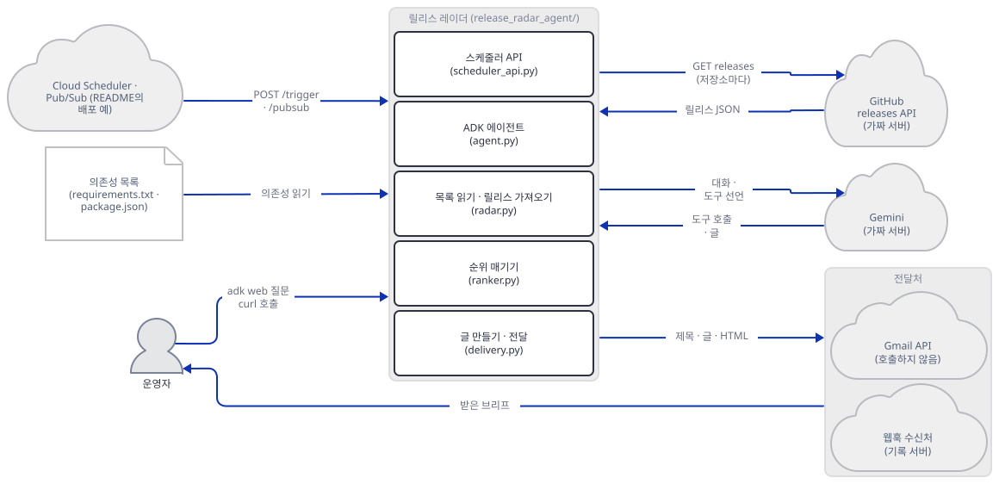

위 그림은 묶음끼리만 이었습니다. 묶음 안의 관계는 두 장입니다. 스케줄러 API와 ADK 에이전트가 모두 `radar.py`를 부르고, `radar.py`가 매니페스트·GitHub·순위 코드를 다룹니다.

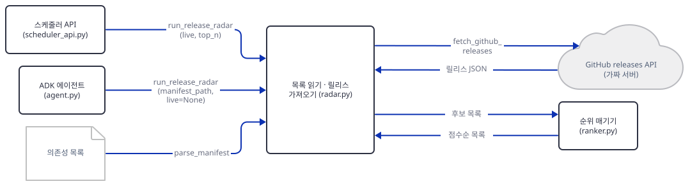

글 만들기와 전달은 따로 있습니다. 전달은 스케줄러 API만 부르고, ADK 에이전트에서는 전달로 가는 길이 없습니다.

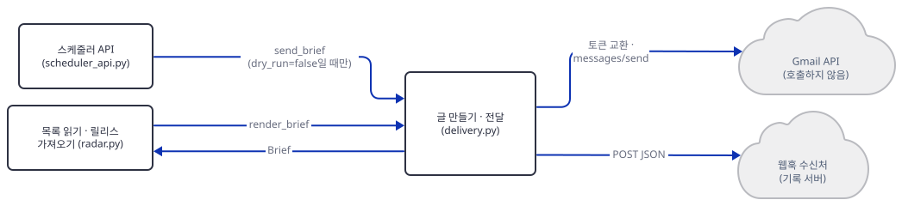

## 사전 준비

| 서비스/도구 | 용도 | 발급·설치 |
|---|---|---|
| uv | 가상환경 생성과 패키지 설치 | [공통 사전 준비](../README.md#공통-사전-준비-한-번만) 참고 |
| Python | 이 문서는 3.12.10으로 돌렸습니다. 고정판 세 줄은 3.14.2에서도 설치되고 `import google.adk`가 됐습니다(직접 확인, 앱 실행은 시험하지 못함). 앱 README는 3.10 이상이라고 하지만 최신 `google-adk` 2.12.0은 `Requires-Python >=3.11`입니다(PyPI 메타데이터) | 공통 사전 준비와 같음 |
| Gemini API 키 | 진짜로 `adk web`을 쓸 때만. 이 문서는 가짜 값만 씁니다 | https://aistudio.google.com/apikey |
| GitHub 토큰 | 진짜로 라이브 모드를 쓸 때만(선택). 이 문서는 쓰지 않았습니다 | GitHub 설정의 개인 액세스 토큰 |
| Gmail OAuth 갱신 토큰, 웹훅 주소 | 진짜로 전송할 때만. **이 문서는 쓰지 않았고, 따라 할 때도 쓰지 마세요** | 앱 README의 Enable Delivery 절 |
| 새 작업 폴더 `radar-work` | 앱 복사본, 가상환경, 대역 서버와 가드 파일을 둡니다 | Step 1에서 만듭니다 |
| 터미널 둘 | A는 대역 서버(Step 1에서 띄워 끝까지 둡니다), B는 앱 쪽 명령 | 별도 설치 없음 |

명령은 Git Bash 기준이고 포트 `53149`(대역 서버)·`53153`(스케줄러 API)·`53151`(`adk web`)은 제 PC에서 비어 있던 값입니다. 다른 번호(49152~65535)를 써도 됩니다. 한국어 Windows에서 파이썬 출력이 cp949로 깨지지 않도록 터미널마다 환경변수를 다시 줍니다. 파일을 저장하는 `cat > 파일 <<'EOF'` 줄(heredoc)과 `export`·`curl`·`netstat | grep`은 Git Bash 문법입니다. PowerShell이라면 파일 내용을 편집기로 같은 이름에 저장하고, 파이썬 줄은 `$PY …` 앞에 `&`를 붙여 `& $PY brief.py 53149`처럼 씁니다. PowerShell 줄은 실행해 보지 못했습니다(이 문서를 쓴 하네스가 PowerShell 실행을 막습니다).

**이 앱의 모델이 아직 살아 있는지.** 앱이 쓰는 모델은 `gemini-3-flash-preview` 하나입니다(`always_on_agents/release_radar_agent/agent.py:30`). 모델 페이지(https://ai.google.dev/gemini-api/docs/models, 2026-10-17에 받아 읽음)는 상태 이름 "Preview"를 "Points to a preview model which may be used for production. Preview models will typically have billing enabled, might come with more restrictive rate limits and will be deprecated with at least 2 weeks notice."라고 풉니다. 폐기 문서(https://ai.google.dev/gemini-api/docs/deprecations, 같은 날, 페이지 갱신 2026-10-12 UTC)의 이 모델 행은 "Preview models" 아래에 출시일 December 17, 2025, 종료일 "No shutdown date announced", 권장 대체 `gemini-3.6-flash`입니다. 종료 예정이 아니니 ⚠는 달지 않지만, 요금표(https://ai.google.dev/gemini-api/docs/pricing)는 이 모델을 "Our legacy Flash model"이라 부르고, 유료 단계 요금을 입력 $0.50·출력(추론 토큰 포함) $3.00(백만 토큰당)으로 적습니다. 무료 단계도 있습니다(그 단계는 "Used to improve our products: Yes"). 한 질문의 비용 어림은 Step 7에 있습니다.

## 아키텍처 한눈에 보기

| 컴포넌트 | 역할 | 코드 위치 |
|---|---|---|
| 에이전트 (`root_agent`) | 지침과 도구 하나를 가진 `LlmAgent`. 모델 `gemini-3-flash-preview` | `always_on_agents/release_radar_agent/agent.py:28-52` |
| 도구 함수 | `run_release_radar(manifest_path, live=None, top_n)`를 그대로 부름 | `always_on_agents/release_radar_agent/agent.py:10-25` |
| 의존성 파서 | `requirements*.txt`와 `package.json`을 읽어 이름·현재 버전·GitHub 저장소로 | `always_on_agents/release_radar_agent/radar.py:61-138` |
| 릴리스 수집 | 표본 데이터, GitHub `releases` 호출, 후보 만들기, 한 번의 전체 실행 | `always_on_agents/release_radar_agent/radar.py:141-396` |
| 순위 | 낱말 목록과 점수로 분류하고 정렬 | `always_on_agents/release_radar_agent/ranker.py:14-124` |
| 글 만들기 | 텍스트와 HTML 브리프 | `always_on_agents/release_radar_agent/delivery.py:32-148` |
| 전달 | 방식 고르기, Gmail(토큰 교환 + 전송), 웹훅 | `always_on_agents/release_radar_agent/delivery.py:23-29`, `159-310` |
| 스케줄러 API | FastAPI. `/health`, `/release-radar/dry-run`, `/release-radar/trigger`, `/release-radar/pubsub` | `always_on_agents/release_radar_agent/scheduler_api.py:25-122` |
| 단위 테스트 | 표본 데이터로 파서·순위·API를 시험(16개) | `always_on_agents/release_radar_agent/tests/unit/test_radar.py:13-92`, `test_ranker.py:8-94`, `test_scheduler_api.py:15-83` |
| 평가 설정 | 프롬프트 셋과 기대 행동을 글로 적은 YAML | `always_on_agents/release_radar_agent/tests/eval/eval_config.yaml:1-22` |
| GitHub·Gmail·웹훅·Gemini | 릴리스, 메일, 알림, 모델 | 코드 없음 (외부 서비스) |

원본 폴더의 파이썬은 `__init__.py` 9줄, `agent.py` 53줄, `radar.py` 396줄, `ranker.py` 124줄, `delivery.py` 310줄, `scheduler_api.py` 122줄입니다(`wc -l`로 직접 확인).

## 단계별 진행

### Step 1. 환경 만들기와 가드 — 고정판 그대로 설치되고, 가짜 세계를 먼저 세웁니다

**목적.** 원본을 건드리지 않도록 복사본 폴더를 만들고, 앱이 고정한 의존성이 오늘도 설치되는지 확인하고, 바깥으로 나갈 수 있는 길을 막는 가드와 대역 서버를 먼저 저장합니다.

**할 일.** `<저장소>`는 이 저장소를 받은 경로입니다. 앱 폴더를 `always_on_agents/` 안에 같은 이름으로 복사하는 까닭은 앱의 단위 테스트가 `from always_on_agents.release_radar_agent.radar import …`로 가져오기 때문입니다(`always_on_agents/release_radar_agent/tests/unit/test_radar.py:3`). 앱 README의 설치 안내는 `pip install -r requirements.txt` 한 줄이고, 그 목록에는 시험 도구가 없어 `pytest`를 더합니다(앱 README의 시험 명령이 씁니다).

```bash
mkdir radar-work
cd radar-work
mkdir always_on_agents
cp -r <저장소>/always_on_agents/release_radar_agent always_on_agents/
uv venv --python 3.12 venv
uv pip install --python venv/Scripts/python.exe -r always_on_agents/release_radar_agent/requirements.txt pytest
```

```text
Using CPython 3.12.10
Creating virtual environment at: venv
Activate with: source venv/Scripts/activate
Resolved 107 packages
Installed 107 packages
```

```powershell
# 아래 PowerShell 줄은 실행해 보지 못했습니다.
mkdir radar-work
cd radar-work
mkdir always_on_agents
Copy-Item -Recurse "<저장소>\always_on_agents\release_radar_agent" always_on_agents\
uv venv --python 3.12 venv
uv pip install --python venv\Scripts\python.exe -r always_on_agents\release_radar_agent\requirements.txt pytest
```

(`cp -r`는 앱 폴더에 `.env`나 `__pycache__`가 있으면 함께 복사합니다. 괜찮습니다. 아래 가드가 키·주소·프록시를 스크립트 안에서 먼저 정하고, 이 문서는 `.env`를 쓰지 않습니다.) 이하 모든 파이썬 명령은 이 가상환경의 것으로 돌리므로 터미널마다 아래를 먼저 합니다. `PYTHONWARNINGS=ignore`는 ADK 1.9.0을 가져올 때 나오는 `vertexai` 경고 문단을 가립니다. 경고를 보고 싶으면 이 변수를 뺍니다.

```bash
export PYTHONIOENCODING=utf-8 PYTHONUTF8=1 PYTHONDONTWRITEBYTECODE=1 PYTHONWARNINGS=ignore
PY=venv/Scripts/python.exe     # macOS·Linux는 venv/bin/python
```

```powershell
$env:PYTHONIOENCODING = "utf-8"; $env:PYTHONUTF8 = "1"; $env:PYTHONDONTWRITEBYTECODE = "1"; $env:PYTHONWARNINGS = "ignore"
$PY = "venv\Scripts\python.exe"
```

```bash
$PY -c "from importlib.metadata import version as v; print(' | '.join(f'{n} {v(n)}' for n in ['google-adk','google-genai','fastapi','uvicorn','starlette','pydantic','httpx','pytest']))"
```

```text
google-adk 1.9.0 | google-genai 2.31.0 | fastapi 0.115.12 | uvicorn 0.34.2 | starlette 0.46.2 | pydantic 2.14.1 | httpx 0.28.1 | pytest 9.1.1
```

세 줄이 그대로 설치됩니다(Python 3.12.10, uv 0.7.2 (481d05d8d 2025-04-30)). `google-adk` 1.9.0은 2025-07-31에 공개됐고(PyPI), 최신은 2.12.0(2026-10-13)입니다. 1.9.0의 메타데이터는 `google-genai>=1.21.1`만 요구해서(PyPI 메타데이터) 오늘 최신 2.31.0이 깔리고, 이 조합으로 앱이 도는 것은 Step 7에서 직접 봅니다. `fastapi==0.115.12`와 `uvicorn==0.34.2`도 오늘 최신(0.141.1, 0.54.0)보다 한참 낡은 판인데 문제 없이 돕니다. 최신 ADK와의 차이는 Step 7에서 두 번째 가상환경으로 맞대어 봅니다.

이제 가드입니다. 가드는 네 가지를 합니다. 환경변수를 **스크립트 안에서 직접** 덮어써서(모델 주소는 `http://127.0.0.1:<포트>/gemini`, 키는 가짜 값, Vertex·전송 설정·매니페스트·라이브 스위치는 빈 값) 셸이나 `.env`에 진짜 값이 있어도 무시하고, `urllib`의 기본 opener를 프록시 없는 것으로 바꾸면서 `api.github.com` 요청은 대역 서버로 돌리고 루프백도 GitHub도 아닌 주소는 요청을 만들기 전에 거절하고, `urllib.request.getproxies()`를 비워 `httpx`·`aiohttp`(Gemini 클라이언트가 씁니다)가 프록시를 찾지 못하게 하고, 소켓 연결·이름 조회·asyncio 연결을 루프백 밖으로는 못 나가게 막습니다. 셸에 프록시가 있었다면 그 포트로의 연결은 루프백이어도 막습니다(이유는 Step 7의 `.env` 시험). 셸의 `HTTP(S)_PROXY`·`ALL_PROXY`는 빈 값으로 덮고(`unset`이 아니라 빈 값이어야 나중에 다른 코드가 다시 채우지 못합니다) `NO_PROXY`·`no_proxy`에 루프백을 겁니다. `check_env`는 이 모두와 웹훅 주소 호스트, Gmail 변수가 비어 있는지를 확인하고 하나라도 어긋나면 멈춥니다.

```bash
cat > guard.py <<'EOF'
"""루프백 가드. 이 파일을 가장 먼저 불러온다.

1) 환경변수를 스크립트 안에서 직접 덮어쓴다(셸이나 .env의 진짜 값이 이기지 못하게).
2) urllib의 기본 opener를 프록시 없는 것으로 바꾸고, GitHub 주소는 가짜 서버로 돌리고,
   루프백도 GitHub도 아닌 주소는 요청을 만들기 전에 거절한다.
3) 소켓 연결과 이름 조회를 루프백 밖으로는 못 나가게 막는다(이차 방어선).
"""
import asyncio.base_events as be
import ipaddress
import os
import socket
import sys
import urllib.error
import urllib.request
from urllib.parse import urlparse

LOOPBACK_NAMES = {"127.0.0.1", "localhost", "::1"}
PROXY_VARS = ("HTTP_PROXY", "HTTPS_PROXY", "ALL_PROXY", "http_proxy", "https_proxy", "all_proxy", "grpc_proxy")
# 비어 있어야 하는 변수: 셸이나 .env에 진짜 값이 있어도 이 프로세스에서는 없는 것으로 친다.
EMPTY_VARS = (
    "GOOGLE_CLOUD_PROJECT", "GOOGLE_CLOUD_LOCATION", "GOOGLE_APPLICATION_CREDENTIALS",
    "RELEASE_RADAR_MANIFEST", "RELEASE_RADAR_LIVE_GITHUB",
    "RELEASE_RADAR_DELIVERY", "RELEASE_RADAR_WEBHOOK_URL", "RELEASE_RADAR_WEBHOOK_TOKEN",
    "RELEASE_RADAR_EMAIL_TO", "RELEASE_RADAR_EMAIL_FROM", "RELEASE_RADAR_GMAIL_CLIENT_ID",
    "RELEASE_RADAR_GMAIL_CLIENT_SECRET", "RELEASE_RADAR_GMAIL_REFRESH_TOKEN",
)
GMAIL_VARS = EMPTY_VARS[-5:]

PORT = None
BLOCKED = []
PROXY_PORTS = set()  # 셸이나 .env에 프록시가 있었다면 그 포트: 루프백이어도 연결을 막는다


def is_loopback_host(host: str) -> bool:
    if host in LOOPBACK_NAMES:
        return True
    try:
        return ipaddress.ip_address(host).is_loopback
    except ValueError:
        return False


def point_at_fakes(port: int) -> None:
    """모델·GitHub·웹훅이 모두 127.0.0.1:<port>의 가짜 서버만 보게 환경을 직접 정한다."""
    global PORT
    PORT = port
    for name in PROXY_VARS:
        parsed = urlparse(os.environ.get(name, "") or "")
        if parsed.port:
            PROXY_PORTS.add(parsed.port)
    os.environ["GOOGLE_API_KEY"] = "fake-key"
    os.environ["GEMINI_API_KEY"] = ""
    os.environ["GOOGLE_GENAI_USE_VERTEXAI"] = "False"
    os.environ["GOOGLE_GEMINI_BASE_URL"] = f"http://127.0.0.1:{port}/gemini"
    os.environ["RELEASE_RADAR_GITHUB_TOKEN"] = "fake-github-token"
    for name in EMPTY_VARS:
        os.environ[name] = ""
    for name in PROXY_VARS:
        os.environ[name] = ""
    os.environ["NO_PROXY"] = os.environ["no_proxy"] = "127.0.0.1,localhost,::1"


def set_webhook(path: str = "/hook") -> None:
    os.environ["RELEASE_RADAR_DELIVERY"] = "webhook"
    os.environ["RELEASE_RADAR_WEBHOOK_URL"] = f"http://127.0.0.1:{PORT}{path}"
    os.environ["RELEASE_RADAR_WEBHOOK_TOKEN"] = "fake-webhook-token"


def check_env() -> None:
    host = urlparse(os.environ.get("GOOGLE_GEMINI_BASE_URL", "")).hostname or ""
    if not is_loopback_host(host):
        sys.exit(f"가드: GOOGLE_GEMINI_BASE_URL 호스트가 루프백이 아닙니다 ({host or '비어 있음'}). 중단합니다.")
    if not os.environ.get("GOOGLE_API_KEY", "").startswith("fake-"):
        sys.exit("가드: GOOGLE_API_KEY가 가짜 값이 아닙니다. 중단합니다.")
    if os.environ.get("GOOGLE_GENAI_USE_VERTEXAI", "").lower() in ("1", "true", "yes"):
        sys.exit("가드: Vertex AI 모드가 켜져 있습니다. 중단합니다.")
    if not os.environ.get("RELEASE_RADAR_GITHUB_TOKEN", "").startswith("fake-"):
        sys.exit("가드: RELEASE_RADAR_GITHUB_TOKEN이 가짜 값이 아닙니다. 중단합니다.")
    webhook = os.environ.get("RELEASE_RADAR_WEBHOOK_URL", "")
    if webhook and not is_loopback_host(urlparse(webhook).hostname or ""):
        sys.exit(f"가드: 웹훅 주소 호스트가 루프백이 아닙니다 ({urlparse(webhook).hostname}). 중단합니다.")
    for name in GMAIL_VARS:
        if os.environ.get(name):
            sys.exit(f"가드: {name}이 비어 있지 않습니다. 이 문서는 Gmail 경로를 쓰지 않습니다. 중단합니다.")
    for name in PROXY_VARS:
        if os.environ.get(name):
            sys.exit(f"가드: 프록시 변수 {name}이 비어 있지 않습니다. 중단합니다.")
    for name in ("NO_PROXY", "no_proxy"):
        if "127.0.0.1" not in os.environ.get(name, "").split(","):
            sys.exit(f"가드: {name}에 127.0.0.1이 없습니다. 중단합니다.")


def _note(kind: str, host: str) -> None:
    BLOCKED.append((kind, host))
    with open("blocked.log", "a", encoding="utf-8", newline="\n") as f:
        f.write(f"{kind} {host}\n")


def _guarded_urlopen_factory(real_urlopen):
    def guarded_urlopen(request, *args, **kwargs):
        if isinstance(request, str):
            request = urllib.request.Request(request)
        parsed = urlparse(request.full_url)
        host = parsed.hostname or ""
        if host == "api.github.com" and parsed.scheme == "https":
            # 앱이 보낸 요청을 헤더·방식·본문 그대로 가짜 GitHub로 돌린다.
            target = f"http://127.0.0.1:{PORT}/github{parsed.path}"
            if parsed.query:
                target += "?" + parsed.query
            redirected = urllib.request.Request(
                target, data=request.data, headers=dict(request.header_items()), method=request.get_method()
            )
            return real_urlopen(redirected, *args, **kwargs)
        if is_loopback_host(host):
            return real_urlopen(request, *args, **kwargs)
        _note("urlopen", host)
        raise urllib.error.URLError(f"가드: 루프백 밖 요청을 만들기 전에 거절했습니다 ({host})")

    return guarded_urlopen


_real_connect = socket.socket.connect
_real_getaddrinfo = socket.getaddrinfo
_real_create_connection = be.BaseEventLoop.create_connection


def install() -> None:
    """프록시 없는 opener, urlopen 문지기, 소켓·이름 조회·asyncio 연결 막기."""
    opener = urllib.request.build_opener(urllib.request.ProxyHandler({}))
    urllib.request.install_opener(opener)
    urllib.request.urlopen = _guarded_urlopen_factory(urllib.request.urlopen)
    # httpx·aiohttp는 urllib.request.getproxies()로 프록시를 찾는다(Windows는 레지스트리 설정까지). 비운다.
    urllib.request.getproxies = lambda: {}

    def guarded_connect(self, address):
        host = address[0] if isinstance(address, tuple) else str(address)
        if self.family in (socket.AF_INET, socket.AF_INET6) and not is_loopback_host(host):
            _note("connect", host)
            raise ConnectionRefusedError(f"가드: 루프백 밖 연결을 막았습니다 ({host})")
        if isinstance(address, tuple) and len(address) > 1 and address[1] in PROXY_PORTS and address[1] != PORT:
            _note("proxy-port", f"{host}:{address[1]}")
            raise ConnectionRefusedError(f"가드: 프록시 포트로의 연결을 막았습니다 ({host}:{address[1]})")
        return _real_connect(self, address)

    def guarded_getaddrinfo(host, *args, **kwargs):
        if isinstance(host, (str, bytes)):
            name = host.decode() if isinstance(host, bytes) else host
            if name and not is_loopback_host(name):
                _note("dns", name)
                raise socket.gaierror(f"가드: 루프백 밖 이름 조회를 막았습니다 ({name})")
        return _real_getaddrinfo(host, *args, **kwargs)

    async def guarded_create_connection(self, protocol_factory, host=None, port=None, **kw):
        if isinstance(host, str) and host and not is_loopback_host(host):
            _note("asyncio", host)
            raise ConnectionRefusedError(f"가드: 루프백 밖 연결을 막았습니다 ({host})")
        return await _real_create_connection(self, protocol_factory, host, port, **kw)

    socket.socket.connect = guarded_connect
    socket.getaddrinfo = guarded_getaddrinfo
    be.BaseEventLoop.create_connection = guarded_create_connection


def report() -> None:
    print(f"가드: 루프백 밖으로 나가려던 시도 {len(BLOCKED)}건 {BLOCKED[:5]}")
EOF
```

다음은 대역 서버입니다. 포트 하나가 세 가지를 겸합니다. `/gemini/…`는 대본대로 답하는 가짜 Gemini(질문에 "email"이 있으면 전송하지 않았다고 답하고, 도구 결과를 받으면 그 항목 수를 세어 한 줄로 말하고, 그 밖에는 `preview_dependency_brief`를 부르라고 답합니다), `/github/…`는 GitHub `releases` 응답 흉내(앱의 `sample_release_data()`를 그대로 내주고 `ratelimited/demo`에는 403, 모르는 저장소에는 404), `/hook`은 웹훅 기록 서버(받은 본문의 요약만 남깁니다)입니다. 모든 요청은 `fakes.log`에 한 줄씩 남습니다.

```bash
cat > fakes.py <<'EOF'
"""가짜 세계 하나: 127.0.0.1의 한 포트가 가짜 Gemini, 가짜 GitHub, 웹훅 기록 서버를 겸한다.

사용: python fakes.py <포트> <기록 파일>
  /gemini/...   Gemini REST. 대본대로 답한다(실제 모델이 아니다).
  /github/...   GitHub releases API 흉내. 데이터는 앱의 sample_release_data()를 그대로 쓴다.
  /hook         웹훅 기록 서버. 받은 본문의 요약만 기록한다.
"""
import json
import re
import sys
import time
from http.server import BaseHTTPRequestHandler, ThreadingHTTPServer

sys.path.insert(0, "always_on_agents/release_radar_agent")
from radar import sample_release_data  # noqa: E402

PORT = int(sys.argv[1])
LOG = sys.argv[2]
GITHUB = dict(sample_release_data())
# 직접 만든 저장소: 이름 규칙은 매니페스트 시험용이다.
GITHUB["acme/internal-tool"] = [
    {"tag_name": "v4.0.0", "name": "internal-tool 4.0", "body": "Removed support for the old config file.",
     "html_url": "https://github.com/acme/internal-tool/releases/tag/v4.0.0",
     "published_at": "2026-07-17T09:00:00Z", "draft": False, "prerelease": False},
]

GITHUB["google/adk-python"] = [
    {"tag_name": "v2.0.0", "name": "google-adk 2.0 (가짜 데이터)", "body": "fake data: Breaking change, the old API moved.",
     "html_url": "https://github.com/google/adk-python/releases/tag/v2.0.0",
     "published_at": "2026-07-18T09:00:00Z", "draft": False, "prerelease": False},
]


def log(kind: str, **fields) -> None:
    with open(LOG, "a", encoding="utf-8", newline="\n") as f:
        f.write(json.dumps({"kind": kind, **fields}, ensure_ascii=False) + "\n")


class Server(ThreadingHTTPServer):
    allow_reuse_address = False  # Windows에서 다른 서버와 같은 포트에 겹쳐 뜨지 않게
    daemon_threads = True


def gemini_reply(body: dict, model: str) -> dict:
    contents = body.get("contents", [])
    last = contents[-1] if contents else {}
    parts = last.get("parts", [])
    response_part = next((p["functionResponse"] for p in parts if "functionResponse" in p), None)
    user_text = " ".join(p.get("text", "") for p in parts if "text" in p)
    if response_part is not None:
        result = response_part.get("response", {})
        releases = result.get("releases", result.get("result", {}).get("releases", []))
        names = ", ".join(r["dependency"] for r in releases)
        out = [{"text": f"(가짜 모델) 브리프를 받았습니다. 항목 {len(releases)}개: {names}"}]
    elif "email" in user_text.lower() or "메일" in user_text:
        out = [{"text": "(가짜 모델) 메일은 보내지 않았습니다. 아래 텍스트를 복사해 쓰세요."}]
    else:
        args = {"top_n": 5}
        m = re.search(r"manifest=(\S+)", user_text)
        if m:
            args["manifest_path"] = m.group(1)
        out = [{"functionCall": {"name": "preview_dependency_brief", "args": args}}]
    return {
        "candidates": [{"content": {"role": "model", "parts": out}, "finishReason": "STOP", "index": 0}],
        "usageMetadata": {"promptTokenCount": 10, "candidatesTokenCount": 10, "totalTokenCount": 20},
        "modelVersion": model,
    }


class Handler(BaseHTTPRequestHandler):
    def log_message(self, *a):  # 콘솔 소음을 끈다
        pass

    def _send(self, status: int, payload: dict, headers: dict | None = None, sse: bool = False) -> None:
        raw = json.dumps(payload).encode("utf-8")
        if sse:
            raw = b"data: " + raw + b"\r\n\r\n"
        self.send_response(status)
        self.send_header("Content-Type", "text/event-stream" if sse else "application/json")
        self.send_header("Content-Length", str(len(raw)))
        for k, v in (headers or {}).items():
            self.send_header(k, v)
        self.end_headers()
        self.wfile.write(raw)

    def _body(self) -> bytes:
        n = int(self.headers.get("Content-Length") or 0)
        return self.rfile.read(n) if n else b""

    def do_GET(self):
        if self.path.startswith("/github/repos/"):
            m = re.match(r"^/github/repos/([^/]+/[^/]+)/releases(\?.*)?$", self.path)
            repo = m.group(1) if m else ""
            auth = self.headers.get("Authorization", "")
            log("github", method="GET", path=self.path, repo=repo,
                auth=auth[:14], accept=self.headers.get("Accept"), ua=self.headers.get("User-Agent"),
                api_version=self.headers.get("X-GitHub-Api-Version"))
            if repo == "ratelimited/demo":
                return self._send(403, {"message": "fake: rate limit exceeded"}, {"x-ratelimit-remaining": "0"})
            if repo in GITHUB:
                return self._send(200, GITHUB[repo])
            return self._send(404, {"message": "Not Found"})
        log("other", method="GET", path=self.path)
        self._send(404, {"error": "fake: unknown path"})

    def do_POST(self):
        raw = self._body()
        if "/gemini/" in self.path:
            m = re.search(r"/models/([^:/]+):(\w+)", self.path)
            model, verb = (m.group(1), m.group(2)) if m else ("?", "?")
            body = json.loads(raw or b"{}")
            contents = body.get("contents", [])
            parts = contents[-1].get("parts", []) if contents else []
            decls = [d for t in body.get("tools", []) for d in t.get("functionDeclarations", [])]
            tools = [d["name"] for d in decls]
            fr_chars = sum(len(json.dumps(p["functionResponse"])) for p in parts if "functionResponse" in p)
            log("gemini", path=self.path.split("?")[0], model=model, verb=verb,
                key=(self.headers.get("x-goog-api-key") or "")[:5], contents=len(contents),
                last=[next(iter(p)) for p in parts], tools=tools,
                params={k: v for k, v in decls[0].items() if k != "description"} if decls else None, fr_chars=fr_chars,
                body_chars=len(raw),
                system_chars=len("".join(p.get("text", "") for p in body.get("systemInstruction", {}).get("parts", []))))
            return self._send(200, gemini_reply(body, model), sse=(verb == "streamGenerateContent"))
        if self.path == "/hook-fail":
            log("hook-fail", bytes=len(raw))
            return self._send(500, {"error": "fake: webhook is down"})
        if self.path == "/hook":
            body = json.loads(raw or b"{}")
            log("hook", auth=self.headers.get("Authorization", "")[:20],
                content_type=self.headers.get("Content-Type"), keys=sorted(body),
                subject=body.get("subject"), releases=len(body.get("releases", [])),
                text_chars=len(body.get("text", "")), html_chars=len(body.get("html", "")))
            return self._send(200, {"ok": True})
        log("other", method="POST", path=self.path, bytes=len(raw))
        self._send(404, {"error": "fake: unknown path"})


if __name__ == "__main__":
    server = Server(("127.0.0.1", PORT), Handler)
    print(f"가짜 세계가 127.0.0.1:{PORT}에서 기다립니다. 기록: {LOG}", flush=True)
    server.serve_forever()
EOF
```

```bash
cat > showlog.py <<'EOF'
"""가짜 세계의 기록(fakes.log)에서 한 종류만 골라 한 줄씩 보여 준다. 사용: python showlog.py <github|gemini|hook|hook-fail|other>"""
import json
import sys

kind = sys.argv[1]
FIELDS = {
    "github": ["repo", "auth", "accept", "ua", "api_version"],
    "gemini": ["model", "verb", "key", "contents", "last", "tools", "system_chars", "fr_chars", "body_chars"],
    "hook": ["auth", "content_type", "keys", "subject", "releases", "text_chars", "html_chars"],
    "hook-fail": ["bytes"],
    "other": ["method", "path"],
}
lines = []
for raw in open("fakes.log", encoding="utf-8"):
    d = json.loads(raw)
    if d["kind"] == kind:
        lines.append(" | ".join(f"{k}={d.get(k)}" for k in FIELDS[kind]))
print(f"{kind} 요청 {len(lines)}건")
for line in sorted(lines) if kind == "github" else lines:
    print(" ", line)
EOF
```

터미널 A에서 대역 서버를 띄웁니다. 앱 폴더의 `radar.py`에서 표본 릴리스 데이터를 가져와 쓰므로 `radar-work`에서 엽니다.

```bash
# 터미널 A
export PYTHONIOENCODING=utf-8 PYTHONUTF8=1 PYTHONDONTWRITEBYTECODE=1 PYTHONWARNINGS=ignore
venv/Scripts/python.exe fakes.py 53149 fakes.log
```

```text
가짜 세계가 127.0.0.1:53149에서 기다립니다. 기록: fakes.log
```

터미널 B에서 응답을 확인합니다. `curl`에는 `--noproxy '*'`를 붙입니다. 셸에 프록시 변수가 있으면 루프백 요청도 프록시로 가기 때문입니다(직접 확인: 변수가 있는 셸에서 이 옵션 없이 부르면 감시용 프록시가 요청을 받았고 응답은 오지 않았습니다).

```bash
curl -s --noproxy '*' -o /dev/null -w "%{http_code}\n" "http://127.0.0.1:53149/github/repos/psf/requests/releases?per_page=5"
```

```text
200
```

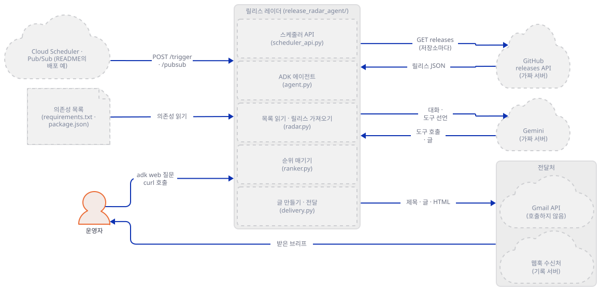

**확인.** 응답이 `200`이면 대역 서버가 서 있습니다. 앱 코드는 아직 한 줄도 돌리지 않았습니다.

### Step 2. 의존성 목록 읽기 — "현재 버전"은 첫 번째 숫자입니다

**목적.** `radar.py`의 파서가 매니페스트를 어떻게 읽는지, 어떤 의존성이 GitHub 저장소로 이어지는지를 봅니다.

**할 일.** 규칙은 `always_on_agents/release_radar_agent/radar.py:61-138`에 있습니다. `requirements*.txt`는 줄마다 ` #` 뒤 주석을 자르고, 빈 줄과 `-`·`#`로 시작하는 줄(`-r base.txt` 같은)을 건너뛰고, `;` 뒤 환경 마커를 떼고, 대괄호 추가 항목(`[standard]`)을 무시하고, 남은 글에서 **처음 나오는 숫자 모양**(`1.2.3`)을 현재 버전으로 씁니다(`_extract_version`, `radar.py:65-69`의 주석이 이유를 말합니다. 마지막 숫자는 `<2.0.0` 같은 상한이기 때문입니다). `package.json`은 `dependencies`와 `devDependencies`를 읽고 `^`·`~`는 숫자 앞이라 저절로 떨어집니다. 저장소는 두 가지로 정해집니다. 명세에 `github.com/소유자/이름`이나 `github:소유자/이름`이 있으면 그것이고, 아니면 앱 안의 표 열한 개(`KNOWN_GITHUB_REPOS`, `radar.py:16-28`: anthropic, fastapi, google-adk, langchain, openai, pydantic, react, requests, urllib3, vite, zod)에서 찾습니다. 표에 없으면 저장소가 없는 의존성이고, 브리프의 "스캔 메모"에 `No GitHub repository mapping for …`로 남습니다(`radar.py:289-292`).

시험용 매니페스트 둘을 저장합니다. 첫째는 하한만 적은 `requirements-demo.txt`이고, 일부러 표에 없는 `uvicorn`, VCS 주소로 저장소를 알리는 `internal-tool`, 가짜 대역이 403을 돌려줄 `slowpoke`를 넣었습니다. 둘째는 이름이 꼭 `package.json`이어야 해서 폴더 안에 둡니다(`radar.py:134`).

```bash
cat > requirements-demo.txt <<'EOF'
# 하한만 적은 매니페스트 (Release Radar 시험용)
-r base.txt
requests>=2.0.0
pydantic==2.9.0
fastapi[standard]>=0.100,<1
openai>=1.0; python_version >= "3.10"
internal-tool @ git+https://github.com/acme/internal-tool.git@v3.2.1
slowpoke @ git+https://github.com/ratelimited/demo.git@v1.0.0
uvicorn==0.34.2
EOF
mkdir demo-web
cat > demo-web/package.json <<'EOF'
{
  "dependencies": {"react": "^18.2.0", "zod": "3.23.8", "left-pad": "latest"},
  "devDependencies": {"vite": "~5.4.0", "typescript": "^5.4.0"}
}
EOF
cat > deps.py <<'EOF'
"""매니페스트를 읽어 의존성 목록(이름 · 현재 버전 · GitHub 저장소)을 찍는다. 네트워크는 쓰지 않는다."""
import sys

import guard

guard.install()
sys.path.insert(0, "always_on_agents/release_radar_agent")
from radar import parse_manifest  # noqa: E402

for path in sys.argv[1:]:
    print(path)
    for dep in parse_manifest(path):
        print(f"  {dep.name:14} 현재 {str(dep.current_version):7} 저장소 {dep.github_repo}")
EOF
```

```bash
$PY deps.py requirements-demo.txt demo-web/package.json always_on_agents/release_radar_agent/requirements.txt
```

```text
requirements-demo.txt
  requests       현재 2.0.0   저장소 psf/requests
  pydantic       현재 2.9.0   저장소 pydantic/pydantic
  fastapi        현재 0.100   저장소 fastapi/fastapi
  openai         현재 1.0     저장소 openai/openai-python
  internal-tool  현재 3.2.1   저장소 acme/internal-tool
  slowpoke       현재 1.0.0   저장소 ratelimited/demo
  uvicorn        현재 0.34.2  저장소 None
demo-web/package.json
  react          현재 18.2.0  저장소 facebook/react
  zod            현재 3.23.8  저장소 colinhacks/zod
  left-pad       현재 None    저장소 None
  vite           현재 5.4.0   저장소 vitejs/vite
  typescript     현재 5.4.0   저장소 None
always_on_agents/release_radar_agent/requirements.txt
  google-adk     현재 1.9.0   저장소 google/adk-python
  fastapi        현재 0.115.12 저장소 fastapi/fastapi
  uvicorn        현재 0.34.2  저장소 None
```

읽을 거리가 셋 있습니다. `requests>=2.0.0`의 현재 버전이 `2.0.0`으로 잡힙니다. 하한은 "이 이상이면 된다"는 뜻이지 설치된 판이 아니므로, 실제로는 2.32를 쓰고 있어도 앱은 2.0.0에서 올라가는 길을 봅니다(Step 3에서 이 때문에 이미 지난 보안 릴리스가 소식으로 올라오는 것을 봅니다). `left-pad: latest`는 숫자가 없어 현재 버전이 `None`입니다. 이 앱 자신의 `requirements.txt` 셋 가운데 `uvicorn`만 저장소로 이어지지 않습니다. 파일 이름 규칙도 있습니다. `requirements`로 **시작하는** `.txt`와 `package.json`만 받고, 나머지는 `ValueError`입니다(`radar.py:134-138`, `dev-requirements.txt`도 받지 못합니다).

```bash
$PY deps.py always_on_agents/release_radar_agent/README.md 2>&1 | tail -1
```

```text
ValueError: Release Radar supports requirements*.txt and package.json manifests.
```

마지막으로 표본 모드를 한 번 돌려 둡니다. `brief.py`는 파이프라인 전체(읽기 → 릴리스 → 순위 → 글)를 서버 없이 한 번 돌려 요약을 찍습니다. 표본은 GitHub 모양의 JSON을 앱 안에서 만들어 쓰고(`radar.py:182-250`), 네트워크를 쓰지 않습니다.

```bash
cat > brief.py <<'EOF'
"""파이프라인(매니페스트 -> 릴리스 -> 순위 -> 글)을 서버 없이 한 번 돌려 요약을 찍는다.

사용: python brief.py <가짜 서버 포트> [--live] [--manifest <경로>] [--text]
"""
import sys

import guard

port = int(sys.argv[1])
flags = sys.argv[2:]
guard.point_at_fakes(port)
guard.check_env()
guard.install()

sys.path.insert(0, "always_on_agents/release_radar_agent")
from radar import run_release_radar  # noqa: E402

manifest = flags[flags.index("--manifest") + 1] if "--manifest" in flags else None
brief = run_release_radar(manifest_path=manifest, live=("--live" in flags), top_n=10)
print({k: brief[k] for k in ("watch_mode", "manifest_path", "dependencies_checked")})
for e in brief["errors"]:
    print("스캔 메모:", e)
for r in brief["releases"]:
    print(r["dependency"], r["current_version"], "->", r["release_version"], r["version_delta"], r["reasons"], r["score"])
if "--text" in flags:
    print(brief["text"])
guard.report()
EOF
$PY brief.py 53149
```

```text
{'watch_mode': 'sample', 'manifest_path': 'deterministic sample data', 'dependencies_checked': 5}
requests 2.31.0 -> 2.32.3 minor ('security fix',) 100
pydantic 1.10.14 -> 2.0.0 major ('breaking change', 'major version', 'deprecation') 100
fastapi 0.114.0 -> 0.115.0 minor ('breaking change',) 90
react 18.2.0 -> 19.0.0 major ('major version',) 70
가드: 루프백 밖으로 나가려던 시도 0건 []
```

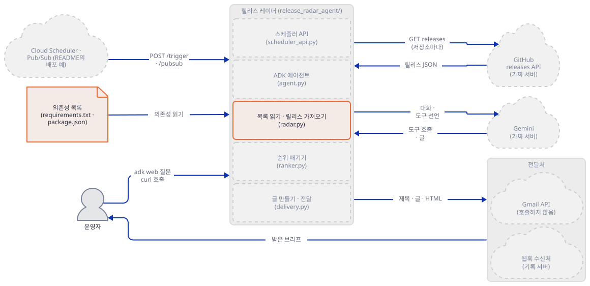

**확인.** 표본 의존성 다섯(`pydantic==1.10.14`, `requests==2.31.0`, `fastapi==0.114.0`, `react ^18.2.0`, `urllib3==2.2.1`) 가운데 넷이 올라오고 `urllib3`의 일상 패치(`2.2.1 -> 2.2.2`)는 걸러졌습니다. 같은 100점인 `requests`와 `pydantic`은 게시 시각이 늦은 `requests`가 앞입니다(Step 4). 가드 줄이 0건이면 바깥으로 나가려던 시도는 없었습니다.

### Step 3. 릴리스 가져오기 — 표본과 라이브, GitHub 요청의 모양

**목적.** 라이브 모드를 켜는 길이 어디인지, GitHub에 어떤 요청이 가는지, 실패하면 무엇이 남는지를 봅니다.

**할 일.** 라이브인지는 세 곳에서 정해집니다. 환경변수 `RELEASE_RADAR_LIVE_GITHUB`가 `1`·`true`·`yes`면 켜지고(`radar.py:348-353`), `run_release_radar(live=…)` 인자가 `None`이 아니면 그 값이 환경변수를 이깁니다(`radar.py:370`). ADK 도구는 `live=None`으로 부르니(`agent.py:23`) 환경변수만 보고, 스케줄러는 요청 본문의 `live`가 있으면 그것을 씁니다(`scheduler_api.py:58`). 곧 **`GET /release-radar/dry-run?live=true`도 GitHub로 나갑니다.** "dry-run"은 전송을 하지 않는다는 뜻이지 바깥에 묻지 않는다는 뜻이 아닙니다.

가져오는 함수는 `fetch_github_releases`입니다(`radar.py:253-278`). 요청은 `https://api.github.com/repos/{저장소}/releases?per_page=5`이고, 헤더는 `Accept: application/vnd.github+json`, `User-Agent: release-radar-agent`, `X-GitHub-Api-Version: 2022-11-28`, 그리고 `RELEASE_RADAR_GITHUB_TOKEN`이 있을 때만 `Authorization: Bearer …`입니다. 제한 시간은 15초이고, 오류(`HTTPError`·`URLError`·시간 초과)는 `RuntimeError`로 바꿔 스캔 메모에 한 줄로 남깁니다. 저장소 하나에 요청 하나이고(중복은 합칩니다), 스레드 최대 여덟 개로 동시에 보냅니다(`_live_release_data`, `radar.py:323-345`).

공식 문서로 이 요청의 조건을 확인했습니다(https://docs.github.com/en/rest/using-the-rest-api/rate-limits-for-the-rest-api, 2026-10-17에 받아 읽음). 비인증 요청은 "The primary rate limit for unauthenticated requests is 60 requests per hour."이고 IP 주소에 묶이며, 개인 액세스 토큰을 쓰면 "personal rate limit of 5,000 requests per hour"입니다. 한도를 넘으면 "you will receive a 403 or 429 response, and the x-ratelimit-remaining header will be 0"입니다. 릴리스 목록 문서(https://docs.github.com/en/rest/releases/releases)는 공개 저장소만 요청하면 인증 없이 부를 수 있다고 하고, `per_page`는 기본 30·최대 100이라고 합니다(앱은 5). API 버전 문서(https://docs.github.com/en/rest/about-the-rest-api/api-versions)는 헤더가 없으면 2022-11-28이 기본이고 이 버전은 March 10, 2028까지 지원된다고 표로 적습니다. 산수로 옮기면 이렇습니다. 토큰 없이 매핑되는 저장소가 61개 이상인 매니페스트는 한 번의 실행이 시간당 한도를 넘고, `live=true`인 dry-run을 부를 때마다 같은 수가 소비됩니다. 한도 초과의 403이 오면 앱은 `exc`를 문자열로 바꿔 `HTTP Error 403: Forbidden`만 남기고 응답 헤더와 본문은 읽지 않습니다(`radar.py:272-273`). 아래 출력의 `ratelimited/demo` 줄이 그 모양입니다.

후보를 거르는 규칙도 `build_release_candidates`에 있습니다(`radar.py:281-320`). 초안(`draft`)·시험판(`prerelease`)은 건너뛰고, 태그에서 숫자 버전을 못 뽑으면 건너뛰고, 현재와 같거나 옛 버전도 건너뜁니다. 현재 버전을 모르면(`None`) 건너뛰지 않고 `unknown`으로 둡니다.

```bash
$PY brief.py 53149 --live --manifest requirements-demo.txt
```

```text
{'watch_mode': 'live_github', 'manifest_path': 'requirements-demo.txt', 'dependencies_checked': 7}
스캔 메모: Could not fetch releases for openai/openai-python: HTTP Error 404: Not Found
스캔 메모: Could not fetch releases for ratelimited/demo: HTTP Error 403: Forbidden
스캔 메모: No GitHub repository mapping for uvicorn.
requests 2.0.0 -> 2.32.3 minor ('security fix',) 100
internal-tool 3.2.1 -> 4.0.0 major ('breaking change', 'major version') 95
fastapi 0.100 -> 0.115.0 minor ('breaking change',) 90
가드: 루프백 밖으로 나가려던 시도 0건 []
```

```bash
$PY showlog.py github
```

```text
github 요청 6건
  repo=acme/internal-tool | auth=Bearer fake-gi | accept=application/vnd.github+json | ua=release-radar-agent | api_version=2022-11-28
  repo=fastapi/fastapi | auth=Bearer fake-gi | accept=application/vnd.github+json | ua=release-radar-agent | api_version=2022-11-28
  repo=openai/openai-python | auth=Bearer fake-gi | accept=application/vnd.github+json | ua=release-radar-agent | api_version=2022-11-28
  repo=psf/requests | auth=Bearer fake-gi | accept=application/vnd.github+json | ua=release-radar-agent | api_version=2022-11-28
  repo=pydantic/pydantic | auth=Bearer fake-gi | accept=application/vnd.github+json | ua=release-radar-agent | api_version=2022-11-28
  repo=ratelimited/demo | auth=Bearer fake-gi | accept=application/vnd.github+json | ua=release-radar-agent | api_version=2022-11-28
```

의존성이 일곱인데 요청은 여섯입니다. `uvicorn`이 저장소에 이어지지 않기 때문입니다. `openai/openai-python`의 404는 대역 서버에 그 저장소의 데이터가 없어서이고(제가 만든 대역의 사정입니다), `ratelimited/demo`의 403은 대역이 일부러 돌려준 것입니다. 결과 셋 가운데 `requests 2.0.0 -> 2.32.3`은 앞에서 본 하한 문제입니다. `pydantic==2.9.0`은 대역의 릴리스 `v2.0.0`이 현재보다 옛 버전이라 후보 규칙에서 빠져 소식이 없는데, `requests>=2.0.0`은 현재 버전이 `2.0.0`으로 잡혀 `2.32.3`의 보안 수정이 소식으로 올라옵니다. 헤더 줄의 `auth=Bearer fake-gi`는 가드가 덮어쓴 가짜 토큰이 요청에 실렸다는 뜻이고, 이 값은 대역 서버에만 갔습니다.

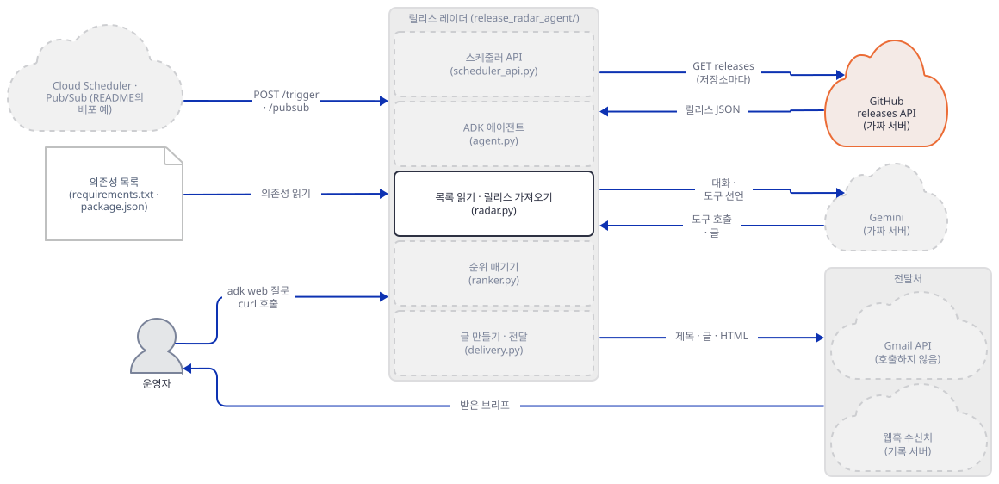

요청과 순위가 `radar.py` 안에서 이어지는 순서는 시퀀스로 그렸습니다. 요청 하나가 흐르는 과정 절의 둘째 그림입니다.

**확인.** `showlog`가 `요청 6건`이고 모든 줄이 `ua=release-radar-agent`, `api_version=2022-11-28`이면 맞습니다. 바깥으로 나가려던 시도가 0건이어야 합니다.

### Step 4. 순위 — 낱말 목록과 점수, 모델은 어디에도 없습니다

**목적.** 무엇이 "알릴 만한 변경"으로 분류되는지, 그 기준이 어디서 어긋나는지를 봅니다.

**할 일.** `ranker.py`는 파이썬 표준 라이브러리만 씁니다(모델을 부르는 코드가 없습니다, 소스로 확인). 분류는 릴리스 제목과 노트를 소문자로 합친 글에 낱말 조각이 **들어 있는지**를 봅니다(`classify_release`, `ranker.py:75-105`). 낱말 조각과 점수는 이렇습니다(`ranker.py:14-39`).

| 이유 | 점수 | 낱말 조각 |
|---|---|---|
| security fix | 100 | `security fix`, `security vulnerability`, `vulnerability`, `cve-`, `security advisory` |
| breaking change | 90 | `breaking change`, `breaking:`, `not backward compatible`, `migration required`, `removed support` |
| yanked release | 85 | `yanked`, `withdrawn release`, `do not use this release` |
| major version | 70 | 낱말이 아니라 `version_delta == "major"`일 때 |
| deprecation | 60 | `deprecated`, `deprecation`, `will be removed` |

점수는 이유 가운데 최댓값에, 이유가 둘 이상이면 추가 이유 하나마다 5점을 더합니다. 그래서 `pydantic 2.0.0`(breaking change, major version, deprecation)이 90 + 10 = 100점입니다. 정렬 키는 (점수, 게시 시각, 버전 글자)의 내림차순이고, 이유가 하나도 없으면 목록에서 빠집니다. `_why_you_care`가 만드는 "왜 중요한지" 한 줄은 이유 우선순위에 따른 고정 문장입니다(`ranker.py:63-72`).

낱말 맞추기이니 어긋나는 곳이 있습니다. 아래 스크립트가 여덟 문장을 분류기에 넣어 봅니다(`ReleaseCandidate`를 직접 만들어 `classify_release`만 부르고, 네트워크도 모델도 쓰지 않습니다).

```bash
cat > rank_probe.py <<'EOF'
"""키워드 분류기가 문장을 어떻게 가르는지 본다. 네트워크도 모델도 쓰지 않는다."""
import sys

sys.path.insert(0, "always_on_agents/release_radar_agent")
from radar import ReleaseCandidate  # noqa: E402
from ranker import classify_release  # noqa: E402


def make(notes, delta="patch", title="demo 1.2.4"):
    return ReleaseCandidate("demo", "acme/demo", "1.2.3", "1.2.4", delta, title, notes,
                            "https://github.com/acme/demo/releases/tag/v1.2.4", "2026-07-15T12:00:00Z", False)


CASES = [
    ("Security fix for CVE-2026-1234.", "patch"),
    ("Fixes a security issue in the parser.", "patch"),
    ("No security vulnerability was found in this release.", "patch"),
    ("Removed deprecated warnings from the test suite.", "patch"),
    ("This is not a breaking change.", "patch"),
    ("Small fixes.", "minor"),
    ("Small fixes.", "major"),
    ("Small fixes.", "unknown"),
]
for notes, delta in CASES:
    r = classify_release(make(notes, delta))
    print(f"{delta:8} {notes!r:58} -> {(r.reasons, r.score) if r else '걸러짐'}")
EOF
$PY rank_probe.py
```

```text
patch    'Security fix for CVE-2026-1234.'                          -> (('security fix',), 100)
patch    'Fixes a security issue in the parser.'                    -> 걸러짐
patch    'No security vulnerability was found in this release.'     -> (('security fix',), 100)
patch    'Removed deprecated warnings from the test suite.'         -> (('deprecation',), 60)
patch    'This is not a breaking change.'                           -> (('breaking change',), 90)
minor    'Small fixes.'                                             -> 걸러짐
major    'Small fixes.'                                             -> (('major version',), 70)
unknown  'Small fixes.'                                             -> 걸러짐
```

넷째 줄부터 읽습니다. "Fixes a security issue in the parser."는 `security fix`·`vulnerability`·`cve-`가 없어서 걸러지고, "No security vulnerability was found in this release."는 `vulnerability`가 있어서 보안 수정(100점)으로 올라옵니다. "This is not a breaking change."는 부정을 보지 않아 깨지는 변경(90점)이고, "Removed deprecated warnings …"는 지원 중단(60점)입니다. 메이저가 아닌데 노트가 일상적이면(`minor`·`unknown`의 "Small fixes.") 걸러지고, 메이저면 노트와 상관없이 70점입니다. 앱의 단위 테스트(`test_ranker.py`)는 낱말이 있는 쪽의 분류만 시험하고 부정문이나 낱말 밖의 표현은 시험하지 않습니다. 0.x 버전은 숫자만으로는 메이저가 아니라서(`fastapi 0.114.0 -> 0.115.0`은 `minor`), 깨지는 변경도 노트에 위 낱말이 없으면 소식이 되지 못합니다. Day 148의 순위도 같은 종류의 낱말·점수 산수였습니다([Day 148 Step 2](../day148-always-on-hn-briefing-agent/README.md)).

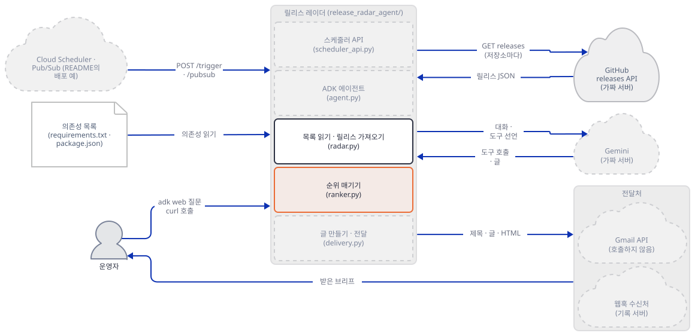

**확인.** 출력 여덟 줄이 위와 같으면 됩니다. 앱 안에서 이 분류의 기준을 바꾸고 싶으면 `SIGNAL_TERMS`(`ranker.py:14-31`)만 고치면 됩니다.

### Step 5. 글 만들기와 전달 — 방식 고르기와 Gmail 요청의 모양

**목적.** 브리프 글이 어떻게 생겼는지, `send_brief`가 전달 방식을 어떻게 고르는지, Gmail 요청이 어떤 모양인지를 실제 메일 없이 봅니다.

**할 일.** `render_brief`(`delivery.py:58-148`)는 순위가 매겨진 릴리스를 의존성별로 묶어 텍스트와 HTML을 만듭니다. HTML의 제목·이유·링크는 `html.escape`를 거칩니다. 릴리스가 하나도 없으면 "No breaking, deprecation, security, or major-version changes found."를 적고, 스캔 메모가 있으면 끝에 붙입니다. 표본 브리프의 글은 이렇습니다.

```bash
$PY brief.py 53149 --text | sed -n '/^Release Radar Dependency Brief/,/^가드/p' | sed '/^가드/d'
```

```text
Release Radar Dependency Brief
Generated: <실행 시각>
Manifest: deterministic sample data
Watch mode: sample
Dependencies checked: 5

Changes that need attention:

requests
- 2.31.0 -> 2.32.3: Requests 2.32.3
  Reason: security fix
  Why you care: requests fixes a security risk; review exposure and patch promptly.
  Link: https://github.com/psf/requests/releases/tag/v2.32.3

pydantic
- 1.10.14 -> 2.0.0: Pydantic 2.0
  Reason: breaking change, major version, deprecation
  Why you care: pydantic may break existing integrations; read its migration notes before upgrading.
  Link: https://github.com/pydantic/pydantic/releases/tag/v2.0.0

fastapi
- 0.114.0 -> 0.115.0: FastAPI 0.115.0
  Reason: breaking change
  Why you care: fastapi may break existing integrations; read its migration notes before upgrading.
  Link: https://github.com/fastapi/fastapi/releases/tag/0.115.0

react
- 18.2.0 -> 19.0.0: React 19
  Reason: major version
  Why you care: react crossed a major version, so expect migration work before upgrading.
  Link: https://github.com/facebook/react/releases/tag/v19.0.0
```

(`Generated:` 줄은 실행한 시각이 들어가고, 제목 `Release Radar dependency brief - 날짜`의 날짜도 실행한 날입니다.)

`send_brief`(`delivery.py:159-179`)의 방식 고르기는 다섯 줄 규칙입니다.

| `RELEASE_RADAR_DELIVERY` | 하는 일 |
|---|---|
| `gmail` | 바로 Gmail로(설정이 모자라면 `skipped_missing_gmail_config`와 빠진 변수 목록) |
| `webhook` | 바로 웹훅으로(주소가 없으면 `skipped_no_webhook`) |
| 그 밖의 모든 값(기본 `auto`, `off`, 오타 포함) | Gmail 변수 다섯이 모두 있으면 Gmail, 아니면 `RELEASE_RADAR_WEBHOOK_URL`이 있으면 웹훅, 아니면 `skipped_no_delivery` |

**`off`라는 값은 꺼짐이 아닙니다.** 소스가 `gmail`·`webhook`만 알아보고 나머지는 자동 판정으로 흘려보내기 때문입니다. 두 방식이 모두 설정되어 있으면 Gmail이 이깁니다. 아래 스크립트가 Gmail 코드 경로를 돌려 보되, **어떤 주소에도 연결하지 않습니다.** `urllib.request.urlopen`을 기록용 대역으로 갈아 끼우고(바로 아래 줄에서 `assert`로 확인합니다), 가드의 소켓 막기도 함께 겁니다. 대역이 받은 `Request`를 적고 가짜 응답을 돌려줍니다. 값은 모두 `fake-`나 `.invalid` 주소입니다.

```bash
cat > gmail_shape.py <<'EOF'
"""Gmail 경로가 만드는 요청의 모양만 읽는다. 어떤 주소에도 연결하지 않는다.

urllib.request.urlopen 을 기록용 대역으로 바꿔서, delivery.py 가 만든 Request 를 받아 적고
가짜 응답을 돌려준다. 소켓 가드도 함께 걸어, 대역이 빠지는 실수가 있어도 바깥으로 나가지 못한다.
"""
import base64
import email
import io
import json
import os
import sys
import urllib.request
from urllib.parse import parse_qs

import guard

guard.install()  # 소켓·DNS·asyncio 막기 + 프록시 없는 opener
sys.path.insert(0, "always_on_agents/release_radar_agent")
import delivery  # noqa: E402

calls = []


class FakeResponse(io.BytesIO):
    status = 200

    def __enter__(self):
        return self

    def __exit__(self, *a):
        return False


def recorder(request, *args, **kwargs):
    calls.append(request)
    if request.full_url.startswith("https://oauth2.googleapis.com/"):
        return FakeResponse(json.dumps({"access_token": "fake-access-token"}).encode())
    return FakeResponse(json.dumps({"id": "fake-message-id"}).encode())


urllib.request.urlopen = recorder
assert urllib.request.urlopen is recorder  # 이 아래에서 부르는 urlopen 은 모두 기록용 대역이다

payload = {"subject": "Release Radar dependency brief - test", "text": "plain body", "html": "<h2>html body</h2>"}

# 1) 일부만 설정했을 때
for name in guard.GMAIL_VARS:
    os.environ[name] = ""
os.environ["RELEASE_RADAR_EMAIL_TO"] = "to@example.invalid"
os.environ["RELEASE_RADAR_EMAIL_FROM"] = "from@example.invalid"
result = delivery.send_gmail(payload)
print("일부만 설정:", result["status"], result["missing"], "요청", len(calls), "건")

# 2) 모두 설정했을 때(전부 가짜 값)
os.environ["RELEASE_RADAR_GMAIL_CLIENT_ID"] = "fake-client-id"
os.environ["RELEASE_RADAR_GMAIL_CLIENT_SECRET"] = "fake-client-secret"
os.environ["RELEASE_RADAR_GMAIL_REFRESH_TOKEN"] = "fake-refresh-token"
result = delivery.send_gmail(payload)
print("모두 설정:", result)
for i, req in enumerate(calls, 1):
    print(f"요청 {i}: {req.get_method()} {req.full_url}")
    print("  헤더:", {k: (v[:20] + "..." if k.lower() == "authorization" else v) for k, v in req.header_items()})
    if i == 1:
        print("  본문 키:", sorted(parse_qs(req.data.decode())), "grant_type =", parse_qs(req.data.decode())["grant_type"])
    else:
        raw = json.loads(req.data)["raw"]
        msg = email.message_from_bytes(base64.urlsafe_b64decode(raw))
        print("  본문 키:", sorted(json.loads(req.data)))
        print("  메일:", {h: msg[h] for h in ("To", "From", "Subject")}, [p.get_content_type() for p in msg.walk()])

# 3) 전달 방식을 "off"로 적고 Gmail 변수는 채워 둔 채 send_brief 를 부르면
calls.clear()
os.environ["RELEASE_RADAR_DELIVERY"] = "off"
result = delivery.send_brief(payload)
print("DELIVERY=off:", result["provider"], result["status"], "요청", len(calls), "건")
guard.report()
EOF
$PY gmail_shape.py
```

```text
일부만 설정: skipped_missing_gmail_config ['RELEASE_RADAR_GMAIL_CLIENT_ID', 'RELEASE_RADAR_GMAIL_CLIENT_SECRET', 'RELEASE_RADAR_GMAIL_REFRESH_TOKEN'] 요청 0 건
모두 설정: {'provider': 'gmail', 'configured': True, 'sent': True, 'status': 'sent', 'message_id': 'fake-message-id'}
요청 1: POST https://oauth2.googleapis.com/token
  헤더: {'Content-type': 'application/x-www-form-urlencoded'}
  본문 키: ['client_id', 'client_secret', 'grant_type', 'refresh_token'] grant_type = ['refresh_token']
요청 2: POST https://gmail.googleapis.com/gmail/v1/users/me/messages/send
  헤더: {'Authorization': 'Bearer fake-access-t...', 'Content-type': 'application/json'}
  본문 키: ['raw']
  메일: {'To': 'to@example.invalid', 'From': 'from@example.invalid', 'Subject': 'Release Radar dependency brief - test'} ['multipart/alternative', 'text/plain', 'text/html']
DELIVERY=off: gmail sent 요청 2 건
가드: 루프백 밖으로 나가려던 시도 0건 []
```

Gmail 경로는 요청 둘입니다. 먼저 `https://oauth2.googleapis.com/token`에 갱신 토큰으로 접근 토큰을 받고(본문 키 `client_id`·`client_secret`·`grant_type`·`refresh_token`, 전송마다 새로 받아 캐시가 없습니다), 그 토큰으로 `https://gmail.googleapis.com/gmail/v1/users/me/messages/send`에 메일을 보냅니다(본문 키는 `raw` 하나, 안은 글과 HTML을 겸한 `multipart/alternative` 메일). 설정이 일부만 있으면 요청을 하나도 만들지 않고 빠진 변수 이름을 돌려줍니다. 마지막 줄이 `off` 사례입니다. 전달 방식에 `off`를 적고 Gmail 변수를 채워 두면 요청이 둘 만들어집니다.

웹훅은 `RELEASE_RADAR_WEBHOOK_URL`로 JSON(`subject`·`text`·`html`·`releases`)을 `POST`하고, `RELEASE_RADAR_WEBHOOK_TOKEN`이 있으면 `Authorization: Bearer`를 붙입니다(`delivery.py:258-310`). 스캔 메모와 매니페스트 경로는 본문에 없습니다. 웹훅과 Gmail 두 방식 모두 오류를 예외로 던지지 않고 결과 딕셔너리로 돌려줍니다. 같은 모양이 [Day 148 Step 4](../day148-always-on-hn-briefing-agent/README.md)에 있습니다.

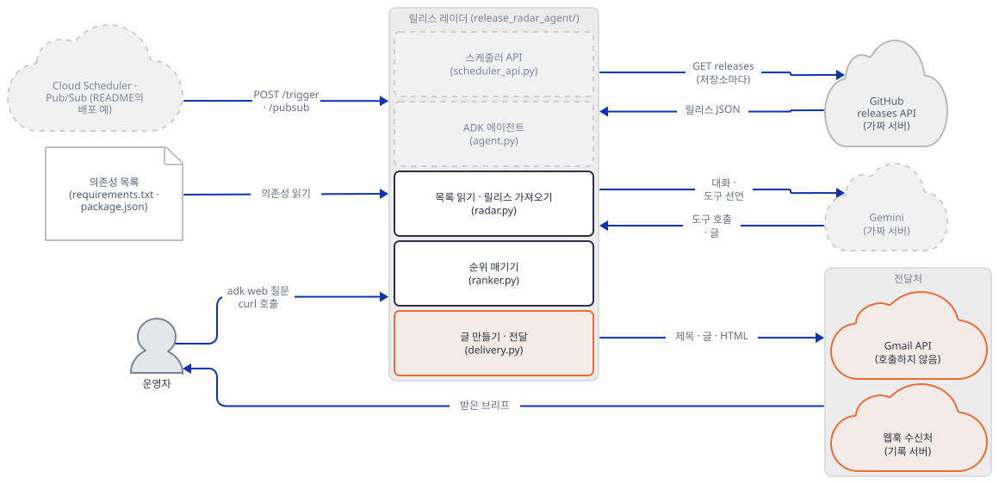

**확인.** 첫 줄이 `skipped_missing_gmail_config`와 변수 셋, 요청 0건이고, `DELIVERY=off` 줄이 `gmail sent 요청 2건`이면 됩니다. 가드 줄은 0건이어야 합니다.

### Step 6. 스케줄러 API — dry-run 안전장치와 열려 있는 문

**목적.** 스케줄러가 부르는 서버를 루프백에 띄워, `dry_run` 기본값과 전달 실패·빈 브리프·깨진 입력이 실제로 어떻게 돌아가는지 봅니다.

**할 일.** 엔드포인트는 넷입니다(`scheduler_api.py:81-122`). `GET /health`, `GET /release-radar/dry-run?top_n=&live=`, `POST /release-radar/trigger`, `POST /release-radar/pubsub`. 셋째·넷째는 모두 `run_scheduled_radar`로 가고(`scheduler_api.py:53-78`), 규칙은 이렇습니다. `dry_run`은 `true`·`1`·`yes`면 참, `false`·`0`·`no`면 거짓이고, **없거나 알아볼 수 없는 값이면 참(기본)**입니다. 불리언이 아닌 숫자 `0`도 참으로 떨어집니다(안전한 쪽입니다). `top_n`은 정수로 바꿔 1~25로 자르고 실패하면 10입니다. `dry_run`이 정확히 `False`일 때만 `send_brief`를 부르니, 전송에는 요청이 `dry_run: false`를 명시하는 것과 전달 설정이 있는 것, 두 열쇠가 필요합니다(앱 README가 "two independent guards"라고 부르는 것입니다). `POST /trigger`의 본문이 깨진 JSON이면 빈 사전으로 취급해 dry-run으로 돕니다.

앱 README의 실행 줄은 `uvicorn scheduler_api:app --host 0.0.0.0 --port 8000`입니다(`scheduler_api.py:4`의 머리 주석도 같습니다). 모든 네트워크 인터페이스에 연다는 뜻인데 이 앱에는 인증이 없습니다. `scheduler_api.py`·`radar.py`·`delivery.py`에서 토큰을 다루는 줄은 나가는 요청에 실을 GitHub·웹훅·Gmail 토큰뿐이고, 들어오는 요청의 헤더에서 인증 정보를 읽는 줄은 없습니다(`request.headers`를 읽는 곳은 `content-length` 하나, `scheduler_api.py:103`, `grep`으로 확인). 같은 네트워크에서 이 포트에 닿는 누구나 (1) `dry-run?live=true`로 GitHub 요청을 일으키고(한도는 서버의 IP나 토큰이 씁니다), (2) `{"dry_run": false}`를 보내 설정된 수신처로 브리프를 보낼 수 있습니다. 보낼 곳과 매니페스트는 고를 수 없습니다. 둘 다 환경변수로만 정해집니다(앱 README가 "request payloads cannot select arbitrary local files"라고 하는 부분이고, 단위 테스트 `test_scheduler_manifest_path_is_server_configured`가 시험합니다). 같은 구조의 [Day 148 Step 5](../day148-always-on-hn-briefing-agent/README.md)가 이를 더 길게 다룹니다. 이 문서는 항상 `127.0.0.1`로만 띄웁니다. 아래 래퍼가 원본을 고치지 않고 가드를 건 뒤 `scheduler_api.app`을 `uvicorn.run(…, host="127.0.0.1")`로 엽니다.

```bash
cat > serve_local.py <<'EOF'
"""scheduler_api를 가드 아래 127.0.0.1에만 연다. 모델·GitHub·웹훅은 가짜 서버가 대신한다.

사용: python serve_local.py <가짜 서버 포트> <이 서버 포트> [--live] [--webhook | --webhook-down] [--manifest <경로>]
"""
import sys

import guard

fake_port, port = int(sys.argv[1]), int(sys.argv[2])
flags = sys.argv[3:]
guard.point_at_fakes(fake_port)
if "--live" in flags:
    import os

    os.environ["RELEASE_RADAR_LIVE_GITHUB"] = "true"
if "--webhook" in flags:
    guard.set_webhook()
if "--webhook-down" in flags:
    guard.set_webhook("/hook-fail")
if "--manifest" in flags:
    import os

    os.environ["RELEASE_RADAR_MANIFEST"] = flags[flags.index("--manifest") + 1]
guard.check_env()
guard.install()

sys.path.insert(0, "always_on_agents/release_radar_agent")
import uvicorn  # noqa: E402
import scheduler_api  # noqa: E402

guard.check_env()  # 앱을 가져온 뒤에 한 번 더
print(f"스케줄러 API가 127.0.0.1:{port}에서 기다립니다 (live={'--live' in flags}, webhook={'--webhook' in flags or '--webhook-down' in flags})", flush=True)
uvicorn.run(scheduler_api.app, host="127.0.0.1", port=port, log_level="warning")
guard.report()
EOF
```

터미널 B에서 먼저 아무 옵션 없이 띄웁니다(표본, 전달 없음). 앱 폴더를 `sys.path` 맨 앞에 두므로 앱의 `from .delivery import …`는 실패하고 README처럼 `from delivery import …`로 돌아갑니다(`scheduler_api.py:11-17`의 `try`/`except ImportError`).

```bash
# 터미널 B
$PY serve_local.py 53149 53153
```

```text
스케줄러 API가 127.0.0.1:53153에서 기다립니다 (live=False, webhook=False)
```

터미널 C(B와 같은 환경변수)에서 요청을 보냅니다. 응답이 길어서 `trig.py`가 요약만 찍습니다. `curl`로 같은 요청을 보내려면 앱 README의 예(`curl -X POST "http://127.0.0.1:8000/release-radar/trigger" -H "Content-Type: application/json" -d '{"dry_run": true, "live": true, "top_n": 10}'`)에 `--noproxy '*'`를 붙이고 주소를 위 포트로 바꾸면 됩니다.

```bash
cat > trig.py <<'EOF'
"""스케줄러 API에 요청 한 건을 보내고 응답을 요약해 찍는다. 루프백 주소에만 보낸다.

사용: python trig.py <포트> trigger '<JSON>'        /release-radar/trigger 에 JSON 본문
      python trig.py <포트> trigger-raw '<본문>'    본문을 그대로(빈 문자열이면 본문 없음)
      python trig.py <포트> pubsub '<JSON>'         JSON을 base64로 싸서 Pub/Sub 푸시 봉투로
      python trig.py <포트> pubsub-raw '<본문>'     본문을 그대로
      python trig.py <포트> dry-run '<쿼리>'        GET /release-radar/dry-run?<쿼리> (예: 'top_n=2&live=false')
      python trig.py <포트> health ''               GET /health
"""
import base64
import json
import sys
import urllib.error
import urllib.request
from urllib.parse import urlparse

port, kind, body = int(sys.argv[1]), sys.argv[2], sys.argv[3]
path = {"pubsub": "/release-radar/pubsub", "pubsub-raw": "/release-radar/pubsub", "health": "/health",
        "dry-run": "/release-radar/dry-run?" + body}.get(kind, "/release-radar/trigger")
url = f"http://127.0.0.1:{port}{path}"
GET = kind in ("health", "dry-run")
if urlparse(url).hostname != "127.0.0.1":
    sys.exit("가드: 루프백이 아닌 주소입니다.")
if kind == "pubsub":
    body = json.dumps({"message": {"data": base64.b64encode(body.encode()).decode()}})
opener = urllib.request.build_opener(urllib.request.ProxyHandler({}))  # 프록시 변수가 있어도 거치지 않는다
request = urllib.request.Request(url, data=None if GET or not body else body.encode(), method="GET" if GET else "POST",
                                 headers={"Content-Type": "application/json"} if body and not GET else {})
try:
    with opener.open(request, timeout=60) as response:
        code, text = response.status, response.read().decode()
except urllib.error.HTTPError as e:
    code, text = e.code, e.read().decode()
try:
    d = json.loads(text)
    b = d["brief"]
    print(f"HTTP {code} | dry_run {d['dry_run']} | top_n {d['top_n']} | watch_mode {b['watch_mode']} | 항목 {len(b['releases'])}")
    print("delivery", d["delivery"])
    for note in b["errors"]:
        print("메모", note)
except (ValueError, KeyError):
    print(f"HTTP {code} | {text[:60]}")
EOF
$PY trig.py 53153 health ''
$PY trig.py 53153 dry-run 'top_n=2&live=false'
$PY trig.py 53153 dry-run 'top_n=2&live=true'
$PY showlog.py github | head -1
$PY trig.py 53153 trigger-raw ''
$PY trig.py 53153 trigger '{"dry_run": false, "live": false, "top_n": 1}'
$PY trig.py 53153 trigger-raw '{bad'
$PY trig.py 53153 pubsub '{"top_n": 1, "live": false}'
$PY trig.py 53153 pubsub-raw '{bad'
$PY trig.py 53153 pubsub-raw '{"message":{"data":5}}'
```

아래는 위 열 줄의 요약입니다(응답 본문에서 `dry_run`·`top_n`·`watch_mode`·항목 수·`delivery`·스캔 메모만 뽑았습니다).

```text
$ $PY trig.py 53153 health ''
HTTP 200 | {"status":"ok"}
$ $PY trig.py 53153 dry-run 'top_n=2&live=false'
HTTP 200 | dry_run True | top_n 2 | watch_mode sample | 항목 2
delivery {'attempted': False, 'sent': False, 'status': 'dry_run', 'detail': 'Set dry_run=false to use configured Gmail or webhook delivery.'}
$ $PY trig.py 53153 dry-run 'top_n=2&live=true'
HTTP 200 | dry_run True | top_n 2 | watch_mode live_github | 항목 2
delivery {'attempted': False, 'sent': False, 'status': 'dry_run', 'detail': 'Set dry_run=false to use configured Gmail or webhook delivery.'}
$ $PY showlog.py github | head -1
github 요청 5건
$ $PY trig.py 53153 trigger-raw ''
HTTP 200 | dry_run True | top_n 10 | watch_mode sample | 항목 4
delivery {'attempted': False, 'sent': False, 'status': 'dry_run', 'detail': 'Set dry_run=false to use configured Gmail or webhook delivery.'}
$ $PY trig.py 53153 trigger '{"dry_run": false, "live": false, "top_n": 1}'
HTTP 200 | dry_run False | top_n 1 | watch_mode sample | 항목 1
delivery {'attempted': True, 'configured': False, 'sent': False, 'status': 'skipped_no_delivery', 'detail': 'Set Gmail environment variables or RELEASE_RADAR_WEBHOOK_URL to deliver scheduled briefs.'}
$ $PY trig.py 53153 trigger-raw '{bad'
HTTP 200 | dry_run True | top_n 10 | watch_mode sample | 항목 4
delivery {'attempted': False, 'sent': False, 'status': 'dry_run', 'detail': 'Set dry_run=false to use configured Gmail or webhook delivery.'}
$ $PY trig.py 53153 pubsub '{"top_n": 1, "live": false}'
HTTP 200 | dry_run True | top_n 1 | watch_mode sample | 항목 1
delivery {'attempted': False, 'sent': False, 'status': 'dry_run', 'detail': 'Set dry_run=false to use configured Gmail or webhook delivery.'}
$ $PY trig.py 53153 pubsub-raw '{bad'
HTTP 500 | Internal Server Error
$ $PY trig.py 53153 pubsub-raw '{"message":{"data":5}}'
HTTP 500 | Internal Server Error
```

읽을 거리가 다섯입니다. 첫째, `dry-run?live=true`는 `watch_mode`가 `live_github`가 되고 대역 서버의 기록에 GitHub 요청 다섯 건(표본 의존성 다섯)이 남습니다. 둘째, `dry_run: false`인데 전달 설정이 없으면 `attempted: True`에 `skipped_no_delivery`로, 아무것도 보내지 않습니다(셸에 Gmail 변수가 있었다면 가드가 비워서 같은 결과입니다). 셋째, 깨진 JSON은 `/trigger`에서는 dry-run으로 200이지만 `/pubsub`에서는 500입니다. `pubsub`은 `await request.json()`을 감싸지 않고(`scheduler_api.py:113`) 본문의 `message.data`가 문자열이 아니면 `base64.b64decode`의 `TypeError`가 잡히지 않아서입니다(`scheduler_api.py:118-121`은 `ValueError`·`JSONDecodeError`·`UnicodeDecodeError`만 잡습니다). 넷째, Pub/Sub 문서(https://cloud.google.com/pubsub/docs/push, 2026-10-17에 받아 읽음)는 푸시 요청에 "To acknowledge the message, return one of the following status codes: 102 200 201 202 204. To send a negative acknowledgment for the message, return any other status code. If you send a negative acknowledgment or the acknowledgment deadline expires, Pub/Sub resends the message."라고 합니다. 곧 깨진 푸시는 500이라 다시 전달됩니다. 다섯째, 같은 문서는 "If a push subscription uses authentication, the Pub/Sub service signs a JWT and sends the JWT in the authorization header of the push request."라고 하는데, 이 앱은 요청 헤더를 읽지 않아 그 서명을 확인하지 않습니다.

이제 서버를 멈추고(`Ctrl+C`) 라이브와 웹훅을 켜서 다시 띄웁니다. `--manifest`는 환경변수 `RELEASE_RADAR_MANIFEST`를 대신하고, `--webhook`은 전달 방식과 웹훅 주소·토큰을 대역 서버의 `/hook`으로 정합니다.

```bash
# 터미널 B (앞 서버를 Ctrl+C로 멈춘 뒤)
$PY serve_local.py 53149 53153 --live --webhook --manifest requirements-demo.txt
```

```bash
# 터미널 C
$PY trig.py 53153 trigger '{"dry_run": false, "top_n": 10}'
$PY showlog.py hook
```

```text
$ trig.py trigger '{"dry_run": false, "top_n": 10}'
HTTP 200 | dry_run False | top_n 10 | watch_mode live_github | 항목 3
delivery {'attempted': True, 'provider': 'webhook', 'configured': True, 'sent': True, 'status': 200, 'response': '{"ok": true}'}
메모 Could not fetch releases for openai/openai-python: HTTP Error 404: Not Found
메모 Could not fetch releases for ratelimited/demo: HTTP Error 403: Forbidden
메모 No GitHub repository mapping for uvicorn.
hook 요청 1건
  auth=Bearer fake-webhook- | content_type=application/json | keys=['html', 'releases', 'subject', 'text'] | subject=Release Radar dependency brief - 2026-10-17 | releases=3 | text_chars=1100 | html_chars=1544
```

`delivery`가 `sent: True`, 웹훅 기록에는 `keys`가 `html`·`releases`·`subject`·`text` 넷이고 인증이 `Bearer fake-webhook-…`입니다(가드가 정한 가짜 토큰). 다음은 웹훅이 죽어 있을 때입니다. 가짜 서버의 `/hook-fail`이 500을 돌려줍니다.

```bash
# 터미널 B (앞 서버를 멈춘 뒤)
$PY serve_local.py 53149 53153 --webhook-down
```

```bash
# 터미널 C
$PY trig.py 53153 trigger '{"dry_run": false, "live": false, "top_n": 1}'
$PY showlog.py hook-fail
```

```text
$ trig.py trigger '{"dry_run": false, "live": false, "top_n": 1}'
HTTP 200 | dry_run False | top_n 1 | watch_mode sample | 항목 1
delivery {'attempted': True, 'provider': 'webhook', 'configured': True, 'sent': False, 'status': 500, 'error': '{"error": "fake: webhook is down"}'}
hook-fail 요청 1건
  bytes=1557
```

**HTTP는 200인데 `sent`는 `False`입니다.** `send_webhook`이 `HTTPError`를 잡아 결과 딕셔너리로 돌려주고(`delivery.py:294-301`), 스케줄러는 그것을 그대로 본문에 싣기 때문입니다. Cloud Scheduler나 Pub/Sub 푸시는 200만 보므로 실패가 "성공"으로 기록됩니다(문서가 말하는 ack). 마지막은 바뀐 것이 하나도 없는 매니페스트(`pydantic==2.9.0`과 `urllib3==2.2.1`)입니다.

```bash
printf 'pydantic==2.9.0\nurllib3==2.2.1\n' > requirements-quiet.txt
# 터미널 B (앞 서버를 멈춘 뒤)
$PY serve_local.py 53149 53153 --live --webhook --manifest requirements-quiet.txt
```

```bash
# 터미널 C
$PY trig.py 53153 trigger '{"dry_run": false}'
$PY showlog.py hook
```

```text
$ trig.py trigger '{"dry_run": false}'
HTTP 200 | dry_run False | top_n 10 | watch_mode live_github | 항목 0
delivery {'attempted': True, 'provider': 'webhook', 'configured': True, 'sent': True, 'status': 200, 'response': '{"ok": true}'}
hook 요청 1건
  auth=Bearer fake-webhook- | content_type=application/json | keys=['html', 'releases', 'subject', 'text'] | subject=Release Radar dependency brief - 2026-10-17 | releases=0 | text_chars=246 | html_chars=319
```

**소식이 하나도 없어도 메일·웹훅은 나갑니다.** `releases=0`, 글 246자의 빈 브리프("No breaking, … changes found.")가 전송됐습니다. 평일 아침마다 도는 스케줄이면 소식이 없는 날도 "없다"는 알림이 옵니다. 그것이 의도인지 소음인지는 쓰는 사람이 정할 일이고, 끄는 설정은 없습니다(`send_brief`가 릴리스 수를 보지 않습니다, `delivery.py:159-179`).

앱 README의 배포 예(Cloud Run 같은 HTTP 서비스 뒤에 두고 Cloud Scheduler가 `/release-radar/trigger`를 부르거나, Pub/Sub 푸시로 `/release-radar/pubsub`를 부르는 것, 예시 일정 `0 9 * * 1-5`)를 그림으로 그리면 아래와 같습니다. **이 문서는 배포하지 않았고 Cloud Scheduler·Pub/Sub·Cloud Run을 만들지 않았습니다.** 앱 폴더에는 `Dockerfile`이 없어서 README의 말만 있습니다.

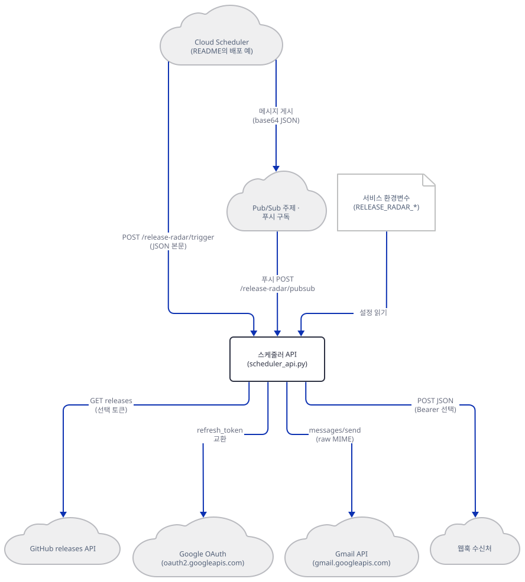

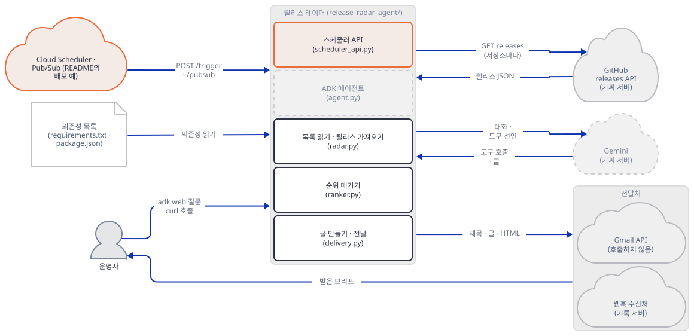

**확인.** 서버가 `127.0.0.1`에만 열려 있는지는 `netstat -ano | grep :53153`이 `127.0.0.1:53153 … LISTENING`만 보이면 됩니다. 터미널 B의 서버를 `Ctrl+C`로 멈춘 뒤에는 이 줄이 비어야 합니다.

### Step 7. ADK 에이전트와 `adk web` — 고정판 1.9.0과 최신판

**목적.** 에이전트가 모델에게 무엇을 선언하고 무엇을 받는지 보고, 고정판 `google-adk` 1.9.0과 최신 2.12.0이 이 앱에서 어디서 갈리는지 맞대어 봅니다.

**할 일.** `agent.py`는 `LlmAgent` 하나(`agent.py:28-52`)와 도구 함수 하나(`preview_dependency_brief(manifest_path: str = "", top_n: int = 10)`, `agent.py:10-25`)입니다. 도구는 `run_release_radar(manifest_path=…, live=None, top_n=…)`를 그대로 부르고, 지침은 "오늘의 브리프를 물으면 이 도구를 부르라"와 "렌더링과 전달을 분리하라, 메일이나 웹훅이 갔다고 말하지 말라"입니다(`agent.py:35-50`). 도구의 `manifest_path`는 **모델이 정하는 인자**입니다. 스케줄러가 매니페스트를 서버 환경변수로만 받게 막은 것과 달리, 대화에서는 사용자가 말한 경로가 그대로 `parse_manifest`로 갑니다(이름 규칙을 통과하는 파일만 읽힙니다).

`run_once.py`는 `InMemoryRunner`로 질문 한 건을 돌려 이벤트를 한 줄씩 찍습니다. 모델 자리에는 Step 1의 가짜 Gemini가 있습니다. 앱 폴더를 패키지로 가져오고(`from always_on_agents.release_radar_agent import root_agent`, `__init__.py:4-9`의 `__getattr__`가 `agent.py`를 늦게 불러옵니다) 가져온 뒤에 가드를 한 번 더 확인합니다.

```bash
cat > run_once.py <<'EOF'
"""질문 한 건을 InMemoryRunner로 돌려 이벤트를 한 줄씩 찍는다. 모델은 가짜 서버가 대신한다.

사용: python run_once.py <가짜 서버 포트> "<질문>" [--webhook]
"""
import asyncio
import sys

import guard

port = int(sys.argv[1])
question = sys.argv[2]
guard.point_at_fakes(port)
guard.check_env()
guard.install()

sys.path.insert(0, ".")
from google.adk.runners import InMemoryRunner  # noqa: E402
from google.genai import types  # noqa: E402

from always_on_agents.release_radar_agent import root_agent  # noqa: E402

guard.check_env()  # 앱을 가져온 뒤에 한 번 더


async def main() -> None:
    runner = InMemoryRunner(agent=root_agent, app_name="radar")
    session = await runner.session_service.create_session(app_name="radar", user_id="me")
    message = types.Content(role="user", parts=[types.Part(text=question)])
    async for event in runner.run_async(user_id="me", session_id=session.id, new_message=message):
        for part in event.content.parts if event.content and event.content.parts else []:
            if part.function_call:
                print(f"[{event.author}] 도구 호출 {part.function_call.name} {dict(part.function_call.args)}")
            elif part.function_response:
                r = part.function_response.response
                print(f"[{event.author}] 도구 결과 키 {sorted(r)[:12]} 항목 {len(r.get('releases', []))}개 / 글 {len(r.get('text', ''))}자 / HTML {len(r.get('html', ''))}자")
            elif part.text:
                print(f"[{event.author}] 글 {part.text}")


asyncio.run(main())
guard.report()
EOF
$PY run_once.py 53149 "Give me today's dependency release brief."
```

```text
Default value is not supported in function declaration schema for Google AI.
Default value is not supported in function declaration schema for Google AI.
Warning: there are non-text parts in the response: ['function_call'], returning concatenated text result from text parts. Check the full candidates.content.parts accessor to get the full model response.
Default value is not supported in function declaration schema for Google AI.
Default value is not supported in function declaration schema for Google AI.
[release_radar] 도구 호출 preview_dependency_brief {'top_n': 5}
[release_radar] 도구 결과 키 ['delivery_note', 'dependencies_checked', 'errors', 'generated_at', 'html', 'manifest_path', 'releases', 'subject', 'text', 'watch_mode'] 항목 4개 / 글 1103자 / HTML 1621자
[release_radar] 글 (가짜 모델) 브리프를 받았습니다. 항목 4개: requests, pydantic, fastapi, react
가드: 루프백 밖으로 나가려던 시도 0건 []
```

```bash
$PY showlog.py gemini
```

```text
gemini 요청 2건
  model=gemini-3-flash-preview | verb=generateContent | key=fake- | contents=1 | last=['text'] | tools=['preview_dependency_brief'] | system_chars=899 | fr_chars=0 | body_chars=1647
  model=gemini-3-flash-preview | verb=generateContent | key=fake- | contents=3 | last=['functionResponse'] | tools=['preview_dependency_brief'] | system_chars=899 | fr_chars=5255 | body_chars=7063
```

보이는 것이 다섯입니다. 첫째, 앞의 경고 넷 줄 "Default value is not supported in function declaration schema for Google AI."는 ADK 1.9.0이 도구의 기본값(`""`, `10`)을 Gemini API에 보낼 수 없어 떼어 낸다는 뜻이고, 그 결과가 아래 선언 비교입니다. 가운데의 `Warning: there are non-text parts in the response`는 첫 응답이 도구 호출이라 글 부분이 없다는 google-genai의 알림입니다. 둘째, 모델 요청은 둘입니다. 첫째(본문 1,647자)는 지침 899자와 도구 선언을, 둘째(7,063자)는 도구 결과 5,255자를 실었습니다. 가짜 서버가 `key=fake-`를 보았으니 ADK 1.9.0의 모델 클라이언트가 `GOOGLE_GEMINI_BASE_URL`과 환경의 키를 그대로 따랐다는 것(직접 확인)이고, 앞선 프록시나 `.env`의 진짜 값은 쓰이지 않았습니다. 셋째, 도구 결과 5,255자 가운데 `text` 1,103자와 `html` 1,621자, 곧 절반 가까이(2,724자)가 같은 내용을 두 번 적은 것입니다. 모델은 HTML을 쓸 일이 없는데 문맥에 실립니다. 넷째, 결과에는 릴리스 노트 전문(`releases[].notes`)도 실립니다. 노트는 그 저장소 주인이 쓴 글이고 모델 문맥으로 그대로 들어갑니다(소스로 확인: `RankedRelease.notes`가 `to_dict`에 있음). 다섯째, 한 질문의 비용입니다. 두 요청의 본문이 합쳐 8.7천 자이니 영어와 JSON을 3.5~4자에 1토큰으로 어림하면 입력 2.2~2.5천 토큰이고, 입력 $0.50/백만이면 0.0013달러 안팎입니다. 출력은 도구 호출과 요약 글에 추론 토큰이 붙어 천 토큰쯤으로 어림하면 $3/백만으로 0.003달러입니다. 합쳐 0.005달러 안팎입니다(⚠ 추정입니다. 이 문서는 진짜 Gemini를 한 번도 부르지 않아 토큰을 재지 못했고, 추론 토큰이 얼마나 나올지는 알 수 없습니다).

**도구 선언이 두 판에서 다릅니다.** 같은 코드에 최신 ADK를 따로 설치해 같은 질문을 돌립니다. 최신판은 가상환경을 하나 더 만듭니다(설치 줄만 프록시·키 변수를 비운 터미널에서 합니다).

```bash
uv venv --python 3.12 venv-latest
uv pip install --python venv-latest/Scripts/python.exe google-adk fastapi uvicorn
venv-latest/Scripts/python.exe -c "from importlib.metadata import version as v; print(' | '.join(f'{n} {v(n)}' for n in ['google-adk','google-genai','fastapi','uvicorn','starlette','pydantic']))"
```

```text
Using CPython 3.12.10
Creating virtual environment at: venv-latest
Activate with: source venv-latest/Scripts/activate
Resolved 48 packages
Installed 48 packages
google-adk 2.12.0 | google-genai 2.31.0 | fastapi 0.141.1 | uvicorn 0.54.0 | starlette 1.8.0 | pydantic 2.14.1
```

최신판은 패키지가 48개이고 1.9.0의 107개(시험 도구 포함)보다 훨씬 적습니다. 같은 질문을 두 판에서 돌려 가짜 서버가 받은 첫 요청의 도구 선언을 찍습니다.

```bash
cat > showparams.py <<'EOF'
"""가짜 서버가 받은 첫 요청의 도구 선언(함수 인자 모양)을 찍는다."""
import json

for raw in open("fakes.log", encoding="utf-8"):
    d = json.loads(raw)
    if d["kind"] == "gemini" and d["contents"] == 1:
        print(json.dumps(d["params"], ensure_ascii=False))
        break
EOF
```

```bash
: > fakes.log      # 대역 서버가 쓰는 기록 파일만 비웁니다(서버는 그대로 둡니다)
$PY run_once.py 53149 "x" > /dev/null 2>&1; $PY showparams.py
: > fakes.log
venv-latest/Scripts/python.exe run_once.py 53149 "x" > /dev/null 2>&1; venv-latest/Scripts/python.exe showparams.py
```

```text
{"name": "preview_dependency_brief", "parameters": {"properties": {"manifest_path": {"type": "STRING"}, "top_n": {"type": "INTEGER"}}, "required": ["manifest_path", "top_n"], "type": "OBJECT"}}
{"name": "preview_dependency_brief", "parameters_json_schema": {"properties": {"manifest_path": {"default": "", "title": "Manifest Path", "type": "string"}, "top_n": {"default": 10, "title": "Top N", "type": "integer"}}, "title": "preview_dependency_briefParams", "type": "object"}}
```

1.9.0은 `required: ["manifest_path", "top_n"]`을 달고 기본값은 없습니다. 모델은 두 인자를 모두 채워야 하는 도구로 이해합니다. 앱의 의도(둘 다 선택, `manifest_path`가 비면 환경변수나 표본)와 다릅니다. 모델이 `manifest_path`에 그럴듯한 경로를 지어 넣으면 아래의 `FileNotFoundError`가 됩니다. 2.12.0은 기본값이 있는 JSON 스키마를 보내고 `required`가 없습니다. 진짜 Gemini가 1.9.0의 선언에서 `manifest_path`를 어떻게 채우는지는 확인하지 못했습니다.

없는 매니페스트를 모델이 넘기면 어떻게 되는지도 봅니다(대역 서버는 질문에 `manifest=<경로>`가 있으면 그 값을 도구 인자로 넘기게 짜여 있습니다).

```bash
$PY run_once.py 53149 "Check manifest=/workspace/package.json" 2>&1 | tail -2
```

```text
    raise FileNotFoundError(f"Dependency manifest not found: {manifest_path}")
FileNotFoundError: Dependency manifest not found: \workspace\package.json
```

도구가 던진 `FileNotFoundError`를 ADK가 모델에게 오류 결과로 돌려주지 않고 실행이 그대로 끝납니다. `adk web`에서는 `/run`이 500입니다(두 판 모두 직접 확인). 평가 설정의 둘째 사례(`Check /workspace/package.json …`)가 바로 이 경로인데, 이 저장소에는 그 파일이 없습니다(Step 8).

이제 `adk web`입니다. 앱 README는 앱 폴더 안에서 `adk web .`를 쓰고 ADK Web에서 `release_radar_agent`를 고르라고 합니다. 이 문서는 `adk` 명령을 래퍼가 가드를 건 뒤 부릅니다. 래퍼는 `--no-reload`(`--reload`는 서버를 새 프로세스로 다시 띄워 가드가 따라가지 못합니다)와 `--host 127.0.0.1`이 없으면 멈추고, `adk web`이 앱을 처음 부를 때 읽는 `.env`를 건너뛰게 합니다. 까닭은 아래 시험입니다.

```bash
cat > serve_adk.py <<'EOF'
"""adk 명령을 가드 아래에서 실행한다. 모델은 가짜 서버가 대신한다.

사용: python serve_adk.py <가짜 서버 포트> web <agents 폴더> --host 127.0.0.1 --port <포트> --no-reload
adk web의 --reload는 서버를 새 프로세스로 다시 띄워 가드가 따라가지 못하므로 항상 --no-reload를 준다.
"""
import os
import sys

sys.path.insert(0, os.path.dirname(os.path.abspath(__file__)))
import guard  # noqa: E402

port = int(sys.argv[1])
args = sys.argv[2:]
if "--no-reload" not in args:
    sys.exit("가드: --no-reload가 없습니다. 중단합니다.")
if "--host" not in args or args[args.index("--host") + 1] != "127.0.0.1":
    sys.exit("가드: --host 127.0.0.1이 없습니다. 중단합니다.")
guard.point_at_fakes(port)
os.environ["ADK_DISABLE_LOAD_DOTENV"] = "1"  # 2.x에만 있는 스위치. 1.9.0에는 없으므로 아래 대체도 한다
guard.check_env()
guard.install()

from google.adk.cli.utils import envs  # noqa: E402


def skip_dotenv(path, **kwargs):
    """adk web이 앱을 처음 부를 때 .env를 읽어 환경을 덮어쓰지 못하게 한다(1.9.0은 override=True)."""
    print(f"가드: .env 읽기를 건너뜁니다 ({os.path.basename(os.path.dirname(str(path)))}/.env)", flush=True)
    return False


envs.load_dotenv = skip_dotenv

from google.adk.cli.cli_tools_click import main  # noqa: E402

sys.argv = ["adk", *args]
main()
EOF
cat > client.py <<'EOF'
"""adk web 서버에 질문 한 건을 /run 으로 보내고 이벤트를 한 줄씩 찍는다. 루프백 주소에만 보낸다.

사용: python client.py <adk web 포트> "<질문>"
"""
import json
import sys
import urllib.request
from urllib.parse import urlparse

port, question = int(sys.argv[1]), sys.argv[2]
BASE = f"http://127.0.0.1:{port}"
if urlparse(BASE).hostname != "127.0.0.1":
    sys.exit("가드: 루프백이 아닌 주소입니다.")
opener = urllib.request.build_opener(urllib.request.ProxyHandler({}))  # 프록시 변수가 있어도 거치지 않는다


def post(path: str, body: dict):
    req = urllib.request.Request(BASE + path, data=json.dumps(body).encode(), headers={"Content-Type": "application/json"})
    try:
        with opener.open(req, timeout=60) as r:
            return r.status, json.loads(r.read())
    except urllib.error.HTTPError as e:
        return e.code, e.read().decode()[:200]


status, session = post("/apps/release_radar_agent/users/me/sessions/s1", {})
print("세션", status, session["id"])
status, events = post("/run", {"app_name": "release_radar_agent", "user_id": "me", "session_id": "s1",
                               "new_message": {"role": "user", "parts": [{"text": question}]}})
print("/run", status)
if status == 200:
    for e in events:
        for p in e.get("content", {}).get("parts", []):
            if "functionCall" in p:
                print(f"[{e['author']}] 도구 호출 {p['functionCall']['name']} {p['functionCall']['args']}")
            elif "functionResponse" in p:
                r = p["functionResponse"]["response"]
                print(f"[{e['author']}] 도구 결과 항목 {len(r.get('releases', []))}개 / watch_mode {r.get('watch_mode')}")
            elif "text" in p:
                print(f"[{e['author']}] 글 {p['text']}")
else:
    print(events)
EOF
```

```bash
# 터미널 B (앞 서버를 멈춘 뒤). 먼저 앱 README의 방식: 앱 폴더 안에서 adk web .
cd always_on_agents/release_radar_agent
$PY ../../serve_adk.py 53149 web . --host 127.0.0.1 --port 53151 --no-reload
```

```bash
# 터미널 C
curl -s --noproxy '*' http://127.0.0.1:53151/list-apps
```

```text
["tests"]
```

**1.9.0에서는 `release_radar_agent`가 목록에 없고 `["tests"]`만 있습니다.** 이 판의 `adk web`은 주어진 폴더의 **하위 폴더**를 앱으로 올립니다. 앱 폴더 자신은 올리지 않고 안의 `tests/`가 올라옵니다. 부모 폴더를 주면 됩니다(`radar-work`에서).

```bash
# 터미널 B (앞 서버를 멈추고 radar-work로 돌아와서)
$PY serve_adk.py 53149 web always_on_agents --host 127.0.0.1 --port 53151 --no-reload
```

```bash
# 터미널 C
curl -s --noproxy '*' http://127.0.0.1:53151/list-apps
$PY client.py 53151 "Give me today's dependency release brief."
$PY showlog.py gemini
```

```text
["release_radar_agent"]
세션 200 s1
/run 200
[release_radar] 도구 호출 preview_dependency_brief {'top_n': 5}
[release_radar] 도구 결과 항목 4개 / watch_mode sample
[release_radar] 글 (가짜 모델) 브리프를 받았습니다. 항목 4개: requests, pydantic, fastapi, react
gemini 요청 2건
  model=gemini-3-flash-preview | verb=generateContent | key=fake- | contents=1 | last=['text'] | tools=['preview_dependency_brief'] | system_chars=899 | fr_chars=0 | body_chars=1647
  model=gemini-3-flash-preview | verb=generateContent | key=fake- | contents=3 | last=['functionResponse'] | tools=['preview_dependency_brief'] | system_chars=899 | fr_chars=5255 | body_chars=7063
```

같은 질문이 `/run`으로 가서 `run_once`와 같은 흐름이 나왔고, 가짜 서버가 받은 요청도 같은 둘입니다. 최신판으로 같은 두 가지(앱 폴더 안의 `adk web .`와 `client.py`)를 해 봅니다.

```bash
# 터미널 B (앞 서버를 멈추고, radar-work에서 시작해 앱 폴더로 들어갑니다)
cd always_on_agents/release_radar_agent
../../venv-latest/Scripts/python.exe ../../serve_adk.py 53149 web . --host 127.0.0.1 --port 53151 --no-reload
```

```bash
# 터미널 C (radar-work에서)
curl -s --noproxy '*' http://127.0.0.1:53151/list-apps
venv-latest/Scripts/python.exe client.py 53151 "Give me today's dependency release brief."
ls -a always_on_agents/release_radar_agent | tr '\n' ' '
```

```text
["release_radar_agent"]
세션 200 s1
/run 200
[release_radar] 도구 호출 preview_dependency_brief {'top_n': 5}
[release_radar] 도구 결과 항목 4개 / watch_mode sample
[release_radar] 글 (가짜 모델) 브리프를 받았습니다. 항목 4개: requests, pydantic, fastapi, react
. .. .adk __init__.py agent.py delivery.py radar.py ranker.py README.md requirements.txt scheduler_api.py tests 
```

**2.12.0은 앱 폴더 안에서 `.`를 줘도 `release_radar_agent`를 올립니다.** 곧 앱 README의 안내는 최신 ADK를 전제로 쓴 것이고, 같은 폴더의 `requirements.txt`가 고정한 1.9.0에서는 맞지 않습니다. 두 판의 다른 점이 하나 더 있습니다. 2.12.0은 `adk web`이 앱 폴더 안에 `.adk/session.db`를 만듭니다(위 출력의 마지막 줄 목록에 `.adk`). 이 파일은 저장소의 `.gitignore:72`(`*.db`)가 가려서 `git status`에는 보이지 않습니다. 저장소 루트에서 이렇게 확인합니다(1.9.0은 만들지 않았습니다).

```bash
git check-ignore -v always_on_agents/release_radar_agent/.adk/session.db
```

```text
.gitignore:72:*.db	always_on_agents/release_radar_agent/.adk/session.db
```

마지막으로 `.env`입니다. 래퍼가 `.env`를 건너뛰는 까닭을 아래 스크립트로 봅니다. `adk web`이 앱을 부를 때 쓰는 함수 `load_dotenv_for_agent`를 직접 불러서, 임시 폴더의 `.env`(`GOOGLE_API_KEY=from-dotenv-file`, `HTTPS_PROXY=http://127.0.0.1:9`)가 가드가 정해 둔 환경을 덮는지 봅니다. 네트워크는 쓰지 않습니다.

```bash
cat > dotenv_probe.py <<'EOF'
"""adk web이 앱을 부를 때 쓰는 .env 읽기 함수가 환경변수를 덮어쓰는지 본다. 네트워크는 쓰지 않는다.
사용: python dotenv_probe.py <가짜 서버 포트>   (이 폴더에 dotenv-lab/ 을 만든다)"""
import os
import sys

import guard

guard.point_at_fakes(int(sys.argv[1]))
guard.check_env()
guard.install()

os.makedirs("dotenv-lab/agents/probe_agent", exist_ok=True)
with open("dotenv-lab/agents/probe_agent/.env", "w", encoding="utf-8", newline="\n") as f:
    f.write("GOOGLE_API_KEY=from-dotenv-file\nHTTPS_PROXY=http://127.0.0.1:9\n")

from google.adk.cli.utils import envs  # noqa: E402

print("읽기 전:", os.environ["GOOGLE_API_KEY"], repr(os.environ["HTTPS_PROXY"]))
envs.load_dotenv_for_agent("probe_agent", "dotenv-lab/agents")
print("읽은 뒤:", os.environ["GOOGLE_API_KEY"], repr(os.environ["HTTPS_PROXY"]))
EOF
$PY dotenv_probe.py 53149
venv-latest/Scripts/python.exe dotenv_probe.py 53149
```

```text
# 앞 두 줄: 1.9.0, 뒤 두 줄: 2.12.0
읽기 전: fake-key ''
읽은 뒤: from-dotenv-file 'http://127.0.0.1:9'
읽기 전: fake-key ''
읽은 뒤: fake-key ''
```

**1.9.0은 `.env`가 셸 환경을 덮습니다.** `envs.py`의 `load_dotenv(…, override=True)`가 이유이고(설치된 패키지의 `google/adk/cli/utils/envs.py` 46행, 소스로 확인), `.env`를 앱 폴더에서 시작해 부모 폴더로 거슬러 올라가며 처음 찾은 것을 읽습니다. 가드가 정한 가짜 키와 대역 주소가 `.env`의 진짜 값으로 바뀌고, 이 문서를 쓰는 동안 실제로 그 일이 있었습니다. 래퍼 없이(`.env`를 건너뛰지 않고) 가드만 건 `adk web`에 진짜 모양의 `.env`와 프록시 변수를 둔 셸을 걸었더니, 첫 `/run`에서 앱이 `generativelanguage.googleapis.com:443`으로 가려고 감시용 프록시에 `CONNECT`를 두 번 보냈습니다(감시용 프록시가 받아 끊었고 바깥에는 나가지 않았습니다). 가드의 소켓 막기는 루프백 프록시로 가는 연결을 통과시켰기 때문에, 프록시 포트로의 연결을 막는 줄과 `.env` 건너뛰기가 그 뒤에 들어갔습니다. 2.12.0은 시작할 때의 환경변수를 기억해 두었다가 `.env`를 읽은 뒤 되돌려 놓고(같은 파일 53~82행), 끄는 스위치 `ADK_DISABLE_LOAD_DOTENV`도 있습니다. 래퍼는 둘 다 합니다. 진짜 키를 `.env`에 두는 독자는, 1.9.0에서는 `.env`가 셸을 이긴다는 것을 알아야 합니다.

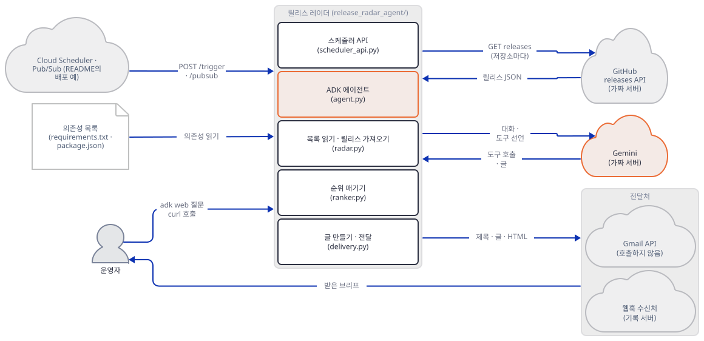

한 질문이 지나가는 순서는 시퀀스 셋으로 그렸습니다. 운영자의 질문이 `adk web`을 거쳐 모델에게 도구 호출을 받아 오는 쪽, 도구가 `radar.py`를 부르는 쪽, 도구 결과를 실은 둘째 모델 요청이 글이 되어 돌아오는 쪽입니다. 요청 내용(1,647자·7,063자, 5,255자)은 위 `showlog` 출력의 값입니다.

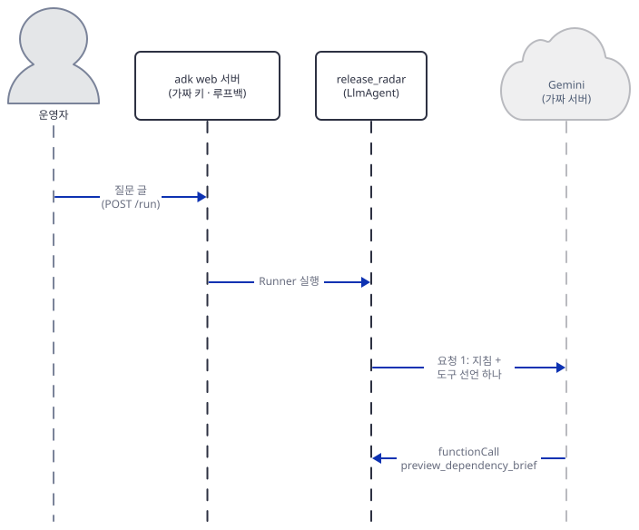

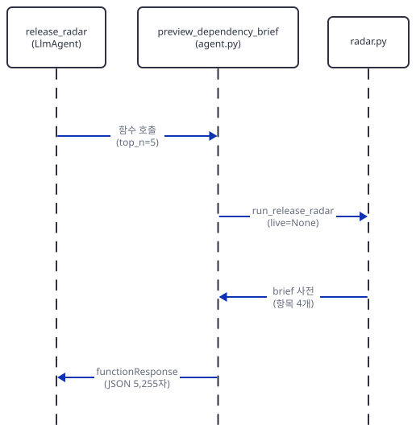

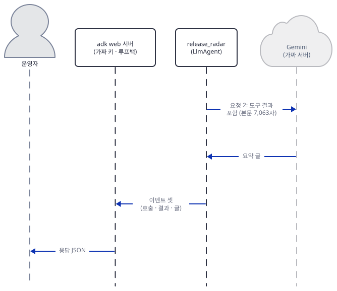

같은 모양이 [Day 148 Step 6](../day148-always-on-hn-briefing-agent/README.md)에 있습니다. 오늘 새로 본 것은 위 네 가지 판 차이입니다.

**확인.** `list-apps` 출력이 위와 같고 `/run`이 200이며, `showlog`가 `요청 2건`·`key=fake-`·`tools=['preview_dependency_brief']`이면 맞습니다. 서버를 `Ctrl+C`로 멈춘 뒤 `netstat -ano | grep -E ":5315[0-9] " | grep LISTENING`이 비어야 합니다.

### Step 8. 시험과 평가 설정 — 무엇을 시험하고 무엇을 시험하지 않는가

**목적.** 앱에 들어 있는 시험 둘(단위 테스트, 평가 설정)이 무엇을 확인하고 무엇을 비워 두는지 봅니다.

**할 일.** 단위 테스트는 열여섯 개입니다(`test_radar.py` 5, `test_ranker.py` 6, `test_scheduler_api.py` 5, `pytest --collect-only`로 센 값, 직접 확인). 앱 README의 명령은 `python3 -m pytest always_on_agents/release_radar_agent/tests/unit -q`이고 **저장소 루트에서** 돌립니다. 테스트가 `always_on_agents.release_radar_agent`를 패키지 이름으로 가져오기 때문입니다. 가드 아래서 돌립니다.

```bash
cat > pytest_guarded.py <<'EOF'
"""앱의 단위 시험을 가드 아래에서 돌린다. 사용: python pytest_guarded.py <가짜 서버 포트> <pytest 인자...>"""
import sys

import guard

guard.point_at_fakes(int(sys.argv[1]))
guard.check_env()
guard.install()

import pytest  # noqa: E402

code = pytest.main(sys.argv[2:])
guard.report()
sys.exit(code)
EOF
$PY pytest_guarded.py 53149 always_on_agents/release_radar_agent/tests/unit -q -p no:cacheprovider
```

```text
16 passed in 0.46s
가드: 루프백 밖으로 나가려던 시도 0건 []
```

열여섯 개가 모두 통과했고 바깥으로 나가려던 시도는 0건입니다. 시험이 `urlopen`을 가짜로 바꾸고(`patch("urllib.request.urlopen")`) 환경을 비우고(`patch.dict(os.environ, {}, clear=True)`) 표본 데이터만 쓰기 때문입니다(소스로 확인). 맨 `pytest` 명령은 모듈을 못 찾습니다. `python -m pytest`가 현재 폴더를 import 경로에 넣어 주는 것이 이 앱의 시험 명령에 꼭 필요합니다.

```bash
venv/Scripts/pytest.exe always_on_agents/release_radar_agent/tests/unit -q -p no:cacheprovider 2>&1 | grep -E "ModuleNotFound" | head -1
```

```text
E   ModuleNotFoundError: No module named 'always_on_agents'
```

그러면 시험이 코드의 얼마를 지나가는지 `coverage`로 봅니다(`coverage`는 Step 1의 설치에 없으니 한 줄 더 설치합니다. 프록시·키 변수를 비운 터미널에서).

```bash
uv pip install --python venv/Scripts/python.exe coverage
$PY -m coverage run --data-file=cov.data --include="always_on_agents/release_radar_agent/*.py" pytest_guarded.py 53149 always_on_agents/release_radar_agent/tests/unit -q -p no:cacheprovider
$PY -m coverage report --data-file=cov.data -m
```

```text
Name                                                    Stmts   Miss  Cover   Missing
-------------------------------------------------------------------------------------
__init__.py            6      2    67%   6-8
delivery.py          115     51    56%   19-20, 121-122, 128-129, 156, 164, 166, 168, 170, 183-198, 204-249, 261-303
radar.py             179     45    75%   58, 102, 111-112, 118, 133, 138, 146, 162, 258-278, 291-292, 299, 302, 326-345, 349, 379-381
ranker.py             50      2    96%   10-11
scheduler_api.py      67     16    76%   20-22, 36-42, 83, 91, 104-105, 120-121
-------------------------------------------------------------------------------------
TOTAL                                                     417    116    72%
```

표의 `Missing` 열이 시험이 지나가지 않는 줄입니다. 표에 오른 파일의 72%만 지나갑니다. `agent.py`는 시험이 가져오지도 않아 표에 없습니다. 비어 있는 곳을 이름으로 부르면 이렇습니다. 라이브 가져오기(`radar.py:258-278`의 `fetch_github_releases`, `326-345`의 스레드 풀, 헤더·토큰·오류 처리 전부), 전달 코드 대부분(`delivery.py:183-198`의 토큰 교환, `204-249`의 Gmail 전송, `261-303`의 웹훅 전송), 방식 고르기의 분기(`delivery.py:164-170`), 스케줄러의 깨진 입력 처리(`scheduler_api.py:120-121`), 문자열 불리언 변환(`scheduler_api.py:36-42`)입니다. 곧 단위 테스트는 "표본으로 순위가 맞고, 전달 설정이 없으면 `urlopen`을 부르지 않는다"까지만 확인하고, 이 문서의 Step 3·5·6에서 본 것들은 시험이 없습니다.

평가 설정(`tests/eval/eval_config.yaml`)은 프롬프트 셋(`daily_brief`·`manifest_brief`·`no_false_delivery`)과 기대 행동을 글로 적은 파일입니다. 이 앱 안에는 그 파일을 읽는 코드가 없고(`grep`으로 확인) 모델을 부르는 평가를 돌리는 스크립트도 없으니, 이 파일은 실제 모델을 부르지 않습니다. ADK가 읽는 평가 집합 모양인지 `EvalSet` 모델로 검증해 봅니다(모델은 부르지 않습니다).

```bash
cat > evalcheck.py <<'EOF'
"""tests/eval/eval_config.yaml 을 ADK 의 평가 집합 모델(EvalSet)로 읽어 본다. 모델은 부르지 않는다."""
import yaml
from google.adk.evaluation.eval_set import EvalSet

with open("always_on_agents/release_radar_agent/tests/eval/eval_config.yaml", encoding="utf-8") as f:
    data = yaml.safe_load(f)
print("최상위 키:", sorted(data))
print("사례 키:", sorted(data["eval_cases"][0]))
try:
    EvalSet.model_validate(data)
    print("EvalSet 검증: 통과")
except Exception as e:  # noqa: BLE001
    print("EvalSet 검증: 실패 -", [(".".join(map(str, x["loc"])), x["type"]) for x in e.errors()])
EOF
$PY evalcheck.py
```

```text
최상위 키: ['description', 'eval_cases', 'eval_set_id', 'name']
사례 키: ['expected_behavior', 'name', 'prompt']
EvalSet 검증: 실패 - [('eval_cases.0.evalId', 'missing'), ('eval_cases.0.conversation', 'missing'), ('eval_cases.1.evalId', 'missing'), ('eval_cases.1.conversation', 'missing'), ('eval_cases.2.evalId', 'missing'), ('eval_cases.2.conversation', 'missing')]
```

ADK 1.9.0의 `EvalSet`이 요구하는 `evalId`와 `conversation`이 사례마다 없습니다. 곧 이 파일은 `adk eval`이 읽는 형식이 아니고 사람이 읽는 시험 계획입니다. 둘째 사례는 `/workspace/package.json`을 말하는데 이 저장소에는 없는 경로라서, 위 Step 7의 `FileNotFoundError`에 그대로 걸립니다. 같은 파일 모양이 [Day 148 Step 7](../day148-always-on-hn-briefing-agent/README.md)에 있습니다.

끝으로 이 문서가 "진짜 키가 있는 독자"로도 바깥 0이었는지 말씀드립니다. 이 문서의 명령은 셸에 진짜 모양의 가짜 값(`GOOGLE_API_KEY`·`GEMINI_API_KEY`, `GOOGLE_GENAI_USE_VERTEXAI=true`, `RELEASE_RADAR_GITHUB_TOKEN`, Gmail 변수 다섯과 웹훅 주소, `RELEASE_RADAR_LIVE_GITHUB=true`와 없는 매니페스트 경로, 프록시 변수)를 걸고, `radar-work`와 그 위 폴더, 앱 폴더에도 같은 모양의 `.env`를 둔 채로 위에서부터 따라 해 보았습니다. 모든 단계가 이 문서와 같은 출력을 냈고, 가짜 서버가 본 키 앞 다섯 글자는 전부 `fake-`였고, 가드의 막은 횟수는 0건, 프로세스마다 `sitecustomize`로 따로 건 소켓 감시(루프백 밖 연결·이름 조회를 기록하고 거절)의 기록도 0바이트, 감시용 프록시가 받은 연결은 `curl`에 `--noproxy '*'`를 빼고 일부러 부른 한 번뿐이었습니다. 앞 단락의 `.env` 사고는 래퍼를 고치기 전 판에서 났고 지금 판은 고친 뒤입니다.


**확인.** 시험이 `16 passed`, 가드가 `0건`, `evalcheck`가 `EvalSet 검증: 실패`면 이 문서와 같습니다.

## 요청 한 건이 흐르는 과정

스케줄러가 `POST /release-radar/trigger`로 `{dry_run: false, live: true}`를 보낸 한 건을 따라갑니다(매니페스트는 서버 환경변수가 가리키는 파일, 전달은 웹훅). 실제 Cloud Scheduler 자리에는 `curl`이 있었습니다. 한 장에 담으면 1,700px가 넘어 시간 경계로 넷으로 나눴고, 메시지는 모두 코드 순서대로 한 그림에 있습니다. 첫째 그림은 요청이 들어와 매니페스트를 읽기까지입니다.

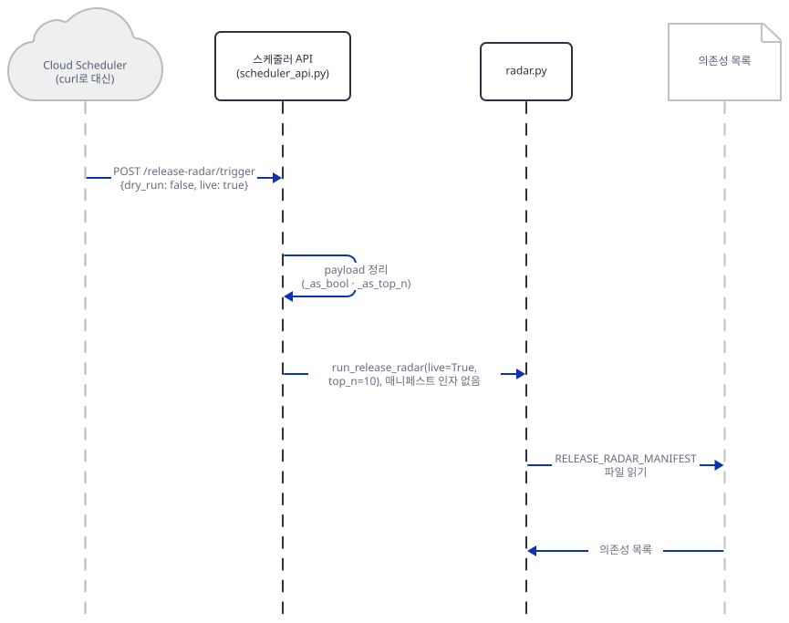

1. 스케줄러가 `POST /release-radar/trigger`를 보냅니다. 본문은 `{dry_run: false, live: true}`입니다.
2. `scheduler_api.py`가 `_as_bool`·`_as_top_n`으로 본문을 정리합니다(`dry_run=False`, `live=True`, `top_n=10`).
3. `run_release_radar(live=True, top_n=10)`을 부릅니다. 매니페스트 인자는 없어서 `radar.py`가 환경변수를 봅니다(`radar.py:364`).
4. `radar.py`가 `RELEASE_RADAR_MANIFEST`가 가리키는 파일을 읽고 의존성 목록을 얻습니다.

둘째 그림은 GitHub에서 릴리스를 가져와 순위를 매기기까지입니다.

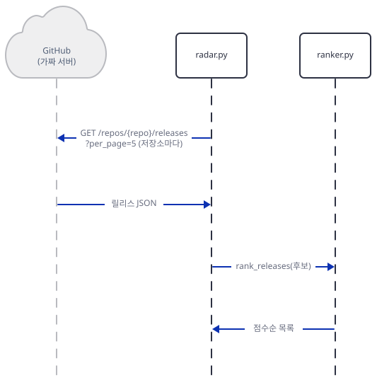

5. 저장소마다 `GET /repos/{repo}/releases?per_page=5`를 보내고 릴리스 JSON을 받습니다.
6. `rank_releases`가 후보를 점수순으로 정렬해 돌려줍니다.

셋째 그림은 글을 만들어 `scheduler_api.py`로 돌아오기까지입니다.

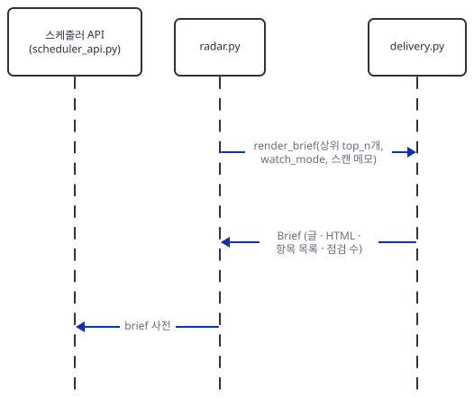

7. `radar.py`가 `render_brief`로 상위 `top_n`개를 글·HTML로 만들고 `Brief`를 받아 사전으로 바꿉니다.
8. `scheduler_api.py`가 그 사전을 받습니다.

넷째 그림은 전달과 응답입니다. `dry_run`이 거짓이라서 전달을 부릅니다.

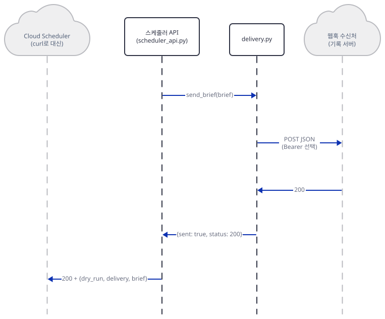

9. `send_brief(brief)`가 웹훅으로 JSON을 `POST`합니다.
10. 수신처가 200을 돌려주고, 전달 결과(`sent: true, status: 200`)가 응답 본문에 실려 스케줄러에게 `200`으로 돌아갑니다.

## 실행 체크리스트

- [ ] `uv pip install`이 세 줄 그대로 설치되고 `google-adk 1.9.0`이 나왔다
- [ ] 터미널 A에 대역 서버가 떠 있고 `curl --noproxy '*'`가 `200`이다
- [ ] `deps.py`가 데모 매니페스트의 `requests>=2.0.0`을 현재 버전 `2.0.0`으로 읽었다
- [ ] 라이브 요청 로그가 `요청 6건`이고 헤더가 `api_version=2022-11-28`이다
- [ ] `rank_probe.py`에서 "No security vulnerability was found…"가 보안 수정으로 분류됐다
- [ ] `gmail_shape.py`의 `DELIVERY=off` 줄이 `요청 2건`이다(실제 Gmail에는 연결하지 않았다)
- [ ] 스케줄러 API를 `127.0.0.1`로만 띄웠고, 웹훅이 죽었을 때 HTTP 200에 `sent: False`였다
- [ ] 1.9.0에서 `adk web .`가 `["tests"]`만 올렸고, 부모 폴더에서는 `["release_radar_agent"]`였다
- [ ] 단위 테스트가 `16 passed`이고 가드가 `0건`이다
- [ ] 끝나고 대역 서버·스케줄러·`adk web`을 모두 멈췄고, `git status --short -- always_on_agents`가 비어 있다

## 문제 해결

| 증상 | 원인 | 해결 |
|---|---|---|
| `adk web .` 뒤 ADK Web의 앱 목록에 `release_radar_agent`가 없고 `tests`만 있다 | 앱이 고정한 `google-adk==1.9.0`은 주어진 폴더의 하위 폴더를 앱으로 올린다. 최신 ADK(2.12.0)는 앱 폴더 자신도 올린다(직접 확인) | 부모 폴더에서 `adk web always_on_agents --host 127.0.0.1 …`를 쓴다 |
| `pytest …`가 `ModuleNotFoundError: No module named 'always_on_agents'` | 맨 `pytest`는 현재 폴더를 import 경로에 넣지 않는다. 테스트가 `always_on_agents.release_radar_agent`로 가져온다 | 앱 폴더를 `always_on_agents/` 안에 두고 그 위 폴더에서 `python -m pytest …` |
| `curl`이 `000`이거나 응답이 없다. 셸에 프록시 변수가 있다 | `curl`이 루프백 요청도 프록시로 보냄 | `curl --noproxy '*'` |
| `ValueError: Release Radar supports requirements*.txt and package.json manifests.` | 파일 이름이 `requirements`로 시작하는 `.txt`나 `package.json`이 아님(`dev-requirements.txt`도 안 됨) | 이름을 `requirements-dev.txt`처럼 바꾼다 |
| 스케줄러가 `500 Internal Server Error`, 서버 로그에 `FileNotFoundError: Dependency manifest not found` | `RELEASE_RADAR_MANIFEST`가 없는 파일을 가리킴. 앱이 이 오류를 잡지 않는다 | 파일 경로를 고치거나 환경변수를 비운다(비면 표본) |
| `/release-radar/pubsub`이 500 | 본문이 JSON이 아니거나 `message.data`가 문자열이 아님(`scheduler_api.py:113`, `118-121`). Pub/Sub 푸시라면 500이 nack이라 다시 전달됨(문서) | 본문을 확인한다. `/trigger`는 같은 입력을 dry-run 200으로 처리한다 |
| 브리프의 스캔 메모에 `Could not fetch releases for …: HTTP Error 403: Forbidden` | 비인증 한도 60회/시간(문서) 초과일 수 있다. 앱은 응답 헤더·본문을 읽지 않아 원인을 알 수 없다 | `RELEASE_RADAR_GITHUB_TOKEN`을 걸거나(5,000회/시간), 한 시간 뒤 다시 한다 |
| `RELEASE_RADAR_DELIVERY=off`로 껐는데 메일이 간다(또는 갈 뻔했다) | `gmail`·`webhook` 말고는 모두 자동 판정이고 Gmail 변수가 있으면 Gmail이 이긴다 | Gmail·웹훅 변수를 지워서 끈다 |
| 소식이 없는 날에도 알림이 온다 | `send_brief`가 릴리스 수를 보지 않는다 | 앱에는 끄는 설정이 없다. 수신 쪽에서 거르거나 `send_brief` 앞에 조건을 둔다 |
| `Default value is not supported in function declaration schema for Google AI.`가 요청마다 두 줄 | ADK 1.9.0이 도구의 기본값을 선언에서 뗀다. 그 결과 인자 둘이 필수가 된다(Step 7) | 무해한 로그다. 필수 여부를 되돌리려면 최신 ADK를 쓴다 |
| 1.9.0을 가져올 때 `vertexai.preview.rag` 경고 문단이 길게 나온다 | 1.9.0의 의존성이 오늘 `vertexai` 쪽 지원 중단 예고를 낸다 | 무해하다. `PYTHONWARNINGS=ignore`로 가린다 |
| 1.9.0에서 `adk web`이 `.env`의 값으로 모델 주소·키·프록시가 바뀐다 | `load_dotenv(…, override=True)`가 셸 값을 덮는다(Step 7) | 래퍼처럼 `.env` 읽기를 건너뛰거나 `.env`를 두지 않는다. 최신 ADK는 셸 값을 지킨다 |
| `가드: … 중단합니다.` | 가드의 점검에 걸림(호스트가 루프백이 아님, 키가 가짜가 아님, Gmail 변수가 비어 있지 않음, 프록시 변수가 비어 있지 않음) | 걸린 항목을 고친다. 가드를 건너뛰고 서버를 띄우지 않는다 |
| 2.x로 `adk web`을 쓴 뒤 앱 폴더에 `.adk/session.db`가 생김 | 2.12.0이 세션 DB를 앱 폴더 안에 둔다. `.gitignore:72`의 `*.db`가 가려 `git status`에 안 보인다 | 복사한 폴더에서 돌리거나 끝난 뒤 지운다 |

## 더 해보기

- `requirements-demo.txt`의 `requests>=2.0.0`을 `requests==2.32.3`으로 바꿔 `brief.py --live`를 다시 돌려, 같은 릴리스가 "older"로 걸러지는지 보세요. 하한과 고정 사이의 차이가 브리프에 얼마나 나는지 보입니다.
- `rank_probe.py`에 "Security: fixed a buffer overflow." 같은 문장과 부정문을 더해 어느 것이 걸러지는지 보세요. `SIGNAL_TERMS`(`ranker.py:14-31`)에 낱말을 더하거나 부정 앞의 문장을 거르는 규칙을 복사본에서 시험해 보세요.
- `send_brief` 앞에 "릴리스가 하나도 없으면 보내지 않는다"는 조건을 복사본에 넣고 Step 6의 마지막 사례를 다시 돌려 `hook 요청 0건`이 되는지 확인해 보세요.
- `serve_adk.py`의 `.env` 건너뛰기를 빼고 `dotenv_probe.py`가 보인 덮어쓰기를 `adk web`에서 재현하되, 루프백 주소(`GOOGLE_GEMINI_BASE_URL=http://127.0.0.1:53149/gemini`)가 든 `.env`로만 해 보세요. 가짜 서버 기록의 키 앞 다섯 글자가 `.env`의 값으로 바뀌는지 볼 수 있습니다.

## 다음 날 예고

[Day 150 · 🧠 Headroom Context Optimization](../day150-headroom-context-optimization/README.md) — 볼륨 14 "🎯 LLM Optimization"의 첫날입니다. `advanced_llm_apps/llm_optimization_tools/headroom_context_optimization`은 `headroom_demo.py` 한 파일(203줄)과 앱 README(174줄)로 이루어지고, 앱 README는 "Reduce LLM API costs by 50-90% through intelligent context compression"라고 말합니다. 오늘 본 도구 결과의 절반이 같은 글과 HTML의 중복이었던 것처럼, 모델에게 보내는 문맥의 군더더기를 줄이는 이야기입니다. `requirements.txt`는 `headroom-ai[all]>=0.2.14`·`openai>=1.0.0`·`anthropic>=0.18.0`입니다(`wc -l`과 `cat`으로 직접 확인).
