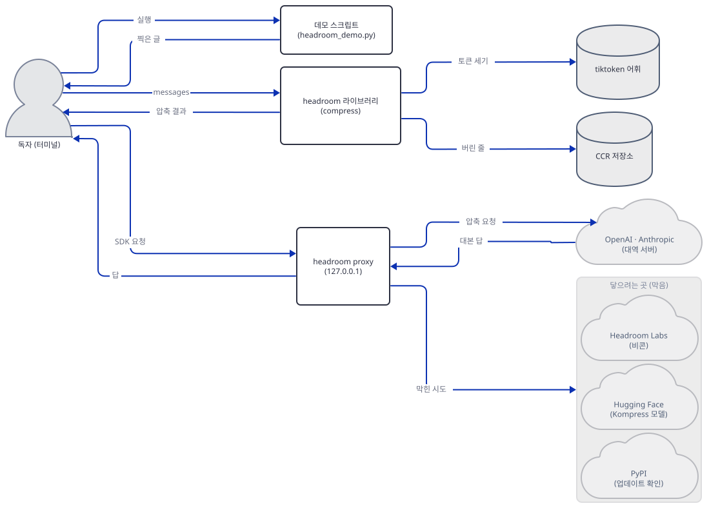
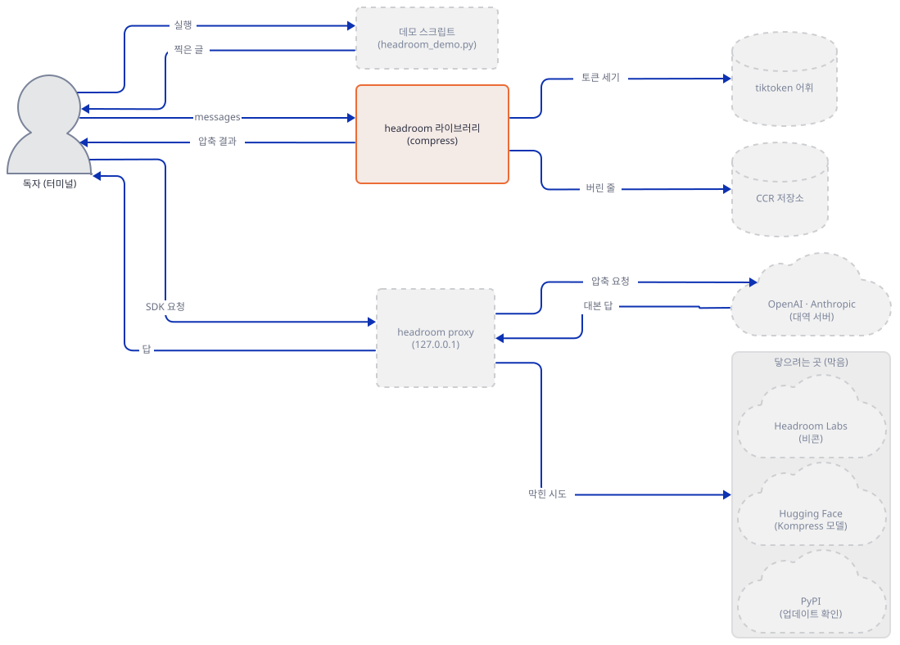
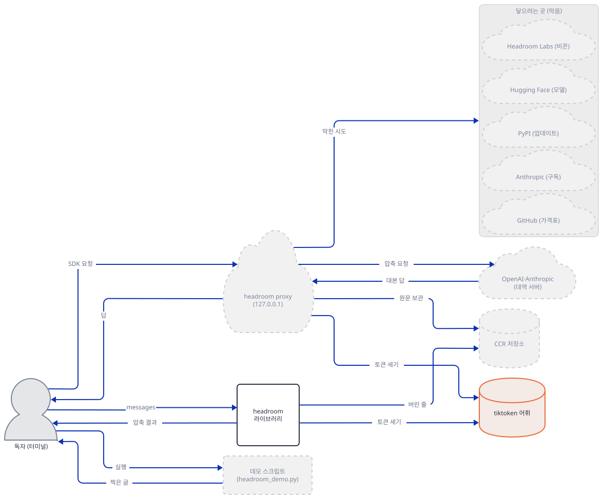
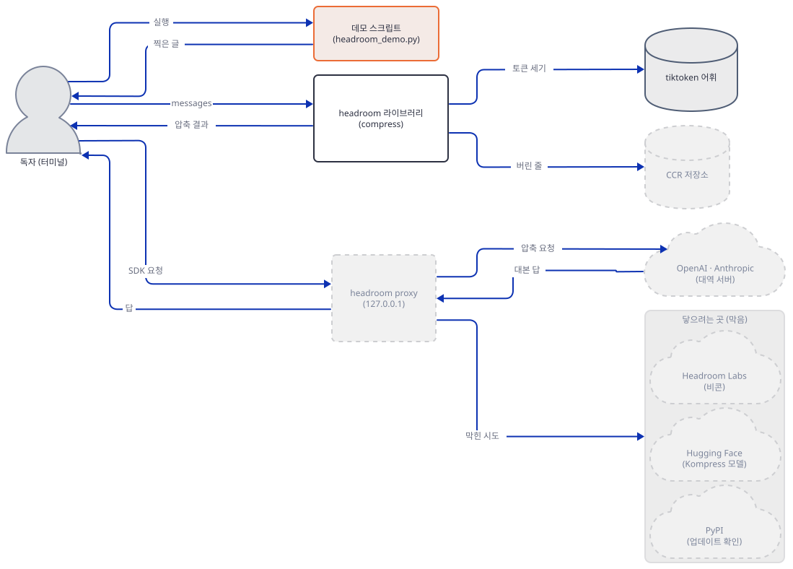
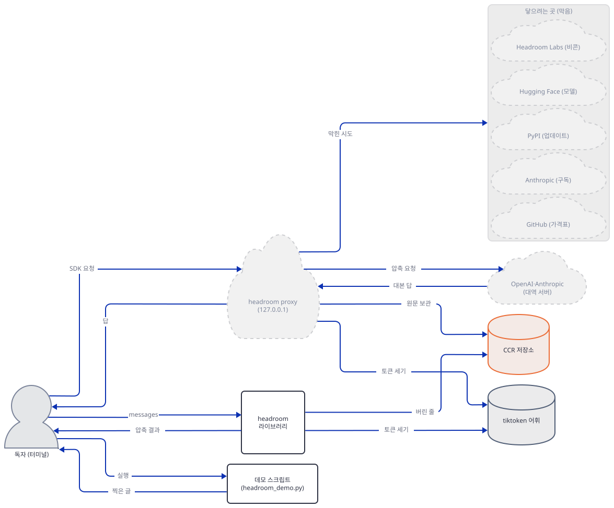
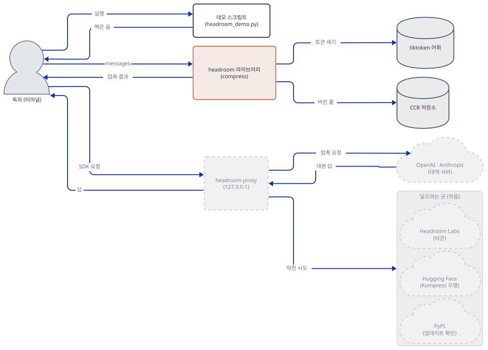
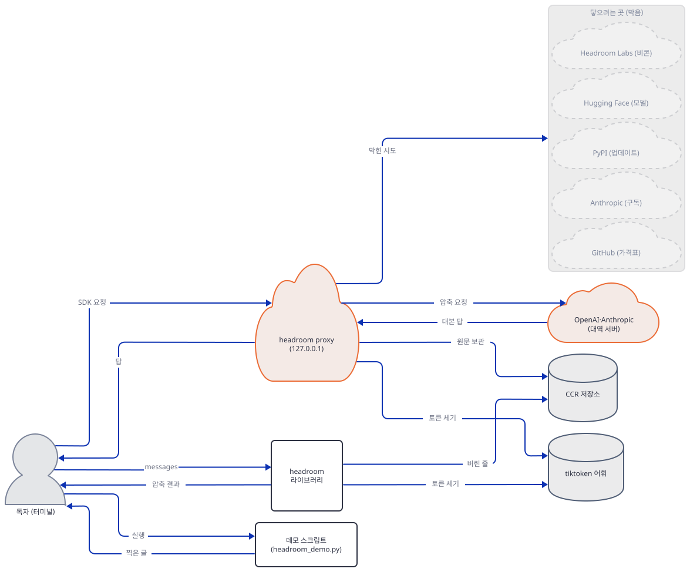
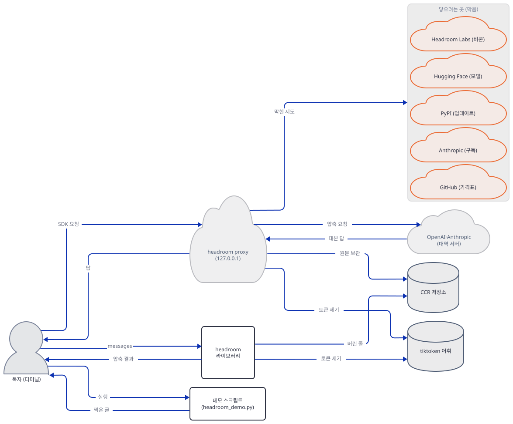
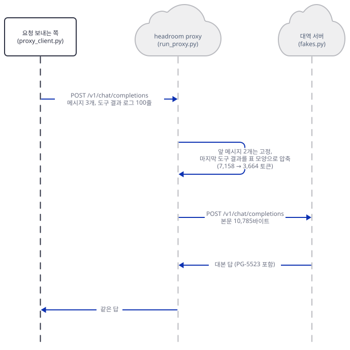

# Day 150 · 🧠 Headroom Context Optimization

> 볼륨 14 🎯 LLM Optimization · 난이도 ★★☆ ⚠ 앱의 데모(`headroom_demo.py`)는 headroom 라이브러리를 부르지 않고 결과를 손으로 흉내 냅니다(Step 3). 앱이 내세우는 "50-90%"는 데모 로그에서 진짜 라이브러리가 낸 수치와 다릅니다(Step 4). 데모 예시의 `gpt-4o`는 모델 페이지의 기본 스냅숏(`gpt-4o-2024-08-06`)이 2027-01-14 종료 예정입니다. 앱의 `headroom-ai[all]>=0.2.14`는 오늘 156개 패키지(휠 합계 약 500MB)로 풀리고, `headroom proxy`는 기본값에서 Hugging Face·PyPI·Anthropic으로 나가려 합니다(Step 7) · 예상 소요 190분(파일 아홉 개를 저장하고 터미널 셋을 오가며 대역 서버·프록시·클라이언트의 기록을 맞대 읽는 손 시간이 본문 읽는 시간보다 큽니다) · API 비용 대략 이 문서의 따라 하기는 $0(OpenAI·Anthropic·Hugging Face 어디에도 요청을 보내지 않았고, 바깥으로 나간 것은 패키지 설치와 어휘 파일 하나뿐입니다) · 원본 앱: `advanced_llm_apps/llm_optimization_tools/headroom_context_optimization`

## 오늘 만들 것

모델에게 보내는 문맥에서 군더더기를 덜어 내는 도구 Headroom을 따라 봅니다. 앱 README는 이 앱을 "Reduce LLM API costs by 50-90% through intelligent context compression"라고 소개하고, 도구 출력(로그, 코드 검색 결과, API 응답)의 70~95%가 되풀이 글이라고 말합니다. 앱의 실체는 `headroom_demo.py` 한 파일(203줄)과 README(174줄), 그리고 세 줄짜리 `requirements.txt`(`headroom-ai[all]>=0.2.14`·`openai>=1.0.0`·`anthropic>=0.18.0`)입니다. 이 줄 수와 인용문, requirements는 Day 149의 "다음 날 예고"가 말한 것과 같았습니다(`wc -l`과 `cat`으로 직접 확인).

볼륨 13(Day 148~149)의 앱은 스케줄이 부르면 브리프를 만들어 보내는 에이전트였고, 모델 호출이 비용의 중심이 아니었습니다. 볼륨 14는 반대편, 곧 모델에게 보내는 글의 크기를 다룹니다. 오늘은 Day 149의 "다음 날 예고"가 짚은 것처럼, 도구 결과 안의 중복(같은 내용의 글과 HTML)을 줄이는 이야기입니다. 새로 나오는 것은 셋입니다. 토큰을 어림이 아니라 실제 어휘(tiktoken)로 세는 일, 압축이 "버리는지 남기는지"(손실과 무손실)를 가르는 일, 그리고 클라이언트와 모델 사이에 끼는 프록시가 무엇을 가로채고 무엇을 바깥으로 보내는지입니다.

**먼저 밝힐 사실.** 앱의 데모는 headroom을 가져오지도 않습니다. `import`하는 모듈은 `json`과 `datetime`뿐이고(Step 3), "Headroom이 남긴 것"은 앞 3줄·FATAL 한 줄·끝 2줄을 손으로 골라 붙인 것이며, 토큰 수는 글자 수를 4로 나눈 어림입니다. LangChain 연동과 프록시 부분은 코드 글자를 `print`할 뿐입니다. 그래서 이 문서는 데모를 돌려 그 사실을 확인한 다음, 같은 100줄 로그를 진짜 `headroom-ai`(오늘 최신 0.41.0)로 줄여 실제 토큰 수로 맞대 봅니다. 직접 돌려 알게 된 것은 일곱입니다.

1. 데모의 흉내는 93.8%(실제 토큰 7,117 → 442)를 줄였다고 하지만, 진짜 `compress()`의 기본 경로는 **100줄을 모두 남기고** 49.1%(7,117 → 3,623)를 줄입니다. 줄 모양을 표로 바꿀 뿐 버리지 않는 무손실 압축입니다(Step 4).
2. 줄을 버리는 손실 경로를 강제하면 20줄을 남기고 80줄은 저장소로 옮겨 86.0%(→ 998)를 줄입니다. 남기는 줄은 "앞 3 + 끝 2"가 아니라 간격을 둔 표본에 이상 줄을 더한 것이고, 버린 줄은 표지(`<<ccr:…>>`)로 되찾을 수 있습니다(Step 4).
3. 이상 줄을 남기는 기준은 `FATAL`·`error_code`·`status_code: 503` 같은 표지입니다. `level`이 `INFO`인데 `latency=90000ms`이거나 메시지에만 장애 내용이 있는 줄은 손실 경로에서 100곳 모두 사라집니다(Step 5).
4. 앱 README의 "Zero code changes" 프록시는 직접 돌려 보니 OpenAI와 Anthropic 요청을 모두 같은 압축으로 줄여 위로 보냅니다. 다만 클라이언트가 보낸 키 헤더도 그대로 위로 갑니다(Step 6).
5. 데모가 보여 준 LangChain 줄(`llm.invoke("Analyze these 100 logs and find the error")`)은 문자열 한 줄이라 절약이 0토큰입니다. 로그를 도구 결과로 싣자 3,494토큰이 줄었습니다(Step 6).
6. 기본값의 `headroom proxy`는 시작 25초 안에 `huggingface.co`(Kompress 모델 내려받기)·`pypi.org`(업데이트 확인)·`api.anthropic.com`(구독 사용량 조회)에 닿으려 했고, 익명 비콘은 기본으로 켜져 있습니다(Step 7).
7. 앱 README의 `[llmlingua]` extra와 "LLMLingua-2" 항목은 0.41.0의 extra 목록에도 소스에도 없습니다(Step 1).

이 문서는 OpenAI·Anthropic·Hugging Face·Headroom Labs 어디에도 요청을 보내지 않았습니다. 그 자리에는 `127.0.0.1`의 대역 서버(`fakes.py`)를 두었고, 키는 모두 `fake-` 값이며, 파이썬을 띄우는 모든 줄 앞에 루프백 가드(`guard.py`)를 두었습니다. 바깥으로 나간 것은 PyPI의 패키지 설치와, Step 2에서 일부러 따로 둔 tiktoken 어휘 파일 하나(`openaipublic.blob.core.windows.net`)뿐입니다. 대역 서버의 답은 모델이 아니라 제가 쓴 대본이라 "같은 답이 나온다"는 앱의 주장은 이 문서가 확인하지 못했습니다(Step 5). 아래는 완성된 아키텍처입니다.



## 사전 준비

| 서비스/도구 | 용도 | 발급·설치 |
|---|---|---|
| uv | 가상환경 생성과 패키지 설치 | [공통 사전 준비](../README.md#공통-사전-준비-한-번만) 참고 |
| Python | 이 문서는 3.12.10으로 돌렸습니다. `headroom-ai` 0.41.0은 `Requires-Python >=3.10`입니다(PyPI 메타데이터) | 공통 사전 준비와 같음 |
| 인터넷 | **두 번만 씁니다.** Step 1·6의 패키지 설치(PyPI)와 Step 2의 tiktoken 어휘 파일(약 5MB). 그 뒤의 모든 실행은 가드 아래에서 오프라인입니다 | 별도 설치 없음 |
| OpenAI·Anthropic 키 | **필요 없습니다. 쓰지 마세요.** 가드가 키를 가짜 값으로 덮어씁니다 | 없음 |
| 새 작업 폴더 `headroom-work` | 데모 복사본, 가상환경, 가드·대역 서버·시험 파일을 둡니다 | Step 1에서 만듭니다 |
| 터미널 셋 | Step 6에서 대역 서버(A)·프록시(B)·클라이언트(C)를 따로 띄웁니다 | 별도 설치 없음 |

명령은 Git Bash 기준이고 포트 `52651`(대역 서버)·`52653`(프록시)·`52655`·`52657`은 제 PC에서 비어 있던 값입니다. 다른 번호(49152~65535)를 써도 됩니다. 한국어 Windows에서 파이썬 출력이 cp949로 깨지지 않도록 터미널마다 환경변수를 다시 줍니다. 파일을 저장하는 `cat > 파일 <<'EOF'` 줄(heredoc)과 `export`·`curl`·`netstat | grep`은 Git Bash 문법입니다. PowerShell이라면 파일 내용을 편집기로 같은 이름에 저장하고, 파이썬 줄은 `& $PY 파일.py`처럼 씁니다. PowerShell 줄은 실행해 보지 못했습니다(이 문서를 쓴 하네스가 PowerShell 실행을 막습니다).

**이 앱의 모델이 아직 살아 있는지.** 앱에서 모델 이름이 나오는 곳은 `gpt-4o`뿐입니다. 데모가 출력하는 LangChain 예시(`advanced_llm_apps/llm_optimization_tools/headroom_context_optimization/headroom_demo.py:152`)와 앱 README의 두 예시(`README.md`의 72·84행)입니다. 데모는 이 모델을 실제로 부르지 않습니다. OpenAI 폐기 문서(https://developers.openai.com/api/docs/deprecations, 2026-10-19에 받아 읽음)는 "2026-10-14: GPT-4 series model deprecations" 항목에서 `gpt-4o-2024-08-06`·`gpt-4o-2024-11-20`의 종료일을 January 14, 2027로, 권장 대체를 `gpt-6-luna`로 적고, `gpt-4o-2024-05-13`은 October 23, 2026에 종료한다고 적습니다. 모델 페이지(https://developers.openai.com/api/docs/models/gpt-4o)의 기본 스냅숏은 `gpt-4o-2024-08-06`이고 페이지에 폐기 안내는 없습니다. `gpt-4o`라는 별칭이 어떻게 동작할지는 폐기 문서가 말하지 않습니다. 그래서 ⚠를 달았고, 문제 해결 표에 바꾸는 법 한 줄을 두었습니다. 또 `headroom.compress()`의 `model` 기본값은 `claude-sonnet-4-5-20250929`인데 Anthropic 폐기 문서(https://platform.claude.com/docs/en/about-claude/model-deprecations, 같은 날)는 이 모델을 Deprecated(2026-09-30 공지), 종료일 November 30, 2026, 권장 대체 `claude-sonnet-5-5`로 적습니다. 이 문서는 `model`을 항상 직접 적고, Anthropic 예시에는 Active인 `claude-sonnet-5-5`를 씁니다.

## 아키텍처 한눈에 보기

| 컴포넌트 | 역할 | 코드 위치 |
|---|---|---|
| 로그 만들기 | 100줄 로그. 67번째가 `FATAL`(바늘), 나머지는 `INFO`(건초) | `advanced_llm_apps/llm_optimization_tools/headroom_context_optimization/headroom_demo.py:15-45` |
| 기준선 | 100줄을 그대로 JSON으로 찍고 글자 수 ÷ 4를 토큰이라 부름 | `advanced_llm_apps/llm_optimization_tools/headroom_context_optimization/headroom_demo.py:48-67` |
| "Headroom" 흉내 | 앞 3줄·`logs[67]`·끝 2줄을 손으로 골라 붙임. headroom을 부르지 않음 | `advanced_llm_apps/llm_optimization_tools/headroom_context_optimization/headroom_demo.py:70-111` |
| 절약 계산 | 위 두 글자 수의 ÷ 4로 퍼센트를 내고 "Same answer"를 찍음 | `advanced_llm_apps/llm_optimization_tools/headroom_context_optimization/headroom_demo.py:114-138` |
| LangChain·프록시 예시 | 코드 글자를 `print`만 함 | `advanced_llm_apps/llm_optimization_tools/headroom_context_optimization/headroom_demo.py:141-175` |
| 의존성 | `headroom-ai[all]>=0.2.14`·`openai`·`anthropic` (데모는 셋 다 가져오지 않음) | `advanced_llm_apps/llm_optimization_tools/headroom_context_optimization/requirements.txt:1-3` |
| 앱 README | 사용법 세 가지(프록시·LangChain·Agno), 수치 표, 안전 보장 | `advanced_llm_apps/llm_optimization_tools/headroom_context_optimization/README.md:1-174` |
| headroom 라이브러리 | `compress()`·`SmartCrusher`. 압축은 Rust 확장(`headroom/_core`)이 함 | 코드 없음 (`headroom-ai` 0.41.0) |
| headroom proxy | OpenAI·Anthropic 요청을 받아 압축해 위로 보내는 서버 | 코드 없음 (`headroom-ai[proxy]`) |
| tiktoken 어휘 | 토큰을 세는 어휘 파일. 처음 쓸 때 내려받음 | 코드 없음 (`tiktoken` 0.14.0) |
| 이 문서의 가드·대역 서버·시험 파일 | 바깥을 막고, 모델 자리를 채우고, 측정함 | Step 2·4~7에서 저장 |

원본 폴더의 줄 수는 `headroom_demo.py` 203줄, `README.md` 174줄, `requirements.txt` 3줄입니다(`wc -l`로 직접 확인).

## 단계별 진행

### Step 1. 환경 만들기 — 최소한만 설치하고, `[all]`은 설치하지 않습니다

**목적.** 라이브러리 압축에 필요한 최소 설치를 하고, 앱이 요구하는 `headroom-ai[all]`이 무엇을 끌어오는지는 설치 없이 메타데이터로만 봅니다.

**할 일.** 앱의 데모 한 파일을 작업 폴더로 복사하고(원본 폴더에는 아무것도 쓰지 않으려는 것입니다), 가상환경을 만들어 `headroom-ai`를 버전 고정으로 설치합니다. `<저장소>`는 이 저장소를 받은 경로입니다. 앱 README의 `pip install headroom-ai`는 extra 없이 기본 설치이고, 이 문서도 기본 설치로 시작합니다.

```bash
mkdir headroom-work
cd headroom-work
cp <저장소>/advanced_llm_apps/llm_optimization_tools/headroom_context_optimization/headroom_demo.py .
uv venv --python 3.12 venv
uv pip install --python venv/Scripts/python.exe "headroom-ai==0.41.0"
```

```text
Using CPython 3.12.10
Creating virtual environment at: venv
Activate with: source venv/Scripts/activate
 + typing-inspection==0.4.4
 + urllib3==2.8.0
 + yarl==1.25.1
 + zipp==4.1.1
```

(출력은 설치 목록의 끝부분만 옮겼습니다.)

```powershell
# 아래 PowerShell 줄은 실행해 보지 못했습니다.
mkdir headroom-work
cd headroom-work
Copy-Item "<저장소>\advanced_llm_apps\llm_optimization_tools\headroom_context_optimization\headroom_demo.py" .
uv venv --python 3.12 venv
uv pip install --python venv\Scripts\python.exe "headroom-ai==0.41.0"
```

이하 모든 파이썬 명령은 이 가상환경의 것으로 돌리므로 터미널마다 아래를 먼저 합니다. `PYTHONDONTWRITEBYTECODE`는 작업 폴더에 `__pycache__`가 생기지 않게 합니다.

```bash
export PYTHONIOENCODING=utf-8 PYTHONUTF8=1 PYTHONDONTWRITEBYTECODE=1
PY="$PWD/venv/Scripts/python.exe"     # 절대 경로. macOS·Linux는 "$PWD/venv/bin/python"
```

```powershell
$env:PYTHONIOENCODING = "utf-8"; $env:PYTHONUTF8 = "1"; $env:PYTHONDONTWRITEBYTECODE = "1"
$PY = "$PWD\venv\Scripts\python.exe"
```

```bash
$PY -c "from importlib.metadata import version as v; print(' | '.join(f'{n} {v(n)}' for n in ['headroom-ai','litellm','tiktoken','pydantic','openai']))"
```

```text
headroom-ai 0.41.0 | litellm 1.106.0 | tiktoken 0.14.0 | pydantic 2.14.1 | openai 2.54.0
```

기본 설치는 패키지 68개이고 가상환경이 약 360MB입니다(`uv pip list`·`du`로 직접 확인). `headroom-ai` 0.41.0은 2026-10-14에 올라온 최신판이고 라이선스는 Apache-2.0, 저장소는 `github.com/headroomlabs-ai/headroom`입니다(PyPI 메타데이터). 윈도우용 휠 하나가 15.6MB인 까닭은 압축 본체가 파이썬이 아니라 Rust 확장(`headroom/_core.pyd`)이기 때문입니다(소스 머리말이 "Rust-backed via PyO3"라고 밝힙니다). 기본 의존성에 `litellm`·`tiktoken`·`ast-grep-cli`가 들어 있는 것도 메타데이터로 확인했습니다. 데모의 마지막 줄이 가리키는 `github.com/chopratejas/headroom`은 2026-10-19에 열어 보니 `headroomlabs-ai/headroom` 저장소 페이지의 내용이었고(리다이렉트라고 직접 확인하지는 못했습니다), 앱 README의 링크는 처음부터 `headroomlabs-ai`입니다.

이제 앱의 `headroom-ai[all]>=0.2.14`가 무엇으로 풀리는지 **설치하지 않고** 봅니다. `uv pip compile`은 의존성을 풀기만 하고 아무것도 설치하지 않습니다.

```bash
echo 'headroom-ai[all]>=0.2.14' > all.in
uv pip compile all.in --python-version 3.12 --python-platform windows -o all.txt
grep -c '==' all.txt
grep -E '^(headroom-ai|torch|transformers|sentence-transformers|scikit-learn|onnxruntime|opencv-python|datasets)==' all.txt
```

```text
156
datasets==5.1.0
headroom-ai==0.41.0
onnxruntime==1.31.0
opencv-python==5.0.0.93
scikit-learn==1.9.1
sentence-transformers==6.1.0
torch==2.14.1
transformers==5.20.1
```

`[all]`은 오늘 156개 패키지로 풉니다. 각 패키지의 PyPI JSON에서 윈도우·cp312용 휠 가운데 가장 큰 파일을 골라 더하면 약 500MB이고(`torch` 124MB, `opencv-python` 44MB, `litellm` 38MB, `scipy` 37MB, `pyarrow` 29MB가 큰 쪽입니다), 그 숫자는 한 패키지당 휠 하나만 센 하한이라 설치 뒤 디스크는 더 큽니다. 메타데이터의 `all` extra는 `code`·`evals`·`html`·`image`·`mcp`·`memory`·`ml`·`otel`·`proxy`·`relevance`·`reports`·`spreadsheet`·`voice`를 묶은 것이고, `ml`·`voice`가 `torch`·`transformers`를, `evals`가 `datasets`·`scikit-learn`을, `image`가 이미지 문자 인식 패키지를 끌어옵니다. **이 문서는 `[all]`을 설치하지 않았고 Hugging Face 모델도 내려받지 않았습니다.** 앱 README가 소개하는 extra 가운데 `llmlingua`는 0.41.0의 `Provides-Extra` 목록에 없습니다(메타데이터로 확인). 설치된 패키지 소스 전체에서 `llmlingua`를 `grep`해도 한 곳도 나오지 않았고, 텍스트(문장)를 ML로 줄이는 압축기는 Hugging Face의 `chopratejas/kompress-v2-base` 모델을 쓰는 Kompress입니다. 그 저장소는 2026-10-19에 열어 보니 파일 합계 1.5GB(`model.safetensors` 316MB·`merged.pt` 302MB 포함), 라이선스 Apache-2.0이었습니다. 그래서 앱 README의 "LLMLingua-2 Integration: Optional ML-based 20x compression"(`README.md:24`)은 오늘의 `headroom-ai`에서 그 이름으로는 찾을 수 없는 항목입니다. 마지막으로 데모는 `openai`·`anthropic`을 가져오지 않으니 `requirements.txt`의 둘은 데모에는 필요 없습니다(Step 3).



**확인.** 위 `importlib.metadata` 출력의 첫 항목이 `headroom-ai 0.41.0`이면 됩니다. `all.txt`는 읽기만 하고 지워도 됩니다.

### Step 2. 바깥을 막고, tiktoken 어휘 파일을 따로 받습니다

**목적.** 이 문서의 모든 실행이 루프백 밖으로 나가지 못하게 가드를 먼저 저장하고, 토큰을 세는 데 필요한 어휘 파일 하나를 **일부러 따로, 허용 호스트 하나로만** 받습니다.

**할 일.** 먼저 왜 따로 받는지입니다. `headroom-ai`는 기본 의존성으로 `tiktoken`을 끌어오고, `gpt-4o` 같은 이름의 토큰을 세려면 tiktoken이 인코딩 어휘 파일(`o200k_base`)을 **처음 쓸 때** `https://openaipublic.blob.core.windows.net/encodings/`에서 내려받습니다(tiktoken 0.14.0 소스). 파일이 없을 때 Headroom은 멈추지 않고 글자 수 어림으로 물러납니다(소스로 확인). 소스의 안내문이 "falling back to token estimation"이고, 내려받기가 10초(`HEADROOM_TIKTOKEN_LOAD_TIMEOUT_SECONDS`) 안에 안 끝나도 같습니다. 그러면 이 문서의 모든 토큰 수가 조용히 어림으로 바뀝니다. 그래서 (1) 내려받기를 설치처럼 한 단계로 떼어 허용 목록 하나로만 하고, (2) 이후의 모든 실행은 가드가 캐시 파일이 있는지 시작 전에 확인해 없으면 멈추게 했습니다. Claude 이름(`claude-*`)을 넘기면 Headroom은 같은 `o200k_base`를 대용으로 씁니다(소스의 설명이 "Claude's tokenizer is private … a stable, monotone proxy"). 따라서 `claude-*`로 센 숫자는 Claude의 실제 토큰 수가 아닙니다.

```bash
cat > fetch_vocab.py <<'EOF'
"""tiktoken 어휘 파일 두 개를 내려받는다. 이 문서에서 바깥으로 나가는 단 하나의 단계.

허용: openaipublic.blob.core.windows.net (443 포트) 하나. 이름 조회도, 연결도 그 호스트에서 나온 주소로만 된다.
그 밖의 호스트와 모든 프록시 주소는 연결 전에 거절한다.
"""
import hashlib
import os
import socket
import sys
from pathlib import Path

ALLOWED_HOST = "openaipublic.blob.core.windows.net"
NAMES = ("o200k_base", "cl100k_base")
HERE = Path(__file__).resolve().parent
CACHE = HERE / "tiktoken-cache"
CACHE.mkdir(exist_ok=True)
os.environ["TIKTOKEN_CACHE_DIR"] = str(CACHE)
for name in ("HTTP_PROXY", "HTTPS_PROXY", "ALL_PROXY", "http_proxy", "https_proxy", "all_proxy"):
    os.environ[name] = ""          # unset이 아니라 빈 값: 나중에 다른 코드가 다시 채우지 못하게
os.environ["NO_PROXY"] = os.environ["no_proxy"] = "127.0.0.1,localhost"

resolved = set()
real_getaddrinfo, real_connect = socket.getaddrinfo, socket.socket.connect


def guarded_getaddrinfo(host, *args, **kwargs):
    name = host.decode() if isinstance(host, bytes) else host
    if name != ALLOWED_HOST:
        raise socket.gaierror(f"가드: 허용 목록 밖 이름 조회를 막았습니다 ({name})")
    infos = real_getaddrinfo(host, *args, **kwargs)
    resolved.update(info[4][0] for info in infos)
    return infos


def guarded_connect(self, address):
    if not (isinstance(address, tuple) and address[0] in resolved and address[1] == 443):
        raise ConnectionRefusedError(f"가드: 허용 목록 밖 연결을 막았습니다 ({address})")
    return real_connect(self, address)


socket.getaddrinfo, socket.socket.connect = guarded_getaddrinfo, guarded_connect

import tiktoken  # 가드를 건 뒤에 가져온다

for name in NAMES:
    enc = tiktoken.get_encoding(name)       # 캐시에 없으면 여기서 내려받고, 해시가 다르면 ValueError
    print(f"{name}: 낱말 {enc.n_vocab:,}개")
for path in sorted(CACHE.iterdir()):
    data = path.read_bytes()
    print(f"{path.name}  {len(data):,}바이트  sha256={hashlib.sha256(data).hexdigest()}")
print("허용 호스트에서 받은 주소:", sorted(resolved))
EOF
$PY fetch_vocab.py
```

```text
o200k_base: 낱말 200,019개
cl100k_base: 낱말 100,277개
9b5ad71b2ce5302211f9c61530b329a4922fc6a4  1,681,126바이트  sha256=223921b76ee99bde995b7ff738513eef100fb51d18c93597a113bcffe865b2a7
fb374d419588a4632f3f557e76b4b70aebbca790  3,613,922바이트  sha256=446a9538cb6c348e3516120d7c08b09f57c36495e2acfffe59a5bf8b0cfb1a2d
허용 호스트에서 받은 주소: ['57.150.192.193']
```

받은 파일은 두 개(`o200k_base` 3,613,922바이트, `cl100k_base` 1,681,126바이트)입니다. `cl100k_base`는 `gpt-4`·`gpt-3.5` 계열 이름이 쓰는 인코딩이라 함께 받았고, 이 문서의 숫자는 `o200k_base`만 씁니다. tiktoken은 받은 파일의 sha256을 코드에 박아 둔 값과 비교하고 다르면 `ValueError`를 냅니다(`tiktoken/load.py`의 `check_hash`, 소스로 확인). 위 해시 둘은 `tiktoken_ext/openai_public.py`에 적힌 기대값과 같았습니다. 이 단계가 바깥으로 나간 유일한 연결입니다. 허용 호스트에서 받은 주소는 하나(`57.150.192.193`)였고, 스크립트가 그 밖의 이름 조회와 연결을 모두 거절했습니다.

이제 가드입니다. 가드는 네 가지를 합니다. (1) 환경변수를 **스크립트 안에서 직접** 덮어씁니다. OpenAI·Anthropic 키는 `fake-` 값, 주소는 `127.0.0.1`의 대역 서버, Headroom의 스위치(`HEADROOM_OFFLINE=1`, `HEADROOM_BEACON=off`, `HEADROOM_TELEMETRY=off`, `HEADROOM_UPDATE_CHECK=off`, `DO_NOT_TRACK=1`)와 상태 폴더(`HEADROOM_WORKSPACE_DIR`)를 이 폴더 안으로 둡니다. (2) 소켓 연결·이름 조회·asyncio 연결을 루프백 밖으로는 막고, 셸의 프록시 변수는 빈 값으로 덮은 채(`unset`이 아니라 빈 값이어야 나중에 다른 코드가 채우지 못합니다) `NO_PROXY`에 루프백을 걸고, 프록시 포트로의 연결도 막습니다. (3) `check_env`가 위가 모두 맞는지, 그리고 tiktoken 캐시 파일이 있는지 확인하고 하나라도 어긋나면 멈춥니다. (4) 막은 시도는 `blocked.log`에 남습니다. 두 겹으로 둔 까닭은 Headroom 쪽 스위치와 소켓 가드가 서로 독립이어야 한 줄을 빠뜨려도 바깥에 닿지 않기 때문입니다. `point_at_fakes`가 소켓 가드를 스스로 설치하므로 그 줄을 지우면 `check_env`가 "가드가 설치되어 있지 않습니다"로 멈춥니다.

```bash
cat > guard.py <<'EOF'
"""루프백 가드. 이 폴더의 모든 파이썬 파일이 가장 먼저 불러온다.

1) 환경변수를 스크립트 안에서 직접 정한다(셸이나 .env의 진짜 값이 이기지 못하게).
   - Headroom: 오프라인 스위치, 익명 비콘·텔레메트리·업데이트 확인 끄기, 상태 폴더를 이 폴더 안으로.
   - 모델: OpenAI·Anthropic 키는 가짜 값, 주소는 127.0.0.1의 대역 서버.
   - tiktoken 캐시는 이 폴더 안. 캐시가 없으면 몰래 내려받지 않고 멈춘다.
2) 소켓 연결·이름 조회·asyncio 연결을 루프백 밖으로는 못 나가게 막는다.
"""
import asyncio.base_events as be
import ipaddress
import os
import socket
import sys
import urllib.request
from pathlib import Path
from urllib.parse import urlparse

HERE = Path(__file__).resolve().parent
LOOPBACK_NAMES = {"127.0.0.1", "localhost", "::1"}
PROXY_VARS = ("HTTP_PROXY", "HTTPS_PROXY", "ALL_PROXY", "http_proxy", "https_proxy", "all_proxy", "grpc_proxy")
TIKTOKEN_FILES = (  # tiktoken이 URL의 sha1 이름으로 캐시하는 파일(fetch_vocab.py가 받은 것)
    "fb374d419588a4632f3f557e76b4b70aebbca790",  # o200k_base
    "9b5ad71b2ce5302211f9c61530b329a4922fc6a4",  # cl100k_base
)

PORT = None
BLOCKED = []
INSTALLED = False
PROXY_PORTS = set()


def is_loopback_host(host: str) -> bool:
    if host in LOOPBACK_NAMES:
        return True
    try:
        return ipaddress.ip_address(host).is_loopback
    except ValueError:
        return False


def point_at_fakes(port: int) -> None:
    """모델 주소가 모두 127.0.0.1:<port>의 대역 서버만 보게 환경을 직접 정하고, 가드를 설치한다."""
    global PORT
    PORT = port
    for name in PROXY_VARS:
        parsed = urlparse(os.environ.get(name, "") or "")
        if parsed.port:
            PROXY_PORTS.add(parsed.port)
        os.environ[name] = ""                       # unset이 아니라 빈 값
    os.environ["NO_PROXY"] = os.environ["no_proxy"] = "127.0.0.1,localhost,::1"
    base = f"http://127.0.0.1:{port}"
    os.environ.update({
        "OPENAI_API_KEY": "fake-openai-key", "OPENAI_BASE_URL": f"{base}/v1",
        "ANTHROPIC_API_KEY": "fake-anthropic-key", "ANTHROPIC_BASE_URL": base,
        "ANTHROPIC_TARGET_API_URL": base, "OPENAI_TARGET_API_URL": base,
        "GEMINI_API_KEY": "", "GOOGLE_API_KEY": "", "GROQ_API_KEY": "", "OPENROUTER_API_KEY": "",
        # Headroom: 끌 수 있는 것은 모두 끈다(아래 소켓 가드는 이것과 별개의 방어선이다)
        "HEADROOM_OFFLINE": "1", "HEADROOM_BEACON": "off", "HEADROOM_TELEMETRY": "off",
        "HEADROOM_UPDATE_CHECK": "off", "DO_NOT_TRACK": "1",
        "HEADROOM_WORKSPACE_DIR": str(HERE / "headroom-home"),
        "LANGSMITH_TRACING": "false", "LANGCHAIN_TRACING_V2": "false",
        "HF_HUB_OFFLINE": "1", "TRANSFORMERS_OFFLINE": "1", "LITELLM_LOCAL_MODEL_COST_MAP": "True",
        "TIKTOKEN_CACHE_DIR": str(HERE / "tiktoken-cache"),
    })
    install()


def check_env() -> None:
    if not (INSTALLED and socket.getaddrinfo.__name__ == "guarded_getaddrinfo"
            and be.BaseEventLoop.create_connection.__name__ == "guarded_create_connection"):
        sys.exit("가드: 소켓 가드가 설치되어 있지 않습니다. 중단합니다.")
    for name in ("OPENAI_BASE_URL", "ANTHROPIC_BASE_URL", "ANTHROPIC_TARGET_API_URL", "OPENAI_TARGET_API_URL"):
        host = urlparse(os.environ.get(name, "")).hostname or ""
        if not is_loopback_host(host):
            sys.exit(f"가드: {name} 호스트가 루프백이 아닙니다 ({host or '비어 있음'}). 중단합니다.")
    for name in ("OPENAI_API_KEY", "ANTHROPIC_API_KEY"):
        if not os.environ.get(name, "").startswith("fake-"):
            sys.exit(f"가드: {name}이 가짜 값이 아닙니다. 중단합니다.")
    for name in ("HEADROOM_OFFLINE", "DO_NOT_TRACK"):
        if os.environ.get(name) != "1":
            sys.exit(f"가드: {name}=1이 아닙니다. 중단합니다.")
    if os.environ.get("HEADROOM_BEACON") != "off":
        sys.exit("가드: HEADROOM_BEACON이 off가 아닙니다. 중단합니다.")
    for name in PROXY_VARS:
        if os.environ.get(name):
            sys.exit(f"가드: 프록시 변수 {name}이 비어 있지 않습니다. 중단합니다.")
    for name in ("NO_PROXY", "no_proxy"):
        if "127.0.0.1" not in os.environ.get(name, "").split(","):
            sys.exit(f"가드: {name}에 127.0.0.1이 없습니다. 중단합니다.")
    cache = Path(os.environ.get("TIKTOKEN_CACHE_DIR", ""))
    missing = [f for f in TIKTOKEN_FILES if not (cache / f).is_file()]
    if missing:   # 없으면 tiktoken은 내려받으려 하고, Headroom은 조용히 글자 수 어림으로 물러난다
        sys.exit(f"가드: tiktoken 캐시에 파일이 없습니다 ({cache}). 먼저 fetch_vocab.py를 돌리세요. 중단합니다.")


def _note(kind: str, host: str) -> None:
    BLOCKED.append((kind, host))
    with open(HERE / "blocked.log", "a", encoding="utf-8", newline="\n") as f:
        f.write(f"{kind} {host}\n")


_real_connect = socket.socket.connect
_real_getaddrinfo = socket.getaddrinfo
_real_create_connection = be.BaseEventLoop.create_connection


def install() -> None:
    """프록시 없는 opener, 소켓·이름 조회·asyncio 연결 막기. 두 번 불러도 한 번만 설치한다."""
    global INSTALLED
    if INSTALLED:
        return
    urllib.request.install_opener(urllib.request.build_opener(urllib.request.ProxyHandler({})))
    urllib.request.getproxies = lambda: {}   # httpx·requests가 Windows 레지스트리의 프록시를 찾지 못하게

    def guarded_connect(self, address):
        host = address[0] if isinstance(address, tuple) else str(address)
        if self.family in (socket.AF_INET, socket.AF_INET6) and not is_loopback_host(host):
            _note("connect", host)
            raise ConnectionRefusedError(f"가드: 루프백 밖 연결을 막았습니다 ({host})")
        if isinstance(address, tuple) and len(address) > 1 and address[1] in PROXY_PORTS and address[1] != PORT:
            _note("proxy-port", f"{host}:{address[1]}")
            raise ConnectionRefusedError(f"가드: 프록시 포트로의 연결을 막았습니다 ({host}:{address[1]})")
        return _real_connect(self, address)

    def guarded_getaddrinfo(host, *args, **kwargs):
        if isinstance(host, (str, bytes)):
            name = host.decode() if isinstance(host, bytes) else host
            if name and not is_loopback_host(name):
                _note("dns", name)
                raise socket.gaierror(f"가드: 루프백 밖 이름 조회를 막았습니다 ({name})")
        return _real_getaddrinfo(host, *args, **kwargs)

    async def guarded_create_connection(self, protocol_factory, host=None, port=None, **kw):
        if isinstance(host, str) and host and not is_loopback_host(host):
            _note("asyncio", host)
            raise ConnectionRefusedError(f"가드: 루프백 밖 연결을 막았습니다 ({host})")
        return await _real_create_connection(self, protocol_factory, host, port, **kw)

    socket.socket.connect = guarded_connect
    socket.getaddrinfo = guarded_getaddrinfo
    be.BaseEventLoop.create_connection = guarded_create_connection
    INSTALLED = True


def report() -> None:
    if not INSTALLED:
        print("가드: 설치되지 않았습니다. 아래 0건은 아무것도 보증하지 않습니다.")
    print(f"가드: 루프백 밖으로 나가려던 시도 {len(BLOCKED)}건 {BLOCKED[:5]}")
EOF
```

시험 하나를 더 둡니다. 가드가 정말 막는지, 여섯 가지 길로 바깥 주소에 닿아 봅니다. 앞 단계의 설치 때문에 `requests`·`httpx`가 있습니다.

```bash
cat > guard_selftest.py <<'EOF'
import asyncio
import socket
import urllib.request

import guard

guard.point_at_fakes(52617)
guard.check_env()
import httpx
import requests


def attempt(label, fn):
    try:
        fn()
        print(f"{label}: 나갔습니다(!)")
    except BaseException as e:
        print(f"{label}: 막힘 ({type(e).__name__})")


attempt("urllib", lambda: urllib.request.urlopen("https://api.openai.com/v1/models", timeout=3))
attempt("requests", lambda: requests.get("https://api.anthropic.com", timeout=3))
attempt("httpx", lambda: httpx.get("https://huggingface.co", timeout=3))
attempt("소켓 이름", lambda: socket.create_connection(("api.openai.com", 443), timeout=3))
attempt("소켓 숫자 주소", lambda: socket.create_connection(("1.1.1.1", 443), timeout=3))
attempt("asyncio", lambda: asyncio.run(asyncio.open_connection("api.anthropic.com", 443)))
guard.report()
EOF
$PY guard_selftest.py
```

```text
urllib: 막힘 (URLError)
requests: 막힘 (ConnectionError)
httpx: 막힘 (ConnectError)
소켓 이름: 막힘 (gaierror)
소켓 숫자 주소: 막힘 (gaierror)
asyncio: 막힘 (ConnectionRefusedError)
가드: 루프백 밖으로 나가려던 시도 6건 [('dns', 'api.openai.com'), ('dns', 'api.anthropic.com'), ('dns', 'huggingface.co'), ('dns', 'api.openai.com'), ('dns', '1.1.1.1')]
```

여섯 길이 모두 막혔고(숫자 주소 `1.1.1.1`은 `socket.create_connection`이 먼저 이름 조회 함수를 거쳐서 같은 자리에서 막힙니다), `blocked.log`에 여섯 줄이 남았습니다. 이 시험 파일은 읽기만 하고 문서의 나머지 단계에서는 부르지 않아도 됩니다. 어휘 파일이 없을 때 멈추는 것도 따로 확인했습니다. 어휘 폴더가 없는 새 폴더에서 이 문서의 `measure.py`(Step 4)를 돌리면 "가드: tiktoken 캐시에 파일이 없습니다 … 먼저 fetch_vocab.py를 돌리세요. 중단합니다."로 끝나고 내려받기는 시도하지 않았습니다(직접 확인).



**확인.** `ls tiktoken-cache`가 파일 두 개(`9b5ad71b…`, `fb374d41…`)를 보여 주고, 위 시험 출력의 마지막 줄이 "시도 6건"이면 됩니다.

### Step 3. 앱의 데모를 돌리고, 데모가 하지 않는 일을 확인합니다

**목적.** 앱이 보여 주는 "Headroom 결과"가 어디서 나오는지 코드와 출력으로 확인합니다.

**할 일.** 먼저 데모가 무엇을 가져오는지 코드 구문 분석으로 셉니다.

```bash
$PY -c "
import ast
t = ast.parse(open('headroom_demo.py', encoding='utf-8').read())
mods = []
for n in ast.walk(t):
    if isinstance(n, ast.Import): mods += [a.name for a in n.names]
    elif isinstance(n, ast.ImportFrom): mods.append(n.module)
print('import하는 모듈:', mods)
"
```

```text
import하는 모듈: ['json', 'datetime']
```

`headroom`도 `openai`도 `anthropic`도 없습니다. 결과를 만드는 함수는 이렇습니다.

`advanced_llm_apps/llm_optimization_tools/headroom_context_optimization/headroom_demo.py:80-89`

```python
    compressed = []

    # First 3 items
    compressed.extend(logs[:3])

    # The FATAL error (anomaly detection)
    compressed.append(logs[67])

    # Last 2 items
    compressed.extend(logs[-2:])
```

주석은 "Headroom's SmartCrusher keeps"라고 하지만 이 줄들은 `logs[:3]`·`logs[67]`·`logs[-2:]`를 하드코딩한 것입니다. 이상 줄을 찾는 코드는 없고, 67번이 FATAL이라는 것을 이미 알고 쓴 것입니다. 토큰은 `len(json_output) // 4`입니다(데모 58·98·119·120행). 이제 돌립니다.

```bash
$PY headroom_demo.py
```

```text

  HEADROOM CONTEXT OPTIMIZATION DEMO
  ===================================
  Reduce LLM costs by 50-90% with intelligent compression

============================================================
BASELINE (Without Headroom)
============================================================
Total log entries: 100
Total characters: 22,042
Estimated tokens: ~5,510

First 3 entries:
  [INFO] api-gateway: Request processed successfully - latency=50ms...
  [INFO] user-service: Request processed successfully - latency=51ms...
  [INFO] inventory: Request processed successfully - latency=52ms...
  ... 94 more INFO entries ...
  [FATAL] payment-gateway: Connection pool exhausted (position 67)
  ... 32 more INFO entries ...

============================================================
WITH HEADROOM (SmartCrusher)
============================================================
Compressed to: 6 entries (from 100)
Total characters: 1,389
Estimated tokens: ~347

What Headroom kept:
  [INFO] api-gateway: Request processed successfully - latency=50ms... (first items)
  [INFO] user-service: Request processed successfully - latency=51ms... (first items)
  [INFO] inventory: Request processed successfully - latency=52ms... (first items)
  [FATAL] payment-gateway: Connection pool exhausted... (anomaly - CRITICAL)
  [INFO] auth: Request processed successfully - latency=148ms... (last items)
  [INFO] payment-gateway: Request processed successfully - latency=149ms... (last items)

============================================================
TOKEN SAVINGS
============================================================
Baseline tokens:   ~5,510
Compressed tokens: ~347
Tokens saved:      ~5,163
Savings:           93.7%

The Question: 'What caused the outage? Error code? Fix?'

Both answers: 'payment-gateway service, error PG-5523,
              fix: Increase max_connections to 500,
              1,847 transactions affected'

Same answer. 93.7% fewer tokens.
```

(출력의 뒷부분인 LangChain·프록시·"GET STARTED" 글은 줄였습니다. 전부 `print`한 글자입니다.)

읽을 것이 넷입니다. 첫째, "...94 more INFO entries..."(데모 63행)는 하드코딩한 글이고 실제로 앞 3줄과 FATAL 사이에 숨은 줄은 64개입니다(0~66번 중 3개를 빼면 64). 이 줄이 틀렸다는 것은 결과에는 영향이 없지만, 출력이 계산이 아니라 대본이라는 증거입니다. 둘째, 기준선 5,510과 흉내 347은 글자 수 ÷ 4의 어림이고, 93.7%는 이 두 어림의 비율입니다. 실제 토큰은 Step 4에서 셉니다. 셋째, "Both answers: …"와 "Same answer."(데모 132~138행)는 모델을 부르지 않고 고정 글을 찍는 줄입니다. 넷째, 데모 141~175행의 LangChain·프록시 예시는 코드를 문자열로 `print`합니다. 앱 README도 같은 예시를 싣고 있으니 그것을 실제로 돌려 본 것이 Step 6입니다.



**확인.** 위 `import하는 모듈` 줄이 `['json', 'datetime']`이고, 출력에 "Compressed to: 6 entries (from 100)"와 "Savings:           93.7%"가 있으면 됩니다.

### Step 4. 진짜 headroom으로 같은 100줄을 줄이고, 실제 토큰으로 맞댑니다

**목적.** 같은 로그를 `headroom.compress()`와 `SmartCrusher`로 직접 줄여, 데모의 흉내·글자 수 어림과 실제 토큰 수를 한 표에 놓습니다.

**할 일.** 아래 `measure.py`는 데모의 `generate_test_logs()`를 그대로 가져와 같은 100줄을 만들고(`indent=2` JSON, 22,042글자), 질문·도구 호출·도구 결과 세 메시지로 감싸 OpenAI 형식으로 `compress()`에 넣습니다. 비교 대상은 다섯입니다. 원문, 데모의 흉내(데모 함수를 그대로 부르되 출력은 가립니다), `compress()` 기본, `densify()`(무손실 전용 단축 호출), 그리고 `SmartCrusher`의 손실 경로를 강제한 것입니다. 마지막은 `lossless_min_savings_ratio=0.99`로 "무손실 압축이 99% 이상 줄이지 못하면 손실 경로로 간다"는 문턱을 사실상 끈 것입니다(`SmartCrusherConfig`의 기본값은 0.15, 소스로 확인). 토큰은 모두 `o200k_base`로 직접 셉니다.

```bash
cat > measure.py <<'EOF'
"""같은 100줄 로그를 데모의 흉내와 진짜 headroom으로 줄여 실제 토큰 수로 맞대 본다."""
import guard

guard.point_at_fakes(53201)
guard.check_env()

import io
import contextlib
import json
import re

import tiktoken

from headroom import compress, densify
from headroom.cache.compression_store import get_compression_store
from headroom.transforms.compaction_codec import expand_compacted, is_compacted
from headroom.transforms.smart_crusher import SmartCrusher, SmartCrusherConfig
import headroom_demo

enc = tiktoken.get_encoding("o200k_base")
tok = lambda s: len(enc.encode(s))
QUESTION = "What caused the outage? What's the error code? What's the fix?"

logs = headroom_demo.generate_test_logs()
original = json.dumps(logs, indent=2)
t0 = tok(original)
rows = []


def row(label, text, extra=""):
    t = tok(text)
    rows.append((label, len(text), len(text) // 4, t, f"{(1 - t / t0) * 100:.1f}%", extra))


row("원문 (indent=2 JSON, 100줄)", original)

with contextlib.redirect_stdout(io.StringIO()):          # 데모가 찍는 글은 가린다
    _, demo_text = headroom_demo.demo_with_headroom()
row("데모의 흉내 (앞 3 + FATAL + 끝 2)", demo_text, "라이브러리를 부르지 않음")

messages = [
    {"role": "user", "content": QUESTION},
    {"role": "assistant", "content": None, "tool_calls": [{"id": "call_1", "type": "function", "function": {"name": "get_logs", "arguments": "{}"}}]},
    {"role": "tool", "tool_call_id": "call_1", "content": original},
]
res = compress(messages, model="gpt-4o")
body = res.messages[-1]["content"]
row("compress() 기본", body, f"{res.transforms_applied[-1]}")
dres = densify(messages, model="gpt-4o")
row("densify()", dres.messages[-1]["content"], f"lossless={dres.lossless} 되돌린 메시지 {dres.reverted_messages}")

crusher = SmartCrusher(SmartCrusherConfig(lossless_min_savings_ratio=0.99))
lossy = crusher.crush(original, QUESTION)
row("SmartCrusher 손실 경로 강제", lossy.compressed, lossy.strategy)

print(f"{'방법':32} {'글자':>7} {'글자/4':>7} {'o200k 토큰':>10} {'절약':>7}  비고")
for label, c, c4, t, pct, extra in rows:
    print(f"{label:32} {c:>7,} {c4:>7,} {t:>10,} {pct:>7}  {extra}")
print()
print("compress() 결과의 메시지 전체 세기: before", res.tokens_before, "after", res.tokens_after, f"({res.compression_ratio*100:.1f}%)")

# 1) 기본 경로가 정말 100줄을 다 남겼는지
assert is_compacted(body)
restored = expand_compacted(body)
print("기본 경로: 복원한 줄 수", len(restored), "| 원문과 같음:", restored == logs)

# 2) 손실 경로가 남긴 줄과 되찾을 수 있는 줄
kept = json.loads(lossy.compressed)
sentinel = [k for k in kept if isinstance(k, dict) and "_ccr_dropped" in k][0]
kept_rows = [k for k in kept if "_ccr_dropped" not in k]
print("손실 경로: 남긴 줄", len(kept_rows), "| 표지", sentinel["_ccr_dropped"])
print("  남긴 줄의 번호:", [int(k["request_id"].split("-")[1]) if k["level"] == "INFO" else k["level"] for k in kept_rows])
h = re.search(r"<<ccr:([0-9a-f]+) ", sentinel["_ccr_dropped"]).group(1)
entry = get_compression_store().retrieve(h)
print("  저장소에서 되찾기:", "없음" if entry is None else f"있음 (보관 시간 {entry.ttl}초)")
if entry:
    full = json.loads(entry.original_content)
    print("  되찾은 내용이 원문과 같음:", full == logs)
guard.report()
EOF
$PY measure.py
```

```text
방법                                    글자    글자/4   o200k 토큰      절약  비고
원문 (indent=2 JSON, 100줄)          22,042   5,510      7,117    0.0%  
데모의 흉내 (앞 3 + FATAL + 끝 2)         1,389     347        442   93.8%  라이브러리를 부르지 않음
compress() 기본                     10,376   2,594      3,623   49.1%  router:mixed:0.38
densify()                          9,259   2,314      3,571   49.8%  lossless=True 되돌린 메시지 0
SmartCrusher 손실 경로 강제              3,653     913        998   86.0%  smart_sample(100->20)

compress() 결과의 메시지 전체 세기: before 7158 after 3664 (48.8%)
기본 경로: 복원한 줄 수 100 | 원문과 같음: True
손실 경로: 남긴 줄 20 | 표지 <<ccr:e233d83726e3 80_rows_offloaded>>
  남긴 줄의 번호: [2, 7, 12, 17, 22, 27, 32, 37, 42, 47, 52, 57, 62, 'FATAL', 72, 77, 82, 87, 92, 97]
  저장소에서 되찾기: 있음 (보관 시간 1800초)
  되찾은 내용이 원문과 같음: True
가드: 루프백 밖으로 나가려던 시도 0건 []
```

(표준 오류로 "Content detection using pure-Python backend …" 한 줄이 나옵니다. Windows에서는 Magika 기본 감지기를 쓰지 않는다는 안내입니다.)

표를 읽습니다. **글자/4 어림은 실제보다 낮습니다.** 원문은 5,510이라 했지만 실제 토큰은 7,117이고(글자 3.1개가 토큰 하나), 데모의 흉내는 347이라 했지만 442입니다. 두 어림이 비슷하게 낮아 비율(93.7% 대 93.8%)은 거의 같습니다. 문제는 비율이 아니라 **흉내라는 것**입니다. 진짜 `compress()` 기본 경로는 49.1%를 줄이고, 줄 수는 100줄 그대로입니다. 출력 첫 줄이 스키마(`[100]{level:string,message:string,…}`)이고 다음부터 한 줄이 한 레코드인 쉼표 표로, 반복되는 키 이름을 한 번만 적었을 뿐입니다. `expand_compacted`로 되돌려 보니 원문과 같았습니다(출력 "원문과 같음: True"). `densify()`는 같은 일을 "무손실이 아니면 원래대로 되돌린다"는 검증을 붙여 하고(`lossless=True`, 되돌린 메시지 0) 49.8%입니다. 줄을 버리지 않는다는 점에서 앱 README의 안전 보장 목록("Compression is reversible" 등)과 같은 쪽이지만, 데모가 보여 준 6줄 압축과는 다른 물건입니다.

손실 경로를 강제하면 `smart_sample(100->20)`이 나옵니다. 100줄 가운데 20줄을 남기고, 남긴 줄의 번호는 2, 7, 12, … 처럼 다섯 줄 간격에 FATAL(67번)이 끼어 있습니다. 앞 3줄·끝 2줄을 남기는 규칙이 아닙니다(0번도 99번도 없습니다). 버린 80줄은 `<<ccr:e233d83726e3 80_rows_offloaded>>`라는 표지 한 줄로 바뀌고, 프로세스 안의 압축 저장소(CCR, Compress-Cache-Retrieve)에 원문이 보관됩니다. `get_compression_store().retrieve(해시)`로 되찾은 내용은 원문과 같았고, 보관 시간 기본값은 1,800초입니다(소스 `DEFAULT_CCR_TTL_SECONDS`). 모델이 모자란 줄을 달라고 할 길(`headroom_retrieve` 도구)이 있다는 것이 "reversible"의 실체이고, 프록시의 `--no-ccr` 도움말은 이 도구를 요청에 끼워 넣는다고 설명합니다(이 문서는 손실 경로를 프록시로 돌려 보지 않았습니다).

세 가지를 짚습니다. 첫째, 앱 README의 "10,144 tokens → 1,260 tokens (87.6%)"는 이 데모 로그에서 나오지 않습니다. 같은 100줄이 제 계산에서는 7,117토큰이고 가장 많이 줄인 경로가 998토큰(86.0%)입니다. 비율은 비슷해도 절대값이 다르니, README의 숫자는 다른 로그나 다른 설정에서 나온 것이라고 읽는 것이 맞습니다(어느 쪽인지는 알 수 없습니다). 둘째, `compress()` 기본값 `protect_recent=4`는 "마지막 4개 메시지는 압축하지 않는다"는 뜻이라고 소스가 설명하는데, 위 호출에서 마지막 메시지인 도구 결과가 압축되었습니다. 설명과 어긋나 보이지만 왜인지는 확인하지 못했습니다. 셋째, `compress()`가 센 메시지 전체 토큰은 7,158 → 3,664(48.8%)로 표의 도구 결과만의 수치보다 메시지 틀 몫이 더해져 있습니다.



**확인.** 표에 다섯 줄이 있고, "기본 경로: 복원한 줄 수 100 | 원문과 같음: True"와 "되찾은 내용이 원문과 같음: True"가 나오며 마지막 줄이 "시도 0건"이면 됩니다.

### Step 5. 바늘이 숨는 100곳에서 시험합니다

**목적.** 데모는 바늘을 67번에 한 번만 놓았습니다. 위치와 모양을 바꿔 가며 압축이 바늘을 남기는지 셉니다.

**할 일.** `needle.py`는 건초 100줄에 바늘을 0번부터 99번까지 번갈아 놓고, 두 경로(기본, 손실 강제)가 바늘을 남기는지 셉니다. 바늘은 네 모양입니다. 데모의 바늘(`FATAL`+`error_code`), `INFO`이지만 `status_code: 503`, `INFO`이지만 메시지에만 장애 내용이 있는 줄, `INFO`이면서 `latency=90000ms`인 줄입니다. 질문은 데모와 같은 글을 `crush`의 `query`로 넘깁니다.

```bash
cat > needle.py <<'EOF'
"""바늘(이상한 줄)을 100곳에 번갈아 숨기고, SmartCrusher의 두 경로가 그 줄을 남기는지 센다."""
import guard

guard.point_at_fakes(53201)
guard.check_env()

import json

from headroom.transforms.smart_crusher import SmartCrusher, SmartCrusherConfig
from headroom_demo import generate_test_logs

QUESTION = "What caused the outage? What's the error code? What's the fix?"
base = generate_test_logs()
plain = [dict(x) for x in base]
plain[67] = {"timestamp": base[66]["timestamp"], "level": "INFO", "service": "auth",
             "message": "Request processed successfully - latency=117ms", "request_id": "req-000067", "status_code": 200}


def info(**over):
    row = {"timestamp": "2024-12-15T03:47:23Z", "level": "INFO", "service": "payment-gateway",
           "message": "Request processed successfully - latency=90ms", "request_id": "req-009999", "status_code": 200}
    row.update(over)
    return row


needles = [
    ("FATAL + error_code (데모의 바늘)", base[67], "PG-5523"),
    ("INFO인데 status_code가 503", info(status_code=503), "req-009999"),
    ("INFO인데 message에만 장애 내용", info(message="Connection pool exhausted, set max_connections=500"), "req-009999"),
    ("INFO인데 latency=90000ms", info(message="Request processed successfully - latency=90000ms"), "req-009999"),
]
default = SmartCrusher()                                              # compress()가 쓰는 기본 설정
lossy = SmartCrusher(SmartCrusherConfig(lossless_min_savings_ratio=0.99))   # 손실 경로 강제

print(f"{'바늘':34} {'기본 경로에서 사라진 위치':>24} {'손실 경로에서 사라진 위치':>24}")
for label, needle, marker in needles:
    lost = {"기본": 0, "손실": 0}
    for pos in range(100):
        rows = [dict(r) for r in plain]
        rows[pos] = needle
        text = json.dumps(rows, indent=2)
        if marker not in default.crush(text, QUESTION).compressed:
            lost["기본"] += 1
        if marker not in lossy.crush(text, QUESTION).compressed:
            lost["손실"] += 1
    print(f"{label:34} {lost['기본']:>20}/100 {lost['손실']:>20}/100")
guard.report()
EOF
$PY needle.py
```

```text
바늘                                           기본 경로에서 사라진 위치           손실 경로에서 사라진 위치
FATAL + error_code (데모의 바늘)                           0/100                    0/100
INFO인데 status_code가 503                               0/100                    0/100
INFO인데 message에만 장애 내용                                0/100                  100/100
INFO인데 latency=90000ms                                0/100                  100/100
```

기본 경로(무손실)는 줄을 버리지 않으니 어느 바늘도 사라지지 않습니다. 손실 경로에서는 `FATAL`·`error_code`가 있는 줄과 `status_code`가 503인 줄은 100곳 모두 남았고, `level`이 `INFO`인 줄은 **이상한 값이 메시지나 지연 시간에만 있으면 100곳 모두 사라졌습니다.** 소스 머리말이 "keeps errors, anomalies"라고 하는 이상 판정이 오류 표지나 상태 코드 같은 필드를 보는 것으로 읽힙니다. "다른 줄과 낯선 값"을 가려내는 일은 아니라는 뜻이고, 이 문서가 시험한 네 모양에 한해서입니다. 데모의 바늘은 하필 가장 잘 남는 모양입니다. 질문을 빈 문자열로 넘긴 경우도 FATAL 바늘은 100곳 모두 남았습니다(처음 시험에서 확인).

이것이 "손실 압축을 어디에 써도 되는가"의 답입니다. 로그에서 오류 줄을 찾는 일에는 잘 맞고, "느린 요청 하나"를 찾는 일에는 손실 경로가 맞지 않습니다. 기본 경로가 무손실이라는 것(Step 4)이 안전한 쪽이고, 손실 경로를 쓰려면 바늘이 오류 표지를 달고 있는지 먼저 확인해야 합니다. 그리고 이 문서는 모델을 부르지 않았으므로 데모의 "Same answer"(압축 뒤에도 모델이 같은 답을 한다)는 **확인하지 못했습니다.** 이 시험이 확인한 것은 압축 결과 안에 바늘이 있느냐까지입니다.



**확인.** 표 네 줄의 "기본 경로" 칸이 모두 `0/100`이고, 첫째·둘째 줄의 "손실 경로" 칸이 `0/100`이면 됩니다.

### Step 6. 프록시와 LangChain — 대역 서버 앞에서 돌립니다

**목적.** 앱 README의 "Zero code changes" 프록시를 대역 서버 앞에서 띄워 OpenAI와 Anthropic 요청이 어떻게 줄어 위로 가는지 보고, 데모가 `print`만 하던 LangChain 줄을 실제로 돌립니다.

**할 일.** 먼저 필요한 패키지를 더합니다. 프록시는 `proxy` extra(27개 패키지: `fastapi`·`uvicorn`·`transformers`·`onnxruntime` 등)가, LangChain 연동은 `langchain` extra가 필요하고, Anthropic 클라이언트는 앱의 requirements에 있는 `anthropic`을 씁니다. `[all]`보다 훨씬 작습니다. 설치 뒤 패키지는 109개, 가상환경은 약 590MB입니다.

```bash
uv pip install --python venv/Scripts/python.exe "headroom-ai[proxy,langchain]==0.41.0" anthropic
$PY -c "from importlib.metadata import version as v; print(' | '.join(f'{n} {v(n)}' for n in ['headroom-ai','fastapi','uvicorn','transformers','onnxruntime','anthropic','openai','langchain-core','langchain-openai']))"
```

```text
Resolved 109 packages in 64ms
Installed 41 packages in 3.49s
headroom-ai 0.41.0 | fastapi 0.146.0 | uvicorn 0.54.0 | transformers 5.20.1 | onnxruntime 1.31.0 | anthropic 1.15.0 | openai 2.54.0 | langchain-core 1.6.12 | langchain-openai 1.7.2
```

앱 README의 `headroom proxy --port 8787`을 그대로 쓰지 않는 까닭을 소스로 확인한 만큼 적습니다. (1) 바인딩 주소의 기본값은 `127.0.0.1`입니다(CLI 도움말 "Host to bind to (default: 127.0.0.1, env: HEADROOM_HOST)"). `proxy/bind_policy.py`의 머리말은 0.40까지는 경고만 하던 "토큰 없는 비루프백 바인딩"을 이제 거절한다고 적습니다(실행해 보지는 않았습니다). (2) 위로 보내는 곳의 기본값은 진짜 `https://api.anthropic.com`과 `https://api.openai.com`입니다(`--anthropic-api-url`·`--openai-api-url`, 또는 `ANTHROPIC_TARGET_API_URL`·`OPENAI_TARGET_API_URL`로 바꿉니다). (3) 구독 사용량 조회·비콘·모델 내려받기가 기본으로 켜져 있어(Step 7) 끄는 줄이 필요합니다. 그래서 프록시는 항상 아래 `run_proxy.py`로 띄웁니다. 이 파일은 가드를 먼저 걸고, 호스트를 `127.0.0.1`로 못 박고, 위로 보내는 곳을 대역 서버로 정하고, 구독 조회와 텔레메트리를 끕니다. **`headroom proxy`를 직접 부르지 마세요.** 그러면 위로 보내는 곳이 진짜 API입니다.

```bash
cat > fakes.py <<'EOF'
"""대역 서버: OpenAI와 Anthropic 요청을 받아 기록하고, 대본대로 답한다.

127.0.0.1에만 열고, 포트 재사용을 끈다. 답은 모델이 아니라 아래 reply()의 대본이다:
요청 본문에 PG-5523이 들어 있으면 사실을 읽어 주고, 없으면 못 찾았다고 한다.
"""
import json
import sys
import time
from http.server import BaseHTTPRequestHandler, ThreadingHTTPServer
from pathlib import Path

HERE = Path(__file__).resolve().parent
LOG = HERE / "fake-requests.jsonl"
FACTS = ("payment-gateway service, error PG-5523, fix: Increase max_connections to 500 in config/database.yml, "
         "1,847 transactions affected")


def reply(body_text: str) -> str:
    return FACTS if "PG-5523" in body_text else "I could not find the error in these logs."


class Server(ThreadingHTTPServer):
    allow_reuse_address = False      # Windows에서는 켜져 있으면 남의 포트에 오류 없이 겹쳐 뜬다
    daemon_threads = True


class Handler(BaseHTTPRequestHandler):
    def log_message(self, *args):
        pass

    def _send(self, code, obj):
        raw = json.dumps(obj).encode()
        self.send_response(code)
        self.send_header("Content-Type", "application/json")
        self.send_header("Content-Length", str(len(raw)))
        self.end_headers()
        self.wfile.write(raw)

    def _record(self, body_text):
        try:
            data = json.loads(body_text) if body_text else {}
        except ValueError:
            data = {}
        tools = [t.get("name") or t.get("function", {}).get("name") for t in data.get("tools", []) if isinstance(t, dict)]
        entry = {
            "t": round(time.time(), 3), "method": self.command, "path": self.path, "bytes": len(body_text),
            "key_prefix": (self.headers.get("x-api-key") or self.headers.get("authorization") or "")[:14],
            "model": data.get("model"), "stream": data.get("stream"), "tools": tools,
            "messages": [
                {"role": m.get("role"), "chars": len(json.dumps(m.get("content"), ensure_ascii=False))}
                for m in data.get("messages", []) if isinstance(m, dict)
            ],
            "body": data,
        }
        with open(LOG, "a", encoding="utf-8", newline="\n") as f:
            f.write(json.dumps(entry, ensure_ascii=False) + "\n")

    def do_GET(self):
        self._record("")
        if self.path.rstrip("/").endswith("/models"):
            return self._send(200, {"object": "list", "data": []})
        self._send(404, {"error": {"message": "fake: not found"}})

    def do_POST(self):
        n = int(self.headers.get("Content-Length") or 0)
        body_text = self.rfile.read(n).decode("utf-8", "replace")
        self._record(body_text)
        text = reply(body_text)
        if self.path.endswith("/chat/completions"):
            return self._send(200, {
                "id": "chatcmpl-fake", "object": "chat.completion", "created": 0, "model": "fake",
                "choices": [{"index": 0, "finish_reason": "stop", "message": {"role": "assistant", "content": text}}],
            })
        if self.path.endswith("/messages"):
            return self._send(200, {
                "id": "msg_fake", "type": "message", "role": "assistant", "model": "fake",
                "content": [{"type": "text", "text": text}], "stop_reason": "end_turn", "stop_sequence": None,
                "usage": {"input_tokens": 0, "output_tokens": 0},
            })
        self._send(404, {"error": {"message": "fake: not found"}})


if __name__ == "__main__":
    import guard
    port = int(sys.argv[1])
    assert 49152 <= port <= 65535, "49152~65535 사이의 포트를 쓰세요"
    guard.point_at_fakes(port)
    srv = Server(("127.0.0.1", port), Handler)
    print(f"대역 서버: http://127.0.0.1:{port}  기록 {LOG.name}", flush=True)
    try:
        srv.serve_forever()
    except KeyboardInterrupt:
        pass
EOF
cat > run_proxy.py <<'EOF'
"""가드를 건 `headroom proxy`. 사용법: python run_proxy.py <프록시 포트> <대역 서버 포트> [--try-defaults | --no-upstream]

headroom proxy를 직접 부르지 말고 항상 이 파일로 띄운다. 직접 부르면 위로 보내는 곳이 진짜 api.anthropic.com과
api.openai.com이다. 두 옵션은 시험용이다. --try-defaults(Step 7)는 Headroom 쪽 스위치를 끄고 소켓 가드만 남기고,
--no-upstream(Step 6)은 위로 보내는 곳을 알리는 줄을 모두 빼고 소켓 가드만 남긴다.
"""
import os
import sys

import guard

proxy_port, fake_port = int(sys.argv[1]), int(sys.argv[2])
try_defaults = "--try-defaults" in sys.argv[3:]
no_upstream = "--no-upstream" in sys.argv[3:]
assert 49152 <= proxy_port <= 65535 and 49152 <= fake_port <= 65535, "49152~65535 사이의 포트를 쓰세요"
guard.point_at_fakes(fake_port)
guard.check_env()

args = [
    "proxy",
    "--host", "127.0.0.1",                                  # 기본값도 127.0.0.1이지만, HEADROOM_HOST가 이기지 못하게 적는다
    "--port", str(proxy_port),
    "--anthropic-api-url", os.environ["ANTHROPIC_TARGET_API_URL"],   # 위로 보내는 곳: 대역 서버
    "--openai-api-url", os.environ["OPENAI_TARGET_API_URL"],
]
if no_upstream:
    args = args[:5]                                          # proxy --host .. --port ..: 위쪽 주소 줄 둘을 뺀다
    os.environ.pop("ANTHROPIC_TARGET_API_URL")               # 같은 뜻의 환경변수도 뺀다
    os.environ.pop("OPENAI_TARGET_API_URL")
if try_defaults:
    for name in ("HEADROOM_OFFLINE", "HEADROOM_BEACON", "HEADROOM_TELEMETRY", "HEADROOM_UPDATE_CHECK",
                 "DO_NOT_TRACK", "HF_HUB_OFFLINE", "TRANSFORMERS_OFFLINE"):
        os.environ.pop(name, None)
else:
    args += ["--no-subscription-tracking", "--no-telemetry"]

from headroom.cli import main

try:
    main(args, standalone_mode=False)
finally:
    guard.report()
EOF
cat > proxy_client.py <<'EOF'
"""프록시를 거쳐 같은 질문을 OpenAI SDK와 Anthropic SDK로 한 번씩 보낸다. 사용법: python proxy_client.py <프록시 포트> <대역 서버 포트>"""
import json
import sys

import guard

proxy_port, fake_port = int(sys.argv[1]), int(sys.argv[2])
guard.point_at_fakes(fake_port)
guard.check_env()

import anthropic
import openai

from headroom_demo import generate_test_logs

QUESTION = "What caused the outage? What's the error code? What's the fix?"
logs_text = json.dumps(generate_test_logs(), indent=2)
proxy = f"http://127.0.0.1:{proxy_port}"
assert proxy.startswith("http://127.0.0.1:")      # 클라이언트가 가리키는 곳도 루프백이어야 한다

oa = openai.OpenAI(base_url=f"{proxy}/v1", api_key="fake-openai-key", max_retries=0)
try:
    r = oa.chat.completions.create(
        model="gpt-4o",
        messages=[
            {"role": "user", "content": QUESTION},
            {"role": "assistant", "content": None, "tool_calls": [
                {"id": "call_1", "type": "function", "function": {"name": "get_logs", "arguments": "{}"}}]},
            {"role": "tool", "tool_call_id": "call_1", "content": logs_text},
        ],
    )
    print("OpenAI SDK    ->", r.choices[0].message.content)
except openai.APIStatusError as e:
    print("OpenAI SDK    -> 오류", e.status_code, e.body)

an = anthropic.Anthropic(base_url=proxy, api_key="fake-anthropic-key", max_retries=0)
try:
    m = an.messages.create(
        model="claude-sonnet-5-5", max_tokens=300,
        messages=[
            {"role": "user", "content": QUESTION},
            {"role": "assistant", "content": [{"type": "tool_use", "id": "toolu_1", "name": "get_logs", "input": {}}]},
            {"role": "user", "content": [{"type": "tool_result", "tool_use_id": "toolu_1", "content": logs_text}]},
        ],
    )
    print("Anthropic SDK ->", m.content[0].text)
except anthropic.APIStatusError as e:
    print("Anthropic SDK -> 오류", e.status_code, e.body)
guard.report()
EOF
```

대역 서버(`fakes.py`)는 OpenAI의 `/v1/chat/completions`와 Anthropic의 `/v1/messages`를 받아 본문을 `fake-requests.jsonl`에 기록하고, 요청 본문에 `PG-5523`이 있으면 사실을 읽어 주고 없으면 못 찾았다고 합니다. **이 답은 모델이 아니라 대본입니다.** 포트 재사용을 꺼서(`allow_reuse_address = False`) 이미 쓰이는 포트에 오류 없이 겹쳐 뜨지 않게 했습니다. 터미널을 셋 엽니다. 각 터미널에서 Step 1의 `export` 두 줄을 다시 합니다.

```bash
# 터미널 A (대역 서버)
rm -f blocked.log fake-requests.jsonl
$PY fakes.py 52651
```

```text
대역 서버: http://127.0.0.1:52651  기록 fake-requests.jsonl
```

```bash
# 터미널 B (프록시)
$PY run_proxy.py 52653 52651
```

프록시가 시작하며 찍는 줄 가운데 이 문서와 관련된 것은 이렇습니다(앞의 시각과 로거 이름은 줄였습니다).

```text
event=proxy_offline_mode air-gap active — every connection Headroom initiates is refused (telemetry, update check 등 — 이하 줄임)
Headroom Proxy started (version 0.41.0)
Mode: cache
  Prefix freeze: strict (all prior turns immutable)
Savings profile: coding (effective: min_tokens=10 min_chars_block=25 compress_user=True dedupe=True tool_search=True)
CCR (Compress-Cache-Retrieve): ENABLED (tool_injection, response_handling, context_tracking, proactive_expansion)
Subscription tracking: DISABLED
Local telemetry: DISABLED (off by default — opt in: HEADROOM_TELEMETRY=on or --telemetry)
Anonymous upload beacon: DISABLED
```

첫 줄의 경고는 `HEADROOM_OFFLINE`이 켜져 있어 "Headroom이 스스로 거는 모든 연결"을 거절하되 "당신이 설정한 위쪽으로의 요청 전달"은 허용한다는 안내입니다. 기본 모드가 `cache`(이전 턴을 고정해 제공자의 접두 캐시 적중률을 높이는 쪽)라는 것과, 기본 절약 프로파일이 `coding`이고 사용자 메시지도 압축 대상(`compress_user=True`)이라는 것이 라이브러리 기본값(`compress_user_messages=False`)과 다른 점입니다. 이제 클라이언트가 같은 질문을 OpenAI SDK와 Anthropic SDK로 한 번씩 프록시에 보냅니다. 두 SDK 모두 `base_url`을 프록시로 줍니다(두 SDK가 `OPENAI_BASE_URL`·`ANTHROPIC_BASE_URL`을 읽는 것도 소스로 확인했지만, 인자가 환경변수보다 먼저입니다).

```bash
# 터미널 C (클라이언트)
$PY proxy_client.py 52653 52651
$PY -c "
import json
for line in open('fake-requests.jsonl', encoding='utf-8'):
    e = json.loads(line)
    print(e['method'], e['path'], e['bytes'], e['model'], e['messages'], e['key_prefix'])
"
```

```text
OpenAI SDK    -> payment-gateway service, error PG-5523, fix: Increase max_connections to 500 in config/database.yml, 1,847 transactions affected
Anthropic SDK -> payment-gateway service, error PG-5523, fix: Increase max_connections to 500 in config/database.yml, 1,847 transactions affected
가드: 루프백 밖으로 나가려던 시도 0건 []
POST /v1/chat/completions 10785 gpt-4o [{'role': 'user', 'chars': 64}, {'role': 'assistant', 'chars': 4}, {'role': 'tool', 'chars': 10479}] Bearer fake-op
POST /v1/messages 10849 claude-sonnet-5-5 [{'role': 'user', 'chars': 64}, {'role': 'assistant', 'chars': 72}, {'role': 'user', 'chars': 10583}] fake-anthropic
```

두 요청 모두 로그 100줄(22,042글자)이 도구 결과로 실려 갔는데, 대역 서버가 받은 도구 결과는 10,479글자(OpenAI 형식)와 10,583글자(Anthropic 형식)로 줄어 있었고, 본문 전체도 10,785·10,849바이트입니다. 같은 압축이 두 제공자 형식에 모두 적용된 것입니다(프록시 기록에서 OpenAI 요청은 `tok_before=7158 tok_after=3664`로 Step 4의 `compress()`와 같은 수이고, Anthropic 요청은 7,149 → 3,655입니다). 두 요청이 같은 프록시로 들어가 `/stats`에는 합쳐 집계됩니다.

```bash
curl -s --noproxy '*' http://127.0.0.1:52653/stats > stats.json
$PY -c "
import json
s = json.load(open('stats.json', encoding='utf-8'))['summary']
c = s['compression']
print('mode', s['mode'], '| 요청', s['api_requests'], '| 압축한 요청', c['requests_compressed'])
print('tokens before', c['total_tokens_before'], 'removed', c['total_tokens_removed'], 'avg%', c['avg_compression_pct'])
"
```

```text
mode cache | 요청 2 | 압축한 요청 2
tokens before 14307 removed 6988 avg% 48.8
cost {'without_headroom_usd': 0.03, 'with_headroom_usd': 0.02, 'savings_pct': 62.1}
```

`/stats`는 달러 환산도 내놓지만 Headroom이 스스로 지닌 가격표로 어림한 값이라(`without_headroom_usd` 등) 이 문서는 옮기지 않았습니다. 대역 서버가 받은 `key_prefix` 칸이 `Bearer fake-op`·`fake-anthropic`이라는 것도 봐 둘 일입니다. **클라이언트가 보낸 키 헤더는 프록시가 그대로 위로 전달합니다.** 진짜 키로 쓰면 프록시는 키가 지나는 자리이고, 앱 README의 `ANTHROPIC_BASE_URL=http://localhost:8787 claude` 줄은 Claude Code가 보내는 대화 전체(시스템 프롬프트·도구 정의·읽은 파일 내용·질문)를 이 프록시로 보내게 됩니다. 프록시의 기본 설정은 요청을 파일로 남기지 않지만(`--log-messages`는 꺼짐) 지나가는 곳이라는 사실은 같습니다. 이 문서는 `claude`도 `cursor`도 실행하지 않았습니다. 특히 Cursor가 `OPENAI_BASE_URL` 환경변수로 모델을 부르는지는 확인하지 못했으니 README의 그 줄은 이 문서가 보증하지 않습니다.

이제 줄 하나를 빼도 바깥으로 가지 않는지 봅니다. `--no-upstream` 옵션은 위로 보내는 곳을 알리는 줄 둘과 같은 뜻의 환경변수 둘을 모두 뺀 채 소켓 가드만 남깁니다. 진짜 주소로 가려 하는지, 가면 막히는지를 봅니다. 터미널 B에서 프록시를 멈추고 다시 띄웁니다.

```bash
# 터미널 B (앞 프록시를 Ctrl+C로 멈춘 뒤)
: > blocked.log
$PY run_proxy.py 52655 52651 --no-upstream
```

```bash
# 터미널 C
$PY proxy_client.py 52655 52651
sort blocked.log | uniq -c
```

```text
OpenAI SDK    -> 오류 502 {'message': 'An error occurred while processing your request. Please try again.', 'type': 'server_error', 'code': 'proxy_error'}
Anthropic SDK -> 오류 502 {'type': 'error', 'error': {'type': 'api_error', 'message': 'An error occurred while processing your request. Please try again.'}}
가드: 루프백 밖으로 나가려던 시도 0건 []
      3 dns api.anthropic.com
      3 dns api.openai.com
```

프록시는 기본 위쪽 주소인 `api.openai.com`과 `api.anthropic.com`으로 가려 했고(재시도 때문에 세 번씩), 가드가 이름 조회를 막아 클라이언트는 502를 받았습니다. 위로 보내는 곳을 빼 먹으면 "조용히 진짜 API로 간다"가 아니라 "502로 멈추고 기록이 남는다"는 뜻입니다. (클라이언트 줄의 "시도 0건"은 클라이언트 프로세스의 가드 숫자입니다. 막은 것은 프록시 프로세스이고 기록은 `blocked.log`에 있습니다.)

다음은 LangChain 줄입니다. 데모 148~155행이 `print`만 하던 코드를 대역 서버(터미널 A가 아직 떠 있습니다)로 돌립니다. `lc_run.py`는 데모의 줄(문자열 한 줄)을 그대로 한 번, 같은 로그를 도구 결과로 실은 대화를 한 번 부릅니다.

```bash
cat > lc_run.py <<'EOF'
"""데모가 출력만 하던 LangChain 줄(headroom_demo.py:148-155)을 대역 서버로 돌린다. 사용법: python lc_run.py <대역 서버 포트>"""
import json
import os
import sys

import guard

guard.point_at_fakes(int(sys.argv[1]))
guard.check_env()

from langchain_core.messages import AIMessage, HumanMessage, ToolMessage
from langchain_openai import ChatOpenAI

from headroom.integrations import HeadroomChatModel
from headroom_demo import generate_test_logs

llm = HeadroomChatModel(ChatOpenAI(model="gpt-4o", base_url=os.environ["OPENAI_BASE_URL"], max_retries=0))

r = llm.invoke("Analyze these 100 logs and find the error")          # 데모가 보여 준 줄 그대로
print("문자열 한 줄:", llm.get_metrics()["total_tokens_saved"], "토큰 절약")

msgs = [
    HumanMessage("What caused the outage? What's the error code? What's the fix?"),
    AIMessage("", tool_calls=[{"id": "call_1", "name": "get_logs", "args": {}}]),
    ToolMessage(json.dumps(generate_test_logs(), indent=2), tool_call_id="call_1"),
]
r = llm.invoke(msgs)
print("로그를 도구 결과로:", r.content)
print(llm.get_metrics())
guard.report()
EOF
$PY lc_run.py 52651
```

```text
문자열 한 줄: 0 토큰 절약
로그를 도구 결과로: payment-gateway service, error PG-5523, fix: Increase max_connections to 500 in config/database.yml, 1,847 transactions affected
{'total_requests': 2, 'total_tokens_saved': 3494, 'average_savings_percent': 24.375610436723875, 'total_tokens_before': 7183, 'total_tokens_after': 3689, 'tokens_saved': 3494}
가드: 루프백 밖으로 나가려던 시도 0건 []
```

데모가 보여 준 줄 그대로(`"Analyze these 100 logs and find the error"`)는 **0토큰을 절약합니다.** 그 문자열에는 로그가 들어 있지 않기 때문입니다. 로그가 도구 결과로 실린 대화에서는 3,494토큰이 줄었습니다(앞 프록시와 같은 수치입니다). 헤드룸이 압축하는 것은 도구 결과 같은 큰 덩어리이고, "compression is automatic"이라는 주석은 그런 덩어리가 있을 때의 말입니다. `lc_run.py`에는 `LANGSMITH_TRACING`을 `false`로 두는 가드 줄이 이미 들어 있습니다(설치된 `langsmith`가 추적을 켜지 않도록 한 것입니다).



**확인.** 클라이언트 출력의 두 줄이 모두 `payment-gateway service, error PG-5523, …`로 시작하고, `fake-requests.jsonl`의 두 요청에서 도구 결과가 10,479·10,583글자(원문 22,042)로 줄어 있으며, `--no-upstream` 시험의 두 줄이 502이면 됩니다. 확인이 끝나면 터미널 B·A에서 Ctrl+C로 프록시와 대역 서버를 멈추고, `netstat -ano | grep -E ":5265[0-9] "`가 `LISTENING` 줄을 하나도 내놓지 않는지 봅니다.

### Step 7. 기본값이 닿으려는 곳, 그리고 앱 README의 줄을 그대로 따르면

**목적.** Headroom 쪽 스위치를 끄고 소켓 가드만 남겨 프록시가 기본값으로 어디에 닿으려 하는지 직접 보고, 그것이 무엇인지 소스로 읽습니다.

**할 일.** `--try-defaults`는 `HEADROOM_OFFLINE`·`HEADROOM_BEACON`·`HEADROOM_TELEMETRY`·`HEADROOM_UPDATE_CHECK`·`DO_NOT_TRACK`과 Hugging Face 오프라인 변수를 지우고, 구독 조회·텔레메트리 끄기 인자도 뺍니다. 가드는 그대로 두므로 **닿으려는 시도만 기록되고 나가지는 않습니다.** 시험은 30초만 돌립니다. 터미널 A의 대역 서버를 다시 띄우고, B에서 아래를 돌리고 30초 뒤 멈춥니다.

```bash
# 터미널 B
: > blocked.log
$PY run_proxy.py 52657 52651 --try-defaults
```

```bash
# 터미널 C (30초 뒤)
sort blocked.log | uniq -c
```

```text
      1 dns api.anthropic.com
     12 dns huggingface.co
      1 dns pypi.org
```

시작 로그에서 같은 줄을 찾으면 이렇습니다.

```text
Anthropic Claude Code quota tracking: ENABLED
OpenAI Codex quota tracking: ENABLED
Subscription tracking: ENABLED (poll_interval=300s, active_window=60s)
Anonymous upload beacon: ENABLED (default — session summaries are sent to Headroom Labs). Opt out: HEADROOM_BEACON=off or DO_NOT_TRACK=1
Downloading Kompress ONNX model from chopratejas/kompress-v2-base ...
```

네 가지가 보입니다. (1) `huggingface.co` 12건: Kompress의 ONNX 모델(`chopratejas/kompress-v2-base`)을 내려받으려는 시도입니다. 그 저장소는 합계 1.5GB이고(Step 1), 어떤 파일을 받는지는 소스의 로그가 "Downloading Kompress ONNX model"이라고 합니다. 프록시가 이 모델을 서버 시작과 함께 미리 내려받는 것은 `HEADROOM_OFFLINE`이 꺼졌을 때의 기본 동작입니다. (2) `pypi.org` 1건: 업데이트 확인입니다(소스의 `update_check.py`가 `https://pypi.org/pypi/headroom-ai/json`을 부릅니다. CI 환경변수나 `HEADROOM_UPDATE_CHECK=off`면 끕니다). (3) `api.anthropic.com` 1건: "Anthropic Claude Code quota tracking: ENABLED"가 시작에 구독 사용량을 조회하는 것입니다. `--no-subscription-tracking`이 끕니다. (4) 익명 비콘은 "ENABLED (default — session summaries are sent to Headroom Labs)"입니다. 이 30초 안에는 비콘 전송 시도가 기록되지 않았습니다. 소스(`telemetry/session.py`)는 살아 있는 세션을 300초마다 보고하고 15분 쉬면 닫는다고 적으니 첫 전송이 더 뒤에 오는 구조로 읽히지만, 그 구간까지 돌려 보지는 않았습니다. 받는 곳의 기본 주소는 소스에서 `https://headroom-beacon.headroom-beacon.workers.dev/v1/logs`(Cloudflare workers.dev 주소, 소스 주석이 "TEMPORARY"라고 적습니다)이고, 소스 머리말은 내용 없는 요약(토큰·전략별 절약량·설정 이름 등)이고 프롬프트나 파일 내용 파생값은 싣지 않는다고 설명합니다. 이 문서는 그 설명이 맞는지 페이로드를 확인하지 않았습니다(`headroom telemetry --show`가 보여 준다고 소스가 적습니다). 끄는 법은 `HEADROOM_BEACON=off`, `DO_NOT_TRACK=1`, `HEADROOM_OFFLINE=1`이고, 소스 안의 설명이 서로 어긋나는 곳이 있습니다. `telemetry/session.py` 머리말은 "Everything here is off unless HEADROOM_TELEMETRY is explicitly on"이라 하지만 `telemetry/beacon.py`와 프록시 시작 로그는 비콘이 기본으로 켜져 있다고 말합니다. 이 문서는 시작 로그의 ENABLED를 따랐습니다.

라이브러리(`compress()`)는 어땠을까요. 같은 스위치를 끄고 소켓 가드만 남긴 채 Step 4와 같은 `compress()`를 돌리고 6초를 기다려 종료까지 보았을 때 닿으려는 시도는 0건이었습니다(직접 확인, 그 시험 파일은 문서에 싣지 않았습니다). 프록시와 달리 라이브러리만 쓰면 바깥으로 나가는 길을 이 6초 안에서는 만나지 못했습니다. 압축 본체(`_core.pyd`)에는 URL 문자열도 `reqwest`·`hyper`·`rustls`·`tokio` 같은 네트워크 라이브러리의 흔적도 없었습니다(바이트 문자열 검색, 증명은 아닙니다). 소켓 가드가 파이썬 쪽 연결만 막기 때문에 이 확인이 필요했고, 프록시 프로세스가 가진 연결은 `netstat`으로 보아 모두 루프백이었습니다(직접 확인).

마지막으로 **진짜 키가 있는 독자로 따라 해 본 결과**입니다. 셸에 진짜처럼 생긴 `OPENAI_API_KEY`·`ANTHROPIC_API_KEY`(가짜 값)와 `HTTPS_PROXY`가 가리키는 감시용 루프백 포트, 진짜 주소를 가리키는 `OPENAI_BASE_URL`·`ANTHROPIC_BASE_URL`, `HEADROOM_OFFLINE=0`, `HEADROOM_BEACON=on`, `HEADROOM_HOST=0.0.0.0`을 걸고, 상위 폴더에 같은 내용의 `.env`를 둔 채 이 문서의 `measure.py`·`guard_selftest.py`·프록시·클라이언트를 돌렸습니다. 가드가 값을 먼저 덮어써서 모두 대역 서버로만 갔고, 감시용 포트는 연결을 한 번도 받지 않았으며, 프록시는 셸의 `HEADROOM_HOST=0.0.0.0`을 무시하고 `127.0.0.1`에만 열렸습니다(직접 확인). `litellm`이 불러올 때 `.env`를 읽지만(`litellm/__init__.py`의 `load_dotenv`, 소스로 확인) `load_dotenv`는 이미 있는 변수를 덮어쓰지 않기 때문입니다.



**확인.** `blocked.log`에 `huggingface.co`·`pypi.org`·`api.anthropic.com` 줄이 보이고 `netstat -ano | grep -E ":52657 "`에서 `LISTENING`이 `127.0.0.1:52657` 하나이며, 프록시를 멈춘 뒤 `netstat -ano | grep -E ":526[5-9][0-9] " | grep LISTENING`이 비어 있으면 됩니다.

## 요청 한 건이 흐르는 과정



프록시를 거치는 요청 한 건입니다. 클라이언트가 `/v1/chat/completions`로 세 메시지(질문, 도구 호출, 로그 100줄이 실린 도구 결과)를 보내면, 프록시는 앞 메시지 두 개를 고정(`Pipeline: freezing first 2/3 messages`)하고 마지막 도구 결과를 압축 단계에 넘겨 표 모양으로 줄입니다(`7,158 → 3,664` 토큰, 프록시 기록). 그다음 줄어든 본문 10,785바이트를 위쪽 서버(여기서는 대역 서버)로 보내고, 답을 받아 클라이언트에 돌려줍니다. 대역 서버가 받은 본문에 `PG-5523`이 들어 있었기 때문에 대본이 사실을 읽어 주었고, 모델이 그 줄을 읽고 같은 답을 하는지는 이 문서가 확인하지 못했습니다. 프록시가 그 사이에 쓰는 것은 `HEADROOM_WORKSPACE_DIR`(이 문서에서는 `headroom-home/`)의 파일들(압축 저장소 `ccr_store.db`, `savings_events.jsonl`, 로그)입니다. 이 문서에서는 그 폴더가 작업 폴더 안에 생겼고 `~/.headroom`은 생기지 않았습니다(직접 확인). 위쪽 주소가 진짜 API라면 같은 자리에서 클라이언트의 키 헤더가 그대로 전달됩니다(Step 6).

## 실행 체크리스트

- [ ] `headroom-ai 0.41.0`이 설치되었고 `[all]`은 설치하지 않았다(Step 1)
- [ ] `fetch_vocab.py`로 어휘 파일 둘을 받았고 `guard_selftest.py`가 여섯 길을 모두 막았다(Step 2)
- [ ] 데모가 `json`·`datetime`만 가져오고 "6 entries (from 100)"를 찍는다(Step 3)
- [ ] `measure.py`의 표에서 기본 경로가 100줄을 남기고 49.1%를 줄인다(Step 4)
- [ ] `needle.py`에서 `INFO`인데 느린 줄이 손실 경로에서 100곳 모두 사라진다(Step 5)
- [ ] 프록시를 거친 두 요청의 도구 결과가 22,042 → 10,479·10,583글자로 줄어 있다(Step 6)
- [ ] `--no-upstream` 시험이 502로 끝나고 `blocked.log`에 `api.openai.com`·`api.anthropic.com`이 남는다(Step 6)
- [ ] `--try-defaults`에서 `huggingface.co`·`pypi.org`·`api.anthropic.com` 시도가 기록되고 나가지는 않았다(Step 7)
- [ ] 프록시·대역 서버를 멈췄고 `~/.headroom`이 없다

## 문제 해결

| 증상 | 원인 | 해결 |
|---|---|---|
| `가드: tiktoken 캐시에 파일이 없습니다 … 중단합니다.` | 어휘 파일을 받지 않았거나 다른 폴더에서 실행함 | 작업 폴더에서 `$PY fetch_vocab.py`를 먼저 돌립니다. 가드는 일부러 내려받기를 막고 멈춥니다 |
| `압축 결과가 100줄 그대로인데 데모처럼 6줄이 아님` | `compress()` 기본 경로는 줄을 버리지 않는 무손실 표 압축입니다 | 정상입니다(Step 4). 줄을 버리려면 `SmartCrusher`의 손실 경로를 쓰되 Step 5의 한계를 먼저 읽습니다 |
| 표준 오류에 `Content detection using pure-Python backend …` | Windows에서는 Magika 기본 감지기를 쓰지 않는다는 안내 | 정상입니다 |
| 프록시 시작 로그에 `Kompress: artifact prefetch refused … (HEADROOM_OFFLINE is set)` 경고와 `/health`의 `kompress … degraded` | 오프라인 스위치가 모델 내려받기를 거절했습니다 | 정상입니다. 텍스트 ML 압축기(Kompress)만 빠지고 JSON 표 압축은 그대로입니다 |
| SDK에서 `502 proxy_error` | 프록시의 위쪽 주소가 대역 서버가 아니거나(`--no-upstream`), 대역 서버가 꺼져 있음 | `run_proxy.py`의 두 `--*-api-url` 줄과 터미널 A를 확인합니다. 어디로 가려 했는지는 `blocked.log`에 남습니다 |
| `DeprecationWarning: The model 'claude-sonnet-4-5-20250929' is deprecated` | Headroom `compress()`의 `model` 기본값이 종료 예정 모델입니다 | `model=`을 직접 적습니다. Anthropic 예시는 `claude-sonnet-5-5`(Active)입니다(폐기 문서) |
| `ImportError: LangChain is required for this integration` | `headroom.integrations`는 가져와지지만 생성할 때 langchain이 필요함 | `uv pip install --python venv/Scripts/python.exe "headroom-ai[langchain]==0.41.0"` (Step 6) |
| 앱 README의 `pip install "headroom-ai[llmlingua]"`가 기대한 일을 하지 않음 | 0.41.0에 `llmlingua` extra가 없음 | 텍스트 압축은 `[ml]`·`[proxy]`가 끌어오는 `transformers`와 Kompress 모델이 맡습니다. 어느 쪽도 이 문서는 설치하지 않았습니다 |
| ⚠ 데모 예시의 `gpt-4o`가 종료 예정 | 모델 페이지의 기본 스냅숏 `gpt-4o-2024-08-06`이 2027-01-14 종료(폐기 문서) | 예시의 `ChatOpenAI(model="gpt-4o")`(데모 152행)를 폐기 문서가 권하는 `gpt-6-luna` 등 Active 모델로 바꿉니다. 이 문서는 모델을 부르지 않았습니다 |
| 포트가 이미 쓰이고 있어 서버가 뜨지 않음 | 대역 서버는 재사용을 끄고 임의 포트(49152~65535)에 뜹니다 | 다른 번호를 고르고 `netstat -ano \| grep -E ":번호 "`로 비어 있는지 봅니다 |

## 더 해보기

- `needle.py`의 세 번째 바늘에 `SmartCrusherConfig(audit_safe=True, protected_patterns=["Connection pool"])`를 더해 손실 경로를 다시 돌려 보세요. 소스의 설명대로라면 패턴과 맞는 줄은 버리지 않고 남깁니다. 이 문서는 이 설정을 돌려 보지 않았으니 실제로 남는지는 직접 세어 보세요.
- 자기 로그나 API 응답(JSON 배열)으로 `measure.py`의 `logs` 자리를 바꿔 보세요. 줄마다 모양이 들쭉날쭉하면 표 압축이 덜 줄이고(`lossless_min_savings_ratio`의 문턱 0.15에서 손실 경로로 넘어갈 수 있습니다), 이때 남는 줄이 질문에 필요한 줄인지 `needle.py`처럼 세어 보세요.
- `run_proxy.py`의 인자에 `--mode token`을 더해 같은 요청의 압축을 비교하고(`--help`는 이전 턴을 다시 쓸 수 있다고 설명합니다), 여러 턴 대화를 보냈을 때 `cache` 모드와 무엇이 달라지는지 대역 서버 기록으로 확인해 보세요. 이 문서는 한 턴짜리 요청만 보냈습니다.

## 다음 날 예고

[Day 151 · 🎯 Toonify Token Optimization](../day151-toonify-token-optimization/README.md) — 볼륨 14를 닫는 날입니다. Headroom이 모델에게 보내는 글을 "버리거나 표로 바꾸는" 압축이었다면, `advanced_llm_apps/llm_optimization_tools/toonify_token_optimization`은 JSON 대신 TOON(Token-Oriented Object Notation)이라는 형식으로 같은 데이터를 적어 토큰을 줄이는 이야기입니다. 파일은 Streamlit 앱 `toonify_app.py`(312줄), 데모 `toonify_demo.py`(311줄), `quick_test.py`(74줄)와 앱 README(148줄)이고, `requirements.txt`는 `toonify>=1.4.0`·`openai>=1.0.0`·`anthropic>=0.40.0`·`streamlit>=1.28.0`·`pandas>=2.0.0`·`tiktoken>=0.5.0` 여섯 항목입니다(`wc -l`과 `cat`으로 직접 확인. `wc -l`은 `requirements.txt`를 7줄이라 하는데 끝에 빈 줄이 하나 있기 때문입니다). 앱 README는 "Reduce LLM API costs by 30-60%"라고 소개하면서 "63.9% average token reduction"도 내세웁니다. 오늘 Headroom의 "50-90%"를 직접 재 본 것처럼, 그 숫자도 직접 셉니다. 오늘 쓴 tiktoken 어휘 내려받기 단계가 거기서도 필요합니다.
