# Day 151 · 🎯 Toonify Token Optimization

> 볼륨 14 🎯 LLM Optimization · 난이도 ★☆☆ ⚠ 앱의 데모(`toonify_demo.py`)가 부르는 모델 둘은 오늘 기준으로 곧 끝나거나 이미 끝났습니다. `gpt-4`는 OpenAI 폐기 문서에서 `gpt-4-0613` 행의 별칭으로 올라 2026-10-23에 종료될 예정이고, `claude-3-5-sonnet-20241022`는 Anthropic 문서에서 2025-10-28에 종료됐습니다(사전 준비). 앱 화면은 모델 이름을 가격 계산에만 쓰기 때문에 영향이 없습니다(Step 5·8) · 예상 소요 135분(앱은 세 파일 697줄이지만 스크립트 아홉을 저장하고, 서버 둘과 터미널 둘을 오가며 같은 숫자를 여러 방식으로 재 보는 손 시간이 읽는 시간보다 큽니다) · API 비용 대략 이 문서의 실습은 0원(OpenAI·Anthropic을 한 번도 부르지 않았습니다. 데모를 진짜 키로 돌리면 `gpt-4` 호출 한 번이 최대 1.5센트 안팎이라는 계산값이 있는데, 입력 94토큰·출력 최대 200토큰에 `gpt-4` 요금 입력 $30·출력 $60/백만 토큰을 곱한 ⚠ 추정입니다) · 원본 앱: `advanced_llm_apps/llm_optimization_tools/toonify_token_optimization`

## 오늘 만들 것

JSON 데이터를 TOON(Token-Oriented Object Notation)이라는 더 짧은 글 형식으로 바꿔 모델에게 보낼 토큰을 줄인다는 앱을 따라 봅니다. 앱은 파이썬 파일 셋과 README로 이루어집니다. `toonify_app.py`(312줄)는 Streamlit 화면이고, `toonify_demo.py`(311줄)는 같은 비교를 터미널에서 하면서 키가 있으면 `gpt-4`와 `claude-3-5-sonnet-20241022`를 실제로 부르는 데모이며, `quick_test.py`(74줄)는 설치 확인용입니다. 바꾸는 일은 `from toon import encode, decode`로 가져오는 두 함수가 맡고, 토큰은 `tiktoken`으로 셉니다. 볼륨 14의 둘째이자 마지막 날입니다. 첫날 [Day 150](../day150-headroom-context-optimization/README.md)의 원본 `headroom_demo.py`는 토큰을 `len(json_output) // 4`, 곧 글자 수 나누기 4로 어림합니다(58·98·119~120행, 소스로 확인). 오늘 앱은 어림이 아니라 `tiktoken`의 인코딩으로 셉니다. 같은 목표(모델에 보낼 글을 줄이기)를 두 도구가 다른 쪽에서 건드리는 셈입니다.

이 문서는 OpenAI와 Anthropic 어디에도 요청을 보내지 않았습니다. 데모의 두 호출은 `127.0.0.1`의 가짜 서버로만 가게 했고, 토큰을 세려면 `tiktoken`이 BPE 인코딩 파일을 한 번 내려받아야 하는데 그것은 Step 2에서 따로 한 단계로 둡니다. 그 한 단계가 이 문서에서 바깥으로 나가는 유일한 요청이고, 그 뒤의 모든 실행은 오프라인입니다. 캐시가 없으면 몰래 받지 않고 멈춥니다(Step 3). 직접 돌려 보거나 소스로 확인한 것이 일곱입니다.

1. 설치 이름은 `toonify`, 불러오는 이름은 `toon`입니다. 앱 README의 예시 `from toonify import encode`는 `ModuleNotFoundError`로 실패하고, PyPI의 `toon`은 신경과학 실험 도구라는 전혀 다른 패키지입니다(Step 1).
2. "30~60% 절감"은 들여쓰기 2칸으로 찍은 JSON(`json.dumps(indent=2)`)과 비교한 값입니다. 앱의 네 예시에서 59.7·58.8·61.2·56.3%였고, 들여쓰기 없는 JSON과 비교하면 26.4·25.8·30.6·21.2%입니다(Step 5).
3. 사이드바의 모델 다섯은 토큰 수를 바꾸지 않고 가격만 바꿉니다. 다섯 모두 `cl100k_base`로 세고, 그것은 Claude의 토큰 수가 아닙니다(Step 5).
4. 같은 키를 가진 표 모양이 아니면 TOON이 들여쓰기 없는 JSON보다 길어질 수 있습니다. 직접 만든 세 경우에서 6.7%에서 50.0% 더 길었습니다(Step 6).
5. 앱의 "Roundtrip verification" 점검은 값이 달라지는 경우를 실제로 잡아냅니다. `"02134"`는 `2134`로, `"null"`은 `None`으로 되돌아옵니다(Step 6, 8).
6. 벤치마크 탭의 숫자(63.9·54.1·73.4%)와 앱 README의 "$2,147"은 계산이 아니라 글자로 박혀 있습니다. 패키지에는 그 벤치마크 데이터가 들어 있지 않아 이 문서는 재현하지 못했습니다(Step 5, 8).
7. 데모의 "Token Savings"는 `tiktoken`으로 센 JSON 프롬프트와 API가 알려 주는 `prompt_tokens`를 비교합니다. 서로 다른 계량이라는 점을 가짜 서버로 확인했습니다(Step 7).

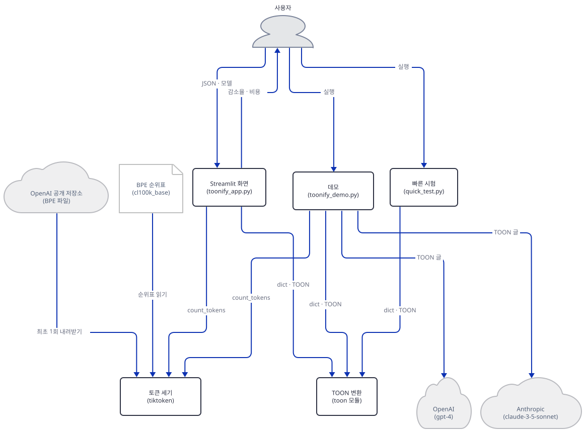

## 사전 준비

| 서비스/도구 | 용도 | 발급·설치 |
|---|---|---|
| uv | 가상환경 생성과 패키지 설치 | [공통 사전 준비](../README.md#공통-사전-준비-한-번만) 절 참고 |
| Python | 이 문서는 3.13.3으로 확인했다. `toonify` 1.6.0은 3.8 이상을 요구한다 | 공통 사전 준비와 같음 |
| 인터넷(한 번만) | Step 2에서 `tiktoken`의 `cl100k_base` 인코딩 파일 1,681,126바이트를 받는다 | Step 2 |
| OpenAI·Anthropic API 키 | 진짜로 쓸 때 데모의 두 호출이 부른다(`toonify_demo.py:157-158`). 이 문서의 실습은 `fake-`로 시작하는 가짜 값만 쓴다 | https://platform.openai.com/api-keys , https://console.anthropic.com/ |
| 브라우저 | 필요 없다. 화면은 Streamlit의 `AppTest`로 확인한다 | 없음 |

⚠ **모델.** 데모는 `gpt-4`(`toonify_demo.py:172`)와 `claude-3-5-sonnet-20241022`(203행)를 부르고, 화면의 선택 상자는 `gpt-4`·`gpt-4-turbo`·`gpt-3.5-turbo`·`claude-3-opus`·`claude-3-sonnet`을 가격표 열쇠로 씁니다(`toonify_app.py:26-32`, 55~59행). OpenAI 폐기 문서(https://developers.openai.com/api/docs/deprecations, 2026-10-19 확인)의 2026-04-22 항목에 `gpt-4-0613 | gpt-4, gpt-4-0613-completions, gpt-4-completions`와 `gpt-4-turbo | gpt-4-turbo-2024-04-09, gpt-4-turbo-completions`, `gpt-3.5-turbo-0125 | gpt-3.5-turbo, gpt-3.5-turbo-completions` 행이 있고 셋 모두 종료일이 2026-10-23, 대체 모델은 앞의 둘이 `gpt-5.6-sol`, 마지막이 `gpt-5.6-terra`입니다. 같은 날 확인한 `gpt-4`·`gpt-4-turbo`·`gpt-3.5-turbo` 모델 페이지는 종료일을 적지 않고 `gpt-4-turbo`와 `gpt-3.5-turbo`에 대해 더 새 모델(`gpt-4o`, `gpt-4o-mini`)을 권합니다. 별칭 `gpt-4`가 그 날 이후 어떻게 되는지는 두 문서가 말하지 않아 확인하지 못했습니다. Anthropic의 모델 폐기 문서(https://platform.claude.com/docs/en/about-claude/model-deprecations, 같은 날)에서 `claude-3-5-sonnet-20241022`는 2025-10-28 종료(대체 `claude-sonnet-5-5`), 가격표의 `claude-3-opus`가 가리키는 `claude-3-opus-20240229`는 2026-01-05 종료(대체 `claude-opus-4-8`), `claude-3-sonnet-20240229`는 2025-07-21 종료(대체 `claude-sonnet-5-5`)이고, 문서는 "Requests to retired models will fail."이라고 적습니다. 그러니 진짜 키로 데모를 돌리면 Claude 쪽은 이미 실패할 것이고(코드의 `except`가 `❌ Anthropic Error`를 찍는 자리입니다, 223~224행. 실행해 보지는 못했습니다) 2026-10-23 이후에는 GPT-4 쪽도 같을 수 있습니다. 교체할 자리는 문제 해결 표에 적었습니다.

이 문서의 스크립트는 한글을 출력합니다. 출력을 파이프나 파일로 받는 한국어 Windows에서는 먼저 인코딩을 맞춥니다. Step 3의 변수 블록에 같은 줄이 들어 있어 거기서 한꺼번에 겁니다.

## 아키텍처 한눈에 보기

| 컴포넌트 | 역할 | 코드 위치 |
|---|---|---|
| 화면: 사이드바 | 모델·구분자·키 접기 선택 | `advanced_llm_apps/llm_optimization_tools/toonify_token_optimization/toonify_app.py:52-85` |
| 화면: 비교 탭 | 예시 넷 가운데 하나를 JSON과 TOON으로 바꿔 크기·토큰·비용을 보인다 | `advanced_llm_apps/llm_optimization_tools/toonify_token_optimization/toonify_app.py:90-203` |
| 화면: 내 데이터 탭 | 붙여 넣은 JSON을 바꾸고 되돌려 읽어 같은지 본다 | `advanced_llm_apps/llm_optimization_tools/toonify_token_optimization/toonify_app.py:205-262` |
| 화면: 벤치마크 탭 | 글자로 박힌 숫자 여섯과 안내 | `advanced_llm_apps/llm_optimization_tools/toonify_token_optimization/toonify_app.py:264-307` |
| 토큰 세기·가격 | `tiktoken`으로 센 토큰 수와 가격표 곱하기 | `advanced_llm_apps/llm_optimization_tools/toonify_token_optimization/toonify_app.py:13-33` |
| 데모 | 비교, 두 모델 호출, 고급 옵션 | `advanced_llm_apps/llm_optimization_tools/toonify_token_optimization/toonify_demo.py:24-306` |
| 빠른 시험 | 설치가 되었는지 바이트 수로 확인 | `advanced_llm_apps/llm_optimization_tools/toonify_token_optimization/quick_test.py:10-60` |
| TOON 변환 (`toon` 모듈) | `encode`·`decode` | 코드 없음 (설치된 패키지 `toonify` 1.6.0, Step 1) |
| 토큰 세기 (`tiktoken`) | 인코딩 이름으로 글을 토큰으로 자른다 | 코드 없음 (설치된 패키지 0.14.0) |
| BPE 순위표 | `cl100k_base` 파일, 캐시 폴더에 둔다 | 코드 없음 (Step 2) |
| OpenAI 공개 저장소 | 캐시에 없을 때 BPE 파일을 주는 곳 | 코드 없음 (외부, Step 2) |
| OpenAI·Anthropic | 데모가 부르는 모델 | `advanced_llm_apps/llm_optimization_tools/toonify_token_optimization/toonify_demo.py:163`, `200` |

## 단계별 진행

### Step 1. 환경 만들기 — `toonify`와 `toon`

**목적.** 앱 파일을 작업 폴더로 복사해 독립 가상환경에 설치하고, 무엇이 설치되는지, 패키지 이름과 불러오는 이름이 어떻게 다른지 확인합니다.

**할 일.** 저장소 루트에서 시작합니다. 원본 폴더에서 돌리면 `__pycache__`가 생기니 복사본으로만 작업합니다.

```bash
mkdir -p ../toonify-lab
cp advanced_llm_apps/llm_optimization_tools/toonify_token_optimization/{toonify_app.py,toonify_demo.py,quick_test.py,requirements.txt} ../toonify-lab/
cd ../toonify-lab
uv venv --python 3.13
uv pip install -r requirements.txt
```

```powershell
New-Item -ItemType Directory -Force ..\toonify-lab
Copy-Item advanced_llm_apps\llm_optimization_tools\toonify_token_optimization\toonify_app.py, advanced_llm_apps\llm_optimization_tools\toonify_token_optimization\toonify_demo.py, advanced_llm_apps\llm_optimization_tools\toonify_token_optimization\quick_test.py, advanced_llm_apps\llm_optimization_tools\toonify_token_optimization\requirements.txt ..\toonify-lab\
Set-Location ..\toonify-lab
uv venv --python 3.13
uv pip install -r requirements.txt
```

(PowerShell 줄은 실행해 보지 못했습니다. pip 대안은 `python -m venv .venv`로 만들고 활성화한 뒤 `pip install -r requirements.txt`입니다.) 이후 모든 명령은 `toonify-lab` 폴더에서 `uv run --no-project`로 돌립니다. 이유는 공통 사전 준비에 있습니다.

`advanced_llm_apps/llm_optimization_tools/toonify_token_optimization/requirements.txt:1-6`

```text
toonify>=1.4.0
openai>=1.0.0
anthropic>=0.40.0
streamlit>=1.28.0
pandas>=2.0.0
tiktoken>=0.5.0
```

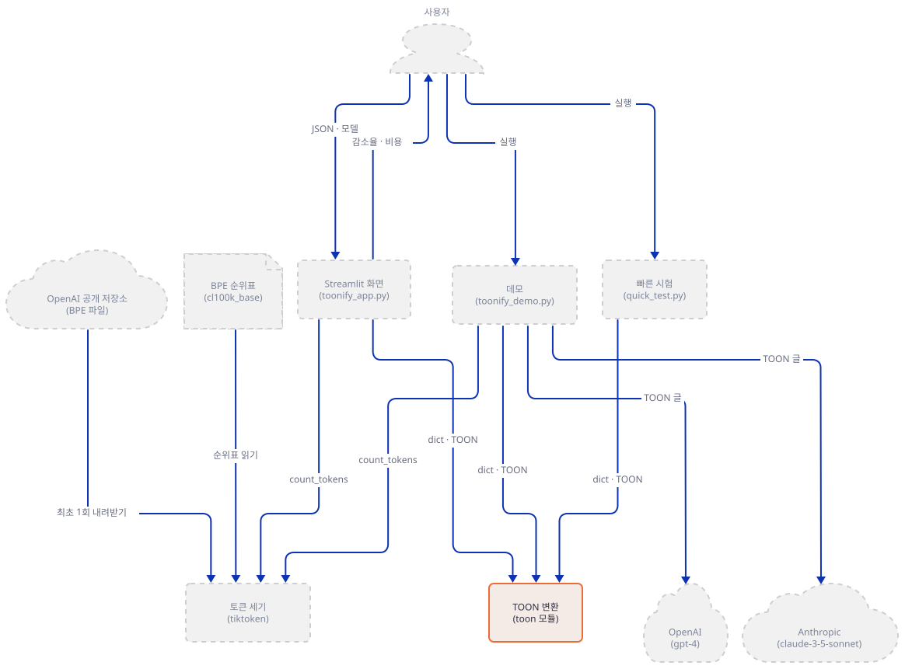

**확인.** 아래를 `toonify-lab/versions.py`로 저장하고 돌립니다.

```python
import importlib.metadata as m
import importlib.util as u

for name in ["toonify", "tiktoken", "openai", "anthropic", "streamlit", "pandas"]:
    print(f"{name:10s}", m.version(name))
print("toonify files:", sorted(str(f) for f in m.files("toonify") if f.suffix == ".py"))
import toon

print("import toon ->", toon.__file__.split("site-packages")[-1], "| toon.__version__ =", toon.__version__)
print("import toonify ->", "있음" if u.find_spec("toonify") else "없음")
print("toon_format ->", "있음" if u.find_spec("toon_format") else "없음")
```

```bash
uv run --no-project python versions.py
```

기대 출력(오늘 기준, 직접 확인)입니다.

```text
toonify    1.6.0
tiktoken   0.14.0
openai     3.35.1
anthropic  1.15.0
streamlit  1.66.0
pandas     3.0.6
toonify files: ['toon/__init__.py', 'toon/cli.py', 'toon/constants.py', 'toon/decoder.py', 'toon/encoder.py', 'toon/kaggle.py', 'toon/pydantic_converter.py', 'toon/structure_generator.py', 'toon/utils.py']
import toon -> \toon\__init__.py | toon.__version__ = 1.0.0
import toonify -> 없음
toon_format -> 없음
```

51개가 설치됩니다(직접 확인). 읽을 것이 다섯입니다. 첫째, `toonify`는 `tiktoken`만 끌어옵니다(패키지 메타데이터 `Requires-Dist`로 확인). 둘째, 이 패키지는 `toon`이라는 폴더를 설치하고 `import toonify`는 실패합니다. 앱 코드는 올바르게 `from toon import encode, decode`(`toonify_app.py:8`)를 쓰지만 앱 README의 예시(94행)는 `from toonify import encode`라서 그대로 따라 하면 `ModuleNotFoundError: No module named 'toonify'`가 납니다(직접 확인). 셋째, `toon.__version__`은 `1.0.0`을 말하지만 설치된 것은 1.6.0입니다(`toon/__init__.py`가 그 문자열을 적어 둔 것을 소스로 확인). 버전은 `importlib.metadata`로 봐야 합니다. 넷째, 이름이 겹치는 다른 패키지가 있습니다. PyPI의 `toon`(https://pypi.org/pypi/toon/json, 2026-10-19 확인)은 0.15.9판의 설명이 "Tools for neuroscience experiments"인 별개의 패키지이고 같은 `toon` 모듈 이름을 줍니다. `pip install toon`은 이 앱에 필요한 것이 아닙니다. TOON 형식의 공식 파이썬 구현은 `toon-format`(1.2.0)이고 그쪽 모듈 이름은 `toon_format`입니다(같은 날 PyPI 설명으로 확인. 설치해 보지는 않았습니다). 다섯째, `toonify` 1.6.0은 PyPI에 2026-02-06에 올라왔고 MIT 라이선스이며 저장소는 `https://github.com/ScrapeGraphAI/toonify`입니다(PyPI와 패키지 메타데이터로 확인). 패키지는 `toon`이라는 명령도 함께 설치합니다(`entry_points.txt`).

### Step 2. 인코딩 파일 내려받기 — 이 문서에서 바깥으로 나가는 유일한 단계

**목적.** `tiktoken`이 토큰을 세는 데 쓰는 BPE 순위표를 한 번 받아 작업 폴더 안에 둡니다. 이 단계가 지나면 이 문서의 모든 실행은 오프라인입니다.

**할 일.** `tiktoken`은 인코딩을 처음 쓸 때 파일을 내려받습니다. `cl100k_base`의 주소와 기대 해시가 소스에 있습니다(`tiktoken_ext/openai_public.py`의 75~78행: 주소 `https://openaipublic.blob.core.windows.net/encodings/cl100k_base.tiktoken`, `expected_hash`는 sha256). 받는 일은 `requests.get`이고(`tiktoken`의 `load.py` 17행) 받은 내용의 해시가 다르면 `ValueError`로 멈춥니다(67~71행). 저장 위치는 환경변수 `TIKTOKEN_CACHE_DIR`이고 없으면 임시 폴더의 `data-gym-cache`입니다(37~48행). 캐시 파일 이름은 주소의 sha1입니다. 이미 있는 캐시 파일의 해시가 다르면 `tiktoken`은 그 파일을 지우고 **다시 내려받습니다**(54~64행). 변수 값이 빈 문자열이면 캐시를 끄고 매번 내려받습니다(13~15행). 이것이 다음 Step에서 가드가 캐시 해시를 직접 보고 빈 값을 거부하는 까닭입니다. 이 앱이 쓰는 인코딩은 `cl100k_base` 하나입니다(Step 5). 아래를 `toonify-lab/fetch_encoding.py`로 저장합니다.

```python
"""One-time download of the cl100k_base encoding file. This is the only step that goes outside.
After this, every other script in this lab runs offline (guard.py enforces it)."""
import hashlib
import os
from pathlib import Path

cache = Path(__file__).resolve().parent / "tiktoken_cache"
os.environ["TIKTOKEN_CACHE_DIR"] = str(cache)

import tiktoken

URL = "https://openaipublic.blob.core.windows.net/encodings/cl100k_base.tiktoken"
SHA256 = "223921b76ee99bde995b7ff738513eef100fb51d18c93597a113bcffe865b2a7"  # tiktoken_ext/openai_public.py

enc = tiktoken.get_encoding("cl100k_base")  # downloads on first use; tiktoken checks the hash
path = cache / hashlib.sha1(URL.encode()).hexdigest()
data = path.read_bytes()
assert hashlib.sha256(data).hexdigest() == SHA256
print("cache file:", path.name, len(data), "bytes")
print("sha256 ok; tokens in 'hello world':", len(enc.encode("hello world")))
```

```bash
uv run --no-project python fetch_encoding.py
```

회사 프록시가 있는 환경이면 `requests`가 프록시 환경변수를 따르므로 평소 쓰던 설정 그대로 두면 됩니다. 이 줄이 이 문서에서 인터넷에 닿는 유일한 줄입니다.

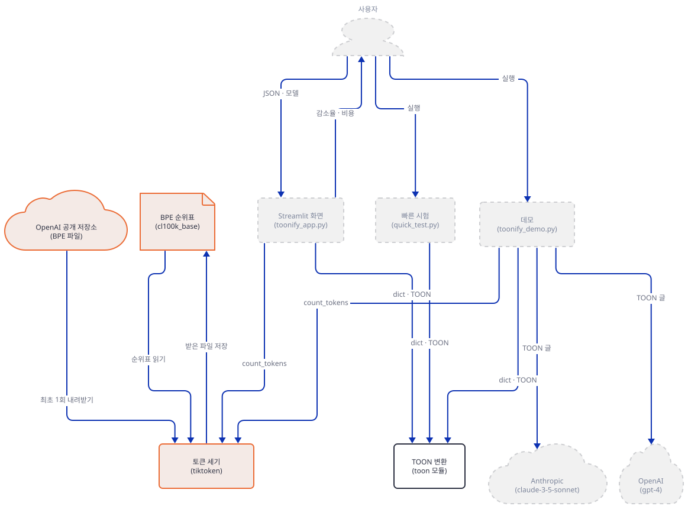

**확인.** 기대 출력(직접 확인)입니다. 처음 받을 때 내려받기가 끝나는 데 몇 초가 걸립니다.

```text
cache file: 9b5ad71b2ce5302211f9c61530b329a4922fc6a4 1681126 bytes
sha256 ok; tokens in 'hello world': 2
```

파일은 `toonify-lab/tiktoken_cache/` 아래 해시 이름 하나(1,681,126바이트)입니다. 스크립트가 `sha256`을 소스의 값과 직접 비교한 결과(`assert`)입니다. 다시 돌리면 캐시를 읽으므로 같은 출력이 나오고 요청이 나가지 않습니다(내가 새 폴더에서 받은 파일을 복사해 두고 이 스크립트를 돌렸을 때 감시 프록시에 요청이 0건이었습니다).

### Step 3. 가짜 서버와 가드 — 줄 하나를 빠뜨려도 바깥으로 나가지 않게

**목적.** 데모의 모델 호출을 `127.0.0.1`의 가짜 서버로만 가게 하고, 어떤 변수가 빠져도 가드가 먼저 멈추게 합니다.

**할 일.** 데모는 키가 환경변수에 있으면 곧바로 호출합니다. 두 클라이언트 모두 주소 인자 없이 키만 줍니다.

`advanced_llm_apps/llm_optimization_tools/toonify_token_optimization/toonify_demo.py:157-163`

```python
    openai_key = os.getenv("OPENAI_API_KEY")
    anthropic_key = os.getenv("ANTHROPIC_API_KEY")
    
    if openai_key:
        try:
            print("\n🔵 Testing with OpenAI GPT-4...")
            client = OpenAI(api_key=openai_key)
```

`advanced_llm_apps/llm_optimization_tools/toonify_token_optimization/toonify_demo.py:197-200`

```python
    if anthropic_key:
        try:
            print("\n🟣 Testing with Anthropic Claude...")
            client = Anthropic(api_key=anthropic_key)
```

그러니 셸에 진짜 `OPENAI_API_KEY`가 있는 독자가 원본 데모를 그대로 돌리면 `api.openai.com`으로 요청이 나가는 구조입니다(소스로 확인. 실행하지 않았습니다). 이 문서는 원본을 그대로 돌리지 않고 가드를 거칩니다. 두 SDK가 주소를 환경변수에서 읽는지는 가짜 서버에 요청이 도착하는 것으로 직접 확인했습니다(`OPENAI_BASE_URL`, `ANTHROPIC_BASE_URL`). 프록시 변수가 있는 환경은 따로 봐야 합니다. 내가 `HTTP_PROXY`·`HTTPS_PROXY`·`ALL_PROXY`를 요청을 기록만 하는 프록시로 두고 `NO_PROXY=127.0.0.1,localhost`를 함께 걸었을 때 가짜 서버가 두 요청을 받았고 프록시에는 0건이었습니다. `NO_PROXY`가 없을 때 localhost 요청이 프록시로 나가는지는 실행해 보지 않았습니다. 가드는 그것을 묻지 않고 멈춥니다.

먼저 가드를 `toonify-lab/guard.py`로 저장합니다. 가드는 모델 주소 둘이 루프백인지, `NO_PROXY`에 루프백이 있는지, 키가 `fake-`로 시작하는지, 인코딩 캐시 파일이 있고 해시가 맞는지를 봅니다. `install_offline()`은 `tiktoken`의 파일 읽기 함수를 바꿔서, 캐시를 지나 내려받기까지 가려는 시도가 있으면 `RuntimeError`로 끝냅니다.

```python
"""Run before anything that can reach a model or the network:  python guard.py  (or: from guard import check; check()).
Exits with code 1 unless
  - both model addresses are loopback http addresses,
  - NO_PROXY / no_proxy lists a loopback host (otherwise a proxy variable would send even localhost traffic out),
  - both API keys are the fake values from this document,
  - the cl100k_base file is already in TIKTOKEN_CACHE_DIR with the hash tiktoken expects.
install_offline() then makes tiktoken refuse any download."""
import hashlib
import os
import sys
from pathlib import Path
from urllib.parse import urlparse

URL = "https://openaipublic.blob.core.windows.net/encodings/cl100k_base.tiktoken"
SHA256 = "223921b76ee99bde995b7ff738513eef100fb51d18c93597a113bcffe865b2a7"


def loopback(url):
    u = urlparse(url)
    return u.scheme == "http" and u.hostname in ("127.0.0.1", "localhost")


def check():
    for name in ("OPENAI_BASE_URL", "ANTHROPIC_BASE_URL"):
        if not loopback(os.environ.get(name, "")):
            sys.exit(f"{name} is not a loopback http address: {os.environ.get(name)!r}")
    no_proxy = os.environ.get("NO_PROXY", "") + "," + os.environ.get("no_proxy", "")
    if not any(h in no_proxy.replace(" ", "").split(",") for h in ("127.0.0.1", "localhost")):
        sys.exit("NO_PROXY/no_proxy does not list 127.0.0.1: a proxy variable could carry even localhost traffic out")
    for name in ("OPENAI_API_KEY", "ANTHROPIC_API_KEY"):
        if not os.environ.get(name, "").startswith("fake-"):
            sys.exit(f"{name} is not a fake- value: do not put a real key into this lab")
    cache = os.environ.get("TIKTOKEN_CACHE_DIR")
    if not cache:
        sys.exit("TIKTOKEN_CACHE_DIR is not set (Step 2)")
    path = Path(cache) / hashlib.sha1(URL.encode()).hexdigest()
    if not path.is_file() or hashlib.sha256(path.read_bytes()).hexdigest() != SHA256:
        sys.exit("the cl100k_base cache file is missing or wrong: run fetch_encoding.py once (Step 2)")


def install_offline():
    """After this, tiktoken cannot download: a cache miss raises instead of fetching."""
    import tiktoken.load

    real = tiktoken.load.read_file

    def offline_read_file(blobpath):
        if blobpath.startswith(("http://", "https://")):
            raise RuntimeError(f"offline: tiktoken wanted to download {blobpath}")
        return real(blobpath)

    tiktoken.load.read_file = offline_read_file


if __name__ == "__main__":
    check()
    print("guard ok")
```

가짜 서버를 `toonify-lab/fake_llm.py`로 저장합니다. `POST /v1/chat/completions`와 `POST /v1/messages`에 정해진 문장으로 답하고, 요청마다 한 줄을 `llm.log`에 적습니다. 응답의 토큰 수는 모델 제공자의 숫자가 아니라 이 서버가 `cl100k_base`로 센 글자입니다. 서버도 시작할 때 같은 가드를 지납니다. 포트는 49152~65535의 임의 번호(여기서는 57314)이고 `allow_reuse_address = False`입니다. Windows에서는 재사용 옵션이 켜져 있으면 다른 프로세스의 포트에 오류 없이 겹쳐 뜰 수 있습니다.

```python
"""Loopback stand-in for the OpenAI and Anthropic APIs. usage: python fake_llm.py PORT LOG
Answers POST /v1/chat/completions and POST /v1/messages with a fixed sentence. The token counts in "usage" are
NOT the providers' numbers: they are cl100k_base counts of the request text, computed here."""
import json
import sys
import threading
from http.server import BaseHTTPRequestHandler, ThreadingHTTPServer

from guard import check, install_offline

check()
install_offline()
import tiktoken

ENC = tiktoken.get_encoding("cl100k_base")
PORT, LOG = int(sys.argv[1]), sys.argv[2]
LOCK = threading.Lock()


def log(rec):
    with LOCK, open(LOG, "a", encoding="utf-8") as f:
        f.write(json.dumps(rec, ensure_ascii=False) + "\n")


class Handler(BaseHTTPRequestHandler):
    protocol_version = "HTTP/1.1"

    def log_message(self, *a):
        pass

    def _send(self, code, obj):
        data = json.dumps(obj).encode()
        self.send_response(code)
        self.send_header("content-type", "application/json")
        self.send_header("content-length", str(len(data)))
        self.end_headers()
        self.wfile.write(data)

    def do_POST(self):
        body = json.loads(self.rfile.read(int(self.headers["content-length"])))
        text = "".join(m["content"] for m in body["messages"])
        n_in = len(ENC.encode(text))
        key = (self.headers.get("authorization") or self.headers.get("x-api-key") or "")
        log({"path": self.path, "model": body.get("model"), "max_tokens": body.get("max_tokens"),
             "key_head": key[:12], "prompt_chars": len(text), "prompt_tokens_cl100k": n_in})
        if self.path.endswith("/chat/completions"):
            self._send(200, {"id": "c1", "object": "chat.completion", "created": 0, "model": body["model"],
                             "choices": [{"index": 0, "finish_reason": "stop",
                                          "message": {"role": "assistant", "content": "FAKE GPT ANSWER"}}],
                             "usage": {"prompt_tokens": n_in, "completion_tokens": 3, "total_tokens": n_in + 3}})
        elif self.path.endswith("/messages"):
            self._send(200, {"id": "m1", "type": "message", "role": "assistant", "model": body["model"],
                             "content": [{"type": "text", "text": "FAKE CLAUDE ANSWER"}],
                             "stop_reason": "end_turn", "stop_sequence": None,
                             "usage": {"input_tokens": n_in, "output_tokens": 3}})
        else:
            self._send(404, {"error": "unknown path"})


class Server(ThreadingHTTPServer):
    allow_reuse_address = False
    daemon_threads = True


Server(("127.0.0.1", PORT), Handler).serve_forever()
```

데모를 가드 뒤에서 돌리는 스크립트 `toonify-lab/run_demo.py`입니다. 원본 파일을 고치지 않고 `runpy`로 그대로 실행합니다.

```python
"""Run the unchanged toonify_demo.py behind the guard, with tiktoken offline."""
import runpy

import guard

guard.check()
guard.install_offline()
runpy.run_path("toonify_demo.py", run_name="__main__")
```

터미널 둘을 씁니다. **터미널 A**와 **터미널 B** 모두 `toonify-lab` 폴더에서 아래 변수 블록을 먼저 겁니다. 터미널마다 따로 거는 것이 핵심입니다. 환경변수는 그 터미널에만 있습니다. 블록은 셸에 진짜 키가 있어도 `fake-` 값으로 덮어씁니다.

```bash
export PYTHONIOENCODING=utf-8
export STREAMLIT_BROWSER_GATHER_USAGE_STATS=false
export TIKTOKEN_CACHE_DIR="$PWD/tiktoken_cache"
export NO_PROXY=127.0.0.1,localhost
export OPENAI_API_KEY=fake-openai-key
export ANTHROPIC_API_KEY=fake-anthropic-key
export OPENAI_BASE_URL=http://127.0.0.1:57314/v1
export ANTHROPIC_BASE_URL=http://127.0.0.1:57314
```

```powershell
$env:PYTHONIOENCODING = "utf-8"
$env:STREAMLIT_BROWSER_GATHER_USAGE_STATS = "false"
$env:TIKTOKEN_CACHE_DIR = "$PWD\tiktoken_cache"
$env:NO_PROXY = "127.0.0.1,localhost"
$env:OPENAI_API_KEY = "fake-openai-key"
$env:ANTHROPIC_API_KEY = "fake-anthropic-key"
$env:OPENAI_BASE_URL = "http://127.0.0.1:57314/v1"
$env:ANTHROPIC_BASE_URL = "http://127.0.0.1:57314"
```

(PowerShell 형태는 실행해 보지 못했습니다. 이 변수들은 그 터미널에 남으므로 끝나면 터미널을 닫습니다. 값을 `""`로 대입하면 PowerShell에서는 변수가 지워지니 키는 위처럼 가짜 값을 넣습니다. 이 앱은 `.env`를 읽지 않습니다. 세 파일에 `dotenv`가 없고 `grep`으로 확인했습니다.) 이 문서의 모든 터미널에서 이 블록을 먼저 겁니다. 터미널 A에서 서버를 띄웁니다. 이 터미널에서는 다른 일을 하지 않습니다.

```bash
uv run --no-project python fake_llm.py 57314 llm.log
```

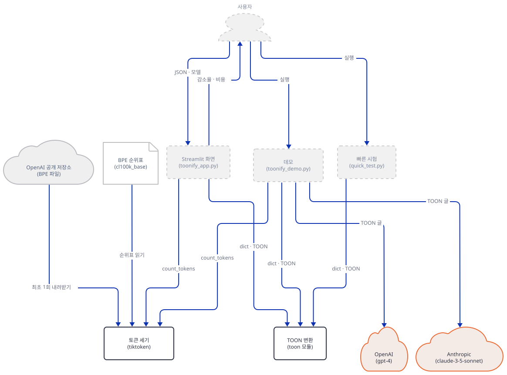

**확인.** 터미널 B에서 가드를 돌립니다. 기대 출력은 한 줄입니다(직접 확인).

```bash
uv run --no-project python guard.py
```

```text
guard ok
```

가드가 정말 멈추는지 네 가지를 일부러 어겨 봅니다. 각 줄은 그 명령 하나에만 값을 바꿉니다. 종료 코드는 모두 1이고 메시지는 아래와 같았습니다(직접 확인).

```bash
OPENAI_BASE_URL=https://api.openai.com/v1 uv run --no-project python guard.py
env -u NO_PROXY -u no_proxy uv run --no-project python guard.py
OPENAI_API_KEY=sk-proj-example uv run --no-project python guard.py
TIKTOKEN_CACHE_DIR="$PWD/nocache" uv run --no-project python guard.py
```

```text
OPENAI_BASE_URL is not a loopback http address: 'https://api.openai.com/v1'
NO_PROXY/no_proxy does not list 127.0.0.1: a proxy variable could carry even localhost traffic out
OPENAI_API_KEY is not a fake- value: do not put a real key into this lab
the cl100k_base cache file is missing or wrong: run fetch_encoding.py once (Step 2)
```

캐시 가드를 일부러 건너뛴 경우도 봤습니다. 빈 캐시 폴더에서 `install_offline()`만 부르고 인코딩을 얻으려 하면 `RuntimeError: offline: tiktoken wanted to download https://openaipublic.blob.core.windows.net/encodings/cl100k_base.tiktoken`으로 끝나고 폴더에는 아무 파일도 생기지 않았습니다(직접 확인). 그래서 Step 2를 빠뜨려도 이 문서의 명령은 몰래 내려받지 않고 멈춥니다.

### Step 4. TOON 글 보기 — 빠른 시험과 데모의 비교

**목적.** TOON 글이 어떻게 생겼는지 데모가 찍는 출력으로 읽고, 앱이 말하는 절약이 이 데이터에서 얼마인지 봅니다.

**할 일.** `quick_test.py`는 토큰 없이 바이트 수만 비교합니다. 터미널 B에서 돌립니다.

```bash
uv run --no-project python quick_test.py
```

이어서 데모를 가드 뒤에서 통째로 돌려 출력을 파일에 받습니다. 두 모델 호출은 가짜 서버(터미널 A)로 갑니다. 이 Step은 앞쪽 비교 구간만 읽고, 모델 호출 구간은 Step 7이 봅니다.

```bash
uv run --no-project python run_demo.py > demo.out
grep -n "Size:\|Tokens:\|Reduction\|Roundtrip" demo.out
```

```powershell
uv run --no-project python run_demo.py | Out-File -Encoding utf8 demo.out
Select-String -Path demo.out -Pattern "Size:|Tokens:|Reduction|Roundtrip"
```

(PowerShell 형태는 실행해 보지 못했습니다. PowerShell 5.1의 `>`는 UTF-16으로 저장하기 때문에 `Out-File -Encoding utf8`을 씁니다.)

데모의 비교 구간은 제품 다섯 개 표를 `json.dumps(…, indent=2)`와 `encode(…)`로 바꿔 크기와 토큰을 잽니다.

`advanced_llm_apps/llm_optimization_tools/toonify_token_optimization/toonify_demo.py:77-85`

```python
    # Convert to JSON
    json_str = json.dumps(products_data, indent=2)
    json_size = len(json_str.encode('utf-8'))
    json_tokens = count_tokens(json_str)
    
    # Convert to TOON
    toon_str = encode(products_data)
    toon_size = len(toon_str.encode('utf-8'))
    toon_tokens = count_tokens(toon_str)
```

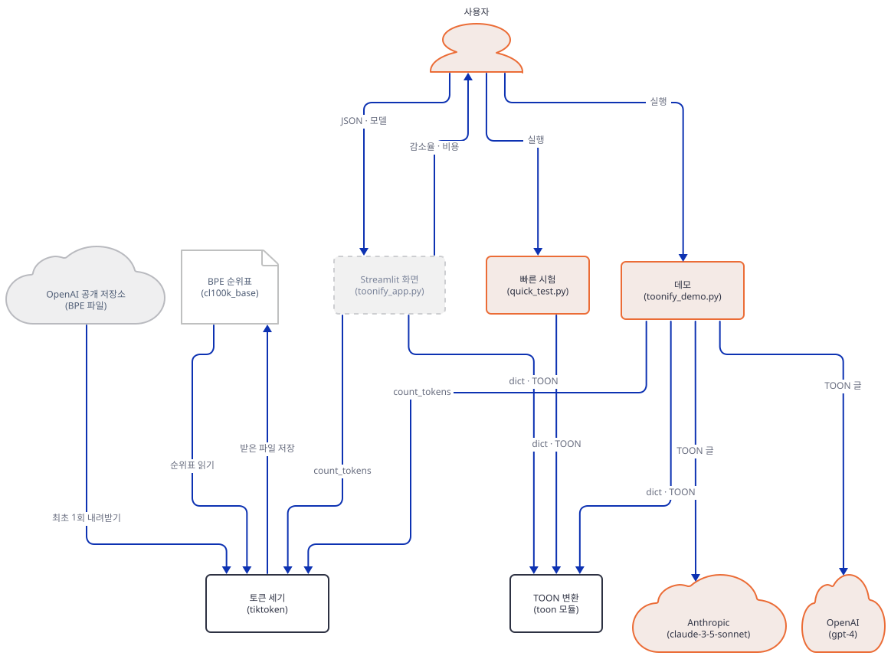

**확인.** `quick_test.py`의 끝은 아래와 같습니다. 이 숫자는 토큰이 아니라 바이트이고, JSON은 들여쓰기 2칸입니다(직접 확인). 다섯 줄 표는 474바이트에서 125바이트로 73.6% 줄어듭니다.

```text
🎯 TOON (125 bytes):
products[5]{id,name,price,stock}:
  1,Laptop,1299,45
  2,Mouse,79,120
  3,Keyboard,89,85
  4,Monitor,399,32
  5,Webcam,129,67

💰 Size Reduction: 73.6%
   Saved: 349 bytes

✅ Roundtrip verification: PASSED
```

`grep`의 출력은 아래입니다(직접 확인).

```text
54:Size: 801 bytes
55:Tokens: 275
67:Size: 278 bytes
68:Tokens: 120
74:Size Reduction: 65.3%
75:Token Reduction: 56.4%
88:✅ Roundtrip verification: PASSED
```

TOON 글을 읽는 법은 첫 줄에 다 있습니다. `products[5]{id,name,category,price,stock,rating}:`는 배열 이름, 항목 수 5, 열 이름 여섯입니다. 그 아래 줄마다 들여쓰기 2칸에 값만 쉼표로 이어 적습니다. 열 이름이 행마다 반복되지 않고 중괄호·따옴표가 없어서 짧아집니다. 앱의 머리말과 데모의 머리 주석이 말하는 "30-60%"(`toonify_app.py:45`, `toonify_demo.py:3`)에 이 한 표는 56.4%로 들어갑니다. 다음 Step이 이 숫자가 무엇과 비교한 것인지 따져 봅니다. 데모 앞부분의 코드 순서는 그림이 보여 줍니다. 메시지가 길어 다섯 장으로 나누었고 이 장이 첫째입니다.

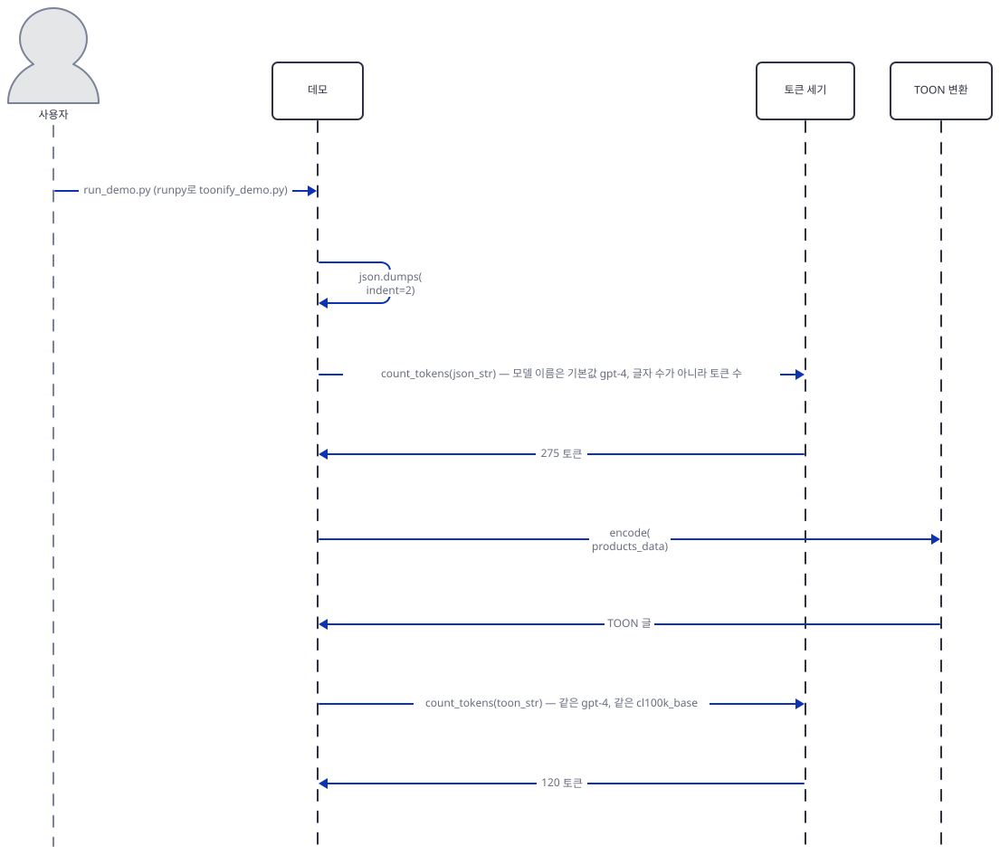

### Step 5. 토큰을 직접 재기 — 기준을 바꾸면 숫자가 바뀐다

**목적.** 앱이 토큰을 어떻게 세는지 읽고, 같은 데이터를 두 가지 JSON 기준과 비교해 절약이 얼마인지 직접 잽니다.

**할 일.** 앱과 데모는 같은 `count_tokens`를 각자 갖고 있습니다. 모델 이름으로 인코딩을 찾고 `KeyError`가 나면 `cl100k_base`로 떨어집니다.

`advanced_llm_apps/llm_optimization_tools/toonify_token_optimization/toonify_app.py:13-21`

```python
def count_tokens(text: str, model: str = "gpt-4") -> int:
    """Count tokens in text."""
    try:
        encoding = tiktoken.encoding_for_model(model)
    except KeyError:
        # tiktoken can't map non-OpenAI model names (e.g. claude-3-*); fall back
        # to the modern OpenAI encoding so the token count still renders.
        encoding = tiktoken.get_encoding("cl100k_base")
    return len(encoding.encode(text))
```

`tiktoken`의 모델 지도(`tiktoken/model.py`)에서 `gpt-4`와 `gpt-3.5-turbo`는 이름이 정확히 맞고(38~39행) `gpt-4-turbo`는 `gpt-4-` 앞붙임으로 `cl100k_base`가 됩니다(17행). `claude-`로 시작하는 이름은 지도에 없어 `KeyError`(103행)가 나고 앱이 그것을 받아 같은 `cl100k_base`를 씁니다(소스로 확인. 앱의 선택 상자 다섯으로 직접 확인한 것이 아래 첫째 표입니다). 가격은 따로 곱합니다.

`advanced_llm_apps/llm_optimization_tools/toonify_token_optimization/toonify_app.py:24-33`

```python
def calculate_cost(tokens: int, model: str = "gpt-4") -> float:
    """Calculate API cost based on token count."""
    pricing = {
        "gpt-4": 0.03 / 1000,  # $0.03 per 1K tokens
        "gpt-4-turbo": 0.01 / 1000,
        "gpt-3.5-turbo": 0.0015 / 1000,
        "claude-3-opus": 0.015 / 1000,
        "claude-3-sonnet": 0.003 / 1000,
    }
    return tokens * pricing.get(model, 0.03 / 1000)
```

아래를 `toonify-lab/measure.py`로 저장합니다. 앱의 `count_tokens`와 `calculate_cost`를 그대로 불러 쓰고, 네 예시 데이터는 앱의 106~135행을 옮겨 둔 것입니다(앱 화면의 바이트·토큰과 같은 숫자가 나오는 것으로 확인합니다).

```python
"""Measure JSON (indent=2 and compact) against TOON on the app's own example data, with the app's own count_tokens."""
import json

import guard

guard.check()
guard.install_offline()
from toon import encode
from toonify_app import calculate_cost, count_tokens

# toonify_app.py:106-135, copied unchanged
EXAMPLES = {
    "E-commerce Products": {"products": [
        {"id": 1, "name": "Laptop Pro", "price": 1299, "stock": 45, "rating": 4.5},
        {"id": 2, "name": "Magic Mouse", "price": 79, "stock": 120, "rating": 4.2},
        {"id": 3, "name": "USB-C Cable", "price": 19, "stock": 350, "rating": 4.8},
        {"id": 4, "name": "Keyboard", "price": 89, "stock": 85, "rating": 4.6},
        {"id": 5, "name": "Monitor Stand", "price": 45, "stock": 60, "rating": 4.3}]},
    "Customer Orders": {"orders": [
        {"order_id": "ORD001", "customer": "Alice", "total": 299.99, "status": "shipped"},
        {"order_id": "ORD002", "customer": "Bob", "total": 149.50, "status": "processing"},
        {"order_id": "ORD003", "customer": "Charlie", "total": 449.99, "status": "delivered"}]},
    "Survey Responses": {"responses": [
        {"id": 1, "age": 25, "satisfaction": 4, "recommend": True, "comment": "Great service!"},
        {"id": 2, "age": 34, "satisfaction": 5, "recommend": True, "comment": "Excellent!"},
        {"id": 3, "age": 42, "satisfaction": 3, "recommend": False, "comment": "Could be better"}]},
    "Analytics Data": {"pageviews": [
        {"page": "/home", "views": 1523, "avg_time": 45, "bounce_rate": 0.32},
        {"page": "/products", "views": 892, "avg_time": 120, "bounce_rate": 0.45},
        {"page": "/about", "views": 234, "avg_time": 60, "bounce_rate": 0.28}]},
}


def pct(a, b):
    return f"{(a - b) / a * 100:.1f}%"


print("== 1. the model name changes the price, not the count (E-commerce, JSON indent=2)")
text = json.dumps(EXAMPLES["E-commerce Products"], indent=2)
for model in ("gpt-4", "gpt-4-turbo", "gpt-3.5-turbo", "claude-3-opus", "claude-3-sonnet"):
    n = count_tokens(text, model)
    print(f"{model:16s} tokens {n}  cost ${calculate_cost(n, model):.6f}")

print("\n== 2. JSON indent=2 vs compact JSON vs TOON (gpt-4 counting; bytes/tokens)")
print(f"{'example':22s} {'indent=2':>10s} {'compact':>10s} {'TOON':>9s} {'vs indent=2':>12s} {'vs compact':>11s}")
for name, d in EXAMPLES.items():
    j2 = json.dumps(d, indent=2)
    jc = json.dumps(d, separators=(",", ":"))
    t = encode(d)
    a, b, c = count_tokens(j2), count_tokens(jc), count_tokens(t)
    print(f"{name:22s} {len(j2):4d}/{a:<5d} {len(jc):4d}/{b:<5d} {len(t):4d}/{c:<4d} {pct(a, c):>12s} {pct(b, c):>11s}")

print("\n== 3. delimiter and key folding (tokens: E-commerce / Orders / Survey / Analytics)")
for delim in ("comma", "tab", "pipe"):
    for fold in ("off", "safe"):
        row = [count_tokens(encode(d, {"delimiter": delim, "key_folding": fold})) for d in EXAMPLES.values()]
        print(f"{delim:6s} {fold:5s}", row)
```

```bash
uv run --no-project python measure.py 2>/dev/null
```

`2>/dev/null`은 앱 모듈을 불러올 때 Streamlit이 stderr에 찍는 경고를 버립니다(PowerShell은 `2>$null`). 기대 출력(직접 확인)입니다.

```text
== 1. the model name changes the price, not the count (E-commerce, JSON indent=2)
gpt-4            tokens 221  cost $0.006630
gpt-4-turbo      tokens 221  cost $0.002210
gpt-3.5-turbo    tokens 221  cost $0.000332
claude-3-opus    tokens 221  cost $0.003315
claude-3-sonnet  tokens 221  cost $0.000663

== 2. JSON indent=2 vs compact JSON vs TOON (gpt-4 counting; bytes/tokens)
example                  indent=2    compact      TOON  vs indent=2  vs compact
E-commerce Products     599/221    341/121    172/89          59.7%       26.4%
Customer Orders         375/119    241/66     136/49          58.8%       25.8%
Survey Responses        408/129    250/72     137/50          61.2%       30.6%
Analytics Data          342/119    208/66     113/52          56.3%       21.2%

== 3. delimiter and key folding (tokens: E-commerce / Orders / Survey / Analytics)
comma  off   [89, 49, 50, 52]
comma  safe  [89, 49, 50, 52]
tab    off   [90, 48, 51, 53]
tab    safe  [90, 48, 51, 53]
pipe   off   [91, 50, 54, 53]
pipe   safe  [91, 50, 54, 53]
```

**확인.** 읽을 것이 넷입니다. 첫째, 모델 다섯이 모두 221토큰입니다. 모델 이름은 가격표 열쇠일 뿐 토큰 수를 바꾸지 않고, `claude-3-opus`·`claude-3-sonnet` 줄의 221은 Claude의 토큰 수가 아니라 OpenAI `cl100k_base`로 센 값입니다. Anthropic 문서(https://platform.claude.com/docs/en/build-with-claude/token-counting, 2026-10-19 확인)는 토큰 수를 세는 전용 엔드포인트를 따로 두고 그 값을 "an **estimate**"라고 하며, Claude Opus 4.7 이후 모델의 새 토크나이저는 같은 글에 "approximately 30 percent more tokens"를 만든다고 적고, 세는 모델을 정해서 다시 세라고 권합니다. 그러므로 앱의 Claude 행은 어림이고, 실제 입력 토큰은 모델마다 다를 수 있습니다. 둘째, 기준입니다. 앱과 데모는 JSON을 `indent=2`로 찍어 비교합니다(`toonify_app.py:141`, `toonify_demo.py:78`). 이 기준에서 절약은 56.3~61.2%이고, 들여쓰기 없는 JSON(`separators=(",", ":")`)과 비교하면 21.2~30.6%입니다. 모델에 보내는 JSON이 어떤 모양인지에 따라 어느 쪽이 맞는지가 정해지니, 자기 데이터를 자기가 보내는 모양으로 재 봐야 합니다. 셋째, 구분자와 키 접기입니다. 쉼표가 세 표에서 가장 적고 Orders에서만 탭이 하나 적습니다. 파이프는 네 표 모두 쉼표와 같거나 1~4토큰 많습니다. 키 접기는 이 표들에 단일 키 사슬이 없어 아무 효과가 없습니다. 넷째, 앱의 "벤치마크" 숫자(63.9·54.1·73.4%)는 "50 real-world datasets"에서 나왔다고 하지만(`toonify_app.py:267-279`) 화면에서 계산하는 값이 아니라 글자입니다. 설치된 패키지의 `RECORD`에는 벤치마크 파일이 없어(`toon/` 아홉 파일과 `dist-info`뿐) 재현하지 못했습니다. 이 문서가 잰 것은 앱 안의 네 표뿐이고 56~61%(들여쓰기 기준)가 그 범위입니다. 참고로 패키지의 명령줄 `toon --stats`는 `o200k_base`로 셉니다(`toon` 패키지의 `cli.py` 32~44행). 같은 글도 어떤 인코딩이냐에 따라 숫자가 달라집니다. `gpt-4o`는 지도에서 `o200k_base`가 되고(`model.py` 37행) 이 앱의 선택 상자에는 없습니다. `o200k_base`는 받지 않았고 재 보지 못했습니다.

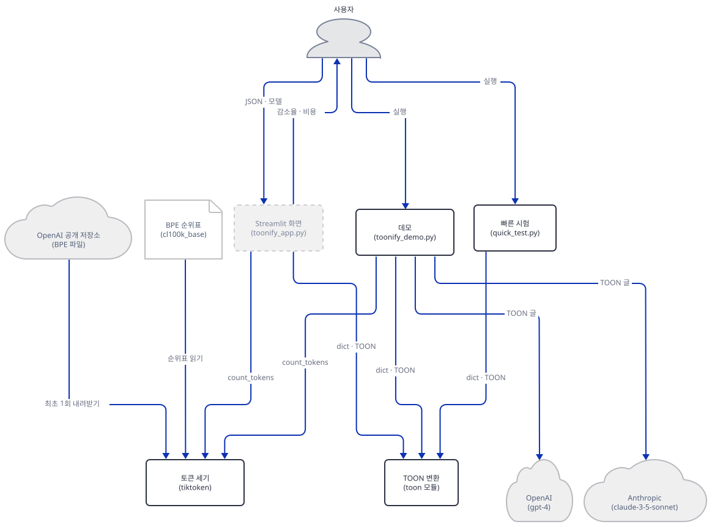

### Step 6. TOON이 이기지 못하는 곳과, 되돌려 읽기가 틀리는 곳

**목적.** 표 모양이 아닌 데이터에서 TOON이 어떻게 되는지, 앱이 점검한다는 `decode(encode(x)) == x`가 언제 깨지는지 봅니다.

**할 일.** 먼저 인코더가 표 모양(`[N]{열}:`)을 쓰는 조건을 읽습니다. 배열의 모든 객체가 같은 열을 갖고 모든 값이 원시값(문자열·숫자·불·null)일 때뿐입니다.

설치된 패키지 `toon`의 `utils.py` 177~203행

```python
    # Get all fields from first object and check if they're primitive
    first_obj = value[0]
    fields = []
    
    for key, val in first_obj.items():
        if not is_primitive(val):
            # Object contains non-primitive field (array or nested object)
            # Cannot use tabular format - must use list format to preserve all data
            return None
        fields.append(key)
    
    if not fields:
        return None
    
    # Check all objects have the exact same fields, all primitive
    for obj in value[1:]:
        # Check that this object has exactly the same fields
        if set(obj.keys()) != set(fields):
            return None
        
        # Check that all values in this object are primitive
        for key, val in obj.items():
            if not is_primitive(val):
                # Found non-primitive field - cannot use tabular format
                return None
    
    return fields
```

값 안에 목록이나 객체가 있거나 열이 하나라도 다르면 `None`이 되어 `- ` 목록 모양으로 갑니다(`encoder.py`의 `_encode_list_array`). 아래를 `toonify-lab/limits.py`로 저장합니다.

```python
"""Where TOON stops helping, and where decode(encode(x)) != x. Offline."""
import json

import guard

guard.check()
guard.install_offline()
from toon import decode, encode
from toonify_app import count_tokens


def pct(a, b):
    return f"{(a - b) / a * 100:.1f}%"


print("== 1. data that is not a uniform table (tokens)")
cases = {
    "single-key chain (demo)": {"api": {"response": {"product": {"title": "Wireless Keyboard", "specs": {"battery": "6 months", "connectivity": "Bluetooth 5.0"}}}}},
    "rows with a nested list": {"users": [{"id": i, "name": f"user{i}", "tags": ["a", "b"]} for i in range(5)]},
    "rows with different keys": {"rows": [{"a": 1, "b": 2}, {"a": 3, "c": 4}, {"b": 5}]},
    "one record": {"id": 1, "name": "Laptop", "price": 1299},
}
for name, d in cases.items():
    a = count_tokens(json.dumps(d, indent=2))
    b = count_tokens(json.dumps(d, separators=(",", ":")))
    c = count_tokens(encode(d))
    print(f"{name:26s} indent=2 {a:3d}  compact {b:3d}  TOON {c:3d}  vs compact {pct(b, c)}")
print(encode(cases["rows with different keys"]))

print("\n== 2. the roundtrip check the app runs: decode(encode(x)) == x")
tests = [
    ("zip code as a string", {"rows": [{"zip": "02134", "n": 1}]}, {}),
    ("id '123' as a string", {"rows": [{"id": "123", "n": 1}]}, {}),
    ("the strings 'null' and 'True'", {"rows": [{"s": "null", "t": "True"}]}, {}),
    ("single-key chain, folding safe", {"a": {"b": {"c": 1}}}, {"key_folding": "safe"}),
    ("demo items, tab delimiter", {"items": [["Product A", "Description with, commas", 29.99], ["Product B", "Another, description", 39.99]]}, {"delimiter": "tab"}),
]
for name, d, opts in tests:
    t = encode(d, opts)
    back = decode(t)
    print(f"{name:32s} {t!r}\n    -> {back!r}  equal={back == d}")
folded = encode({"a": {"b": {"c": 1}}}, {"key_folding": "safe"})
print("with expand_paths safe:", decode(folded, {"expand_paths": "safe"}))

print("\n== 3. the README sample (says 247 -> 98 bytes, 60%)")
shown = """{
  "products": [
    {"id": 101, "name": "Laptop Pro", "price": 1299},
    {"id": 102, "name": "Magic Mouse", "price": 79},
    {"id": 103, "name": "USB-C Cable", "price": 19}
  ]
}"""  # README.md:61-67, as printed there
sample = json.loads(shown)
j2, jc, t = json.dumps(sample, indent=2), json.dumps(sample, separators=(",", ":")), encode(sample)
print(f"bytes: as printed {len(shown)}  indent=2 {len(j2)}  compact {len(jc)}  TOON {len(t)}")
print(f"tokens: as printed {count_tokens(shown)}  indent=2 {count_tokens(j2)}  compact {count_tokens(jc)}  TOON {count_tokens(t)}")
```

```bash
uv run --no-project python limits.py 2>/dev/null
```

기대 출력(직접 확인)입니다.

```text
== 1. data that is not a uniform table (tokens)
single-key chain (demo)    indent=2  59  compact  30  TOON  32  vs compact -6.7%
rows with a nested list    indent=2 179  compact  83  TOON 104  vs compact -25.3%
rows with different keys   indent=2  56  compact  24  TOON  36  vs compact -50.0%
one record                 indent=2  25  compact  15  TOON  14  vs compact 6.7%
rows[3]:
  - a: 1
    b: 2
  - a: 3
    c: 4
  - b: 5

== 2. the roundtrip check the app runs: decode(encode(x)) == x
zip code as a string             'rows[1]{zip,n}:\n  02134,1'
    -> {'rows': [{'zip': 2134, 'n': 1}]}  equal=False
id '123' as a string             'rows[1]{id,n}:\n  123,1'
    -> {'rows': [{'id': 123, 'n': 1}]}  equal=False
the strings 'null' and 'True'    'rows[1]{s,t}:\n  "null","True"'
    -> {'rows': [{'s': None, 't': True}]}  equal=False
single-key chain, folding safe   'a.b.c: 1'
    -> {'a.b.c': 1}  equal=False
demo items, tab delimiter        'items[2]:\n  - [Product A\t"Description with, commas"\t29.99]\n  - [Product B\t"Another, description"\t39.99]'
    -> {'items': [['Product A', 'Description with, commas', 29.99], ['Product B', 'Another, description', 39.99]]}  equal=True
with expand_paths safe: {'a': {'b': {'c': 1}}}

== 3. the README sample (says 247 -> 98 bytes, 60%)
bytes: as printed 182  indent=2 254  compact 144  TOON 91
tokens: as printed 72  indent=2 90  compact 46  TOON 38
```


**확인.** 읽을 것이 다섯입니다. 첫째, 표가 아닌 세 경우(단일 키 사슬, 안에 목록이 든 행, 열이 다른 행)에서 TOON은 들여쓰기 없는 JSON보다 6.7%, 25.3%, 50.0% 더 깁니다. 한 레코드는 6.7% 짧습니다. 들여쓰기 2칸 JSON과 비교하면 이 경우들도 짧아 보입니다. 앱 사이드바의 "Avoid for: Highly nested data, Irregular structures"(`toonify_app.py:82-84`)는 이 결과와 맞습니다. 둘째, 데모의 고급 구간 두 장도 같은 이야기입니다. 키 접기는 단일 키 사슬(`api.response.product`)을 한 줄로 접어 7줄을 5줄로, 135바이트를 111바이트로 줄입니다(데모 출력의 `Savings: 135 → 111 bytes`, 직접 확인). 그런데 이 접힌 글을 앱의 방식(`decode(toon_str)`, 옵션 없음)으로 읽으면 키가 `a.b.c` 하나로 남아 원래와 달라집니다(위 출력의 마지막 줄). `expand_paths: safe`를 주어야 복원됩니다. 이 옵션은 앱의 253행에 없습니다.

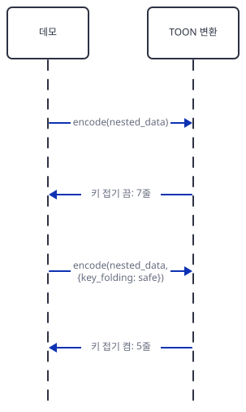

셋째, 데모의 "Tab delimiter (for data with commas)"는 입력이 객체 목록이 아니라 배열의 배열이라 표 모양이 아니라 `- [Product A	"Description with, commas"	29.99]` 같은 목록 모양이 됩니다(데모 출력에서 확인). 탭을 구분자로 골라도 쉼표가 든 글자에는 따옴표가 붙어서, 데모의 주석이 약속하는 효과는 이 데이터에서는 없었습니다. 이 글은 `decode`가 원래대로 돌려 읽었습니다(위 출력의 `demo items, tab delimiter` 줄, `equal=True`). 이 두 장은 데모에서 모델 호출 구간 뒤에 실행되지만 TOON의 옵션이라 여기서 함께 읽습니다.

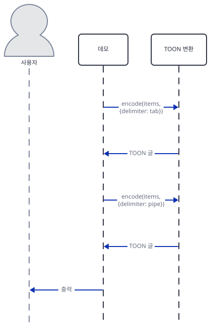

넷째, 키 접기 말고도 되돌려 읽기가 틀리는 경우가 둘 있습니다. 숫자처럼 생긴 문자열은 따옴표 없이 적히고(`needs_quoting`이 `float(value)`가 되면 `False`를 돌려줍니다, `toon` 패키지의 `utils.py` 44~50행), 읽을 때 숫자가 됩니다. `"02134"`가 `2134`가 되어 앞의 0이 사라집니다. `"null"`·`"True"` 같은 글자는 따옴표를 붙여 적지만 읽는 쪽 `_split_row`가 따옴표 글자를 버리고 나서 값을 해석해 `None`과 `True`가 됩니다(`toon` 패키지의 `decoder.py` 402~409행).

설치된 패키지 `toon`의 `decoder.py` 402~409행

```python
        if char == QUOTE:
            if in_quote and i + 1 < len(row_str) and row_str[i + 1] == QUOTE:
                # Escaped quote
                current.append(QUOTE)
                i += 2
            else:
                in_quote = not in_quote
                i += 1
```

다섯째, README 예시의 숫자입니다. 앱 README(59~76행)는 JSON 247바이트가 TOON 98바이트로 60% 줄어든다고 하지만, 거기 적힌 JSON 글자 자체가 182바이트이고 TOON은 91바이트입니다. 247도 98도 맞지 않습니다. 그 JSON을 `indent=2`로 다시 찍으면 254바이트이고 들여쓰기 없이는 144바이트입니다. 토큰으로는 적힌 모양 72, 들여쓰기 2칸 90, 들여쓰기 없음 46, TOON 38입니다. 같은 글이 기준에 따라 절약이 58%(`indent=2` 대비)도 17%(들여쓰기 없음 대비)도 됩니다. 이 되돌려 읽기가 틀린 값을 LLM이 어떻게 읽는지는 이 문서가 확인하지 못했습니다.

### Step 7. 모델 호출 구간 — 가짜 서버에서 읽는 데모

**목적.** 데모가 모델에게 보내는 TOON 프롬프트와, "Token Savings" 숫자가 어디서 나오는지 읽습니다.

**할 일.** `llm_integration_demo()`는 주문 네 건을 TOON으로 바꿔 두 모델에게 같은 질문을 보냅니다. 첫째 호출입니다.

`advanced_llm_apps/llm_optimization_tools/toonify_token_optimization/toonify_demo.py:165-190`

```python
            prompt = f"""Analyze these customer orders and provide a brief summary:

{toon_data}

Provide: 1) Total revenue, 2) Orders by status, 3) Average order value"""
            
            response = client.chat.completions.create(
                model="gpt-4",
                messages=[{"role": "user", "content": prompt}],
                max_tokens=200
            )
            
            print("\n✅ GPT-4 Response:")
            print(response.choices[0].message.content)
            
            # Show token usage
            print(f"\n📊 Token Usage:")
            print(f"  Input tokens: {response.usage.prompt_tokens}")
            print(f"  Output tokens: {response.usage.completion_tokens}")
            print(f"  Total tokens: {response.usage.total_tokens}")
            
            # Compare with JSON
            json_tokens = count_tokens(prompt.replace(toon_data, json_data))
            toon_tokens = response.usage.prompt_tokens
            savings = ((json_tokens - toon_tokens) / json_tokens) * 100
            print(f"\n💰 Token Savings: {savings:.1f}% (vs JSON)")
```

Step 4에서 이미 돌린 `demo.out`의 해당 구간과 가짜 서버가 적은 `llm.log`를 읽습니다.

```bash
sed -n 90,126p demo.out
cat llm.log
```

```powershell
Get-Content demo.out | Select-Object -Skip 89 -First 37
Get-Content llm.log
```

(PowerShell 형태는 실행해 보지 못했습니다.)

`demo.out`의 앞부분은 아래와 같았습니다(직접 확인).

```text
🤖 LLM INTEGRATION DEMO
================================================================================

📦 Data to analyze:
orders[4]{order_id,customer,total,status}:
  ORD001,Alice,299.99,shipped
  ORD002,Bob,149.5,processing
  ORD003,Charlie,449.99,delivered
  ORD004,Diana,89.99,pending

🔵 Testing with OpenAI GPT-4...

✅ GPT-4 Response:
FAKE GPT ANSWER

📊 Token Usage:
  Input tokens: 94
  Output tokens: 3
  Total tokens: 97

💰 Token Savings: 50.0% (vs JSON)

🟣 Testing with Anthropic Claude...

✅ Claude Response:
FAKE CLAUDE ANSWER

📊 Token Usage:
  Input tokens: 94
  Output tokens: 3
```

`llm.log`(직접 확인)입니다.

```text
{"path": "/v1/chat/completions", "model": "gpt-4", "max_tokens": 200, "key_head": "Bearer fake-", "prompt_chars": 297, "prompt_tokens_cl100k": 94}
{"path": "/v1/messages", "model": "claude-3-5-sonnet-20241022", "max_tokens": 200, "key_head": "fake-anthrop", "prompt_chars": 297, "prompt_tokens_cl100k": 94}
```


**확인.** 읽을 것이 넷입니다. 첫째, 요청은 두 건이고 모델 이름은 코드 그대로 `gpt-4`와 `claude-3-5-sonnet-20241022`, `max_tokens`는 둘 다 200, 키 머리는 `Bearer fake-`와 `fake-anthrop`이었습니다. 프롬프트는 297글자이고 `cl100k_base`로 94토큰입니다. 둘째, 출력의 "Input tokens: 94"와 "Token Savings: 50.0%"는 가짜 서버가 만든 숫자입니다. 서버가 요청 글을 `cl100k_base`로 세어 `usage`에 넣었고, 데모는 JSON으로 바꾼 같은 프롬프트를 `tiktoken`으로 센 값(188토큰)과 그 `usage.prompt_tokens`를 비교해 (188−94)/188 = 50.0%를 찍습니다(187~190행). 진짜 OpenAI의 `prompt_tokens`가 메시지 형식에 쓰는 토큰을 더해서 주는지는 이 문서가 확인하지 못했습니다. 더한다면 이 "절약률"은 서로 다른 계량의 비교입니다. 셋째, Claude 쪽은 `usage.input_tokens`를 찍기만 하고(220행) 아무것과도 비교하지 않습니다. 이 앱에서 Claude의 토큰 수가 실제로 등장하는 유일한 자리인데 모델이 종료되어 진짜로는 닿지 않습니다. 넷째, 비용입니다. 앞의 94토큰과 출력 최대 200토큰을 `gpt-4` 요금으로 곱하면 입력 $0.0028, 출력 상한 $0.012로 합쳐 1.5센트 안팎이 최대입니다(⚠ 계산값이고 이 문서는 진짜 호출을 하지 않았습니다). 두 호출의 순서는 아래 두 장이 그립니다. 첫 장의 앞 두 메시지는 `main()`이 비교 구간 직후에 하는 되돌려 읽기 점검(292~294행)이고, 그 아래가 `llm_integration_demo()`입니다.

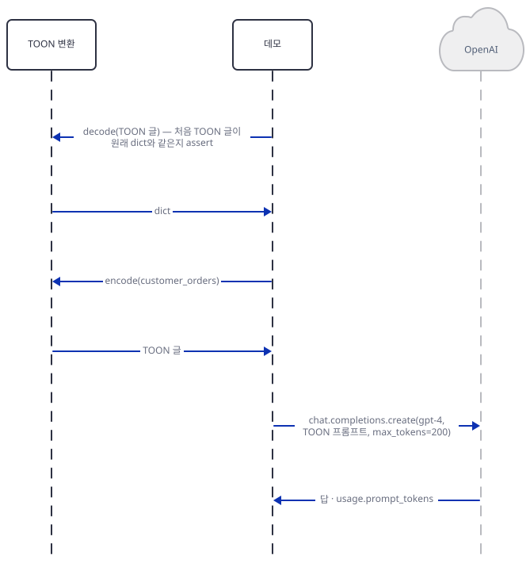

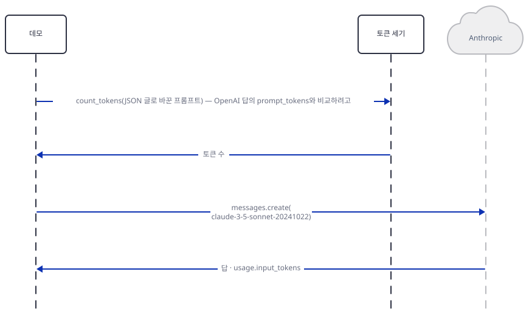

### Step 8. Streamlit 화면 — 패치 래퍼로 `127.0.0.1`에 띄우기

**목적.** 화면을 사용 통계 없이 루프백에 띄우고, 브라우저 없이 세 탭을 눌러 보면서 가격표와 모델 목록을 공식 문서와 맞춰 봅니다.

**할 일.** 앱 자체는 네트워크를 쓰지 않지만 세 가지를 막고 시작합니다. Streamlit은 `127.0.0.1`에만 열고(`--server.address 127.0.0.1`), 사용 통계는 끄고(`--browser.gatherUsageStats false`), 앱 안에서는 `tiktoken`이 내려받기를 시도하지 못하게 합니다. 아래 래퍼 `toonify-lab/screen_app.py`는 가드를 먼저 지나고 원본 앱 파일을 그대로 실행합니다. 원본을 고치지 않습니다.

```python
"""streamlit run target: guard and offline patch first, then the unchanged app file."""
import os
import runpy

import guard

guard.check()
guard.install_offline()
runpy.run_path(os.path.join(os.path.dirname(os.path.abspath(__file__)), "toonify_app.py"), run_name="__main__")
```

터미널 B에서 변수 블록(Step 3)을 건 상태로 띄웁니다. `&&`가 가드가 실패하면 서버를 띄우지 않게 합니다.

```bash
uv run --no-project python guard.py && uv run --no-project streamlit run screen_app.py --server.headless true --server.address 127.0.0.1 --server.port 58217 --browser.gatherUsageStats false
```

```powershell
uv run --no-project python guard.py
if ($LASTEXITCODE -eq 0) { uv run --no-project streamlit run screen_app.py --server.headless true --server.address 127.0.0.1 --server.port 58217 --browser.gatherUsageStats false }
```

(PowerShell 형태는 실행해 보지 못했습니다.) 서버가 뜨면 터미널 C(변수 블록은 필요 없고 `curl`만 쓰면 됩니다)에서 확인합니다. 루프백 `curl`에는 프록시를 타지 않도록 `--noproxy '*'`를 붙입니다.

```bash
curl --noproxy '*' -s -o /dev/null -w "%{http_code}\n" http://127.0.0.1:58217/_stcore/health
```

```powershell
curl.exe --noproxy '*' -s -o NUL -w "%{http_code}\n" http://127.0.0.1:58217/_stcore/health
```

(PowerShell 형태는 실행해 보지 못했습니다. `curl`이라는 이름은 PowerShell 5.1에서 다른 명령의 별칭이라 `curl.exe`를 씁니다.) 확인이 끝나면 터미널 B와 A에서 Ctrl+C로 두 서버를 끕니다.

기대 출력은 `200`이고(직접 확인) 서버 로그의 주소는 `http://127.0.0.1:58217`이었습니다. 이 실행 내내 바깥 접속을 기록하는 프록시에는 0건이었습니다. 브라우저는 열지 않았습니다. 화면은 `toonify-lab/screen_check.py`가 `AppTest`로 사람처럼 누릅니다. 같은 래퍼를 대상으로 하고 첫머리에서 가드를 부릅니다.

```python
"""Drive the app's screen without a browser (Streamlit AppTest) through screen_app.py. Run behind the guard."""
import sys

from guard import check

check()
from streamlit.testing.v1 import AppTest


def pick(at, label):
    return next(s for s in at.selectbox if s.label == label)


def metrics(at):
    return {m.label: m.value for m in at.metric}


at = AppTest.from_file("screen_app.py", default_timeout=60).run()
if at.exception:
    sys.exit("screen stopped: " + str(at.exception[0].value)[:200])
print("tabs:", [t.label for t in at.tabs])
print("models:", pick(at, "LLM Model").options)
print("default:", metrics(at))
print("captions:", [c.value for c in at.caption])

print("-- model changes the price, not the token count")
for model in ("gpt-4", "gpt-4-turbo", "gpt-3.5-turbo", "claude-3-opus", "claude-3-sonnet"):
    pick(at, "LLM Model").select(model).run()
    m = metrics(at)
    print(f"{model:16s} tokens {at.caption[0].value.split('Tokens: ')[1]:>4s}/{at.caption[1].value.split('Tokens: ')[1]:<3s} reduction {m['Token Reduction']}  cost/call {m['Cost per Call']}  per 1K {m['Savings per 1K calls']}")
pick(at, "LLM Model").select("gpt-4").run()

print("-- the four example datasets (comma, folding off)")
for ex in ("E-commerce Products", "Customer Orders", "Survey Responses", "Analytics Data"):
    pick(at, "Choose example dataset").select(ex).run()
    m = metrics(at)
    print(f"{ex:20s} size {m['Size Reduction']}  tokens {m['Token Reduction']}  {at.caption[0].value} -> {at.caption[1].value}")


def convert(text, label):
    at.text_area[0].set_value(text).run()
    next(b for b in at.button if b.label.endswith("Convert to TOON")).click().run()
    msgs = [s.value for s in at.success] + [w.value for w in at.warning] + [e.value for e in at.error]
    m = {x.label: x.value for x in at.tabs[1].metric}
    print(f"[{label}] {msgs} {m}")


print("-- tab 2, Custom Data")
convert(at.text_area[0].value, "default text")
convert("{not json", "invalid json")
convert('{"a": {"b": {"c": 1}}}', "single-key chain, folding off")
pick(at, "Key Folding").select("safe").run()
convert('{"a": {"b": {"c": 1}}}', "single-key chain, folding safe")
pick(at, "Key Folding").select("off").run()
convert('{"rows": [{"zip": "02134", "n": 1}]}', "zip as a string")
convert("{}", "empty object")
convert('{"rows":[{"id":1,"name":"Laptop","price":1299},{"id":2,"name":"Mouse","price":79}]}', "compact JSON pasted")
print("exceptions:", [str(e.value)[:100] for e in at.exception])
```

```bash
uv run --no-project python screen_check.py 2>/dev/null
```

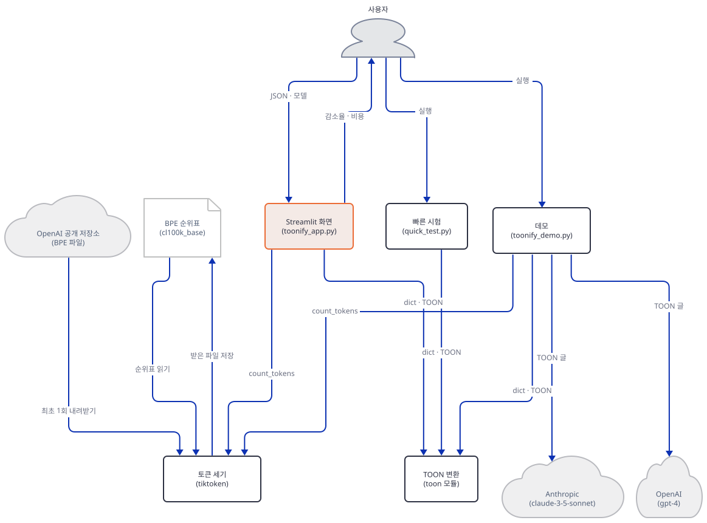

**확인.** 기대 출력(직접 확인)입니다. 이모지로 시작하는 문구에서 이모지는 `AppTest`가 떼어 냅니다.

```text
tabs: ['📊 Comparison', '✍️ Custom Data', '📈 Benchmark']
models: ['gpt-4', 'gpt-4-turbo', 'gpt-3.5-turbo', 'claude-3-opus', 'claude-3-sonnet']
default: {'Size Reduction': '71.3%', 'Token Reduction': '59.7%', 'Cost per Call': '$0.002670', 'Savings per 1K calls': '$3.96', 'Avg Size Reduction': '63.9%', 'Avg Token Reduction': '54.1%', 'Best Case': '73.4%'}
captions: ['Size: 599 bytes | Tokens: 221', 'Size: 172 bytes | Tokens: 89']
-- model changes the price, not the token count
gpt-4            tokens  221/89  reduction 59.7%  cost/call $0.002670  per 1K $3.96
gpt-4-turbo      tokens  221/89  reduction 59.7%  cost/call $0.000890  per 1K $1.32
gpt-3.5-turbo    tokens  221/89  reduction 59.7%  cost/call $0.000133  per 1K $0.20
claude-3-opus    tokens  221/89  reduction 59.7%  cost/call $0.001335  per 1K $1.98
claude-3-sonnet  tokens  221/89  reduction 59.7%  cost/call $0.000267  per 1K $0.40
-- the four example datasets (comma, folding off)
E-commerce Products  size 71.3%  tokens 59.7%  Size: 599 bytes | Tokens: 221 -> Size: 172 bytes | Tokens: 89
Customer Orders      size 63.7%  tokens 58.8%  Size: 375 bytes | Tokens: 119 -> Size: 136 bytes | Tokens: 49
Survey Responses     size 66.4%  tokens 61.2%  Size: 408 bytes | Tokens: 129 -> Size: 137 bytes | Tokens: 50
Analytics Data       size 67.0%  tokens 56.3%  Size: 342 bytes | Tokens: 119 -> Size: 113 bytes | Tokens: 52
-- tab 2, Custom Data
[default text] ['Conversion successful!', 'Roundtrip verification passed!'] {'Size Reduction': '40.3%', 'Token Reduction': '42.9%', 'Savings per call': '$0.000360'}
[invalid json] ['Invalid JSON: Expecting property name enclosed in double quotes: line 1 column 2 (char 1)'] {}
[single-key chain, folding off] ['Conversion successful!', 'Roundtrip verification passed!'] {'Size Reduction': '27.3%', 'Token Reduction': '16.7%', 'Savings per call': '$0.000060'}
[single-key chain, folding safe] ['Conversion successful!', 'Roundtrip verification failed'] {'Size Reduction': '63.6%', 'Token Reduction': '50.0%', 'Savings per call': '$0.000180'}
[zip as a string] ['Conversion successful!', 'Roundtrip verification failed'] {'Size Reduction': '30.6%', 'Token Reduction': '17.6%', 'Savings per call': '$0.000090'}
[empty object] ['Conversion successful!', 'Roundtrip verification passed!'] {'Size Reduction': '0.0%', 'Token Reduction': '0.0%', 'Savings per call': '$0.000000'}
[compact JSON pasted] ['Conversion successful!', 'Roundtrip verification passed!'] {'Size Reduction': '37.3%', 'Token Reduction': '13.3%', 'Savings per call': '$0.000120'}
exceptions: []
```

읽을 것이 여섯입니다. 첫째, 모델을 바꿔도 토큰(221/89)과 절감률(59.7%)은 그대로이고 비용만 바뀝니다(Step 5). 둘째, 화면의 가격표를 공식 값과 맞춰 봅니다. OpenAI 모델 페이지(2026-10-19 확인)는 `gpt-4`를 입력 $30·출력 $60, `gpt-4-turbo`를 입력 $10·출력 $30, `gpt-3.5-turbo`를 입력 $0.5·출력 $1.5(모두 백만 토큰당)로 적습니다. 앱은 `gpt-4`를 $0.03/1K, `gpt-4-turbo`를 $0.01/1K로 곱해(입력 가격과 맞습니다) `gpt-3.5-turbo`는 $0.0015/1K, 곧 백만 토큰당 $1.5로 곱합니다. 이것은 현재 입력 가격($0.5)이 아니라 출력 가격입니다. `claude-3-opus` $15·`claude-3-sonnet` $3(백만 토큰당)은 두 모델이 종료되어 Anthropic 가격 페이지(https://platform.claude.com/docs/en/about-claude/pricing, 같은 날)에 행이 없어 확인하지 못했습니다. 그리고 앱은 입력 토큰에만 가격을 곱하고 출력 토큰은 계산에 넣지 않습니다. 셋째, 비교 탭의 "Size Reduction"(71.3%)은 바이트 기준이라 들여쓰기 공백까지 세고, "Token Reduction"(59.7%)과 다릅니다. 넷째, 내 데이터 탭의 비교 기준은 붙여 넣은 글 그대로입니다(229~232행). 같은 JSON을 들여쓰기 없이 붙이면 절감이 13.3%로 줄어듭니다(출력의 마지막 줄). 다섯째, 같은 탭이 Step 6의 실패를 화면에 보입니다. 단일 키 사슬에 키 접기를 켜면 `Roundtrip verification failed`가 뜨고(경고 문구), `"02134"`도 같습니다. 잘못된 JSON은 `Invalid JSON: …` 오류가 되고 `{}`는 0.0%입니다. 여섯째, 벤치마크 탭의 세 숫자는 위 출력의 마지막 세 항목과 같은 글자입니다(Step 5). 이 실행의 stderr에는 Streamlit이 `use_container_width`를 `width`로 바꾸라는 경고를 계속 찍지만(`toonify_app.py:203`, `291`) 1.66.0에서 화면은 정상으로 그려졌습니다(문제 해결).

## 요청 한 건이 흐르는 과정

비교 탭에서 예시와 모델을 고르면 화면이 한 번 다시 돌며 일어나는 일입니다. 메시지가 길어 둘로 나눴고 메시지는 코드 순서대로 한 장에 하나씩 있습니다. 첫 그림은 선택에서 TOON 글이 만들어지기까지입니다.

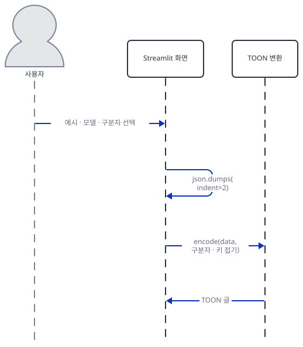

화면은 예시 데이터를 `indent=2` JSON으로 찍고(141행) 그 데이터를 `encode`에 옵션 딕셔너리(구분자, 키 접기)와 함께 넘겨 TOON 글을 받습니다(142~146행). 다음 그림은 두 글의 토큰을 세는 부분입니다.

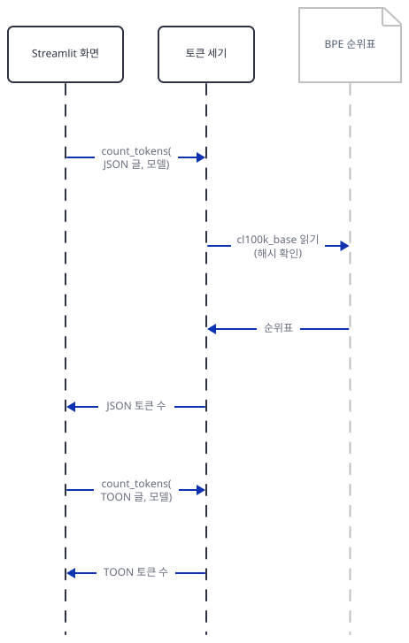

`count_tokens`는 JSON 글과 TOON 글에 한 번씩 불립니다(151~152행). 인코딩 파일 읽기는 프로세스에서 인코딩을 처음 만들 때 한 번뿐이고(`tiktoken`의 `registry.py` 63~87행, `ENCODINGS` 캐시) 그때 해시를 확인합니다. 두 번째 호출은 캐시된 인코딩을 씁니다. 그 뒤 화면은 크기와 토큰의 감소율을 계산하고(154~155행), 모델 이름으로 가격표를 곱해 비용을 얻으며(157~159행), 메트릭 넷과 코드 블록 둘, 비용 projection 표를 그립니다(162~203행).

## 실행 체크리스트

- [ ] `uv venv`와 `uv pip install -r requirements.txt`로 51개를 설치하고 `versions.py`에서 `toonify 1.6.0`, `import toon`이 되고 `import toonify`는 없음임을 봤다
- [ ] `fetch_encoding.py`가 1,681,126바이트 캐시 파일을 받고 `sha256 ok`를 찍는 것을 봤다. 이것이 바깥에 닿은 유일한 단계다
- [ ] 터미널 A·B 모두 변수 블록을 걸고, `guard.py`가 `guard ok`를 찍고 네 가지 어긴 경우에서 종료 코드 1로 멈추는 것을 봤다
- [ ] 터미널 A에서 `fake_llm.py 57314 llm.log`를 띄웠다
- [ ] `quick_test.py`에서 474바이트가 125바이트(73.6%)가 되는 것을 봤다
- [ ] `run_demo.py`의 `demo.out`에서 275토큰이 120토큰(56.4%)이 되는 것을 보고, `llm.log`에 `gpt-4`와 `claude-3-5-sonnet-20241022` 요청이 한 건씩인 것을 봤다
- [ ] `measure.py`에서 모델 다섯의 토큰 수가 모두 221이고 절약이 들여쓰기 기준 56~61%, 들여쓰기 없는 기준 21~31%인 것을 봤다
- [ ] `limits.py`에서 표가 아닌 데이터가 들여쓰기 없는 JSON보다 길어지고 `"02134"`가 `2134`로 돌아오는 것을 봤다
- [ ] `guard.py && streamlit run screen_app.py …`의 `/_stcore/health`가 200이고 `screen_check.py`의 출력(모델 다섯, 예시 넷, 내 데이터 탭)을 봤다
- [ ] 띄운 서버(57314·58217)를 모두 끄고 해당 포트가 비었다

## 문제 해결

| 증상 | 원인 | 해결 |
|---|---|---|
| `ModuleNotFoundError: No module named 'toonify'`(직접 확인) | 설치 이름은 `toonify`, 불러오는 이름은 `toon`이다. 앱 README 94행의 예시가 틀렸다 | `from toon import encode, decode`를 쓴다(`toonify_app.py:8`) |
| `guard.py`가 `... is not a loopback http address` 등으로 종료 코드 1(직접 확인) | 해당 터미널에 변수 블록(Step 3)이 없거나 값이 틀렸다 | 그 터미널에서 블록을 다시 건다. 변수는 터미널마다 따로다 |
| `the cl100k_base cache file is missing or wrong`(직접 확인) | Step 2를 하지 않았거나 `TIKTOKEN_CACHE_DIR`이 다른 폴더를 가리킨다 | `fetch_encoding.py`를 돌리고 변수가 `toonify-lab/tiktoken_cache`인지 본다 |
| `RuntimeError: offline: tiktoken wanted to download …`(직접 확인) | 가드를 건너뛰고 `install_offline()`만 거친 프로세스가 캐시에 없는 인코딩을 요청했다 | 인코딩 이름이 `cl100k_base`인지 본다. 이 앱의 모델 다섯은 모두 `cl100k_base`다 |
| `Roundtrip verification failed` 경고(직접 확인) | 키 접기 결과를 `expand_paths` 없이 읽었거나, 숫자처럼 생긴 문자열이 숫자로 돌아왔다(Step 6) | 키 접기를 끄거나 `decode(text, {"expand_paths": "safe"})`로 읽는다. 문자열 값이 숫자 모양이면 TOON으로 보내기 전에 확인한다 |
| 실행할 때마다 stderr에 `Please replace use_container_width with width`(직접 확인) | `toonify_app.py:203`, `291`이 옛 인자를 쓴다. 로그에 "after 2025-12-31"이라고 적혀 있지만 1.66.0에서 화면은 그려졌다 | 두 줄의 `use_container_width=True`를 `width="stretch"`로 바꾼다(원본을 고치지 말고 복사본에서). 지금은 경고일 뿐이다 |
| ⚠ 데모의 `gpt-4`·`claude-3-5-sonnet-20241022` 호출이 진짜 키로 실패할 수 있다(실행하지 않았고 폐기 문서와 코드로 읽은 것) | `gpt-4`는 2026-10-23 종료 예정, Claude 모델은 2025-10-28 종료 | 복사본의 `toonify_demo.py` 172행과 203행의 모델 이름을 폐기 문서가 권하는 `gpt-5.6-sol`, `claude-sonnet-5-5`로 바꾼다. 화면의 가격표(`toonify_app.py:26-32`)와 선택 상자(55~59행)도 같은 이름과 오늘 가격으로 고쳐야 한다 |

## 더 해보기

- 자기 데이터 하나를 자기가 실제로 모델에 보내는 모양(들여쓰기 없는 JSON인지, 들여쓰기 2칸인지)으로 `measure.py`와 같은 표를 만들어 봅니다. 표 모양이 아니면 `limits.py`의 첫 구간처럼 TOON이 지는지 확인합니다.
- Step 6의 세 되돌려 읽기 실패를 `decode(…, {"expand_paths": "safe"})`와 `strict` 옵션으로 줄일 수 있는지 시험해 봅니다. 문자열 `"02134"`를 잃지 않고 보내려면 TOON 글에서 어떻게 적혀야 하는지 `toon-format`(`toon_format` 모듈)의 같은 입력과 비교해 볼 수 있습니다(이 문서는 설치해 보지 않았습니다).
- 진짜 키가 있다면 `gpt-5.6-sol` 같은 현재 모델과 Anthropic의 토큰 세기 엔드포인트(`count_tokens`)로 같은 두 글의 토큰 수를 재고, 이 문서가 `cl100k_base`로 센 숫자와 얼마나 다른지 확인해 봅니다. 이 문서는 하지 않았습니다.

## 다음 날 예고

[Day 152 · 🦙 Llama 3.2 Fine-tuning](../day152-llama3.2-finetuning/README.md) — 볼륨 14는 여기까지입니다. 두 날 모두 모델에 보낼 글을 줄이는 도구였고, 볼륨 15 "🔧 LLM Fine-tuning"의 첫날은 모델 자체를 바꾸는 쪽입니다. `advanced_llm_apps/llm_finetuning_tutorials/llama3.2_finetuning`은 `finetune_llama3.2.py`(마지막 줄에 개행이 없어 `wc -l`은 62, 편집기에서는 63줄)와 앱 README(88줄), 항목 다섯의 `requirements.txt`(`torch`·`unsloth`·`transformers`·`datasets`·`trl`, 마지막 줄에 개행이 없어 `wc -l`은 4)로 이루어지고, 스크립트는 `unsloth/Llama-3.2-3B-Instruct`를 4비트로 불러 LoRA 어댑터를 붙입니다(소스로 확인). 앱 README는 86행에서 Google Colab 무료 등급의 GPU에 맞춘 스크립트라고 말하고 스크립트도 `torch.cuda`를 부릅니다(51~52행). 오늘과 달리 GPU가 필요한 날입니다.
