# Day 152 · 🦙 Llama 3.2 Fine-tuning

> 볼륨 15 🔧 LLM Fine-tuning · 난이도 ★★☆(원본은 파일 하나 63줄이지만 CUDA GPU가 있어야 돕니다. 이 문서의 실습은 GPU 없이 CPU에서 도는 장난감 축소판이고, 원본 스크립트는 실행하지 않았습니다) ⚠ 이 PC에서는 원본이 `unsloth`를 불러오는 두 번째 줄에서 멈춥니다(CPU판 `torch`, Step 4). 또 앱의 `SFTTrainer` 인자 셋은 순수한 `trl` 1.15.0이 받지 않아서 앱은 Unsloth의 `trl` 패치에 기대는데, 그 패치는 `unsloth`가 불러와질 때만 적용됩니다(Step 7). 앱이 GPU에서 끝까지 도는지는 이 문서가 확인하지 않았습니다 · 예상 소요 220분(스크립트 스물하나를 저장하고 돌리며(설치만 해도 내려받기가 335MiB입니다) 같은 숫자를 여러 방식으로 재 보는 손 시간이 읽는 시간보다 큽니다) · API 비용 대략 0원(모델 API를 한 번도 부르지 않았습니다. 원본을 GPU에서 돌릴 때의 비용은 Colab 무료 등급이나 자기 GPU 전기료이고 이 문서가 재 보지 않았습니다) · 원본 앱: `advanced_llm_apps/llm_finetuning_tutorials/llama3.2_finetuning`

## 오늘 만들 것

볼륨 14까지의 앱은 모델을 호출해서 쓰기만 했습니다. 바로 앞 [Day 151](../day151-toonify-token-optimization/README.md)도 모델에 보낼 글을 줄이는 도구였습니다. 볼륨 15 "🔧 LLM Fine-tuning"은 모델 자체를 바꾸는 쪽입니다. 사전 학습된 모델의 가중치 대부분은 얼려 두고, 선택한 투영(이 앱은 층마다 일곱 개)마다 작은 행렬 두 개(LoRA 어댑터)만 붙여 그것만 학습한 다음 저장합니다. 첫날의 앱은 `finetune_llama3.2.py`(마지막 줄에 개행이 없어 `wc -l`은 62, 편집기에서는 63줄), 앱 README(88줄), 항목 다섯에 버전이 없는 `requirements.txt`(`torch`·`unsloth`·`transformers`·`datasets`·`trl`, 개행이 없어 `wc -l`은 4)로 이루어집니다. 흐름은 하나입니다. Unsloth로 `unsloth/Llama-3.2-3B-Instruct`를 4비트로 불러오고, LoRA를 붙이고, `mlabonne/FineTome-100k` 대화를 "llama-3.1" 채팅 틀로 글로 바꾸고, `SFTTrainer`로 60걸음 학습하고, `finetuned_model/`에 저장합니다. Day 151의 예고가 말한 대로 GPU가 필요한 날입니다.

**이 문서는 원본을 실행하지 않았습니다.** 이 PC에는 NVIDIA GPU(RTX 5060 Laptop)가 있지만, 모델(4비트판이 2.37GB)과 데이터셋(116MB)을 내려받고 학습하는 일은 하지 않았습니다. 대신 같은 흐름을 **장난감**으로 돌렸습니다. 모델은 `transformers`의 `LlamaConfig`로 만든 층 2개·폭 64의 무작위 가중치 모델이고(106,816개 매개변수), 토크나이저는 `tokenizers`로 그 자리에서 학습한 어휘 512개짜리이며, 데이터는 손으로 쓴 대화 25개입니다. **Llama도 Llama의 어휘도 아니고, 같은 모양의 장난감입니다.** 그 위에서 `peft`의 LoRA(같은 일곱 투영, `r=16`)와 `trl`의 `SFTTrainer`를 같은 숫자(배치 2, 누적 4, 워밍업 5, 60걸음, 학습률 2e-4)로 CPU에서 돌렸습니다. 그래서 학습되는 매개변수 비율과 저장되는 파일은 장난감의 값이고, 진짜 모델의 값은 공개 카드와 `config.json`에서 계산한 것이거나 어림입니다. 어느 쪽인지 줄마다 밝힙니다.

Hugging Face 라이브러리를 불러오는 모든 프로세스는 **오프라인 변수, 이 폴더 안의 `HF_HOME`, 이 폴더 안의 홈, 소켓 가드**를 모두 건 채로만 돌렸고(Step 2), 독자 명령도 같습니다. 이 PC의 진짜 홈에는 Hugging Face 토큰이 있어서, 라이브러리가 그 파일을 보지 못하게 하는 것이 이 문서의 가장 중요한 안전 장치입니다. 이 문서에서 바깥으로 나가는 줄은 패키지 설치와 Step 3의 공개 카드 읽기(`curl`, 로그인 없음) 둘뿐입니다. 직접 돌려 보거나 소스로 확인한 것이 여덟입니다.

1. 오늘 `requirements.txt`를 설치하면 86개 패키지가 깔리고 `torch`는 CPU판(`2.14.1+cpu`)입니다. 이 PC에 GPU가 있어도 `from unsloth import FastLanguageModel`(2행)은 `NotImplementedError`로 멈춥니다(Step 1, 4).
2. `load_in_4bit=True`는 이름에 적힌 저장소가 아니라 `unsloth/Llama-3.2-3B-Instruct-unsloth-bnb-4bit`를 요청합니다. Unsloth 소스의 이름 변환 함수를 직접 돌려 확인했습니다(Step 3).
3. Unsloth는 모델을 불러올 때 Hugging Face에 사용 통계용 저장소를 받고, 8.8.8.8:53으로 TCP 접속을 시험하며, 모르는 모델 이름이면 GitHub에서 표를 새로 읽습니다. 통계와 접속 시험은 오프라인 변수나 `UNSLOTH_DISABLE_STATISTICS` 어느 쪽으로도 꺼지고, 표 읽기는 오프라인 변수(`HF_HUB_OFFLINE`·`TRANSFORMERS_OFFLINE`)로만 꺼집니다(Step 4, 소스로 확인).
4. 오늘 설치되는 `trl` 1.15.0은 앱이 쓰는 `tokenizer=`·`dataset_text_field=`·`max_seq_length=`를 `SFTTrainer`에서 거부합니다. 앱이 도는 것은 `unsloth`를 불러올 때 설치되는 `trl` 패치 덕분이고, 이 PC에서는 시험용 스위치로 그 패치를 설치해 세 인자가 받아지고 앱이 실제로 쓰는 설정이 순수 `trl`과 다른 것(8비트 AdamW, `weight_decay` 0.001, `seed` 3407)까지 직접 확인했습니다(Step 7).
5. 학습되는 LoRA 매개변수는 24,313,856개, 전체의 0.757%입니다. 유효 배치는 2×4=8이고 60걸음은 480개 시퀀스로 데이터셋의 0.48%입니다(Step 6, 계산이고 장난감으로 공식을 확인했습니다).
6. 앱은 `train_on_responses_only`를 쓰지 않으므로 질문 토큰까지 손실에 들어갑니다. 장난감에서 모든 행의 `labels`가 `input_ids`와 같았고, 패치된 앱 경로에서도 패딩을 빼면 같았습니다(Step 7).
7. "llama-3.1" 채팅 틀은 대화에 시스템 글이 없어도 모든 샘플에 `Cutting Knowledge Date: December 2023`과 `Today Date: 26 July 2024`를 붙입니다. 틀의 `<|begin_of_text|>`와 토크나이저가 더하는 것이 겹쳐 시작 토큰이 둘이 되는데, Unsloth가 이를 하나로 줄이는 코드는 소스에서 읽었습니다(Step 5, 7).
8. `save_pretrained`는 LoRA 어댑터만 저장합니다. 장난감에서 134,616바이트였고 기본 모델 가중치는 한 개도 들어 있지 않았습니다(Step 8).

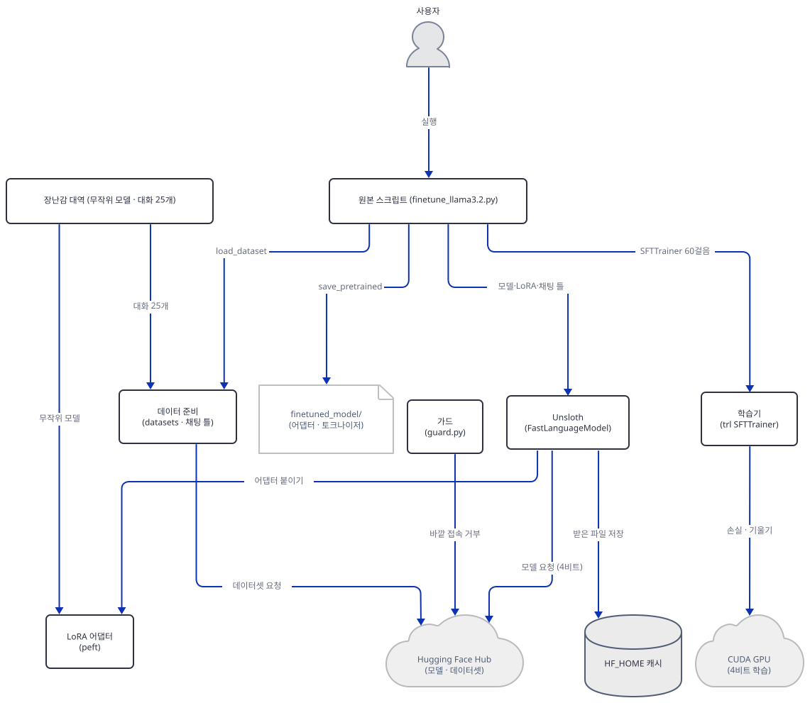

## 사전 준비

| 서비스/도구 | 용도 | 발급·설치 |
|---|---|---|
| uv | 가상환경 생성과 패키지 설치 | [공통 사전 준비](../README.md#공통-사전-준비-한-번만) 절 참고 |
| Python | 이 문서는 3.13.3으로 확인했다. `unsloth` 2026.10.6은 3.9 이상 3.15 미만을 요구한다 | 공통 사전 준비와 같음 |
| 인터넷 | 패키지 설치(큰 바퀴 44개 약 335MiB를 내려받고, 설치 뒤 가상환경은 1.3GB)와 Step 3의 공개 카드 읽기. 그 밖의 줄은 오프라인이다 | 없음 |
| CUDA GPU | **원본을 진짜로 돌릴 때만** 필요하다. 이 문서의 실습은 필요 없다 | Colab 무료 GPU 또는 자기 PC(NVIDIA) |
| Hugging Face 계정·토큰 | 필요 없다. `unsloth/` 저장소는 로그인 없이 받을 수 있다(`gated: False`, Step 3) | 없음 |
| 디스크 | 이 문서의 가상환경이 1.3GB다(`du -sh`로 직접 확인) | 없음 |

이 문서의 스크립트는 한글이 아니라 영어를 출력하지만, 출력을 파이프나 파일로 받는 한국어 Windows에서는 먼저 인코딩을 맞춥니다. 아래 Step 2의 변수 블록에 이 줄이 들어 있습니다. 이 문서의 출력에서 `SyntaxWarning`(`torchao`가 정규식 문자열을 그대로 쓴 것)과 `W1019 ... is an Enum subclass` 한 줄은 매번 나오는 무해한 경고라 기대 출력에서 뺐습니다.

**모델.** 이 앱의 모델은 API로 부르는 것이 아니라 가중치를 내려받아 학습하는 것이라 OpenAI·Anthropic의 폐기 문서 대상이 아닙니다. 대신 **라이선스와 접근 조건**이 있습니다(2026-10-19에 카드 원문으로 확인).

- **Llama 3.2 Community License.** `unsloth/Llama-3.2-3B-Instruct`의 카드는 "Use of Llama 3.2 is governed by the Llama 3.2 Community License"라고 적고, `license: llama3.2`입니다. 라이선스 원문(https://github.com/meta-llama/llama-models/blob/main/models/llama3_2/LICENSE, `curl`로 2026-10-19에 읽음)의 요점은 다음과 같습니다. 파생물을 배포하면 라이선스 사본을 주고 "Built with Llama"를 눈에 띄게 적어야 합니다. 35행의 이름 규칙은 "If you use the Llama Materials or any outputs or results of the Llama Materials to create, train, fine tune, or otherwise improve an AI model, which is distributed or made available, you shall also include \"Llama\" at the beginning of any such AI model name"입니다. Llama Materials 자체를 **미세조정**해 배포하는 이 앱의 `finetuned_model/`도 이 문장에 해당하니, 배포하면 모델 이름이 "Llama"로 시작해야 합니다. 배포본에는 `Llama 3.2 is licensed under the Llama 3.2 Community License, Copyright © Meta Platforms, Inc. All Rights Reserved.`라는 고지를 남기고(41행), 사용은 Acceptable Use Policy를 따라야 합니다(44행). 라이선스가 적은 주소 https://www.llama.com/llama3_2/use-policy는 같은 날 따라가 보니 여러 번(301·302·308) 넘어간 뒤 `404`였고, 사본은 https://raw.githubusercontent.com/meta-llama/llama-models/main/models/llama3_2/USE_POLICY.md(`200`)에 있습니다. 출시일 기준 월간 활성 사용자가 7억 명을 넘는 곳은 Meta에 따로 허가를 받아야 합니다(46행). 이 문서가 만든 장난감은 Llama의 가중치를 한 개도 담지 않아 이 조건의 대상이 아니지만, 원본 스크립트의 `finetuned_model/`은 Llama 3.2의 파생물입니다.
- **접근 신청과 미러의 차이.** 원본 저장소 `meta-llama/Llama-3.2-3B-Instruct`는 `gated: manual`이라 로그인하고 접근을 신청해야 합니다. 로그인 없이 `curl`로 `config.json`을 읽으면 `401`과 "Access to model meta-llama/Llama-3.2-3B-Instruct is restricted"가 돌아옵니다(직접 확인). 앱이 쓰는 `unsloth/` 미러는 `gated: False`라 신청 없이 내려받아지지만 카드는 같은 라이선스를 적습니다. 미러에서 받는다고 조건이 사라지는 것은 아닙니다.
- **FineTome-100k.** 카드(https://huggingface.co/datasets/mlabonne/FineTome-100k)는 `arcee-ai/The-Tome`에서 `arcee-ai/qwen2-72b-magpie-en`을 뺀 부분집합을 `fineweb-edu-classifier`로 다시 걸러 만들었다고 적고, 머리의 메타데이터에 **`license` 줄이 없습니다**(Step 3에서 직접 확인). 부모 `The-Tome` 카드는 `license: mit`이고 아홉 개 공개 데이터셋(`BAAI/Infinity-Instruct` 등)을 모았다고 적지만, 그 아홉 개 각각의 라이선스는 확인하지 못했습니다. 사업에 쓰려면 직접 확인하세요.

## 아키텍처 한눈에 보기

| 컴포넌트 | 역할 | 코드 위치 |
|---|---|---|
| 모델 불러오기 | `FastLanguageModel.from_pretrained`로 4비트 3B 모델과 토크나이저 | `advanced_llm_apps/llm_finetuning_tutorials/llama3.2_finetuning/finetune_llama3.2.py:8-12` |
| LoRA 붙이기 | `get_peft_model(r=16)`, 일곱 투영 | `advanced_llm_apps/llm_finetuning_tutorials/llama3.2_finetuning/finetune_llama3.2.py:14-21` |
| 채팅 틀·데이터 | `get_chat_template`, `load_dataset`, `standardize_sharegpt`, `text` 열 만들기 | `advanced_llm_apps/llm_finetuning_tutorials/llama3.2_finetuning/finetune_llama3.2.py:23-35` |
| 학습기 | `SFTTrainer`와 `SFTConfig`(배치 2, 누적 4, 60걸음, 2e-4) | `advanced_llm_apps/llm_finetuning_tutorials/llama3.2_finetuning/finetune_llama3.2.py:37-56` |
| 학습과 저장 | `trainer.train()`, 모델·토크나이저 `save_pretrained` | `advanced_llm_apps/llm_finetuning_tutorials/llama3.2_finetuning/finetune_llama3.2.py:58-63` |
| Unsloth | 4비트 적재, LoRA 붙이기, 채팅 틀, `trl` 패치 | 코드 없음 (설치된 패키지 `unsloth` 2026.10.6, Step 1) |
| Hugging Face Hub | 모델·데이터셋이 있는 곳. 이 문서는 공개 카드만 읽었다 | 코드 없음 (외부, Step 3) |
| HF_HOME 캐시 | 내려받은 파일이 쌓이는 곳(`hub/`, `datasets/`) | 코드 없음 (Step 2) |
| 가드 | 홈·토큰·소켓·환경변수를 검사하고 바깥 접속을 거부 | `guard.py` (이 문서가 만든 파일, Step 2) |
| 장난감 대역 | 무작위 모델·토크나이저·대화 25개 | `make_toy.py`, `toy_data.py` (이 문서가 만든 파일, Step 5) |

## 단계별 진행

### Step 1. 작업 폴더와 설치 — 오늘 무엇으로 풀리는가

**목적.** 원본 `requirements.txt`를 독립 가상환경에 설치하고, 버전이 없는 다섯 줄이 오늘 무엇이 되는지 봅니다.

**할 일.** 원본 폴더에서 돌리면 `__pycache__`가 생기니 작업 폴더를 따로 만들어 파일을 복사합니다. 저장소 루트에서 시작합니다.

```bash
mkdir -p ../finetune-lab
cp advanced_llm_apps/llm_finetuning_tutorials/llama3.2_finetuning/{finetune_llama3.2.py,requirements.txt} ../finetune-lab/
cd ../finetune-lab
uv venv --python 3.13
uv pip install -r requirements.txt
```

```powershell
New-Item -ItemType Directory -Force ..\finetune-lab
Copy-Item advanced_llm_apps\llm_finetuning_tutorials\llama3.2_finetuning\finetune_llama3.2.py, advanced_llm_apps\llm_finetuning_tutorials\llama3.2_finetuning\requirements.txt ..\finetune-lab\
Set-Location ..\finetune-lab
uv venv --python 3.13
uv pip install -r requirements.txt
```

(PowerShell 줄은 실행해 보지 못했습니다. pip 대안은 `python -m venv .venv`로 만들고 활성화한 뒤 `pip install -r requirements.txt`입니다.) 이후 모든 명령은 `finetune-lab` 폴더에서 `uv run --no-project`로 돌립니다. 이유는 공통 사전 준비에 있습니다. 복사해 온 `finetune_llama3.2.py`는 읽기 위한 것이고 이 문서의 어느 단계도 그것을 실행하지 않습니다.

`advanced_llm_apps/llm_finetuning_tutorials/llama3.2_finetuning/requirements.txt:1-5`

```text
torch
unsloth
transformers 
datasets 
trl 
```

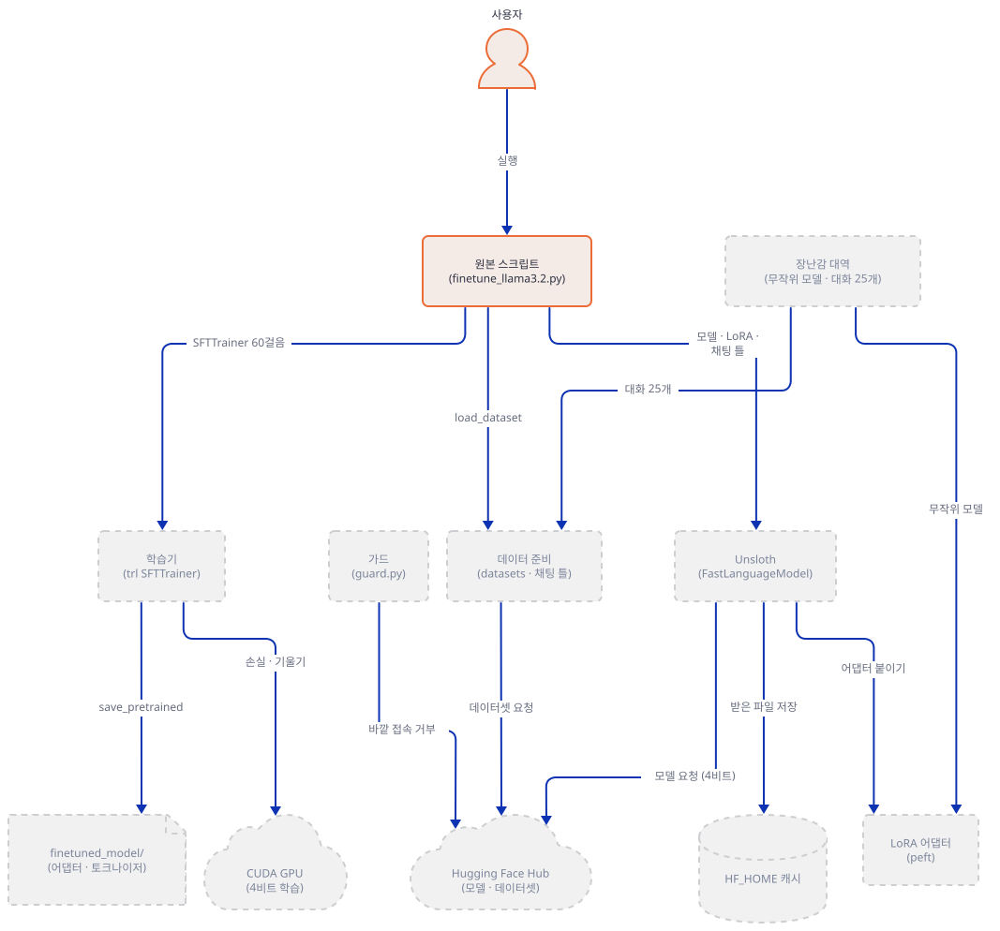

**확인.** `uv pip install`의 앞쪽에 `Resolved 86 packages`가 있고 마지막 줄이 `+ zipp==4.1.1`로 끝나면 됩니다. 큰 바퀴 44개를 받았고 내려받은 양의 합은 335.3MiB입니다(uv 로그의 `Downloading` 줄을 더한 값, 직접 확인). 모두 바퀴라 빌드 코드는 돌지 않았습니다(로그에 `Built` 0줄). 설치된 판은 `versions.py`로 보는데, 이 스크립트도 가상환경의 파이썬을 띄우므로 Step 2의 변수 블록으로 홈을 돌린 **뒤에** Step 2의 끝에서 돌립니다.

### Step 2. 가드 — 홈·토큰·소켓을 닫고 시작하기

**목적.** Hugging Face 계열 라이브러리를 불러오는 모든 프로세스가 바깥에 닿지 않고, 이 PC의 진짜 홈(Hugging Face 토큰, Claude 자격 증명)을 보지 못하게 합니다. 줄 하나를 빼도 스크립트가 시작하자마자 멈추게 합니다.

**할 일.** 이유부터입니다. `huggingface_hub`는 토큰을 인자로 주지 않아도 기본으로 기계에서 읽어 요청에 싣습니다(`huggingface_hub/utils/_headers.py` 42~44행의 설명, `get_token()`이 `HF_TOKEN` 환경변수와 홈의 `~/.cache/huggingface/token`을 봄). Unsloth는 한술 더 떠서 `from_pretrained` 첫머리에서 `hf_login(token)`으로 그 토큰을 미리 읽어 이후 모든 Hub 호출에 넘깁니다(`unsloth/models/llama.py` 2938행, `models/_utils.py` 7920~7927행). 내가 홈에 가짜 토큰 파일(`hf_FAKE…`)을 둔 폴더로 `HOME`을 돌리고 오프라인·소켓 가드 아래에서 `get_token()`을 불렀더니 그 가짜 값이 읽혔습니다. 그러니 `HOME`과 `USERPROFILE`을 이 폴더 안의 빈 폴더로 돌리고 `HF_HOME`도 폴더 안에 둡니다. 가드는 그 밖의 경로 변수(`HF_TOKEN_PATH`, 캐시 경로, `XDG_CACHE_HOME`)와 프록시 변수까지 봅니다. 프록시는 루프백 주소여도 안 됩니다. 소켓 가드가 루프백을 허용하기 때문에, 루프백 프록시가 있으면 바깥 요청이 허용된 루프백 소켓으로 빠져나갈 수 있습니다. 이 실습은 네트워크가 전혀 필요 없으니 프록시 변수는 모두 지웁니다. 임시 폴더도 같습니다. `torch`는 `import`만 해도 임시 폴더에 `torchinductor_<사용자>/`를 만들고 Unsloth는 컴파일한 트레이너 코드를 `unsloth_compiled_cache/`에 쌓는데, Git Bash는 `TMPDIR`을 진짜 Temp 폴더로 미리 잡아 두므로 `TEMP`만 돌려서는 부족합니다. 그래서 `TEMP`·`TMP`·`TMPDIR`과 `UNSLOTH_COMPILE_LOCATION`을 모두 이 폴더의 `tmp/`로 돌리고 가드가 그 위치와 `tempfile.gettempdir()`를 검사합니다.

가드를 `finetune-lab/guard.py`로 저장합니다. `check()`는 아래가 하나라도 어긋나면 이유를 모두 적고 종료 코드 1로 끝납니다. `install()`은 파이썬의 `socket`에서 루프백이 아닌 곳으로의 접속·이름 조회를 막고(Windows asyncio는 `socket.connect`를 부르지 않아 `IocpProactor.connect`도 막습니다), 시도를 `guard.log`에 한 줄씩 적습니다.

```python
"""Guard for every process of this lab that imports a Hugging Face library.

  python guard.py            -> checks the environment, installs the socket guard, prints "guard ok"
  from guard import check    -> scripts call check() first; it exits with code 1 when anything is off
  sitecustomize.py (same folder, found through PYTHONPATH) calls install() so that EVERY python process
  started from this terminal, including child processes, refuses non-loopback sockets.

What it refuses (each is a separate layer, any one of them missing stops the run):
  - HF_HUB_OFFLINE / HF_DATASETS_OFFLINE / TRANSFORMERS_OFFLINE must be 1
  - HOME, USERPROFILE, CLAUDE_CONFIG_DIR and HF_HOME must be inside this lab folder, so that the real
    ~/.cache/huggingface/token and ~/.claude/.credentials.json are never visible
  - HF_TOKEN / HUGGING_FACE_HUB_TOKEN / HF_ENDPOINT must not be set; the other HF path variables (cache, token file, XDG_CACHE_HOME)
    must be unset or inside this lab folder
  - TEMP, TMP, TMPDIR and UNSLOTH_COMPILE_LOCATION must be inside this lab folder (Git Bash presets TMPDIR to the real Temp, so TEMP
    alone is not enough), and tempfile.gettempdir() must be too: torch writes torchinductor_<user>/ and unsloth writes
    unsloth_compiled_cache/ there; TORCHINDUCTOR_CACHE_DIR and TRITON_CACHE_DIR are checked like the other cache variables
  - no proxy variable may be set: a proxy on 127.0.0.1 would let a non-loopback request leave through an allowed loopback socket
  - UNSLOTH_DISABLE_STATISTICS must be present (unsloth only tests for presence)
  - any socket connect or name lookup to a non-loopback address raises, and the attempt is appended to guard.log
"""
import os
import socket
import sys
from pathlib import Path

LAB = Path(__file__).resolve().parent
LOG = LAB / "guard.log"
OFFLINE = ("HF_HUB_OFFLINE", "HF_DATASETS_OFFLINE", "TRANSFORMERS_OFFLINE")
LOOPBACK = ("127.0.0.1", "::1", "localhost")
PROXY = ("HTTP_PROXY", "HTTPS_PROXY", "ALL_PROXY", "GRPC_PROXY", "http_proxy", "https_proxy", "all_proxy", "grpc_proxy")
HF_PATHS = ("HF_HUB_CACHE", "HUGGINGFACE_HUB_CACHE", "HF_DATASETS_CACHE", "TRANSFORMERS_CACHE", "HF_ASSETS_CACHE",
            "HF_XET_CACHE", "HF_TOKEN_PATH", "HF_STORED_TOKENS_PATH", "XDG_CACHE_HOME", "TORCHINDUCTOR_CACHE_DIR", "TRITON_CACHE_DIR")
_installed = False


def _inside(path, parent):
    try:
        Path(path).resolve().relative_to(Path(parent).resolve())
        return True
    except (ValueError, OSError):
        return False


def _refuse(kind, target):
    with open(LOG, "a", encoding="utf-8") as f:
        f.write(f"{kind} {target}\n")
    raise OSError(f"guard: refused {kind} to non-loopback {target!r}")


def _host(address):
    return address[0] if isinstance(address, tuple) else None


def install():
    global _installed
    if _installed:
        return
    real_getaddrinfo = socket.getaddrinfo
    real_gethostbyname = socket.gethostbyname
    real_connect = socket.socket.connect
    real_connect_ex = socket.socket.connect_ex
    real_sendto = socket.socket.sendto

    def ok(host):
        return host is None or host in LOOPBACK or host == ""

    def getaddrinfo(host, *a, **k):
        if not ok(host):
            _refuse("lookup", host)
        return real_getaddrinfo(host, *a, **k)

    def gethostbyname(host):
        if not ok(host):
            _refuse("lookup", host)
        return real_gethostbyname(host)

    def connect(self, address):
        if self.family in (socket.AF_INET, socket.AF_INET6) and not ok(_host(address)):
            _refuse("connect", address)
        return real_connect(self, address)

    def connect_ex(self, address):
        if self.family in (socket.AF_INET, socket.AF_INET6) and not ok(_host(address)):
            _refuse("connect", address)
        return real_connect_ex(self, address)

    def sendto(self, data, *args):
        address = args[-1] if args else None
        if self.family in (socket.AF_INET, socket.AF_INET6) and not ok(_host(address)):
            _refuse("sendto", address)
        return real_sendto(self, data, *args)

    # Windows asyncio (ProactorEventLoop) connects with _overlapped.ConnectEx and never calls socket.connect.
    try:
        from asyncio import windows_events
    except ImportError:
        windows_events = None
    if windows_events is not None:
        real_proactor_connect = windows_events.IocpProactor.connect

        def proactor_connect(self, conn, address):
            if conn.family in (socket.AF_INET, socket.AF_INET6) and not ok(_host(address)):
                _refuse("connect", address)
            return real_proactor_connect(self, conn, address)

        windows_events.IocpProactor.connect = proactor_connect

    socket.getaddrinfo = getaddrinfo
    socket.gethostbyname = gethostbyname
    socket.socket.connect = connect
    socket.socket.connect_ex = connect_ex
    socket.socket.sendto = sendto
    _installed = True


def check():
    install()
    bad = []
    for name in OFFLINE:
        if os.environ.get(name) != "1":
            bad.append(f"{name} is not 1")
    home = LAB / "home"
    for name in ("HOME", "USERPROFILE"):
        if not _inside(os.environ.get(name, "/nonexistent"), home):
            bad.append(f"{name} is not inside {home}: the real home (token, credentials) would be visible")
    if not _inside(os.environ.get("CLAUDE_CONFIG_DIR", "/nonexistent"), home):
        bad.append("CLAUDE_CONFIG_DIR is not inside the lab home")
    if not _inside(os.environ.get("HF_HOME", "/nonexistent"), LAB):
        bad.append("HF_HOME is not inside the lab folder")
    if not _inside(Path.home(), home):
        bad.append(f"Path.home() is {Path.home()}, not inside the lab home")
    for name in ("HF_TOKEN", "HUGGING_FACE_HUB_TOKEN", "HF_ENDPOINT"):
        if name in os.environ:
            bad.append(f"{name} is set")
    tmp = LAB / "tmp"
    for name in ("TEMP", "TMP", "TMPDIR", "UNSLOTH_COMPILE_LOCATION"):
        if not _inside(os.environ.get(name, "/nonexistent"), tmp):
            bad.append(f"{name} is not inside {tmp}: temporary and compile-cache files would land in the real Temp folder")
    import tempfile
    if not _inside(tempfile.gettempdir(), tmp):
        bad.append(f"tempfile.gettempdir() is {tempfile.gettempdir()}, outside the lab tmp folder (does the folder exist? mkdir tmp)")
    for name in HF_PATHS:
        if name in os.environ and not _inside(os.environ[name], LAB):
            bad.append(f"{name} points outside the lab folder: {os.environ[name]}")
    for name in sorted({n.upper() for n in PROXY}):
        if os.environ.get(name) or os.environ.get(name.lower()):
            bad.append(f"{name} is set: unset every proxy variable in this terminal (the lab needs no network at all)")
    if "UNSLOTH_DISABLE_STATISTICS" not in os.environ:
        bad.append("UNSLOTH_DISABLE_STATISTICS is not set")
    if bad:
        sys.exit("guard: " + "; ".join(bad))


if __name__ == "__main__":
    check()
    print("guard ok")
```

아래를 `finetune-lab/sitecustomize.py`로 저장합니다. 이 파일은 같은 폴더를 `PYTHONPATH`에 두면 이 터미널에서 뜨는 **모든** 파이썬 프로세스(자식 프로세스 포함)가 시작할 때 `install()`을 부르게 합니다. 스크립트마다 첫 줄이 `guard.check()`이니 변수가 빠진 터미널에서는 어떤 스크립트도 라이브러리를 불러오기 전에 멈춥니다.

```python
import guard

guard.install()
```

이 문서의 터미널마다 `finetune-lab` 폴더에서 아래 블록을 **먼저** 겁니다. 환경변수는 그 터미널에만 있습니다. 홈을 바꾸므로 끝나면 터미널을 닫으세요.

```bash
mkdir -p home hf_home tmp
export PYTHONIOENCODING=utf-8 PYTHONDONTWRITEBYTECODE=1 PYTHONPATH="$PWD"
export HF_HUB_OFFLINE=1 HF_DATASETS_OFFLINE=1 TRANSFORMERS_OFFLINE=1
export HF_HOME="$PWD/hf_home" HF_HUB_DISABLE_TELEMETRY=1 DO_NOT_TRACK=1 UNSLOTH_DISABLE_STATISTICS=1
export HOME="$PWD/home" USERPROFILE="$PWD/home" CLAUDE_CONFIG_DIR="$PWD/home/.claude"
export TEMP="$PWD/tmp" TMP="$PWD/tmp" TMPDIR="$PWD/tmp" UNSLOTH_COMPILE_LOCATION="$PWD/tmp/unsloth_compiled_cache"
unset HTTP_PROXY HTTPS_PROXY ALL_PROXY GRPC_PROXY http_proxy https_proxy all_proxy grpc_proxy
unset HF_TOKEN HUGGING_FACE_HUB_TOKEN HF_ENDPOINT HF_TOKEN_PATH HF_HUB_CACHE HUGGINGFACE_HUB_CACHE HF_DATASETS_CACHE TRANSFORMERS_CACHE XDG_CACHE_HOME TORCHINDUCTOR_CACHE_DIR TRITON_CACHE_DIR
```

```powershell
New-Item -ItemType Directory -Force home, hf_home, tmp
$env:PYTHONIOENCODING = "utf-8"; $env:PYTHONDONTWRITEBYTECODE = "1"; $env:PYTHONPATH = "$PWD"
$env:HF_HUB_OFFLINE = "1"; $env:HF_DATASETS_OFFLINE = "1"; $env:TRANSFORMERS_OFFLINE = "1"
$env:HF_HOME = "$PWD\hf_home"; $env:HF_HUB_DISABLE_TELEMETRY = "1"; $env:DO_NOT_TRACK = "1"; $env:UNSLOTH_DISABLE_STATISTICS = "1"
$env:HOME = "$PWD\home"; $env:USERPROFILE = "$PWD\home"; $env:CLAUDE_CONFIG_DIR = "$PWD\home\.claude"
$env:TEMP = "$PWD\tmp"; $env:TMP = "$PWD\tmp"; $env:TMPDIR = "$PWD\tmp"; $env:UNSLOTH_COMPILE_LOCATION = "$PWD\tmp\unsloth_compiled_cache"
"HTTP_PROXY","HTTPS_PROXY","ALL_PROXY","GRPC_PROXY","HF_TOKEN","HUGGING_FACE_HUB_TOKEN","HF_ENDPOINT","HF_TOKEN_PATH","HF_HUB_CACHE","HUGGINGFACE_HUB_CACHE","HF_DATASETS_CACHE","TRANSFORMERS_CACHE","XDG_CACHE_HOME","TORCHINDUCTOR_CACHE_DIR","TRITON_CACHE_DIR" | ForEach-Object { Remove-Item "Env:$_" -ErrorAction SilentlyContinue }
```

(PowerShell 형태는 실행해 보지 못했습니다. PowerShell에서는 변수에 `""`를 대입하면 변수가 지워지므로 위처럼 값이 있는 줄은 값을 주고, 지울 것은 `Remove-Item`으로 지웁니다. Windows는 변수 이름의 대소문자를 구분하지 않아 소문자 프록시 변수도 함께 지워집니다.) `UNSLOTH_DISABLE_STATISTICS`는 값이 아니라 **있는지**만 봅니다. 소스가 `"UNSLOTH_DISABLE_STATISTICS" in os.environ`이라 `0`이나 `false`를 넣어도 통계가 꺼집니다(Step 4).

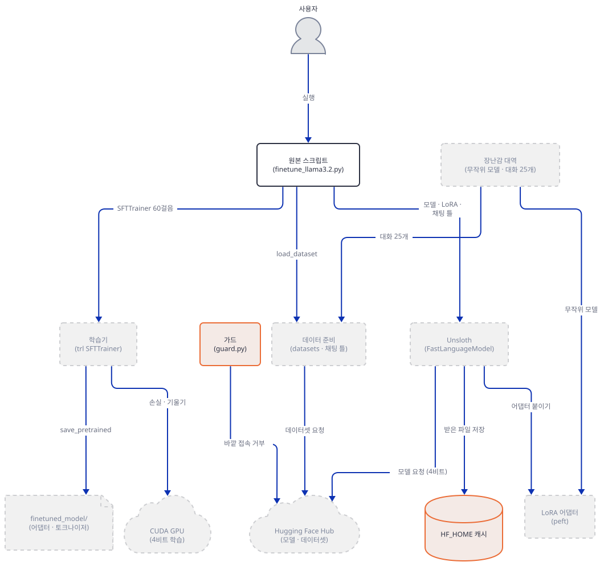

**확인.** 블록을 건 터미널에서 돌립니다.

```bash
uv run --no-project python guard.py
```

```text
guard ok
```

줄 하나를 빼면 멈추는 것을 봅니다. 내가 셸에 진짜 모양의 키(`sk-proj-REALISH…`, `sk-ant-api03-REALISH…`), `HF_TOKEN=hf_REALISH…`, 요청을 기록만 하는 루프백 프록시를 가리키는 `HTTP_PROXY`·`HTTPS_PROXY`·`ALL_PROXY`를 걸고, 상위 폴더에 같은 모양의 가짜 키가 든 `.env`를 두고, 독자 홈(`HOME`)에 가짜 토큰 파일이 든 상태에서 문서를 위에서부터 따라 했습니다. 블록 없이 가드를 돌리면 다음처럼 모든 어긋남을 나열하고 종료 코드 1로 멈춥니다(직접 확인, 경로는 내 PC의 것).

```text
guard: HF_HUB_OFFLINE is not 1; HF_DATASETS_OFFLINE is not 1; TRANSFORMERS_OFFLINE is not 1; HOME is not inside …\finetune-lab\home: the real home (token, credentials) would be visible; USERPROFILE is not inside …; CLAUDE_CONFIG_DIR is not inside the lab home; HF_HOME is not inside the lab folder; Path.home() is …, not inside the lab home; HF_TOKEN is set; ALL_PROXY is set: unset every proxy variable in this terminal (the lab needs no network at all); HTTPS_PROXY is set: …; HTTP_PROXY is set: …; UNSLOTH_DISABLE_STATISTICS is not set
```

`PYTHONPATH`(`sitecustomize.py`)만 빼면 가드가 `guard ok`로 돌지만 스크립트의 `guard.check()`가 같은 소켓 가드를 직접 깝니다(직접 확인). `unset` 줄만 빼면 `HF_TOKEN is set; HTTPS_PROXY is set: …`로, `UNSLOTH_DISABLE_STATISTICS` 줄만 빼면 그 한 줄로, 홈을 돌리는 줄만 빼면 `HOME is not inside …: the real home (token, credentials) would be visible`로 종료 코드 1입니다(모두 직접 확인). 블록을 모두 건 뒤 이 문서의 모든 스크립트를 돌렸을 때 `guard.log`는 비어 있었고(차단된 시도 0건), 상위 `.env`와 셸의 키·토큰은 한 번도 쓰이지 않았으며, 기록 프록시에 들어온 요청은 0건이었습니다(프록시가 작동함은 `curl -x`로 확인했습니다). 같은 가드의 마지막 점검으로 앱의 내려받기 줄이 오프라인에서 어떻게 끝나는지 봅니다. 아래를 `offline_probe.py`로 저장합니다.

```python
"""What happens when the app's download lines run inside the lab: they fail closed. Nothing is downloaded.
(1) load_dataset (app line 25), (2) a tokenizer by repo name, (3) the Hub token this process can see."""
import guard

guard.check()

import huggingface_hub
from datasets import load_dataset
from huggingface_hub import constants
from transformers import AutoTokenizer


def attempt(label, fn):
    try:
        fn()
        print(f"[{label}] worked")
    except BaseException as e:
        print(f"[{label}] {type(e).__name__}: {str(e).splitlines()[0][:230]}")


import datasets.config

print("HF_HUB_CACHE      ->", constants.HF_HUB_CACHE)
print("HF_DATASETS_CACHE ->", datasets.config.HF_DATASETS_CACHE)
print("token file        ->", constants.HF_TOKEN_PATH)
print("get_token()       ->", huggingface_hub.get_token())
attempt("load_dataset FineTome", lambda: load_dataset("mlabonne/FineTome-100k", split="train"))
attempt("AutoTokenizer by name", lambda: AutoTokenizer.from_pretrained("unsloth/Llama-3.2-3B-Instruct"))
attempt("hf_hub_download config.json", lambda: huggingface_hub.hf_hub_download("unsloth/Llama-3.2-3B-Instruct", "config.json"))
```

```bash
uv run --no-project python offline_probe.py
```

기대 출력(직접 확인)입니다. 경로는 내 PC의 것이고, 파이썬이 `\`와 `/`를 섞어 적는 것은 Windows에서 정상입니다.

```text
HF_HUB_CACHE      -> …/finetune-lab/hf_home\hub
HF_DATASETS_CACHE -> …\finetune-lab\hf_home\datasets
token file        -> …/finetune-lab/hf_home\token
get_token()       -> None
[load_dataset FineTome] ConnectionError: Couldn't reach 'mlabonne/FineTome-100k' on the Hub (OfflineModeIsEnabled)
[AutoTokenizer by name] OSError: We couldn't connect to 'https://huggingface.co' to load the files, and couldn't find them in the cached files.
[hf_hub_download config.json] LocalEntryNotFoundError: An error happened while trying to locate the file on the Hub and we cannot find the requested files in the local cache. Please check your connection and try again or make sure your Internet connection is on.
```

토큰 경로가 이 폴더 안이고 `get_token()`이 `None`이며, 앱의 내려받기 줄(`load_dataset`)과 이름으로 모델 받기가 소켓을 열지 않고 닫힌 채로 실패합니다. 캐시가 비어 있으면 몰래 받지 않고 멈춘다는 뜻입니다. 이 문서는 진짜 모델을 받지 않으므로 이것이 정상입니다.

**설치 확인.** Step 1에서 미룬 확인입니다. 아래를 `finetune-lab/versions.py`로 저장하고 블록을 건 터미널에서 돌립니다. 패키지를 불러오지 않고 설치 기록만 읽습니다.

```python
import importlib.metadata as m

for name in ["torch", "unsloth", "unsloth_zoo", "transformers", "datasets", "trl", "peft", "tokenizers", "huggingface_hub",
             "bitsandbytes", "triton-windows", "xformers", "accelerate", "hf-xet"]:
    print(f"{name:16s}", m.version(name))
print("distributions installed:", len(list(m.distributions())))
```

```bash
uv run --no-project python versions.py
```

기대 출력(오늘 기준, 직접 확인)입니다.

```text
torch            2.14.1
unsloth          2026.10.6
unsloth_zoo      2026.10.6
transformers     5.17.0
datasets         4.8.5
trl              1.15.0
peft             0.21.2
tokenizers       0.23.3
huggingface_hub  1.33.0
bitsandbytes     0.50.2
triton-windows   3.8.0.post29
xformers         0.0.35
accelerate       1.15.0
hf-xet           1.7.0
distributions installed: 86
```

요구 다섯 줄이 86개가 됩니다. 눈여겨볼 것이 넷입니다. 첫째, `peft`는 requirements에 없지만 `unsloth`가 끌어옵니다(`Requires-Dist: peft>=0.18.0`). LoRA를 붙이는 라이브러리가 `peft`입니다. 둘째, `torch` 2.14.1은 이 Windows PC에서 CPU판입니다. 파이썬에서 `torch.__version__`을 찍으면 `2.14.1+cpu`이고(Step 4) PyPI의 Windows용 `torch` 바퀴가 CPU판이라서 그렇습니다. 리눅스의 PyPI `torch`가 CUDA판을 끌어오는지는 확인하지 못했습니다. 셋째, `trl`이 오늘 최신(1.16.0)이 아니라 1.15.0인 것은 `unsloth`와 `unsloth_zoo`가 `trl<=1.15.0`, `transformers<=5.17.0`으로 막아 두었기 때문입니다(`Requires-Dist`로 확인). 앱의 `SFTTrainer` 호출이 순수 `trl`과 맞지 않는 까닭은 판 차이가 아니라 처음부터 Unsloth 패치에 기댄 것입니다(Step 7). 넷째, `unsloth`는 Apache-2.0, `unsloth_zoo`는 LGPL-3.0-or-later입니다(패키지 메타데이터로 확인).

### Step 3. 앱이 받는 것 — 공개 카드로만 읽기

**목적.** 원본 스크립트가 무엇을 얼마나 받고 어디에 쌓는지를, 내려받지 않고 Hugging Face의 공개 카드와 파일 목록으로 확인합니다. `load_in_4bit=True`가 실제로 요청하는 저장소 이름도 찾습니다.

**할 일.** 먼저 모델 줄입니다.

`advanced_llm_apps/llm_finetuning_tutorials/llama3.2_finetuning/finetune_llama3.2.py:8-12`

```python
# Load model and tokenizer
model, tokenizer = FastLanguageModel.from_pretrained(
    model_name="unsloth/Llama-3.2-3B-Instruct",
    max_seq_length=2048, load_in_4bit=True,
)
```

`unsloth/Llama-3.2-3B-Instruct`는 16비트(bf16) 저장소입니다. 그런데 `load_in_4bit=True`일 때 Unsloth는 이름을 표(`models/mapper.py`)로 바꿉니다. 보통의 import로는 `unsloth`를 불러올 수 없으므로(Step 4) 그 표와 변환 함수 `__get_model_name`의 소스 글자(`models/loader_utils.py` 965행)를 파일에서 꺼내 그대로 돌리는 스크립트를 씁니다. 아래를 `route.py`로 저장합니다. `unsloth`를 불러오지 않고 파일 위치만 찾습니다.

```python
"""Which repo does FastLanguageModel.from_pretrained(model_name, load_in_4bit=True) really ask for?
unsloth cannot be imported on this machine (no CUDA torch), so this reads the two source files that decide it
(models/mapper.py is plain tables, models/loader_utils.py has the function __get_model_name) and runs that
function's own source text.  Nothing is imported from unsloth and nothing touches the network."""
import ast
import importlib.util
import os
import sys
from pathlib import Path

import guard

guard.check()
spec = importlib.util.find_spec("unsloth")           # find the folder without importing the package
models = Path(spec.submodule_search_locations[0]) / "models"

# 1) mapper.py has no imports: load it by file path under a private name.
ms = importlib.util.spec_from_file_location("unsloth_mapper_by_path", models / "mapper.py")
mapper = importlib.util.module_from_spec(ms)
ms.loader.exec_module(mapper)

# 2) take the source text of __get_model_name out of loader_utils.py and run it.
text = (models / "loader_utils.py").read_text(encoding="utf-8")
node = next(n for n in ast.parse(text).body if isinstance(n, ast.FunctionDef) and n.name == "__get_model_name")
ns = {"os": os, "importlib": importlib, "SUPPORTS_FOURBIT": True, "transformers_version": "x", "Version": None}
exec(ast.get_source_segment(text, node), ns)
get_name = ns["__get_model_name"]

def resolve(name, four):
    return get_name(model_name=name, load_in_4bit=four,
                    INT_TO_FLOAT_MAPPER=mapper.INT_TO_FLOAT_MAPPER, FLOAT_TO_INT_MAPPER=mapper.FLOAT_TO_INT_MAPPER,
                    MAP_TO_UNSLOTH_16bit=mapper.MAP_TO_UNSLOTH_16bit,
                    FLOAT_TO_FP8_BLOCK_MAPPER=mapper.FLOAT_TO_FP8_BLOCK_MAPPER, FLOAT_TO_FP8_ROW_MAPPER=mapper.FLOAT_TO_FP8_ROW_MAPPER)

for name in sys.argv[1:] or ["unsloth/Llama-3.2-3B-Instruct", "unsloth/gemma-3-270m-it"]:
    print(f"{name!r:40} load_in_4bit=True  -> {resolve(name, True)}")
    print(f"{name!r:40} load_in_4bit=False -> {resolve(name, False)}")
```

```bash
uv run --no-project python route.py
```

기대 출력(직접 확인)입니다. 둘째 모델은 Day 153이 쓰는 이름이라 덤으로 넣었습니다.

```text
'unsloth/Llama-3.2-3B-Instruct'          load_in_4bit=True  -> unsloth/Llama-3.2-3B-Instruct-unsloth-bnb-4bit
'unsloth/Llama-3.2-3B-Instruct'          load_in_4bit=False -> None
'unsloth/gemma-3-270m-it'                load_in_4bit=True  -> unsloth/gemma-3-270m-it-unsloth-bnb-4bit
'unsloth/gemma-3-270m-it'                load_in_4bit=False -> None
```

앱이 실제로 받는 것은 `unsloth/Llama-3.2-3B-Instruct-unsloth-bnb-4bit`입니다(`None`은 "바꾸지 않고 적힌 이름 그대로"입니다). 이제 그 저장소와 데이터셋의 공개 카드를 읽습니다. 아래를 `fetch_cards.sh`로 저장하고 돌립니다. `curl -q`는 `~/.curlrc`를 읽지 않고, 로그인도 토큰도 쓰지 않으며, 이 줄이 이 문서에서 Hugging Face에 닿는 유일한 줄입니다. 읽는 것은 작은 JSON과 카드 글뿐이고 가중치 파일은 받지 않습니다.

```bash
# Public pages only, no login, no token. curl -q ignores any ~/.curlrc.
set -e
mkdir -p cards
H=https://huggingface.co
get() { curl -q -sS -L --fail -o "cards/$1" "$2"; echo "$1  $(wc -c < "cards/$1") bytes"; }
get 4bit_tree.json    "$H/api/models/unsloth/Llama-3.2-3B-Instruct-unsloth-bnb-4bit/tree/main"
get 4bit_model.json   "$H/api/models/unsloth/Llama-3.2-3B-Instruct-unsloth-bnb-4bit"
get meta_model.json   "$H/api/models/meta-llama/Llama-3.2-3B-Instruct"
get 4bit_config.json "$H/unsloth/Llama-3.2-3B-Instruct-unsloth-bnb-4bit/raw/main/config.json"
get bf16_tree.json    "$H/api/models/unsloth/Llama-3.2-3B-Instruct/tree/main"
get config.json       "$H/unsloth/Llama-3.2-3B-Instruct/raw/main/config.json"
get ds_tree.json      "$H/api/datasets/mlabonne/FineTome-100k/tree/main/data"
get ds_card.md        "$H/datasets/mlabonne/FineTome-100k/raw/main/README.md"
```

```bash
bash fetch_cards.sh
```

```text
4bit_tree.json  1329 bytes
4bit_model.json  10372 bytes
meta_model.json  23776 bytes
4bit_config.json  1494 bytes
bf16_tree.json  1778 bytes
config.json  890 bytes
ds_tree.json  319 bytes
ds_card.md  982 bytes
```

(PowerShell에서는 `curl`이 `Invoke-WebRequest`의 별칭이라 `curl.exe`로 바꿔 한 줄씩 돌리거나 Git Bash로 돌립니다. 이 줄은 실행해 보지 못했습니다.) 읽은 날짜는 2026-10-19이고 주소는 스크립트에 있습니다. 숫자를 뽑는 `cards.py`입니다. 표준 라이브러리만 씁니다.

```python
"""Read the public cards that fetch_cards.sh saved. Standard library only; nothing is downloaded here."""
import json
import re
from pathlib import Path

d = Path("cards")
tree = json.loads((d / "4bit_tree.json").read_text(encoding="utf-8"))
print("unsloth/Llama-3.2-3B-Instruct-unsloth-bnb-4bit:")
for e in tree:
    print(f"  {e['size']:>13,}  {e['path']}")
print(f"  {sum(e['size'] for e in tree):>13,}  total")
m = json.loads((d / "4bit_model.json").read_text(encoding="utf-8"))
print("  gated:", m["gated"], "| license:", m["cardData"]["license"], "| last modified:", m["lastModified"])
bf = json.loads((d / "bf16_tree.json").read_text(encoding="utf-8"))
print("  16-bit repo unsloth/Llama-3.2-3B-Instruct, safetensors files:", [f"{e['size']:,}" for e in bf if e["path"].endswith(".safetensors")])
qc = json.loads((d / "4bit_config.json").read_text(encoding="utf-8"))["quantization_config"]
print("  quantization_config:", {k: qc[k] for k in ("quant_method", "bnb_4bit_quant_type", "bnb_4bit_use_double_quant", "llm_int8_skip_modules")})
q = json.loads((d / "config.json").read_text(encoding="utf-8"))
print("  config.json (bf16 repo):", {k: q[k] for k in ("hidden_size", "intermediate_size", "num_hidden_layers", "num_attention_heads", "num_key_value_heads", "head_dim", "vocab_size")})
meta = json.loads((d / "meta_model.json").read_text(encoding="utf-8"))
print("meta-llama/Llama-3.2-3B-Instruct: gated:", meta["gated"], "| license:", meta["cardData"]["license"])
ds = json.loads((d / "ds_tree.json").read_text(encoding="utf-8"))
print("mlabonne/FineTome-100k data/:", [(e["path"], f"{e['size']:,}") for e in ds])
card = (d / "ds_card.md").read_text(encoding="utf-8")
front = card.split("---")[1]
print("dataset card front matter has a license line?", bool(re.search(r"^license:", front, re.M)))
print("num_examples:", re.search(r"num_examples: (\d+)", front).group(1), "| dataset_size:", re.search(r"dataset_size: ([\d.]+)", front).group(1))
```

```bash
uv run --no-project python cards.py
```

기대 출력(직접 확인)입니다.

```text
unsloth/Llama-3.2-3B-Instruct-unsloth-bnb-4bit:
          1,570  .gitattributes
          6,873  README.md
          3,827  chat_template.jinja
          1,494  config.json
            234  generation_config.json
  2,354,805,470  model.safetensors
            454  special_tokens_map.json
     17,209,920  tokenizer.json
         54,669  tokenizer_config.json
  2,372,084,511  total
  gated: False | license: llama3.2 | last modified: 2025-06-02T21:41:30.000Z
  16-bit repo unsloth/Llama-3.2-3B-Instruct, safetensors files: ['4,965,799,096', '1,459,729,952']
  quantization_config: {'quant_method': 'bitsandbytes', 'bnb_4bit_quant_type': 'nf4', 'bnb_4bit_use_double_quant': True, 'llm_int8_skip_modules': ['lm_head', 'multi_modal_projector', 'merger', 'modality_projection', 'model.layers.1.mlp']}
  config.json (bf16 repo): {'hidden_size': 3072, 'intermediate_size': 8192, 'num_hidden_layers': 28, 'num_attention_heads': 24, 'num_key_value_heads': 8, 'head_dim': 128, 'vocab_size': 128256}
meta-llama/Llama-3.2-3B-Instruct: gated: manual | license: llama3.2
mlabonne/FineTome-100k data/: [('data/train-00000-of-00001.parquet', '116,531,415')]
dataset card front matter has a license line? False
num_examples: 100000 | dataset_size: 239650960.7474458
```

읽을 것이 다섯입니다. 첫째, 모델 쪽은 파일 아홉 개 약 2.37GB(2,372,084,511바이트)이고 거의 전부가 `model.safetensors` 하나입니다. 같은 모델의 16비트 저장소는 `safetensors`가 4,965,799,096바이트와 1,459,729,952바이트 두 조각(합 6.43GB)이므로 4비트가 약 3분의 1입니다. 4비트 저장소의 `config.json`은 `bitsandbytes`의 NF4 양자화에 이중 양자화를 쓰고, `model.layers.1.mlp`는 양자화에서 빠져 있습니다(`llm_int8_skip_modules`, 출력의 `quantization_config`). 둘째, 데이터 쪽은 parquet 파일 하나 116,531,415바이트(111MiB)이고 100,000행입니다. `load_dataset`은 그것을 받은 뒤 Arrow 파일로 다시 만들어 두며 카드의 `dataset_size`는 239,650,960바이트(약 229MiB)입니다. 셋째, 쌓이는 곳은 `HF_HOME`입니다. 모델·parquet은 `HF_HOME/hub/`, Arrow 캐시는 `HF_HOME/datasets/`이고(Step 2의 `offline_probe.py` 출력이 두 경로를 찍습니다), `HF_HOME`을 정하지 않으면 홈의 `~/.cache/huggingface/`입니다. 학습이 끝나면 앱의 `outputs/`(`SFTConfig`의 `output_dir`)와 `finetuned_model/`이 작업 폴더에 생깁니다. 넷째, 접근 조건은 사전 준비의 세 항목입니다. 미러는 `gated: False`, 원본은 `gated: manual`입니다. 다섯째, 앱 README의 `git clone` 뒤 `cd awesome-llm-apps/llm_finetuning_tutorials/llama3.2_finetuning`(21행)은 `advanced_llm_apps/`가 빠진 경로입니다. 리포에서 그대로 따라 하면 그 폴더가 없다고 나옵니다(경로를 `ls`로 직접 확인했습니다).

앱 README는 4행에서 "30 Lines" 튜토리얼 링크(https://www.theunwindai.com/p/fine-tune-llama-3-2-for-free-in-30-lines-of-python-code)를 안내합니다. 2026-10-19에 읽기만 했고, 코드는 같은 모델·`r=16`·일곱 투영·60걸음·`finetuned_model` 저장이며 `train_on_responses_only`는 언급하지 않았습니다. 글은 Python "3.7 이상"을 권하지만 오늘 설치되는 `unsloth`는 3.9 이상을 요구합니다. 앱 README의 Colab 안내(72~82행)는 읽기만 했습니다.

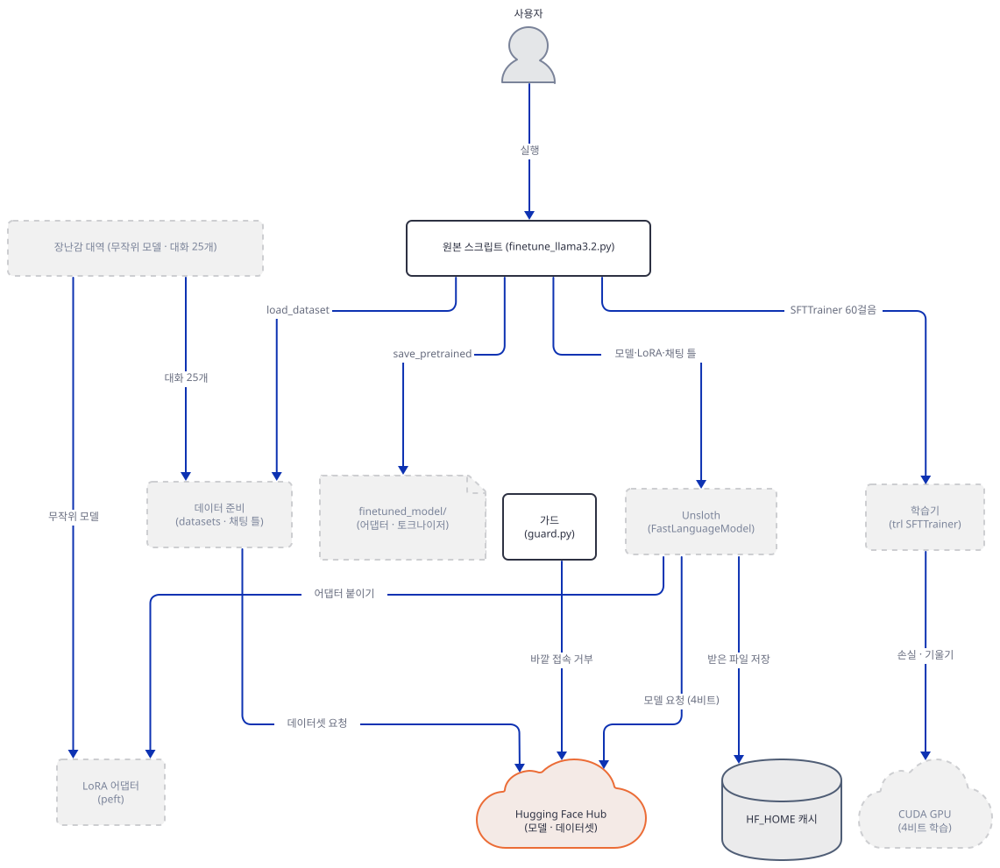

**확인.** `route.py`의 첫 줄이 `…-unsloth-bnb-4bit`를, `cards.py`가 `model.safetensors` 2,354,805,470바이트와 `FineTome` 행 100000을 내놓으면 됩니다.

### Step 4. Unsloth를 불러오면 — 멈춤과 바깥으로 나가는 것

**목적.** 원본의 첫 줄들이 이 PC에서 어디서 멈추는지 보고, Unsloth가 모델·학습 중에 바깥으로 무엇을 보내는지 소스로 확인합니다.

**할 일.** 원본의 앞머리입니다.

`advanced_llm_apps/llm_finetuning_tutorials/llama3.2_finetuning/finetune_llama3.2.py:1-6`

```python
import torch
from unsloth import FastLanguageModel
from datasets import load_dataset
from trl import SFTTrainer, SFTConfig 
from transformers import DataCollatorForSeq2Seq 
from unsloth.chat_templates import get_chat_template, standardize_sharegpt
```

그대로 불러 봅니다. 아래를 `try_unsloth.py`로 저장합니다. 첫 줄이 가드이니 오프라인 변수와 소켓 가드 아래에서만 `import unsloth`가 일어납니다.

```python
"""Step 4: what `from unsloth import ...` (app line 2) does on this machine. Guard first, as in every script of this lab."""
import guard

guard.check()

import torch

print("torch", torch.__version__, "| cuda available:", torch.cuda.is_available())
try:
    import unsloth  # noqa: F401
    print("unsloth imported")
except BaseException as e:
    print(type(e).__name__ + ":", str(e)[:420])
```

```bash
uv run --no-project python try_unsloth.py
```

기대 출력(직접 확인)입니다. 두 번째 줄은 GPU와 `torch` 상태에 따라 말이 다릅니다. 이 PC는 `nvidia-smi`가 GPU(RTX 5060 Laptop)를 보지만 `torch`가 CPU판이라 이렇게 나옵니다. 가상환경 경로는 내 PC의 것입니다.

```text
torch 2.14.1+cpu | cuda available: False
NotImplementedError: Unsloth: nvidia-smi sees NVIDIA GeForce RTX 5060 Laptop GPU but torch.cuda.is_available() is False (torch 2.14.1+cpu). PyTorch likely does not match this machine; reinstall it for …\finetune-lab\.venv\Scripts\python.exe per https://github.com/unslothai/unsloth#-install
```

원본은 2행에서 멈춥니다. `unsloth_zoo/device_type.py` 416행이 `NotImplementedError("Unsloth cannot find any torch accelerator? You need a GPU.")`를 던지고, `unsloth/_gpu_init.py`가 `nvidia-smi --query-gpu=name`으로 GPU 이름을 읽어(189행, 이 문서가 GPU를 쓰는 유일한 순간이고 이름만 묻습니다) 위 말로 바꿔 다시 던집니다. GPU가 아예 없으면 앞의 "You need a GPU." 말이 그대로 나옵니다. 고치는 길은 `unsloth`의 설치 안내에 따라 이 GPU에 맞는 CUDA판 `torch`를 넣는 것입니다(이 PC의 RTX 5060이 어느 CUDA판을 요구하는지는 확인하지 않았고, 이 문서는 큰 CUDA 바퀴를 받지 않았습니다). Day 153의 앱도 같은 라이브러리를 쓰므로 같은 지점에서 멈춥니다.

이제 가드가 왜 필요한지 소스로 봅니다. 아래를 `where.py`로 저장하고 돌리면 설치된 `unsloth`와 `unsloth_zoo`에서 이 Step과 다음 Step들이 인용하는 줄 번호를 찍습니다. 패키지를 불러오지 않습니다.

```python
"""Find the lines of the installed unsloth / unsloth_zoo that matter for the network, without importing either package."""
import importlib.util
from pathlib import Path

PATTERNS = [
    ("unsloth", "models/_utils.py", ["def has_internet", '"UNSLOTH_DISABLE_STATISTICS" in os.environ', "f\"unslothai/{statistics}\"", "sock.connect((host, port))", "host = \"8.8.8.8\""]),
    ("unsloth", "models/loader_utils.py", ["raw.githubusercontent.com/unslothai/unsloth/main/unsloth/models/mapper.py", "and not _env_says_offline()"]),
    ("unsloth", "models/llama.py", ["get_statistics(kwargs.get(\"local_files_only\", False))", "token = hf_login(token)"]),
    ("unsloth", "models/_utils.py", ["def hf_login", "return get_token()"]),
    ("unsloth", "trainer.py", ["def _backwards_compatible_trainer", "kwargs[\"processing_class\"] = kwargs.pop(\"tokenizer\")"]),
    ("unsloth", "chat_templates.py", ["DEFAULT_SYSTEM_MESSAGE[\"llama-3.1\"]", "standardize_sharegpt = standardize_data_formats", "def train_on_responses_only"]),
    ("unsloth", "models/rl_replacements.py", ["has_bos_token_already = ("]),
    ("unsloth", "save.py", ["def unsloth_model_save_pretrained"]),
    ("unsloth_zoo", "dataset_utils.py", ["def standardize_data_formats", "We found double BOS tokens"]),
    ("unsloth_zoo", "device_type.py", ["You need a GPU."]),
]
for pkg, rel, needles in PATTERNS:
    root = Path(importlib.util.find_spec(pkg).submodule_search_locations[0])
    lines = (root / rel).read_text(encoding="utf-8").splitlines()
    for needle in needles:
        hits = [i for i, line in enumerate(lines, 1) if needle in line]
        print(f"{pkg}/{rel}:{','.join(map(str, hits[:3])) or '-':<12} {needle}")
```

```bash
uv run --no-project python where.py
```

```text
unsloth/models/_utils.py:4254         def has_internet
unsloth/models/_utils.py:4381         "UNSLOTH_DISABLE_STATISTICS" in os.environ
unsloth/models/_utils.py:4350         f"unslothai/{statistics}"
unsloth/models/_utils.py:4270         sock.connect((host, port))
unsloth/models/_utils.py:4255         host = "8.8.8.8"
unsloth/models/loader_utils.py:1032         raw.githubusercontent.com/unslothai/unsloth/main/unsloth/models/mapper.py
unsloth/models/loader_utils.py:1634         and not _env_says_offline()
unsloth/models/llama.py:2980         get_statistics(kwargs.get("local_files_only", False))
unsloth/models/llama.py:2938         token = hf_login(token)
unsloth/models/_utils.py:7920         def hf_login
unsloth/models/_utils.py:7927         return get_token()
unsloth/trainer.py:1677         def _backwards_compatible_trainer
unsloth/trainer.py:1686         kwargs["processing_class"] = kwargs.pop("tokenizer")
unsloth/chat_templates.py:572          DEFAULT_SYSTEM_MESSAGE["llama-3.1"]
unsloth/chat_templates.py:87           standardize_sharegpt = standardize_data_formats
unsloth/chat_templates.py:59           def train_on_responses_only
unsloth/models/rl_replacements.py:835          has_bos_token_already = (
unsloth/save.py:7898         def unsloth_model_save_pretrained
unsloth_zoo/dataset_utils.py:2482         def standardize_data_formats
unsloth_zoo/dataset_utils.py:2821         We found double BOS tokens
unsloth_zoo/device_type.py:416          You need a GPU.
```

(소스로 읽은 것이고 불러 보지는 못했습니다.) `from_pretrained`가 일으키는 바깥 요청은 셋입니다. 첫째, **사용 통계.** `FastLanguageModel.from_pretrained`(`models/llama.py` 2980행)가 `get_statistics`를 부릅니다. 그 함수는 환경 이름(`colab`·`kaggle`·`aws`·`other` 등), `repeat`, `vram-8` 같은 VRAM 구간, GPU 개수를 이름으로 한 Hugging Face 저장소 `unslothai/<이름>`을 `snapshot_download`로 받습니다(`models/_utils.py` 4350행 등, 주석은 "all data public"이라 적습니다). 받는 요청 자체가 통계이고, 위에서 본 대로 이 요청은 기본으로 저장된 Hugging Face 토큰을 싣습니다. 요청 전에 `has_internet()`이 **8.8.8.8의 53번 포트로 TCP 접속**을 시험합니다(4254~4270행). 이 함수는 `UNSLOTH_DISABLE_STATISTICS`가 환경에 **있거나** `UNSLOTH_USE_MODELSCOPE=1`이거나 `local_files_only`이거나 `TRANSFORMERS_OFFLINE`·`HF_HUB_OFFLINE`이 참이면 아무것도 하지 않고 돌아옵니다(4376~4398행). 둘째, **이름 표 새로 읽기.** 모델 이름이 설치된 표에 없고 오프라인이 아니면 GitHub의 `raw.githubusercontent.com/unslothai/unsloth/main/unsloth/models/mapper.py`를 읽습니다(`loader_utils.py` 1026~1041행, 오프라인이면 건너뜀, 1634행). 이 앱의 모델 이름은 표에 있으므로 이 길은 타지 않습니다. 셋째, **모델과 데이터셋 내려받기**(Step 3). `ROCm` 경로의 `download.pytorch.org` 확인(`device_type.py` 41~108행)은 AMD GPU에서만 쓰입니다. 오늘 `pip`나 업데이트를 확인하는 호출은 찾지 못했습니다(`requests`·`urlopen`·`httpx`·`socket.connect`를 부르는 곳을 두 패키지에서 훑었습니다). 그러니 통계와 8.8.8.8 시험을 끄는 변수는 `UNSLOTH_DISABLE_STATISTICS=1`이고, 오프라인 변수(`HF_HUB_OFFLINE`·`TRANSFORMERS_OFFLINE`) 하나만 있어도 같은 효과입니다. 그러나 GitHub 표 읽기는 `UNSLOTH_DISABLE_STATISTICS`로는 꺼지지 않고 오프라인 변수로만 꺼집니다(`loader_utils.py` 1634행이 `_env_says_offline()`을 보고, 그 함수는 3666~3673행에서 두 변수만 봅니다). 이 문서의 블록에는 둘 다 들어 있고, 어느 줄을 빼도 가드가 먼저 멈춥니다(Step 2).

보통의 import로는 위처럼 멈추지만, Unsloth에는 시험용 스위치 `UNSLOTH_ALLOW_CPU=1`이 있습니다. CPU `torch`에서도 import가 되게 장치 종류를 "cuda"라고 답하게 하는 스위치이고(`unsloth_zoo/device_type.py` 374~383행, `unsloth/device_type.py` 94행), 그 대가로 `trl` 패치 설치를 일부러 건너뜁니다(`unsloth/_gpu_init.py` 770~773행, `models/rl.py` 4898~4900행). 독자에게 권하는 해결책이 아니라, 이 문서가 소스로만 읽은 주장을 Step 7에서 실행해 보려고 쓴 스위치입니다. 스위치로 불러왔을 때 `import unsloth`는 16초쯤 걸렸고 가드 로그는 비어 있었습니다(직접 확인). 원본을 진짜로 돌릴 때는 모델을 받아야 하니 오프라인 변수는 걸 수 없고, 그때는 통계 변수만 걸고 토큰을 `hf auth login` 없이 두는 것이 줄 수 있는 최소입니다.

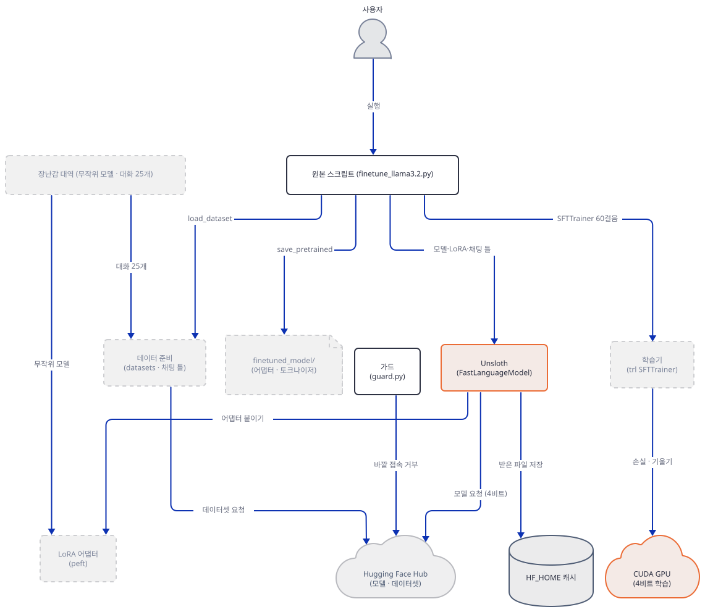

**확인.** `try_unsloth.py`가 `NotImplementedError`로 끝나고 `guard.log`가 없거나 비어 있으면 됩니다.

### Step 5. 데이터 — ShareGPT에서 학습 글까지

**목적.** 앱의 데이터 부분(23~35행)이 대화를 어떤 글로 바꾸는지, 장난감 토크나이저와 대화 25개로 만들어 봅니다.

**할 일.** 앱의 데이터 줄입니다.

`advanced_llm_apps/llm_finetuning_tutorials/llama3.2_finetuning/finetune_llama3.2.py:23-35`

```python
# Set up chat template and prepare dataset
tokenizer = get_chat_template(tokenizer, chat_template="llama-3.1")
dataset = load_dataset("mlabonne/FineTome-100k", split="train")
dataset = standardize_sharegpt(dataset)
dataset = dataset.map(
    lambda examples: {
        "text": [
            tokenizer.apply_chat_template(convo, tokenize=False)
            for convo in examples["conversations"]
        ]
    },
    batched=True
)
```

FineTome-100k의 행은 `conversations`(`from`이 `human`·`gpt`, `value`가 글인 목록), `source`, `score` 세 열입니다. 같은 날 공개 행 API(`datasets-server.huggingface.co/rows`)로 앞 세 행만 읽어 보니 모두 `source`가 `infini-instruct-top-500k`이고 대화는 사람 1턴·gpt 1턴, 글자 수는 사람 927·119·549자, gpt 2,956·1,636·3,585자였습니다(직접 확인). 학습 글이 꽤 길다는 뜻입니다. `max_seq_length=2048`은 토큰 수라 글자로는 대략 8천 자 안팎까지입니다(⚠ 한 토큰이 3~4자라는 어림이고 진짜 토크나이저로 세지 않았습니다).

장난감 데이터를 같은 모양으로 손으로 씁니다. `toy_data.py`로 저장합니다. 스무 개는 한 턴, 다섯 개는 두 턴입니다. FineTome의 행이 아닙니다.

```python
"""Twenty-five tiny conversations written by hand in the shape of FineTome-100k:
each row has "conversations" (a list of {"from": "human" | "gpt", "value": text}), "source" and "score".
They are NOT taken from FineTome-100k."""

PAIRS = [
    ("What is a prime number?", "A prime number is a whole number greater than one that has no divisors other than one and itself."),
    ("Why is the sky blue?", "Air scatters short blue wavelengths of sunlight more strongly than long red ones, so the sky looks blue."),
    ("What does a compiler do?", "A compiler translates source code written by a person into instructions that a computer can run."),
    ("How many days are in a leap year?", "A leap year has 366 days because February gets an extra day."),
    ("What is the capital of France?", "The capital of France is Paris."),
    ("Explain what a variable is.", "A variable is a named place in memory that holds a value which a program can read and change."),
    ("What is the boiling point of water?", "Water boils at 100 degrees Celsius at sea level."),
    ("Name the largest planet.", "Jupiter is the largest planet in the solar system."),
    ("What is a function in programming?", "A function is a reusable block of code that takes inputs, does some work and returns a result."),
    ("Why do we sleep?", "Sleep lets the body repair itself and lets the brain sort and store what it learned during the day."),
    ("What is an array?", "An array is an ordered list of values that you can reach by their position number."),
    ("How does a magnet work?", "A magnet pulls on iron because its atoms line up and create a magnetic field around it."),
    ("What is the square root of 81?", "The square root of 81 is 9, because 9 times 9 equals 81."),
    ("Define photosynthesis.", "Photosynthesis is how plants turn sunlight, water and carbon dioxide into sugar and oxygen."),
    ("What is a loop?", "A loop repeats a block of code until a condition says it should stop."),
    ("Who wrote Hamlet?", "William Shakespeare wrote the play Hamlet."),
    ("What is the freezing point of water?", "Water freezes at zero degrees Celsius."),
    ("What is a database?", "A database is an organized collection of data that programs can store, search and update."),
    ("How many sides does a hexagon have?", "A hexagon has six sides."),
    ("What does HTTP stand for?", "HTTP stands for HyperText Transfer Protocol, the way web browsers and servers talk."),
]
TWO_TURN = [
    (
        [("What is an integer?", "An integer is a whole number such as three or minus seven."),
         ("And a float?", "A float is a number with a decimal point such as three point one four.")]
    ),
    (
        [("What is a bug?", "A bug is a mistake in a program that makes it behave in a way nobody intended."),
         ("How do I find one?", "Read the error message, reproduce the problem, and test one small part of the program at a time.")]
    ),
    (
        [("What is the speed of light?", "Light travels at about 300 thousand kilometers per second in empty space."),
         ("Is anything faster?", "No. Nothing with mass can reach or pass the speed of light.")]
    ),
    (
        [("What is a string?", "A string is a sequence of characters, such as a word or a sentence."),
         ("Can I join two strings?", "Yes. Joining strings is called concatenation, and most languages use the plus sign for it.")]
    ),
    (
        [("What is gravity?", "Gravity is the force that pulls objects with mass toward each other."),
         ("Why do we not float away?", "The mass of the Earth pulls us toward its center with a force we feel as weight.")]
    ),
]


def conversations():
    rows = []
    for q, a in PAIRS:
        rows.append([{"from": "human", "value": q}, {"from": "gpt", "value": a}])
    for turns in TWO_TURN:
        convo = []
        for q, a in turns:
            convo.append({"from": "human", "value": q})
            convo.append({"from": "gpt", "value": a})
        rows.append(convo)
    return [{"conversations": c, "source": "toy-by-hand", "score": 5.0} for c in rows]


if __name__ == "__main__":
    rows = conversations()
    print(len(rows), "rows;", sum(len(r["conversations"]) for r in rows), "messages")
```

다음으로 "llama-3.1" 틀을 소스에서 꺼냅니다. 이 틀은 `unsloth/chat_templates.py`의 `llama31_template` 문자열이고(455행~), `DEFAULT_SYSTEM_MESSAGE["llama-3.1"] = ""`라서 `{system_message}` 자리가 빈 글로 바뀝니다(572행, `_change_system_message`). 보통의 import로는 `unsloth`를 불러올 수 없으니 파일을 읽어 문자열만 꺼내는 `template.py`를 씁니다.

```python
"""Read unsloth's "llama-3.1" chat template out of the installed source WITHOUT importing unsloth.
(import unsloth stops on a machine without a CUDA torch; the template is a plain string in chat_templates.py.)

What unsloth does with it, from chat_templates.py:
  CHAT_TEMPLATES["llama-3.1"] = (llama31_template, "eos_token", False, ...)   line ~571
  DEFAULT_SYSTEM_MESSAGE["llama-3.1"] = ""                                    line ~572
  _change_system_message() then does template.replace("{system_message}", "")  (default system message is empty)
"""
import ast
import importlib.util
from pathlib import Path


def unsloth_file(name):
    spec = importlib.util.find_spec("unsloth")  # locates the folder, does not import the package
    return Path(spec.submodule_search_locations[0]) / name


def llama31_template():
    path = unsloth_file("chat_templates.py")
    tree = ast.parse(path.read_text(encoding="utf-8"))
    for node in tree.body:
        if isinstance(node, ast.Assign) and any(getattr(t, "id", None) == "llama31_template" for t in node.targets):
            template = ast.literal_eval(node.value)
            return template.replace("{system_message}", "")
    raise SystemExit("llama31_template not found in " + str(path))


if __name__ == "__main__":
    t = llama31_template()
    print(len(t), "characters;", t.count("\n") + 1, "lines")
```

```bash
uv run --no-project python template.py
```

```text
4568 characters; 140 lines
```

이제 장난감 토크나이저와 모델을 만듭니다. `make_toy.py`입니다. 어휘 512개의 바이트 단위 BPE를 대화 글에서 학습하고, Llama 3.2와 같은 특수 토큰 이름(`<|begin_of_text|>`, `<|eot_id|>`, 패딩 `<|finetune_right_pad_id|>` 등)과 같은 후처리(입력 앞에 시작 토큰 하나. 진짜 토크나이저의 `tokenizer.json`도 `post_processor`에 `TemplateProcessing`으로 `<|begin_of_text|>` + `$A`를 둡니다. `curl`의 범위 요청으로 앞 15만 바이트만 읽어 확인했습니다)를 두고, 위의 틀을 붙입니다. 모델은 층 2개, 폭 64, 머리 4개에 키·값 머리 2개(Llama 3.2 3B는 층 28개, 폭 3072, 머리 24개에 키·값 머리 8개)인 `LlamaForCausalLM`이고 무작위 가중치입니다.

```python
"""Build the toy stand-in: a tokenizer trained on the toy conversations and a RANDOM-weight Llama-shaped model.
Same shape as Llama 3.2 3B (LlamaForCausalLM, grouped-query attention, SwiGLU MLP, tied embeddings) but 2 layers, width 64.
Nothing here is Llama's vocabulary or Llama's weights."""
import guard

guard.check()

import json
import torch
from tokenizers import Tokenizer, decoders, models, pre_tokenizers, processors, trainers
from transformers import LlamaConfig, LlamaForCausalLM, PreTrainedTokenizerFast

from template import llama31_template
from toy_data import conversations

SPECIAL = ["<|begin_of_text|>", "<|end_of_text|>", "<|start_header_id|>", "<|end_header_id|>", "<|eot_id|>",
           "<|finetune_right_pad_id|>"]

# text the tokenizer learns from: every message plus the words of the template
corpus = [m["value"] for row in conversations() for m in row["conversations"]]
corpus += ["system user assistant Cutting Knowledge Date: December 2023 Today Date: 26 July 2024"]

tok = Tokenizer(models.BPE())
tok.pre_tokenizer = pre_tokenizers.ByteLevel(add_prefix_space=False)
tok.decoder = decoders.ByteLevel()
trainer = trainers.BpeTrainer(vocab_size=512, special_tokens=SPECIAL, initial_alphabet=pre_tokenizers.ByteLevel.alphabet())
tok.train_from_iterator(corpus, trainer)
tok.post_processor = processors.TemplateProcessing(single="<|begin_of_text|> $A", special_tokens=[("<|begin_of_text|>", tok.token_to_id("<|begin_of_text|>"))])

fast = PreTrainedTokenizerFast(tokenizer_object=tok, bos_token="<|begin_of_text|>", eos_token="<|eot_id|>",
                               pad_token="<|finetune_right_pad_id|>", padding_side="right", model_max_length=2048)
fast.chat_template = llama31_template()
fast.save_pretrained("toy_tok")

V = len(fast)
cfg = LlamaConfig(vocab_size=V, hidden_size=64, intermediate_size=128, num_hidden_layers=2, num_attention_heads=4,
                  num_key_value_heads=2, head_dim=16, max_position_embeddings=2048, tie_word_embeddings=True,
                  bos_token_id=fast.bos_token_id, eos_token_id=fast.eos_token_id, pad_token_id=fast.pad_token_id)
torch.manual_seed(0)
model = LlamaForCausalLM(cfg)
model.save_pretrained("toy_base")
n = sum(p.numel() for p in model.parameters())
print(f"vocab {V}; model {n:,} parameters; special ids {[fast.convert_tokens_to_ids(s) for s in SPECIAL]}")
```

```bash
uv run --no-project python make_toy.py
```

```text
vocab 512; model 106,816 parameters; special ids [0, 1, 2, 3, 4, 5]
```

(앞뒤로 `SyntaxWarning`과 `Writing model shards` 진행 줄이 나옵니다.) 이제 앱의 23~35행을 장난감에 돌립니다. `render.py`입니다. `standardize_sharegpt`(=`unsloth_zoo.dataset_utils.standardize_data_formats`, `chat_templates.py` 87행)는 보통의 import로는 돌릴 수 없어서 소스(`dataset_utils.py` 2482~2614행)를 읽고 같은 일을 하는 짧은 함수를 손으로 썼습니다. 하는 일은 역할을 담은 열(`from`)을 `role`로, 글 열(`value`)을 `content`로 바꾸고 `human`·`input`을 `user`로, `gpt`·`output`을 `assistant`로 맞추는 것입니다. 이 손 함수가 진짜와 같은지는 Step 7의 시험 스위치 실행에서 25행 모두 같은 것으로 확인했습니다.

```python
"""The data half of the app (finetune_llama3.2.py:23-35) on the toy data:
ShareGPT rows -> standardize_sharegpt -> apply_chat_template -> a "text" column."""
import guard

guard.check()

from datasets import Dataset
from transformers import AutoTokenizer

from toy_data import conversations

ds = Dataset.from_list(conversations())
print("columns:", ds.column_names)
print("row 0 before:", ds[0]["conversations"])

# What unsloth_zoo.dataset_utils.standardize_data_formats does to a text dataset (source lines 2482-2614), written out by hand:
# the key that holds the role becomes "role", the other becomes "content", and the role names map to system/user/assistant.
ALIASES = {"system": "system", "user": "user", "human": "user", "input": "user", "gpt": "assistant", "assistant": "assistant", "output": "assistant"}


def standardize(batch):
    return {"conversations": [[{"role": ALIASES[m["from"]], "content": m["value"]} for m in convo] for convo in batch["conversations"]]}


ds = ds.map(standardize, batched=True)
print("row 0 after: ", ds[0]["conversations"])

tok = AutoTokenizer.from_pretrained("toy_tok")
ds = ds.map(lambda ex: {"text": [tok.apply_chat_template(c, tokenize=False) for c in ex["conversations"]]}, batched=True)
print("columns:", ds.column_names)
print("row 0 text:")
print(repr(ds[0]["text"]))
print()
print(ds[0]["text"])
ds.save_to_disk("toy_text_ds")
```

```bash
uv run --no-project python render.py
```

기대 출력(직접 확인)입니다. 진행 막대 줄은 뺐습니다.

```text
columns: ['conversations', 'source', 'score']
row 0 before: [{'from': 'human', 'value': 'What is a prime number?'}, {'from': 'gpt', 'value': 'A prime number is a whole number greater than one that has no divisors other than one and itself.'}]
row 0 after:  [{'role': 'user', 'content': 'What is a prime number?'}, {'role': 'assistant', 'content': 'A prime number is a whole number greater than one that has no divisors other than one and itself.'}]
columns: ['conversations', 'source', 'score', 'text']
row 0 text:
'<|begin_of_text|><|start_header_id|>system<|end_header_id|>\n\nCutting Knowledge Date: December 2023\nToday Date: 26 July 2024\n\n<|eot_id|><|start_header_id|>user<|end_header_id|>\n\nWhat is a prime number?<|eot_id|><|start_header_id|>assistant<|end_header_id|>\n\nA prime number is a whole number greater than one that has no divisors other than one and itself.<|eot_id|>'

<|begin_of_text|><|start_header_id|>system<|end_header_id|>

Cutting Knowledge Date: December 2023
Today Date: 26 July 2024

<|eot_id|><|start_header_id|>user<|end_header_id|>

What is a prime number?<|eot_id|><|start_header_id|>assistant<|end_header_id|>

A prime number is a whole number greater than one that has no divisors other than one and itself.<|eot_id|>
```

읽을 것이 둘입니다. 첫째, 대화에 시스템 글이 없는데도 틀이 시스템 구역을 만들어 **고정 날짜 두 줄**을 넣습니다. "Cutting Knowledge Date: December 2023"과 "Today Date: 26 July 2024"는 틀 소스에 박힌 값이고(`date_string` 기본값, 틀의 ``) 모든 샘플에 똑같이 붙습니다. 학습한 모델은 그 날짜가 오늘이라고 믿도록 배울 수 있습니다(⚠ 이 영향은 재지 않았습니다. 장난감은 무작위 가중치라 잴 수 없습니다). 둘째, 글이 `<|begin_of_text|>`로 시작합니다. 이 글을 다시 토큰으로 바꿀 때 문제가 되는 일은 Step 7에서 봅니다.

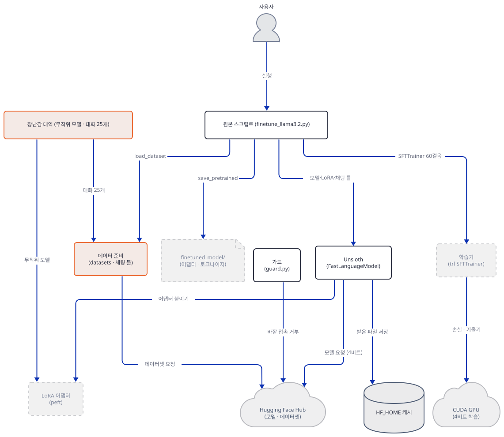

**확인.** `row 0 text`가 위처럼 `<|begin_of_text|>`로 시작해 `<|eot_id|>`로 끝나고 `text` 열이 생겼으면 됩니다.

### Step 6. 모델 — LoRA 붙이기와 숫자 세기

**목적.** 앱의 LoRA 줄(14~21행)이 학습시키는 매개변수가 몇 개인지, 장난감으로 공식을 확인하고 진짜 모델 값을 계산합니다.

**할 일.** 앱의 LoRA 줄입니다.

`advanced_llm_apps/llm_finetuning_tutorials/llama3.2_finetuning/finetune_llama3.2.py:14-21`

```python
# Add LoRA adapters
model = FastLanguageModel.get_peft_model(
    model, r=16,
    target_modules=[
        "q_proj", "k_proj", "v_proj", "o_proj",
        "gate_proj", "up_proj", "down_proj"
    ],
)
```

`r`과 `target_modules`만 줍니다. 나머지는 `get_peft_model`의 기본값(`models/llama.py` 3942~3965행)이 정합니다. `lora_alpha=16`, `lora_dropout=0.0`, `bias="none"`, `use_gradient_checkpointing="unsloth"`, `random_state=3407`, `use_rslora=False`입니다. 장난감에서는 같은 설정을 `peft`로 직접 붙입니다. 학습되는 것은 투영마다 붙는 행렬 두 개 `A`(r×입력)와 `B`(출력×r)이고 모델 본체는 얼어 있습니다. `lora.py`입니다.

```python
"""The model half of the app (finetune_llama3.2.py:14-21) on the toy model: LoRA r=16 on the same seven projections.
unsloth's get_peft_model defaults (llama.py:3942-3965): lora_alpha=16, lora_dropout=0.0, bias="none", random_state=3407."""
import guard

guard.check()

import torch
from peft import LoraConfig, get_peft_model
from transformers import AutoModelForCausalLM

TARGETS = ["q_proj", "k_proj", "v_proj", "o_proj", "gate_proj", "up_proj", "down_proj"]


def build():
    model = AutoModelForCausalLM.from_pretrained("toy_base", dtype=torch.float32)
    cfg = LoraConfig(r=16, lora_alpha=16, lora_dropout=0.0, bias="none", target_modules=TARGETS, task_type="CAUSAL_LM")
    return get_peft_model(model, cfg)


if __name__ == "__main__":
    m = build()
    m.print_trainable_parameters()
    trainable = sum(p.numel() for p in m.parameters() if p.requires_grad)
    total = sum(p.numel() for p in m.parameters())
    print("trainable", trainable, "total", total)
    c = m.base_model.model.config
    r, h, i, L = 16, c.hidden_size, c.intermediate_size, c.num_hidden_layers
    q_out = c.num_attention_heads * c.head_dim
    kv_out = c.num_key_value_heads * c.head_dim
    per_layer = r * ((h + q_out) + (h + kv_out) + (h + kv_out) + (q_out + h) + 3 * (h + i))
    print("formula  ", per_layer * L, "=", per_layer, "per layer x", L, "layers")
    names = sorted({n.split(".lora_")[0].rsplit(".", 1)[-1] for n, _ in m.named_parameters() if ".lora_" in n})
    print("modules with LoRA:", names)
    print("first lora tensors:", [(n, tuple(p.shape)) for n, p in m.named_parameters() if ".lora_" in n][:4])
```

```bash
uv run --no-project python lora.py
```

```text
trainable params: 32,768 || all params: 139,584 || trainable%: 23.4755
trainable 32768 total 139584
formula   32768 = 16384 per layer x 2 layers
modules with LoRA: ['down_proj', 'gate_proj', 'k_proj', 'o_proj', 'q_proj', 'up_proj', 'v_proj']
first lora tensors: [('base_model.model.model.layers.0.self_attn.q_proj.lora_A.default.weight', (16, 64)), ('base_model.model.model.layers.0.self_attn.q_proj.lora_B.default.weight', (64, 16)), ('base_model.model.model.layers.0.self_attn.k_proj.lora_A.default.weight', (16, 64)), ('base_model.model.model.layers.0.self_attn.k_proj.lora_B.default.weight', (32, 16))]
```

(기대 출력은 직접 확인한 것입니다. `Loading weights` 진행 줄은 뺐습니다.) 공식이 장난감에서 맞습니다. 투영 하나의 LoRA 매개변수 수는 `r × (입력 + 출력)`이고, 층마다 `q`(64→64)·`k`(64→32)·`v`(64→32)·`o`(64→64)·`gate`·`up`(64→128)·`down`(128→64)을 더해 16,384개, 두 층이라 32,768개이며 `peft`가 센 값과 같습니다. 장난감은 본체가 너무 작아서 학습되는 비율이 23.5%입니다. 진짜 모델에서는 그렇지 않습니다. 같은 공식에 Step 3에서 읽은 `config.json`의 값을 넣고 메모리와 배치 숫자도 계산합니다. `sizes.py`입니다. 파일을 아무것도 불러오지 않는 계산이며 이름을 `numbers.py`로 하면 표준 라이브러리 `numbers`를 가려 `torch`가 `ImportError`로 멈춥니다(내가 실제로 겪었습니다).

```python
"""Arithmetic for the real model, from the public config.json of unsloth/Llama-3.2-3B-Instruct (read 2026-10-19) and the
file sizes the Hub API lists.  Pure Python: it loads nothing.  Estimates are marked as such."""
hidden, inter, heads, kv, head_dim, layers, vocab = 3072, 8192, 24, 8, 128, 28, 128256
params_total = 3_212_749_824            # safetensors total in the Hub API for unsloth/Llama-3.2-3B-Instruct
r = 16

q_out, kv_out = heads * head_dim, kv * head_dim
per_layer = r * ((hidden + q_out) + (hidden + kv_out) + (hidden + kv_out) + (q_out + hidden) + 3 * (hidden + inter))
lora = per_layer * layers
print(f"LoRA parameters   : {lora:,} = {per_layer:,} per layer x {layers}")
print(f"share of the model: {lora / params_total:.3%} of {params_total:,}  ({lora / (params_total + lora):.3%} of base+LoRA, the way peft prints it)")

batch, accum, steps, rows = 2, 4, 60, 100_000
eff = batch * accum
print(f"effective batch   : {batch} x {accum} = {eff}; {steps} steps see {eff * steps} sequences = {eff * steps / rows:.2%} of {rows:,} rows; one epoch = {rows // eff:,} steps")

GB = 1e9
embed = vocab * hidden
print("\n-- memory, in decimal GB (ESTIMATES, nothing was loaded) --")
print(f"bf16 weights      : {params_total * 2 / GB:.2f} GB")
mlp_l1 = 3 * hidden * inter             # layer 1's mlp stays 16-bit in the dynamic 4-bit repo (llm_int8_skip_modules)
rest = params_total - embed - mlp_l1
guess = embed * 2 + mlp_l1 * 2 + rest * 0.5
print(f"4-bit guess       : {guess / GB:.2f} GB  (embedding 16-bit + layer-1 mlp 16-bit + the rest at 0.5 byte)")
print(f"4-bit repo file   : {2_354_805_470 / GB:.2f} GB  (model.safetensors of unsloth/Llama-3.2-3B-Instruct-unsloth-bnb-4bit, Hub API)")
print(f"LoRA fp32 + grads + 8-bit Adam moments: {lora * (4 + 4 + 2) / GB:.2f} GB   (4 + 4 + 2 bytes; unsloth's default optim is adamw_8bit)")
print(f"adapter file      : {lora * 2 / 1e6:.0f} MB if saved as 16-bit, {lora * 4 / 1e6:.0f} MB if saved as 32-bit")
print(f"full fp32 logits for one micro-batch: {batch * 2048 * vocab * 4 / GB:.2f} GB  ({batch} x 2048 x {vocab:,} x 4 bytes)")
```

```bash
uv run --no-project python sizes.py
```

```text
LoRA parameters   : 24,313,856 = 868,352 per layer x 28
share of the model: 0.757% of 3,212,749,824  (0.751% of base+LoRA, the way peft prints it)
effective batch   : 2 x 4 = 8; 60 steps see 480 sequences = 0.48% of 100,000 rows; one epoch = 12,500 steps

-- memory, in decimal GB (ESTIMATES, nothing was loaded) --
bf16 weights      : 6.43 GB
4-bit guess       : 2.31 GB  (embedding 16-bit + layer-1 mlp 16-bit + the rest at 0.5 byte)
4-bit repo file   : 2.35 GB  (model.safetensors of unsloth/Llama-3.2-3B-Instruct-unsloth-bnb-4bit, Hub API)
LoRA fp32 + grads + 8-bit Adam moments: 0.24 GB   (4 + 4 + 2 bytes; unsloth's default optim is adamw_8bit)
adapter file      : 49 MB if saved as 16-bit, 97 MB if saved as 32-bit
full fp32 logits for one micro-batch: 2.10 GB  (2 x 2048 x 128,256 x 4 bytes)
```

계산한 것이 셋입니다. **학습되는 매개변수는 24,313,856개**로 전체(3,212,749,824개)의 0.757%입니다. 3B 모델에서 2천4백만 개만 학습합니다. **유효 배치는 2×4=8**입니다. 한 번에 2개씩 4번 모아 한 걸음을 가므로 **60걸음은 480개 시퀀스**이고 100,000행의 **0.48%**입니다. 한 에폭은 12,500걸음입니다. 이 앱은 데이터를 한 번도 다 보지 않습니다. 60걸음은 학습이라기보다 흐름을 확인해 보는 정도의 길이입니다(⚠ 판단입니다). 메모리는 어림입니다. 4비트판 가중치는 2.31GB로 어림한 값이 실제 파일 크기 2.35GB와 가깝습니다(임베딩을 16비트로 두고 나머지를 0.5바이트로 센 것). 16비트로 올리면 6.43GB라 8GB GPU에 활성값 자리가 거의 남지 않으니 4비트가 이 GPU급을 위한 선택입니다. 어댑터 가중치(32비트), 기울기, 8비트 AdamW의 두 모멘트(앱 경로의 기본 옵티마이저, Step 7)를 합쳐 0.24GB 정도이고, 한 번에 2×2048개 토큰의 로짓을 32비트로 모두 만든다면 2.10GB라서 손실 계산을 쪼개 하는 구현이 중요합니다(Step 7). 활성값은 재지 않았습니다. 이 PC의 GPU에서 이 앱이 실제로 얼마를 쓰는지는 확인하지 못했습니다.

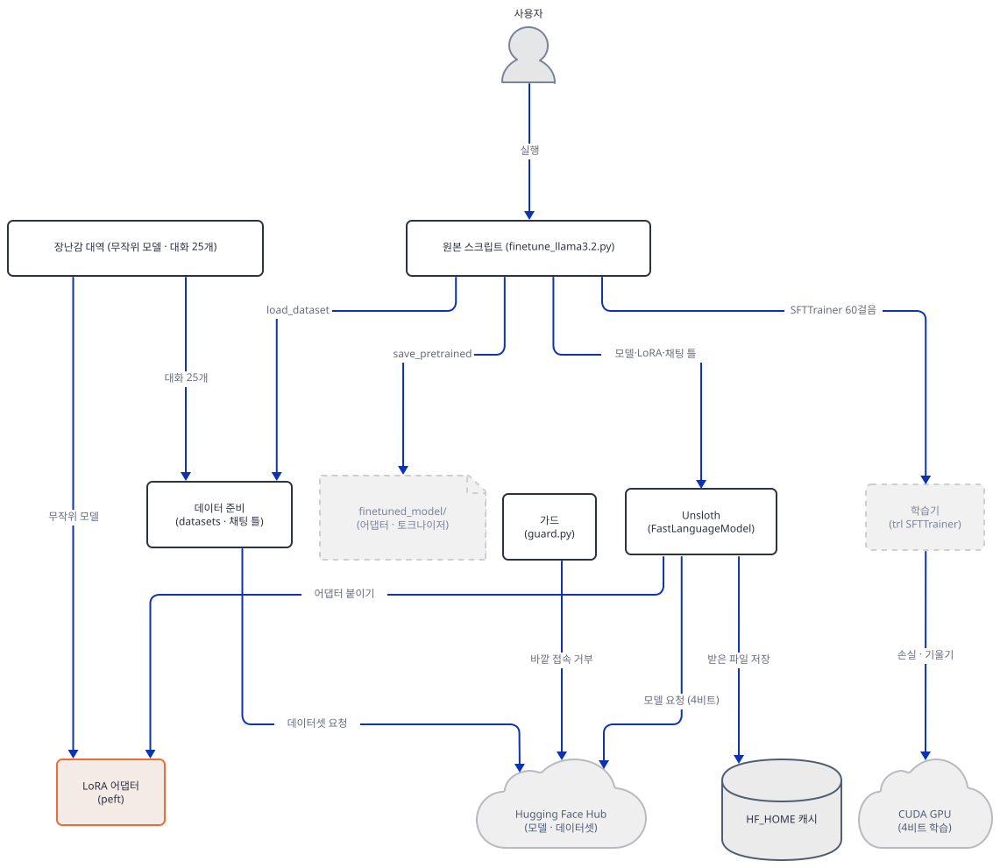

**확인.** `lora.py`의 `trainable 32768`이 `formula 32768`과 같고, `sizes.py`가 `24,313,856`과 `0.48%`를 내놓으면 됩니다.

### Step 7. 학습기 — `SFTTrainer`가 오늘 받는 인자

**목적.** 앱의 학습 줄(37~59행)을 같은 숫자로 장난감에 돌리고, 오늘 판 `trl`이 앱의 인자를 어떻게 받는지, 손실이 무엇에 대해 계산되는지 봅니다.

**할 일.** 앱의 학습 줄입니다.

`advanced_llm_apps/llm_finetuning_tutorials/llama3.2_finetuning/finetune_llama3.2.py:37-59`

```python
# Set up trainer
trainer = SFTTrainer(
    model=model,
    tokenizer=tokenizer, 
    train_dataset=dataset,
    dataset_text_field="text",
    max_seq_length=2048,
    data_collator=DataCollatorForSeq2Seq(tokenizer=tokenizer), 
    args=SFTConfig( 
        per_device_train_batch_size=2,
        gradient_accumulation_steps=4,
        warmup_steps=5,
        max_steps=60,
        learning_rate=2e-4,
        fp16=not torch.cuda.is_bf16_supported(),
        bf16=torch.cuda.is_bf16_supported(),
        logging_steps=1,
        output_dir="outputs",
    ),
)

# Train the model
trainer.train()
```

먼저 오늘 판 `trl` 1.15.0이 이 줄을 받는지 봅니다. 아래를 `trl_as_written.py`로 저장합니다. 보통의 import로는 Unsloth를 불러올 수 없으니 순수한 `trl`입니다.

```python
"""Run the app's trainer lines (finetune_llama3.2.py:37-56) as written, on the toy model, against the trl that installs today.
Three tries, each isolated, to see which line the plain trl refuses (no unsloth involved: it cannot be imported here)."""
import guard

guard.check()

import torch
from datasets import load_from_disk
from transformers import AutoTokenizer, DataCollatorForSeq2Seq
from trl import SFTConfig, SFTTrainer

from lora import build

tok = AutoTokenizer.from_pretrained("toy_tok")
ds = load_from_disk("toy_text_ds")
model = build()


def attempt(label, fn):
    try:
        fn()
        print(f"[{label}] accepted")
    except Exception as e:
        print(f"[{label}] {type(e).__name__}: {str(e).splitlines()[0][:200]}")


# 1. the SFTConfig lines exactly as written (51-52): fp16 = not torch.cuda.is_bf16_supported()
def cfg_as_written():
    SFTConfig(per_device_train_batch_size=2, gradient_accumulation_steps=4, warmup_steps=5, max_steps=60, learning_rate=2e-4,
              fp16=not torch.cuda.is_bf16_supported(), bf16=torch.cuda.is_bf16_supported(), logging_steps=1, output_dir="outputs")


attempt("SFTConfig fp16/bf16 as written", cfg_as_written)
print("   torch.cuda.is_bf16_supported() ->", torch.cuda.is_bf16_supported())

base = dict(per_device_train_batch_size=2, gradient_accumulation_steps=4, warmup_steps=5, max_steps=60, learning_rate=2e-4,
            fp16=False, bf16=False, logging_steps=1, output_dir="outputs", report_to="none", use_cpu=True)

# 2. SFTTrainer with the keyword arguments exactly as written (38-44), CPU-safe config
attempt("SFTTrainer(tokenizer=...)", lambda: SFTTrainer(model=model, tokenizer=tok, train_dataset=ds, dataset_text_field="text",
        max_seq_length=2048, data_collator=DataCollatorForSeq2Seq(tokenizer=tok), args=SFTConfig(**base)))

# 3. one at a time
attempt("only tokenizer=", lambda: SFTTrainer(model=model, tokenizer=tok, train_dataset=ds, args=SFTConfig(**base)))
attempt("only dataset_text_field= on the trainer", lambda: SFTTrainer(model=model, processing_class=tok, train_dataset=ds, dataset_text_field="text", args=SFTConfig(**base)))
attempt("only max_seq_length= on the trainer", lambda: SFTTrainer(model=model, processing_class=tok, train_dataset=ds, max_seq_length=2048, args=SFTConfig(**base)))
attempt("max_seq_length= on SFTConfig", lambda: SFTConfig(max_seq_length=2048, **base))
attempt("dataset_text_field= on SFTConfig", lambda: SFTConfig(dataset_text_field="text", **base))
attempt("max_length= on SFTConfig", lambda: SFTConfig(max_length=2048, **base))
```

```bash
uv run --no-project python trl_as_written.py
```

기대 출력(직접 확인)입니다.

```text
[SFTConfig fp16/bf16 as written] accepted
   torch.cuda.is_bf16_supported() -> False
[SFTTrainer(tokenizer=...)] TypeError: SFTTrainer.__init__() got an unexpected keyword argument 'tokenizer'
[only tokenizer=] TypeError: SFTTrainer.__init__() got an unexpected keyword argument 'tokenizer'
[only dataset_text_field= on the trainer] TypeError: SFTTrainer.__init__() got an unexpected keyword argument 'dataset_text_field'
[only max_seq_length= on the trainer] TypeError: SFTTrainer.__init__() got an unexpected keyword argument 'max_seq_length'
[max_seq_length= on SFTConfig] TypeError: SFTConfig.__init__() got an unexpected keyword argument 'max_seq_length'. Did you mean 'max_length'?
[dataset_text_field= on SFTConfig] accepted
[max_length= on SFTConfig] accepted
```

세 인자가 모두 거부됩니다. `tokenizer=`는 `processing_class=`로, `dataset_text_field=`는 `SFTConfig`로, `max_seq_length=`는 `SFTConfig(max_length=)`로 옮겨 갔습니다. 순수한 `trl` 1.15.0에서는 이 앱의 38~44행이 `TypeError`로 끝납니다.

이것은 오늘 판이 바뀌어서 생긴 문제가 아닙니다. 앱의 학습 줄(`tokenizer=`, `SFTConfig`, `DataCollatorForSeq2Seq`)은 2026-08-02의 커밋 `779e9f9b`에서 들어갔고(`git log`), 그날의 최신 `trl`은 1.9.2(PyPI 업로드 2026-07-28)였습니다. 그 바퀴를 받아 압축을 풀지 않고 읽으니 `SFTTrainer.__init__`에 세 인자가 이미 없었고 `SFTConfig`에도 `max_seq_length` 필드가 없었습니다(직접 확인). 앱은 처음부터 Unsloth의 `trl` 패치에 기대 쓰인 것입니다. 패치는 `unsloth`가 정상으로 불러와질 때 이 순서로 설치됩니다(소스). `unsloth/_gpu_init.py` 752행의 `from .models import *` → `models/llama.py` 4933행 `PatchFastRL` → `models/rl.py`가 `trl.SFTTrainer`·`trl.SFTConfig`를 Unsloth판으로 바꿈(3675~3700행의 `exec`들) → `_gpu_init.py` 773행 `_patch_trl_trainer()` → `trainer.py`의 `_backwards_compatible_trainer`(1677행)가 `tokenizer`를 `processing_class`로 바꾸고(1686행) 설정에 속하는 인자를 `SFTConfig`로 옮깁니다. `max_seq_length`는 `models/rl.py`가 만드는 설정 클래스에 필드를 더해 `max_length`로 복사합니다(3194~3204행, 2603~2605행).

**선택: 패치를 실행해 보기.** 이 PC에서는 보통의 import가 멈추니 Step 4의 시험 스위치를 씁니다. 스위치는 패치 설치를 건너뛰므로, 아래 스크립트는 `unsloth`를 스위치로 불러온 뒤 스위치를 지우고 GPU 환경과 같은 순서로 설치 함수 둘(`PatchFastRL`, `_patch_trl_trainer`)을 직접 부릅니다. 독자 해결책이 아니라 읽은 소스를 확인하는 시험이므로 건너뛰어도 됩니다. 가드와 소켓 가드가 설치되었다는 단언이 통과한 **뒤에만** `unsloth`를 불러옵니다. 실행하면 Unsloth가 만든 트레이너 코드가 `tmp/unsloth_compiled_cache/`에 쌓이고(`UNSLOTH_COMPILE_LOCATION`, 소스는 `unsloth_zoo/compiler.py` 918~924행이 임시 폴더를 쓰는 길도 갖고 있어 `TEMP`·`TMP`·`TMPDIR`까지 이 폴더 안으로 돌렸습니다) 작업 폴더에 `outputs_probe/`가 생깁니다. `torch`는 `import`만 해도 임시 폴더에 `torchinductor_<사용자>/`를 만들어서(`torch/_inductor/runtime/cache_dir_utils.py` 32~33행) 그것도 `tmp/` 안으로 갑니다. `unsloth_probe.py`로 저장합니다.

```python
"""OPTIONAL (Step 7): load unsloth on this CPU-only torch through its CPU test switch
UNSLOTH_ALLOW_CPU=1, install the trl patch the way a GPU machine does, and run the app's trainer lines on the toy model."""
import os, sys, socket
os.environ["UNSLOTH_ALLOW_CPU"] = "1"
import guard
guard.check()
# assert the socket guard is really installed before anything else runs (no packet, no log line)
assert guard._installed and socket.getaddrinfo.__module__ == "guard", "socket guard NOT active"
print("socket guard active")
import io, contextlib, torch
import unsloth
from unsloth.models.llama import FastLlamaModel
from unsloth import FastLanguageModel
from unsloth.models.rl import PatchFastRL
from unsloth.trainer import _patch_trl_trainer
# the switch makes both installers return early; a GPU machine has no switch, so drop it and run them in the GPU order
os.environ.pop("UNSLOTH_ALLOW_CPU")
PatchFastRL(FastLanguageModel=FastLlamaModel)
_patch_trl_trainer()
from datasets import load_from_disk
from transformers import AutoTokenizer, DataCollatorForSeq2Seq, AutoModelForCausalLM
from trl import SFTTrainer, SFTConfig
print("trl.SFTTrainer is now:", SFTTrainer.__name__, "| SFTConfig:", SFTConfig.__name__)
from unsloth.chat_templates import get_chat_template, standardize_sharegpt
from toy_data import conversations
from datasets import Dataset
from peft import LoraConfig, get_peft_model

tok = AutoTokenizer.from_pretrained("toy_tok")
raw = Dataset.from_list(conversations())
# real standardize_sharegpt vs the hand-written one in render.py
real = standardize_sharegpt(raw)
ALIASES = {"human": "user", "gpt": "assistant", "system": "system"}
mine = raw.map(lambda b: {"conversations": [[{"role": ALIASES[m["from"]], "content": m["value"]} for m in c] for c in b["conversations"]]}, batched=True)
print("real standardize_sharegpt == hand-written:", all(a["conversations"] == b["conversations"] for a, b in zip(real, mine)))
tok2 = get_chat_template(tok, chat_template="llama-3.1")
texts_real = [tok2.apply_chat_template(r["conversations"], tokenize=False) for r in real]
old = load_from_disk("toy_text_ds")
print("real get_chat_template render == template.py render (25 rows):", texts_real == [r["text"] for r in old])
ds = real.map(lambda ex: {"text": [tok2.apply_chat_template(c, tokenize=False) for c in ex["conversations"]]}, batched=True)

model = AutoModelForCausalLM.from_pretrained("toy_base", dtype=torch.float32)
model = get_peft_model(model, LoraConfig(r=16, lora_alpha=16, lora_dropout=0.0, bias="none", target_modules=["q_proj","k_proj","v_proj","o_proj","gate_proj","up_proj","down_proj"], task_type="CAUSAL_LM"))
buf = io.StringIO()
with contextlib.redirect_stdout(buf):
    trainer = SFTTrainer(
        model=model, tokenizer=tok2, train_dataset=ds, dataset_text_field="text", max_seq_length=2048,
        data_collator=DataCollatorForSeq2Seq(tokenizer=tok2),
        args=SFTConfig(per_device_train_batch_size=2, gradient_accumulation_steps=4, warmup_steps=5, max_steps=60, learning_rate=2e-4,
                       fp16=False, bf16=False, logging_steps=1, output_dir="outputs_probe", use_cpu=True),
    )
print("app's SFTTrainer call accepted ->", type(trainer).__name__)
print("printed by unsloth:", [l for l in buf.getvalue().splitlines() if "Unsloth" in l][:4])
a = trainer.args
print("optim", a.optim, "| weight_decay", a.weight_decay, "| seed", a.seed, "| lr_scheduler", a.lr_scheduler_type, "| warmup_steps", a.warmup_steps,
      "| loss_type", getattr(a, "loss_type", None), "| max_length", getattr(a, "max_length", None), "| report_to", a.report_to)
print("processing_class is tok2:", trainer.processing_class is tok2, "| collator:", type(trainer.data_collator).__name__)
print("dataset columns:", trainer.train_dataset.column_names)
b = next(iter(trainer.get_train_dataloader()))
ids, lab = b["input_ids"], b["labels"]
print("first token ids of row 0:", ids[0][:4].tolist(), "| labels==input_ids where not padding:", bool(((lab == ids) | (lab == -100)).all()))
print("packing", a.packing, "| padding_free", getattr(a, "padding_free", None))
```

```bash
uv run --no-project python unsloth_probe.py
```

기대 출력(직접 확인)입니다. `torchao`·`xformers` 경고와 진행 막대 줄, 그리고 GRPO 트레이너를 만들 수 없다는 `unsloth_zoo.log` WARNING 한 줄(CPU `torch`라서)은 뺐습니다. 값이 아닌 모양을 보는 시험이라 장난감 모델과 CPU에서 돌았습니다.

```text
socket guard active
🦥 Unsloth: Will patch your computer to enable 2x faster free finetuning.
🦥 Unsloth Zoo will now patch everything to make training faster!
trl.SFTTrainer is now: UnslothSFTTrainer | SFTConfig: SFTConfig
real standardize_sharegpt == hand-written: True
real get_chat_template render == template.py render (25 rows): True
app's SFTTrainer call accepted -> UnslothSFTTrainer
printed by unsloth: ['Unsloth: We found double BOS tokens - we shall remove one automatically.']
optim OptimizerNames.ADAMW_8BIT | weight_decay 0.001 | seed 3407 | lr_scheduler SchedulerType.LINEAR | warmup_steps 5 | loss_type nll | max_length 2048 | report_to []
processing_class is tok2: True | collator: DataCollatorForLanguageModeling
dataset columns: ['input_ids', 'attention_mask']
first token ids of row 0: [0, 2, 401, 474] | labels==input_ids where not padding: True
packing False | padding_free False
```

읽을 것이 다섯입니다. 첫째, `from trl import SFTTrainer`가 `UnslothSFTTrainer`를 주고, 앱의 38~45행 인자(`tokenizer=`·`dataset_text_field=`·`max_seq_length=` 포함)가 그대로 받아집니다. 둘째, **앱이 실제로 쓰는 설정은 순수 `trl`의 기본값과 다릅니다.** Unsloth의 설정 클래스가 기본값을 바꿉니다(`models/rl.py` 3076~3107행). 옵티마이저는 bitsandbytes의 8비트 AdamW(`adamw_8bit`), `weight_decay`는 0.001, `seed`는 3407, `report_to`는 none이고, SFT의 손실은 `loss_type='nll'`로 고정됩니다(3141~3149행). 앱이 직접 준 값(배치 2, 누적 4, 워밍업 5, 60걸음, 2e-4)은 그대로입니다. 학습률은 선형으로 줄어듭니다. 셋째, `max_seq_length=2048`이 `max_length`로 들어갔습니다. 넷째, 글의 `<|begin_of_text|>`와 토크나이저가 더하는 시작 토큰이 겹치는 것을 Unsloth가 알아채고 `add_special_tokens=False`로 토큰화해 첫 토큰이 `[0, 2, 401, 474]`로 하나입니다(`unsloth_zoo/dataset_utils.py` 2812~2821행, `models/rl_replacements.py` 835행). 다섯째, 앱이 준 `DataCollatorForSeq2Seq`는 데이터셋에 `labels` 열이 없으면 `DataCollatorForLanguageModeling`으로 바뀌고(`models/rl.py` 2932~2938행), 데이터 열은 `input_ids`·`attention_mask`뿐이며 배치의 `labels`는 패딩을 빼면 `input_ids`와 같습니다. 질문 토큰까지 손실에 들어간다는 결론이 앱 경로에서도 같다는 뜻입니다. 같은 실행에서 진짜 `standardize_sharegpt`와 `get_chat_template`의 결과가 Step 5의 손 함수·`template.py`와 25행 모두 같았고, 자동 packing·padding-free는 앱이 콜레이터를 주므로 꺼진 채라(`trainer.py` 1858~1875행) 한 걸음이 8개 시퀀스입니다. 이 시험은 GPU 학습을 돌린 것이 아니므로 앱이 GPU에서 끝까지 도는지는 여전히 확인하지 못했습니다.

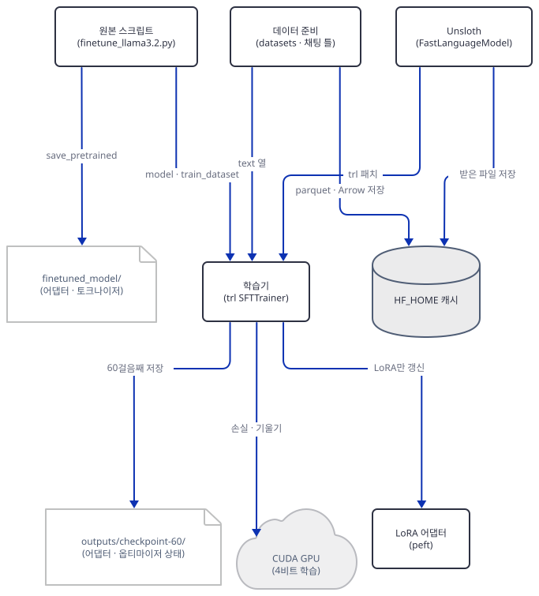

위 그림은 학습기 둘레의 관계입니다. `SFTTrainer`가 스크립트에서 모델(LoRA가 붙은)과 `train_dataset`을, 데이터 준비에서 `text` 열을 받고, Unsloth가 `trl`을 패치하며, 학습기는 LoRA 행렬만 갱신하고 GPU에서 손실과 기울기를 계산하고 60걸음째에 `outputs/checkpoint-60/`을 씁니다. `finetuned_model/`은 학습기가 아니라 스크립트가 씁니다(Step 8).

이제 순수 `trl` 쪽을 봅니다. fp16 줄입니다. CPU `torch`에서 `torch.cuda.is_bf16_supported()`는 `False`라서 앱의 51~52행은 `fp16=True`가 되는데, CPU에서도 오류 없이 돕니다. `use_cpu` 없이 앱의 두 줄 그대로 2걸음을 돌려 손실 6.189와 6.191이 기록되는 것을 직접 확인했습니다. 장난감에서는 GPU 설정과 헷갈리지 않게 둘 다 끕니다. 아래 `defaults.py`는 **순수 `trl` 1.15.0**의 `SFTConfig` 기본값입니다. 장난감은 순수 `trl`이라 이 값(`adamw_torch_fused`, `weight_decay` 0.0, `seed` 42)으로 돌고, 앱은 위의 Unsloth 값으로 돕니다.

```python
"""Defaults of the PLAIN trl 1.15.0 SFTConfig for the fields the app does not set (finetune_llama3.2.py:45-55 sets nine things).
The app does not get these values: unsloth replaces SFTConfig and changes several defaults (Step 7)."""
import guard

guard.check()

from trl import SFTConfig

c = SFTConfig(output_dir="outputs", report_to="none", use_cpu=True)
for name in ("optim", "lr_scheduler_type", "weight_decay", "seed", "num_train_epochs", "max_length", "dataset_text_field",
             "packing", "padding_free", "assistant_only_loss", "completion_only_loss", "gradient_checkpointing",
             "save_strategy", "save_steps", "report_to", "dataset_num_proc"):
    print(f"{name:24} {getattr(c, name)!r}")
```

```bash
uv run --no-project python defaults.py
```

```text
optim                    <OptimizerNames.ADAMW_TORCH_FUSED: 'adamw_torch_fused'>
lr_scheduler_type        <SchedulerType.LINEAR: 'linear'>
weight_decay             0.0
seed                     42
num_train_epochs         3.0
max_length               1024
dataset_text_field       'text'
packing                  False
padding_free             False
assistant_only_loss      False
completion_only_loss     None
gradient_checkpointing   True
save_strategy            <SaveStrategy.STEPS: 'steps'>
save_steps               500
report_to                []
dataset_num_proc         None
```

(직접 확인, 오늘 설치한 `trl` 1.15.0·`transformers` 5.17.0 기준입니다.) `report_to`가 비어 있어 기본으로 `wandb` 같은 곳에 기록을 보내지 않습니다. 이 문서의 `transformers` 판의 사실이고 다른 판은 확인하지 않았습니다. 앱이 `max_steps=60`을 주었으므로 `num_train_epochs`는 무시됩니다.

이제 장난감을 앱의 숫자로 돌립니다. 바꾼 것이 셋입니다. 첫째, `trl` 1.15.0의 `SFTTrainer.compute_loss`는 손실을 Triton 커널로 계산합니다(`sft_trainer.py` 1558~1600행에서 `trainer/utils.py` 1638행, `kernels/chunked_logprob.py`). 로짓 전체를 만들지 않으려는 구현인데 GPU 드라이버가 필요하고, CPU에서는 그대로 `RuntimeError: 0 active drivers ([]). There should only be one.`로 끝났습니다(직접 확인). 그래서 `SFTTrainer`를 상속해 `compute_loss` 한 줄만 `transformers`의 평범한 손실로 바꾸고 나머지(데이터 준비, 라벨 만들기, 콜레이터, 옵티마이저, 스케줄러, 학습 루프)는 `SFTTrainer` 그대로 둡니다. 둘째, fp16·bf16을 끄고 `use_cpu=True`를 줍니다. 셋째, `report_to="none"`과 `save_strategy="no"`를 줍니다. 앱 설정 그대로면 `save_steps` 기본값 500에 `max_steps=60`이라 학습 끝에 `outputs/checkpoint-60/`을 쓰는데(`transformers/trainer_callback.py` 603~604행 근처), 장난감에서 `save_strategy="no"`만 빼고 돌리니 그 폴더에 어댑터(134,616바이트) 말고도 `optimizer.pt` 285,723바이트, `scheduler.pt`, `rng_state.pth`, `trainer_state.json`, `training_args.bin`과 토크나이저 파일이 남았습니다(직접 확인). 앱의 `tokenizer=`는 `processing_class=`로, 앱의 `SFTTrainer` 인자 둘은 `SFTConfig`로 옮겨 적었습니다. 아래를 `train_toy.py`로 저장합니다.

```python
"""The training half of the app (finetune_llama3.2.py:37-63) on the toy model, CPU, with the argument spelling today's trl accepts.
Same numbers as the app: batch 2, accumulation 4, warmup 5, 60 steps, lr 2e-4, logging every step, r=16 LoRA on seven projections."""
import guard

guard.check()

import json
import os
import torch
from datasets import load_from_disk
from transformers import AutoTokenizer, DataCollatorForSeq2Seq
from transformers import Trainer
from trl import SFTConfig, SFTTrainer

from lora import build


class CpuSFTTrainer(SFTTrainer):
    """trl 1.15 computes the loss with a Triton kernel (sft_trainer.py:1558-1600 -> trainer/utils.py:1638
    -> kernels/chunked_logprob.py), which needs a GPU driver. Everything else stays SFTTrainer's own: dataset
    preparation, labels, collator, optimizer, scheduler, loop. Only the loss line is swapped for transformers' plain one."""

    def compute_loss(self, model, inputs, return_outputs=False, num_items_in_batch=None):
        return Trainer.compute_loss(self, model, inputs, return_outputs=return_outputs, num_items_in_batch=num_items_in_batch)

torch.manual_seed(3407)
tok = AutoTokenizer.from_pretrained("toy_tok")
ds = load_from_disk("toy_text_ds")
model = build()

trainer = CpuSFTTrainer(
    model=model,
    processing_class=tok,                      # app: tokenizer=tokenizer
    train_dataset=ds,
    data_collator=DataCollatorForSeq2Seq(tokenizer=tok),
    args=SFTConfig(
        dataset_text_field="text",             # app: SFTTrainer(dataset_text_field="text")
        max_length=2048,                       # app: SFTTrainer(max_seq_length=2048)
        per_device_train_batch_size=2,
        gradient_accumulation_steps=4,
        warmup_steps=5,
        max_steps=60,
        learning_rate=2e-4,
        fp16=False, bf16=False, use_cpu=True,  # app: fp16/bf16 from torch.cuda.is_bf16_supported(); there is no GPU here
        logging_steps=1,
        output_dir="outputs",
        report_to="none",
        save_strategy="no",
    ),
)

# what the trainer will actually feed the model
row = trainer.train_dataset[0]
print("columns after SFTTrainer prepared the dataset:", trainer.train_dataset.column_names)
print("first 4 input_ids of row 0:", row["input_ids"][:4], "| bos id", tok.bos_token_id)
print("labels == input_ids for every token of every row:", all(r["labels"] == r["input_ids"] for r in trainer.train_dataset))
print("rows:", len(trainer.train_dataset), "| tokens per row (min/max):", min(len(r["input_ids"]) for r in trainer.train_dataset), max(len(r["input_ids"]) for r in trainer.train_dataset))

result = trainer.train()
logs = [h for h in trainer.state.log_history if "loss" in h]
print("steps trained:", trainer.state.global_step, "| logged losses:", len(logs))
print("loss at step 1, 10, 30, 60:", [round(logs[i - 1]["loss"], 4) for i in (1, 10, 30, 60)])
print("learning rate at step 1, 5, 6, 60:", [logs[i - 1]["learning_rate"] for i in (1, 5, 6, 60)])
json.dump(trainer.state.log_history, open("loss_log.json", "w"))

model.save_pretrained("finetuned_model")
tok.save_pretrained("finetuned_model")
for name in sorted(os.listdir("finetuned_model")):
    print(f"{os.path.getsize(os.path.join('finetuned_model', name)):>9}  {name}")
```

```bash
uv run --no-project python train_toy.py
```

기대 출력은 아래와 같습니다(직접 확인). 매 걸음 `{'loss': …}` 줄이 60개 나오는데 앞 여덟 줄만 싣습니다. 값은 `torch`·`trl` 판과 CPU에 따라 끝자리가 달라질 수 있습니다.

```text
columns after SFTTrainer prepared the dataset: ['conversations', 'source', 'score', 'text', 'input_ids', 'labels']
first 4 input_ids of row 0: [0, 0, 2, 401] | bos id 0
labels == input_ids for every token of every row: True
rows: 25 | tokens per row (min/max): 89 173
{'loss': '6.189', 'grad_norm': '0.2112', 'learning_rate': '0', 'epoch': '0.3077'}
{'loss': '6.191', 'grad_norm': '0.2185', 'learning_rate': '4e-05', 'epoch': '0.6154'}
{'loss': '6.193', 'grad_norm': '0.2149', 'learning_rate': '8e-05', 'epoch': '0.9231'}
{'loss': '6.169', 'grad_norm': '0.2668', 'learning_rate': '0.00012', 'epoch': '1'}
{'loss': '6.188', 'grad_norm': '0.2214', 'learning_rate': '0.00016', 'epoch': '1.308'}
{'loss': '6.186', 'grad_norm': '0.218', 'learning_rate': '0.0002', 'epoch': '1.615'}
{'loss': '6.184', 'grad_norm': '0.2032', 'learning_rate': '0.0001964', 'epoch': '1.923'}
{'loss': '6.165', 'grad_norm': '0.2837', 'learning_rate': '0.0001927', 'epoch': '2'}
```

60개의 손실 줄과 `train_runtime` 요약 줄 뒤에 걸음 수와 손실을 요약하는 다음 세 줄이 나오고, 끝으로 저장된 파일 목록이 이어집니다(Step 8에서 다시 봅니다).

```text
steps trained: 60 | logged losses: 60
loss at step 1, 10, 30, 60: [6.1888, 6.1871, 6.1384, 6.1143]
learning rate at step 1, 5, 6, 60: [0.0, 0.00016, 0.0002, 3.636363636363636e-06]
```

읽을 것이 다섯입니다. 첫째, **60걸음이 60개의 손실 기록**으로 남고 학습률이 앱의 설정대로 움직입니다. 0에서 시작해 걸음마다 4e-5씩 올라 여섯째 기록에서 2e-4에 이르고, 60걸음째는 3.64e-6으로 거의 0입니다(`2e-4 × 1/55`). 둘째, 손실은 6.19에서 6.11로 조금만 내려갑니다. 무작위 모델의 어림 손실 `ln(512)=6.24`에서 거의 움직이지 않은 것이고, 이것은 학습이 잘 되었다는 증거가 아닙니다. 학습 과정이 이렇게 흐른다는 모양을 보인 것뿐입니다. 셋째, **`labels == input_ids`가 모든 행에서 참**입니다. 순수 `trl`에서는 `SFTTrainer`가 만든 `labels` 열이 입력과 같으니 시스템 머리글·질문·`<|start_header_id|>` 같은 틀 토큰까지 전부 손실에 들어갑니다. 앱이 응답만 학습하는 `train_on_responses_only`(Unsloth에 있는 함수, `chat_templates.py` 59행)를 부르지 않기 때문입니다. 위 시험에서 보았듯 앱 경로에서는 콜레이터가 바뀌어 같은 결과가 됩니다. 이것이 틀린 것은 아니지만, 모델이 질문을 흉내 내는 데에도 용량을 씁니다. 넷째, **시작 토큰이 둘**입니다(`[0, 0, 2, …]`, 0이 `<|begin_of_text|>`). Step 5의 글이 이미 그 토큰으로 시작하는데 토크나이저가 입력 앞에 또 붙이기 때문이고, 순수 `trl` 1.15.0은 이것을 그대로 둡니다. `bos_check.py`로 확인합니다.

```python
"""The chat template already writes <|begin_of_text|>; a Llama tokenizer prepends another one when it encodes."""
import guard

guard.check()

from datasets import load_from_disk
from transformers import AutoTokenizer

tok = AutoTokenizer.from_pretrained("toy_tok")
text = load_from_disk("toy_text_ds")[0]["text"]
print("text starts with:", repr(text[:40]))
print("tokenizer(text)[:4]                      ->", tok(text)["input_ids"][:4])
print("tokenizer(text, add_special_tokens=False) ->", tok(text, add_special_tokens=False)["input_ids"][:4], "| bos id =", tok.bos_token_id)
```

```bash
uv run --no-project python bos_check.py
```

```text
text starts with: '<|begin_of_text|><|start_header_id|>syst'
tokenizer(text)[:4]                      -> [0, 0, 2, 401]
tokenizer(text, add_special_tokens=False) -> [0, 2, 401, 474] | bos id = 0
```

다섯째, 이 단계의 결론입니다. 앱의 학습 줄은 순수한 `trl` 1.15.0에서는 돌지 않습니다. Unsloth 패치가 적용되면 인자가 받아지고, 시작 토큰 중복도 그 패치가 줄이며, 설정 기본값(8비트 AdamW 등)과 손실 계산도 Unsloth의 것입니다(위 시험으로 확인한 부분과 소스로 읽은 부분이 섞여 있습니다). 그 패치는 CUDA `torch`가 있어야 보통의 import로 불러와집니다.

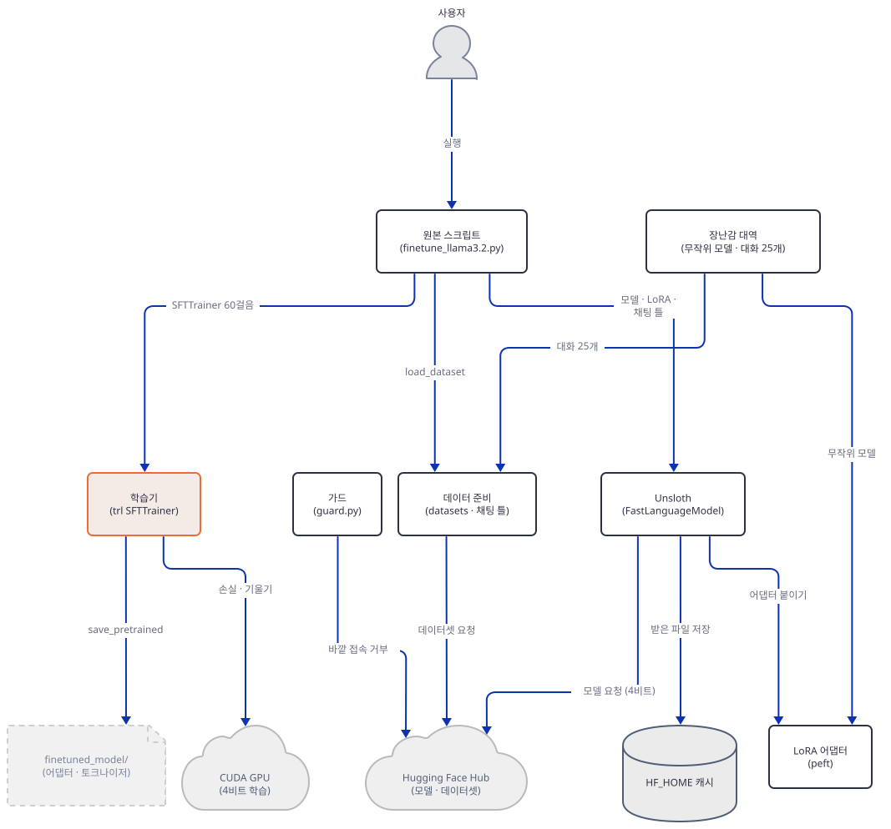

**확인.** `train_toy.py`가 `steps trained: 60`과 `labels == input_ids … True`를 내놓고 종료 코드 0이면 됩니다.

### Step 8. 저장 — `finetuned_model/`에 무엇이 남는가

**목적.** 앱의 마지막 두 줄(61~63행)이 저장하는 파일을 보고, 저장된 어댑터가 모델을 정말 바꾸는지 확인합니다.

**할 일.** 앱의 저장 줄입니다.

`advanced_llm_apps/llm_finetuning_tutorials/llama3.2_finetuning/finetune_llama3.2.py:61-63`

```python
# Save the finetuned model
model.save_pretrained("finetuned_model")
tokenizer.save_pretrained("finetuned_model") 
```

`model`은 LoRA가 붙은 `PeftModel`이라 `save_pretrained`는 **어댑터만** 저장합니다. Unsloth는 이 메서드를 얇게 감싸 `safe_serialization=None`을 safetensors로 바꿀 뿐 나머지는 그대로 넘깁니다(`unsloth/save.py` 7898~7930행). 합친 전체 모델을 저장하는 것은 다른 메서드(`save_pretrained_merged`)입니다. `train_toy.py`가 이미 같은 폴더에 같은 두 줄을 실행했으므로 `check_saved.py`로 열어 봅니다.

```python
"""What finetuned_model/ holds after the toy run, and whether the saved adapter really changes the model."""
import guard

guard.check()

import os
import torch
from peft import PeftModel
from safetensors.torch import load_file
from transformers import AutoModelForCausalLM, AutoTokenizer

print("files in finetuned_model/:")
for name in sorted(os.listdir("finetuned_model")):
    print(f"  {os.path.getsize(os.path.join('finetuned_model', name)):>8}  {name}")

tensors = load_file("finetuned_model/adapter_model.safetensors")
a = [k for k in tensors if "lora_A" in k]
b = [k for k in tensors if "lora_B" in k]
print("adapter tensors:", len(tensors), "| lora_A:", len(a), "| lora_B:", len(b), "| dtype:", {str(t.dtype) for t in tensors.values()})
print("elements:", sum(t.numel() for t in tensors.values()))
print("lora_B all zero?", all(torch.count_nonzero(tensors[k]) == 0 for k in b), "(zero at the start of training by LoRA's design)")
print("every tensor is a LoRA tensor (no base weights saved)?", all("lora_" in k for k in tensors))

tok = AutoTokenizer.from_pretrained("finetuned_model")
ids = tok("What is a loop?", return_tensors="pt")
base = AutoModelForCausalLM.from_pretrained("toy_base", dtype=torch.float32).eval()
tuned = PeftModel.from_pretrained(AutoModelForCausalLM.from_pretrained("toy_base", dtype=torch.float32), "finetuned_model").eval()
with torch.no_grad():
    d = (base(**ids).logits - tuned(**ids).logits).abs().max().item()
print("max |logit(base) - logit(base + adapter)| =", round(d, 5))
```

```bash
uv run --no-project python check_saved.py
```

기대 출력(직접 확인)입니다.

```text
files in finetuned_model/:
      5182  README.md
      1213  adapter_config.json
    134616  adapter_model.safetensors
      4707  chat_template.jinja
     22316  tokenizer.json
       295  tokenizer_config.json
adapter tensors: 28 | lora_A: 14 | lora_B: 14 | dtype: {'torch.float32'}
elements: 32768
lora_B all zero? False (zero at the start of training by LoRA's design)
every tensor is a LoRA tensor (no base weights saved)? True
max |logit(base) - logit(base + adapter)| = 0.30142
```

읽을 것이 넷입니다. 첫째, `adapter_model.safetensors`가 134,616바이트이고 안의 원소는 32,768개(위에서 센 학습 매개변수 수 그대로) 32비트라 `32,768 × 4 = 131,072`바이트에 머리글이 붙은 값입니다. 안에는 `lora_A`·`lora_B` 14쌍만 있고 기본 모델 가중치는 한 개도 없습니다. 둘째, 같은 일이 진짜 모델에서 일어나면 어댑터는 24,313,856개이므로 16비트로 저장하면 약 49MB, 32비트면 약 97MB입니다(⚠ 어림이고 Unsloth가 어떤 정밀도로 저장하는지는 확인하지 못했습니다). 3B 모델 전체(수 GB)가 아니라 이만큼입니다. 이 어댑터는 반드시 같은 기본 모델 위에 얹어야 쓸 수 있고, `adapter_config.json`의 `base_model_name_or_path`가 그 모델을 가리킵니다. 셋째, `lora_B`는 `False`로 0이 아닙니다. LoRA는 `B`를 0으로 시작해서 학습 전에는 모델이 기본 모델과 같은데, 60걸음 뒤 0이 아니게 되었고 저장된 어댑터를 얹으면 같은 입력의 로짓이 최대 0.30 달라집니다. 어댑터가 모델을 바꾼다는 뜻입니다(값은 무작위 모델이라 의미 없습니다). 넷째, 토크나이저 파일(`tokenizer.json`, `tokenizer_config.json`, `chat_template.jinja`)이 함께 저장됩니다. 한편 앱은 `finetuned_model/` 말고도 학습기가 쓰는 `outputs/checkpoint-60/`(옵티마이저 상태 포함, Step 7)을 남깁니다. 장난감은 `save_strategy="no"`로 그 체크포인트를 막았습니다. 토크나이저 파일이 저장되는 것은 앱 63행의 `tokenizer.save_pretrained` 때문이고, 저장소 이력에서 이 줄은 "Added tokenizer and saved the model at the end"라는 변경(`779e9f9b`)으로 들어왔습니다.

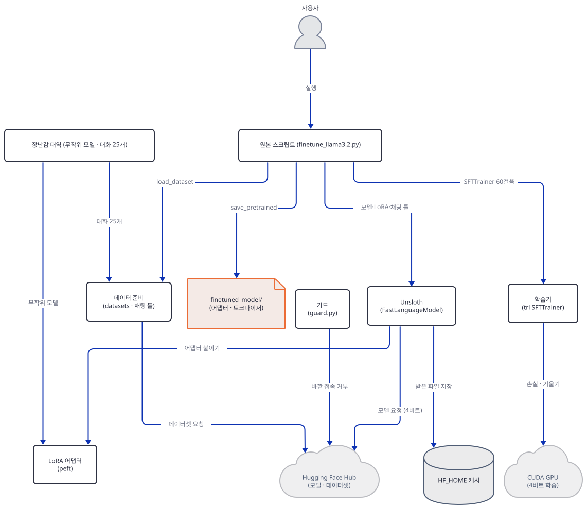

**확인.** `every tensor is a LoRA tensor … True`와 `max |logit(base) - logit(base + adapter)|`가 0보다 크면 됩니다. 이 단계까지 끝낸 뒤에도 `guard.log`는 비어 있어야 하고(없어도 됩니다) 원본 앱 폴더는 바뀌지 않아야 합니다. `git status --short -- advanced_llm_apps/llm_finetuning_tutorials`가 비어 있고 `find advanced_llm_apps/llm_finetuning_tutorials -name __pycache__`가 아무것도 내놓지 않으면 됩니다.

## 요청 한 건이 흐르는 과정

원본 스크립트를 한 번 돌리면 이렇게 흐릅니다(이 문서가 실행한 흐름이 아니라 소스에서 읽은 순서이고, 장난감은 Hub와 GPU 자리를 로컬 파일과 CPU로 대신했습니다). 그림은 시간 경계에서 셋으로 나눴습니다. 모델 불러오기와 LoRA 붙이기, 데이터 준비, 학습과 저장입니다.

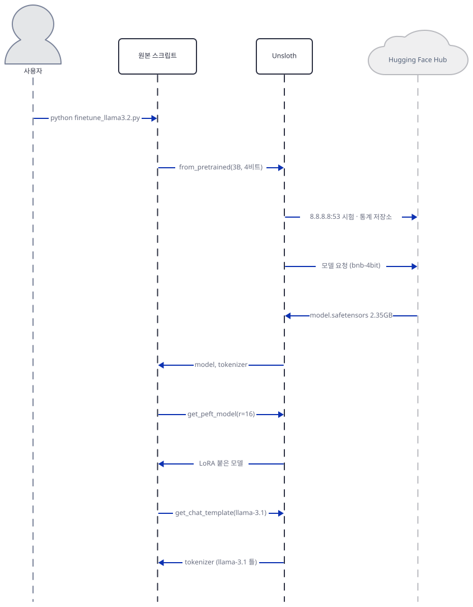

사용자가 스크립트를 돌리면 `FastLanguageModel.from_pretrained`가 먼저 8.8.8.8:53 접속 시험과 통계 저장소 받기를 하고(`UNSLOTH_DISABLE_STATISTICS`나 오프라인 변수가 없을 때, Step 4), 이름을 `…-unsloth-bnb-4bit`로 바꿔 Hub에 요청하고(Step 3), 받은 `model.safetensors` 2.35GB를 4비트로 적재해 모델과 토크나이저를 돌려줍니다. `get_peft_model(r=16)`이 LoRA를 붙이고 `get_chat_template`이 토크나이저에 "llama-3.1" 틀을 붙입니다(Step 6, 5).

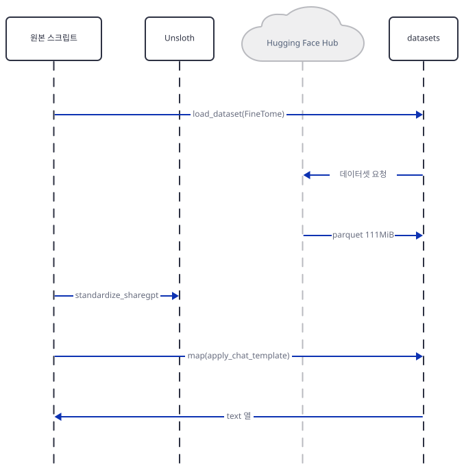

`load_dataset`이 parquet 111MiB를 받고, `standardize_sharegpt`가 키를 바꾸고, `map(apply_chat_template)`가 `text` 열을 만듭니다(Step 5). 이 단계에서 이미 10만 행 전부에 채팅 틀이 적용되고, 트레이너를 만들 때 10만 행 전부가 토큰화됩니다. 학습이 쓰는 것은 그중 480개 시퀀스뿐입니다(Step 6). Arrow 파일은 메모리 매핑이라 전부가 메모리에 올라오는 것은 아닙니다.

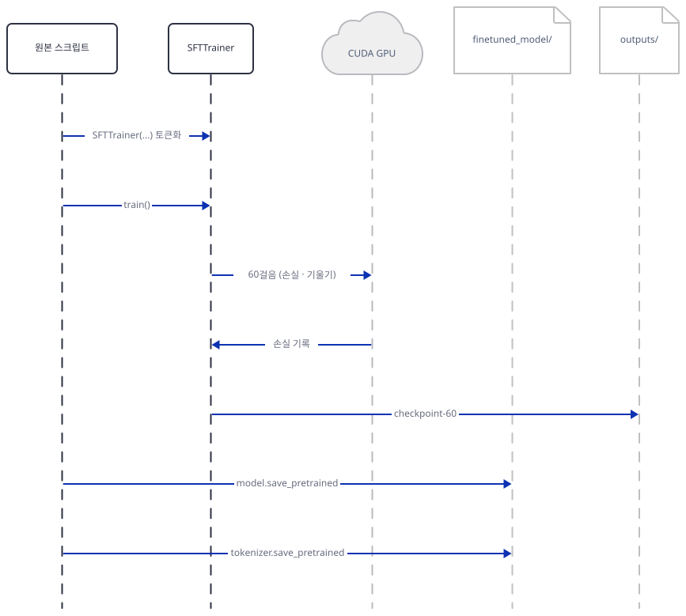

`SFTTrainer(...)`를 만들 때 토큰화·시작 토큰 정리·콜레이터 교체가 일어나고, `train()`이 GPU에서 60걸음을 돌리며 `outputs/checkpoint-60/`을 쓰고(Step 7), 스크립트가 모델과 토크나이저를 `finetuned_model/`에 저장합니다(Step 8).

## 실행 체크리스트

- [ ] 작업 폴더 `finetune-lab`에 `uv venv`와 `uv pip install -r requirements.txt`를 했고, Step 2에서 블록을 건 뒤 `versions.py`가 `distributions installed: 86`을 찍었다
- [ ] 터미널마다 변수 블록을 걸었고, `guard.py`가 `guard ok`를 찍었다
- [ ] 블록을 빼거나 프록시·토큰 변수를 남겼을 때 `guard.py`가 종료 코드 1로 멈추는 것을 봤다
- [ ] `offline_probe.py`에서 세 내려받기가 모두 닫힌 채 실패하고 `get_token()`이 `None`인 것을 봤다
- [ ] `fetch_cards.sh`와 `cards.py`로 4비트 repo 2,372,084,511바이트, 데이터셋 116,531,415바이트, 카드에 `license` 줄이 없는 것을 봤다
- [ ] `route.py`가 `…-unsloth-bnb-4bit`를 내놓았다
- [ ] `try_unsloth.py`가 `NotImplementedError`로 끝났다
- [ ] `render.py`에서 `Cutting Knowledge Date`·`Today Date` 두 줄과 `text` 열을 봤다
- [ ] `lora.py`의 학습 매개변수 32,768이 공식과 같고, `sizes.py`가 24,313,856과 0.48%를 찍었다
- [ ] `trl_as_written.py`에서 세 인자가 `TypeError`가 되는 것을 봤다
- [ ] (선택) `unsloth_probe.py`에서 앱의 세 인자가 `UnslothSFTTrainer`에 받아지고 옵티마이저가 `adamw_8bit`인 것을 봤다
- [ ] `train_toy.py`가 60걸음을 마치고 `labels == input_ids … True`를 찍었다
- [ ] `check_saved.py`에서 어댑터 134,616바이트와 `every tensor is a LoRA tensor … True`를 봤다
- [ ] `guard.log`가 비어 있고 원본 앱 폴더가 바뀌지 않았다

## 문제 해결

| 증상 | 원인 | 해결 |
|---|---|---|
| `guard: HF_HUB_OFFLINE is not 1; …`로 종료 코드 1(직접 확인) | 그 터미널에 변수 블록(Step 2)을 걸지 않았거나 일부가 빠졌다 | 블록을 `finetune-lab` 폴더에서 다시 건다. 변수는 터미널마다 따로다 |
| `guard: … is set: unset every proxy variable …`(직접 확인) | 프록시·`HF_TOKEN` 변수가 남았다 | 블록의 `unset`(또는 PowerShell의 `Remove-Item`) 줄을 건다 |
| `ImportError: cannot import name 'Number' from 'numbers'`(직접 확인) | 작업 폴더에 표준 라이브러리와 이름이 같은 `numbers.py`를 만들었다 | 파일 이름을 `sizes.py`로 바꾼다 |
| `NotImplementedError: Unsloth: nvidia-smi sees … GPU but torch.cuda.is_available() is False`(직접 확인) | 설치된 `torch`가 CPU판이라 Unsloth가 GPU를 못 찾는다 | 원본을 진짜로 돌리려면 `unsloth` 설치 안내에 맞는 CUDA판 `torch`를 넣는다. 이 문서의 장난감 실습에는 필요 없다 |
| `ConnectionError: Couldn't reach … (OfflineModeIsEnabled)`, `LocalEntryNotFoundError`(직접 확인) | 가드 아래에서 내려받기 줄이 돌았다. 캐시가 비어 있으면 닫힌 채 실패한다 | 정상이다. 진짜 모델을 받으려면 가드가 없는 다른 터미널에서 원본을 돌린다(이 문서는 하지 않았다) |
| `TypeError: SFTTrainer.__init__() got an unexpected keyword argument 'tokenizer'`(직접 확인) | 오늘 `trl` 1.15.0은 `tokenizer=`·`dataset_text_field=`·`max_seq_length=`를 받지 않는다 | Unsloth가 패치된 환경(소스로 읽음)이거나, `processing_class=`·`SFTConfig(dataset_text_field=, max_length=)`로 옮겨 쓴다 |
| `RuntimeError: 0 active drivers ([]). There should only be one.`(직접 확인) | `trl` 1.15.0의 `SFTTrainer` 손실 커널이 Triton과 GPU를 요구한다 | CPU에서는 `train_toy.py`처럼 `compute_loss`를 평범한 손실로 바꾼다. GPU에서는 그대로 쓴다 |
| 원본 51~52행이 CPU `torch`에서 `fp16=True`가 되어도 오류가 없다(직접 확인, 2걸음) | CPU에서도 fp16 설정이 거부되지 않았다 | 장난감에서는 GPU 설정과 헷갈리지 않게 `fp16=False`, `bf16=False`, `use_cpu=True`로 둔다 |
| `unsloth_zoo.log`의 WARNING `Could not build the patched trl.trainer.grpo_trainer … Torch not compiled with CUDA enabled`(직접 확인, `unsloth_probe.py`) | 시험 스위치로 불러온 CPU `torch`에서 GRPO 트레이너 패치를 만들 수 없다 | 무시해도 된다. SFT 패치와 무관하다 |
| 모든 실행의 `SyntaxWarning`·`W1019 … Enum subclass` 경고(직접 확인) | `torchao`와 `torch`가 내는 경고다 | 무시해도 된다 |
| 앱 README 21행의 `cd awesome-llm-apps/llm_finetuning_tutorials/…`가 없는 폴더(경로를 `ls`로 확인) | `advanced_llm_apps/`가 빠진 경로다 | 리포 루트에서 `advanced_llm_apps/llm_finetuning_tutorials/llama3.2_finetuning`로 간다 |
| 앱 README 61행의 `unsloth/Llama-3.1-1B-Instruct`가 없다(`curl`로 `401`, 직접 확인) | Llama 3.1에는 1B가 없다. 1B는 Llama 3.2다 | `unsloth/Llama-3.2-1B-Instruct`(같은 날 공개 API로 `200`)를 쓴다. 이 이름의 4비트 변환은 확인하지 않았다 |
| 앱 README 64행의 `TrainingArguments`는 스크립트에 없다 | 스크립트는 `SFTConfig`를 쓴다(45행). 두 번째 앱(Day 153)은 `TrainingArguments`를 쓴다 | `SFTConfig`로 읽는다 |

## 더 해보기

- `train_toy.py`의 학습 줄에서 `train_on_responses_only`가 하는 일을 흉내 내 봅니다. `SFTConfig`의 `assistant_only_loss=True`나 `labels`를 직접 만들어 사용자 구간을 `-100`으로 두고, `labels == input_ids` 줄이 어떻게 달라지는지 봅니다. 이 문서는 하지 않았습니다.
- 장난감의 학습률을 올리거나 걸음을 늘려 손실이 정말 내려가는지, LoRA 비율이 23%인 장난감에서 어떻게 달라지는지 봅니다. 층 수와 폭을 키우면 비율이 0.757%에 가까워지는지도 `make_toy.py`로 시험할 수 있습니다.
- GPU와 CUDA판 `torch`가 있는 PC나 Colab에서 원본을 진짜로 돌려 `finetuned_model/`의 어댑터 크기가 49~97MB 어림과 맞는지 확인합니다. 이 문서는 하지 않았습니다. 그때는 모델·데이터 내려받기가 필요하니 이 문서의 가드를 걸지 않은 별도 터미널에서 하고, `UNSLOTH_DISABLE_STATISTICS=1`과 Hugging Face 토큰 없는 홈을 쓰는 것을 권합니다.

## 다음 날 예고

[Day 153 · 🦥 Gemma 3 Fine-tuning](../day153-gemma3-finetuning/README.md) — 볼륨 15의 마지막 날입니다. `advanced_llm_apps/llm_finetuning_tutorials/gemma3_finetuning`은 `finetune_gemma3.py`(90줄), 앱 README(45줄), 항목 여섯의 `requirements.txt`(`torch`·`transformers`·`datasets`·`trl`·`unsloth`·`unsloth_zoo`, 모두 버전 없음)로 이루어집니다. 오늘과 같은 Unsloth 흐름이지만 `FastLanguageModel` 대신 `FastModel`을 쓰고(2행), 모델은 270m 크기의 `unsloth/gemma-3-270m-it`(9행)이며, `SFTConfig` 대신 `transformers`의 `TrainingArguments`(6행, 64행)와 "gemma-3" 채팅 틀(38행)을 씁니다(소스로 확인). 오늘 Step 3의 `route.py`가 이미 그 모델의 4비트 이름(`unsloth/gemma-3-270m-it-unsloth-bnb-4bit`)을 보였습니다. 이 날은 오늘 확인한 사실(CPU `torch`에서 `unsloth`가 멈추는 것, `trl` 인자)이 같은지 다른지를 다룹니다.
