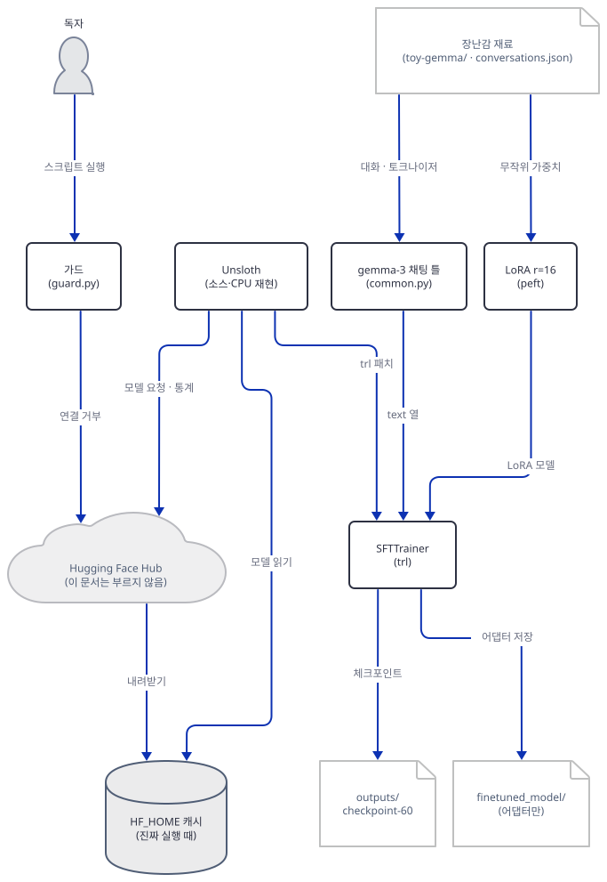
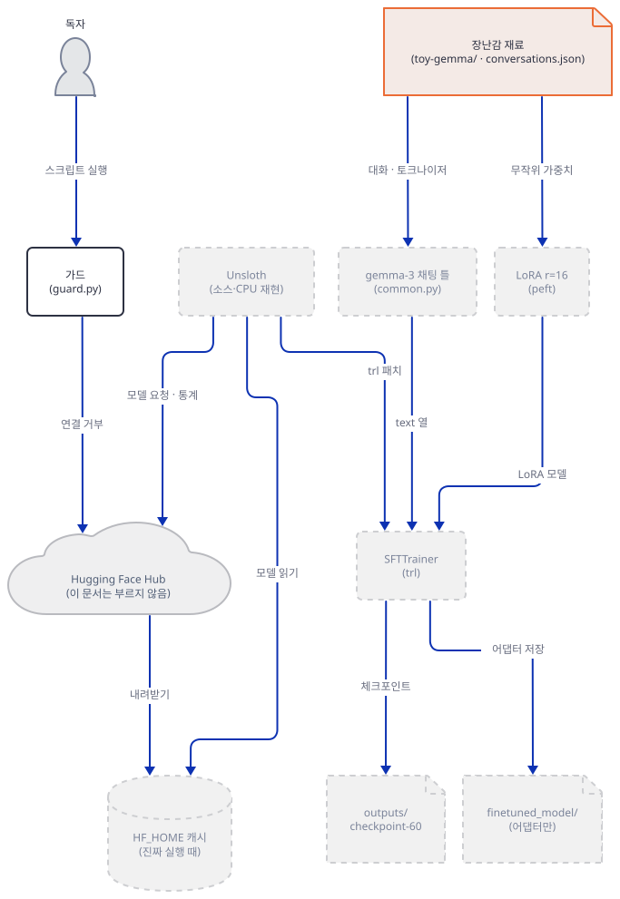
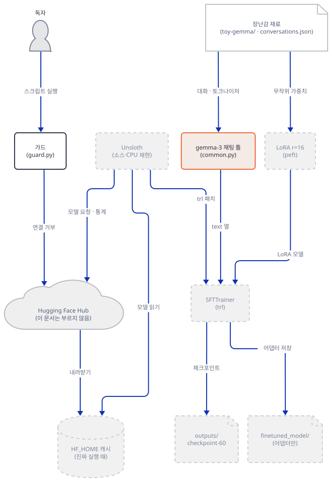
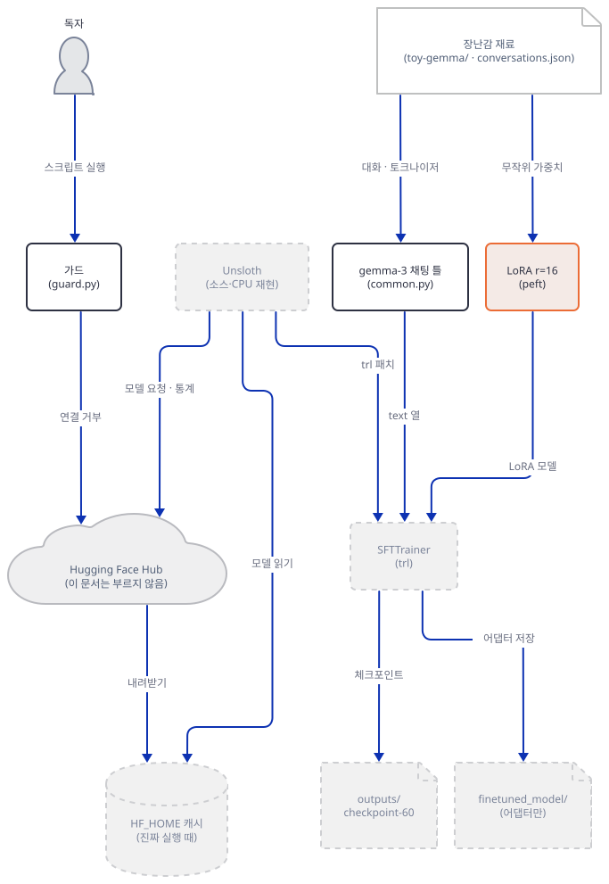
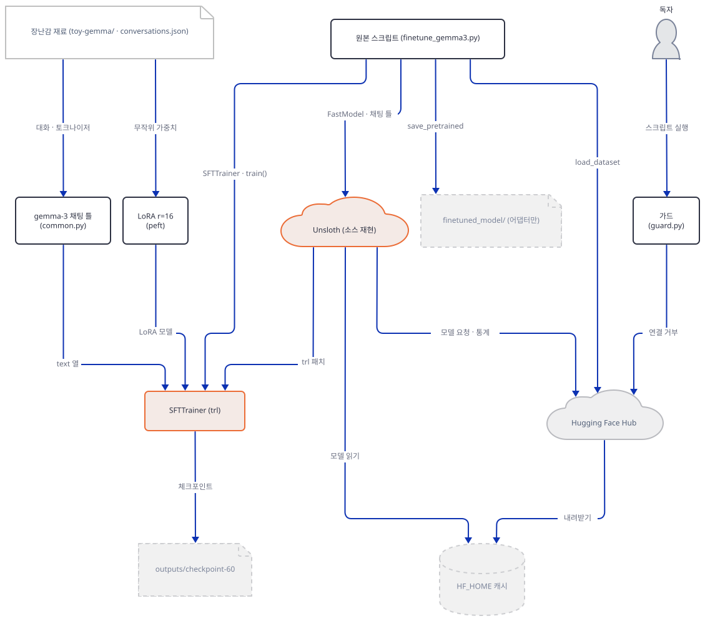
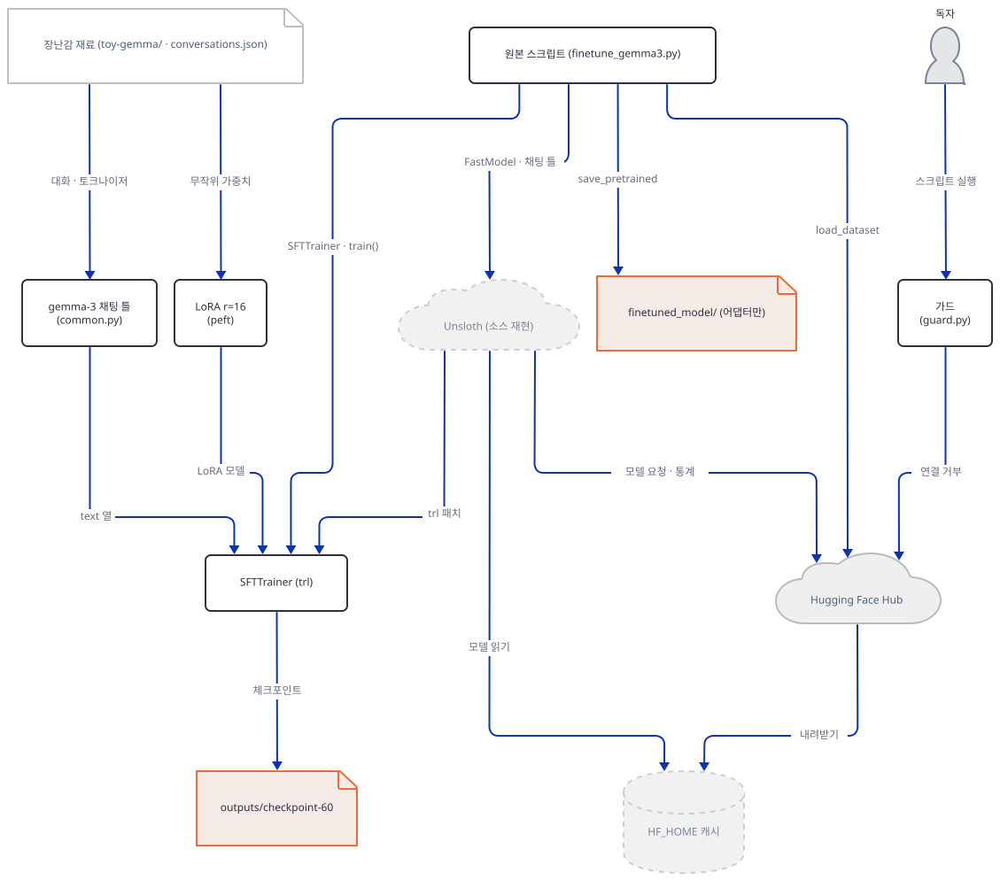
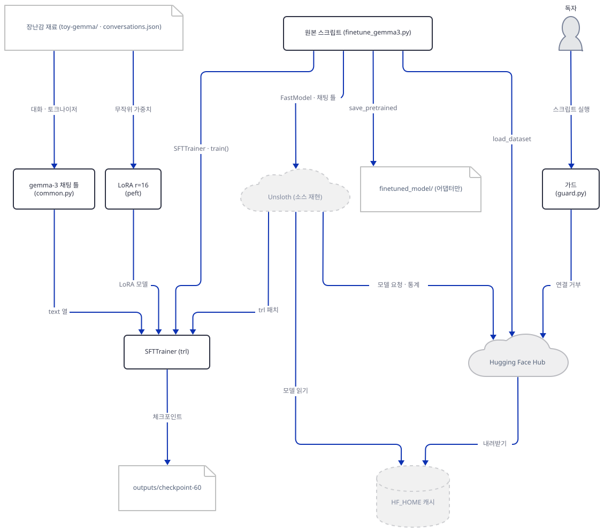
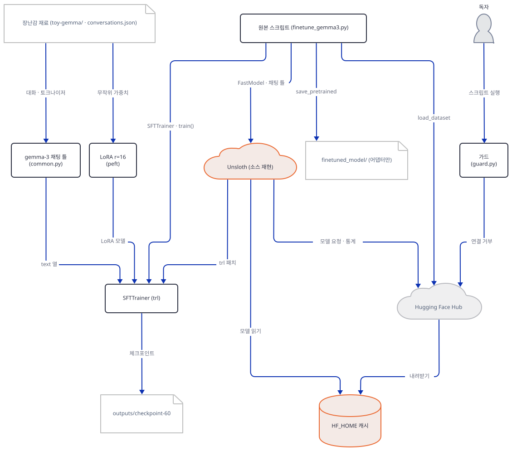
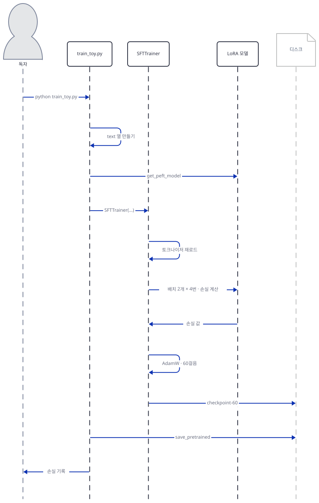

# Day 153 · 🦥 Gemma 3 Fine-tuning

> 볼륨 15 🔧 LLM Fine-tuning · 난이도 ★★☆(앱은 파일 하나지만 CUDA GPU와 Hugging Face 내려받기가 필요하고, 이 문서의 실습은 스크립트 열 개를 CPU에서 돌립니다) ⚠ 오늘 `requirements.txt`로 설치되는 `trl` 1.15.0만으로는 원본의 `SFTTrainer(...)` 인자를 받지 않습니다. Unsloth가 `trl`을 고쳐 주는 길을 GPU 없이 CPU에서 재현하면 받아지지만, 앱이 `SFTConfig` 대신 `TrainingArguments`를 쓰는 탓에 `max_seq_length=2048`이 사라져 글이 1024토큰에서 잘렸습니다(Step 5. GPU에서 원본을 돌려 보지는 못했습니다) · 예상 소요 205분(앱은 90줄이지만 스크립트 열 개를 저장하고 오프라인 가드와 숫자 확인을 한 걸음씩 거칩니다) · API 비용 대략 0원(API 키가 필요 없고 Hugging Face도 한 번도 부르지 않았습니다. GPU 사용료는 이 문서가 쓰지 않았습니다) · 원본 앱: `advanced_llm_apps/llm_finetuning_tutorials/gemma3_finetuning`

## 오늘 만들 것

Google의 작은 언어 모델 Gemma 3(2.7억 매개변수, 270M)을 Unsloth로 불러 LoRA로 일부만 학습하고, 그 결과를 어댑터 파일로 저장하는 스크립트 하나를 따라 봅니다. 원본은 `finetune_gemma3.py`(90줄)가 전부이고 앱 README(45줄)와 `requirements.txt`(6줄)가 곁에 있습니다. 흐름은 `FastModel.from_pretrained`로 모델을 4-bit로 불러오기, `get_peft_model`로 LoRA 붙이기, `gemma-3` 채팅 틀로 FineTome-100k 대화를 글 한 줄씩으로 바꾸기, TRL의 `SFTTrainer`로 60걸음 학습하기, `save_pretrained`로 저장하기입니다. 볼륨 15의 둘째이자 마지막 날입니다. 볼륨 14의 Day 150~151은 모델에 보낼 글을 줄이는 도구였고, 볼륨 15는 글이 아니라 모델의 가중치 일부를 학습합니다. [Day 152](../day152-llama3.2-finetuning/README.md)의 원본 `finetune_llama3.2.py`(편집기에서 63줄)와 뼈대가 같습니다. 같은 FineTome-100k, 같은 LoRA 설정(`r=16`과 일곱 투영 이름), 같은 배치 2×4와 60걸음입니다. 오늘은 같은 것을 다시 설명하지 않고, 그 원본과 다른 점이 실제로 무슨 뜻인지에 집중합니다. 중요한 다른 점은 다섯입니다. `FastLanguageModel` 대신 `FastModel`을 쓰고(2행), `SFTConfig` 대신 `TrainingArguments`를 쓰고(6행, 64행), `SFTTrainer`에 토크나이저를 넘기지 않고(59~63행), 채팅 틀이 `gemma-3`이고(38행), 저장할 때 토크나이저를 저장하지 않습니다(84행). 이 밖에 Day 152의 `SFTTrainer`가 받던 `data_collator=DataCollatorForSeq2Seq(...)`(`finetune_llama3.2.py` 44행)가 이 앱에는 없고, 상단 상수에 `LOAD_IN_8BIT`와 `FULL_FINETUNING` 스위치가 있습니다(12~13행, 켜면 무엇이 달라지는지는 Step 8).

이 문서는 진짜 모델과 데이터셋을 내려받지 않았고, 진짜 학습도 돌리지 않았으며, GPU도 쓰지 않았습니다. 이 PC에는 NVIDIA GPU가 있지만 쓰지 않았습니다. 대신 무작위 가중치로 만든 **장난감** Gemma 3 모양 모델(층 2개, 폭 64)과 그 자리에서 만든 토크나이저, 손으로 쓴 대화 12개로 같은 흐름을 CPU에서 돌립니다. 이것은 Gemma가 아니라 같은 구조 가족의 아주 작은 모형이므로, 손실 값이 진짜 학습의 결과를 말해 주지는 않습니다. 장난감으로 볼 수 있는 것은 숫자가 아니라 모양입니다. 어떤 글이 만들어지는지, 몇 개 매개변수가 학습되는지, 어떤 호출이 받아지는지, 어떤 파일이 저장되는지입니다. 진짜 앱이 무엇을 받고 어디에 쌓는지는 Hugging Face의 공개 카드와 파일 목록, 설치된 패키지의 소스로 읽었습니다(Step 8). 직접 돌려 보거나 소스로 확인한 것이 여덟입니다.

1. `unsloth/gemma-3-270m-it`를 `load_in_4bit=True`로 부르면 Unsloth는 다른 저장소 `unsloth/gemma-3-270m-it-unsloth-bnb-4bit`를 받습니다. 저장소 파일 목록의 합계는 432,737,613바이트이고 데이터셋 파일은 116,531,415바이트입니다(Step 8).
2. LoRA로 학습되는 매개변수는 3,796,992개로 모델 전체 268,098,176개의 1.42%입니다. 설정값에서 계산한 수가 장난감의 실제 수와 같았고, 진짜 270M 설정을 메모리 없이 만들어 같은 수를 얻었습니다(Step 4).
3. `max_steps=60`은 유효 배치 8로 예시 480개, 곧 FineTome-100k의 0.48%입니다. 한 에포크는 12,500걸음입니다(Step 6).
4. 원본의 `SFTTrainer(...)` 호출은 순수한 `trl` 1.15.0에서 `dataset_text_field=` 때문에 `TypeError`로 멈춥니다. Unsloth가 `trl`을 패치하는 길을 CPU에서 재현하면 받아지지만, `TrainingArguments`를 거치며 `max_seq_length=2048`이 사라져 긴 글이 1024토큰에서 잘렸습니다(Step 5).
5. 순수한 `trl` 경로에서는 글에 `<bos>`가 두 번 들어가고 끝에 `<end_of_turn>`이 하나 더 붙습니다. Unsloth의 트레이너 경로에서는 BOS를 하나로 줄이고 끝 표시를 더 붙이지 않았습니다. 두 경로 모두 질문 토큰까지 손실에 들어갑니다(Step 3, 5, 6).
6. 학습이 끝나도 `finetuned_model/`에는 LoRA 어댑터만 있고 토크나이저는 없습니다. 토크나이저는 `outputs/checkpoint-60/`에 있습니다(Step 6, 7).
7. 이 PC의 `requirements.txt` 설치는 CPU판 `torch`(`2.14.1+cpu`)를 받고, `import unsloth`는 몇 초 뒤 "You need a GPU"로 멈춥니다(Step 8).
8. 앱 README의 `--force-reinstall` 줄은 이미 설치된 86개를 모두 다시 설치합니다(Step 8). Unsloth가 `from_pretrained`마다 Hugging Face에 환경 통계를 요청하는 길과 그것을 끄는 변수도 확인했습니다(Step 8).



## 사전 준비

| 서비스/도구 | 용도 | 발급·설치 |
|---|---|---|
| uv | 가상환경 생성과 패키지 설치 | [공통 사전 준비](../README.md#공통-사전-준비-한-번만) 절 참고 |
| Python | 이 문서는 3.13.3으로 확인했다. `unsloth` 2026.10.6은 3.9 이상 3.15 미만을 요구한다 | 공통 사전 준비와 같음 |
| 인터넷(설치 때만) | Step 1에서 PyPI의 패키지 59개를 받는다. 이 문서의 실행은 Hugging Face를 부르지 않는다 | Step 1 |
| CUDA GPU | 원본 앱을 진짜로 돌릴 때만. 앱 README는 "runnable on a CUDA GPU"라고 적는다. 이 문서는 GPU를 쓰지 않았다 | 없음 |
| Hugging Face 계정 | 필요 없다. 앱이 받는 `unsloth/` 저장소는 접근 신청이 없는 공개 저장소다(API의 `gated`가 `false`). 원본 `google/gemma-3-270m-it`는 `gated`가 `manual`이라 약관 동의가 필요하다 | https://huggingface.co/unsloth/gemma-3-270m-it |

⚠ **라이선스.** 이 문서는 Gemma Terms of Use(https://ai.google.dev/gemma/terms, 2026-10-19에 읽음, 쪽 머리에 "Last modified: April 1, 2026", 그 쪽에 "This documentation is deprecated"와 새 문서 gemma.ai 안내가 있음)와 `unsloth/gemma-3-270m-it` 카드(`license: gemma`, 약관 링크)에서 다음을 읽었습니다. 약관은 부록의 목록에 Gemma 3을 포함합니다. 3.1절은 Gemma나 Model Derivatives를 제3자에게 배포(Distribution)할 때 3.2절의 사용 제한을 그 사람들과의 계약에 집행 가능한 조항으로 넣고 그 제한이 적용된다고 알리며, 약관 사본을 주고, 고친 파일에 고쳤다는 표시를 달고, 호스팅 서비스가 아니면 "Gemma is provided under and subject to the Gemma Terms of Use found at ai.google.dev/gemma/terms"라는 Notice 파일을 붙이라고 합니다. 3.2절은 금지 사용 정책을 약관에 포함시킵니다. 정의 1.1(e)는 Gemma를 고치거나 그 위에 만든 모델을 Model Derivatives로 적고 "Outputs are not deemed Model Derivatives"라고 합니다. 학습된 LoRA 어댑터 파일이 여기에 드는지는 약관이 어댑터를 따로 말하지 않아 확인하지 못했습니다. 자기 PC에 두고 쓰는 것과 남에게 주는 것은 약관에서 다른 일입니다. 데이터셋 FineTome-100k 카드(https://huggingface.co/datasets/mlabonne/FineTome-100k, 같은 날)는 `license` 항목이 없고, "arcee-ai/The-Tome의 부분집합을 fineweb-edu 분류기로 다시 거른 것"이라고만 적습니다. The-Tome 카드의 `license`는 `mit`이지만 그 카드가 모았다는 아홉 개 데이터셋 각각의 조건은 확인하지 못했습니다. `unsloth` 2026.10.6은 Apache-2.0, `unsloth_zoo`는 LGPL-3.0-or-later, `trl`은 Apache-2.0, `peft`는 Apache(패키지 메타데이터로 확인)입니다. 법률 조언이 아닙니다.

이 문서의 스크립트는 영어 문장과 한글을 섞어 출력합니다. 출력을 파이프나 파일로 받는 한국어 Windows에서는 먼저 인코딩을 맞춥니다. Step 1의 변수 블록에도 들어 있습니다.

```bash
export PYTHONIOENCODING=utf-8
```

```powershell
$env:PYTHONIOENCODING = "utf-8"
```

## 아키텍처 한눈에 보기

| 컴포넌트 | 역할 | 코드 위치 |
|---|---|---|
| 설정 상수 | 모델 이름, 최대 길이, 4-bit·8-bit·전체 학습 스위치 | `advanced_llm_apps/llm_finetuning_tutorials/gemma3_finetuning/finetune_gemma3.py:8-13` |
| 모델 불러오기 | `FastModel.from_pretrained`로 모델과 토크나이저 | `advanced_llm_apps/llm_finetuning_tutorials/gemma3_finetuning/finetune_gemma3.py:16-24` |
| LoRA 붙이기 | `get_peft_model`, `r=16`, 일곱 투영 | `advanced_llm_apps/llm_finetuning_tutorials/gemma3_finetuning/finetune_gemma3.py:26-35` |
| 채팅 틀 | `get_chat_template(..., "gemma-3")` | `advanced_llm_apps/llm_finetuning_tutorials/gemma3_finetuning/finetune_gemma3.py:37-39` |
| 데이터셋 준비 | FineTome-100k 불러오기, 표준화, `text` 열 만들기 | `advanced_llm_apps/llm_finetuning_tutorials/gemma3_finetuning/finetune_gemma3.py:42-51` |
| 정밀도와 학습 | bf16·fp16 고르기, `SFTTrainer`, `TrainingArguments` | `advanced_llm_apps/llm_finetuning_tutorials/gemma3_finetuning/finetune_gemma3.py:54-76` |
| 저장 | `save_pretrained("finetuned_model")` | `advanced_llm_apps/llm_finetuning_tutorials/gemma3_finetuning/finetune_gemma3.py:84` |
| 설치 목록 | 패키지 여섯, 버전 없음 | `advanced_llm_apps/llm_finetuning_tutorials/gemma3_finetuning/requirements.txt:1-6` |
| Unsloth (`unsloth`, `unsloth_zoo`) | 모델 불러오기·LoRA·`trl` 패치 | 코드 없음 (설치된 패키지 2026.10.6, 소스로만 읽음) |
| TRL·PEFT | 학습 루프, LoRA | 코드 없음 (설치된 패키지 1.15.0, 0.21.2) |
| Hugging Face Hub | 모델·데이터셋을 내려주는 곳 | 코드 없음 (외부. 이 문서는 부르지 않음) |
| `HF_HOME` 캐시 | 받은 파일을 쌓는 곳 | 코드 없음 (진짜 실행 때, Step 8) |
| 이 문서의 장난감 재료와 가드 | 무작위 모델·토크나이저·대화, 오프라인 가드 | 코드 없음 (Step 1~2에서 직접 만듦) |

## 단계별 진행

### Step 1. 환경과 가드 — 줄 하나를 빠뜨려도 바깥으로 나가지 않게

**목적.** 이 문서의 실습에 필요한 패키지를 독립 가상환경에 설치하고, Hugging Face 계열 라이브러리가 바깥에 닿지도 이 PC의 진짜 홈을 보지도 못하게 하는 가드를 만듭니다.

**할 일.** 먼저 폴더와 가상환경을 만듭니다. 원본 앱 폴더에서는 아무것도 돌리지 않습니다.

```bash
mkdir gemma3-lab
cd gemma3-lab
uv venv --python 3.13
```

```powershell
New-Item -ItemType Directory gemma3-lab | Out-Null
Set-Location gemma3-lab
uv venv --python 3.13
```

(PowerShell 줄은 실행해 보지 못했습니다. pip 대안은 `python -m venv .venv`로 만들고 활성화한 뒤 `pip install -r requirements-lab.txt`입니다.) 설치 목록을 `requirements-lab.txt`로 저장합니다. 여섯 줄의 버전은 임의의 값이 아니라 원본 `requirements.txt`(여섯 줄, 버전 없음)가 오늘 풀리는 값입니다. `uv pip compile requirements.txt --python-platform windows`는 86개로 풀렸고(2026-10-19, 직접 확인) 그 가운데 `torch==2.14.1`, `transformers==5.17.0`, `trl==1.15.0`, `datasets==4.8.5`, `tokenizers==0.23.3`, `peft==0.21.2`를 그대로 가져왔습니다. `peft`는 원본 목록에 없고 `unsloth`와 `unsloth_zoo`가 끌어옵니다. 같은 `trl`로 돌려야 Step 5의 오류가 원본 앱이 만날 오류와 같기 때문에 버전을 고정했습니다. `unsloth`는 이 가상환경에 넣지 않습니다. 이 실습에 필요하지 않고, GPU가 없으면 불러오지도 못합니다(Step 8).

`requirements-lab.txt`

```text
torch==2.14.1
transformers==5.17.0
trl==1.15.0
peft==0.21.2
datasets==4.8.5
tokenizers==0.23.3
```

```bash
uv pip install -r requirements-lab.txt
```

패키지 59개가 설치됩니다(`uv pip list`로 센 값, 직접 확인). 이 줄이 인터넷에 닿는 유일한 줄입니다. 설치 뒤 다음 파일 `guard.py`를 저장합니다. 모든 스크립트가 맨 첫 줄에서 불러오는 파일입니다. 불러오는 프로세스 안에서 네 가지를 합니다. 첫째, `HF_HUB_OFFLINE`·`HF_DATASETS_OFFLINE`·`TRANSFORMERS_OFFLINE`을 `1`로 덮어씁니다. 둘째, `HF_HOME`을 이 폴더의 `hf/`로, `HOME`·`USERPROFILE`·`CLAUDE_CONFIG_DIR`을 `fake-home/`으로, `TEMP`·`TMP`·`TMPDIR`과 Unsloth가 생성한 코드를 쌓는 `UNSLOTH_COMPILE_LOCATION`을 `tmp/`로 덮어씁니다. 서드파티가 쓰는 임시 파일이 독자의 진짜 임시 폴더를 어지럽히지 않게 하는 줄입니다(`torch`의 컴파일 캐시도 `tmp/`에 생겼습니다). 이 PC의 진짜 홈에는 Hugging Face 토큰(`~/.cache/huggingface/token`)과 코딩 도구의 자격 증명이 있을 수 있고, 라이브러리가 그것을 보지 못해야 합니다. 셋째, 토큰·프록시·API 키 변수를 지우고 `HF_ENDPOINT`를 죽은 루프백 주소로 돌립니다. 넷째, 소켓에서 루프백이 아닌 이름 조회와 연결을 거부합니다. 환경변수는 `huggingface_hub`가 불려 올 때 읽히므로 가드는 반드시 첫 줄입니다.

`gemma3-lab/guard.py`

```python
"""Import this FIRST in every script of this lab, before torch / transformers / trl / peft / datasets.

What it does, in this process only:
  1. forces the Hugging Face libraries offline (HF_HUB_OFFLINE, HF_DATASETS_OFFLINE, TRANSFORMERS_OFFLINE),
  2. points HF_HOME, HOME, USERPROFILE, CLAUDE_CONFIG_DIR, TEMP and the Unsloth compile cache at folders inside this lab, so a token file in your
     real home (~/.cache/huggingface/token, ~/.claude/...) is never found,
  3. drops token and proxy variables and sends HF_ENDPOINT to a dead loopback port,
  4. refuses every network name lookup and connection that is not loopback.
It overrides whatever the terminal had: a missing export line in your terminal cannot undo it."""
import os
import socket
from pathlib import Path

LAB = Path(__file__).resolve().parent
FAKE_HOME = LAB / "fake-home"
HF_HOME = LAB / "hf"
TMP_DIR = LAB / "tmp"
for folder in (FAKE_HOME / ".claude", HF_HOME, TMP_DIR):
    folder.mkdir(parents=True, exist_ok=True)

for name in ("HF_TOKEN", "HUGGING_FACE_HUB_TOKEN", "HF_TOKEN_PATH", "HF_HUB_ENABLE_HF_TRANSFER",
             "HTTP_PROXY", "HTTPS_PROXY", "ALL_PROXY", "http_proxy", "https_proxy", "all_proxy",
             "OPENAI_API_KEY", "ANTHROPIC_API_KEY", "WANDB_API_KEY", "CLAUDE_CODE_OAUTH_TOKEN"):
    os.environ.pop(name, None)

os.environ.update({
    "HF_HUB_OFFLINE": "1",
    "HF_DATASETS_OFFLINE": "1",
    "TRANSFORMERS_OFFLINE": "1",
    "HF_HOME": str(HF_HOME),
    "HF_ENDPOINT": "http://127.0.0.1:9",
    "HF_HUB_DISABLE_TELEMETRY": "1",
    "HF_HUB_DISABLE_PROGRESS_BARS": "1",
    "DO_NOT_TRACK": "1",
    "UNSLOTH_DISABLE_STATISTICS": "1",
    "WANDB_MODE": "disabled",
    "HOME": str(FAKE_HOME),
    "USERPROFILE": str(FAKE_HOME),
    "HOMEDRIVE": FAKE_HOME.drive or "C:",
    "HOMEPATH": str(FAKE_HOME)[len(FAKE_HOME.drive):] or "\\",
    "CLAUDE_CONFIG_DIR": str(FAKE_HOME / ".claude"),
    "TOKENIZERS_PARALLELISM": "false",
    "TEMP": str(TMP_DIR),
    "TMP": str(TMP_DIR),
    "TMPDIR": str(TMP_DIR),
    "UNSLOTH_COMPILE_LOCATION": str(TMP_DIR / "unsloth_compiled_cache"),
})

_LOOPBACK = ("127.0.0.1", "::1", "localhost")


class NetworkBlocked(OSError):
    pass


def _refuse(kind, target):
    raise NetworkBlocked(f"guard: blocked {kind} {target!r} (this lab talks to loopback only)")


_getaddrinfo = socket.getaddrinfo


def _guarded_getaddrinfo(host, *args, **kwargs):
    if host is not None and host not in _LOOPBACK:
        _refuse("lookup", host)
    return _getaddrinfo(host, *args, **kwargs)


socket.getaddrinfo = _guarded_getaddrinfo
for _fn_name in ("gethostbyname", "gethostbyname_ex"):
    def _make(real, label=_fn_name):
        def guarded(host, *args):
            if host not in _LOOPBACK:
                _refuse(label, host)
            return real(host, *args)
        return guarded
    setattr(socket, _fn_name, _make(getattr(socket, _fn_name)))

_connect = socket.socket.connect
_connect_ex = socket.socket.connect_ex


def _guarded_connect(self, address):
    if isinstance(address, tuple) and address[0] not in _LOOPBACK:
        _refuse("connect", address)
    return _connect(self, address)


def _guarded_connect_ex(self, address):
    if isinstance(address, tuple) and address[0] not in _LOOPBACK:
        _refuse("connect_ex", address)
    return _connect_ex(self, address)


socket.socket.connect = _guarded_connect
socket.socket.connect_ex = _guarded_connect_ex


def status():
    rel = lambda p: os.path.relpath(p, LAB)
    return (f"guard ok: offline, HOME={rel(os.environ['HOME'])}, HF_HOME={rel(os.environ['HF_HOME'])} "
            f"(inside this lab), sockets: loopback only")


if __name__ == "__main__":
    print(status())
    try:
        socket.create_connection(("huggingface.co", 443), timeout=2)
    except NetworkBlocked as error:
        print("huggingface.co ->", error)
    print("Path.home() =", os.path.relpath(Path.home(), LAB))
    import huggingface_hub
    print("token that huggingface_hub can see:", huggingface_hub.get_token())
```

가드의 둘째 겹은 터미널 변수입니다. 같은 일을 터미널에서 따로 합니다. 독자가 `guard.py`를 한 스크립트에서 빠뜨려도 터미널 변수가 라이브러리를 오프라인으로 두고 진짜 홈을 가리고, 반대로 터미널 변수를 빠뜨려도 `guard.py`가 같은 일을 합니다. 두 겹은 서로 독립입니다. 변수 블록은 `gemma3-lab` 폴더에서, **스크립트를 돌리는 터미널마다** 먼저 겁니다. 환경변수는 그 터미널에만 있기 때문입니다. 설치를 마친 뒤에 겁니다. `HOME`을 바꾸면 `uv`가 자기 캐시를 못 찾아 패키지를 다시 받을 수 있습니다.

```bash
export PYTHONIOENCODING=utf-8
export HF_HUB_OFFLINE=1 HF_DATASETS_OFFLINE=1 TRANSFORMERS_OFFLINE=1
export HF_HUB_DISABLE_TELEMETRY=1 DO_NOT_TRACK=1
export HF_HOME="$PWD/hf"
export HOME="$PWD/fake-home" USERPROFILE="$PWD/fake-home" CLAUDE_CONFIG_DIR="$PWD/fake-home/.claude"
export TEMP="$PWD/tmp" TMP="$PWD/tmp" TMPDIR="$PWD/tmp" UNSLOTH_COMPILE_LOCATION="$PWD/tmp/unsloth_compiled_cache"
unset HF_TOKEN HUGGING_FACE_HUB_TOKEN
mkdir -p "$HF_HOME" "$CLAUDE_CONFIG_DIR" "$TEMP"
```

```powershell
$env:PYTHONIOENCODING = "utf-8"
$env:HF_HUB_OFFLINE = "1"
$env:HF_DATASETS_OFFLINE = "1"
$env:TRANSFORMERS_OFFLINE = "1"
$env:HF_HUB_DISABLE_TELEMETRY = "1"
$env:DO_NOT_TRACK = "1"
$env:HF_HOME = "$PWD\hf"
$env:HOME = "$PWD\fake-home"
$env:USERPROFILE = "$PWD\fake-home"
$env:CLAUDE_CONFIG_DIR = "$PWD\fake-home\.claude"
$env:TEMP = "$PWD\tmp"
$env:TMP = "$PWD\tmp"
$env:UNSLOTH_COMPILE_LOCATION = "$PWD\tmp\unsloth_compiled_cache"
Remove-Item Env:HF_TOKEN, Env:HUGGING_FACE_HUB_TOKEN -ErrorAction SilentlyContinue
New-Item -ItemType Directory -Force $env:HF_HOME, $env:CLAUDE_CONFIG_DIR, $env:TEMP | Out-Null
```

(PowerShell 형태는 실행해 보지 못했습니다. PowerShell에서 변수에 빈 문자열 `""`을 대입하면 변수가 지워지므로, 값을 비우는 줄 대신 지우는 줄을 쓰거나 위처럼 값을 정합니다. 이 이름들은 그 터미널에 남으므로 끝나면 터미널을 닫습니다.)

**확인.** 가드를 직접 돌립니다. 이 출력의 마지막 줄이 `None`이어야 합니다. 진짜 토큰이 있는 홈에서 돌려도 라이브러리가 토큰을 보지 못했다는 뜻입니다.

```bash
uv run --no-project python guard.py
```

기대 출력(직접 확인)입니다.

```text
guard ok: offline, HOME=fake-home, HF_HOME=hf (inside this lab), sockets: loopback only
huggingface.co -> guard: blocked lookup 'huggingface.co' (this lab talks to loopback only)
Path.home() = fake-home
token that huggingface_hub can see: None
```

여기서 두 겹을 따로 시험한 결과는 이렇습니다(직접 확인). 새 폴더에서 셸에 진짜처럼 생긴 가짜 `OPENAI_API_KEY`·`ANTHROPIC_API_KEY`·`HF_TOKEN`, 프록시 변수 다섯(기록만 하는 루프백 프록시를 가리킴), `HF_HUB_OFFLINE=0`, 진짜 `HF_ENDPOINT`를 두고, 상위 폴더에 같은 모양의 가짜 키가 든 `.env`를, 독자 홈에 가짜 `~/.cache/huggingface/token`과 `~/.claude/.credentials.json`을 두었습니다. 그 상태로 이 문서의 스크립트를 순서대로 돌렸을 때 기록 프록시에 도착한 요청과 소켓 감시에 걸린 시도가 모두 0이었습니다. 변수 블록 없이 `guard.py`만으로 돌렸을 때도, `guard.py`의 `import guard` 줄을 뺀 사본에 변수 블록만 걸고 돌렸을 때도 0이었고 `huggingface_hub.get_token()`은 `None`이었습니다. 둘 다 없는 사본에서는 `show_template.py`와 `count_lora.py`가 0이었지만 `train_toy.py`는 `huggingface.co:443`으로 가는 요청 둘을 시도했고(기록 프록시가 받았습니다), `get_token()`은 셸의 `HF_TOKEN` 값을 돌려주었습니다. 요청 둘은 `trl` 1.15.0의 트레이너가 만들어질 때 나갑니다(소스로 확인: `trl/trainer/base_trainer.py` 81행의 `_send_telemetry`). 하나는 사용 통계 `HEAD /api/telemetry/trl/<트레이너 이름>`이고, 사용자 에이전트에 모델 종류(`gemma3_text`)·PEFT 여부·데이터 출처의 종류·장치(CPU는 `cpu`, CUDA면 GPU 이름까지)가 실립니다. 다른 하나는 그 요청의 헤더를 만들 때 `huggingface_hub` 1.33.0이 `detect_agent()`로 받는 에이전트 목록 `GET /api/agent-harnesses`입니다(`utils/_headers.py`, `utils/_detect_agent.py`). 요청을 루프백 허브 대역으로 돌려 본 결과 둘 다 `Authorization` 헤더가 없었습니다. 오프라인 변수, `HF_HUB_DISABLE_TELEMETRY`, `DO_NOT_TRACK` 가운데 하나만 있어도 둘이 모두 꺼졌습니다(각각 직접 확인). 같은 모델 폴더를 읽는 `count_lora.py`와 `load_back.py`는 트레이너를 만들지 않아 0건이었습니다. 진짜 앱에서는 이 겹이 진짜 토큰이 요청에 실리는 것을 막는 유일한 것입니다(Step 8).

### Step 2. 장난감 재료 — 무작위 가중치의 Gemma 3 모양 모델

**목적.** 내려받기 없이 같은 흐름을 돌릴 재료를 만듭니다. 모델, 토크나이저, ShareGPT 모양의 대화입니다.

**할 일.** 다음을 `make_toy.py`로 저장합니다. `transformers`의 `Gemma3TextConfig`로 층 2개, 폭 64의 모델을 무작위 가중치로 만들고, `tokenizers`로 12개 문장에서 토크나이저를 그 자리에서 학습하고, 대화 12개를 JSON으로 씁니다. 토크나이저의 설정은 진짜 `unsloth/gemma-3-270m-it`의 공개 `tokenizer_config.json`(https://huggingface.co/unsloth/gemma-3-270m-it/resolve/main/tokenizer_config.json, 2026-10-19에 인증 없이 읽음)과 맞춥니다. 그 파일은 `add_bos_token: true`, `add_eos_token: false`, `eos_token: "<end_of_turn>"`입니다. 장난감은 글자 단위(바이트) BPE이고 진짜는 어휘 262,144개의 다른 토크나이저입니다. 맞춘 것은 BOS를 자동으로 붙이는 동작과 끝 표시 토큰의 이름뿐입니다.

`gemma3-lab/make_toy.py`

```python
"""Build the toy: a tiny Gemma 3 shaped model with RANDOM weights, a tokenizer trained on the spot, and 12 hand-made
ShareGPT conversations. Nothing is downloaded. The toy is not Gemma: same architecture family, 2 layers, width 64."""
import guard  # noqa: F401  (must stay the first import)

import json
from pathlib import Path

import torch
from tokenizers import Tokenizer, decoders, models, pre_tokenizers, processors, trainers
from transformers import Gemma3ForCausalLM, Gemma3TextConfig, PreTrainedTokenizerFast

LAB = Path(__file__).resolve().parent
TOY = LAB / "toy-gemma"
SPECIAL = ["<pad>", "<eos>", "<bos>", "<unk>", "<start_of_turn>", "<end_of_turn>"]  # ids 0..5

PAIRS = [
    ("What is LoRA?", "LoRA freezes the base weights and trains two small matrices per layer instead."),
    ("Why use 4-bit loading?", "It stores the frozen weights in 4 bits, so the model needs less GPU memory."),
    ("What does r=16 mean?", "It is the rank of the two small LoRA matrices; a larger rank trains more parameters."),
    ("What is a chat template?", "It turns a list of messages into one string with the model's turn markers."),
    ("What is an epoch?", "One full pass over the training data."),
    ("What is a step?", "One optimizer update, after gradient accumulation has collected its mini batches."),
    ("Why accumulate gradients?", "To get a larger effective batch without holding it in memory at once."),
    ("What is the learning rate?", "The size of each update; LoRA usually takes a larger one than full fine-tuning."),
    ("What is a tokenizer?", "It splits text into pieces and maps each piece to an integer id."),
    ("What is an adapter?", "A small file of trained LoRA weights that sits on top of an unchanged base model."),
    ("What is FineTome?", "A hundred thousand filtered conversations in ShareGPT format."),
    ("What is Gemma?", "A family of open language models from Google, from 270 million to 27 billion parameters."),
]
CONVERSATIONS = [
    {"conversations": [{"from": "human", "value": q}, {"from": "gpt", "value": a}]} for q, a in PAIRS
]
CONVERSATIONS[3]["conversations"] += [
    {"from": "human", "value": "Show one."},
    {"from": "gpt", "value": "A user turn starts with the marker start of turn, then the word user."},
]

(LAB / "conversations.json").write_text(json.dumps(CONVERSATIONS, indent=1), encoding="utf-8")

corpus = [m["value"] for c in CONVERSATIONS for m in c["conversations"]]
tok = Tokenizer(models.BPE(unk_token="<unk>"))
tok.pre_tokenizer = pre_tokenizers.ByteLevel(add_prefix_space=False)
tok.decoder = decoders.ByteLevel()
tok.train_from_iterator(
    corpus,
    trainers.BpeTrainer(vocab_size=400, special_tokens=SPECIAL, initial_alphabet=pre_tokenizers.ByteLevel.alphabet()),
)
# Gemma's tokenizer puts <bos> in front of every encoded text by itself; copy that behavior.
tok.post_processor = processors.TemplateProcessing(single="<bos> $A", special_tokens=[("<bos>", 2)])
fast = PreTrainedTokenizerFast(
    tokenizer_object=tok, bos_token="<bos>", eos_token="<end_of_turn>", pad_token="<pad>", unk_token="<unk>",
    additional_special_tokens=["<start_of_turn>", "<end_of_turn>"],
)

torch.manual_seed(0)
config = Gemma3TextConfig(
    vocab_size=len(fast), hidden_size=64, intermediate_size=128, num_hidden_layers=2,
    num_attention_heads=4, num_key_value_heads=1, head_dim=16, max_position_embeddings=512,
    sliding_window=64, layer_types=["sliding_attention", "full_attention"],
    bos_token_id=2, eos_token_id=5, pad_token_id=0,
)
model = Gemma3ForCausalLM(config)
TOY.mkdir(exist_ok=True)
model.save_pretrained(TOY)
fast.save_pretrained(TOY)

n = sum(p.numel() for p in model.parameters())
print("toy model:", config.model_type, "layers", config.num_hidden_layers, "width", config.hidden_size,
      "vocab", config.vocab_size, "params", n)
print("files in", TOY.name, ":", sorted(p.name for p in TOY.iterdir()))
print("conversations:", len(CONVERSATIONS), "| first token ids:", fast("What is LoRA?")["input_ids"])
```

```bash
uv run --no-project python make_toy.py
```

**확인.** 기대 출력(직접 확인)입니다. 새로 생기는 것은 `toy-gemma/`(모델과 토크나이저)와 `conversations.json`입니다.

```text
toy model: gemma3_text layers 2 width 64 vocab 400 params 95872
files in toy-gemma : ['config.json', 'generation_config.json', 'model.safetensors', 'tokenizer.json', 'tokenizer_config.json']
conversations: 12 | first token ids: [2, 278, 277, 317, 36]
```

진짜 모델과 무엇이 같고 다른지는 다음과 같습니다. 진짜 값은 `unsloth/gemma-3-270m-it`의 `config.json`(https://huggingface.co/unsloth/gemma-3-270m-it/resolve/main/config.json, 같은 날)입니다.

| | 진짜 270M | 장난감 |
|---|---|---|
| 모델 종류 | `gemma3_text`(`Gemma3ForCausalLM`) | 같음 |
| 층 수 | 18 | 2 |
| 은닉 폭 · 중간 폭 | 640 · 2,048 | 64 · 128 |
| 어텐션 머리 · 키/값 머리 · 머리 크기 | 4 · 1 · 256 | 4 · 1 · 16 |
| 어휘 크기 | 262,144 | 400 |
| 매개변수 | 268,098,176(Step 4에서 계산) | 95,872 |
| 가중치 | 학습된 값 | 무작위 |



### Step 3. gemma-3 채팅 틀 — 어떤 글이 만들어지는가

**목적.** 앱의 데이터 준비(`finetune_gemma3.py:42-51`)를 장난감 대화 12개로 그대로 돌려, `gemma-3` 틀이 만드는 글과 그 글이 토큰이 될 때의 모양을 봅니다.

**할 일.** 앱은 ShareGPT 모양의 대화(`{"from": "human", "value": ...}`)를 `standardize_sharegpt`로 `{"role": "user", "content": ...}`로 바꾸고, 대화마다 `tokenizer.apply_chat_template(c, tokenize=False)`를 불러 `text` 열을 만듭니다(원본 `finetune_llama3.2.py`의 25~35행에도 같은 단계가 있습니다). 오늘 달라지는 것은 틀입니다.

`advanced_llm_apps/llm_finetuning_tutorials/gemma3_finetuning/finetune_gemma3.py:37-39`

```python
    # Apply Gemma 3 chat template for correct conversation formatting
    tokenizer = get_chat_template(tokenizer, chat_template="gemma-3")
    return model, tokenizer
```

`get_chat_template`는 `gemma-3`라는 이름으로 Unsloth가 들고 있는 틀 문자열을 찾아 `tokenizer.chat_template`에 넣습니다(소스로 확인, unsloth 2026.10.6의 `unsloth/chat_templates.py`). 그 항목의 세 번째 값이 `False`라서 Llama처럼 끝 표시를 다른 토큰으로 바꾸는 `map_eos_token` 처리는 하지 않습니다. 아래 `common.py`는 그 틀 문자열을 설치된 소스의 696~737행에서 그대로 옮기고(작성자가 설치된 값과 글자 그대로 같음을 확인), `standardize_sharegpt`와 데이터 준비를 장난감 크기로 다시 씁니다. 틀은 첫 번째 `system` 메시지를 첫 사용자 차례의 앞에 붙이고, `assistant`를 `model`로 바꿉니다. 사용자와 모델이 번갈아 나오지 않으면 오류를 냅니다.

`gemma3-lab/common.py`

```python
"""Shared helpers for the lab: the gemma-3 chat template, a small standardize_sharegpt, the toy tokenizer, the dataset."""
import guard  # noqa: F401  (must stay the first import)

import json
from pathlib import Path

from datasets import Dataset, disable_progress_bars
from transformers import AutoTokenizer

disable_progress_bars()
LAB = Path(__file__).resolve().parent
TOY = LAB / "toy-gemma"

# Copied from unsloth/chat_templates.py lines 696-737 (unsloth 2026.10.6): the "gemma-3" template.
GEMMA3_TEMPLATE = \
"""{{ bos_token }}

    
        
    
        
    
    

    
    


    {%- if (message['role'] == 'user') != (loop.index0 % 2 == 0) -%}
        {{ raise_exception("Conversation roles must alternate user/assistant/user/assistant/...") }}
    
    
        
    
        
    
    {{ '<start_of_turn>' + role + '\n' + (first_user_prefix if loop.first else "") }}
    
        {{ message['content'] | trim }}
    
        
            
                {{ '<start_of_image>' }}
            
                {{ item['text'] | trim }}
            
        
    
        {{ raise_exception("Invalid content type") }}
    
    {{ '<end_of_turn>\n' }}


    {{ '<start_of_turn>model\n' }}

"""

ROLES = {"system": "system", "user": "user", "human": "user", "input": "user",
         "gpt": "assistant", "assistant": "assistant", "output": "assistant"}


def standardize_sharegpt(rows):
    """What unsloth's standardize_sharegpt does to our rows: {"from","value"} -> {"role","content"}."""
    return [{"conversations": [{"role": ROLES[m["from"].strip().lower()], "content": m["value"]}
                               for m in row["conversations"]]} for row in rows]


def load_tokenizer():
    """Like unsloth's get_chat_template(tokenizer, "gemma-3"): the template is stored on the tokenizer."""
    tokenizer = AutoTokenizer.from_pretrained(TOY)
    tokenizer.chat_template = GEMMA3_TEMPLATE
    return tokenizer


def build_dataset(tokenizer):
    """The app's prepare_dataset(): finetune_gemma3.py lines 45-50, on 12 rows instead of 100,000."""
    rows = json.loads((LAB / "conversations.json").read_text(encoding="utf-8"))
    dataset = Dataset.from_list(standardize_sharegpt(rows))
    return dataset.map(
        lambda ex: {"text": [tokenizer.apply_chat_template(c, tokenize=False) for c in ex["conversations"]]},
        batched=True,
    )


TARGETS = ["q_proj", "k_proj", "v_proj", "o_proj", "gate_proj", "up_proj", "down_proj"]  # finetune_gemma3.py:31-34


def lora_config():
    """r=16 and the seven names are the app's (lines 30-34). lora_alpha=16 and lora_dropout=0.0 are the defaults of
    Unsloth's get_peft_model, which the app does not override."""
    from peft import LoraConfig
    return LoraConfig(r=16, lora_alpha=16, lora_dropout=0.0, target_modules=TARGETS, task_type="CAUSAL_LM")
```

이어서 `show_template.py`를 저장하고 돌립니다.

`gemma3-lab/show_template.py`

```python
from common import build_dataset, load_tokenizer

tokenizer = load_tokenizer()
dataset = build_dataset(tokenizer)
print("columns:", dataset.column_names, "| rows:", len(dataset))
print("row 0 text:", repr(dataset[0]["text"]))
print("row 3 text:")
print(dataset[3]["text"])
print("with a system message:", repr(tokenizer.apply_chat_template(
    [{"role": "system", "content": "Be brief."}, {"role": "user", "content": "Hi"}, {"role": "assistant", "content": "Hello"}],
    tokenize=False)))
print("add_generation_prompt:", repr(tokenizer.apply_chat_template(
    [{"role": "user", "content": "Hi"}], tokenize=False, add_generation_prompt=True)))
try:
    tokenizer.apply_chat_template([{"role": "user", "content": "a"}, {"role": "user", "content": "b"}], tokenize=False)
except Exception as error:
    print("two user turns in a row ->", type(error).__name__, str(error)[:80])

text = dataset[0]["text"]
default = tokenizer(text)["input_ids"]
no_special = tokenizer(text, add_special_tokens=False)["input_ids"]
print("eos_token:", tokenizer.eos_token, "| bos id:", tokenizer.bos_token_id)
print("tokenizer(text)                          :", default[:3], "bos count", default.count(tokenizer.bos_token_id))
print("tokenizer(text, add_special_tokens=False):", no_special[:3], "bos count", no_special.count(tokenizer.bos_token_id))
print("text ends with eos_token?", text.endswith(tokenizer.eos_token), "| last 16 characters:", repr(text[-16:]))
```

```bash
uv run --no-project python show_template.py
```

**확인.** 기대 출력(직접 확인)입니다.

```text
columns: ['conversations', 'text'] | rows: 12
row 0 text: '<bos><start_of_turn>user\nWhat is LoRA?<end_of_turn>\n<start_of_turn>model\nLoRA freezes the base weights and trains two small matrices per layer instead.<end_of_turn>\n'
row 3 text:
<bos><start_of_turn>user
What is a chat template?<end_of_turn>
<start_of_turn>model
It turns a list of messages into one string with the model's turn markers.<end_of_turn>
<start_of_turn>user
Show one.<end_of_turn>
<start_of_turn>model
A user turn starts with the marker start of turn, then the word user.<end_of_turn>

with a system message: '<bos><start_of_turn>user\nBe brief.\n\nHi<end_of_turn>\n<start_of_turn>model\nHello<end_of_turn>\n'
add_generation_prompt: '<bos><start_of_turn>user\nHi<end_of_turn>\n<start_of_turn>model\n'
two user turns in a row -> TemplateError Conversation roles must alternate user/assistant/user/assistant/...
eos_token: <end_of_turn> | bos id: 2
tokenizer(text)                          : [2, 2, 4] bos count 2
tokenizer(text, add_special_tokens=False): [2, 4, 90] bos count 1
text ends with eos_token? False | last 16 characters: 'd.<end_of_turn>\n'
```

읽을 것이 넷입니다. 첫째, 글 한 줄은 `<bos><start_of_turn>user\n질문<end_of_turn>\n<start_of_turn>model\n답<end_of_turn>\n`입니다. 틀이 이미 `<bos>`를 글자로 넣었습니다. 둘째, 그 글을 토크나이저로 토큰으로 바꾸면 기본값(`add_special_tokens=True`)에서는 `<bos>`가 한 번 더 붙어 둘이 됩니다(`[2, 2, 4]`). 진짜 토크나이저의 `add_bos_token`이 `true`이므로 같은 일이 일어날 것입니다. Unsloth의 Gemma 3 문서(https://unsloth.ai/docs/models/gemma-3-how-to-run-and-fine-tune, 2026-10-19에 읽음)는 "Remember to remove <bos> since Gemma 3 auto adds a <bos>!"라고 적고, 공식 270M 노트북(https://github.com/unslothai/notebooks 의 `nb/Gemma3_(270M).ipynb`, 같은 날)은 글을 만들 때 `.removeprefix('<bos>')`를 붙입니다. 이 앱에는 그 줄이 없습니다(47~50행). 다만 Unsloth의 트레이너는 이 겹침을 스스로 하나로 줄입니다(Step 5). 순수한 `trl`로 학습하는 이 문서의 Step 6에서만 둘이 그대로 남습니다. 셋째, 글은 `eos_token`(`<end_of_turn>`)으로 끝나지 않고 그 뒤의 줄바꿈으로 끝납니다. 이것이 Step 6에서 `trl`이 끝 표시를 한 번 더 붙이는 까닭입니다. 넷째, 같은 틀이 `unsloth/gemma-3-270m-it` 저장소가 직접 들고 있는 틀과 어떻게 다른지도 재 보았습니다. 그 저장소의 `tokenizer_config.json`에 들어 있는 `chat_template`(공개 파일)과 Unsloth의 `gemma-3` 틀로 장난감 대화 12개와 `system` 메시지 하나를 렌더했더니 글자 그대로 같았습니다(작성자 확인). 그러니 Gemma 3에서 `get_chat_template`가 글을 바꾸는 일은 없고, 이 줄은 틀을 메모리에 확실히 두는 쪽에 가깝습니다. 다만 이 틀은 저장되지 않습니다(Step 7).



### Step 4. LoRA와 숫자 — 몇 개가 학습되는가

**목적.** `get_peft_model(r=16, 일곱 투영)`이 붙이는 LoRA의 매개변수 수를 설정값에서 계산하고, 장난감으로 공식을 확인하고, 진짜 270M 설정에 적용합니다.

**할 일.** 앱은 `r=16`과 일곱 투영 이름만 주고(26~35행) `lora_alpha`와 `lora_dropout`은 주지 않습니다. 안 준 값은 Unsloth의 기본값입니다. `FastModel.get_peft_model`의 시그니처는 `lora_alpha = 16`, `lora_dropout = 0.0`, `use_gradient_checkpointing = "unsloth"`, `random_state = 3407`입니다(소스로 확인, unsloth 2026.10.6의 `unsloth/models/vision.py` 4472행부터). LoRA는 가중치 하나(입력 `a`, 출력 `b`)마다 `r×(a+b)`개의 새 매개변수를 만듭니다. Gemma 3의 일곱 투영은 `q`(폭 → 머리 수×머리 크기), `k`·`v`(폭 → 키/값 머리 수×머리 크기), `o`, `gate`·`up`(폭 → 중간 폭), `down`입니다. `count_lora.py`는 공식 `formula`를 장난감에서 실제 `peft` 모델의 학습 매개변수 수와 비교하고, 같은 공식을 진짜 270M 설정으로 만든 **메타 장치** 모델에 적용합니다. 메타 장치 모델은 모양만 있고 메모리를 쓰지 않으므로 진짜 가중치 없이 같은 계산을 할 수 있습니다.

`gemma3-lab/count_lora.py`

```python
import guard  # noqa: F401

import torch
from peft import get_peft_model
from transformers import Gemma3ForCausalLM, Gemma3TextConfig

from common import TOY, lora_config


def formula(c, r=16):
    q, kv = c.num_attention_heads * c.head_dim, c.num_key_value_heads * c.head_dim
    h, i = c.hidden_size, c.intermediate_size
    pairs = [(h, q), (h, kv), (h, kv), (q, h), (h, i), (h, i), (i, h)]  # q k v o gate up down: (in, out)
    return c.num_hidden_layers * sum(r * (a + b) for a, b in pairs)


def report(name, model, config):
    total = sum(p.numel() for p in model.parameters())
    peft_model = get_peft_model(model, lora_config())
    trainable = sum(p.numel() for p in peft_model.parameters() if p.requires_grad)
    print(f"{name}: base {total:,} | LoRA trainable {trainable:,} | formula {formula(config):,} | "
          f"{100 * trainable / (total + trainable):.2f}% of all (adapter included)")
    return peft_model


# 1) the toy, for real
toy_config = Gemma3TextConfig.from_pretrained(TOY)
toy = Gemma3ForCausalLM.from_pretrained(TOY)
peft_toy = report("toy ", toy, toy_config)
print("names of the first LoRA tensors:", [n for n, _ in peft_toy.named_parameters() if "lora" in n][:4])

# 2) the real unsloth/gemma-3-270m-it shape from its public config.json, built on the meta device (no memory, no weights)
real = Gemma3TextConfig(vocab_size=262144, hidden_size=640, intermediate_size=2048, num_hidden_layers=18,
                        num_attention_heads=4, num_key_value_heads=1, head_dim=256)
with torch.device("meta"):
    real_model = Gemma3ForCausalLM(real)
report("270m", real_model, real)
embed = real.vocab_size * real.hidden_size
print(f"embedding table: {embed:,} parameters")
```

```bash
uv run --no-project python count_lora.py
```

**확인.** 기대 출력(직접 확인)입니다.

```text
toy : base 95,872 | LoRA trainable 31,744 | formula 31,744 | 24.87% of all (adapter included)
names of the first LoRA tensors: ['base_model.model.model.layers.0.self_attn.q_proj.lora_A.default.weight', 'base_model.model.model.layers.0.self_attn.q_proj.lora_B.default.weight', 'base_model.model.model.layers.0.self_attn.k_proj.lora_A.default.weight', 'base_model.model.model.layers.0.self_attn.k_proj.lora_B.default.weight']
270m: base 268,098,176 | LoRA trainable 3,796,992 | formula 3,796,992 | 1.40% of all (adapter included)
embedding table: 167,772,160 parameters
```

장난감에서 공식(31,744)이 실제(31,744)와 같고, 같은 공식이 진짜 설정에서 3,796,992를 냈으며, 메타 모델에 `peft`를 붙여 센 값도 같았습니다. 손으로 계산해도 됩니다. 한 층에서 `q` 640→1,024는 `16×(640+1,024)=26,624`, `k`·`v` 640→256은 각 `14,336`, `o`는 `26,624`, `gate`·`up`·`down`은 각 `16×(640+2,048)=43,008`이라 합이 210,944이고 18층이면 3,796,992입니다. 이것은 기본 모델 268,098,176의 1.42%(어댑터를 더한 전체로는 1.40%)입니다. 임베딩 표 하나가 167,772,160개로 전체의 62.58%라는 점도 눈여겨볼 만합니다. 270M 모델은 대부분이 어휘 표입니다.

4-bit 적재의 메모리를 어림해 봅니다. ⚠ **어림입니다.** 4-bit 저장소(`unsloth/gemma-3-270m-it-unsloth-bnb-4bit`)의 `model.safetensors`는 393,471,884바이트이고 16-bit 저장소는 536,223,056바이트입니다(공개 파일 목록, 2026-10-19). 줄어든 것은 27%뿐입니다. 임베딩 167,772,160개가 16-bit(2바이트)로 남는다고 가정하면 그것만 335,544,320바이트이고, 나머지 100,326,016개는 4-bit 파일에서 57,927,564바이트, 곧 매개변수당 약 4.6비트가 됩니다. 가정이 맞다면 270M에서 4-bit가 아끼는 것은 선형 층뿐입니다. LoRA 쪽은 학습 매개변수 3,796,992개를 32비트(4바이트)로 두면 가중치 15.2MB, 기울기 15.2MB, Adam의 두 상태 30.4MB로 합 60.8MB입니다. Unsloth가 어떤 정밀도를 쓰는지는 확인하지 못했습니다. 로짓은 따로 큽니다. `배치 2 × 길이 2,048 × 어휘 262,144`는 1,073,741,824개 값이라 16-bit로 2.1GB, 32-bit로 4.3GB입니다. 이 단순한 곱을 Unsloth가 피하는지는 확인하지 못했습니다(의존성에 `cut-cross-entropy`가 있다는 것만 압니다). 8GB GPU에서 실제로 얼마나 쓰는지는 재지 못했습니다.



### Step 5. SFTTrainer 호출 모양 — 토크나이저를 넘기지 않는다는 것

**목적.** 앱의 `SFTTrainer(...)` 호출이 오늘 풀리는 `trl`에서 받아지는지, Unsloth가 이를 고쳐 주는지 확인합니다. 그리고 토크나이저를 넘기지 않으면 무슨 일이 일어나는지 봅니다.

**할 일.** 앱의 호출입니다.

`advanced_llm_apps/llm_finetuning_tutorials/gemma3_finetuning/finetune_gemma3.py:59-75`

```python
    trainer = SFTTrainer(
        model=model,
        train_dataset=dataset,
        dataset_text_field="text",
        max_seq_length=MAX_SEQ_LEN,
        args=TrainingArguments(
            per_device_train_batch_size=2,
            gradient_accumulation_steps=4,
            warmup_steps=5,
            max_steps=60,
            learning_rate=2e-4,
            bf16=use_bf16,
            fp16=use_fp16,
            logging_steps=1,
            output_dir="outputs",
        ),
    )
```

앱은 `dataset_text_field`와 `max_seq_length`를 `SFTTrainer`에 직접 주고, 설정은 `trl`의 `SFTConfig`가 아닌 `transformers`의 `TrainingArguments`로 줍니다. 토크나이저는 어디에도 없습니다. `sft_call_shapes.py`는 같은 모양들을 장난감 모델과 장난감 데이터로 `trl` 1.15.0에 차례로 넘겨 받아지는지만 봅니다(학습하지 않고 `SFTTrainer`를 만드는 데까지).

`gemma3-lab/sft_call_shapes.py`

```python
import guard  # noqa: F401

from peft import get_peft_model
from transformers import Gemma3ForCausalLM, TrainingArguments
from trl import SFTConfig, SFTTrainer

from common import TOY, build_dataset, load_tokenizer, lora_config

tokenizer = load_tokenizer()
dataset = build_dataset(tokenizer)


def model():
    return get_peft_model(Gemma3ForCausalLM.from_pretrained(TOY), lora_config())


def app_args(cls=TrainingArguments, **extra):  # finetune_gemma3.py:64-74
    return cls(per_device_train_batch_size=2, gradient_accumulation_steps=4, warmup_steps=5, max_steps=60,
               learning_rate=2e-4, bf16=False, fp16=False, logging_steps=1, output_dir="outputs", disable_tqdm=True, gradient_checkpointing=False,
               **extra)


def attempt(label, **kwargs):
    try:
        SFTTrainer(**kwargs)
        print(f"{label:46s} accepted")
    except Exception as error:
        print(f"{label:46s} {type(error).__name__}: {str(error)[:78]}")


attempt("Day 152 shape: tokenizer=", model=model(), tokenizer=tokenizer, train_dataset=dataset, args=app_args())
attempt("dataset_text_field= on the trainer", model=model(), train_dataset=dataset, dataset_text_field="text", args=app_args())
attempt("max_seq_length= on the trainer", model=model(), train_dataset=dataset, max_seq_length=2048, args=app_args())
attempt("the app's call as written", model=model(), train_dataset=dataset, dataset_text_field="text",
        max_seq_length=2048, args=app_args())
attempt("TrainingArguments only, no tokenizer", model=model(), train_dataset=dataset, args=app_args())
attempt("SFTConfig(max_length, dataset_text_field)", model=model(), train_dataset=dataset,
        args=app_args(SFTConfig, max_length=2048, dataset_text_field="text"))
```

```bash
uv run --no-project python sft_call_shapes.py
```

**확인.** 기대 출력(직접 확인)입니다.

```text
Day 152 shape: tokenizer=                      TypeError: SFTTrainer.__init__() got an unexpected keyword argument 'tokenizer'
dataset_text_field= on the trainer             TypeError: SFTTrainer.__init__() got an unexpected keyword argument 'dataset_text_field'
max_seq_length= on the trainer                 TypeError: SFTTrainer.__init__() got an unexpected keyword argument 'max_seq_length'
the app's call as written                      TypeError: SFTTrainer.__init__() got an unexpected keyword argument 'dataset_text_field'
TrainingArguments only, no tokenizer           accepted
SFTConfig(max_length, dataset_text_field)      accepted
```

읽을 것이 넷입니다. 첫째, 순수한 `trl` 1.15.0의 `SFTTrainer`는 `tokenizer=`, `dataset_text_field=`, `max_seq_length=`를 받지 않습니다. 앱의 호출은 `dataset_text_field=`에서 `TypeError`로 멈춥니다. 이 인자들은 `processing_class=`, `SFTConfig.dataset_text_field`(기본값 `"text"`), `SFTConfig.max_length`(기본값 1024)로 옮겨 갔습니다(소스로 확인: trl 1.15.0의 `trl/trainer/sft_config.py` 201행). [Day 152](../day152-llama3.2-finetuning/README.md)가 같은 세 인자를 순수한 `trl`로 시험한 결과와 같습니다. 둘째, `TrainingArguments`만 넘기는 모양은 받아집니다. `trl`이 그것을 `SFTConfig`로 바꿉니다(소스로 확인: `trl/trainer/sft_trainer.py` 645~651행). 셋째, 토크나이저를 넘기지 않아도 받아지는 까닭은 `processing_class`가 `None`이면 `trl`이 `AutoProcessor.from_pretrained(model.config._name_or_path)`로 모델 이름에서 토크나이저를 스스로 불러오기 때문입니다(같은 파일 704~706행, `trl/trainer/utils.py` 1381행의 `get_config_model_id`). 앱에서는 그 이름이 `unsloth/gemma-3-270m-it-unsloth-bnb-4bit`일 것이고 허브 캐시에서 읽을 것입니다. 장난감에서는 `toy-gemma/` 폴더이고, Step 6에서 보이듯 앱이 `get_chat_template`로 만든 토크나이저와는 다른 객체입니다. 넷째, `SFTConfig`는 `bf16`을 정하지 않으면 `fp16`이 없을 때 `bf16=True`로 둡니다(소스로 확인: `trl/trainer/base_config.py` 108행). 앱은 `TrainingArguments`에 `bf16`과 `fp16`을 직접 주므로 이 영향을 받지 않습니다(CUDA가 없으면 둘 다 거짓).

그러면 Unsloth가 이 호출을 고쳐 줍니까. 소스에는 그 길이 있습니다. GPU가 있는 기계에서 `import unsloth`가 끝나면 `unsloth/_gpu_init.py`가 먼저 `from .models import *`(752행)를 하고, 그것이 부르는 `unsloth/models/llama.py` 끝의 `PatchFastRL`(4933행)이 `patch_trl_rl_trainers()`(`unsloth/models/rl.py` 4913행)로 `trl`의 SFT 트레이너를 Unsloth가 코드를 만들어 내는 `UnslothSFTTrainer`로 바꿉니다. 그 뒤 773행이 `_patch_trl_trainer()`(`unsloth/trainer.py` 2044행)로 `__init__`에 `tokenizer=`를 `processing_class=`로 옮기는 래퍼(1677~1757행)를 씌웁니다(모두 소스로 확인, unsloth 2026.10.6). Day 152도 같은 소스를 읽고 같은 결론에 이르렀지만 돌려 보지는 못했습니다. 이 PC에서는 `import unsloth`가 GPU 없이 되지 않아(Step 8) 길을 그대로 돌려 볼 수 없습니다. 그래서 **작성자가 따로** 한 실험입니다(독자 명령이 아닙니다). 소스에 "Test-only CPU fallback"이라 적힌 시험용 스위치 `UNSLOTH_ALLOW_CPU=1`로 `import unsloth`를 통과시켰습니다. 그 스위치가 있으면 소스가 위 두 패치를 건너뛰므로(`rl.py` 4898~4900행, `_gpu_init.py` 770~773행), 그 호출 동안만 스위치를 끄고 `PatchFastRL`과 `_patch_trl_trainer()`를 Unsloth 자신의 함수 그대로 같은 순서로 불렀습니다. 모델은 장난감이지만 Unsloth가 불러온 모델처럼 `max_seq_length = 2048` 속성을 모든 모듈에 달았고(소스로 확인: `unsloth/models/vision.py` 4395~4400행), 패딩 토큰의 임베딩 행이 0이 아닌 변형을 썼습니다(까닭은 아래 다섯째). 같은 장난감 데이터로 모양 다섯을 넣은 결과입니다. 표의 "상한"은 학습 세트에 들어간 첫 예시의 토큰 길이 상한(`args.max_length`)이고, 장난감 대화는 짧아서 길이는 긴 글(2,454토큰) 하나로 따로 쟀습니다.

| 호출 모양 | 순수 `trl` (위 출력) | Unsloth 패치 (작성자 CPU 재현) |
|---|---|---|
| 앱 그대로: `dataset_text_field=` + `max_seq_length=2048` + `TrainingArguments`, 토크나이저 없음 | `TypeError ... 'dataset_text_field'` | 받아짐, 상한 1024 |
| 위에서 `max_seq_length=`만 뺌 | `TypeError ... 'dataset_text_field'` | 받아짐, 상한 1024 |
| `TrainingArguments`만 | 받아짐 | 받아짐, 상한 1024 |
| `tokenizer=` + `TrainingArguments` | `TypeError ... 'tokenizer'` | 받아짐, 상한 1024 |
| `SFTConfig(max_length=2048, dataset_text_field="text")` | 받아짐 | 받아짐, 상한 2048 |
| 위에 `processing_class=tokenizer`를 더함(이 문서가 권하는 고침) | 받아짐 | 받아짐, `args.max_length`는 `None`이 되고 padding-free가 자동으로 켜짐("Padding-free auto-enabled"), 긴 글은 Unsloth의 데이터 준비에서 2048로 잘림 |

읽을 것이 다섯입니다. 첫째, Unsloth의 트레이너는 앱의 호출을 받아 줍니다. `tokenizer=`, `dataset_text_field=`, `max_seq_length=`와 `TrainingArguments`가 모두 통과합니다. 둘째, 글이 달라집니다. Unsloth의 데이터 준비 코드는 첫 글이 `<bos>`로 시작하면 "We found double BOS tokens - we shall remove one automatically."를 찍고 `add_special_tokens=False`로 토큰화합니다(소스로 확인: unsloth_zoo 2026.10.6의 `unsloth_zoo/dataset_utils.py` 2810~2822행). 장난감의 첫 예시가 순수한 `trl`에서는 `[2, 2, 4, ...]`로 시작해 `[..., 5, 204, 5]`로 끝났는데(Step 6) 여기서는 `[2, 4, 90, ...]`과 `[..., 19, 5, 204]`입니다. BOS가 하나이고 `trl`이 붙이던 끝 표시도 없습니다. 그러니 이 앱에 `.removeprefix('<bos>')`가 없어도 Unsloth 경로에서는 BOS가 하나입니다. 셋째, 질문 토큰까지 손실에 들어가는 것은 이 경로에서도 같았습니다. 학습기가 내놓는 첫 배치에서 `labels`가 `input_ids`와 같았습니다(패딩 자리만 `-100`). 넷째, 앱의 `max_seq_length=2048`이 사라집니다. 긴 글(2,454토큰) 하나로 쟀더니 앱의 호출에서는 첫 예시가 1024토큰으로 잘렸고, `SFTConfig(max_length=2048)`에서는 2048, `SFTConfig`에 길이를 주지 않았을 때는 모델의 `max_seq_length`(2048)를 따라 2048이었습니다. 까닭은 소스로 이렇게 읽힙니다. 원인은 셋입니다. ① Unsloth의 `_backwards_compatible_trainer`는 `max_seq_length`와 `dataset_text_field`를 호출자가 넘긴 `TrainingArguments` 객체에 그대로 `setattr`합니다(`unsloth/trainer.py` 1741~1749행). ② 생성된 `UnslothSFTTrainer.__init__`은 `args`에 `max_length`가 없으면 길이 보정을 건너뜁니다(생성된 파일 2449~2450행). ③ `trl`이 `SFTConfig(**args.to_dict())`로 다시 만드는데(`trl/trainer/sft_trainer.py` 645~651행) `to_dict()`는 데이터클래스 필드만 담으므로(`transformers/training_args.py` 2143행) 붙인 값이 사라지고 기본값 1024가 쓰입니다. 트레이너에 직접 준 `max_seq_length=`는 어디에도 반영되지 않았습니다(`trainer.max_seq_length`가 `None`). 다섯째, 토크나이저를 넘기지 않는 모양에서는 다른 곳이 멈출 수 있습니다. Unsloth의 트레이너는 `__init__`의 인자 `processing_class`를 그대로 `fix_untrained_tokens(model, tokenizer, ...)`에 넘기는데(생성된 `UnslothSFTTrainer.py`, `unsloth_zoo/tokenizer_utils.py` 449행에서 `tokenizer.convert_ids_to_tokens`를 부름), 모델 임베딩에 값이 거의 0인 행이 하나라도 있으면 `None`에 그 메서드를 부르다 `AttributeError: 'NoneType' object has no attribute 'convert_ids_to_tokens'`로 멈춥니다. 장난감은 패딩 토큰(0번)의 행이 0이라 실제로 멈췄고(`tokenizer=`를 같이 넘기면 통과), 그 행을 0이 아니게 만든 변형에서는 통과했습니다. **진짜 270M의 임베딩에 그런 행이 있는지는 가중치를 받지 않아 확인하지 못했습니다.** 그래서 앱의 모양이 진짜 모델에서 멈추는지는 모릅니다. 공식 270M 노트북은 `tokenizer = tokenizer`를 넘깁니다.

이 결과는 모두 GPU 없이 CPU에서, 장난감 모델과 Unsloth의 패치 함수를 직접 불러 얻은 재현입니다. 실제 경로와 다른 점이 있습니다. 실제로는 `PatchFastRL`이 `llama.py`를 불러오는 도중에 불리는데(`unsloth/_gpu_init.py` 752행, `llama.py` 4933행) 재현은 `import unsloth`가 끝난 뒤 불렀고, 모델은 `FastModel.get_peft_model`이 아니라 `peft`로 만든 장난감입니다. 토크나이저 `None`에서 멈추는 곳은 생성된 `__init__`이 `super().__init__`보다 먼저 `fix_untrained_tokens`를 부르는 코드라서 GPU에 의존하지 않는다고 읽었습니다. **GPU에서 원본을 돌렸을 때도 같은지는 확인하지 못했습니다.** 고치는 방향은 위 표의 마지막 줄입니다. `TrainingArguments`를 `SFTConfig`로 바꾸고 `dataset_text_field`와 `max_length`(앱의 `max_seq_length` 자리)를 거기에 넣고, `processing_class=tokenizer`를 함께 넘기는 것입니다. 이 고침의 효과(2048)는 맞지만 `trainer.args.max_length`를 찍어 보면 `None`이 나오고 padding-free가 켜져 있습니다. 토크나이저를 빼면 padding-free가 켜지지 않고 `args.max_length`가 2048 그대로입니다. 이 고침도 진짜 모델로는 돌려 보지 못했습니다.



### Step 6. 학습 — 60걸음이 하는 일

**목적.** 앱과 같은 숫자(배치 2, 누적 4, 워밍업 5, 60걸음, 학습률 2e-4)로 장난감을 학습하고 손실 기록, 학습된 매개변수, 저장되는 파일을 봅니다.

**할 일.** 먼저 산수입니다. 유효 배치는 `2×4=8`입니다. `max_steps=60`은 에포크 수를 무시하고 최적화 걸음 60번에서 끝내므로 본 예시는 `60×8=480`개이고, FineTome-100k의 `480÷100,000=0.48%`입니다. 한 에포크를 다 돌리려면 `100,000÷8=12,500`걸음입니다. 장난감은 12개라 60걸음이 30에포크입니다(12개는 미니 배치 6개이고 누적이 4이므로 한 에포크가 걸음 둘, 곧 4개와 2개입니다). 다음으로 학습 스크립트입니다. `trl` 1.15.0의 `SFTTrainer`는 손실 계산에 GPU용 커널을 씁니다(소스로 확인: `trl/trainer/utils.py`의 `add_fused_lm_head` 1545행과 그 커널을 부르는 1638행. 커널을 불러오지 못하면 그 자리가 `None`이라 `AttributeError`, 설치된 `triton`이 GPU를 못 찾으면 `RuntimeError`가 났습니다, 직접 확인). CPU 장난감에는 그것이 없으므로 `cpu_trainer.py`가 손실만 일반 `transformers` 방식으로 계산하는 하위 클래스를 만듭니다. 나머지는 `SFTTrainer` 그대로입니다. 이것은 GPU 없는 이 실습만의 우회이고 앱에는 필요하지 않습니다.

`gemma3-lab/cpu_trainer.py`

```python
"""trl 1.15's SFTTrainer computes its loss with a fused LM-head kernel that needs a GPU (trl/trainer/utils.py, the
Triton kernel behind `add_fused_lm_head`): on a CPU it stops with an AttributeError or a Triton driver error.
This subclass keeps everything else in SFTTrainer and computes the loss the plain transformers way."""
from transformers import Trainer
from trl import SFTTrainer


class CpuSFTTrainer(SFTTrainer):
    def compute_loss(self, model, inputs, return_outputs=False, num_items_in_batch=None):
        return Trainer.compute_loss(self, model, inputs, return_outputs=return_outputs,
                                    num_items_in_batch=num_items_in_batch)
```

`train_toy.py`는 앱의 `train`과 `main`(54~84행)을 그대로 따라갑니다. LoRA를 붙이고, 앱의 정밀도 고르기(56~57행)를 하고, 토크나이저는 넘기지 않고, 앱의 숫자로 학습하고, 저장합니다. 달라지는 점은 `TrainingArguments`가 `SFTConfig`로 바뀌고 `max_length`와 `dataset_text_field`가 거기 들어간다는 것(Step 5), 그리고 `SFTConfig`의 `gradient_checkpointing` 기본값이 `True`라서 앱 경로(`TrainingArguments`, 기본 `False`)에 맞추려고 `False`를 준다는 것(직접 확인: 기본값은 `TrainingArguments` False, `SFTConfig` True), 보고 싶은 값을 찍는다는 것입니다. 이 학습은 순수한 `trl` 경로입니다. Unsloth의 트레이너와 글이 어떻게 다른지는 Step 5에서 보았습니다.

`gemma3-lab/train_toy.py`

```python
import guard  # noqa: F401

import shutil

import torch
from peft import get_peft_model
from transformers import Gemma3ForCausalLM
from trl import SFTConfig

from common import LAB, TOY, build_dataset, load_tokenizer, lora_config
from cpu_trainer import CpuSFTTrainer

tokenizer = load_tokenizer()
dataset = build_dataset(tokenizer)

model = get_peft_model(Gemma3ForCausalLM.from_pretrained(TOY), lora_config())
model.print_trainable_parameters()


def fingerprint(select):
    return round(sum(float(p.detach().double().abs().sum()) for n, p in model.named_parameters() if select(n)), 4)


base_before = fingerprint(lambda n: "lora_" not in n)
lora_b_before = fingerprint(lambda n: "lora_B" in n)

# finetune_gemma3.py:55-57: bf16/fp16 only if CUDA says so. Here neither is on.
use_bf16 = torch.cuda.is_available() and torch.cuda.is_bf16_supported()
use_fp16 = torch.cuda.is_available() and not use_bf16
print("cuda available:", torch.cuda.is_available(), "| bf16:", use_bf16, "| fp16:", use_fp16)

trainer = CpuSFTTrainer(
    model=model,
    train_dataset=dataset,
    # no processing_class: the trainer loads the tokenizer from the model's own folder (the app's shape)
    args=SFTConfig(  # the app's numbers (lines 64-74); max_length and dataset_text_field are SFTConfig fields in today's trl
        per_device_train_batch_size=2,
        gradient_accumulation_steps=4,
        warmup_steps=5,
        max_steps=60,
        learning_rate=2e-4,
        bf16=use_bf16,
        fp16=use_fp16,
        logging_steps=1,
        output_dir=str(LAB / "outputs"),
        max_length=2048,
        dataset_text_field="text",
        disable_tqdm=True,
        dataloader_pin_memory=False,
        gradient_checkpointing=False,  # the app's TrainingArguments default; SFTConfig defaults to True
    ),
)
seen = trainer.processing_class
print("trainer's tokenizer:", type(seen).__name__, "| chat_template is None:", seen.chat_template is None,
      "| ours is None:", tokenizer.chat_template is None, "| same object:", seen is tokenizer)
ids = trainer.train_dataset[0]["input_ids"]
print("example 0:", len(ids), "tokens | starts", ids[:3], "| ends", ids[-3:], "| bos count", ids.count(tokenizer.bos_token_id))
print("last tokens decoded:", repr(tokenizer.decode(ids[-4:])))
print("columns the trainer built:", trainer.train_dataset.column_names)
labels = trainer.train_dataset[0]["labels"]
print("labels == input_ids for every position:", labels == ids)

trainer.train()
losses = [(h["step"], round(h["loss"], 1)) for h in trainer.state.log_history if "loss" in h]
print("logged steps:", len(losses), "| first 3:", losses[:3], "| last 3:", losses[-3:])
print("base weights unchanged:", fingerprint(lambda n: "lora_" not in n) == base_before,
      "| lora_B was all zeros before:", lora_b_before == 0.0, "| and is not after:", fingerprint(lambda n: "lora_B" in n) > 0.0)

save_to = LAB / "finetuned_model"
if save_to.exists():
    shutil.rmtree(save_to)
model.save_pretrained(save_to)  # finetune_gemma3.py:84. The app has no tokenizer.save_pretrained line.
print("adapter saved to", save_to.name)
out = LAB / "outputs"
for p in sorted(out.rglob("*")):
    if p.is_file():
        print("  outputs/" + p.relative_to(out).as_posix())
```

```bash
uv run --no-project python train_toy.py
```

**확인.** 학습 중에 걸음마다 `{'loss': ...}` 한 줄씩 60줄이 지나가고 끝에 `train_runtime` 요약이 한 줄 붙습니다(`logging_steps=1` 때문입니다). 그 줄들을 뺀 나머지의 기대 출력(직접 확인)입니다. 손실은 소수 첫째 자리까지만 찍으므로 실행마다 같지만, 그 아래 소수점은 실행마다 조금씩 다릅니다.

```text
trainable params: 31,744 || all params: 127,616 || trainable%: 24.8746
cuda available: False | bf16: False | fp16: False
trainer's tokenizer: TokenizersBackend | chat_template is None: True | ours is None: False | same object: False
example 0: 49 tokens | starts [2, 2, 4] | ends [5, 204, 5] | bos count 2
last tokens decoded: '.<end_of_turn>\n<end_of_turn>'
columns the trainer built: ['conversations', 'text', 'input_ids', 'labels']
labels == input_ids for every position: True
logged steps: 60 | first 3: [(1, 6.0), (2, 6.0), (3, 6.0)] | last 3: [(58, 5.8), (59, 5.8), (60, 5.8)]
base weights unchanged: True | lora_B was all zeros before: True | and is not after: True
adapter saved to finetuned_model
  outputs/checkpoint-60/adapter_config.json
  outputs/checkpoint-60/adapter_model.safetensors
  outputs/checkpoint-60/optimizer.pt
  outputs/checkpoint-60/README.md
  outputs/checkpoint-60/rng_state.pth
  outputs/checkpoint-60/scheduler.pt
  outputs/checkpoint-60/tokenizer.json
  outputs/checkpoint-60/tokenizer_config.json
  outputs/checkpoint-60/trainer_state.json
  outputs/checkpoint-60/training_args.bin
  outputs/README.md
```

읽을 것이 여섯입니다. 첫째, 손실은 6.0에서 5.8로 아주 조금 내렸습니다. 무작위 가중치에 학습률 2e-4, 60걸음이라 이 정도이고 이것이 진짜 학습의 결과를 말하지는 않습니다. 확인할 수 있는 것은 학습이 일어났다는 사실입니다. 기본 모델의 가중치 합은 학습 전후가 같고(`base weights unchanged: True`), 0으로 시작하는 `lora_B`는 0이 아니게 되었습니다. 둘째, 트레이너가 가진 토크나이저는 우리가 `chat_template`을 얹어 둔 토크나이저와 다른 객체이고, 그 `chat_template`은 `None`입니다. 모델 폴더에서 다시 불러온 것이기 때문입니다. 글은 이미 `text` 열로 만들어졌으므로 학습에는 영향이 없습니다. 진짜 앱에서는 모델 저장소의 `tokenizer_config.json`이 `chat_template`을 들고 있어(공개 파일) `None`이 아닐 것입니다. 셋째, 순수한 `trl` 경로에서 첫 예시의 토큰은 `[2, 2, 4, ...]`로 시작해 `<bos>`가 둘이고, `[..., 5, 204, 5]`로 끝납니다. `<end_of_turn>`, 줄바꿈, 다시 `<end_of_turn>`입니다. `trl`이 글이 `eos_token`으로 끝나지 않는다고 보고 `eos_token`을 한 번 더 붙였습니다(소스로 확인: `trl/trainer/sft_trainer.py` 1290~1294행의 `add_eos`). 토큰화는 `processing_class(text=...)`이므로(`trl/data_utils.py` 399행) 특수 토큰 추가를 끄지 않습니다. Step 5의 Unsloth 경로는 이것을 BOS 하나로 줄이고 끝 표시도 더하지 않았습니다. 넷째, 트레이너가 만든 `labels`는 `input_ids`와 모든 자리에서 같습니다. 질문 토큰도 손실에 들어갑니다. 앱에는 응답만 학습하는 `train_on_responses_only`가 없고, 공식 270M 노트북은 그 함수를 씁니다. Unsloth 경로에서도 같았습니다(Step 5). 다섯째, 기본 `TrainingArguments`는 500걸음마다 저장하는데(`save_steps` 500, 직접 확인) 60걸음짜리 학습이 끝나도 `outputs/checkpoint-60/`이 생겼습니다. 학습의 마지막에 한 번 저장하기 때문입니다(소스로 확인: transformers 5.17.0의 `trainer_callback.py` 602~604행). 이 폴더에는 어댑터, 옵티마이저 상태, 난수 상태, 스케줄러, 트레이너 상태, 그리고 **토크나이저**(`tokenizer.json`)가 있습니다. 여섯째, 앱이 `report_to`를 정하지 않으므로 기본값(`[]`, 어디에도 기록하지 않음, 직접 확인)이 쓰이고, 최적화기는 기본값 `adamw_torch_fused`입니다. 공식 270M 노트북은 `adamw_8bit`를 씁니다.



### Step 7. 저장물 — 어댑터만 있고 토크나이저는 없다

**목적.** 앱의 마지막 줄 `model.save_pretrained("finetuned_model")`이 무엇을 저장하는지 보고, 저장물을 다시 불러와 쓸 수 있는지 확인합니다.

**할 일.** Step 6의 `train_toy.py`가 이미 같은 줄로 `finetuned_model/`을 만들었습니다. 앱의 84행은 `model.save_pretrained("finetuned_model")` 한 줄이고 그 뒤에 `tokenizer.save_pretrained`가 없습니다(Day 152의 원본은 마지막 줄이 `tokenizer.save_pretrained`입니다). `load_back.py`는 저장된 폴더의 파일을 보고, 토크나이저가 있는지 확인하고, 기본 모델 위에 어댑터를 얹어 출력이 바뀌는지 봅니다.

`gemma3-lab/load_back.py`

```python
import guard  # noqa: F401

import json

import torch
from peft import PeftModel
from transformers import AutoTokenizer, Gemma3ForCausalLM

from common import LAB, TOY, GEMMA3_TEMPLATE

saved = LAB / "finetuned_model"
for p in sorted(saved.iterdir()):
    print("  finetuned_model/" + p.name)
config = json.loads((saved / "adapter_config.json").read_text(encoding="utf-8"))
print("adapter_config:", {k: config[k] for k in ("peft_type", "r", "lora_alpha", "lora_dropout", "task_type")})
print("base_model_name_or_path:", config["base_model_name_or_path"].replace("\\", "/").split("/")[-1], "(your absolute path, here shortened)")
print("target_modules:", sorted(config["target_modules"]))
print("tokenizer files in finetuned_model:", [p.name for p in saved.iterdir() if "token" in p.name] or "none")
try:
    AutoTokenizer.from_pretrained(saved)
except Exception as error:
    print("AutoTokenizer.from_pretrained(finetuned_model) ->", type(error).__name__, str(error).splitlines()[0][:100])

tokenizer = AutoTokenizer.from_pretrained(TOY)  # the tokenizer has to come from the base model's folder
tokenizer.chat_template = GEMMA3_TEMPLATE        # and the template Unsloth had set in memory has to be set again
prompt = tokenizer.apply_chat_template([{"role": "user", "content": "What is LoRA?"}], tokenize=False,
                                       add_generation_prompt=True)
inputs = tokenizer(prompt, add_special_tokens=False, return_tensors="pt")

base = Gemma3ForCausalLM.from_pretrained(TOY).eval()
tuned = PeftModel.from_pretrained(Gemma3ForCausalLM.from_pretrained(TOY), saved).eval()
with torch.no_grad():
    a, b = base(**inputs).logits[0, -1], tuned(**inputs).logits[0, -1]
difference = float((a - b).abs().max())
print("the adapter changes the output on the same prompt:", difference > 0.01)
print("adapter_model.safetensors:", f"{(saved / 'adapter_model.safetensors').stat().st_size:,}", "bytes")
```

```bash
uv run --no-project python load_back.py
```

**확인.** 기대 출력(직접 확인)입니다. `base_model_name_or_path`는 독자 폴더의 절대 경로이고 여기서는 마지막 폴더 이름만 적었습니다.

```text
  finetuned_model/adapter_config.json
  finetuned_model/adapter_model.safetensors
  finetuned_model/README.md
adapter_config: {'peft_type': 'LORA', 'r': 16, 'lora_alpha': 16, 'lora_dropout': 0.0, 'task_type': 'CAUSAL_LM'}
base_model_name_or_path: toy-gemma (your absolute path, here shortened)
target_modules: ['down_proj', 'gate_proj', 'k_proj', 'o_proj', 'q_proj', 'up_proj', 'v_proj']
tokenizer files in finetuned_model: none
AutoTokenizer.from_pretrained(finetuned_model) -> ValueError Couldn't instantiate the backend tokenizer from one of: 
the adapter changes the output on the same prompt: True
adapter_model.safetensors: 130,520 bytes
```

`save_pretrained`는 `PeftModel`의 것이라 어댑터만 저장합니다. 어댑터 설정(`adapter_config.json`), 어댑터 가중치(`adapter_model.safetensors`), 자동으로 만든 모델 카드(`README.md`)가 전부입니다. 장난감 어댑터 파일은 130,520바이트이고 학습 매개변수 31,744개를 32비트로 쓴 값(126,976바이트)에 헤더 3,544바이트가 붙은 크기입니다. 같은 계산을 진짜 어댑터에 적용하면 3,796,992개의 32비트 값, 곧 15.2MB 안팎입니다(⚠ 어림. Unsloth가 어댑터를 어떤 정밀도로 저장하는지는 확인하지 못했습니다). 기본 모델의 가중치는 들어 있지 않습니다. 다시 쓰려면 기본 모델과 토크나이저를 따로 구해야 하고, `adapter_config.json`의 `base_model_name_or_path`가 그 기본 모델의 이름(진짜 앱에서는 Unsloth가 불러온 저장소 이름일 것이나, 확인하지 못했습니다)을 가리킵니다. 토크나이저는 `finetuned_model/`에 없으므로 `AutoTokenizer.from_pretrained("finetuned_model")`이 오류를 내고, 기본 모델의 폴더에서 불러와야 합니다. 그리고 Unsloth가 메모리에서 얹어 둔 `gemma-3` 틀은 저장되지 않으니 다시 얹어야 합니다(위 스크립트의 마지막 부분처럼). 토크나이저가 저장된 곳은 `outputs/checkpoint-60/`입니다.



### Step 8. 진짜 앱을 돌린다면 — 실행하지 않았습니다

**목적.** 원본 스크립트를 진짜로 돌릴 때 무엇을 받고, 어디에 쌓고, 무엇이 바깥으로 나가는지, 이 PC에서 오늘 `requirements.txt`가 어떻게 풀리는지 사실대로 적습니다. 이 Step의 명령은 독자가 돌려도 되지만 **이 문서는 원본 `finetune_gemma3.py`를 실행하지 않았습니다.**

**할 일.** 받는 것입니다. 모델 저장소의 파일 크기는 공개 파일 목록(`https://huggingface.co/api/models/<저장소>/tree/main`, 2026-10-19, 인증 없이)입니다.

| 무엇 | 크기 | 비고 |
|---|---|---|
| `unsloth/gemma-3-270m-it-unsloth-bnb-4bit` 저장소 파일 합계 | 432,737,613바이트 | `model.safetensors` 393,471,884, `tokenizer.json` 33,384,568, `tokenizer.model` 4,689,074, `tokenizer_config.json` 1,157,090. 실제로 모두 받는지는 확인하지 못했다 |
| `unsloth/gemma-3-270m-it` (16-bit) 파일 합계 | 575,490,162바이트 | `model.safetensors` 536,223,056. 앱의 이름이지만 4-bit일 때는 받지 않는다 |
| `mlabonne/FineTome-100k` | `data/train-00000-of-00001.parquet` 116,531,415바이트 | 카드: 100,000행, `dataset_size` 239,650,960 |

앱의 `MODEL_NAME`은 `unsloth/gemma-3-270m-it`이지만 `load_in_4bit=True`이면 Unsloth가 받는 곳은 다른 저장소입니다. 설치된 `unsloth` 2026.10.6의 매퍼(`unsloth/models/mapper.py` 1084~1088행, 이름 바꾸기는 `unsloth/models/loader_utils.py`의 `get_model_name`)가 `unsloth/gemma-3-270m-it`을 `unsloth/gemma-3-270m-it-unsloth-bnb-4bit`로 바꿉니다(`FLOAT_TO_INT_MAPPER`를 직접 조회해 확인). 공식 270M 노트북은 `load_in_4bit = False`로 16-bit를 받습니다. 쌓이는 곳은 `HF_HOME` 아래입니다. 허브 캐시는 `HF_HOME/hub`, 데이터셋 캐시는 `HF_HOME/datasets`입니다(두 경로는 가드를 건 상태에서 `huggingface_hub`와 `datasets`에 물어 직접 확인). 기본값은 사용자 홈의 `.cache/huggingface`입니다. 데이터셋은 Arrow로 바뀌어 약 240MB가 되고(카드의 `dataset_size`), `.map`이 `text` 열을 더하면 캐시 파일이 하나 더 생길 수 있습니다(재지 못했습니다). 학습이 끝나면 작업 폴더에 `outputs/`와 `finetuned_model/`이 생깁니다.

**상단 스위치를 바꾸면.** 앱 README는 `MODEL_NAME`·`MAX_SEQ_LEN`·`LOAD_IN_4BIT`·`FULL_FINETUNING`을 고쳐 보라고 권하고, 코드에는 `LOAD_IN_8BIT`도 있습니다(12행). 소스로 읽은 것입니다(unsloth 2026.10.6의 `unsloth/models/loader.py`, `FastModel.from_pretrained`). `FULL_FINETUNING=True`이면 앱의 `LOAD_IN_4BIT=True`가 그대로 남아 있어도 2119~2126행이 "Unsloth: You selected full finetuning support, but 4bit / 8bit is enabled - disabling LoRA / QLoRA."를 찍고 4-bit·8-bit·16-bit 플래그를 모두 꺼서 16-bit 가중치를 받습니다. 앱은 `if not FULL_FINETUNING:`(26행) 때문에 LoRA를 붙이지 않으므로 268,098,176개 전부가 학습되고, `save_pretrained`는 어댑터가 아니라 모델 전체를 저장합니다. 그러면 Step 4의 학습 매개변수 수·메모리 어림과 Step 7의 저장물 크기는 이 경우에 맞지 않습니다. `LOAD_IN_8BIT=True`만 켜고 `LOAD_IN_4BIT=True`를 그대로 두면 둘이 겹쳐 2159~2165행이 `RuntimeError: Unsloth: Can only load in 4bit or 8bit or 16bit, not a combination!`을 냅니다(판정은 212~215행의 `_precision_flags_conflict`). 8-bit를 쓰려면 `LOAD_IN_4BIT = False`도 함께 바꿔야 합니다. 앞의 문장은 작성자의 CPU 시험(`UNSLOTH_ALLOW_CPU=1`, 로컬 장난감 경로)에서 그대로 찍혔고, 로드는 CPU 제약으로 이어서 멈췄습니다. `RuntimeError`는 GPU와 `bitsandbytes`가 있어야 가는 경로라서 CPU에서는 "`bitsandbytes`를 쓸 수 없어 4-bit·8-bit를 끈다"는 안내가 먼저 나와 재현하지 못했습니다(소스로만 확인). 또 `SFTTrainer`에 collator를 넘기지 않으므로 Unsloth가 padding-free 배치를 막지 않습니다(collator가 있으면 막습니다, `unsloth/trainer.py` 1858~1859행).

설치입니다. 이 PC의 별도 가상환경에서 원본 `requirements.txt`를 설치하고 `try_unsloth.py`로 불러 보았습니다(직접 확인). 새 폴더에서 원본의 여섯 줄을 `uv pip install -r`로 설치하면 86개가 풀리고, PyPI의 Windows 휠 크기를 합하면 363.4MB입니다(가장 큰 것이 `torch` 124.1MB, `triton-windows` 52.8MB, `bitsandbytes` 39.1MB, `unsloth` 30.4MB). `torch`는 `2.14.1+cpu`, 곧 PyPI가 Windows에 주는 CPU판입니다. GPU가 있어도 `requirements.txt`만으로는 CUDA판이 설치되지 않습니다. CUDA판은 따로 받아야 하고, 방법은 아래 Unsloth Windows 문서가 안내합니다. Unsloth의 Windows 설치 문서(https://unsloth.ai/docs/get-started/install/windows-installation, 2026-10-19에 읽음)는 WSL 경로와 `pip install torch torchvision --force-reinstall --index-url https://download.pytorch.org/whl/cu130`을 안내합니다. 읽기만 했고 따라 하지는 않았습니다. 이 스크립트는 그 가상환경이 `.venv-real`이라고 가정합니다.

```bash
cp ../advanced_llm_apps/llm_finetuning_tutorials/gemma3_finetuning/requirements.txt requirements.txt
uv venv .venv-real --python 3.13
uv pip install --python .venv-real -r requirements.txt
```

```powershell
Copy-Item ..\advanced_llm_apps\llm_finetuning_tutorials\gemma3_finetuning\requirements.txt requirements.txt
uv venv .venv-real --python 3.13
uv pip install --python .venv-real -r requirements.txt
```

(복사 경로는 `gemma3-lab`이 저장소 루트 옆에 있다고 가정합니다. 다르면 경로를 맞추세요. PowerShell 줄은 실행해 보지 못했습니다.) 이 줄도 인터넷에 닿는 설치 줄입니다. Step 1의 변수 블록을 건 터미널이 아니라 **변수 블록을 걸지 않은 새 터미널**에서 돌리세요. `HOME`이 `fake-home`으로 바뀌어 있으면 Linux·macOS의 `uv`는 캐시와 관리하는 Python을 그쪽에서 찾아 다시 받을 수 있습니다(`uv` 문서의 기본 경로 기준, 이 PC에서는 재현하지 못했습니다). 설치가 끝나면 변수 블록을 건 터미널로 돌아와 아래 명령을 돌립니다. 그 뒤 터미널에 Step 1의 변수 블록을 걸고 `try_unsloth.py`로 `import unsloth`를 시도합니다. 이 스크립트도 `guard.py`를 맨 앞에서 불러 오프라인으로 돕니다.

`gemma3-lab/try_unsloth.py`

```python
import guard  # noqa: F401

import time
from importlib.metadata import version

import torch

for name in ("torch", "unsloth", "unsloth_zoo", "trl", "transformers", "peft", "datasets", "bitsandbytes", "triton-windows"):
    try:
        print(f"{name:15s}", version(name))
    except Exception:
        print(f"{name:15s}", "not installed")
print("torch.__version__:", torch.__version__, "| cuda available:", torch.cuda.is_available())

start = time.time()
try:
    import unsloth  # noqa: F401
    print("import unsloth: ok")
except BaseException as error:
    print(f"import unsloth -> {type(error).__name__}: {error} ({time.time() - start:.0f} s)")
```

```bash
uv run --no-project --python .venv-real python try_unsloth.py
```

```powershell
uv run --no-project --python .venv-real python try_unsloth.py
```

**확인.** 기대 출력(직접 확인)입니다. 가상환경에 따라 `import unsloth` 앞에 경고가 더 나올 수 있고, `nvidia-smi`가 PATH에 있는 PC에서는 [Day 152](../day152-llama3.2-finetuning/README.md) Step 4의 출력처럼 GPU 이름이 든 더 긴 말이 나옵니다. 소요 시간(여기서는 몇 초)도 처음 불러올 때와 두 번째가 다릅니다.

```text
torch           2.14.1
unsloth         2026.10.6
unsloth_zoo     2026.10.6
trl             1.15.0
transformers    5.17.0
peft            0.21.2
datasets        4.8.5
bitsandbytes    0.50.2
triton-windows  3.8.0.post29
torch.__version__: 2.14.1+cpu | cuda available: False
import unsloth -> NotImplementedError: Unsloth cannot find any torch accelerator? You need a GPU. (10 s)
```

괄호 안의 초는 불러오는 데 걸린 시간이라 실행마다 다릅니다(재확인 때는 4 s).

GPU가 없는 이 환경에서 `import unsloth`는 `NotImplementedError: Unsloth cannot find any torch accelerator? You need a GPU.`로 멈춥니다(소스로 확인: unsloth_zoo 2026.10.6의 `unsloth_zoo/device_type.py` 416행에서 던지고 `unsloth/_gpu_init.py`가 다시 던집니다. Day 152도 같은 곳을 가리킵니다). 그러니 오늘 이 PC의 CPU판 `torch`로는 원본 스크립트의 첫 줄(`from unsloth import FastModel`)에서 끝납니다. 앱 README의 설치 줄 `pip install --upgrade --force-reinstall --no-cache-dir unsloth unsloth_zoo`(16행)는 `unsloth`와 `unsloth_zoo`만 새로 받는 것이 아닙니다. pip 문서는 `--force-reinstall`을 "Reinstall all packages even if they are already up-to-date"라고 적고(https://pip.pypa.io/en/stable/cli/pip_install/, pip 26.2.1, 2026-10-19), `--no-cache-dir`은 캐시를 쓰지 않습니다. 이미 위 요구 사항이 모두 설치된 환경에서 같은 줄에 `--dry-run`을 붙여 돌렸더니 "Would install"에 86개가 모두 올라왔습니다. `torch`와 `transformers`, `trl`, `peft`를 포함해서입니다(직접 확인, 실제 설치는 하지 않음). 그래서 이 줄은 독자 명령으로 권하지 않습니다. 이미 CUDA판 `torch`가 있는 환경에서 돌리면 그것도 다시 설치될 수 있습니다.

바깥으로 나가는 것은 [Day 152](../day152-llama3.2-finetuning/README.md) Step 4가 같은 `unsloth`로 자세히 다루었습니다. 모델·데이터셋 내려받기, `from_pretrained`마다 Hugging Face의 `unslothai/<이름>` 저장소를 받는 통계, 그 직전의 `8.8.8.8` 포트 53 접속 시험, 모델 이름이 표에 없을 때의 GitHub 조회와 그것을 끄는 `UNSLOTH_DISABLE_STATISTICS`·오프라인 변수입니다. 오늘 앱은 `FastModel`을 쓰므로 통계는 `unsloth/models/vision.py` 3287행에서 불립니다(소스로 확인, `FastLanguageModel`은 `llama.py` 2980행). 모델 이름은 표에 있어 GitHub 조회는 타지 않습니다. Day 152에 없는 것이 하나 있습니다. Unsloth가 만든 트레이너의 부모도 `trl`의 트레이너라서(생성된 `UnslothSFTTrainer.py`) 원본을 가드 없이 돌리면 Step 1의 `HEAD /api/telemetry/trl/…`가 그대로 나가고, CUDA에서는 `gpu`에 `torch.cuda.get_device_name(0)`이 실립니다(소스로 확인, 토큰은 실리지 않음). 오프라인 변수·`HF_HUB_DISABLE_TELEMETRY`·`DO_NOT_TRACK`로 꺼집니다. 이 문서가 더 재 본 것은 셋입니다. 작성자가 한 실험이고 독자 명령이 아닙니다. 이 PC의 진짜 홈이 아니라 스크래치 홈, 가짜 토큰 파일, 루프백으로 돌린 허브 대역, 소켓 감시 아래에서 했습니다.

첫째, **끄는 변수가 실제로 듣는지** 대역에 도착하는 요청 수로 쟀습니다. 통계 요청이 대역 허브(`HF_ENDPOINT`)로 도착하는 설정에서 `UNSLOTH_DISABLE_STATISTICS=0`(값이 `0`이어도 변수가 있기만 하면 꺼집니다), `HF_HUB_OFFLINE=1`, `TRANSFORMERS_OFFLINE=1` 각각 넣으면 요청이 0건이었습니다(소스로는 `unsloth/models/_utils.py` 4376~4398행). 둘째, **Windows에서는 통계가 일어나지 않습니다.** `has_internet()`(4254~4273행)이 `8.8.8.8:53`에 연결을 시도하고(소켓 감시에 기록되고 막힘, 직접 확인), 그다음 120초 제한을 거는 `execute_with_time_limit`가 Windows에는 없는 `SIGALRM`을 요구해 `NotImplementedError`를 내며(`unsloth_zoo/rl_environments.py` 986~987행) `_get_statistics`가 그 예외를 삼킵니다(`_utils.py` 4345~4375행). 그래서 이 PC에서 Hugging Face로 가는 통계 요청은 만들어지지 않습니다. Linux·macOS처럼 시간 제한이 되는 것으로 바꿔 돌렸더니(그 함수만 시험용으로 바꿈) 대역에 요청 셋이 도착했습니다. `GET /api/models/unslothai/other/revision/main`, `GET /api/models/unslothai/repeat/revision/main`, 그리고 인증 없는 `GET /api/agent-harnesses`(`huggingface_hub` 1.33.0이 스스로 보내는 것, Step 1)입니다. 셋째, 앞의 둘에는 `Authorization: Bearer hf_…`가 **실렸습니다.** `HF_HOME`에 둔 가짜 토큰 파일의 값이 갔습니다. 진짜 홈에 토큰이 있는 독자가 가드 없이 원본을 돌리면 그 토큰이 간다는 뜻이고, Step 1의 가드가 `HOME`·`HF_HOME`을 가리는 까닭입니다. GPU 쪽 통계 둘(`vram-N`, GPU 수)은 CPU에서는 거기까지 가지 못해 재지 못했습니다. 생성된 트레이너 파일은 작업 폴더(또는 임시 폴더) 아래 `unsloth_compiled_cache/`에 쌓입니다(작성자 CPU 실험에서 확인). 위치는 `UNSLOTH_COMPILE_LOCATION`으로 정하고(소스로 확인: `unsloth_zoo/compiler.py` 497행, 직접 확인: 이 변수를 정하면 파일이 거기에만 생김) Step 1의 블록이 그것을 `tmp/`로 돌립니다.

앱 README의 블로그 링크(`unsloth.ai/blog/gemma3`)는 열어 보지 않았습니다. 이 문서의 어떤 단계도 허브에 요청하지 않았고, 설치(PyPI)와 공개 문서·카드 읽기(`curl`, 인증 없음)를 빼면 바깥으로 나간 것이 없습니다.

GPU가 있는 독자가 원본을 돌린다면 이 문서가 확인한 한계는 다음과 같습니다. `torch`를 CUDA판으로 바꿔야 하고(확인하지 못함), `SFTTrainer` 줄이 `max_seq_length`를 잃거나 토크나이저 `None`에서 멈출 수 있으며(Step 5, GPU에서는 확인하지 못함), 첫 실행이 약 433MB와 117MB를 받고, Unsloth 통계 요청이 홈의 토큰과 함께 나가고 `trl`의 사용 통계도 나갈 수 있습니다. 이 모든 것을 알고도 돌린다면 복사본에서 돌려 원본 폴더에 `outputs/`와 `finetuned_model/`이 생기지 않게 하세요.



## 요청 한 건이 흐르는 과정

여기서 한 건은 학습 한 번(`python train_toy.py`)입니다. 독자가 스크립트를 돌리면 스크립트가 채팅 틀로 `text` 열을 만들고, `get_peft_model`로 LoRA를 붙이고, `SFTTrainer`를 만듭니다. 만드는 동안 트레이너는 토크나이저를 모델 폴더에서 다시 불러와 글을 토큰으로 바꿉니다. 스크립트가 `trainer.train()`을 부르면 트레이너는 배치 2개씩 네 번 모아 한 걸음을 계산하고(손실은 모델에게서 받습니다), 60걸음 동안 최적화 걸음을 되풀이하고, 마지막에 `outputs/checkpoint-60/`에 저장합니다. 스크립트는 이어서 손실 기록을 보여 주고, 그다음 `model.save_pretrained`로 어댑터를 `finetuned_model/`에 저장합니다(트레이너가 쓰는 것은 `outputs/`뿐이고 `finetuned_model/`은 스크립트가 씁니다). 진짜 앱의 흐름도 같고, 앞에 모델과 데이터셋을 허브에서 받는 일이 붙습니다(Step 8).



## 실행 체크리스트

- [ ] `uv pip install -r requirements-lab.txt`로 패키지 59개를 설치했다(Step 1)
- [ ] `guard.py`를 돌려 마지막 줄이 `token that huggingface_hub can see: None`이다(Step 1)
- [ ] 스크립트를 돌리는 터미널마다 Step 1의 변수 블록을 걸었다(Step 1)
- [ ] `make_toy.py`로 `toy-gemma/`와 `conversations.json`을 만들었다(Step 2)
- [ ] 글 한 줄이 `<bos>`로 시작하고, 순수한 `trl`에서는 토큰의 `<bos>`가 둘이고 `<end_of_turn>`이 하나 더 붙음을 보았다(Step 3, 6)
- [ ] LoRA 학습 매개변수가 공식과 같고, 270M은 3,796,992개(1.42%)임을 확인했다(Step 4)
- [ ] 앱의 `SFTTrainer` 호출이 순수한 `trl` 1.15.0에서 `TypeError`로 멈추고 `SFTConfig` 모양은 받아짐을 보았다(Step 5)
- [ ] 60걸음 학습 뒤 기본 가중치는 그대로, `lora_B`는 0이 아님을 보았다(Step 6)
- [ ] `finetuned_model/`에 토크나이저가 없고 `outputs/checkpoint-60/`에는 있음을 보았다(Step 7)
- [ ] 진짜 앱이 받는 것·바깥으로 나가는 것을 읽었고, 원본 스크립트를 돌리지 않았다(Step 8)
- [ ] 끝나면 터미널을 닫고 `gemma3-lab/`을 지웠다(그 안의 `fake-home`, `hf`, `.venv`, `.venv-real` 포함)

## 문제 해결

| 증상 | 원인 | 해결 |
|---|---|---|
| `TypeError: SFTTrainer.__init__() got an unexpected keyword argument 'dataset_text_field'` (또는 `'tokenizer'`, `'max_seq_length'`) | `trl` 1.15.0의 `SFTTrainer`는 그 인자를 받지 않는다 | `SFTConfig`에 `dataset_text_field`와 `max_length`를 넣고, 토크나이저는 `processing_class=`로 넘긴다(Step 5) |
| `AttributeError: 'NoneType' object has no attribute 'convert_ids_to_tokens'` (작성자의 CPU 재현) | 토크나이저를 넘기지 않으면 Unsloth의 트레이너가 `None`을 `fix_untrained_tokens`에 넘기고, 임베딩에 0인 행이 있으면 거기서 멈춘다 | `processing_class=tokenizer`를 넘긴다(Step 5). 진짜 270M에서 나는지는 확인하지 못했다 |
| 대화가 1024토큰에서 잘리는 것 같다(오류 없음, 작성자의 CPU 재현) | `TrainingArguments`를 거치면 앱의 `max_seq_length=2048`이 사라지고 `SFTConfig`의 기본 `max_length`(1024)가 쓰인다 | `SFTConfig(max_length=2048, ...)`를 넘긴다(Step 5) |
| `NotImplementedError: Unsloth cannot find any torch accelerator? You need a GPU.` | CUDA GPU가 없거나 `torch`가 CPU판이다(`2.14.1+cpu`) | GPU와 CUDA판 `torch`가 필요하다. 이 문서의 장난감 실습은 `unsloth` 없이 돈다(Step 8) |
| 학습 시작에서 `AttributeError: 'NoneType' object has no attribute 'apply'` (또는 `RuntimeError: 0 active drivers`) | `trl` 1.15.0의 손실 커널이 GPU를 요구한다. CPU에서는 커널이 `None`이거나 `triton`이 GPU를 못 찾는다 | GPU 없는 실습에서는 `cpu_trainer.py`의 하위 클래스를 쓴다(Step 6) |
| `ValueError: Your setup doesn't support bf16/gpu. You need to assign use_cpu ...` | `SFTConfig`는 `fp16`을 정하지 않으면 `bf16`을 `True`로 둔다 | CPU에서는 `bf16=False, fp16=False`를 준다(Step 5, 6) |
| `guard: blocked lookup 'huggingface.co'` 같은 `NetworkBlocked` | 가드가 루프백이 아닌 접속을 거부했다(의도한 동작) | 이 문서의 스크립트는 허브가 필요하지 않다. 직접 쓴 코드가 허브를 부른다면 그 줄을 뺀다 |
| `AutoTokenizer.from_pretrained('finetuned_model')`가 `ValueError` | `save_pretrained`가 어댑터만 저장하고 토크나이저는 저장하지 않는다 | 기본 모델의 폴더(또는 `outputs/checkpoint-60/`)에서 불러온다(Step 7) |
| `FileNotFoundError`나 `OSError`로 `toy-gemma`를 못 찾음 | `make_toy.py`를 먼저 돌리지 않았거나 다른 폴더에서 돌렸다 | `gemma3-lab` 폴더에서 `make_toy.py`부터 돌린다(Step 2) |
| 한국어 Windows에서 출력이 깨지거나 `UnicodeEncodeError` | 파이프·파일 출력이 cp949로 나간다 | `PYTHONIOENCODING=utf-8`을 건다(사전 준비) |

## 더 해보기

- 장난감의 `lora_config()`에서 `r`을 8과 32로 바꿔 `count_lora.py`를 돌려, 진짜 270M 설정의 학습 매개변수 수가 `r`에 어떻게 비례하는지 계산과 맞춰 보세요.
- `common.py`의 `build_dataset`에 `.removeprefix('<bos>')`를 넣고 `train_toy.py`를 다시 돌려 첫 예시의 토큰이 `<bos>` 하나로 시작하는지, `train_toy.py`가 찍는 값이 어떻게 바뀌는지 보세요.
- `SFTConfig`에 응답만 학습하게 하는 설정을 넣거나, 질문 부분의 `labels`를 `-100`으로 덮는 `datasets` 매핑을 직접 만들어 Step 6의 "모든 자리에서 같음"이 달라지는지 확인해 보세요.
- GPU가 있다면 복사본에서 Step 5의 고침(`SFTConfig`, `max_length`)을 적용해 원본을 돌려 보고, 이 문서가 확인하지 못한 것(CUDA판 `torch` 설치, 실제 메모리 사용량, 저장되는 어댑터 크기)을 직접 재 보세요.

## 다음 날 예고

[Day 154 · 🧠 Advisor Orchestrator Worker](../day154-advisor-orchestrator-worker/README.md) — 볼륨 16 Agent Skills의 첫날입니다. 파이썬 앱이 아니라 코딩 에이전트에게 설치하는 스킬이고, `agent_skills/advisor-orchestrator-worker`에는 `SKILL.md`(139줄), `README.md`(58줄), `references/`의 파일 셋(32·44·30줄)과 그림 하나(`advisor_skill.jpeg`)가 있습니다. 큰 일을 쪼개 값싼 모델 여럿에게 나눠 맡기고 강한 모델이 계획과 결과를 두 번 점검하는 3단 모델 팀을 에이전트가 이끌게 하는 스킬입니다.
