# Day 155 · 🎙️ Thinking Out Loud

> 볼륨 16 🧩 Agent Skills · 난이도 ★☆☆ · 예상 소요 150분(스크립트가 없는 스킬이라 돌릴 것은 적지만, 지시문 158줄과 명세 두 쪽을 읽고 시험 다섯 줄의 출력을 해석하고 램블을 손으로 에코로 바꾸고, 블록마다 bash와 PowerShell 두 벌을 읽고 고르는 데 시간이 듭니다) · API 비용 대략 0원(모델을 한 번도 부르지 않았습니다) · 원본 앱: `agent_skills/thinking-out-loud`

## 오늘 만들 것

음성으로 길게 떠든 지시를 코딩 에이전트가 곧바로 실행하지 않고, 먼저 "내가 이렇게 알아들었다"는 짧은 점검표(에코)로 되읽어 주게 하는 스킬을 따라 봅니다. 원본은 `SKILL.md`(158줄), `README.md`(67줄), `references/echo-format.md`(72줄)가 전부이고 스크립트는 하나도 없습니다. 볼륨 16의 둘째 날입니다. 볼륨 15까지의 앱은 파이썬이나 Node 프로그램이었고, 이 볼륨부터는 프로그램이 아니라 에이전트에게 주는 지시 묶음을 다룹니다. 스킬이 무엇이고 어떤 시험 단계가 있으며 어떻게 설치하는지는 [Day 154](../day154-advisor-orchestrator-worker/README.md)가 자세히 다룹니다. 오늘은 이 스킬에 필요한 만큼만 다시 적습니다. Day 154의 스킬도 스크립트가 없는 글 스킬이므로 오늘은 그 위에 "글만으로 된 약속은 무엇으로 확인하는가"를 더 묻습니다.

이 문서는 에이전트(Claude Code, Codex, Cursor 등)를 한 번도 띄우지 않았고 모델도 부르지 않았으며, 3단계 행동 시험도 돌리지 않았습니다. 이 PC의 진짜 `~/.claude/skills`나 다른 에이전트 설정 폴더에는 아무것도 넣지 않았고 `npx skills add`도 실행하지 않았습니다. 그래서 "에이전트가 실제로 이렇게 답한다"는 문장은 이 문서에 없습니다. 있는 것은 세 가지입니다. 첫째, `SKILL.md`가 에이전트에게 시키는 것을 읽어 정리한 내용입니다. 둘째, 저장소의 결정적 시험(구조·보안·트리거·레지스트리) 네 개를 직접 돌린 출력입니다. 셋째, 램블 하나를 제가 손으로 에코로 바꿔 보고 작은 검사기로 모양을 잰 결과입니다. 손으로 쓴 에코는 모델의 출력이 아니라 "이 형식을 지키면 이런 모양이어야 한다"는 견본입니다. 직접 돌려 보거나 소스로 확인한 것은 일곱입니다.

1. `SKILL.md`의 frontmatter는 agentskills.io 명세의 필수·선택 필드 규칙을 모두 지키고, `skill_lint.py --strict`는 오류 0·경고 0입니다(Step 2, 4).
2. 이 스킬 폴더에는 파이썬 파일이 0개입니다. 저장소 README의 "Real scripts" 기준과 시험 README의 "`test_<skill>.py`는 최소한" 문장을 이 스킬은 충족하지 않습니다(Step 1, 4).
3. 보안 스캐너는 "no findings", 레지스트리 검사는 오류 0입니다. 시험 도구 넷은 네트워크 모듈을 불러오지 않고, 소켓 가드 아래에서도 막힌 연결이 없었습니다(Step 4).
4. 트리거 시험은 모델이 아니라 낱말 겹침 점수입니다. 양성 넷의 가장 낮은 점수는 1.15, 음성 셋의 가장 높은 점수는 0.32입니다(Step 4).
5. 한국어 Windows에서 이 도구들은 옵션 없이 돌리면, 출력이 파이프일 때 출력 줄(`—`)에서(`skill_lint`·`skill_scanner`·`registry_lint`), 그리고 다른 스킬의 `SKILL.md` 읽기에서(`run_trigger_evals`) `cp949` 오류로 멈춥니다(Step 4).
6. 손으로 만든 에코는 검사기를 통과하고, 일부러 망가뜨린 에코는 8건을 받습니다. 원본 참고 문서의 예시 에코도 1건을 받습니다(Step 7).
7. 3단계 `evals.json`은 스킬 본문과 말이 어긋난 곳이 있고, 처음 들어온 커밋부터 그랬습니다. 예를 들어 에코가 "네 부분"이라고 적는데 `SKILL.md`는 다섯 부분입니다(Step 8).

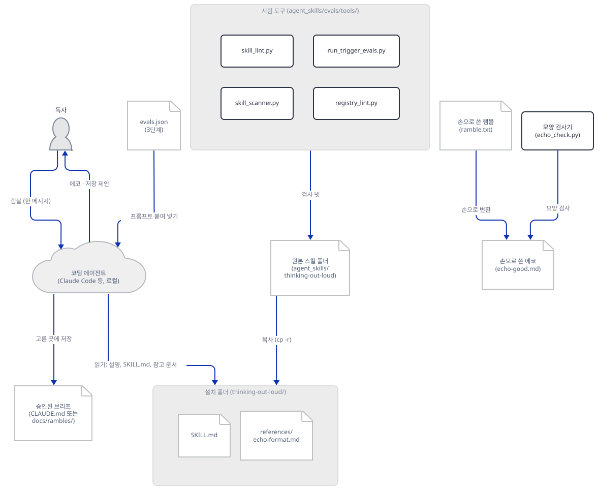

## 사전 준비

| 서비스/도구 | 용도 | 발급·설치 |
|---|---|---|
| Python 3.8 이상 | 저장소의 시험 도구와 오늘의 검사기를 돌린다. 스캐너 머리말이 3.8 이상을 적는다. 이 문서는 3.14.2로 확인했다 | [공통 사전 준비](../README.md#공통-사전-준비-한-번만) 절 참고 |
| 이 저장소의 클론 | 스킬 원본과 시험 도구를 읽는다. 아래 명령은 모두 저장소 루트에서 시작한다 | `git clone https://github.com/Shubhamsaboo/awesome-llm-apps` |
| git | 저장소 클론 | 공통 사전 준비 |
| 코딩 에이전트 | 스킬을 실제로 불러 쓰는 쪽. **이 문서는 쓰지 않았고 필요하지도 않다** | 없음 |
| API 키·계정 | 필요 없다 | 없음 |

한국어 Windows에서는 출력과 파일 읽기가 `cp949`로 잡혀 있어서, 아래 파이썬 명령에는 `-B -X utf8` 두 옵션을 붙입니다. `-X utf8`은 한글이 아닌 글자(`—`)를 출력하거나 UTF-8 파일을 읽을 때 멈추지 않게 하고, `-B`는 저장소 안에 `__pycache__`를 만들지 않게 합니다. 환경변수 `PYTHONUTF8=1`은 `-I`(격리) 옵션과 함께 쓰면 무시되므로 옵션 쪽이 안전합니다.

## 아키텍처 한눈에 보기

| 컴포넌트 | 역할 | 코드 위치 |
|---|---|---|
| frontmatter | 이름, 언제 쓰는지를 말하는 설명, 라이선스, 작성자·버전 | `agent_skills/thinking-out-loud/SKILL.md:1-22` |
| 계약 여섯 줄 | 에코 전에는 아무것도 하지 않기, 추측 표시, 번복 표시 등 | `agent_skills/thinking-out-loud/SKILL.md:58-72` |
| 언제 쓰고 쓰지 않는지 | 램블에는 쓰고 이미 정리된 글·원문 그대로 정리에는 안 쓴다 | `agent_skills/thinking-out-loud/SKILL.md:74-89` |
| 에코의 다섯 부분과 압축 규칙 | Mission, Locked, Open, Ledger, My additions | `agent_skills/thinking-out-loud/SKILL.md:91-119` |
| 인터뷰·캡처 모드·저장 | 선택 기능 둘과 저장 위치 제안 | `agent_skills/thinking-out-loud/SKILL.md:121-158` |
| 에코 형식 참고 문서 | 틀과 손으로 쓴 예시 하나 | `agent_skills/thinking-out-loud/references/echo-format.md:11-72` |
| 사람용 README | 설치·사용·"왜 질문만으로는 안 되는가" | `agent_skills/thinking-out-loud/README.md:1-67` |
| 시험 도구 넷 | 구조·보안·트리거·레지스트리 검사(모델 없음) | `agent_skills/evals/tools/` |
| 시험 자료 | `trigger-cases.json`(48줄), `evals.json`(57줄) | `agent_skills/evals/thinking-out-loud/` |
| 레지스트리 | 이름·설명·설치 명령·시험 폴더 | `agent_skills/registry.json:79-` |
| 코딩 에이전트 | 스킬을 불러 읽고 따르는 쪽 | 코드 없음 (외부. 이 문서는 띄우지 않음) |
| 이 문서의 램블·에코·검사기 | 손으로 만든 견본과 모양 검사기 | 코드 없음 (Step 6~7에서 직접 만듦) |

## 단계별 진행

### Step 1. 원본을 읽기만 한다

**목적.** 원본 폴더에는 아무것도 쓰지 않고, 스킬이 무엇으로 이루어졌는지 파일과 줄 수로 확인합니다. 이 문서에서 파일을 만들거나 복사하는 블록(Step 3, 6, 7)은 앞 터미널의 변수에 기대지 않습니다. 블록마다 첫머리에서 저장소 위치와 스크래치 폴더를 다시 정하고, 목적지는 `${LAB:?}`처럼 비어 있으면 그 줄에서 멈추게 쓰며, 목적지가 `~/.claude`·`~/.agents`·`~/.codex` 같은 진짜 에이전트 설정 폴더 아래로 풀리면 멈춥니다. 새 터미널에서 Step 3부터 시작해도, 줄 하나를 빼고 붙여 넣어도 진짜 설정 폴더에는 아무것도 쓰이지 않습니다. 이것은 가짜 홈(안에 `.claude/skills/existing`과 가짜 자격 증명 파일을 둔 폴더)에서 블록을 글자 그대로 돌리고 줄을 하나씩 빼 보며 직접 확인했습니다(Step 3).

**할 일.** 저장소 루트에서 줄 수와 파이썬 파일 수를 셉니다. `wc -l`은 끝에 개행이 없는 파일을 한 줄 적게 세므로 편집기의 줄 수와 다를 수 있는데, 이 세 파일은 모두 개행으로 끝나서 같습니다.

```bash
cd awesome-llm-apps          # 저장소 루트로 간다
wc -l agent_skills/thinking-out-loud/SKILL.md agent_skills/thinking-out-loud/README.md agent_skills/thinking-out-loud/references/echo-format.md
find agent_skills/thinking-out-loud -name "*.py" | wc -l
```

```powershell
Set-Location awesome-llm-apps
foreach ($f in "SKILL.md","README.md","references/echo-format.md") { "$f " + (Get-Content "agent_skills/thinking-out-loud/$f").Count }
(Get-ChildItem agent_skills/thinking-out-loud -Recurse -Filter *.py).Count
```

(이 PowerShell 블록은 실행해 보지 못했습니다. `Measure-Object -Line`은 빈 줄을 세지 않으므로 쓰지 않았습니다.)

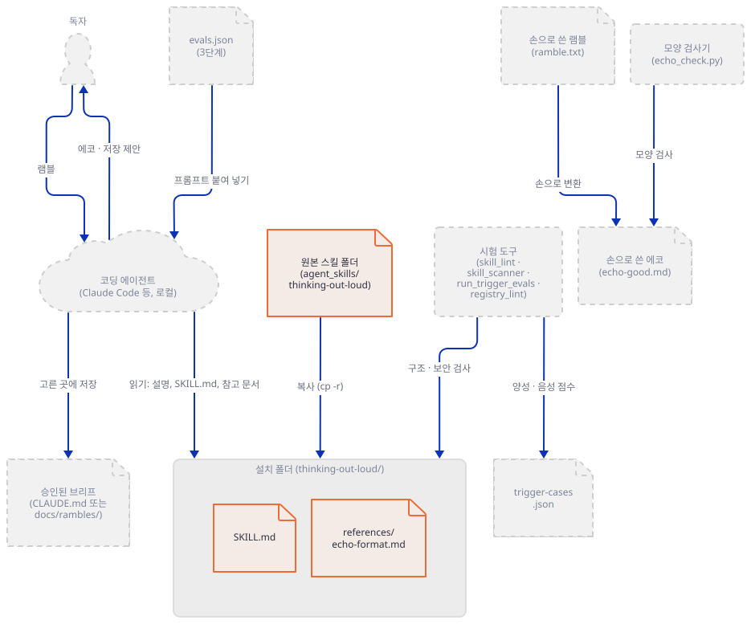

**확인.** 직접 확인한 출력입니다(2026-10-19).

```text
  158 agent_skills/thinking-out-loud/SKILL.md
   67 agent_skills/thinking-out-loud/README.md
   72 agent_skills/thinking-out-loud/references/echo-format.md
  297 total
0
```

글 297줄이고 파이썬 파일은 0개입니다. 저장소 `agent_skills/README.md`의 "The bar"는 첫 항목으로 "Real scripts. Deterministic work runs as code, not as token generation."을 듭니다. 이 스킬은 그 항목을 충족하지 않습니다. 시험 README(`agent_skills/evals/README.md:48-50`)도 새 스킬에 "at minimum a deterministic `test_<skill>.py`"를 요구하는데 이 스킬에는 그 파일이 없습니다. `skill_lint.py`가 글만 있는 스킬을 경고하지 않는 것은 `references/` 폴더가 있기 때문입니다(`skill_lint.py:21-22`의 머리말: 스크립트와 참고 문서가 둘 다 없을 때 경고). 하는 일이 "계산"이 아니라 "에이전트가 어떻게 답할지"의 약속이라서 생긴 일이고, 이것이 오늘 스킬의 핵심 한계이기도 합니다. 약속이 지켜졌는지는 결정적 시험으로 확인할 수 없고, 모델을 돌려 봐야 압니다(Step 8).

### Step 2. frontmatter를 명세와 한 줄씩 대조한다

**목적.** 에이전트가 시작할 때 읽는 것은 본문이 아니라 frontmatter의 이름과 설명뿐입니다. 이 부분이 명세에 맞는지 봅니다.

**할 일.** `SKILL.md:1-22`는 다음과 같습니다(설명은 원문 그대로입니다).

```yaml
---
name: thinking-out-loud
description: >-
  A contract for what the agent does when a long, messy, stream-of-consciousness
  ramble arrives (usually voice dictation): act on nothing until the echo brief
  is approved. The echo audits the entire transfer, mission, locked decisions
  and constraints, open questions, flips and parked tangents, with the model's
  inferences and guesses quarantined away from the user's own phrasing, so the
  user verifies what the model believes, not just what it doubts. Use when the
  user says "let me think out loud" or wants to ramble a bit before building
  anything, when a message opens with a speech-to-text preamble like "switching
  to voice, sorry for typos", when input is a long weakly punctuated stream
  with restarts and mid-message reversals ("actually no, wait, scrap that idea
  entirely"), or when the user asks to be interviewed about a fuzzy half-formed
  idea. Includes an optional capture mode for rambles spread across several
  messages and an optional targeted interview.
license: Apache-2.0
metadata:
  author: "Shubham Saboo"
  version: "1.3.0"
  source: "https://github.com/Shubhamsaboo/awesome-llm-apps"
---
```

[agentskills.io 명세](https://agentskills.io/specification)(2026-10-19에 읽음)와 [Anthropic의 Agent Skills 문서](https://platform.claude.com/docs/en/agents-and-tools/agent-skills/overview)(같은 날)를 이렇게 대조했습니다.

| 필드 | 명세의 규칙 | 이 스킬 |
|---|---|---|
| `name` | 1~64자, 소문자·숫자·하이픈, 처음과 끝이 하이픈이 아님, `--` 없음, 폴더 이름과 같음 | `thinking-out-loud`(17자), 폴더 이름과 같음 |
| `description` | 1~1024자, 무엇을 하고 언제 쓰는지 | 줄 바꿈을 공백 하나로 접으면 964자(직접 센 값, 한도 1,024). "Use when …"으로 언제 쓰는지를 말함 |
| `license` | 선택, 짧은 이름 | `Apache-2.0` |
| `metadata` | 선택, 문자열 키와 문자열 값의 맵 | `author`·`version`·`source` 셋, 모두 문자열 |
| `compatibility`·`allowed-tools` | 선택 | 없음 |

Anthropic 문서는 `name`에 `anthropic`·`claude` 낱말과 XML 태그를 못 쓰게 합니다. 이 스킬 이름에는 둘 다 없습니다. 설명이 길어질 이유도 문서에 있습니다. 에이전트는 설명을 시작할 때 모든 스킬에 대해 읽고(스킬당 약 100토큰), 그 설명에 요청이 맞는지로 스킬을 켭니다. 켜진 뒤에야 `SKILL.md` 본문(5,000토큰 미만 권장, 500줄 미만 권장)을 읽고, `references/`의 파일은 본문이 가리킬 때만 읽습니다. 이 스킬의 본문은 158줄이고 참고 문서 하나를 가리킵니다(`SKILL.md:95`). 그래서 이 스킬의 "언제 켜지는가"는 설명 하나에 달려 있고, 설명에는 램블의 겉모습(음성 서두, 구두점 없는 긴 글, 번복)이 낱말로 들어 있습니다.

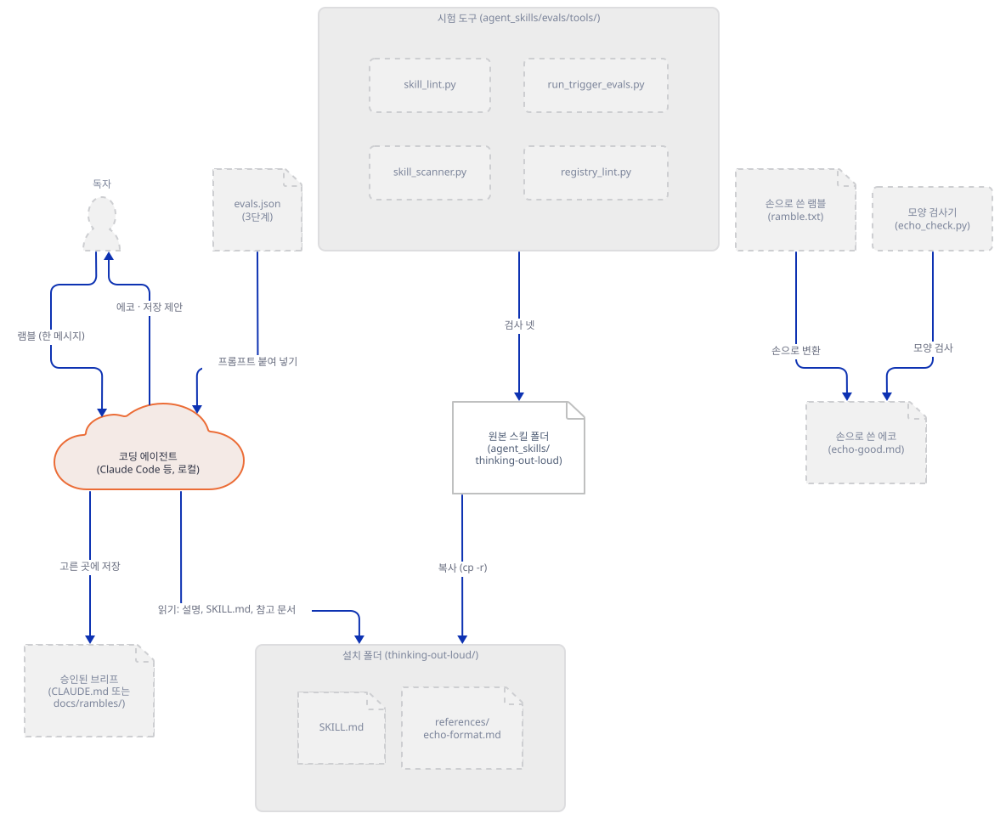

**확인.** 명세의 규칙이 이 문서와 같은지는 위 두 페이지의 원문으로 다시 볼 수 있습니다. 이 스킬의 값은 저장소 루트에서 한 줄로 셀 수 있습니다. 설명은 `>-` 블록이라 줄 바꿈을 공백 하나로 접은 값이 문서의 964자입니다.

```bash
python -B -X utf8 -c "import re; t=open('agent_skills/thinking-out-loud/SKILL.md',encoding='utf-8').read(); d=re.search(r'^description:\s*>-\n(.*?)^license:',t,re.S|re.M).group(1); print(len(' '.join(l.strip() for l in d.strip().split('\n'))), len('thinking-out-loud'))"
```

기대 출력은 `964 17`입니다(직접 확인). 이 스킬이 규칙 전체를 지키는지는 Step 4의 `skill_lint.py`가 기계로 확인합니다.

### Step 3. 스크래치 프로젝트에 설치하고 폴더에 무엇이 들어갔는지 본다

**목적.** 설치가 폴더 복사라는 것을 실제로 해 보고, 무엇이 따라 들어가는지 봅니다. 진짜 홈의 에이전트 설정 폴더는 건드리지 않습니다.

**할 일.** 스크래치 프로젝트를 만들고 Claude Code가 읽는 프로젝트 위치(`.claude/skills/`)와 여러 에이전트가 읽는 공용 위치(`.agents/skills/`)에 각각 복사합니다.

```bash
REPO="$HOME/awesome-llm-apps"          # 클론한 위치로 바꿉니다
LAB="${TMPDIR:-/tmp}/tol-lab"
PROJ="${LAB:?LAB이 비었습니다}/myproj"
case "$PROJ" in "$HOME/.claude"*|"$HOME/.agents"*|"$HOME/.codex"*|"$HOME/.cursor"*|"$HOME/.copilot"*|"$HOME/.openclaw"*|"$HOME/.hermes"*) echo "멈춥니다: $PROJ"; PROJ="" ;; esac
mkdir -p "${PROJ:?}/.claude/skills/thinking-out-loud" "${PROJ:?}/.agents/skills/thinking-out-loud"
cp -r "${REPO:?}/agent_skills/thinking-out-loud/." "${PROJ:?}/.claude/skills/thinking-out-loud/"
cp -r "${REPO:?}/agent_skills/thinking-out-loud/." "${PROJ:?}/.agents/skills/thinking-out-loud/"
find "${PROJ:?}/.claude" "${PROJ:?}/.agents" -type f | sort
diff -r "${REPO:?}/agent_skills/thinking-out-loud" "${PROJ:?}/.claude/skills/thinking-out-loud" && echo "원본과 같음"
```

```powershell
$ErrorActionPreference = "Stop"
$Repo = Join-Path $HOME "awesome-llm-apps"     # 클론한 위치로 바꿉니다
$Lab  = Join-Path $env:TEMP "tol-lab"
$Proj = Join-Path $Lab "myproj"
foreach ($bad in ".claude",".agents",".codex",".cursor",".copilot",".openclaw",".hermes") {
  if ($Proj.StartsWith((Join-Path $HOME $bad), [System.StringComparison]::OrdinalIgnoreCase)) { throw "멈춥니다: $Proj" }
}
foreach ($d in ".claude",".agents") {
  $dest = Join-Path (Join-Path $Proj $d) "skills/thinking-out-loud"
  New-Item -ItemType Directory -Force $dest | Out-Null
  Copy-Item -Recurse -Force (Join-Path $Repo "agent_skills/thinking-out-loud/*") $dest
}
Get-ChildItem $Proj -Recurse -File | ForEach-Object { $_.FullName.Substring($Proj.Length + 1) }
```

(`$HOME/awesome-llm-apps`는 클론한 위치로 바꿉니다. 같은 블록을 다시 돌려도 안쪽에 폴더가 겹쳐 생기지 않게 `/.`와 `/*`로 내용만 복사합니다.) 세 가지 방어선이 있습니다. 첫째, `LAB`이나 `PROJ`가 비면 `${LAB:?}`·`${PROJ:?}`(PowerShell은 `Join-Path`가 빈 값에 내는 오류와 `$ErrorActionPreference = "Stop"`)가 그 줄에서 멈춥니다. 둘째, 목적지가 진짜 에이전트 설정 폴더 아래로 풀리면(예를 들어 `TMPDIR`가 `~/.claude/...`를 가리키는 경우) 그 줄이 `PROJ`를 비워 뒤의 모든 줄을 멈춥니다. 셋째, 설치·목록 블록이 앞 터미널의 변수를 쓰지 않으므로 새 터미널에서도 같은 결과가 납니다. 직접 확인한 것은 이렇습니다. 홈을 스크래치의 가짜 홈(`.claude/skills/existing`과 가짜 `.credentials.json`이 있음)으로 바꾸고 Git Bash에서 블록을 글자 그대로 돌렸고, 앞 줄 여덟 개를 하나씩 빼 보았으며, `TMPDIR`를 가짜 `.claude` 아래로 돌린 판도 돌렸습니다. 모든 판에서 가짜 `.claude`와 `.agents`의 파일 목록 해시는 그대로였습니다. PowerShell 블록은 Windows PowerShell 5.1에서 같은 가짜 홈으로 같은 식으로(줄을 하나씩 빼고, `TEMP`를 가짜 `.claude` 아래로 돌려) 돌렸고 같았습니다.

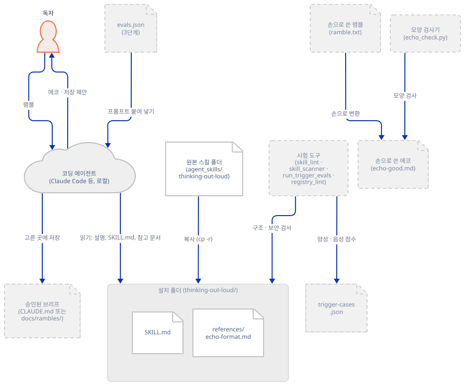

**확인.** 직접 확인한 출력입니다(Git Bash, 스크래치 폴더). `find`는 앞에 `<LAB>/myproj/`가 붙은 전체 경로를 찍고 `diff -r`는 마지막에 `원본과 같음`을 찍습니다. 아래는 앞부분을 뗀 목록입니다.

```text
.agents/skills/thinking-out-loud/README.md
.agents/skills/thinking-out-loud/references/echo-format.md
.agents/skills/thinking-out-loud/SKILL.md
.claude/skills/thinking-out-loud/README.md
.claude/skills/thinking-out-loud/references/echo-format.md
.claude/skills/thinking-out-loud/SKILL.md
```

폴더에는 파일 셋뿐입니다(`SKILL.md` 7,478바이트, `README.md` 2,840바이트, `echo-format.md` 2,427바이트). `diff -r`의 결과는 같음입니다. `evals/`는 따라오지 않습니다. `agent_skills/evals/README.md`가 "These files never ship in an install"이라고 적은 대로입니다. 설치된 사본에도 `skill_lint.py --strict`를 돌리면 통과합니다(Step 4의 다섯째 줄). 이름이 폴더 이름과 같아야 한다는 규칙이 복사한 폴더에서도 지켜진 것입니다.

저장소 README가 안내하는 다른 길 둘은 이 문서에서 실행하지 않았습니다.

- 진짜 홈에 두는 길: `~/.claude/skills/` 등. 저장소 README의 표가 에이전트별 위치를 적습니다. Anthropic 문서도 Claude Code는 개인용 `~/.claude/skills/`와 프로젝트용 `.claude/skills/`를 읽는다고 적습니다.
- `npx skills add https://github.com/Shubhamsaboo/awesome-llm-apps/tree/main/agent_skills/thinking-out-loud`. 이 명령의 CLI는 [skills.sh](https://skills.sh)에 안내되어 있고 저장소는 [vercel-labs/skills](https://github.com/vercel-labs/skills)입니다(skills.sh 쪽에는 "Made with care by Vercel"과 그 저장소 링크가 있습니다. 2026-10-19에 읽음). 그 README는 GitHub 트리 URL을 받을 수 있다고 하고, 설치 범위는 기본이 프로젝트 안(Claude Code는 `.claude/skills/`, 에이전트마다 위치가 다릅니다)이며 `-g`를 주면 사용자 폴더이고, 기본 동작은 각 에이전트 폴더에 심볼릭 링크를 만드는 것(`--copy`면 복사)이며, 익명 사용 통계를 기본으로 보내고 `DISABLE_TELEMETRY=1`이나 `DO_NOT_TRACK=1`로 끈다고 적습니다. 직접 내려받는 주소(SKILL.md나 압축 파일 주소)에는 10 MiB, 풀면 25 MiB, 파일 1,000개라는 기본 제한이 있다고 하는데, 이것이 이 문서가 쓰는 GitHub 트리 주소에도 같은 모양으로 적용되는지는 읽은 범위에서 확인하지 못했습니다. 이 문서는 CLI를 실행하지 않았으므로 위 내용은 공개 README를 읽은 것이고 직접 본 것이 아닙니다.

설치 전에 읽어야 한다는 점은 Day 154가 다루고, Anthropic 문서의 "Treat like installing software"도 같은 말입니다. 이 스킬은 스크립트가 없으니 읽을 것이 글 세 파일뿐입니다.

### Step 4. 결정적 시험 넷을 돌린다

**목적.** 저장소가 CI에서 돌리는 무료 시험 가운데 이 스킬에 걸리는 것을 직접 돌립니다. 모델은 부르지 않습니다.

**할 일.** 저장소 루트에서 다음 다섯 줄입니다(다섯째는 Step 3에서 만든 설치본에 lint를 한 번 더 돌립니다). 모두 파일을 읽기만 합니다.

```bash
REPO="$HOME/awesome-llm-apps"          # 클론한 위치로 바꿉니다
cd "${REPO:?}"
python -B -X utf8 agent_skills/evals/tools/skill_lint.py agent_skills/thinking-out-loud --strict
python -B -X utf8 agent_skills/evals/tools/skill_scanner.py agent_skills/thinking-out-loud
python -B -X utf8 agent_skills/evals/tools/run_trigger_evals.py
python -B -X utf8 agent_skills/evals/tools/registry_lint.py --check --root .
python -B -X utf8 agent_skills/evals/tools/skill_lint.py "${TMPDIR:-/tmp}/tol-lab/myproj/.claude/skills/thinking-out-loud" --strict
```

```powershell
$Repo = Join-Path $HOME "awesome-llm-apps"     # 클론한 위치로 바꿉니다
Set-Location $Repo
python -B -X utf8 agent_skills/evals/tools/skill_lint.py agent_skills/thinking-out-loud --strict
python -B -X utf8 agent_skills/evals/tools/skill_scanner.py agent_skills/thinking-out-loud
python -B -X utf8 agent_skills/evals/tools/run_trigger_evals.py
python -B -X utf8 agent_skills/evals/tools/registry_lint.py --check --root .
python -B -X utf8 agent_skills/evals/tools/skill_lint.py (Join-Path $env:TEMP "tol-lab/myproj/.claude/skills/thinking-out-loud") --strict
```

(`agent_skills/evals/README.md`는 `python3`로 적습니다. Windows에서는 `python`입니다. `python`이 가상환경의 것인지 시스템의 것인지는 `python -c "import sys; print(sys.executable)"`로 봅니다. 이 도구들은 표준 라이브러리만 쓰므로 어느 쪽이어도 해가 없습니다. PowerShell 블록은 실행해 보지 못했습니다.)

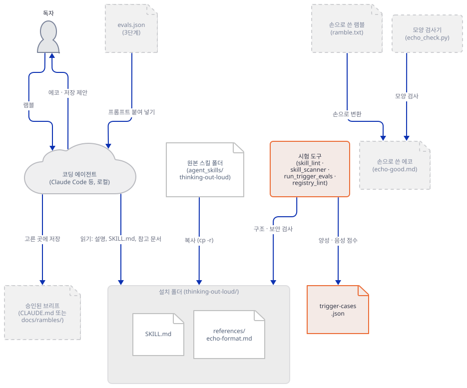

네 도구가 각각 무엇을 읽는지는 보조 그림이 따로 보입니다. 한 노드로 묶으면 입력이 서로 다르다는 점이 사라집니다.

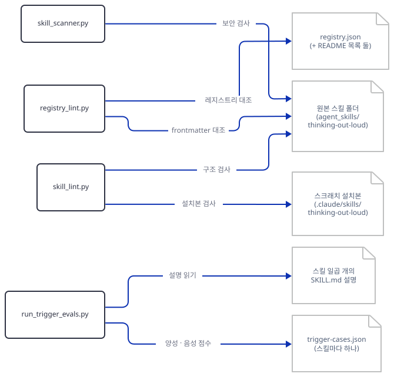

**확인.** 직접 확인한 출력입니다. 이 PC에서는 `HOME`·`USERPROFILE`·`CLAUDE_CONFIG_DIR`·`TEMP`을 스크래치로 돌렸고, `192.0.2.1` 연결이 막히는 것을 먼저 단언하는 소켓 가드(루프백이 아닌 이름 조회와 연결을 거부) 아래서 돌렸습니다. 독자 명령에는 이 가드가 없습니다. 대신 네 파일 모두에서 줄 머리의 `import`를 grep해 `socket`·`urllib`·`http`·`requests`·`subprocess`·`ssl`이 0건임을 확인했습니다.

```text
Linting ...thinking-out-loud (strict=on)
  PASS — 0 error(s), 0 warning(s)

agent-skill security scan v1.0.0 — 1 skill(s) under ...thinking-out-loud
=== thinking-out-loud (...) ===
  clean — no findings
Summary: 0 CRITICAL, 0 WARN, 0 INFO
Verdict guidance: no pattern hits. Still read SKILL.md end-to-end — natural-language attacks evade pattern scanners (OWASP AST08).

PASS  thinking-out-loud: 4 positives clear 3 near-misses (weakest 1.15 vs strongest 0.32)
trigger & routing: all clear (7 skills)

Checking registry at ... (mode=check)
  PASS — 0 error(s), 0 warning(s)
```

(트리거 시험은 스킬 일곱 개를 모두 돌려서 줄이 일곱 개 나옵니다. 위에는 이 스킬의 줄만 옮겼습니다.)

넷이 무엇을 보는지는 소스(`agent_skills/evals/tools/`)의 머리말로 읽었습니다. `skill_lint.py`는 이름·설명 길이·본문 줄 수(500줄부터 `--strict`에서 오류)·본문이 가리키는 상대 경로가 실제로 있는지를 봅니다. `skill_scanner.py`는 원격 스크립트를 셸로 넘기는 줄, 인코딩된 실행, 자격 증명 접근 같은 패턴을 정규식으로 찾고, 스스로 "자연어 공격은 패턴 스캐너를 피한다"고 적습니다. 이 스킬은 지시문이 전부인 스킬이라서 이 말이 오히려 핵심입니다. 스캐너가 깨끗하다는 것은 위험한 줄이 없다는 뜻이지 지시가 안전하다는 보증이 아닙니다. 지시가 안전한지는 읽어서 봅니다(Step 5). `registry_lint.py`는 `registry.json`의 항목과 README의 목록이 `SKILL.md` frontmatter와 같은지 봅니다. 이 스킬의 항목(`registry.json:79-`)에는 위 frontmatter의 설명·라이선스·메타데이터에 더해 `install`(`npx skills add …`)과 `evals_dir`(`agent_skills/evals/thinking-out-loud`)가 있습니다.

트리거 시험이 모델이 아니라는 점은 소스가 말합니다(`run_trigger_evals.py`의 머리말: "Deterministic, CI-safe, no model."). 점수는 프롬프트의 낱말(불용어를 빼고 어미를 거칠게 자른 것)이 설명의 낱말과 겹치는 개수를 프롬프트 낱말 수의 제곱근으로 나눈 값이고, 양성의 최저점이 음성의 최고점의 1.15배를 넘어야 통과합니다. 이 스킬의 사례별 점수를 저장소의 함수로 직접 뽑으면 다음과 같습니다(`score_cases.py`는 같은 함수를 불러 쓰는 열 줄짜리 스크립트로, 이 문서에는 싣지 않았습니다).

| 사례 | 양성이어야 하나 | 점수 | 겹친 낱말 |
|---|---|---|---|
| `explicit-invoke` | 예 | 2.65 | let, think, loud, before, build 등 7개 |
| `unpunctuated-stream` | 예 | 1.92 | scrap, wait, actually, idea 등 9개 |
| `interview-request` | 예 | 1.63 | interview, fuzzy, idea, about |
| `voice-preamble` | 예 | 1.15 | sorry, speech, switch, typo |
| `near-miss-verbatim` | 아니오 | 0.32 | voice |
| `near-miss-structured-doc` | 아니오 | 0.00 | 없음 |
| `near-miss-clear-request` | 아니오 | 0.00 | 없음 |

가장 아슬아슬한 쪽은 음성 서두(`voice-preamble`) 사례입니다. 1.15는 0.32의 3.6배로 한도(1.15배)를 한참 넘지만, 이 사례가 4개 낱말에만 기댄다는 점은 보입니다. 이 시험은 "에이전트가 실제로 스킬을 켠다"를 증명하지 않습니다. 설명에 사람들이 실제로 쓰는 낱말이 들어 있는지만 봅니다. 이 한계는 `run_trigger_evals.py:11`의 머리말도 "a lexical approximation of routing"이라고 밝힙니다. `2b`단계(스크립트 시험, `<skill>/test_*.py`)는 이 스킬에 없습니다. `agent_skills/evals/thinking-out-loud/`에는 `evals.json`과 `trigger-cases.json` 둘뿐이고 `test_*.py`가 없습니다.

### Step 5. 계약을 읽는다 — 에이전트에게 무엇을 시키는가

**목적.** `SKILL.md`의 본문을 설명할 대상으로 읽어, 에이전트에게 시키는 것을 정리합니다. 본문은 에이전트에게 주는 지시문이므로 이 문서는 그 지시를 따르지 않고 옮겨 적기만 합니다.

**할 일.** `SKILL.md`를 위에서 아래로 읽습니다. 구성은 이렇습니다.

문제 설정(`24-40`). 긴 램블이 오면 모델이 빈틈을 확신을 가지고 채우고("the usual model"이 특정 모델이 됨), 번복한 입장이 사실로 남고, 그 오해 위에서 일해 버린다고 합니다. 이 서술은 모델 행동에 대한 주장이고 이 문서에서는 시험하지 않았습니다.

왜 질문이 아니라 에코인가(`41-57`). 질문은 모델이 의심하는 것만 확인하고 에코는 모델이 믿는 것을 확인한다, 질문은 서너 개를 표본으로 뽑고 에코는 전체를 목록으로 만든다는 두 이유입니다. 사용자는 답을 만들어 내는 것보다 읽고 틀린 곳을 찾는 쪽이 싸다는 것이 근거입니다.

계약 여섯 줄(`58-72`).

1. 에코가 승인될 때까지 파일 수정·코드·계획·조각 해결 같은 어떤 행동도 하지 않는다.
2. 모델이 보탠 추측·추론은 사용자 내용과 다른 부분에 둔다. 추측을 사용자의 목소리로 말하지 않는다.
3. 번복은 나중 입장을 채택하되 표시한다. 조용히 평균 내거나 고르지 않는다.
4. 곁가지는 버리지 않고 보관한다.
5. 오타·동음이의어·군말·재시작은 조용히 고치고 언급하지 않는다. 사용자의 낱말과 프로젝트 이름은 그대로 쓴다.
6. 승인된 브리프는 저장 위치를 제안하되 묻지 않고 저장하지 않는다.

언제 쓰고 쓰지 않는지(`74-89`). 쓰는 경우는 구두점이 약한 긴 글에 재시작과 번복이 있을 때, 음성 서두("switching to speech recognition, sorry for any typos")로 시작할 때, 사용자가 램블하겠다고 말할 때, 사용자가 인터뷰를 청할 때입니다. 쓰지 않는 경우는 이미 분명한 짧은 요청, 원문 그대로의 기록·회의록·받아쓰기 정리를 원할 때, 구조가 있는 긴 글(스펙 등), 직접 질문입니다.

에코(`91-119`)는 Step 6에서 만들어 봅니다. 인터뷰(`121-132`)는 사용자가 수락했을 때만, Open·Guessed 항목에 대해서만, 한 메시지에 질문 하나(이유를 한 절로), 최대 다섯 개를 묻고 끝난 뒤 바뀐 부분만 다시 씁니다. 캡처 모드(`133-148`)는 한 메시지로 오는 받아쓰기 도구에는 필요 없고, 사용자가 먼저 스킬을 부른 뒤 여러 메시지로 덧붙일 때 씁니다. 첫 응답은 한 줄("Go ahead, I'm listening. Say 'done' when you want the echo.")이고, 이후는 매번 "Listening."처럼 한 줄만 답하며, 직접 질문에는 두 문장 안에서 답한 뒤 듣기로 돌아가고, "done"·"echo" 등으로 끝냅니다. 저장(`149-158`)은 정확히 세 가지를 제안합니다. `CLAUDE.md`에 덧붙이기, `docs/rambles/YYYY-MM-DD-<topic>.md`로 저장, 대화 안에만 두기입니다.

원문에 언어 지정이 없습니다. `SKILL.md`·참고 문서·README에서 "language"·"Korean"·"translate"를 찾아봤으나 0건이었습니다. 그래서 한국어 램블에서 에코가 어떤 언어로 나오는지는 이 스킬이 정하지 않습니다(이 문서는 확인하지 못했습니다). 오늘의 견본은 스킬이 쓰는 영어로 만듭니다.

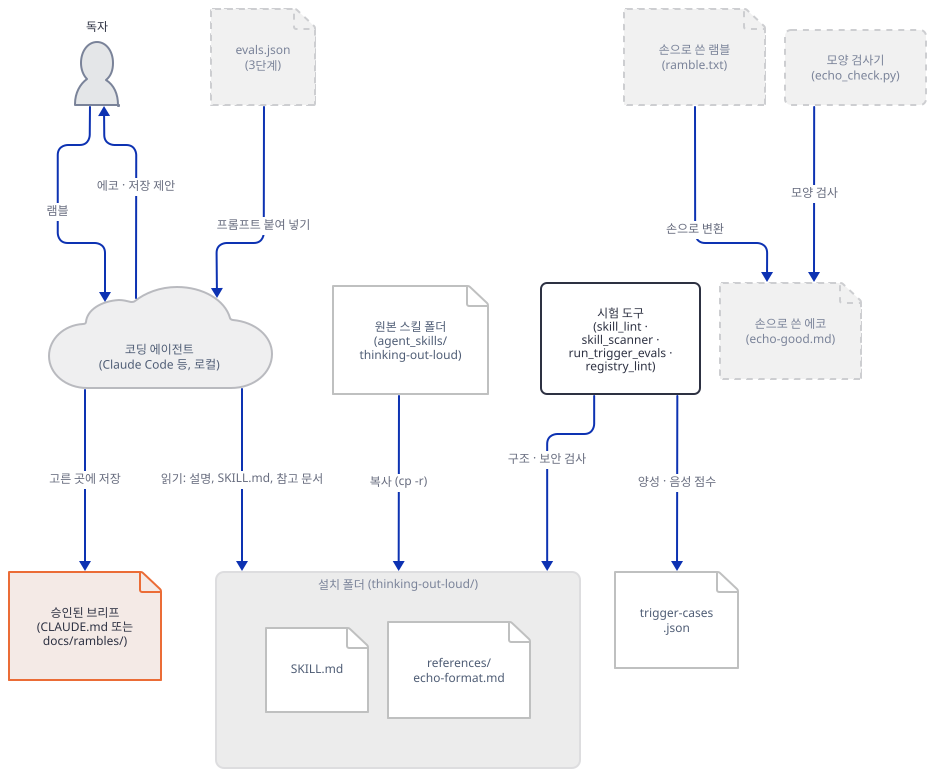

**확인.** 세 가지를 확인할 수 있습니다. 하나, 본문에는 네트워크를 가리키는 말이 없습니다. `http`·`curl`·`network`·`fetch`·`search`·`web`을 찾으면 `SKILL.md:21`의 `source` URL 한 줄뿐입니다. 둘, 파일을 쓰는 곳은 저장(Persistence) 절의 두 곳(`CLAUDE.md`와 `docs/rambles/`)뿐이고 둘 다 사용자가 고른 뒤입니다. 셋, 이 설계에는 이 문서가 짚어 둘 점이 하나 있습니다. 승인된 브리프를 `CLAUDE.md`에 덧붙이면 그 글은 이후 모든 세션에서 에이전트가 읽는 지시가 됩니다. 브리프는 모델이 사용자의 말을 요약한 글이므로, 첫 번째 선택지를 고르기 전에 에코 전체를 읽어야 합니다. 스킬은 이 위험을 말하지 않고 "묻기 전에는 저장하지 않는다"로만 다룹니다.

### Step 6. 램블 하나를 손으로 에코로 바꿔 본다

**목적.** 형식을 지키면 에코가 어떤 모양이어야 하는지, 모델 없이 손으로 만들어 봅니다.

**할 일.** 램블 하나를 `ramble.txt`로 저장합니다. 음성 서두, 번복(Slack에서 email로, 이슈에서 커밋만으로), 곁가지, 모호한 낱말("the usual cutoff"), 나중에 한 말로 바뀌는 것, 최우선 조건을 일부러 넣었습니다. 129낱말입니다.

```bash
LAB="${TMPDIR:-/tmp}/tol-lab"
mkdir -p "${LAB:?}"
cat > "${LAB:?}/ramble.txt" <<'EOF'
ok switching to voice sorry for typos. so i want a small tool that tells me when my side projects go quiet, like a weekly nudge, maybe a slack message no wait email is better i never open slack. it should look at git activity, not just commits but open issues too i guess. the usual cutoff for quiet, whatever, we can pick that later. oh and my friend dana wants one too so it has to work for more than one person. actually forget issues, just commits, issues are a rabbit hole. random thought, this could be a menu bar app someday but not now. and it has to run by itself on sunday evening, if i have to remember to run it that defeats the whole purpose.
EOF
```

```powershell
$ErrorActionPreference = "Stop"
$Lab = Join-Path $env:TEMP "tol-lab"
New-Item -ItemType Directory -Force $Lab | Out-Null
$utf8 = New-Object System.Text.UTF8Encoding $false
[System.IO.File]::WriteAllText((Join-Path $Lab "ramble.txt"), @'
ok switching to voice sorry for typos. so i want a small tool that tells me when my side projects go quiet, like a weekly nudge, maybe a slack message no wait email is better i never open slack. it should look at git activity, not just commits but open issues too i guess. the usual cutoff for quiet, whatever, we can pick that later. oh and my friend dana wants one too so it has to work for more than one person. actually forget issues, just commits, issues are a rabbit hole. random thought, this could be a menu bar app someday but not now. and it has to run by itself on sunday evening, if i have to remember to run it that defeats the whole purpose.
'@, $utf8)
```

(heredoc과 here-string은 내용이 있는 파일 저장용입니다. PowerShell 블록은 Windows PowerShell 5.1에서 가짜 홈과 스크래치 `TEMP`로 돌렸고, 저장된 파일의 첫 바이트가 BOM(`ef bb bf`)이 아님을 확인했습니다. 5.1의 `Set-Content -Encoding utf8`은 BOM을 붙이므로 쓰지 않고 .NET으로 씁니다.) 이제 `SKILL.md`의 다섯 부분과 압축 규칙을 따라 손으로 바꿉니다. 판단 하나하나는 이렇습니다. 번복 둘은 Ledger에 "앞 입장, 뒤 입장, 뒤를 채택"으로 한 줄씩 넣습니다. "the usual cutoff"는 모호한 수량 낱말이므로 Locked에 넣지 않고 Open에 넣습니다. 최우선 조건("그러지 않으면 목적이 사라진다")은 Locked에 `**Top priority**`로 표시합니다. 곁가지(menu bar app)는 Parked 한 줄입니다. Dana의 이메일이 "그녀 몫으로 따로 나가는가"는 램블에 없는 추론이라 Inferred에, 일요일 저녁의 시간대는 Guessed에 둡니다. 번복의 채택된 입장(email, commits only)은 Ledger에만 두고 Locked에 되풀이하지 않습니다. "Nothing appears twice"(`SKILL.md:110`, "Every fact lives in exactly one section")를 이 문서는 Mission을 요약으로 보고 뺀 채 Locked와 Ledger 사이에서 지키는 쪽으로 읽었습니다. 원본 참고 문서의 예시는 email을 Mission·Locked·Ledger 세 곳에 적습니다. 규칙이 요약과 채택 결과를 어디까지 한 곳으로 치는지 말하지 않으므로 어느 읽기가 맞는지는 이 문서가 정하지 않습니다. Mission은 2인칭("your side projects")으로 씁니다. 틀이 Mission을 "what you are actually trying to achieve"(`echo-format.md:15`)로 적기 때문입니다. `echo-good.md`로 저장합니다.

```bash
LAB="${TMPDIR:-/tmp}/tol-lab"
mkdir -p "${LAB:?}"
cat > "${LAB:?}/echo-good.md" <<'EOF'
## Mission
A weekly nudge, run by itself, about which of your side projects have gone quiet.

## Locked (your decisions and constraints)
- Works for more than one person (you and Dana)
- Runs weekly on Sunday evening
- **Top priority**: it runs by itself; a manual run defeats the purpose

## Open (needs your answer)
- What counts as "quiet": how many days without a commit?
- Which projects are watched: a list you keep, or every repo in a folder?

## Ledger
- Flipped: Slack, then email. Going with email.
- Flipped: commits plus open issues, then commits only. Going with commits only.
- Parked: a menu bar app someday

## My additions (correct these first)
- Inferred: Dana gets her own digest about her own projects, not one shared list
- Guessed: "Sunday evening" is in your local timezone

Correct anything that's off, especially My additions. Want the interview for the Open items?
EOF
```

```powershell
$ErrorActionPreference = "Stop"
$Lab = Join-Path $env:TEMP "tol-lab"
New-Item -ItemType Directory -Force $Lab | Out-Null
$utf8 = New-Object System.Text.UTF8Encoding $false
[System.IO.File]::WriteAllText((Join-Path $Lab "echo-good.md"), @'
## Mission
A weekly nudge, run by itself, about which of your side projects have gone quiet.

## Locked (your decisions and constraints)
- Works for more than one person (you and Dana)
- Runs weekly on Sunday evening
- **Top priority**: it runs by itself; a manual run defeats the purpose

## Open (needs your answer)
- What counts as "quiet": how many days without a commit?
- Which projects are watched: a list you keep, or every repo in a folder?

## Ledger
- Flipped: Slack, then email. Going with email.
- Flipped: commits plus open issues, then commits only. Going with commits only.
- Parked: a menu bar app someday

## My additions (correct these first)
- Inferred: Dana gets her own digest about her own projects, not one shared list
- Guessed: "Sunday evening" is in your local timezone

Correct anything that's off, especially My additions. Want the interview for the Open items?
'@, $utf8)
```

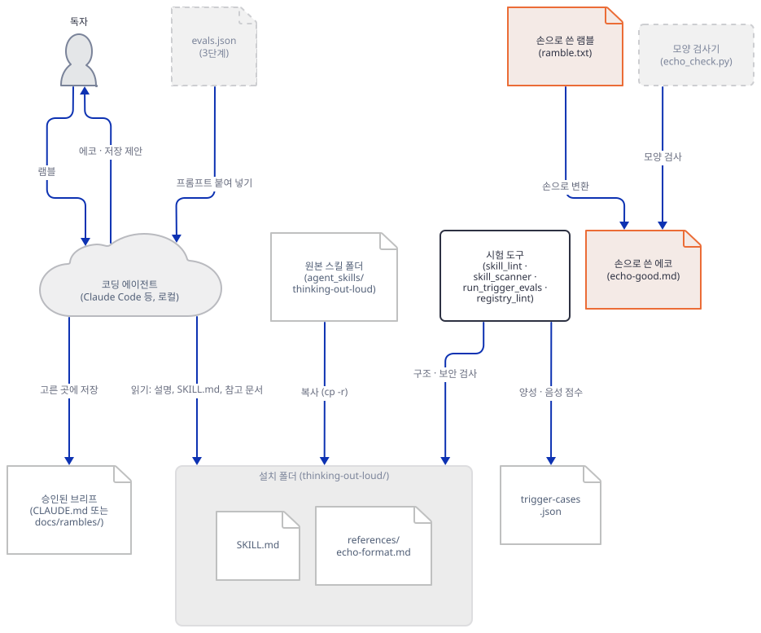

**확인.** 이 에코는 157낱말이고 램블(129낱말)보다 깁니다. 참고 문서는 "ten minute ramble"에 대해 250낱말 미만을 겨냥하라고 적습니다. 열 분 분량 램블이 몇 낱말인지는 원문이 말하지 않으므로, 이 견본은 형식을 보이는 용도일 뿐 "에코가 입력보다 짧다"는 주장의 근거가 아닙니다. 번복의 결과가 Ledger의 한 줄로만 나오고(Mission은 요약이라 뺀 읽기), 모델이 보탠 것은 My additions의 두 줄뿐이라는 것이 이 형식의 효과입니다. 모델이 이 형식대로 실제로 답하는지는 확인하지 못했습니다.

### Step 7. 모양 검사기로 견본과 망가진 견본을 잰다

**목적.** 형식의 규칙 가운데 프로그램이 볼 수 있는 것만 기계로 확인합니다. 의미(추측이 Locked에 숨었는가)는 못 봅니다.

**할 일.** 다음 `echo_check.py`를 Step 6의 스크래치 폴더(bash는 `${TMPDIR:-/tmp}/tol-lab`, PowerShell은 `$env:TEMP\tol-lab`)에 편집기로 저장합니다. 마크다운 하나를 읽어 다섯 제목의 순서, 불릿 한 줄 규칙(들여 쓴 이어짐 줄이 있으면 문제), 같은 줄의 되풀이, My additions와 Ledger의 접두어, 250낱말 미만, 끝맺음 문장, 금지된 말(`you said`, `typo`, `I'll start`)을 봅니다. 파일은 `utf-8-sig`로 엽니다. BOM이 붙은 파일을 `utf-8`로 열면 첫 제목이 `\ufeff## Mission`이 되어 Mission을 놓치기 때문입니다(Windows PowerShell 5.1의 `Set-Content -Encoding utf8`이 그런 파일을 만듭니다).

`echo_check.py`

```python
"""Mechanical shape check for an echo brief. It reads one markdown file and checks only
what a program can see. It cannot tell whether a guess is hiding in Locked."""
import os, re, sys

SECTIONS = ["Mission", "Locked", "Open", "Ledger", "My additions"]
text = open(sys.argv[1], encoding="utf-8-sig").read()
problems = []

parts = re.split(r"^## (.+)$", text, flags=re.M)          # [pre, title, body, title, body, ...]
titles = [parts[i].strip() for i in range(1, len(parts), 2)]
bodies = [parts[i] for i in range(2, len(parts), 2)]
names = [re.split(r"\s*\(", t)[0] for t in titles]
if names != SECTIONS:
    problems.append("sections are %r, expected %r in this order" % (names, SECTIONS))

seen = {}
for name, body in zip(names, bodies):
    lines = body.strip().split("\n")
    bullets, cur = [], None
    for ln in lines:
        if ln.startswith("- "):
            cur = [ln[2:]]; bullets.append(cur)
        elif ln.startswith("  ") and cur is not None:
            cur.append(ln.strip())                          # wrapped continuation line
    for b in bullets:
        line = " ".join(b)
        if len(b) > 1:
            problems.append("%s: bullet spans %d lines: %r" % (name, len(b), line[:40]))
        if name == "My additions" and not re.match(r"(Inferred|Guessed):", line):
            problems.append("My additions: bullet is neither Inferred nor Guessed: %r" % line[:40])
        if name == "Ledger" and not re.match(r"(Flipped|Parked):", line):
            problems.append("Ledger: bullet is neither Flipped nor Parked: %r" % line[:40])
        key = re.sub(r"\W+", " ", line.lower()).strip()
        if key in seen:
            problems.append("%r appears in %s and again in %s" % (line[:40], seen[key], name))
        seen.setdefault(key, name)

words = len(re.findall(r"\S+", text))
if words >= 250:
    problems.append("%d words, the reference targets well under 250" % words)
if not re.search(r"Correct anything.*interview", text, flags=re.S):
    problems.append("no closing invitation to correct and offer the interview")
for pat in (r"\byou said\b", r"\btypo", r"\bI'll start\b"):
    if re.search(pat, text, flags=re.I):
        problems.append("forbidden phrase matched: %s" % pat)

print("%s: %d words, %d problem(s)" % (os.path.basename(sys.argv[1]), words, len(problems)))
for p in problems:
    print("  -", p)
sys.exit(1 if problems else 0)
```

일부러 망가뜨린 견본 `echo-bad.md`도 만듭니다. 규칙을 어긴 곳이 여럿입니다(제목 하나 빠짐, 되풀이, 두 줄 불릿, 접두어 없는 추가, 인사말, 군말 언급).

```bash
LAB="${TMPDIR:-/tmp}/tol-lab"
mkdir -p "${LAB:?}"
cat > "${LAB:?}/echo-bad.md" <<'EOF'
## Mission
You said you want a tool for quiet projects. Sounds like a great idea! I'll start building it now.

## Locked
- Email delivery
- Quiet means 14 days without a commit
- Email delivery

## Ledger
- Flipped: Slack, then email. Going with email.
  That was a typo-prone part of the dictation.

## My additions
- Dana wants one too
EOF
```

```powershell
$ErrorActionPreference = "Stop"
$Lab = Join-Path $env:TEMP "tol-lab"
New-Item -ItemType Directory -Force $Lab | Out-Null
$utf8 = New-Object System.Text.UTF8Encoding $false
[System.IO.File]::WriteAllText((Join-Path $Lab "echo-bad.md"), @'
## Mission
You said you want a tool for quiet projects. Sounds like a great idea! I'll start building it now.

## Locked
- Email delivery
- Quiet means 14 days without a commit
- Email delivery

## Ledger
- Flipped: Slack, then email. Going with email.
  That was a typo-prone part of the dictation.

## My additions
- Dana wants one too
'@, $utf8)
```

그리고 원본 참고 문서 `echo-format.md`의 "Worked example" 에코(`:48-` 이후)를 `ref-echo.md`로 잘라 저장해 같이 잽니다.

```bash
REPO="$HOME/awesome-llm-apps"          # 클론한 위치로 바꿉니다
LAB="${TMPDIR:-/tmp}/tol-lab"
mkdir -p "${LAB:?}"
awk '/^\*\*Echo:\*\*/{f=1;next} f' "${REPO:?}/agent_skills/thinking-out-loud/references/echo-format.md" > "${LAB:?}/ref-echo.md"
```

```powershell
$ErrorActionPreference = "Stop"
$Lab = Join-Path $env:TEMP "tol-lab"
New-Item -ItemType Directory -Force $Lab | Out-Null
$utf8 = New-Object System.Text.UTF8Encoding $false
$Repo = Join-Path $HOME "awesome-llm-apps"     # 클론한 위치로 바꿉니다
$lines = [System.IO.File]::ReadAllLines((Join-Path $Repo "agent_skills/thinking-out-loud/references/echo-format.md"))
$i = [array]::IndexOf($lines, "**Echo:**")
[System.IO.File]::WriteAllText((Join-Path $Lab "ref-echo.md"), (($lines[($i + 1)..($lines.Count - 1)]) -join "`n") + "`n", $utf8)
```

세 견본을 잽니다.

```bash
LAB="${TMPDIR:-/tmp}/tol-lab"
for f in echo-good.md echo-bad.md ref-echo.md; do python -B -X utf8 "${LAB:?}/echo_check.py" "${LAB:?}/$f"; done
```

```powershell
$Lab = Join-Path $env:TEMP "tol-lab"
foreach ($f in "echo-good.md","echo-bad.md","ref-echo.md") { python -B -X utf8 (Join-Path $Lab "echo_check.py") (Join-Path $Lab $f) }
```

(PowerShell의 `ref-echo.md` 자르기와 `echo-good.md` 검사는 5.1에서 돌려 보았고, 나머지 PowerShell 줄은 실행해 보지 못했습니다.)

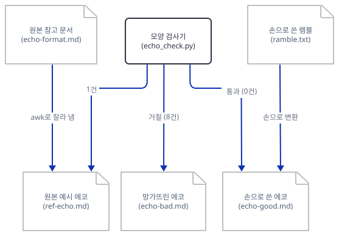

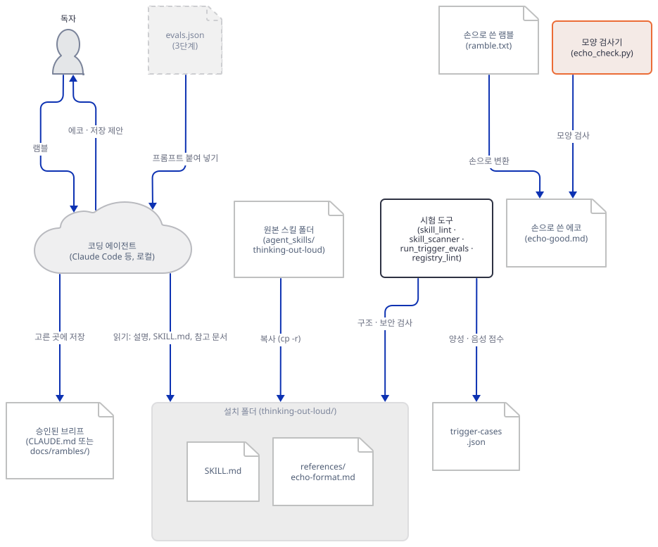

**확인.** 직접 확인한 출력입니다.

```text
echo-good.md: 157 words, 0 problem(s)
echo-bad.md: 63 words, 8 problem(s)
  - sections are ['Mission', 'Locked', 'Ledger', 'My additions'], expected ['Mission', 'Locked', 'Open', 'Ledger', 'My additions'] in this order
  - 'Email delivery' appears in Locked and again in Locked
  - Ledger: bullet spans 2 lines: 'Flipped: Slack, then email. Going with e'
  - My additions: bullet is neither Inferred nor Guessed: 'Dana wants one too'
  - no closing invitation to correct and offer the interview
  - forbidden phrase matched: \byou said\b
  - forbidden phrase matched: \btypo
  - forbidden phrase matched: \bI'll start\b
ref-echo.md: 137 words, 1 problem(s)
  - Open: bullet spans 2 lines: 'What defines "relevance to what I\'m buil'
```

세 가지를 읽습니다. 첫째, 규칙 가운데 모양으로 보이는 것(검사 항목 일곱)은 기계가 잡습니다. 둘째, 기계가 못 잡는 것이 더 중요합니다. `echo-bad.md`에서 "Quiet means 14 days"는 램블에 없던 숫자가 Locked에 들어간 것인데 검사기는 이것을 못 봅니다. 이것이 이 스킬이 막으려는 바로 그 실패입니다("vague quantifiers are never silently resolved"). 그것을 잡는 것은 사람 눈이나 3단계 시험뿐입니다. 셋째, 원본 참고 문서의 예시 에코도 "한 줄 한 불릿" 규칙에서 걸립니다. 예시의 Open 불릿은 문서 폭 때문에 줄이 접혀 있을 뿐이고 화면에서는 한 줄로 이어지는 글일 수 있습니다. 규칙의 "한 줄"이 화면 줄인지 글 단위인지 원문이 정하지 않았고, 이 검사기는 접힌 줄을 문제로 셉니다. 그 한 건을 빼면 원본 예시는 다섯 부분, 접두어, 낱말 수, 끝맺음을 모두 통과합니다.

### Step 8. 3단계 시험을 읽고 말이 어긋난 곳을 찾는다

**목적.** 모델을 돌려야 하는 3단계 시험(`evals.json`)이 무엇을 보는지 읽고, 스킬 본문과 맞는지 대조합니다. 3단계는 토큰을 쓰므로 돌리지 않습니다.

**할 일.** `evals.json`은 네 사례입니다. 각 사례는 프롬프트와 `expectations[]`(에이전트의 답이 만족해야 하는 문장들)로 되어 있습니다.

| id | 프롬프트 | 기대 항목 수 | 무엇을 보는가 |
|---|---|---|---|
| 1 | 음성 서두의 램블(주간 변경 이력 이메일, 스크린샷 번복, 투자자 보고 곁가지, 톤이 최우선) | 11 | 행동 없이 에코만 냄, 한 문장 Mission, 번복이 Ledger에 양쪽 입장으로, 곁가지는 Parked, 추측은 Guessed·Open, 한 사실은 한 곳, 한 줄 불릿, 오타 언급 없음, 끝맺음 |
| 2 | 여러 메시지로 오는 램블(중간에 "vercel이 cron을 지원하나?" 질문, 끝에 "ok done, echo me") | 5 | 첫 응답이 종료 신호를 말하는 한 줄, 중간 응답은 한 줄, 직접 질문은 두 문장, 신호 전에는 에코 없음, 신호 직후 에코 |
| 3 | 에코 뒤의 "yes interview me" | 5 | 플래그된 항목만, 한 메시지에 질문 하나, 이유 한 절, 다섯 개 이하, 바뀐 부분만 다시 씀 |
| 4 | 수정 뒤의 "yes that's exactly it, locked" | 3 | 저장 선택지 정확히 셋, 고르기 전에 쓰지 않음, 뒤에 다시 묻지 않음 |

이 사례를 Step 6의 견본에 대고, 글만 보고 판단할 수 있는 사례 1의 항목을 제가 손으로 채점해 보았습니다. 열한 항목 가운데 첫째("에코만 내고 행동하지 않음")는 에이전트의 행동이라 글만으로는 판단할 수 없고, 나머지 열은 견본이 만족합니다(Mission 한 문장, 번복 둘이 양쪽 입장으로 Ledger에, 곁가지 Parked, 최우선 조건 Locked, My additions는 Inferred·Guessed뿐, 모호한 낱말은 Open·Guessed, 한 사실은 한 곳(Mission은 요약이라 뺀 읽기), 한 줄 불릿, 오타 언급 없음, 끝맺음). 그러나 이 채점은 제가 쓴 글을 제가 채점한 것이라 순환입니다. 실제 에이전트가 이 열 항목을 지키는지는 이 문서가 확인하지 못했습니다.

대조에서 본문과 어긋난 곳이 넷 나왔습니다.

- 사례 2의 마지막 기대는 "all four sections"를 말하지만 `SKILL.md:91-119`의 에코는 다섯 부분입니다.
- 사례 1의 `expected_output`은 "brief with goals, constraints, made decisions and open questions"와 "an assumption diff separating said, inferred, and guessed"를 말합니다. 본문은 Locked 하나(결정과 제약을 합침)와 My additions(Inferred·Guessed만)이고, 같은 사례의 기대 항목은 "there is no you-said recap section"을 요구해서 `expected_output`과 서로 어긋납니다. 이 저장소의 이력으로 보면 `SKILL.md`와 `evals.json`은 같은 커밋(`de309b13`, 2026-07-21)으로 함께 들어왔고 그때 이미 `version: "1.3.0"`과 다섯 부분이었으므로, 어긋남은 처음 들어온 때부터입니다(`git log -- agent_skills/evals/thinking-out-loud/evals.json`).
- 사례 1의 기대 하나는 곁가지가 "goals"에 섞이지 않아야 한다고 적습니다. 본문에는 goals라는 부분이 없습니다.
- 스킬의 `README.md`(67줄)는 캡처 모드의 응답을 "listening..."이라고 적지만 `SKILL.md`는 "Listening."처럼 조금씩 바꾸라고 적습니다. 의미는 같고 낱말이 다릅니다.

저장소 `agent_skills/README.md`의 두 문장도 대조했습니다. 하나, "Every skill also has an executable eval in evals/. Run it from the clone before installing." 이 스킬에서 "executable"은 `test_*.py`가 아니라 위 사례들을 사람이 에이전트에 붙여 넣는 일이고, 그렇게 돌린 결과는 저장소에 남아 있지 않습니다(이 문서는 돌리지 않았습니다). 둘, "Local and private by default. No network calls unless declared." 이 스킬에는 스크립트가 없고 본문에 네트워크를 가리키는 말이 없으며 스캐너도 깨끗하므로 이 주장과 부딪히는 곳이 없습니다. 다만 이것은 스킬 파일의 내용이지, 에이전트가 램블을 모델에 보내는 일 자체(어차피 일어나는 일)의 이야기가 아닙니다. 원본 `README.md`가 쓴 "no scripts, no network calls, and it never saves anything without asking"에서 앞 둘은 이 문서가 확인했고 셋째는 본문이 그렇게 시킨다는 것까지입니다.

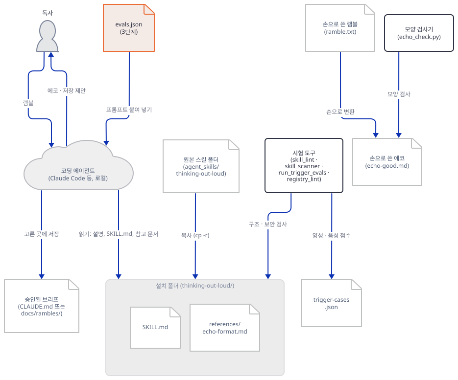

**확인.** 사례별 기대 항목 수(11, 5, 5, 3)와 위 어긋남은 `agent_skills/evals/thinking-out-loud/evals.json`을 열어 직접 다시 셀 수 있습니다. `grep -n "four\|goals\|assumption diff\|said" agent_skills/evals/thinking-out-loud/evals.json`이 해당 줄을 보여 줍니다.

## 요청 한 건이 흐르는 과정

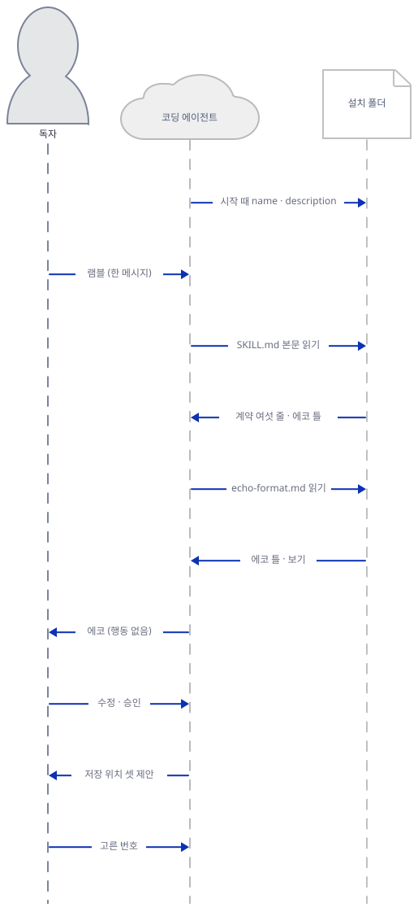

이 그림은 에이전트를 띄워 관찰한 것이 아니라 Anthropic 문서의 점진적 불러오기와 `SKILL.md`의 지시를 이어 붙인 것입니다. 시작할 때 에이전트는 설치된 모든 스킬의 이름과 설명만 읽습니다(첫 메시지). 사용자가 램블을 한 메시지로 보내면, 설명에 맞는다고 판단한 에이전트가 `SKILL.md` 본문을 읽고(셋째 메시지) 계약 여섯 줄과 에코 틀을 얻습니다. 본문이 `references/echo-format.md`를 가리키므로 에이전트는 그 파일도 읽을 수 있습니다(다섯째 메시지). 문서는 가리킨 파일이 "필요할 때" 읽힌다고 하므로 읽을지는 에이전트 몫입니다. 그 뒤 에이전트는 파일 수정이나 코드 없이 에코만 보내고, 사용자가 고치고 승인하면 저장 위치 셋을 제안합니다. 사용자가 고른 뒤에야 `CLAUDE.md`나 `docs/rambles/`에 쓰는 마지막 두 메시지는 폭을 지키려고 보조 그림으로 나눴습니다(메시지는 코드 순서 그대로입니다).

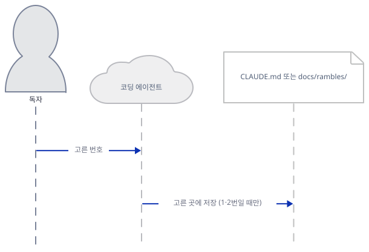

첫 그림의 마지막 메시지 다음에 이 그림의 첫 메시지가 옵니다. 1번이나 2번을 골랐을 때만 파일에 씁니다. 3번(대화 안에만 두기)이면 쓰지 않습니다. 여기에 모델 호출이 몇 번 있는지, 에코가 한 번에 만들어지는지는 이 문서가 확인하지 못했습니다. 캡처 모드와 인터뷰는 이 그림에 넣지 않았습니다. 같은 사용자와 에이전트 사이에서 메시지 수가 늘어나는 선택 경로입니다(Step 5).

## 실행 체크리스트

- [ ] `wc -l`로 세 파일이 158·67·72줄이고 파이썬 파일이 0개임을 확인했다
- [ ] Step 3 블록으로 스크래치 프로젝트의 `.claude/skills/`에 복사하고 파일 셋만 들어간 것을 봤다(새 터미널이면 블록 첫머리의 변수 줄부터 그대로)
- [ ] `skill_lint.py --strict`, `skill_scanner.py`, `run_trigger_evals.py`, `registry_lint.py --check`가 통과했다
- [ ] `echo_check.py`가 견본은 통과시키고 망가진 견본은 거절했다
- [ ] 진짜 `~/.claude`나 다른 에이전트 설정 폴더를 건드리지 않았고, 저장소에 `__pycache__`가 새로 생기지 않았다

## 문제 해결

| 증상 | 원인 | 해결 |
|---|---|---|
| `UnicodeEncodeError: 'cp949' codec can't encode character '\u2014'`(`skill_lint.py`·`skill_scanner.py`·`registry_lint.py`의 출력 줄) | 한국어 Windows에서 출력이 콘솔이 아니라 파이프일 때(Git Bash 등) 기본 출력 인코딩이 `cp949`이고 도구가 `—`를 찍는다. 직접 확인했다. 콘솔 창에서는 나지 않는 것으로 알지만 재현하지 못했다 | 명령에 `-X utf8`을 붙인다. `-I`와 함께 쓰는 `PYTHONIOENCODING`은 듣지 않는다 |
| `UnicodeDecodeError: 'cp949' codec can't decode byte 0xe2`(`run_trigger_evals.py`의 `open(...).read()`) | 도구가 스킬 일곱 개의 `SKILL.md`를 인코딩 지정 없이 연다. 이 스킬의 `SKILL.md`는 ASCII뿐이지만 다른 스킬(`advisor-orchestrator-worker`·`project-graveyard`)에 UTF-8 글자가 있다. 직접 확인했다 | `-X utf8`. `PYTHONIOENCODING=utf-8`만으로는 읽기에서 계속 멈춘다 |
| `agent_skills/evals/tools/__pycache__`가 생김 | 파이썬이 도구 파일을 바이트코드로 저장한다. 저장소 `.gitignore`가 무시하지만 클론이 더러워진다. 이 문서의 작업 중에 한 번 직접 봤다 | `-B`를 붙이고, 이미 생겼다면 그 폴더만 이름으로 지운다(와일드카드 없이) |
| `-I`를 쓰면 `PYTHONDONTWRITEBYTECODE=1`·`PYTHONUTF8=1`이 듣지 않음 | `-I`는 `PYTHON*` 환경변수를 모두 무시한다. 직접 확인했다 | 환경변수 대신 `-B`·`-X utf8` 옵션을 쓴다 |
| `echo_check.py`가 원본 예시 에코를 문제로 셈 | "한 줄 한 불릿"을 화면 줄로 읽는 검사기와 접힌 원문 예시의 차이(Step 7) | 접힌 줄을 합쳐 다시 재거나, 이 한 건은 알려진 차이로 둔다 |
| 설치했는데 에이전트가 스킬을 켜지 않는 것 같음 | 이 문서는 에이전트를 띄우지 않아 원인을 확인하지 못했다. 트리거 시험은 낱말 겹침이라 실제 켜짐을 보장하지 않는다 | 설명(`SKILL.md`의 `description`)에 쓰는 낱말이 실제 램블의 낱말과 겹치는지 보고, 에이전트가 스킬 폴더를 읽는 위치(Step 3)에 설치했는지 확인한다 |

## 더 해보기

- 자기 램블을 손으로 에코로 바꾸고 `echo_check.py`를 통과시켜 본 다음, 검사기가 잡지 못하는 것(숨은 추측)을 눈으로 찾아 Guessed로 옮겨 보세요. 검사기가 못 보는 것이 얼마나 되는지 직접 세어 보면 3단계 시험의 몫이 보입니다.
- `evals.json` 사례 2(캡처 모드)와 사례 4(저장 선택)를 대화 기록 모양으로 손으로 써 보고, 각 기대 항목이 기록의 어느 줄을 보는지 줄 번호로 표시해 보세요. 모델 없이도 기대 항목이 모호한 곳("minimal one-line replies")이 드러납니다.
- Step 8에서 찾은 어긋남 넷을 고친 `evals.json` 초안을 스크래치 사본에 써 보세요. 원본은 고치지 않습니다.

## 다음 날 예고

[Day 156 · 🏺 Commit Archaeologist](../day156-commit-archaeologist/README.md) — 같은 볼륨의 세 번째 스킬이지만 오늘과 달리 스크립트가 있습니다. `agent_skills/commit-archaeologist`에는 `scripts/archaeologist.py`(388줄, git을 하위 프로세스로 부름), `references/reading-git-history.md`(82줄), `SKILL.md`(132줄)가 있고, 파일이나 줄 범위가 왜 그 모양이 되었는지를 로컬 git 이력에서 복원합니다. 오늘은 약속을 읽는 날이었고 다음 날은 그 약속을 코드가 지킵니다.
