# Day 156 · 🏺 Commit Archaeologist

> 볼륨 16 🧩 Agent Skills · 난이도 ★☆☆ · 예상 소요 150분(스크립트 하나와 git만 있으면 되지만, 지시문·명세를 읽고 합성 저장소로 출력 여덟 가지를 한 걸음씩 따라 읽는 데 시간이 듭니다) · API 비용 대략 0원(API 키가 필요 없고 모델을 한 번도 부르지 않았습니다) · 원본 앱: `agent_skills/commit-archaeologist`

## 오늘 만들 것

코딩 에이전트에게 "이 코드는 왜 있나?"를 물으면 답을 만들어 주는 스킬 `commit-archaeologist`를 읽고, 그 스킬이 에이전트 대신 돌리게 하는 스크립트를 직접 돌려 봅니다. 앱이 아니라 폴더입니다. 저장소의 `agent_skills/README.md`는 스킬을 `SKILL.md` 하나와 스크립트·참고 문서가 든 폴더로 설명하고, 에이전트가 그것을 발견해 필요할 때 불러온다고 적습니다. 볼륨 15의 [Day 152](../day152-llama3.2-finetuning/README.md)와 [Day 153](../day153-gemma3-finetuning/README.md)는 모델의 가중치 일부를 학습했습니다. 볼륨 16은 모델 쪽이 아니라 모델에게 주는 지시문과 그 지시문이 실행시키는 도구를 다룹니다. [Day 155](../day155-thinking-out-loud/README.md)의 스킬은 스크립트가 하나도 없는 글 스킬이었고, 오늘 스킬은 이 볼륨에서 처음으로 스크립트를 직접 돌려 볼 수 있는 쪽입니다. 스킬이 무엇이고 시험 단계가 어떻게 나뉘며 어떻게 설치하는지는 볼륨의 첫날 [Day 154](../day154-advisor-orchestrator-worker/README.md)가 다룹니다. 오늘은 그 날의 내용에 기대지 않고, 이 스킬에 필요한 사실만 소스와 공개 문서로 확인해 적었습니다.

스킬의 일은 `git blame`이 하지 않는 것입니다. blame은 줄마다 마지막으로 손댄 사람을 알려 줍니다. 이 스킬은 파일이나 줄 범위가 처음 들어온 커밋, 그 뒤의 수정, 함께 자주 바뀐 파일, 커밋 메시지에 적힌 의도 단서를 모아 JSON으로 내놓고, 에이전트가 그것을 읽어 "왜 있나" 보고서를 쓰게 합니다. 파일은 `SKILL.md`(132줄), `references/reading-git-history.md`(82줄), `scripts/archaeologist.py`(388줄)와 사람용 `README.md`(74줄)입니다. 스크립트는 파이썬 표준 라이브러리와 git만 씁니다.

이 문서는 에이전트(Claude Code, Codex, Cursor 등)를 한 번도 띄우지 않았고 모델도 부르지 않았으며, 3단계 행동 시험도 돌리지 않았습니다. 이 PC의 진짜 `~/.claude/skills`나 다른 에이전트 설정 폴더에는 아무것도 넣지 않았고 `npx skills add`도 실행하지 않았습니다. 대신 스킬 폴더를 스크래치 프로젝트의 `.claude/skills/` 아래로 복사해 설치 모양을 보이고, 이력이 있는 가짜 저장소를 직접 만들어 스크립트를 돌립니다. 저장소의 가짜 작성자는 `Ada Fixture`와 `Ben Fixture`, 메일은 `example.test`입니다. 직접 돌려 보거나 소스로 확인한 것이 여덟입니다.

1. `SKILL.md`의 frontmatter는 agentskills.io 명세의 필드 규칙을 지키고, `skill_lint.py --strict`는 오류 0·경고 0입니다. 설명(`description`)은 360자이고 `compatibility`·`allowed-tools`는 없습니다(Step 1, 8).
2. 스크립트 한 번은 `git` 하위 프로세스 6~18개를 시작하고, 모두 `rev-parse`·`ls-files`·`show`·`log`·`diff-tree`·`blame`입니다. 실행 전후 `.git` 폴더 파일 65개의 지문이 같았고 네트워크 시도는 0이었습니다(Step 7).
3. 줄 범위를 주면 "처음 들어온 사람"과 "지금 그 줄의 주인"이 갈릴 수 있습니다. 합성 저장소에서 `invalidate` 함수를 Ben이 넣었지만 마지막 줄은 이름 바꾸기 커밋 때문에 blame이 Ada를 가리킵니다(Step 4).
4. "함께 바뀐 파일"의 문턱은 `max(2, (커밋 수 + 2) // 3)`입니다. 같은 파일이라도 파일 모드에서는 문턱이 3, 줄 모드에서는 2라서 목록이 달라지고, 줄 모드는 파일의 옛 이름을 동반 파일로 적을 수 있습니다(Step 5).
5. 커밋 분류는 키워드 판정이고 먼저 맞는 규칙이 이깁니다. `Fix typo in the refactor guide`는 `refactor`이고, "workaround"를 이름에 단 커밋은 `other`입니다. 되돌림(revert) 커밋은 되돌린 커밋의 제목 낱말을 그대로 물려받아 의도 단서가 되풀이됩니다(Step 6).
6. 이 저장소의 실제 파일 둘에 읽기만으로 돌려 봤습니다. 스쿼시 병합 본문 속 "fix(...)" 때문에 새 스킬을 추가한 커밋이 `fix`로 분류됐고, `docs/tutorials/_tools/theme.d2`의 줄 범위에는 SVG 그림 157개가 "함께 바뀐 파일"로 나왔습니다(Step 7).
7. 저장소 README의 "Local and private by default"는 스크립트에 대해서는 맞습니다. 다만 JSON에는 작성자 이름·메일과 저장소의 절대 경로가 들어 있어서, 에이전트가 그것을 읽으면 모델 쪽 대화에 실립니다(Step 7).
8. 결정적 시험 넷은 모두 통과합니다. 2b 시험은 18개 확인을 하지만 작성자가 한 명인 저장소만 쓰고, 줄 모드의 옛 이름과 되돌림 단서 되풀이는 보지 않습니다. 트리거 시험은 낱말이 겹치는 정도만 재서 "what is the story behind this retry loop"가 0점입니다(Step 8).

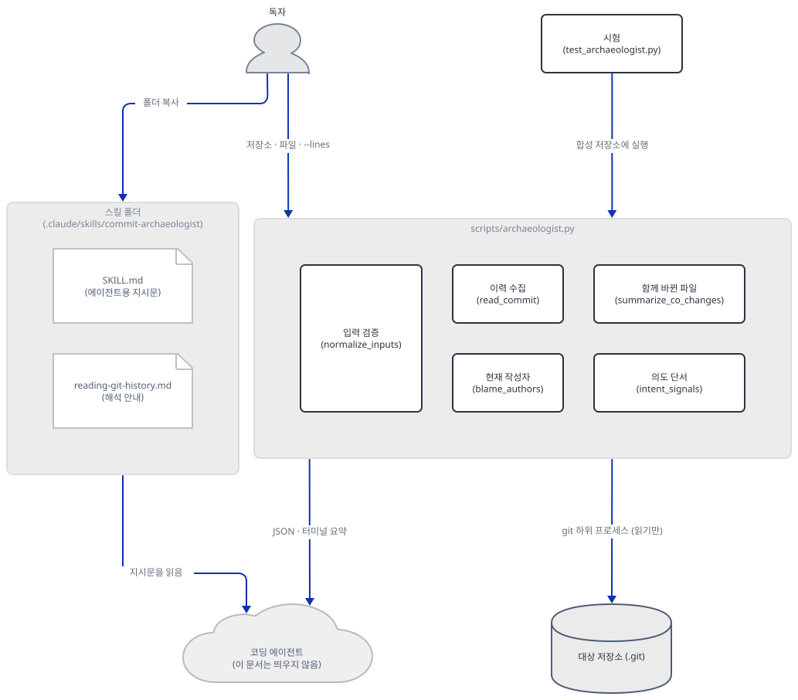

## 사전 준비

| 서비스/도구 | 용도 | 발급·설치 |
|---|---|---|
| Python 3 | 스킬 스크립트와 시험 도구 모두 표준 라이브러리만 씁니다. 이 문서는 3.14.2로 돌렸습니다. 스크립트 머리말은 3.8 이상이라고 적지만 그 아래 버전은 돌려 보지 못했습니다 | [공통 사전 준비](../README.md#공통-사전-준비-한-번만) 절 참고. 설치할 패키지는 없습니다 |
| git | 스크립트가 하위 프로세스로 부릅니다. 이 문서는 2.52.0으로 돌렸습니다 | 이미 있으면 `git --version`으로 확인 |
| 이 저장소의 clone | 스킬 폴더, 시험 도구, 시험 자료를 가져옵니다. 아래에서 `REPO`라는 변수로 가리킵니다 | `git clone https://github.com/Shubhamsaboo/awesome-llm-apps` |
| 코딩 에이전트 | 필요 없음. 이 문서는 에이전트를 띄우지 않습니다 | 없음 |
| API 키·네트워크 | 필요 없음. clone 뒤에는 인터넷 없이 모두 돌아갑니다 | 없음 |

한국어 Windows에서는 시험 도구 하나(`run_trigger_evals.py`)가 파일을 기본 인코딩(cp949)으로 열어 멈춥니다(문제 해결 표). 아래 변수 블록에 `PYTHONUTF8=1`을 넣어 두었습니다.

## 아키텍처 한눈에 보기

| 컴포넌트 | 역할 | 코드 위치 |
|---|---|---|
| 스킬 이름·설명 | 에이전트가 시작할 때 읽는 메타데이터(frontmatter) | `agent_skills/commit-archaeologist/SKILL.md:1-14` |
| 에이전트용 지시문 | 대상 정하기, 스크립트 실행, JSON 읽기, 보고서 여섯 부분, 증거 규칙 | `agent_skills/commit-archaeologist/SKILL.md:16-132` |
| 해석 안내 | 파일 이력과 줄 이력, 작성자 두 뜻, 분류, 동반 변경, 신뢰도 | `agent_skills/commit-archaeologist/references/reading-git-history.md:1-82` |
| git 호출 | 읽기 전용 명령 하나를 돌리고 UTF-8로 풀기 | `agent_skills/commit-archaeologist/scripts/archaeologist.py:33-55` |
| 입력 검증 | 저장소 찾기, 파일이 저장소 안인지·추적 중인지, 줄 범위 형식과 길이 | `agent_skills/commit-archaeologist/scripts/archaeologist.py:58-106` |
| 이력 수집 | `log -L` 또는 `log --follow`, 커밋마다 메타데이터와 바뀐 파일 | `agent_skills/commit-archaeologist/scripts/archaeologist.py:109-212` |
| 현재 작성자 | `blame --line-porcelain`으로 줄 수 세기, 커밋 수와 합치기 | `agent_skills/commit-archaeologist/scripts/archaeologist.py:215-262` |
| 함께 바뀐 파일 | 옛 이름 모으기, 문턱 계산, 목록 | `agent_skills/commit-archaeologist/scripts/archaeologist.py:265-295` |
| 보고서 조립과 출력 | 여섯 키 JSON, 사람용 요약, 인자 처리 | `agent_skills/commit-archaeologist/scripts/archaeologist.py:298-388` |
| 시험 도구 넷 | 구조(`skill_lint.py`), 보안(`skill_scanner.py`), 트리거(`run_trigger_evals.py`), 레지스트리(`registry_lint.py`) | `agent_skills/evals/tools/` |
| 스킬 시험 자료 | 스크립트 시험, 트리거 사례, 행동 시험 | `agent_skills/evals/commit-archaeologist/` |
| 레지스트리 | 이름·설명·설치 명령·시험 폴더 | `agent_skills/registry.json` |
| 코딩 에이전트 | 스킬을 불러 읽고 스크립트를 돌린 뒤 보고서를 쓰는 쪽 | 코드 없음 (외부. 이 문서는 띄우지 않음) |
| 이 문서의 가짜 저장소와 보조 스크립트 | 이력을 아는 저장소, JSON 골라 보기, git 호출 기록 | 코드 없음 (Step 2~7에서 직접 만듦) |

## 단계별 진행

### Step 1. 스킬 폴더를 읽고 스크래치 프로젝트에 "설치"한다

**목적.** 스킬이 어떤 파일로 이루어졌고 frontmatter가 명세를 지키는지 확인하고, 진짜 에이전트 설정 폴더를 건드리지 않는 설치 모양을 만듭니다.

**할 일.** 먼저 작업 폴더와 변수를 정합니다. 이 스킬의 스크립트는 환경 변수를 읽지 않지만 git은 `HOME` 아래의 `.gitconfig`를 읽으므로, 이 시리즈의 규칙대로 홈과 임시 폴더를 작업 폴더 안으로 돌립니다. `REPO`는 clone한 폴더입니다.

```bash
mkdir lab156
cd lab156
mkdir -p home tmp
export REPO=/path/to/awesome-llm-apps
export HOME="$PWD/home" USERPROFILE="$PWD/home" CLAUDE_CONFIG_DIR="$PWD/home/.claude"
export TEMP="$PWD/tmp" TMP="$PWD/tmp" TMPDIR="$PWD/tmp"
export PYTHONIOENCODING=utf-8 PYTHONUTF8=1 PYTHONDONTWRITEBYTECODE=1
```

```powershell
New-Item -ItemType Directory lab156 | Out-Null
Set-Location lab156
New-Item -ItemType Directory home, tmp | Out-Null
$LAB = (Get-Location).Path
$REPO = "C:\path\to\awesome-llm-apps"
$env:HOME = "$LAB\home"; $env:USERPROFILE = "$LAB\home"; $env:CLAUDE_CONFIG_DIR = "$LAB\home\.claude"
$env:TEMP = "$LAB\tmp"; $env:TMP = "$LAB\tmp"; $env:TMPDIR = "$LAB\tmp"
$env:PYTHONIOENCODING = "utf-8"; $env:PYTHONUTF8 = "1"; $env:PYTHONDONTWRITEBYTECODE = "1"
```

(PowerShell 줄은 실행해 보지 못했습니다. 이 문서의 모든 실행은 Git Bash에서 했습니다. 아래 명령의 `$REPO`는 PowerShell에서 `$REPO`, 경로 구분자는 `\`입니다.)

`SKILL.md`의 맨 위가 frontmatter입니다. 원문 그대로입니다.

`agent_skills/commit-archaeologist/SKILL.md:1-14`

```yaml
---
name: commit-archaeologist
description: >-
  Reconstructs why code exists from local git history, including the introducing
  commit, later changes, current authors, repeated companion files, and likely
  intent. Use when the user asks "why does this code exist", "who wrote this
  function and why", or to "explain the history of this function" before a
  rewrite, refactor, or risky edit. Runs entirely locally.
license: Apache-2.0
metadata:
  author: "Matt Van Horn"
  version: "1.0.0"
  source: "https://github.com/Shubhamsaboo/awesome-llm-apps"
---
```

agentskills.io의 명세 쪽(https://agentskills.io/specification, 2026-10-19에 읽음)과 하나씩 맞춰 봅니다.

| 필드 | 명세가 말하는 것 | 이 스킬 |
|---|---|---|
| `name` | 필수. 1~64자, 소문자·숫자·하이픈, 처음과 끝은 하이픈 금지, 연속 하이픈 금지, 폴더 이름과 같아야 함 | `commit-archaeologist` 20자, 폴더 이름과 같음 |
| `description` | 필수. 1~1024자. 무엇을 하는지와 언제 쓰는지, 에이전트가 알아볼 낱말을 포함 | 360자(직접 센 값). "Use when the user asks ..."에 에이전트가 들을 문장 셋을 따옴표로 적음 |
| `license` | 선택 | `Apache-2.0` |
| `compatibility` | 선택. 500자 이하. 필요한 환경(시스템 패키지, 네트워크 등)을 적는 자리이고 "대부분의 스킬은 필요 없음" | 없음. 스킬은 git과 Python을 쓰지만 적지 않았습니다 |
| `metadata` | 선택. 문자열 키와 문자열 값의 맵 | `author`·`version`·`source` 셋, 값이 모두 문자열 |
| `allowed-tools` | 선택. 실험적. 미리 허락해 둘 도구 목록 | 없음 |

`allowed-tools`가 없다는 것의 뜻은 Claude Code 문서(https://code.claude.com/docs/en/skills, 같은 날 읽음)에 있습니다. 스크립트는 에이전트가 Bash 도구로 돌리므로 "normal permission rules apply", 곧 평소의 권한 규칙이 적용되고, 미리 허락하려면 `allowed-tools`에 적습니다. 이 스킬은 적지 않아서, 설정에 따라 스크립트를 돌릴 때마다 허락을 물을 수 있습니다. 이 문서는 에이전트를 띄우지 않아서 실제로 묻는지는 확인하지 못했습니다.

이제 폴더를 프로젝트 안으로 복사합니다. 같은 문서가 프로젝트 스킬의 자리를 `.claude/skills/<skill-name>/SKILL.md`, 개인 스킬의 자리를 `~/.claude/skills/<skill-name>/SKILL.md`라고 적습니다. 개인 자리가 이 PC의 진짜 홈 아래이므로 쓰지 않고 프로젝트 자리로만 복사합니다.

```bash
mkdir -p project/.claude/skills
cp -r "$REPO/agent_skills/commit-archaeologist" project/.claude/skills/commit-archaeologist
```

```powershell
New-Item -ItemType Directory -Force project\.claude\skills | Out-Null
Copy-Item -Recurse "$REPO\agent_skills\commit-archaeologist" project\.claude\skills\commit-archaeologist
```

저장소 README의 설치 명령 `npx skills add https://github.com/Shubhamsaboo/awesome-llm-apps/tree/main/agent_skills/commit-archaeologist`(`agent_skills/commit-archaeologist/README.md`의 17행)와 진짜 홈 쪽 복사(`~/.claude/skills/`)는 이 문서가 실행하지 않았습니다. 그 CLI가 무엇을 내려받는지는 확인하지 못했습니다. README는 그 CLI를 https://skills.sh라고만 소개합니다. 복사한 폴더에 무엇이 들어갔는지 봅니다.

```bash
find project -type f | sort
find project -type f -exec wc -l {} +
```

```powershell
Get-ChildItem project -Recurse -File | ForEach-Object { "{0}  {1}" -f (Get-Content $_.FullName).Count, $_.FullName.Substring($LAB.Length + 1) }
```

**확인.** 기대 출력(Git Bash, 목록 순서는 파일 시스템마다 다를 수 있습니다).

```text
project/.claude/skills/commit-archaeologist/README.md
project/.claude/skills/commit-archaeologist/SKILL.md
project/.claude/skills/commit-archaeologist/references/reading-git-history.md
project/.claude/skills/commit-archaeologist/scripts/archaeologist.py
   74 project/.claude/skills/commit-archaeologist/README.md
   82 project/.claude/skills/commit-archaeologist/references/reading-git-history.md
  388 project/.claude/skills/commit-archaeologist/scripts/archaeologist.py
  132 project/.claude/skills/commit-archaeologist/SKILL.md
  676 total
```

파일 넷, 676줄입니다. `agent_skills/evals/README.md`는 시험 파일이 설치에 들어가지 않고 "the skill folders contain only what runs at runtime"이라고 적는데, 복사한 폴더에도 `evals/`가 없습니다. 명세의 점진적 불러오기(progressive disclosure)에 맞춰 보면, 에이전트는 시작할 때 `name`과 `description`(이 스킬은 360자)만 읽고, 스킬을 쓰기로 정하면 `SKILL.md` 전체(132줄)를 읽고, `references/`와 `scripts/`의 파일은 필요할 때만 읽거나 돌립니다. Claude Code 문서는 스크립트를 "executed, not loaded"로 적습니다. 소스는 컨텍스트에 들어가지 않고 출력만 들어갑니다.

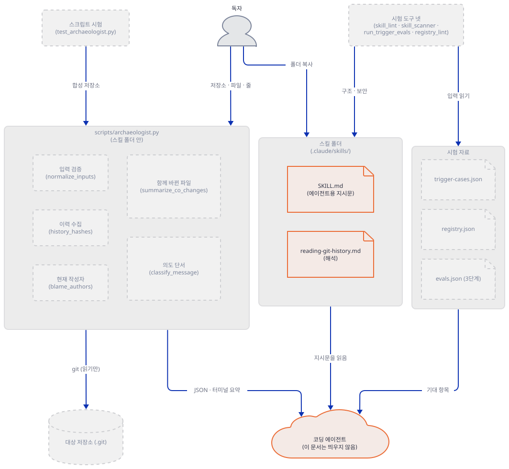

### Step 2. 이력을 아는 합성 저장소를 만든다

**목적.** 진짜 사람의 이력 대신, 어떤 커밋이 왜 있는지 제가 아는 저장소를 만들어 스크립트의 출력을 정답과 맞춰 봅니다.

**할 일.** 아래 스크립트를 `lab156/make_shop.py`로 저장합니다. 가상의 가격 캐시 `src/cache.py`가 일곱 커밋을 거칩니다. 작성자는 가짜 둘이고, 날짜는 고정해서 커밋 해시가 누가 만들어도 같습니다. 일곱 번째 커밋은 파일 이름을 `src/pricing_cache.py`로 바꿉니다. 모든 git 호출은 전역·시스템 설정을 읽지 않고 서명을 끕니다.

`lab156/make_shop.py`

```python
"""Build a small synthetic git repository with a known history (fake identities)."""
import os
import subprocess
import sys

REPO = os.path.abspath(sys.argv[1])
ADA = ("Ada Fixture", "ada.fixture@example.test")
BEN = ("Ben Fixture", "ben.fixture@example.test")


def git(*args, who=None, date=None):
    env = dict(os.environ, GIT_CONFIG_GLOBAL=os.devnull, GIT_CONFIG_NOSYSTEM="1")
    if who:
        env.update(GIT_AUTHOR_NAME=who[0], GIT_AUTHOR_EMAIL=who[1],
                   GIT_COMMITTER_NAME=who[0], GIT_COMMITTER_EMAIL=who[1])
    if date:
        env.update(GIT_AUTHOR_DATE=date, GIT_COMMITTER_DATE=date)
    out = subprocess.run(["git", "-C", REPO, "-c", "commit.gpgsign=false", *args], env=env, capture_output=True,
                         text=True, encoding="utf-8", check=True)
    return out.stdout.strip()


def put(path, text):
    full = os.path.join(REPO, path)
    os.makedirs(os.path.dirname(full), exist_ok=True)
    with open(full, "w", encoding="utf-8", newline="\n") as fh:
        fh.write(text)


def commit(who, date, message, files):
    for path, text in files.items():
        put(path, text)
    git("add", "-A")
    git("commit", "-q", "-m", message, who=who, date=date)


CACHE_V1 = '''"""Price cache."""
_store = {}


def get(key):
    return _store.get(key)


def put(key, value):
    _store[key] = value
'''

CACHE_V2 = '''"""Price cache."""
import time

TTL_SECONDS = 300
_store = {}


def get(key):
    entry = _store.get(key)
    if entry is None:
        return None
    value, stored_at = entry
    if time.time() - stored_at > TTL_SECONDS:
        del _store[key]
        return None
    return value


def put(key, value):
    _store[key] = (value, time.time())
'''

CACHE_V3 = CACHE_V2 + '''

def invalidate(key):
    _store.pop(key, None)
'''

CACHE_V4 = CACHE_V3.replace(
    "def get(key):\n",
    "def get(key):\n    if key.startswith(\"EU:\"):\n        return None\n",
)

CACHE_V6 = CACHE_V3.replace("_store", "_entries")

os.makedirs(REPO)
git("init", "-q", "-b", "main")
git("config", "user.name", ADA[0])
git("config", "user.email", ADA[1])

commit(ADA, "2026-01-05T10:00:00+0000", "feat: add in-memory price cache", {
    "src/cache.py": CACHE_V1,
    "src/prices.py": "from cache import get, put\n",
    "tests/test_cache.py": "def test_roundtrip():\n    pass\n",
    "docs/notes.md": "Prices are looked up on every request.\n",
    "README.md": "# shop\n",
})
commit(ADA, "2026-01-12T10:00:00+0000", "Add TTL to cache entries (#12)", {
    "src/cache.py": CACHE_V2,
    "tests/test_cache.py": "def test_roundtrip():\n    pass\n\n\ndef test_expiry():\n    pass\n",
    "config/settings.toml": "[cache]\nttl_seconds = 300\n",
})
commit(BEN, "2026-02-02T10:00:00+0000", "fix: stale price after refund (see issue 34)", {
    "src/cache.py": CACHE_V3,
    "tests/test_cache.py": "def test_roundtrip():\n    pass\n\n\ndef test_expiry():\n    pass\n\n\ndef test_refund():\n    pass\n",
})
commit(BEN, "2026-02-20T10:00:00+0000",
       "temporary workaround: skip cache for EU prices (#41)\n\n"
       "TODO: remove once the currency API returns EU prices reliably.", {
    "src/cache.py": CACHE_V4,
    "config/settings.toml": "[cache]\nttl_seconds = 300\nskip_regions = [\"EU\"]\n",
})
bad = git("rev-parse", "HEAD")
git("revert", "--no-edit", bad, who=BEN, date="2026-03-10T10:00:00+0000")
commit(ADA, "2026-03-22T10:00:00+0000", "refactor: rename _store to _entries across modules", {
    "src/cache.py": CACHE_V6,
    "src/prices.py": "from cache import get, put  # price lookups\n",
    "README.md": "# shop\n\nSmall price service.\n",
})
git("mv", "src/cache.py", "src/pricing_cache.py")
put("tests/test_cache.py", "from pricing_cache import get\n\n\ndef test_roundtrip():\n    pass\n\n\ndef test_expiry():\n    pass\n\n\ndef test_refund():\n    pass\n")
git("add", "-A")
git("commit", "-q", "-m", "refactor: move cache into its own module name", who=BEN, date="2026-04-02T10:00:00+0000")
print(git("log", "--format=%h %an %ad %s", "--date=short"))
```

```bash
python make_shop.py shop
git -C shop log --format='%h %an <%ae> %s' | head -3
```

**확인.** 첫 명령은 로그 일곱 줄을, 둘째 명령은 이름과 메일이 든 앞 세 줄을 보입니다. 이름과 메일은 코드가 정한 가짜입니다. 해시 앞 일곱 글자는 누가 만들어도 같습니다.

```text
75706c7 Ben Fixture 2026-04-02 refactor: move cache into its own module name
e53954a Ada Fixture 2026-03-22 refactor: rename _store to _entries across modules
b923ca0 Ben Fixture 2026-03-10 Revert "temporary workaround: skip cache for EU prices (#41)"
f56d3c9 Ben Fixture 2026-02-20 temporary workaround: skip cache for EU prices (#41)
1b820cd Ben Fixture 2026-02-02 fix: stale price after refund (see issue 34)
204ccae Ada Fixture 2026-01-12 Add TTL to cache entries (#12)
a758aca Ada Fixture 2026-01-05 feat: add in-memory price cache
75706c7 Ben Fixture <ben.fixture@example.test> refactor: move cache into its own module name
e53954a Ada Fixture <ada.fixture@example.test> refactor: rename _store to _entries across modules
b923ca0 Ben Fixture <ben.fixture@example.test> Revert "temporary workaround: skip cache for EU prices (#41)"
```

일곱 커밋이 각각 무엇을 보이려고 있는지 표로 적어 둡니다. 정답을 알고 출력을 읽기 위한 것입니다.

| 커밋 | 바뀐 파일 | 보이려는 것 |
|---|---|---|
| `a758aca` feat | `src/cache.py`, `src/prices.py`, 테스트, 메모, README | 도입 커밋과 한 번만 바뀐 이웃 파일 |
| `204ccae` TTL, `#12` | 캐시, 테스트, `config/settings.toml` | 이슈 참조 `#12`, 설정 파일의 첫 동반 변경 |
| `1b820cd` fix, `issue 34` | 캐시, 테스트 | `invalidate`(23~24행)를 Ben이 넣음 |
| `f56d3c9` 임시 우회, `#41` | 캐시, 설정 | 제목에 workaround·temporary, 본문에 TODO, 분류 낱말 없음 |
| `b923ca0` Revert | 캐시, 설정 | `git revert`가 만든 되돌림 커밋 |
| `e53954a` refactor | 캐시, `src/prices.py`, README | `_store`를 `_entries`로: blame이 바뀌는 기계적 편집 |
| `75706c7` refactor | 캐시를 `src/pricing_cache.py`로 이름만 바꿈, 테스트 | 이름 바꾸기 |

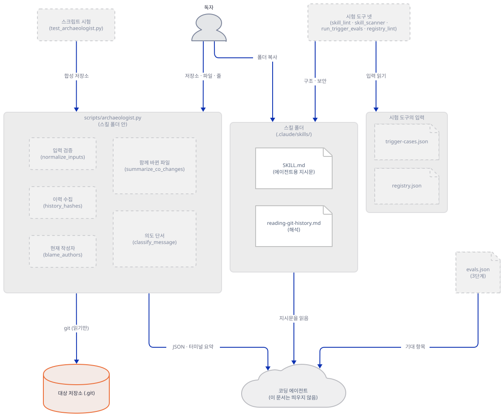

### Step 3. 파일 전체 이력을 돌려 도입 커밋과 타임라인을 읽는다

**목적.** `--lines` 없이 파일 하나의 이력을 돌려 보고, 출력의 각 부분이 어느 git 명령에서 나오는지 연결합니다.

**할 일.** 스킬 폴더 안의 스크립트를 가리키는 변수를 하나 두고, 저장소와 파일 경로를 줍니다. 파일 경로는 저장소 맨 위 폴더 기준이고 `/`로 씁니다.

```bash
SK=project/.claude/skills/commit-archaeologist/scripts/archaeologist.py
python $SK shop src/pricing_cache.py
```

```powershell
$SK = "project\.claude\skills\commit-archaeologist\scripts\archaeologist.py"
python $SK shop src/pricing_cache.py
```

(`SKILL.md`는 "From this skill directory:"라고 쓰고 `python3 scripts/archaeologist.py ...`를 보입니다. 여기서는 작업 폴더에서 전체 경로로 돌립니다. Windows에서 `python3`이 없을 수 있어 이 문서는 `python`을 씁니다.)

**확인.** 기대 출력입니다. 해시는 날짜와 작성자가 고정이라 같게 나옵니다.

```text
COMMIT ARCHAEOLOGIST: src/pricing_cache.py
Introduced by a758aca7500e Ada Fixture: feat: add in-memory price cache

TIMELINE
  a758aca7500e  feat      feat: add in-memory price cache
  204ccaec4f18  feat      Add TTL to cache entries (#12)
  1b820cdfc1b8  fix       fix: stale price after refund (see issue 34)
  f56d3c9ffc76  other     temporary workaround: skip cache for EU prices (#41)
  b923ca009fda  revert    Revert "temporary workaround: skip cache for EU prices (#41)"
  e53954a64086  refactor  refactor: rename _store to _entries across modules
  75706c768bc1  refactor  refactor: move cache into its own module name

REPEATED CO-CHANGES
  4x  tests/test_cache.py
  3x  config/settings.toml

INTENT SIGNALS
  204ccaec4f18  issue_reference  #12
  1b820cdfc1b8  issue_reference  issue 34
  f56d3c9ffc76  issue_reference  #41
  f56d3c9ffc76  workaround  workaround
  f56d3c9ffc76  temporary  temporary
  f56d3c9ffc76  todo  TODO
  b923ca009fda  issue_reference  #41
  b923ca009fda  revert  Revert
  b923ca009fda  workaround  workaround
  b923ca009fda  temporary  temporary
```

도입 커밋은 타임라인의 첫 항목입니다. 파일 이름이 중간에 바뀌었는데도 `src/cache.py` 시절의 첫 커밋까지 닿았습니다. 이력 목록을 만드는 함수를 봅니다.

`agent_skills/commit-archaeologist/scripts/archaeologist.py:109-127`

```python
def history_hashes(repo, path, line_range):
    if line_range:
        selector = "%d,%d:%s" % (line_range[0], line_range[1], path)
        output = git(repo, ["log", "--format=%H", "--no-patch", "-L", selector])
    else:
        output = git(
            repo,
            ["log", "--format=%H", "--no-patch", "--follow", "--", path],
        )
    newest_first = [line.strip() for line in output.splitlines() if line.strip()]
    hashes = []
    seen = set()
    for commit_hash in reversed(newest_first):
        if commit_hash not in seen:
            seen.add(commit_hash)
            hashes.append(commit_hash)
    if not hashes:
        raise ArchaeologistError("no commits found for %s" % path)
    return hashes
```

줄 범위가 없으면 `git log --format=%H --no-patch --follow -- <파일>`이 해시를 새것부터 내놓고, 코드는 그것을 뒤집어 오래된 것부터 둡니다. `--follow`가 이름 바꾸기를 따라가므로 일곱 번째 커밋(이름 바꾸기)과 첫 커밋(옛 이름) 둘 다 들어옵니다. 도입 커밋은 따로 찾지 않고 `timeline[0]`입니다(298~324행의 `build_report`). 그래서 `SKILL.md`의 규칙 "The oldest selected commit is the region's introduction, not always the file's first commit"이 코드와 맞습니다. 파일 모드에서는 그 둘이 같습니다. 날짜는 커밋 날짜가 아니라 작성(author) 날짜 `%aI`이고, 분류 열은 Step 6에서 봅니다. 이 한 번의 실행이 git을 몇 번 부르는지는 Step 7에서 셉니다.

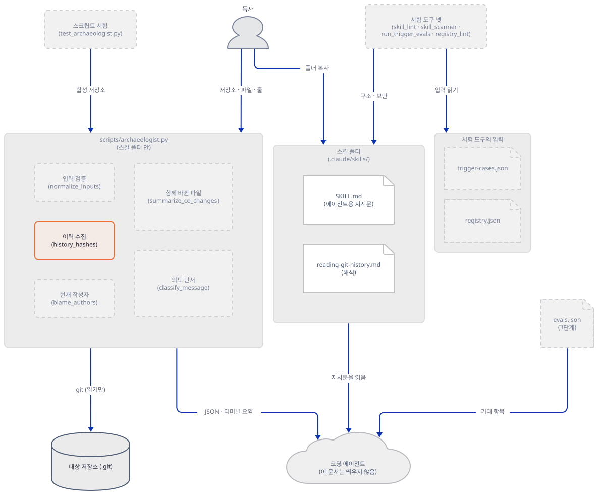

### Step 4. 줄 범위와 현재 작성자 — 처음 넣은 사람과 지금 주인은 다르다

**목적.** 줄 범위 모드가 무엇을 바꾸는지 보고, blame 기반 "현재 작성자"와 타임라인의 "처음 넣은 사람"이 갈리는 경우를 만들어 봅니다.

**할 일.** 출력에서 필요한 키만 골라 보는 작은 도우미를 저장합니다. 스킬 스크립트를 `--json`으로 돌려 이름을 준 키만 인쇄합니다.

`lab156/dig.py`

```python
"""Run the installed skill script with --json and print only the keys you name.

    python dig.py REPO FILE [--lines A-B] KEY [KEY ...]      (KEY may be dotted: region.mode)
"""
import json
import os
import subprocess
import sys

SCRIPT = os.path.join(os.path.dirname(os.path.abspath(__file__)), "project", ".claude", "skills",
                      "commit-archaeologist", "scripts", "archaeologist.py")
args = sys.argv[1:]
keys = [a for a in args[2:] if not a.startswith("--") and not (a[:1].isdigit() and "-" in a)]
passthrough = [a for a in args if a not in keys]
run = subprocess.run([sys.executable, SCRIPT, *passthrough, "--json"], capture_output=True, text=True, encoding="utf-8")
if run.returncode != 0:
    sys.exit(run.stderr.strip())
report = json.loads(run.stdout)
for key in keys:
    value = report
    for part in key.split("."):
        value = value[part]
    print(key, "=", json.dumps(value, indent=1, ensure_ascii=False))
```

현재 파일의 23~24행은 `invalidate` 함수입니다(`cat -n shop/src/pricing_cache.py`로 볼 수 있습니다. 22행은 빈 줄입니다). 이 세 줄만 추적합니다. 비교를 위해 git의 blame 원본도 같은 범위로 봅니다.

```bash
python dig.py shop src/pricing_cache.py --lines 22-24 introduced_by.short_hash introduced_by.author authors
git -C shop blame --line-porcelain -L 22,24 HEAD -- src/pricing_cache.py | grep -E '^(author |[0-9a-f]{40} )'
```

```powershell
python dig.py shop src/pricing_cache.py --lines 22-24 introduced_by.short_hash introduced_by.author authors
git -C shop blame --line-porcelain -L 22,24 HEAD -- src/pricing_cache.py | Select-String '^(author |[0-9a-f]{40} )'
```

**확인.**

```text
introduced_by.short_hash = "1b820cdfc1b8"
introduced_by.author = "Ben Fixture"
authors = [
 {
  "current_lines": 2,
  "email": "ben.fixture@example.test",
  "name": "Ben Fixture",
  "timeline_commits": 1
 },
 {
  "current_lines": 1,
  "email": "ada.fixture@example.test",
  "name": "Ada Fixture",
  "timeline_commits": 1
 }
]
1b820cdfc1b8b82ceca67e284a580de327d8981e 22 22 2
author Ben Fixture
1b820cdfc1b8b82ceca67e284a580de327d8981e 23 23
author Ben Fixture
e53954a64086852d250045435a78eb48349a52eb 24 24 1
author Ada Fixture
```

이 줄들을 처음 넣은 사람은 Ben(`1b820cd`)이지만, 24행(`_entries.pop(key, None)`)은 Ada의 이름 바꾸기 커밋(`e53954a`)이 `_store`를 `_entries`로 고치면서 blame의 주인이 바뀌었습니다. 같은 사람 둘이 `authors`에서 서로 다른 두 숫자로 나뉩니다. `current_lines`는 지금 줄의 blame 수이고, `timeline_commits`는 선택된 타임라인에서 그 사람이 한 커밋 수입니다. 코드는 이 둘을 따로 모읍니다.

`agent_skills/commit-archaeologist/scripts/archaeologist.py:215-237`

```python
def blame_authors(repo, path, line_range):
    args = ["blame", "--line-porcelain"]
    if line_range:
        args.extend(["-L", "%d,%d" % line_range])
    args.extend(["HEAD", "--", path])
    output = git(repo, args, required=False)
    counts = Counter()
    names = {}
    current_name = ""
    current_email = ""
    for line in output.splitlines():
        if line.startswith("author "):
            current_name = line[7:]
        elif line.startswith("author-mail "):
            current_email = line[12:].strip("<>")
        elif line.startswith("\t"):
            if current_email:
                key = current_email.lower()
                counts[key] += 1
                names[key] = (current_name, current_email)
            current_name = ""
            current_email = ""
    return counts, names
```

`blame --line-porcelain`을 `HEAD` 기준으로 돌리고, 줄마다 `author`와 `author-mail`을 읽어 메일 소문자를 열쇠로 셉니다. 사람 구분이 메일이라서 같은 사람이 메일을 둘 쓰면 둘로 나뉩니다(코드로 확인, 합성 저장소로는 시험하지 못했습니다). 이것이 `references/reading-git-history.md`의 확인 목록 4번 "Does current blame hide an older introducing author after a mechanical edit?"가 묻는 상황입니다. 줄 범위의 번호는 지금(HEAD) 줄 번호입니다. 스크립트는 `git show HEAD:<파일>`의 줄 수를 세어 그보다 큰 끝 번호를 거부합니다(97~106행, Step 7).

파일 전체로 돌리면 24줄 가운데 Ada 21줄, Ben 3줄이고 타임라인 커밋은 Ada 3개, Ben 4개입니다(직접 확인). Ben이 커밋의 절반 넘게 했지만 줄은 적게 갖습니다. 어느 쪽 숫자도 "누가 설계했나"의 답이 아니라는 `SKILL.md`의 증거 규칙 "Current blame ownership is not proof of original authorship"이 이 숫자로 보입니다.

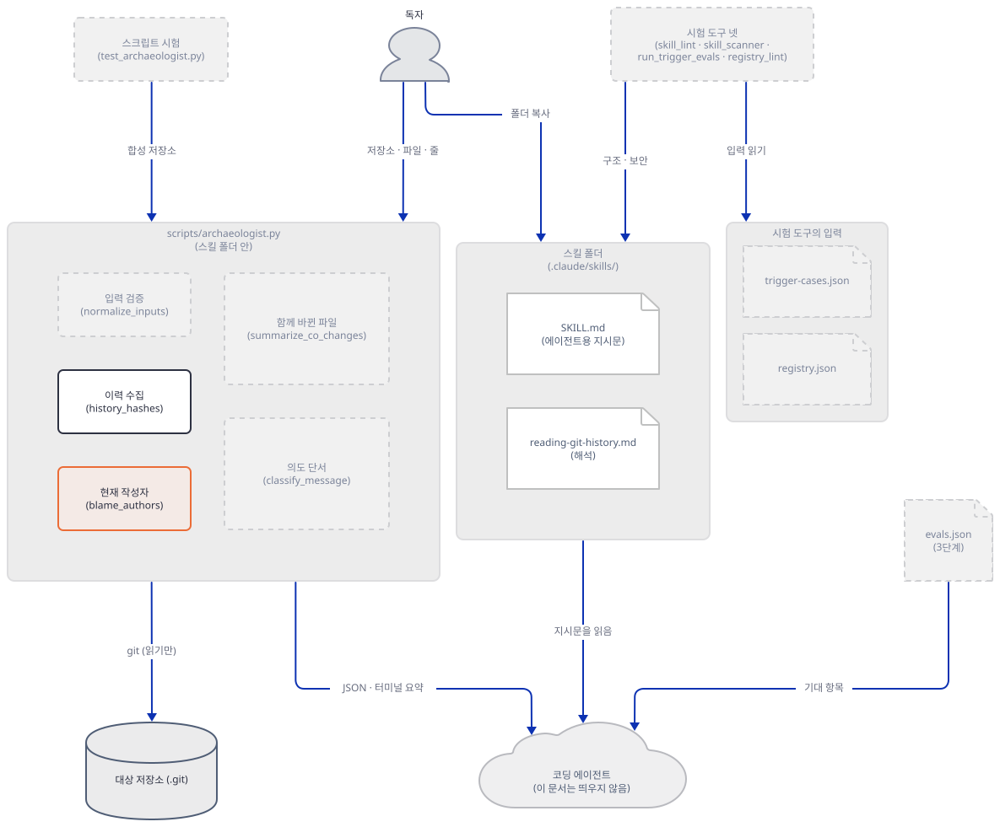

### Step 5. 함께 바뀐 파일 — 문턱은 모드마다 다르다

**목적.** "반복되는 동반 변경"이 어떤 문턱으로 정해지는지 코드에서 읽고, 같은 파일을 파일 모드와 줄 모드로 돌려 결과가 어떻게 달라지는지 봅니다.

**할 일.** 계산은 `summarize_co_changes`에 있습니다.

`agent_skills/commit-archaeologist/scripts/archaeologist.py:265-295`

```python
def historical_paths(path, timeline):
    aliases = {path}
    for entry in reversed(timeline):
        for rename in entry["renames"]:
            if rename["to"] in aliases:
                aliases.add(rename["from"])
    return aliases


def summarize_co_changes(path, timeline):
    threshold = max(2, (len(timeline) + 2) // 3)
    aliases = historical_paths(path, timeline)
    commits_by_file = defaultdict(list)
    for entry in timeline:
        for changed in entry["changed_files"]:
            if changed not in aliases:
                commits_by_file[changed].append(entry["hash"])
    co_changed = []
    for changed, commits in commits_by_file.items():
        if len(commits) >= threshold:
            co_changed.append({
                "file": changed,
                "count": len(commits),
                "commit_ratio": round(len(commits) / len(timeline), 3),
                "commits": commits,
            })
    return (
        threshold,
        sorted(co_changed, key=lambda item: (-item["count"], item["file"])),
        sorted(aliases),
    )
```

문턱은 `max(2, (타임라인 커밋 수 + 2) // 3)`입니다. 대략 커밋의 3분의 1 이상에서 같이 바뀐 파일을 "반복"으로 칩니다. 커밋 수 1~5개에서는 2, 7개에서는 3, 10개에서는 4입니다. 대상 파일 자신의 옛 이름은 `historical_paths`로 빼고 나머지 파일만 셉니다. 이름 바꾸기는 타임라인 안의 커밋이 `diff-tree -M`로 보고한 것만 알 수 있습니다. 파일 모드와 줄 모드를 비교합니다.

```bash
python dig.py shop src/pricing_cache.py region.co_change_threshold region.historical_paths
python dig.py shop src/pricing_cache.py --lines 1-24 region.co_change_threshold region.historical_paths
python $SK shop src/pricing_cache.py --lines 1-24
```

```powershell
python dig.py shop src/pricing_cache.py region.co_change_threshold region.historical_paths
python dig.py shop src/pricing_cache.py --lines 1-24 region.co_change_threshold region.historical_paths
python $SK shop src/pricing_cache.py --lines 1-24
```

**확인.** 앞의 두 명령입니다.

```text
region.co_change_threshold = 3
region.historical_paths = [
 "src/cache.py",
 "src/pricing_cache.py"
]
region.co_change_threshold = 2
region.historical_paths = [
 "src/pricing_cache.py"
]
```

셋째 명령의 출력은 타임라인 여섯 줄(이름 바꾸기 커밋 `75706c7`은 빠짐)과 다음 동반 변경입니다.

```text
REPEATED CO-CHANGES
  6x  src/cache.py
  3x  config/settings.toml
  3x  tests/test_cache.py
  2x  README.md
  2x  src/prices.py
```

세 가지가 보입니다. 첫째, 줄 모드의 타임라인은 6개라서 문턱이 2로 낮아졌습니다. 파일 모드(7개, 문턱 3)에서 숨었던 `README.md`와 `src/prices.py`가 나타났습니다. 이 둘은 첫 커밋과 이름 바꾸기 커밋이 우연히 함께 건드린 파일이라서 `reading-git-history.md`의 "Generated or formatting commits can create meaningless co-change patterns"에 해당합니다. 둘째, `tests/test_cache.py`와 `config/settings.toml`은 두 모드에서 모두 나옵니다. 설정 파일이 TTL 추가, 지역 건너뛰기 추가, 그 되돌림에서 세 번 함께 바뀐 것이 이 이력의 진짜 동반 관계입니다. 셋째, 줄 모드는 맨 위에 `6x src/cache.py`를 적었습니다. 이것은 대상 파일의 옛 이름입니다. 줄 로그에는 내용이 안 바뀐 이름 바꾸기 커밋이 들어오지 않아서 코드가 옛 이름을 모릅니다(`historical_paths`에 현재 이름뿐). 스킬의 2b 시험은 이름 바꾸기 뒤의 "옛 이름은 동반 파일이 아니다"를 파일 모드에서만 시험합니다(`agent_skills/evals/commit-archaeologist/test_archaeologist.py:217-224`). 줄 모드에서 옛 이름처럼 보이는 파일이 비율 1.0으로 맨 위에 있으면 `reading-git-history.md` 확인 목록 5번대로 파일 모드를 같이 돌려 `historical_paths`를 비교합니다.

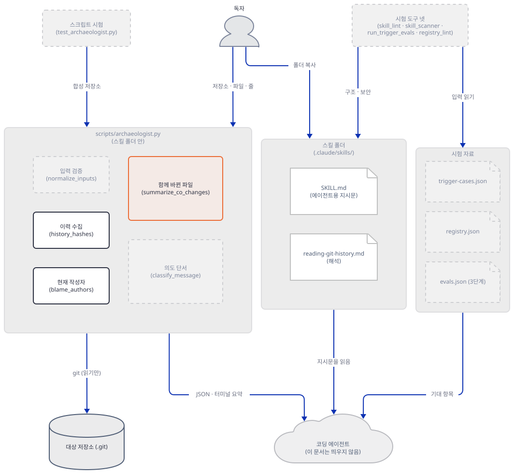

### Step 6. 의도 단서 — 분류는 키워드 판정이다

**목적.** 커밋 분류와 의도 단서가 어떤 낱말 규칙으로 정해지는지 읽고, 규칙의 모서리를 직접 만든 메시지로 확인합니다.

**할 일.** 규칙은 위쪽 상수와 `classify_message`에 있습니다.

`agent_skills/commit-archaeologist/scripts/archaeologist.py:19-26`

```python
LINE_RANGE_RE = re.compile(r"^([1-9][0-9]*)-([1-9][0-9]*)$")
ISSUE_RE = re.compile(r"(?<![\w/])(?:#[0-9]+|(?:pr|issue|gh)[\s:#-]*[0-9]+)", re.I)
INTENT_PATTERNS = (
    ("revert", re.compile(r"\brevert(?:ed|s|ing)?\b", re.I)),
    ("workaround", re.compile(r"\bwork[ -]?around\b", re.I)),
    ("temporary", re.compile(r"\b(?:temporary|temporarily|temp)\b", re.I)),
    ("todo", re.compile(r"\bTODO\b", re.I)),
)
```

`agent_skills/commit-archaeologist/scripts/archaeologist.py:130-145`

```python
def classify_message(subject, body):
    text = "%s\n%s" % (subject, body)
    lowered = text.lower()
    if subject.lower().startswith("merge "):
        return "merge"
    if re.search(r"\brevert(?:ed|s|ing)?\b", lowered):
        return "revert"
    if re.search(r"\bhot[ -]?fix\b", lowered):
        return "hotfix"
    if re.search(r"\b(refactor|cleanup|restructure|rename)\b", lowered):
        return "refactor"
    if re.search(r"\b(fix|fixed|fixes|bug|patch)\b", lowered):
        return "fix"
    if re.search(r"\b(feat|feature|add|added|introduce|implement)\b", lowered):
        return "feat"
    return "other"
```

분류는 제목과 본문을 합친 글에서 위에서 아래로 처음 맞는 규칙입니다. 순서는 `merge`(제목이 "merge "로 시작), `revert`, `hotfix`, `refactor`(cleanup·restructure·rename 포함), `fix`(bug·patch 포함), `feat`(add·implement 포함), 없으면 `other`입니다. 의도 단서는 이슈 참조(`#41`, `issue 34`, `PR 7`, `gh-9`)를 모두 찾고, 되돌림·workaround·temporary(temp 포함)·TODO는 커밋마다 한 번씩만 찾습니다. 예시 메시지를 넣어 보는 작은 스크립트를 저장하고 돌립니다. 영어 규칙이 한글 제목을 어떻게 다루는지 보려고 한글 예시 셋도 넣었습니다. 스킬 스크립트를 파일 경로로 불러와 같은 두 함수를 부를 뿐이고 git은 쓰지 않습니다.

`lab156/probe.py`

```python
"""Print the category and intent signals the skill script gives to example commit messages.

    python probe.py SCRIPT
"""
import importlib.util
import sys

spec = importlib.util.spec_from_file_location("arch", sys.argv[1])
arch = importlib.util.module_from_spec(spec)
spec.loader.exec_module(arch)

EXAMPLES = [
    ("Fix typo in the refactor guide", ""),
    ("Add retry, fix flaky test", ""),
    ("hotfix: patch login", ""),
    ("Merge branch 'main' into feature", ""),
    ("Update cache", "Reverts nothing, but mentions revert in passing"),
    ("Tidy up", ""),
    ("Prefix keys with region", ""),
    ("Bump version", "see PR 7 and gh-9, also issue: 12"),
    ("Use template strings", "template engine, temp dir"),
    ("캐시 만료 시간 추가", ""),
    ("임시 우회: EU 건너뛰기", ""),
    ("Revert 캐시 변경", ""),
]
for subject, body in EXAMPLES:
    signals = [(s["type"], s["evidence"]) for s in arch.intent_signals("h", subject, body)]
    print(repr(subject), "->", arch.classify_message(subject, body), signals)
```

```bash
python probe.py $SK
```

```powershell
python probe.py $SK
```

**확인.**

```text
'Fix typo in the refactor guide' -> refactor []
'Add retry, fix flaky test' -> fix []
'hotfix: patch login' -> hotfix []
"Merge branch 'main' into feature" -> merge []
'Update cache' -> revert [('revert', 'Reverts')]
'Tidy up' -> other []
'Prefix keys with region' -> other []
'Bump version' -> other [('issue_reference', 'PR 7'), ('issue_reference', 'gh-9'), ('issue_reference', 'issue: 12')]
'Use template strings' -> other [('temporary', 'temp')]
'캐시 만료 시간 추가' -> other []
'임시 우회: EU 건너뛰기' -> other []
'Revert 캐시 변경' -> revert [('revert', 'Revert')]
```

모서리가 여섯입니다. 오타를 고치는 커밋이 `refactor`로 분류되고(`fix`보다 `refactor` 규칙이 앞), "Add retry, fix flaky test"는 `feat`가 아니라 `fix`입니다. 본문에 "revert"라는 낱말이 지나가기만 해도 `revert`이고, 본문의 "temp dir"이 `temporary` 단서가 됩니다. 이슈 참조는 `issue: 12`처럼 구두점이 끼어도 잡습니다. 여섯째로, 한글 제목은 "임시 우회"처럼 뜻이 분명해도 규칙(영어 낱말)에 하나도 걸리지 않아 `other`이고 단서가 없습니다. `Revert`처럼 영어 낱말이 섞여야 잡힙니다. Step 3의 이력에서도 같은 일이 보입니다. "temporary workaround ..." 커밋은 분류 낱말이 하나도 없어 `other`이고, 가장 강한 의도 단서가 달린 커밋이 가장 약한 분류를 받은 셈입니다. 또 되돌림 커밋(`b923ca0`)의 제목이 `Revert "temporary workaround: skip cache for EU prices (#41)"`라서 원래 커밋의 `#41`·`workaround`·`temporary`가 그대로 한 번 더 단서로 올라옵니다. 열 개의 단서 가운데 세 개가 되풀이입니다. 이 단서만 세면 임시 우회가 아직 살아 있는 것처럼 읽히지만, 그 커밋은 이미 되돌려졌습니다. `SKILL.md`가 보고서에서 "preserve reverts, fixes, and workarounds"를 요구하고 `reading-git-history.md`가 분류를 "routing hints"라고 부르는 까닭입니다. `SKILL.md`의 규칙 "An empty signal list means the messages do not say why"는 반대쪽을 지킵니다. 단서가 없어도 이유가 없었다는 뜻이 아닙니다. 

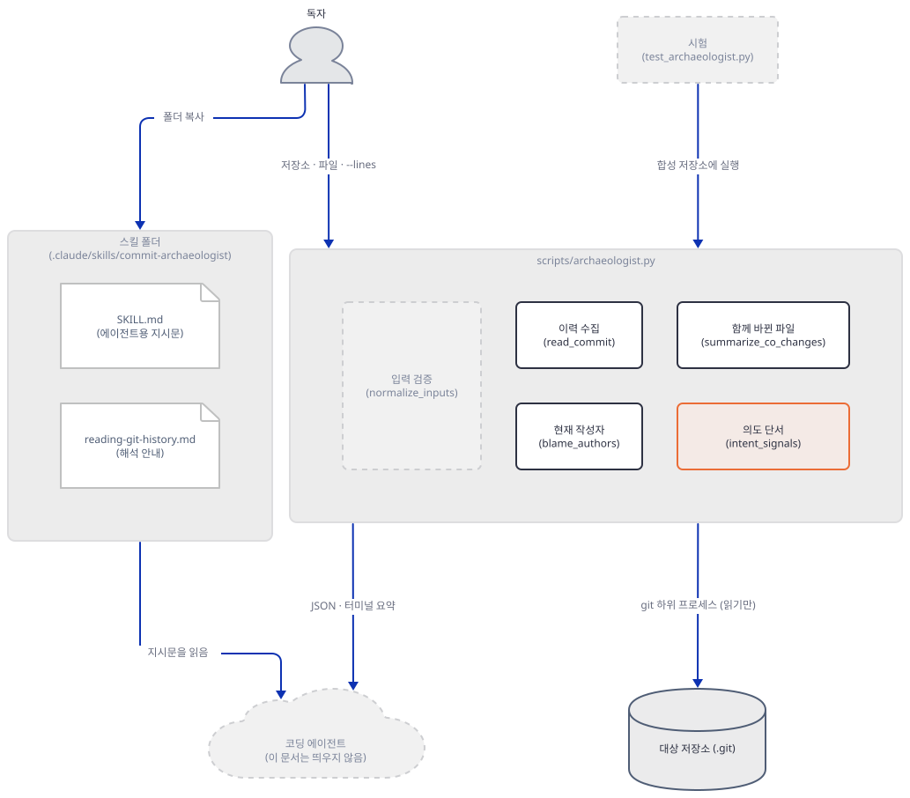

### Step 7. 읽기 전용, 네트워크 없음, 입력 오류 — 그리고 이 저장소의 실제 파일

**목적.** 스킬이 주장하는 "No network calls, API keys, or repository writes"를 소스와 실행으로 확인하고, 잘못된 입력에서 어떻게 멈추는지 보고, 진짜 저장소에 읽기만으로 돌려 봅니다.

**할 일.** git 호출은 한 곳에서만 나옵니다.

`agent_skills/commit-archaeologist/scripts/archaeologist.py:33-55`

```python
def git(repo, args, required=True):
    """Run a read-only git command and return stdout."""
    try:
        result = subprocess.run(
            ["git", "-C", repo, *args],
            capture_output=True,
            text=True,
            # Decode git output as UTF-8. With text=True and no encoding, Python
            # uses the locale default (cp1252 on Windows), which raises
            # UnicodeDecodeError on non-Latin-1 bytes in commit messages or file
            # content (emoji, em-dashes, …).
            encoding="utf-8",
            errors="replace",
            timeout=30,
        )
    except FileNotFoundError as exc:
        raise ArchaeologistError("git is not installed or is not on PATH") from exc
    except subprocess.TimeoutExpired as exc:
        raise ArchaeologistError("git command timed out") from exc
    if result.returncode != 0 and required:
        detail = result.stderr.strip() or result.stdout.strip() or "git command failed"
        raise ArchaeologistError(detail)
    return result.stdout if result.returncode == 0 else ""
```

`subprocess.run`에 인자 목록을 주고 셸은 쓰지 않으며(파일 이름의 공백이나 특수문자가 명령으로 풀리지 않습니다), 30초 제한이 있고, 출력은 UTF-8로 풉니다. 스크립트에는 `socket`·`urllib`·`http`·`requests` 같은 낱말이 없습니다(`grep`으로 확인). 그래도 실제로 어떤 git 명령이 몇 번 돌고 네트워크를 시도하는지는 실행으로 셉니다. 스킬 스크립트를 같은 프로세스 안에서 돌리면서 `subprocess.run`을 감싸 모든 호출을 기록하고, 소켓 연결과 이름 조회를 막아 시도를 세는 도우미입니다. 이 도우미가 보는 것은 파이썬 프로세스가 시작한 일뿐입니다. git 명령의 종류는 인자 기록으로, 네트워크는 파이썬 쪽 시도 횟수로 봅니다.

`lab156/trace_git.py`

```python
"""Run the skill script in-process while recording every git subprocess and every network attempt.

    python trace_git.py SCRIPT REPO FILE [--lines A-B]
"""
import collections
import contextlib
import importlib.util
import io
import socket
import subprocess
import sys

script, *argv = sys.argv[1:]
spec = importlib.util.spec_from_file_location("arch", script)
arch = importlib.util.module_from_spec(spec)
spec.loader.exec_module(arch)

calls, attempts = [], []
real_run = subprocess.run


def traced_run(cmd, *a, **k):
    calls.append(cmd)
    return real_run(cmd, *a, **k)


def refuse(*a, **k):
    attempts.append(a)
    raise OSError("network blocked by trace_git.py")


subprocess.run = traced_run
socket.getaddrinfo = refuse
socket.create_connection = refuse
socket.socket.connect = refuse

with contextlib.redirect_stdout(io.StringIO()):
    code = arch.main(argv)

print("exit code:", code)
print("git processes:", len(calls), "| programs started:", sorted({c[0] for c in calls}))
for verb, n in sorted(collections.Counter(c[3] for c in calls).items()):   # ["git", "-C", repo, VERB, ...]
    print("  %-10s x%d" % (verb, n))
print("network attempts:", len(attempts))
```

저장소의 `.git` 안 모든 파일의 지문을 찍는 도우미도 저장합니다. 지문이 같으면 스크립트 실행이 `.git`을 바꾸지 않았다는 뜻입니다.

`lab156/snapshot.py`

```python
"""Print one fingerprint of every file under REPO/.git plus the count of changed work-tree files."""
import hashlib
import os
import subprocess
import sys

repo = os.path.abspath(sys.argv[1])
digest = hashlib.sha256()
count = 0
for folder, dirs, files in os.walk(os.path.join(repo, ".git")):
    dirs.sort()
    for name in sorted(files):
        path = os.path.join(folder, name)
        digest.update(os.path.relpath(path, repo).encode())
        with open(path, "rb") as handle:
            digest.update(handle.read())
        count += 1
status = subprocess.run(["git", "-C", repo, "status", "--porcelain"], capture_output=True, text=True, env=dict(os.environ, GIT_OPTIONAL_LOCKS="0")).stdout
print("git files:", count, "| fingerprint:", digest.hexdigest()[:16], "| changed work-tree files:", len(status.splitlines()))
```

```bash
python snapshot.py shop
python trace_git.py $SK shop src/pricing_cache.py
python trace_git.py $SK shop src/pricing_cache.py --lines 1-24
python trace_git.py $SK shop docs/notes.md
python snapshot.py shop
```

```powershell
python snapshot.py shop
python trace_git.py $SK shop src/pricing_cache.py
python trace_git.py $SK shop src/pricing_cache.py --lines 1-24
python trace_git.py $SK shop docs/notes.md
python snapshot.py shop
```

**확인.** 지문 줄은 `fingerprint:` 뒤 값이 실행 전후로 같으면 됩니다(값 자체는 이 문서와 다를 수 있습니다. 첫 줄과 마지막 줄이 이 문서에서는 모두 아래 값이었습니다).

```text
git files: 65 | fingerprint: 8a75271ee35e4624 | changed work-tree files: 0
exit code: 0
git processes: 18 | programs started: ['git']
  blame      x1
  diff-tree  x7
  log        x1
  ls-files   x1
  rev-parse  x1
  show       x7
network attempts: 0
exit code: 0
git processes: 17 | programs started: ['git']
  blame      x1
  diff-tree  x6
  log        x1
  ls-files   x1
  rev-parse  x1
  show       x7
network attempts: 0
exit code: 0
git processes: 6 | programs started: ['git']
  blame      x1
  diff-tree  x1
  log        x1
  ls-files   x1
  rev-parse  x1
  show       x1
network attempts: 0
git files: 65 | fingerprint: 8a75271ee35e4624 | changed work-tree files: 0
```

일곱 커밋 파일 모드는 git을 18번 부르고, 그 가운데 `show`와 `diff-tree`가 커밋 수에 맞춰 늘어납니다. 커밋마다 `show -s`(메타데이터)와 `diff-tree`(바뀐 파일)를 한 번씩 부르기 때문입니다(2×7=14). 나머지 넷은 고정입니다. `rev-parse`(저장소 맨 위 찾기), `ls-files`(추적 중인지), `log`, `blame`입니다. 줄 모드는 여기에 `show HEAD:<파일>` 한 번(줄 수 검증)이 더해지고 `diff-tree`는 타임라인 커밋 수(6)만큼입니다. 부르는 명령은 모두 읽기 명령입니다. 이 문서의 시험으로 `.git` 안 65개 파일의 지문이 그대로였고 파이썬 쪽 네트워크 시도는 0이었습니다. 다만 이 확인은 파이썬이 시도하는 연결만 봅니다. git 자신이 네트워크를 쓰는지는 이 문서가 막아 보지 못했고, 쓰는 명령이 위 여섯 가지(저장소 안의 객체와 색인을 읽는 명령)라는 것만 인자로 확인했습니다.

이제 잘못된 입력입니다. 각 명령은 에러 한 줄을 내고 종료 코드 2로 끝납니다. 마지막 `echo $?`는 바로 앞 명령의 종료 코드를 보입니다.

```bash
python $SK shop nope.py
python $SK shop src/cache.py
python $SK shop src/pricing_cache.py --lines 9-3
python $SK shop src/pricing_cache.py --lines 0-3
python $SK shop src/pricing_cache.py --lines 5-99
python $SK shop ../outside.txt
python $SK shop/src pricing_cache.py
python $SK home src/x.py
echo $?
```

```powershell
python $SK shop nope.py
python $SK shop src/cache.py
python $SK shop src/pricing_cache.py --lines 9-3
python $SK shop src/pricing_cache.py --lines 0-3
python $SK shop src/pricing_cache.py --lines 5-99
python $SK shop ../outside.txt
python $SK shop/src pricing_cache.py
python $SK home src/x.py
$LASTEXITCODE
```

```text
error: file is not tracked at HEAD: nope.py
error: file is not tracked at HEAD: src/cache.py
error: line range start must not exceed its end
error: line range must use positive A-B form, such as 40-72
error: line range ends at 99, but src/pricing_cache.py has 24 lines at HEAD
error: file must be inside the repository
error: file is not tracked at HEAD: pricing_cache.py
error: fatal: not a git repository (or any of the parent directories): .git
2
```

네 번째 줄 `src/cache.py`는 합성 저장소의 옛 이름입니다. 이름이 바뀌어 HEAD에는 없으므로 추적 중이 아니라고 거절합니다(옛 이름으로는 물을 수 없습니다). 일곱 번째 줄은 저장소 자리에 하위 폴더를 주면 git이 맨 위를 찾지만 파일 경로는 그 맨 위 기준이라는 것을 보입니다(`shop/src pricing_cache.py`가 아니라 `shop/src src/pricing_cache.py`). 마지막 줄은 저장소가 아닌 폴더에서 git 자신의 메시지가 그대로 나옵니다. `lab156`가 다른 git 저장소 안에 있으면 `home` 대신 그 바깥 저장소가 잡히므로 이 줄의 출력이 다를 수 있습니다. 작업 폴더를 어떤 저장소 안에도 두지 않는 것이 안전합니다. 입력이 잘못되면 JSON을 내지 않고 종료 코드 2로 끝납니다. `SKILL.md`는 에이전트에게 "report that error and ask for a corrected target"이라고 시킵니다.

마지막으로 이 저장소의 실제 파일입니다. 저장소를 읽기만 합니다. 실행 앞뒤로 `git -C "$REPO" status --short`가 같은지 보면 됩니다. 이 PC에서는 `.git` 파일 4,650개의 같은 지문 도우미(`python snapshot.py "$REPO"`, 30초 남짓)도 앞뒤가 같았습니다. 출력의 사람 이름 두 개는 `<작성자 A>`·`<작성자 B>`로 가렸습니다. 첫 명령은 스킬의 스크립트 자신입니다.

```bash
python $SK "$REPO" agent_skills/commit-archaeologist/scripts/archaeologist.py
python $SK "$REPO" docs/tutorials/_tools/theme.d2 --lines 20-52
```

```powershell
python $SK $REPO agent_skills/commit-archaeologist/scripts/archaeologist.py
python $SK $REPO docs/tutorials/_tools/theme.d2 --lines 20-52
```

내 출력의 앞부분입니다(2026-10-19의 clone. 이후의 커밋이 쌓이면 다를 수 있고, 얕은 clone이면 이력이 짧습니다).

```text
COMMIT ARCHAEOLOGIST: agent_skills/commit-archaeologist/scripts/archaeologist.py
Introduced by 76b63f64f044 <작성자 A>: Add commit-archaeologist skill: reconstruct the why behind code from git history (#974)

TIMELINE
  76b63f64f044  fix       Add commit-archaeologist skill: reconstruct the why behind code from git history (#974)
  0c499421ea48  fix       fix(agent_skills): decode git subprocess output as UTF-8 (Windows cp1252 crash)

REPEATED CO-CHANGES
  none above threshold

INTENT SIGNALS
  76b63f64f044  issue_reference  #974
COMMIT ARCHAEOLOGIST: docs/tutorials/_tools/theme.d2:20-52
Introduced by 14b2c8fb52f1 <작성자 B>: docs(tutorials): add D2 tooling package, theme and render library

TIMELINE
  14b2c8fb52f1  feat      docs(tutorials): add D2 tooling package, theme and render library
  1d692a588cfd  other     docs(tutorials): give the diagrams a real Korean font and an editorial skin
  2eeafcecb41e  other     docs(tutorials): stop grouping boxes from claiming to be our code

REPEATED CO-CHANGES
  2x  docs/tutorials/_tools/lib/d2.mjs
  2x  docs/tutorials/day001-xai-finance-agent/diagrams/overview.svg
  (이하 같은 모양 156줄)

INTENT SIGNALS
  2eeafcecb41e  todo  todo
```

첫 파일은 사실 이 스킬의 스크립트입니다. 첫 커밋의 제목에는 `fix`가 없지만 `fix`로 분류됐습니다. 스쿼시 병합이 안에 있던 모든 커밋 메시지를 본문에 모아 놓았고(그 안에 `fix(commit-archaeologist): ...`가 있습니다) 분류가 본문까지 보기 때문입니다. 이 본문에는 병합 공동 작성자의 이름과 메일 한 쌍도 `Co-authored-by:`로 들어 있어서 JSON의 `body` 키로 나갑니다. 둘째 줄의 동반 변경은 158개인데 하나가 `lib/d2.mjs`이고 157개가 앞 날들의 `diagrams/*.svg`입니다. 두 번째·세 번째 커밋이 모든 그림을 다시 렌더해서 생긴 것이고, `reading-git-history.md`가 경고한 "Generated or formatting commits" 그대로입니다. 문턱(커밋 3개에 2)이 낮아서 모두 통과했습니다. 에이전트가 이 목록을 그대로 "결합 관계"로 쓰면 틀립니다. `SKILL.md`가 "Do not treat a one-off file in `changed_files` as a dependency"와 "Repeated co-change suggests coupling; it does not prove a dependency"를 따로 적은 이유입니다.

개인정보 쪽으로 한 가지 더 있습니다. 저장소 README는 "Local and private by default. No network calls unless declared. Nothing leaves your machine."이라고 적습니다. 스크립트에 대해서는 위 실행이 맞다고 보여 줍니다. 그런데 JSON에는 작성자 이름과 메일(`authors`, 커밋마다 `author`·`email`), 커밋 본문 전체(`body`), 저장소의 절대 경로(`region.repo`)가 들어 있습니다.

```bash
python dig.py shop src/pricing_cache.py region.repo introduced_by.email
```

```powershell
python dig.py shop src/pricing_cache.py region.repo introduced_by.email
```

```text
region.repo = "/…/lab156/shop"
introduced_by.email = "ada.fixture@example.test"
```

(첫 줄의 경로는 가렸습니다. Windows에서는 `C:\\Users\\...`처럼 사용자 이름이 든 경로가 그대로 나옵니다.) 이 JSON을 에이전트가 읽으면 그 내용은 에이전트가 쓰는 모델과의 대화에 들어갑니다. Claude Code 문서는 스크립트의 "Only the script's output enters the conversation"이라고 적습니다. 모델 제공자로 무엇이 얼마나 가는지는 쓰는 에이전트의 설정에 달려 있고 이 문서는 확인하지 못했습니다. 스크립트가 아무것도 내보내지 않는다는 것과, 스크립트의 출력이 어디까지 가는지는 다른 질문입니다.

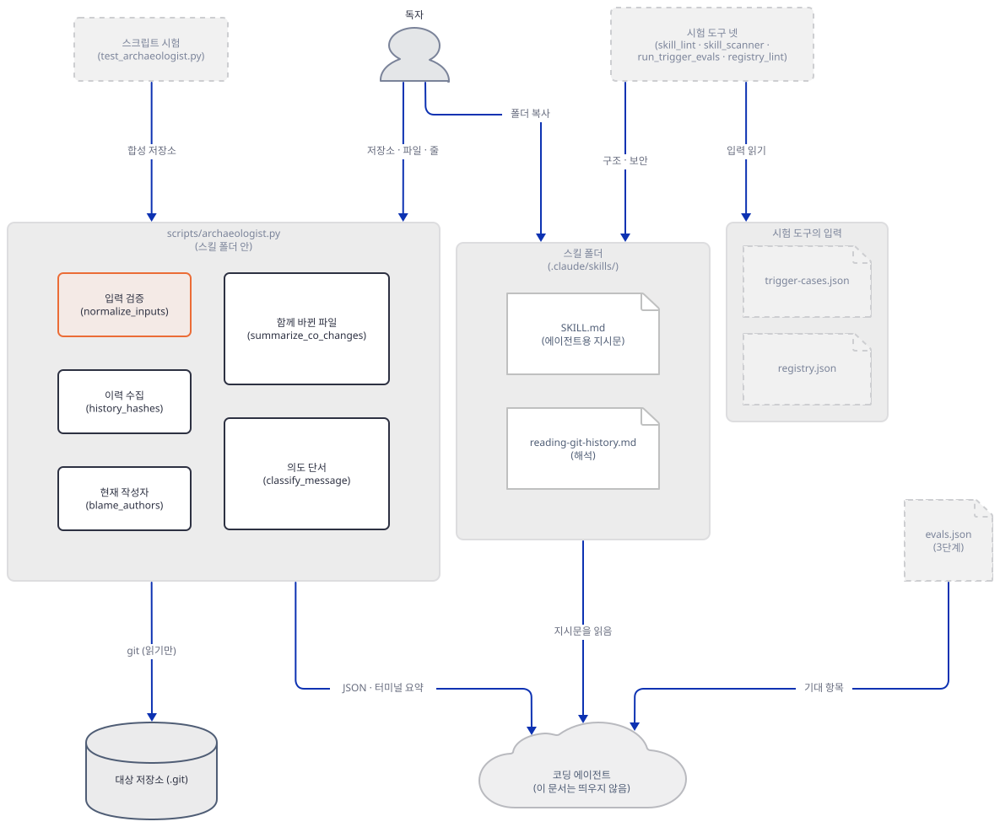

### Step 8. 결정적 시험 넷과 행동 시험 읽기

**목적.** 저장소가 스킬에 대해 돌리는 구조·보안·트리거·레지스트리·스크립트 시험을 직접 돌려 출력을 읽고, 그 시험이 보지 못하는 것을 구분합니다. 행동 시험(3단계)은 모델을 부르므로 돌리지 않고 읽기만 합니다.

**할 일.** 시험 도구는 저장소 안 파일을 읽으므로 저장소 맨 위에서 돌립니다. 레지스트리 검사는 현재 폴더를 저장소 맨 위로 보므로 반드시 그 자리에서 돌려야 합니다(다른 폴더에서 돌리면 "no SKILL.md files found"로 실패합니다). 앞 Step의 변수 블록이 `PYTHONDONTWRITEBYTECODE=1`을 걸어 저장소 안에 `__pycache__`가 생기지 않게 합니다.

```bash
cd "$REPO"
python agent_skills/evals/tools/skill_lint.py agent_skills/commit-archaeologist --strict
python agent_skills/evals/tools/skill_scanner.py agent_skills/commit-archaeologist
python agent_skills/evals/tools/run_trigger_evals.py
python agent_skills/evals/tools/registry_lint.py
python agent_skills/evals/commit-archaeologist/test_archaeologist.py
cd -
```

```powershell
Set-Location $REPO
python agent_skills/evals/tools/skill_lint.py agent_skills/commit-archaeologist --strict
python agent_skills/evals/tools/skill_scanner.py agent_skills/commit-archaeologist
python agent_skills/evals/tools/run_trigger_evals.py
python agent_skills/evals/tools/registry_lint.py
python agent_skills/evals/commit-archaeologist/test_archaeologist.py
Set-Location $LAB
```

**확인.** 이 스킬의 부분입니다(트리거 시험은 저장소의 모든 스킬을 한꺼번에 돌려 줄이 여럿이고, 아래는 이 스킬의 줄입니다).

```text
Linting .../agent_skills/commit-archaeologist (strict=on)
  PASS — 0 error(s), 0 warning(s)
=== commit-archaeologist (.../agent_skills/commit-archaeologist) ===
  clean — no findings

Summary: 0 CRITICAL, 0 WARN, 0 INFO
PASS  commit-archaeologist: 3 positives clear 3 near-misses (weakest 1.73 vs strongest 0.89)
Checking registry at ... (mode=check)
  PASS — 0 error(s), 0 warning(s)
PASS - 18/18 checks
```

(2b 시험은 위 줄 앞에 확인 18개의 `PASS` 줄을 출력합니다.) Windows에서는 2b 시험이 끝나도 `commit-archaeologist-eval-…`라는 임시 폴더가 `TEMP` 아래에 남습니다. 시험은 끝에 `shutil.rmtree(root, ignore_errors=True)`로 지우는데(`agent_skills/evals/commit-archaeologist/test_archaeologist.py:243`) git이 만든 객체 파일이 읽기 전용이라 지워지지 않고 오류가 조용히 무시됩니다. 두 번 돌려 두 폴더가 남는 것을 직접 확인했습니다. 변수 블록이 `TEMP`를 `lab156/tmp`로 돌려 놓았으므로 거기에만 남고, 실습이 끝나면 `lab156` 폴더째 지우면 됩니다. 이 시험이 이 PC의 진짜 임시 폴더를 어지럽히지 않게 하려면 `TEMP`를 돌린 셸에서 돌려야 합니다. 이 시험들이 무엇을 보는지 정리합니다.

| 단계 | 도구 | 보는 것 | 한계 |
|---|---|---|---|
| 1 구조 | `skill_lint.py --strict` | 명세 필드 규칙, 이름과 폴더 일치, 본문 길이(400줄부터 경고, 500줄 이상은 `--strict`에서 오류), 본문이 가리키는 상대 경로의 존재 | 지시문이 쓸모 있는지는 모름 |
| 1b 보안 | `skill_scanner.py` | 설치 유인 문구, 원격 스크립트 파이프, 인증 정보 파일 읽기, 코드에 감춘 페이로드, 스크립트의 네트워크 낱말(선언 없으면 경고) | 패턴만 봄. 이 도구 자신이 "natural-language attacks evade pattern scanners"라고 적음. `SKILL.md`를 끝까지 읽어야 함 |
| 2 트리거 | `run_trigger_evals.py` | `trigger-cases.json`의 양성 문장이 설명(description)과 낱말이 겹치는 정도가 음성보다 1.15배 넘게 높은가 | 의미가 아니라 낱말 겹침 |
| 레지스트리 | `registry_lint.py` (기본 `--check`) | `registry.json`이 각 `SKILL.md`의 frontmatter에서 다시 만든 것과 같은가, 스킬이 README 목록 둘에 다 있는가 | 설치 명령이 실제로 동작하는지는 모름. `--write`는 `registry.json`을 다시 쓰므로 이 문서는 쓰지 않았습니다 |
| 2b 스크립트 | `test_archaeologist.py` | 임시 저장소를 만들어 정렬·동반 변경·작성자·단서·결정성·오류 확인 18개 | 아래 |

트리거 시험을 직접 만져 봅니다. 시험이 쓰는 두 함수를 불러 같은 방식으로 점수를 매기는 도우미입니다.

`lab156/try_prompts.py`

```python
"""Score prompts against a skill description the way run_trigger_evals.py does.

    python try_prompts.py REPO_ROOT "prompt one" "prompt two" ...
"""
import importlib.util
import sys

root = sys.argv[1]
spec = importlib.util.spec_from_file_location("trig", root + "/agent_skills/evals/tools/run_trigger_evals.py")
trig = importlib.util.module_from_spec(spec)
spec.loader.exec_module(trig)

description = trig.tokens(trig.description_of(root + "/agent_skills/commit-archaeologist"))
for prompt in sys.argv[2:]:
    words = trig.tokens(prompt)
    print("%.2f  %-46s shared=%s" % (trig.score(words, description), prompt, sorted(words & description)))
```

```bash
python try_prompts.py "$REPO" "why does this code exist" "who wrote this function and why" "explain the history of this function" "run git blame on src/parser.py" "delete this file's history" "squash my commits" "what is the story behind this retry loop" "rewrite history to remove a secret"
```

```powershell
python try_prompts.py $REPO "why does this code exist" "who wrote this function and why" "explain the history of this function" "run git blame on src/parser.py" "delete this file's history" "squash my commits" "what is the story behind this retry loop" "rewrite history to remove a secret"
```

```text
1.73  why does this code exist                       shared=['code', 'exist', 'why']
2.00  who wrote this function and why                shared=['function', 'who', 'why', 'wrote']
1.73  explain the history of this function           shared=['explain', 'function', 'history']
0.89  run git blame on src/parser.py                 shared=['git', 'run']
0.58  delete this file's history                     shared=['history']
0.71  squash my commits                              shared=['commit']
0.00  what is the story behind this retry loop       shared=[]
1.00  rewrite history to remove a secret             shared=['history', 'rewrite']
```

앞 세 줄이 `trigger-cases.json`의 양성(`should_trigger: true`), 다음 세 줄이 음성입니다. 음성 "run git blame on src/parser.py"의 점수 0.89는 `git`과 `run`이 설명에 있어서 나옵니다. "Runs entirely locally"의 `run`입니다. 그 아래 두 줄은 제가 더한 문장입니다. 뜻이 같은 질문 "what is the story behind this retry loop"는 겹치는 낱말이 없어 0점이고, 이력을 지우려는 "rewrite history to remove a secret"는 설명의 "rewrite"와 "history"를 우연히 겹쳐 1.00으로 `explain the history ...`(1.73) 아래이긴 하지만 "run git blame"(0.89)보다 높습니다. 이 시험은 설명을 고치다 낱말이 빠지는 사고를 잡는 안전망이지, 에이전트가 실제로 이 스킬을 고를지의 예측이 아닙니다.

2b 시험이 안 보는 것은 이 문서가 앞 Step에서 본 것들입니다. 시험 저장소의 작성자는 한 명(`archaeologist-eval@example.com`)뿐이라서 "처음 넣은 사람과 지금의 주인이 갈리는" 경우(Step 4)가 없습니다. 이름 바꾸기 시험은 파일 모드뿐이라 줄 모드의 옛 이름(Step 5)이 없습니다. 되돌림 커밋의 단서 되풀이(Step 6)도 없습니다. 이 틈들을 시험에 더하는 것이 아래 "더 해보기"의 과제입니다.

3단계 행동 시험 `agent_skills/evals/commit-archaeologist/evals.json`(38줄)은 모델을 부르는 시험이라 돌리지 않았습니다. 읽어 보면 질문 셋에 기대 항목(`expectations[]`)이 5·4·3개 있고, 모두 에이전트가 한 일을 사람이나 채점 모델이 판정하는 문장입니다. 예를 들면 "The agent runs scripts/archaeologist.py with the user-provided repository, file, line range, and --json", "Current blame ownership and timeline authors are not treated as the same fact", "The agent requests missing path information instead of scanning unrelated repositories"입니다. 스크립트가 아니라 에이전트의 행동을 보므로 이 문서의 Step 4·5가 보인 함정을 에이전트가 피하는지는 이 단계에서만 시험할 수 있습니다. 그 결과는 이 문서에 없습니다.

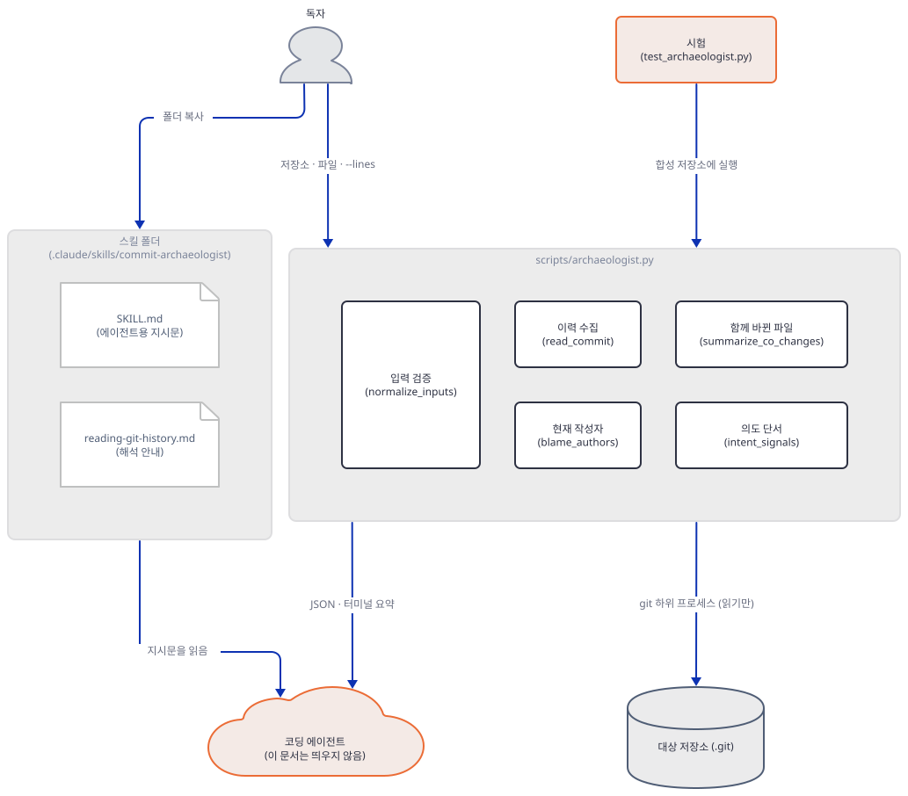

## 요청 한 건이 흐르는 과정

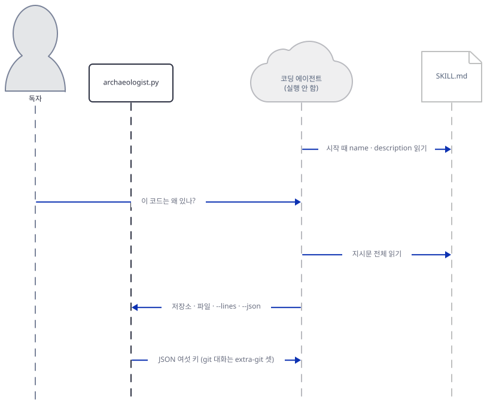

사용자가 에이전트에게 "이 코드는 왜 있나?"를 묻습니다. 에이전트는 시작할 때 읽어 둔 설명을 보고 이 스킬이 맞다고 판단해 `SKILL.md` 전체를 읽습니다(소스로 읽은 흐름이고 이 문서는 에이전트를 띄우지 않았습니다). 지시문은 대상(저장소와 파일, 줄 범위)을 모으고, 하나라도 빠졌으면 빠진 값만 묻고 형제 저장소를 훑지 말라고 시킵니다. 그다음 `python3 scripts/archaeologist.py /path/to/repo src/cache.py --lines 40-72 --json`을 돌리게 하고, 결과 JSON을 해석하기 전에 `references/reading-git-history.md`를 읽게 합니다. 스크립트가 git과 나누는 대화는 아래 그림에 따로 있습니다.

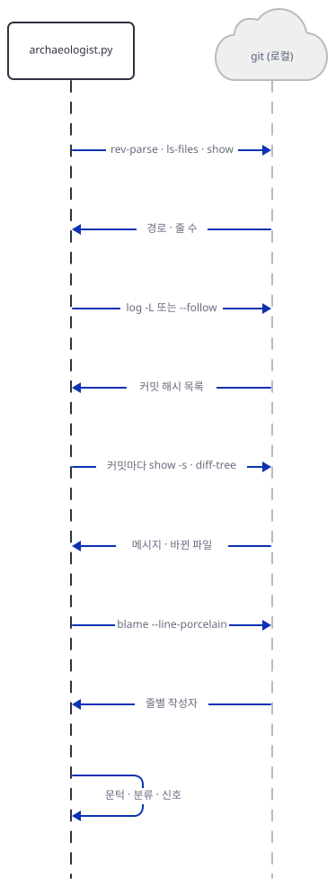

스크립트는 `rev-parse`로 저장소 맨 위를 찾고 `ls-files`로 추적 중인지 보고, 줄 범위면 `show HEAD:<파일>`로 줄 수를 확인합니다. `log`로 해시 목록을 받아 커밋마다 `show -s`와 `diff-tree`를 부르고, `blame`으로 현재 작성자를 셉니다. 마지막으로 문턱·분류·단서 계산은 파이썬 안에서 합니다. 에이전트는 JSON을 받아 해석 규칙을 읽고 보고서를 씁니다.

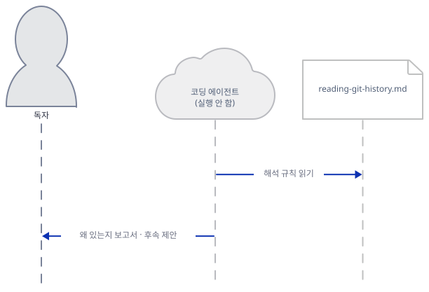

`SKILL.md`는 보고서를 여섯 부분(결론과 신뢰도, 도입, 타임라인, 동반 파일, 의도 근거, 변경 위험)으로 쓰고 후속 제안 하나로 끝내라고 합니다. 아래는 Step 3의 파일 모드 결과로 제가 손으로 쓴 견본이고, 모델의 출력이 아닙니다. 이 형식을 지키면 이런 모양이어야 한다는 예입니다.

> **결론.** 이 가격 캐시는 요청마다 가격을 다시 조회하지 않으려고 들어왔고(`a758aca`, 메모 `docs/notes.md`가 "Prices are looked up on every request"), 이후 만료 시간(`204ccae`)과 환불 뒤 낡은 가격을 지우는 `invalidate`(`1b820cd`, 제목 "stale price after refund")가 붙었습니다. 신뢰도는 중간입니다. 제목들이 무엇을 했는지는 말하지만 캐시를 둔 이유를 직접 적은 메시지는 없습니다.
>
> **도입.** `a758aca`(2026-01-05, Ada Fixture) "feat: add in-memory price cache"가 `src/cache.py`와 `src/prices.py`, 테스트, 메모를 함께 넣었습니다.
>
> **타임라인.** 만료 시간 추가(`204ccae`) → 환불 뒤 낡은 가격 수정(`1b820cd`, issue 34) → EU 가격 캐시 건너뛰기라는 임시 우회(`f56d3c9`, #41, "TODO: remove once the currency API returns EU prices reliably") → 그 우회의 되돌림(`b923ca0`) → `_store`를 `_entries`로 바꾼 이름 정리(`e53954a`, 기계적 편집) → 파일 이름 변경(`75706c7`).
>
> **동반 파일.** `tests/test_cache.py`(4번)와 `config/settings.toml`(3번)이 자주 함께 바뀌었습니다. 같이 바뀐 것이 의존이라는 증거는 아니고, 만료 시간과 지역 설정이 설정 파일에 있다는 단서입니다.
>
> **의도 근거.** 제목 "temporary workaround: skip cache for EU prices (#41)"와 본문 "TODO: remove once the currency API returns EU prices reliably"가 직접 증거이고, 되돌림 커밋(`b923ca0`)이 그 우회가 끝났다고 말합니다. 우회가 아직 살아 있다고 읽을 근거는 없습니다. 되돌림 제목에도 "workaround"와 "temporary"가 있어서 단서 목록에는 되풀이로 나타납니다. 환불 수정이 어떤 사고에서 나왔는지는 issue 34 본문을 봐야 알 수 있어서 추론으로 남깁니다.
>
> **변경 위험.** 환불 뒤에는 `invalidate`가 호출되어야 한다는 제약(테스트와 함께 바뀜), 만료 시간(설정 파일과 함께 바뀜), 한 번 되돌려진 EU 우회를 다시 넣으려는 변경이 위험입니다. `invalidate`의 마지막 줄은 이름 정리 커밋 때문에 blame이 Ada를 가리키지만 그 줄을 처음 넣은 사람은 Ben입니다.
>
> 이 변경이 의도적이었는지 평가해 드릴까요, 아니면 이 영역을 바꾸면 무엇이 깨질지 지도를 그려 드릴까요?

## 실행 체크리스트

- [ ] 작업 폴더 `lab156`를 어떤 git 저장소 안에도 두지 않고, 변수 블록으로 홈과 임시 폴더를 작업 폴더 안으로 돌렸다
- [ ] 스킬 폴더를 `project/.claude/skills/`로 복사했고 파일이 네 개(676줄)이며 `evals/`가 없다. 진짜 `~/.claude/skills`에는 아무것도 넣지 않았다
- [ ] `python make_shop.py shop`의 로그 첫 줄이 `75706c7`이고 일곱 줄이다
- [ ] 파일 모드 출력의 도입 커밋이 `a758aca…`이고 동반 변경이 `tests/test_cache.py`(4번), `config/settings.toml`(3번)이다
- [ ] `--lines 22-24`에서 `introduced_by`는 Ben이고 `authors`에 Ben 2줄, Ada 1줄이 나온다
- [ ] 줄 모드(`--lines 1-24`)의 문턱이 2이고 동반 변경 맨 위에 옛 이름 `src/cache.py`가 보인다
- [ ] `probe.py`의 열두 줄이 위와 같고, 되돌림 커밋의 단서 열 개 가운데 세 개가 원래 커밋의 것임을 확인했다
- [ ] 스크립트 실행 전후 `snapshot.py`의 지문이 같고 `trace_git.py`의 네트워크 시도가 0이다
- [ ] 잘못된 입력 여덟 가지가 모두 `error: ...` 한 줄과 종료 코드 2로 끝난다
- [ ] 저장소 맨 위에서 시험 다섯 개(`skill_lint`·`skill_scanner`·`run_trigger_evals`·`registry_lint`·`test_archaeologist`)가 모두 통과한다
- [ ] 이 문서가 에이전트를 띄우지 않았고 `npx skills add`와 진짜 홈 쪽 설치를 실행하지 않았음을 기억한다

## 문제 해결

| 증상 | 원인 | 해결 |
|---|---|---|
| `run_trigger_evals.py`가 `UnicodeDecodeError: 'cp949' codec can't decode byte 0xe2 in position 7280`으로 멈춥니다 | 한국어 Windows에서 이 도구가 `SKILL.md`를 인코딩 지정 없이(`open(...).read()`) 열어 cp949로 읽습니다. 저장소의 어떤 스킬 문서에 UTF-8 문자가 있습니다(직접 겪음, 위치 7280은 한 스킬의 `SKILL.md`) | 변수 블록의 `PYTHONUTF8=1`을 켠 셸에서 돌립니다 |
| `error: file is not tracked at HEAD: src/cache.py` | 파일 이름이 바뀐 저장소에서 옛 이름을 줬습니다. HEAD에 그 이름이 없습니다 | 지금 이름(`src/pricing_cache.py`)을 줍니다. 옛 이름의 이력은 `--follow`가 따라갑니다 |
| `error: file is not tracked at HEAD: pricing_cache.py` | 저장소 자리에 하위 폴더(`shop/src`)를 줬는데 파일 경로를 그 폴더 기준으로 썼습니다. 파일 경로는 저장소 맨 위 기준입니다 | `python $SK shop/src src/pricing_cache.py`처럼 맨 위 기준 경로를 줍니다 |
| `error: line range ends at 99, but src/pricing_cache.py has 24 lines at HEAD` | 줄 범위는 현재(HEAD) 줄 번호이고 끝 번호가 줄 수보다 큽니다 | `cat -n`으로 지금 줄 번호를 보고 다시 줍니다 |
| 줄 모드 동반 변경 맨 위에 옛 파일 이름이 `비율 1.0`으로 나옵니다 | 줄 로그에 내용이 안 바뀐 이름 바꾸기 커밋이 들어오지 않아 옛 이름을 모릅니다 | 파일 모드를 같이 돌려 `region.historical_paths`를 비교하고, 목록에서 그 이름을 빼고 읽습니다 |
| `error: fatal: not a git repository (or any of the parent directories): .git` | 저장소가 아닌 폴더를 줬습니다. 작업 폴더가 다른 저장소 안이면 그 바깥 저장소가 잡힐 수 있습니다 | 저장소 경로를 확인하고 작업 폴더를 저장소 밖에 둡니다 |
| 2b 시험이 끝났는데 `TEMP` 아래에 `commit-archaeologist-eval-…` 폴더가 남습니다 | Windows에서 읽기 전용 git 객체 파일을 `rmtree(ignore_errors=True)`가 지우지 못합니다(직접 확인) | `TEMP`를 작업 폴더로 돌린 셸에서 돌리고, 실습 뒤 `lab156`를 지웁니다 |
| `registry_lint.py`가 `no SKILL.md files found under agent_skills/*/SKILL.md`로 실패합니다 | 이 도구는 현재 폴더를 저장소 맨 위로 봅니다 | `cd "$REPO"` 한 뒤 돌립니다 |

## 더 해보기

- 합성 저장소에 두 번째 이름 바꾸기와 줄 내용 수정을 한 커밋으로 더해 줄 로그가 이름 바꾸기를 타임라인에 싣게 만들어 보세요. `historical_paths`가 채워지는 순간과 옛 이름이 동반 파일에서 사라지는 것을 확인하고, 이 틈을 잡는 시험 한 개를 `agent_skills/evals/commit-archaeologist/test_archaeologist.py`를 본떠 스크래치에 써 보세요.
- `probe.py`의 예시에 팀의 실제 커밋 메시지 습관(예: `chore:`, `WIP`, 한글 제목)을 넣어 `classify_message`가 어떻게 가르는지 보세요. 한글 제목이 모두 `other`가 되는 것(Step 6에서 직접 확인)이 한국어로 커밋 메시지를 쓰는 저장소에서 보고서에 무엇을 뜻하는지 정리하고, 어떤 낱말을 더하면 나아질지 스크래치 사본에서 고쳐 보세요.
- 합성 저장소에 파일을 건드리는 커밋을 100개 더하고 `trace_git.py`를 다시 돌려, git 호출 수가 파일 모드에서 `4 + 2n`(n은 타임라인 커밋 수)으로 늘어나는지 확인하세요. Step 7의 18개는 n=7일 때 4+14입니다. 스크립트의 `timeout=30`은 git 호출 하나마다의 제한이고, 이력이 아주 긴 파일의 `log -L` 한 호출이 얼마나 걸리는지는 이 문서가 재 보지 않았습니다.

## 다음 날 예고

[Day 157 · 🩺 Dependency Doctor](../day157-dependency-doctor/README.md) — 같은 볼륨의 다음 스킬로, 이번에는 git이 아니라 `requirements.txt`·`pyproject.toml`·`package.json` 같은 의존성 목록을 읽습니다. 표준 라이브러리를 가리는 핀, 낡은 백포트, 버전을 안 정한 항목, 목록 안의 충돌을 찾는 스크립트(`dep_doctor.py`, 485줄)가 들어 있고, 기본으로는 오프라인이며 켜면 PyPI에 조회하는 옵션이 있다고 설명합니다. 오늘처럼 스크립트를 직접 돌려 보되 PyPI 조회는 가짜 주소로 돌려 닿지 않게 합니다.
