# Day 157 · 🩺 Dependency Doctor

> 볼륨 16 🧩 Agent Skills · 난이도 ★☆☆(스크립트는 표준 라이브러리만 쓰고 키가 필요 없지만, 이 문서는 설치·시험·가짜 PyPI까지 여덟 걸음을 거칩니다) · 예상 소요 140분(매니페스트 열 개와 스크립트 다섯을 저장하고 파이썬 세 판으로 돌려 비교하며 소스를 읽는 시간이 듭니다) · API 비용 대략 0원(모델을 부르지 않았고 PyPI에도 한 번도 요청하지 않았습니다) · 원본 앱: `agent_skills/dependency-doctor`

## 오늘 만들 것

의존성 매니페스트(`requirements.txt`, `pyproject.toml`, `package.json`) 하나를 읽고 "겉으로 보이는 직접 의존성의 함정"을 찾아 주는 코딩 에이전트용 스킬을 설치하고, 그 스크립트가 무엇을 어떻게 판정하는지 합성 매니페스트로 하나씩 확인합니다. 원본은 `SKILL.md`(151줄), 진단 스크립트 `scripts/dep_doctor.py`(485줄), 참고 문서 `references/dependency-pitfalls.md`(74줄), 사람이 읽는 `README.md`(56줄)이고, 시험은 `agent_skills/evals/dependency-doctor/`에 따로 있습니다. 볼륨 15의 Day 152~153은 모델의 가중치 일부를 학습했고, 볼륨 16은 앱이 아니라 에이전트에게 주는 지시 묶음입니다. 스킬이 무엇이고 어떻게 설치되는지, 시험 단계가 무엇인지는 [Day 154](../day154-advisor-orchestrator-worker/README.md)가 자세히 다루니(Step 2에서 머리말을 명세에 대조하고 Step 5에서 스크래치 프로젝트에 설치합니다), 오늘은 [agentskills.io 명세](https://agentskills.io/specification)와 Anthropic의 Agent Skills 문서에서 읽은 것 가운데 이 스킬에 닿는 것만 짧게 씁니다. 오늘의 중심은 스크립트입니다. 검사 항목은 다섯입니다. 표준 라이브러리 가리기, 낡은 백포트, 고정 없음, 중복, 고정 버전끼리의 충돌입니다.

이 문서는 코딩 에이전트(Claude Code 등)를 띄우지 않았고, 진짜 `~/.claude/skills`나 다른 에이전트 설정 폴더에 아무것도 넣지 않았으며, `npx skills add`도 실행하지 않았고, 모델을 부르는 3단계 시험도 돌리지 않았습니다. 에이전트가 스킬을 불러 쓰는 장면은 `SKILL.md`를 읽은 것이고, 스크립트와 1~2b단계 시험만 직접 돌렸습니다. 스크립트는 스크래치 폴더의 합성 매니페스트와, 읽기만 한 이 시리즈 앱들의 `requirements.txt`에 돌렸습니다. PyPI에는 한 번도 요청하지 않았습니다. `--online` 길은 `urlopen`을 루프백의 가짜 서버로 돌리는 래퍼로만 돌렸습니다(Step 7). 직접 돌리거나 소스로 확인한 것이 열둘입니다.

1. 스킬을 프로젝트의 `.claude/skills/dependency-doctor`로 복사하면 파일 넷이 따라오고 시험 폴더는 따라오지 않습니다(Step 1).
2. 머리말은 명세의 필드 다섯과 한계 안에 있고(`description` 583자, `compatibility` 116자), 구조 시험은 오류 0·경고 0, 보안 시험은 심각·경고 0에 정보 5건(전부 PyPI 조회 줄)입니다(Step 1, 2).
3. 트리거 시험은 모델을 쓰지 않는 낱말 겹침 점수입니다. 가장 약한 양성 1.50이 가장 센 음성 1.15의 1.15배(1.32)를 넘어 통과합니다(Step 2).
4. 표준 라이브러리 가리기는 스크립트를 돌린 파이썬의 `sys.stdlib_module_names`로 판정해서, 같은 매니페스트가 파이썬 3.11에서는 높음 5건이고 3.13·3.14에서는 1건입니다(Step 3).
5. `python_version` 표지도 돌린 파이썬으로 판정해서, 같은 줄이 3.13에서는 2건이고 3.14에서는 0건입니다(Step 3).
6. 서로 겹치지 않는 범위(`flask<2`와 `flask>=3`)나 범위와 정확한 고정(`click>=8,<9`와 `click==7.1.2`)은 충돌이 아니라 중복으로 나옵니다(Step 4).
7. UTF-8 BOM이 붙은 파일은 첫 줄이 조용히 사라지고, UTF-16 파일은 종료 코드 2로 멈춥니다(Step 4). 보고서가 있어도 종료 코드는 언제나 0이라 CI 관문으로 쓸 수 없습니다.
8. `pyproject.toml`에서 `[dependency-groups]`는 읽지 않고, 줄 번호는 이름이 처음 나오는 줄이라 설명문의 낱말에 걸리면 어긋납니다(Step 5).
9. 이 시리즈 앱의 `requirements.txt` 159개 가운데 77개가 무결점이고, 나온 것은 전부 "고정 없음" 299건입니다. 다른 종류는 0건입니다(Step 6).
10. `--online`이 PyPI에 보내는 것은 정규화한 패키지 이름뿐이고 버전은 보내지 않습니다. `SKILL.md`와 시험 3의 문장(이름과 정확한 버전)은 이 점에서 소스와 다릅니다(Step 7).
11. 가짜 PyPI가 `yanked_reason: null`을 돌려주면 `dep_doctor.py`가 `AttributeError`로 멈춥니다(Step 7).
12. 래퍼의 줄을 하나씩 빼서 만든 변형 65개를 프록시 변수와 가짜 키가 있는 환경에서 돌렸더니 바깥으로 간 요청은 0이었습니다(Step 7).

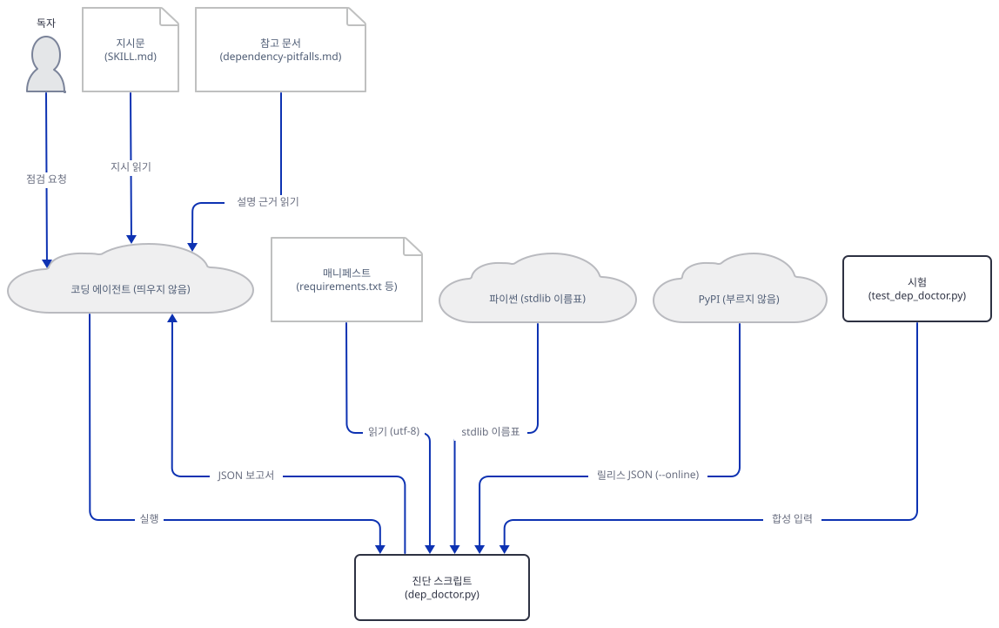

## 사전 준비

| 서비스/도구 | 용도 | 발급·설치 |
|---|---|---|
| uv | 파이썬을 골라 스크립트를 돌린다(`uv run --no-project`) | [공통 사전 준비](../README.md#공통-사전-준비-한-번만) 절 참고 |
| Python | 스킬은 3.11 이상을 요구한다(`compatibility`). 이 문서는 3.13.3으로 돌렸고 비교로 3.11.12와 3.14.2를 썼다. 모두 이미 설치된 것만 쓰도록 `--no-python-downloads`를 붙인다 | 없는 판은 `uv python install 3.13`처럼 미리 설치하거나 비교를 건너뛴다 |
| 이 저장소의 복제본 | 설치할 스킬 폴더와 시험 파일의 출처 | `git clone`. 아래에서 `REPO`로 부른다 |
| 인터넷 | 필요 없다. 스킬은 표준 라이브러리만 쓰고, 이 문서의 어떤 명령도 인터넷에 닿지 않는다 | 없음 |
| 코딩 에이전트, API 키 | 필요 없다. 이 문서는 에이전트를 띄우지 않았다 | 없음 |
| `npx skills add …` | 레지스트리와 스킬 README가 적은 설치 명령 | **이 문서는 실행하지 않았다.** 아래 참고 |

**설치 명령에 대해.** `agent_skills/registry.json`과 스킬 README의 설치 줄은 `npx skills add https://github.com/Shubhamsaboo/awesome-llm-apps/tree/main/agent_skills/dependency-doctor`입니다. `skills` CLI는 GitHub의 `vercel-labs/skills`(MIT, npm 패키지 `skills`)입니다(2026-10-19에 그 README를 읽음). README에 따르면 소스는 GitHub 주소나 `owner/repo`, 다른 git 주소, 로컬 경로, `SKILL.md` 한 파일이나 압축 파일의 주소까지이고, 기본은 프로젝트 범위(`./<에이전트>/skills/`, Claude Code는 `.claude/skills/`)이며 `-g`를 주면 홈(`~/.claude/skills/`)에 넣습니다. 대화형 설치는 한 곳에 두고 에이전트마다 링크하는 방식(권장)과 복사 방식(`--copy`)을 고르게 합니다. 이 CLI는 익명 사용 통계를 모으고 `DISABLE_TELEMETRY=1`이나 `DO_NOT_TRACK=1`로 끕니다. 이 문서는 그 CLI도 `npm`도 돌리지 않고, 같은 결과(프로젝트의 `.claude/skills/<스킬>` 폴더)를 복사로 만듭니다. 홈 쪽(`~/.claude/skills/`)에는 아무것도 넣지 않았고, Anthropic 문서가 말하는 두 자리(개인 `~/.claude/skills/`, 프로젝트 `.claude/skills/`) 가운데 프로젝트 쪽만 썼습니다. `agent_skills/README.md`는 설치 전에 `SKILL.md`와 모든 스크립트를 읽으라고 합니다. 이 스킬의 스크립트는 485줄 하나이고 이 문서가 전부 읽었습니다.

## 아키텍처 한눈에 보기

| 컴포넌트 | 역할 | 코드 위치 |
|---|---|---|
| 머리말 | `name`·`description`·`license`·`compatibility`·`metadata`. 에이전트가 시작할 때 읽는 것 | `agent_skills/dependency-doctor/SKILL.md:1-18` |
| 지시문 본문 | 언제 쓰고 언제 쓰지 않는지, 실행 명령, 설명과 수정 제안의 순서 | `agent_skills/dependency-doctor/SKILL.md:20-151` |
| 매니페스트 읽기 | 이름으로 파서를 고르고 `requirements.txt`·`pyproject.toml`·`package.json`을 공통 항목으로 바꾼다 | `agent_skills/dependency-doctor/scripts/dep_doctor.py:61-194` |
| 오프라인 검사 | 백포트, 표준 라이브러리 이름, 고정 없음, 중복·충돌 | `agent_skills/dependency-doctor/scripts/dep_doctor.py:278-373` |
| 표지 걸러내기 | `python_version` 표지를 돌린 파이썬으로 판정 | `agent_skills/dependency-doctor/scripts/dep_doctor.py:205-230` |
| PyPI 조회(선택) | `--online`일 때 정확히 고정한 (이름, 버전)마다 한 번 | `agent_skills/dependency-doctor/scripts/dep_doctor.py:376-420` |
| 보고서 조립과 출력 | 정렬, 요약, JSON 또는 사람용 글 | `agent_skills/dependency-doctor/scripts/dep_doctor.py:423-481` |
| 참고 문서 | 에이전트가 설명하기 전에 읽는 판단 기준 | `agent_skills/dependency-doctor/references/dependency-pitfalls.md:1-74` |
| 시험 1~2단계 | 구조(`skill_lint`)·보안(`skill_scanner`)·트리거 낱말 점수(`run_trigger_evals`). 모델 없이 돈다 | `agent_skills/evals/tools/skill_lint.py:1-385`, `skill_scanner.py:1-423`, `run_trigger_evals.py:1-132` |
| 시험 | 합성 매니페스트로 66개 단언, 트리거 여섯 사례, 3단계 기대 | `agent_skills/evals/dependency-doctor/test_dep_doctor.py:1-222` |
| 이 문서의 도구 | 복사한 스킬 폴더, 랩 환경, 가짜 PyPI 래퍼 | 코드 없음 (Step 1, 7에서 직접 만듦) |

## 단계별 진행

### Step 1. 스킬 폴더 설치와 머리말 대조

**목적.** 스킬을 프로젝트의 `.claude/skills/`로 복사하고, 거기에 무엇이 들어가는지와 머리말이 명세와 맞는지 봅니다. 이 터미널은 랩 전용으로 쓰고, 스크립트가 서드파티를 부르지는 않지만 홈·임시 폴더·인코딩을 랩 안으로 돌려 둡니다.

**할 일.** 복제본 위치를 `REPO`에 넣고 랩 폴더를 만듭니다.

```bash
export REPO=/path/to/awesome-llm-apps
mkdir doctor-lab
cd doctor-lab
mkdir -p fake-home tmp .claude/skills
```

```powershell
$env:REPO = "C:\path\to\awesome-llm-apps"
New-Item -ItemType Directory doctor-lab | Out-Null
Set-Location doctor-lab
New-Item -ItemType Directory fake-home, tmp, .claude\skills | Out-Null
```

랩 환경 파일을 만듭니다. 홈과 임시 폴더를 랩으로 돌리고, 파이썬의 출력·읽기 인코딩을 UTF-8로 고정하고(한국어 Windows는 기본이 cp949입니다. Step 2에서 이 줄이 빠지면 무슨 일이 나는지 봅니다), `.pyc`를 쓰지 않게 하고, 파이썬 판을 고르는 함수 둘을 정의합니다. 이 문서의 모든 `uv run`이 `--no-project --no-python-downloads`를 갖도록 함수 하나에 모았습니다.

`doctor-lab/lab-env.sh`

```bash
export HOME="$PWD/fake-home" USERPROFILE="$PWD/fake-home" CLAUDE_CONFIG_DIR="$PWD/fake-home/.claude"
export TEMP="$PWD/tmp" TMP="$PWD/tmp" TMPDIR="$PWD/tmp"
export PYTHONUTF8=1 PYTHONIOENCODING=utf-8 PYTHONDONTWRITEBYTECODE=1
pyv() { uv run --no-project --no-python-downloads --python "$1" python "${@:2}"; }
py() { pyv 3.13 "$@"; }
```

```bash
. ./lab-env.sh
```

```powershell
$env:HOME = "$PWD\fake-home"; $env:USERPROFILE = "$PWD\fake-home"; $env:CLAUDE_CONFIG_DIR = "$PWD\fake-home\.claude"
$env:TEMP = "$PWD\tmp"; $env:TMP = "$PWD\tmp"; $env:TMPDIR = "$PWD\tmp"
$env:PYTHONUTF8 = "1"; $env:PYTHONIOENCODING = "utf-8"; $env:PYTHONDONTWRITEBYTECODE = "1"
function pyv { uv run --no-project --no-python-downloads --python $args[0] python @($args | Select-Object -Skip 1) }
function py { pyv 3.13 @args }
```

(PowerShell 줄은 실행해 보지 못했습니다. 아래의 파일 저장 명령은 bash의 `cat > 파일 <<'EOF'`입니다. PowerShell이면 같은 내용을 편집기로 저장하거나 Git Bash를 쓰세요.) 이제 설치입니다. 설치는 폴더 복사입니다.

```bash
cp -r "$REPO/agent_skills/dependency-doctor" .claude/skills/dependency-doctor
find .claude -type f | sort
```

```powershell
Copy-Item -Recurse "$env:REPO\agent_skills\dependency-doctor" .claude\skills\dependency-doctor
Get-ChildItem -Recurse -File .claude | ForEach-Object FullName
```

```text
.claude/skills/dependency-doctor/README.md
.claude/skills/dependency-doctor/references/dependency-pitfalls.md
.claude/skills/dependency-doctor/scripts/dep_doctor.py
.claude/skills/dependency-doctor/SKILL.md
```

파일은 넷이고 `evals/`는 없습니다. `agent_skills/evals/README.md`가 말하는 "시험 파일은 설치에 따라오지 않는다"가 맞습니다. 다만 같은 문서의 "스킬 폴더에는 실행에 필요한 것만 있다"와 달리 사람용 `README.md`(원격의 GIF 이미지 주소를 담고 있습니다)도 따라옵니다. 실행에는 영향이 없습니다. 다음은 머리말을 명세와 맞대는 `fm.py`입니다. `SKILL.md`는 에이전트에게 주는 지시문이므로 이 스크립트는 그것을 읽고 출력만 하고, 그 안의 지시를 따르지 않습니다.

`doctor-lab/fm.py`

```python
"""Print the SKILL.md frontmatter of an installed skill and compare it with the agentskills.io limits."""
import pathlib, re, sys

skill = pathlib.Path(sys.argv[1])
text = (skill / "SKILL.md").read_text(encoding="utf-8")
block = text.split("---")[1]
print("--- frontmatter ---")
print(block.strip("\n"))
print("--- checks ---")
name = re.search(r"^name:\s*(\S+)", block, re.M).group(1)
desc = " ".join(
    part.strip()
    for part in re.search(r"^description:\s*>-\n((?:  .*\n)+)", block, re.M).group(1).splitlines()
)
compat = re.search(r'^compatibility:\s*"(.*)"', block, re.M).group(1)
print("name", name, "| same as folder:", name == skill.name,
      "| allowed characters:", bool(re.fullmatch(r"[a-z0-9]+(-[a-z0-9]+)*", name)), "| length", len(name), "(limit 64)")
print("description", len(desc), "characters (limit 1024)")
print("compatibility", len(compat), "characters (limit 500)")
print("top-level keys:", re.findall(r"^([a-z-]+):", block, re.M))
print("SKILL.md lines:", len(text.splitlines()))
```

```bash
py -B fm.py .claude/skills/dependency-doctor
```

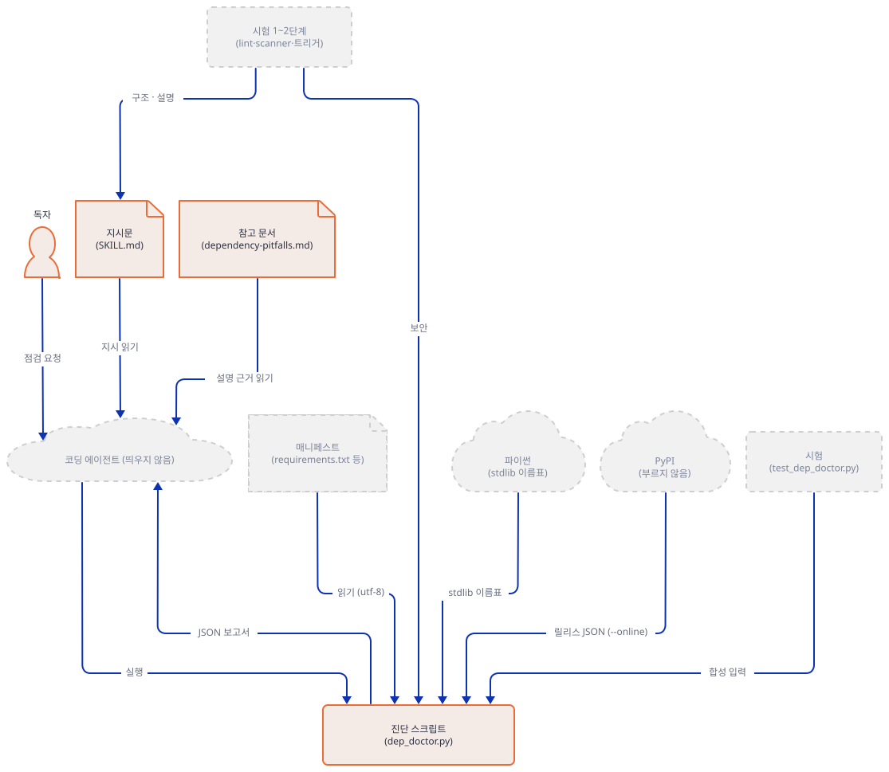

**확인.** 출력은 다음입니다(머리말 줄은 `SKILL.md` 2~17행 그대로입니다).

```text
--- frontmatter ---
name: dependency-doctor
description: >-
  Checks requirements.txt, pyproject.toml, and package.json dependency manifests
  for surface-level direct-dependency footguns: standard-library shadowing pins,
  abandoned backports, unpinned dependencies, and obvious intra-manifest
  conflicts, plus opt-in PyPI yanked releases. Use when the user asks to check a
  manifest for dependency problems, asks why dependencies won't install or
  whether anything is wrong with their dependencies, wants a dependency autopsy,
  or suspects dependency manifest rot. Runs offline by default as a local tool
  for the user's own project, not repository CI.
license: Apache-2.0
compatibility: "Python 3.11+. Offline by default. Network access to pypi.org occurs only when the user explicitly approves --online."
metadata:
  author: "Matt Van Horn"
  version: "1.0.0"
  source: "https://github.com/Shubhamsaboo/awesome-llm-apps"
--- checks ---
name dependency-doctor | same as folder: True | allowed characters: True | length 17 (limit 64)
description 583 characters (limit 1024)
compatibility 116 characters (limit 500)
top-level keys: ['name', 'description', 'license', 'compatibility', 'metadata']
SKILL.md lines: 151
```

명세(agentskills.io, 2026-10-19에 읽음)는 필수 필드를 `name`(최대 64자, 소문자·숫자·하이픈, 폴더 이름과 같음)과 `description`(1~1024자, 무엇을 하고 언제 쓰는지)으로 두고, 선택 필드로 `license`, `compatibility`(최대 500자, "intended product, system packages, network access" 같은 환경 요구), `metadata`(문자열 키와 값의 맵), `allowed-tools`(실험적)를 둡니다. 이 스킬은 `allowed-tools` 말고 전부 가졌습니다. `compatibility`가 네트워크 접근을 밝히는 자리라는 것이 Step 2의 보안 시험에서 쓰입니다. Anthropic 문서는 이름과 설명이 시작할 때 시스템 프롬프트에 들어가고(스킬당 약 100토큰), 본문은 스킬이 쓰일 때 읽히며, 스크립트는 bash로 돌아 "그 코드는 문맥에 들어가지 않고 출력만 들어간다"고 적습니다. 같은 문서가 `name`에 "anthropic"과 "claude"를 예약어로 막지만 `dependency-doctor`에는 없습니다.

### Step 2. 구조·보안·트리거 시험

**목적.** 저장소가 스킬마다 거는 1~2단계 시험 가운데 모델 없이 도는 것 셋(구조 1, 보안 1b, 트리거 2)을 돌리고, 각각이 실제로 무엇을 보는지 읽습니다. 2b(스크립트 시험)는 Step 8에서 돌립니다.

**할 일.** 구조 시험은 설치한 복사본에, 보안 시험은 `.claude/skills`에 돌립니다. 트리거 시험은 저장소의 스킬 전부에 대해 돕니다.

```bash
SK=.claude/skills/dependency-doctor
py -B "$REPO/agent_skills/evals/tools/skill_lint.py" $SK --strict
py -B "$REPO/agent_skills/evals/tools/skill_scanner.py" .claude/skills
py -B "$REPO/agent_skills/evals/tools/run_trigger_evals.py"
```

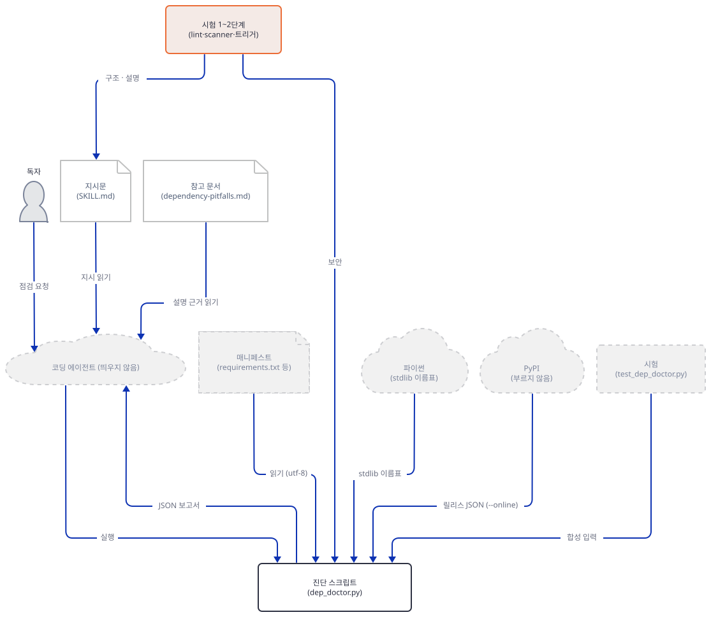

**확인.** 구조 시험은 `PASS — 0 error(s), 0 warning(s)`입니다. 이름이 폴더와 같은지, 설명 길이, 본문 줄 수(500줄 넘으면 `--strict`에서 오류), 본문이 가리키는 상대 경로가 실제로 있는지를 봅니다. 보안 시험의 끝은 다음입니다.

```text
=== dependency-doctor (.claude\skills\dependency-doctor) ===
  [INFO] NET01 scripts\dep_doctor.py:378
      Script makes network calls (python network import), declared via 'compatibility'.
      > import urllib.parse
  ...
Summary: 0 CRITICAL, 0 WARN, 5 INFO
```

정보 5건은 모두 `dep_doctor.py` 378~392행, 곧 `--online` 쪽의 `urllib` 줄입니다. 시험이 "declared via 'compatibility'"라고 적은 것은 Step 1의 `compatibility`에 네트워크 접근이 적혀 있기 때문입니다. 이 시험은 문자열 패턴을 찾을 뿐이어서(출력 끝의 안내도 "자연어로 된 공격은 패턴 검사기를 피한다"고 적습니다) 그 줄들이 기본 실행에서 닿지 않는다는 보장은 못 합니다. 그것은 Step 3~6의 실행으로 확인합니다. 트리거 시험은 이 스킬에 대해 다음을 냅니다.

```text
PASS  dependency-doctor: 3 positives clear 3 near-misses (weakest 1.50 vs strongest 1.15)
```

한국어 Windows에서 `PYTHONUTF8=1` 없이 돌리면 이 시험은 `UnicodeDecodeError: 'cp949' codec can't decode byte 0xe2`로 멈췄습니다(작성자의 PC에서 직접 확인했습니다. `run_trigger_evals.py` 59행이 인코딩 없이 `SKILL.md`를 엽니다). Step 1의 `lab-env.sh`가 그 줄을 이미 갖고 있습니다. 점수가 어떻게 나오는지 보려고 같은 함수를 부르는 `trig.py`를 만듭니다.

`doctor-lab/trig.py`

```python
"""Score every dependency-doctor trigger case with the same function run_trigger_evals.py uses."""
import json, os, sys

sys.path.insert(0, sys.argv[1] + "/agent_skills/evals/tools")
import run_trigger_evals as t

skills = {
    name: t.tokens(t.description_of(os.path.join(t.SKILLS_ROOT, name)))
    for name in sorted(os.listdir(t.SKILLS_ROOT))
    if os.path.exists(os.path.join(t.SKILLS_ROOT, name, "SKILL.md"))
}
cases = json.load(open(os.path.join(t.EVALS_ROOT, "dependency-doctor", "trigger-cases.json"), encoding="utf-8"))["cases"]
for case in cases:
    words = t.tokens(case["prompt"])
    score = t.score(words, skills["dependency-doctor"])
    best = max(skills, key=lambda name: t.score(words, skills[name]))
    print("%-18s trigger=%-5s score=%.2f shared=%s best=%s" % (
        case["id"], case["should_trigger"], score, sorted(words & skills["dependency-doctor"]), best))
```

```bash
py -B trig.py "$REPO"
```

```text
check-requirements trigger=True  score=2.00 shared=['check', 'problem', 'requirement', 'txt'] best=dependency-doctor
deps-wont-install  trigger=True  score=1.50 shared=['install', 'why', "won't"] best=dependency-doctor
anything-wrong     trigger=True  score=1.73 shared=['anyth', 'dependenci', 'wrong'] best=dependency-doctor
near-miss-install  trigger=False score=0.71 shared=['install'] best=dependency-doctor
near-miss-upgrade  trigger=False score=0.00 shared=[] best=advisor-orchestrator-worker
near-miss-add      trigger=False score=1.15 shared=['package', 'project'] best=dependency-doctor
```

`trigger-cases.json`의 양성(`should_trigger: true`) 셋은 "check my requirements.txt for problems", "why won't my deps install?", "is anything wrong with my dependencies?"이고 음성 셋은 "install my deps", "upgrade everything to the latest version", "add a package to my project"입니다. 시험은 프롬프트와 `description`의 낱말(간단히 어간을 줄인 것)이 겹치는 수를 점수로 삼고, 가장 약한 양성이 가장 센 음성의 1.15배(`MARGIN`)를 넘는지, 각 양성이 저장소의 스킬 중 이 스킬에 가장 가깝게 나오는지를 봅니다. 그래서 이것은 에이전트가 실제로 이 스킬을 고르는지가 아니라 설명에 사람들이 쓰는 낱말이 있는지를 보는 시험입니다(`evals/README.md`도 "lexical approximation"이라고 밝힙니다). 읽을 점이 둘 있습니다. `near-miss-add`의 1.15는 "package"와 "project"가 설명에 있어서 나온 것이고, 통과선은 1.15×1.15=1.32라 가장 약한 양성 1.50과 0.18 차이입니다. `near-miss-install`은 낱말 하나(`install`)로 0.71점이라 점수가 이 스킬로 기웁니다. 설명이 바뀌면 이 여유가 얼마나 남는지가 이 시험의 몫입니다.

### Step 3. 첫 진단 — 표준 라이브러리 가리기와 낡은 백포트

**목적.** 합성 `requirements.txt`로 처음 진단을 돌려 두 가지 "빼야 할 줄"이 어떻게 갈리는지, 그리고 그 판정이 어느 파이썬으로 돌렸는지에 달린다는 것을 봅니다.

**할 일.** 첫 매니페스트를 만들고 돌립니다. 마지막 두 줄은 지시자와 주석이고 진단 대상이 아닙니다.

```bash
mkdir manifests
cat > manifests/a-shadow.txt <<'EOF'
pathlib==1.0.1
argparse==1.4.0
enum34==1.1.10
typing_extensions==4.12.2
-r shared-requirements.txt
# a comment is not a dependency
EOF
DD=.claude/skills/dependency-doctor/scripts/dep_doctor.py
py -B $DD manifests/a-shadow.txt; echo "exit=$?"
```

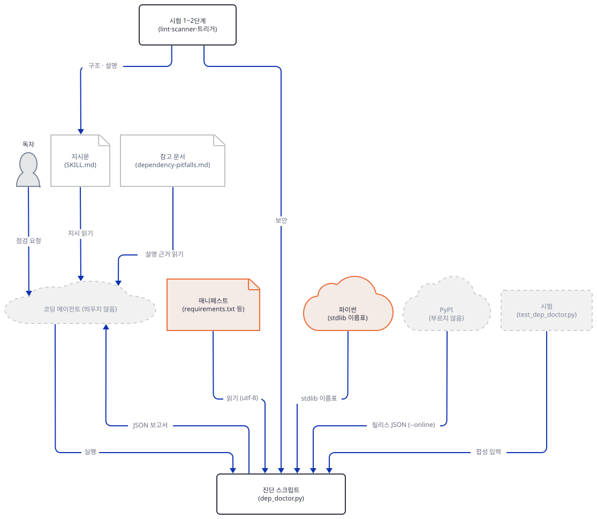

**확인.** 세 건이 나오고 종료 코드는 0입니다.

```text
Dependency Doctor: manifests\a-shadow.txt

HIGH [abandoned-backport] pathlib (line 1)
  Why: Python 3.4 and newer include pathlib in the standard library. The old backport can conflict with supported runtimes.
  Fix: Remove pathlib on supported Python versions. If an older runtime is required, guard the backport with a Python-version marker.

HIGH [stdlib-shadowing] argparse (line 2)
  Why: argparse is provided by this Python runtime. Installing a package with the same name can shadow the maintained standard-library module.
  Fix: Remove argparse from the manifest and import the standard-library module directly.

HIGH [abandoned-backport] enum34 (line 3)
  Why: Python 3.4 and newer include enum in the standard library. The old backport can conflict with supported runtimes.
  Fix: Remove enum34 on supported Python versions. If an older runtime is required, guard the backport with a Python-version marker.

Summary: 3 finding(s)
exit=0
```

`typing_extensions`는 이름이 표준 라이브러리 모듈이 아니라서 걸리지 않았고, `-r …`과 주석은 읽지 않았습니다(`-`나 `#`로 시작하는 줄은 건너뛰므로 `-r`이 가리키는 파일은 따라가지도 않습니다). 같은 "빼야 할 줄"이 둘로 갈린 이유는 코드 순서입니다.

`agent_skills/dependency-doctor/scripts/dep_doctor.py:286-309`

```python
        if entry["ecosystem"] == "python":
            module_name = package.replace("-", "_")
            if package in BACKPORTS:
                # A known backport is the more specific, actionable root cause.
                remove_instead_of_pin = True
                findings.append(make_finding(
                    "high",
                    "abandoned-backport",
                    entry,
                    BACKPORTS[package] + " The old backport can conflict with supported runtimes.",
                    "Remove %s on supported Python versions. If an older runtime is required, guard the backport with a Python-version marker."
                    % package,
                ))
            elif module_name in stdlib_names:
                remove_instead_of_pin = True
                findings.append(make_finding(
                    "high",
                    "stdlib-shadowing",
                    entry,
                    "%s is provided by this Python runtime. Installing a package with the same name can shadow the maintained standard-library module."
                    % package,
                    "Remove %s from the manifest and import the standard-library module directly."
                    % package,
                ))
```

먼저 손으로 적은 표 `BACKPORTS`(30~42행, 이름 열한 개: `asyncio`·`configparser`·`dataclasses`·`enum34`·`functools32`·`futures`·`ipaddress`·`pathlib`·`singledispatch`·`subprocess32`·`typing`)에 있으면 백포트이고, 없을 때만 `sys.stdlib_module_names`에 있는지 봅니다. `stdlib_names`는 스크립트를 돌린 파이썬의 것입니다(281행). 그래서 판정이 파이썬마다 다릅니다. 3.12에서 표준 라이브러리를 떠난 `distutils`와 `imp`, `asyncore`, 3.13에서 떠난 `cgi`, 3.11에 들어온 `tomllib`을 매니페스트에 적고 세 판으로 돌려 봅니다. 결과를 줄여 보이는 `show.py`를 먼저 만듭니다.

`doctor-lab/show.py`

```python
import json, sys

report = json.load(sys.stdin)
for f in report["findings"]:
    print(f["line"], f["severity"], f["kind"], f["package"])
print("total", report["summary"]["total"])
```

```bash
cat > manifests/b-removed.txt <<'EOF'
distutils
imp
asyncore
cgi
tomllib
requests==2.31.0
EOF
for v in 3.11 3.13 3.14; do echo "== Python $v"; pyv $v -B $DD manifests/b-removed.txt --json | py -B show.py; done
```

```text
== Python 3.11
1 high stdlib-shadowing distutils
1 medium unpinned distutils
2 high stdlib-shadowing imp
2 medium unpinned imp
3 high stdlib-shadowing asyncore
3 medium unpinned asyncore
4 high stdlib-shadowing cgi
4 medium unpinned cgi
5 high stdlib-shadowing tomllib
5 medium unpinned tomllib
total 10
== Python 3.13
1 medium unpinned distutils
2 medium unpinned imp
3 medium unpinned asyncore
4 medium unpinned cgi
5 high stdlib-shadowing tomllib
5 medium unpinned tomllib
total 6
== Python 3.14
1 medium unpinned distutils
2 medium unpinned imp
3 medium unpinned asyncore
4 medium unpinned cgi
5 high stdlib-shadowing tomllib
5 medium unpinned tomllib
total 6
```

같은 매니페스트가 3.11에서는 높음 5건, 3.13·3.14에서는 1건입니다. 이 도구의 한계이면서 어찌 보면 옳은 동작입니다. 3.13에서는 `distutils`가 표준 라이브러리가 아니라 그 이름으로 PyPI의 패키지를 설치해도 가려질 모듈이 없습니다. 하지만 이 판정은 "독자가 지원하려는 파이썬"이 아니라 "지금 이 스크립트를 돌린 파이썬"으로 정해집니다. 지원 범위가 3.9~3.13인 프로젝트를 3.13으로만 진단하면 3.11까지 있던 이름은 놓칩니다. `sys.stdlib_module_names`는 3.10에 생긴 속성이라 `getattr`의 빈 기본값(281행)으로 돌아가는 3.9 이하에서는 이 검사가 말없이 하나도 걸리지 않을 것으로 소스에서 읽었습니다(3.9는 이 PC에 없어 돌려 보지 못했습니다). `python_version` 표지도 같은 파이썬으로 판정합니다(`marker_applies`, 205~230행).

```bash
cat > manifests/c-marker.txt <<'EOF'
dataclasses; python_version < "3.14"
EOF
for v in 3.13 3.14; do echo "== Python $v"; pyv $v -B $DD manifests/c-marker.txt --json | py -B show.py; done
```

```text
== Python 3.13
1 high abandoned-backport dataclasses
1 medium unpinned dataclasses
total 2
== Python 3.14
total 0
```

표지가 있는 줄은 3.14에서 해당 없음으로 걸러져 진단에서 사라집니다. 표지로 가둔 백포트를 보고서가 문제 삼지 않는 것은 설계(`references`의 "표지를 쓰라")와 맞지만, 사라진 줄은 "검사했다"가 아니라 "이 파이썬에서는 해당 없음"입니다. 3.13에서 `dataclasses; python_version < "3.14"`가 높음으로 나온 것은 3.13이 그 표지의 참인 쪽이기 때문입니다.

### Step 4. 고정 없음·중복·충돌

**목적.** 나머지 세 검사가 정확히 무엇을 "고정 없음", "중복", "충돌"로 부르는지 경계 사례로 봅니다. 그리고 파일을 읽는 단계의 함정을 봅니다.

**할 일.** 경계 사례를 한 파일에 모읍니다.

```bash
cat > manifests/d-pins.txt <<'EOF'
requests
requests
urllib3==1.26.18
urllib3==2.2.2
numpy>=1.26
uvicorn[standard]
uvicorn==0.30.0
click>=8,<9
click==7.1.2
flask<2
flask>=3
EOF
py -B $DD manifests/d-pins.txt --json | py -B show.py
```

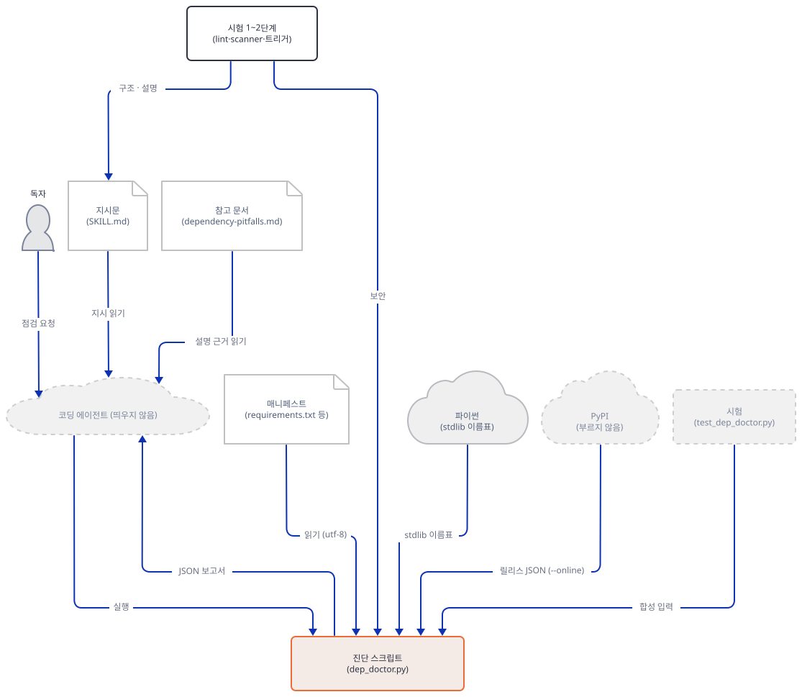

**확인.**

```text
1 medium unpinned requests
2 medium duplicate-constraint requests
2 medium unpinned requests
4 high conflicting-constraints urllib3
6 medium unpinned uvicorn
7 medium duplicate-constraint uvicorn
9 medium duplicate-constraint click
11 medium duplicate-constraint flask
total 8
```

해석은 다음과 같습니다. 이름만 있는 `requests` 두 줄은 "고정 없음" 둘과 "중복" 하나입니다(중복은 두 번째 줄에 붙습니다). `urllib3`의 정확한 고정 둘(`==`)만 "충돌"입니다(높음, 충돌 보고는 쌍 하나만 냅니다). `numpy>=1.26`은 아무것도 아닙니다. 하한만 있는 범위도 "쓸 만한 제약"으로 치기 때문입니다(`has_version_spec`, 197~202행). 이 시리즈의 앱들이 이 모양을 얼마나 많이 쓰는지는 Step 6에서 셉니다. 대괄호 추가 요소(`uvicorn[standard]`)는 이름을 같게 묶기 때문에 `uvicorn`과 중복입니다. `click>=8,<9`와 `click==7.1.2`는 서로 모순이지만 정확한 고정이 둘이 아니라서 "중복"이고, `flask<2`와 `flask>=3`은 어떤 버전도 만족하지 못하는데도 "중복"입니다. `SKILL.md`가 "모든 범위를 충돌이라 부르지 말라"고 하고 스크립트가 정확한 고정끼리만 충돌로 본다는 것이 이 모습입니다. 높음 하나가 없다고 안전하다는 뜻이 아닙니다.

파일을 읽는 단계에도 함정이 있습니다. BOM이 붙은 UTF-8, UTF-16(Windows PowerShell 5.1의 `>`가 이 모양으로 쓴다고 알려져 있지만 이 문서는 확인하지 못했습니다), 지원하지 않는 이름을 차례로 넣어 봅니다.

```bash
printf 'pathlib==1.0.1\nrequests\n' > manifests/e-plain.txt
printf '\357\273\277' | cat - manifests/e-plain.txt > manifests/e-bom.txt
py -B -c "open('manifests/e-utf16.txt','wb').write(open('manifests/e-plain.txt','rb').read().decode().encode('utf-16'))"
printf 'foo\n' > manifests/deps.in
py -B $DD manifests/e-plain.txt --json | py -B show.py
py -B $DD manifests/e-bom.txt --json | py -B show.py
py -B $DD manifests/e-utf16.txt; echo "exit=$?"
py -B $DD manifests/deps.in; echo "exit=$?"
```

```text
1 high abandoned-backport pathlib
2 medium unpinned requests
total 2
2 medium unpinned requests
total 1
usage: dep_doctor.py [-h] [--json] [--online] manifest
dep_doctor.py: error: 'utf-8' codec can't decode byte 0xff in position 0: invalid start byte
exit=2
usage: dep_doctor.py [-h] [--json] [--online] manifest
dep_doctor.py: error: unsupported manifest; use requirements.txt, pyproject.toml, or package.json
exit=2
```

BOM이 붙은 파일은 첫 줄 `pathlib`이 보고서에서 조용히 사라지고(첫 낱말 앞의 보이지 않는 문자 때문에 이름 정규식이 첫 줄에 맞지 않고, 오류도 없습니다), UTF-16은 오류 문구와 종료 코드 2로 멈춥니다. 반대로 보고서가 있어도 종료 코드는 언제나 0입니다(`main`의 `return 0`, 481행). 맨 처음 Step 3의 실행이 높음 3건을 내고도 `exit=0`이었습니다. 그러니 이 스크립트는 CI 관문이 아니고(`SKILL.md`도 "CI 관문이 아니다"라고 적습니다) 에이전트와 사람이 읽는 보고서입니다.

### Step 5. `pyproject.toml`과 `package.json`

**목적.** 다른 두 형식에서 어디까지 읽는지, 줄 번호가 어떻게 정해지는지 봅니다.

**할 일.** 일부러 놓칠 곳을 심은 `pyproject.toml`을 만듭니다. `[dependency-groups]`와 `[build-system]`에 낡은 백포트를 넣었고, `description`에 `httpx`라는 낱말을 넣었습니다.

```bash
mkdir -p manifests/py manifests/js
cat > manifests/py/pyproject.toml <<'EOF'
[project]
name = "demo-app"
description = "Small app that wraps httpx calls"
requires-python = ">=3.11"
dependencies = [
  "httpx",
  "pydantic>=2",
  "pathlib==1.0.1",
  "rich[jupyter]==13.7.1",
]

[project.optional-dependencies]
dev = ["pytest", "rich==13.9.0"]

[dependency-groups]
lint = ["typing==3.7.4.3", "ruff"]

[build-system]
requires = ["setuptools", "wheel"]

[tool.poetry.dependencies]
python = "^3.11"
fastapi = "0.110.0"
uvicorn = { extras = ["standard"] }
sqlalchemy = { version = "^2.0" }
EOF
cat > manifests/js/package.json <<'EOF'
{
  "name": "demo",
  "dependencies": {
    "left-pad": "*",
    "chalk": "5.3.0",
    "react": "^18.2.0",
    "lodash": "latest",
    "axios": ""
  },
  "devDependencies": {
    "chalk": "4.1.2",
    "jest": "x"
  }
}
EOF
py -B $DD manifests/py/pyproject.toml --json | py -B show.py
grep -n "httpx" manifests/py/pyproject.toml
py -B $DD manifests/js/package.json --json | py -B show.py
```


**확인.**

```text
3 medium unpinned httpx
8 high abandoned-backport pathlib
13 high conflicting-constraints rich
13 medium unpinned pytest
24 medium unpinned uvicorn
total 5
3:description = "Small app that wraps httpx calls"
6:  "httpx",
4 medium unpinned left-pad
7 medium unpinned lodash
8 medium unpinned axios
11 high conflicting-constraints chalk
12 medium unpinned jest
total 5
```

`pyproject.toml`에서 읽는 곳은 `[project].dependencies`, `[project.optional-dependencies]`, `[tool.poetry.dependencies]` 셋입니다(`python`은 건너뜁니다. 117~153행). 그래서 `[dependency-groups]`의 `typing==3.7.4.3`과 `[build-system]`의 `requires`는 보고서에 없습니다. `typing==3.7.4.3`이 `[project]`에 있었다면 높은 백포트였을 줄입니다. `httpx`의 줄 번호는 3으로 나왔는데 실제 의존성은 6행입니다. 줄 번호는 TOML을 다시 파싱한 값에서 이름을 문자열로 찾아 정한 것이라 첫 번째로 나오는 줄이 `description`에 걸렸습니다(`line_locator`, 79~104행). `rich`는 실제 줄이 9와 13인데 두 줄에 걸쳐 충돌로 보고됩니다. 이 줄 번호는 "대충 어디" 정도로 읽고, 에이전트가 파일을 직접 열어 확인하라는 뜻으로 받아야 합니다. `package.json`은 `dependencies`·`devDependencies`·`optionalDependencies`·`peerDependencies` 넷을 읽고, `*`·`latest`·`x`·빈 문자열을 "고정 없음"으로, `^18.2.0` 같은 범위는 제약으로 칩니다. `chalk`가 `dependencies`(5.3.0)와 `devDependencies`(4.1.2)에 둘 다 있으면 정확한 고정이 달라 충돌입니다. 표준 라이브러리·백포트 검사는 파이썬 항목에만 걸리므로 npm 이름은 건너뜁니다.

### Step 6. 이 시리즈의 앞 앱들에 돌려 보기

**목적.** 합성 입력이 아니라 실제 매니페스트에 돌려 결과를 읽습니다. 이 저장소의 앱들이 어떤 제약을 많이 쓰는지도 셉니다.

**할 일.** `days.json`의 모든 일차 폴더에서 `requirements.txt`를 읽기만 하는 `survey.py`를 만듭니다. 스크립트는 각 파일을 하위 프로세스로 돌려 JSON 요약을 모으고, 항목의 제약 모양을 세려고 같은 파일을 모듈로도 불러 읽습니다. 앱 폴더에는 아무것도 쓰지 않습니다.

`doctor-lab/survey.py`

```python
"""Run dep_doctor.py (read-only) on every requirements.txt of the series' apps and summarize."""
import collections, importlib.util, json, pathlib, subprocess, sys

repo, doctor, show = pathlib.Path(sys.argv[1]), sys.argv[2], {int(d) for d in sys.argv[3:]}
spec = importlib.util.spec_from_file_location("dep_doctor", doctor)
dd = importlib.util.module_from_spec(spec)
spec.loader.exec_module(dd)

days = json.loads((repo / "docs/tutorials/_tools/days.json").read_text(encoding="utf-8"))
kinds, shapes, clean, files = collections.Counter(), collections.Counter(), 0, 0
for day in days:
    for req in sorted((repo / day["path"]).rglob("requirements.txt")):
        if "node_modules" in req.parts:
            continue
        out = subprocess.run([sys.executable, "-B", doctor, str(req), "--json"],
                             capture_output=True, text=True, encoding="utf-8", check=True).stdout
        summary = json.loads(out)["summary"]
        files += 1
        clean += summary["total"] == 0
        kinds.update(summary["by_kind"])
        for entry in dd.load_requirements(req.read_text(encoding="utf-8", errors="replace")):
            spec_text = entry["spec"]
            if not spec_text:
                shapes["no constraint"] += 1
            elif dd.exact_pin(entry):
                shapes["exact =="] += 1
            elif spec_text.startswith(">=") and "," not in spec_text and "<" not in spec_text:
                shapes["lower bound only"] += 1
            else:
                shapes["other"] += 1
        if day["day"] in show:
            print("Day %d  %s  findings=%d %s" % (day["day"], req.relative_to(repo / day["path"]),
                                                  summary["total"], summary["by_kind"]))
print("files", files, "| files with no finding", clean, "| findings by kind", dict(kinds))
print("entries by constraint shape", dict(shapes), "total", sum(shapes.values()))
```

```bash
py -B survey.py "$REPO" .claude/skills/dependency-doctor/scripts/dep_doctor.py 134 136 148 149 152 153
```

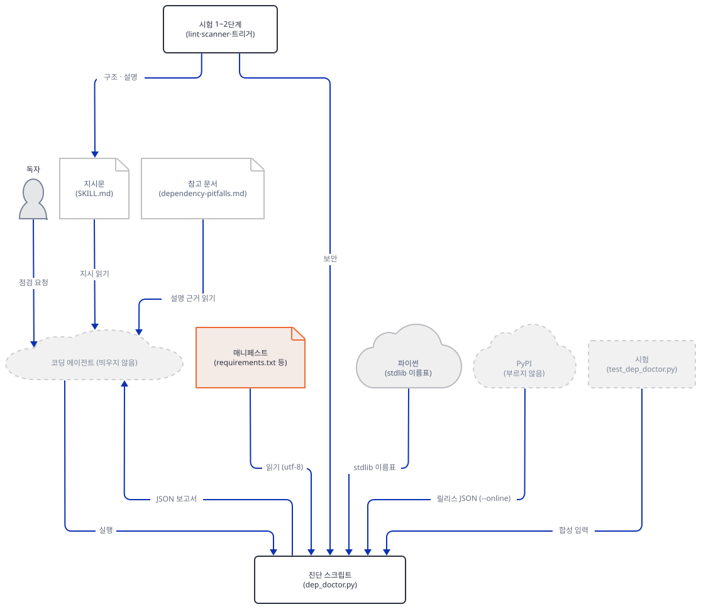

**확인.**

```text
Day 134  requirements.txt  findings=3 {'unpinned': 3}
Day 136  requirements.txt  findings=0 {}
Day 148  requirements.txt  findings=3 {'unpinned': 3}
Day 149  requirements.txt  findings=0 {}
Day 152  requirements.txt  findings=5 {'unpinned': 5}
Day 153  requirements.txt  findings=6 {'unpinned': 6}
files 159 | files with no finding 77 | findings by kind {'unpinned': 299}
entries by constraint shape {'lower bound only': 326, 'no constraint': 299, 'exact ==': 465, 'other': 7} total 1097
```

읽을 것은 다섯입니다. 첫째, 159개 가운데 77개가 무결점이고 나온 것은 전부 "고정 없음"(299건)입니다. 표준 라이브러리 가리기, 백포트, 중복, 충돌은 0건입니다. 이 앱들의 매니페스트가 깨끗해서라기보다 이 검사가 잡는 종류가 좁아서입니다. 둘째, Day 152의 다섯 건은 `torch`·`unsloth`·`transformers`·`datasets`·`trl`이고 Day 153의 여섯 건은 거기에 `unsloth_zoo`가 더해진 것입니다. 스킬이 권하는 고침은 "작업 환경에 설치된 버전을 확인해 고정하라"이고(`SKILL.md`), Day 153이 `uv pip compile`로 풀린 값을 확인해 `requirements-lab.txt`에 고정한 것과 같은 방향입니다. 셋째, Day 136의 236줄짜리 목록과 Day 149의 `google-adk==1.9.0`은 0건입니다. 그런데 Day 149는 바로 그 고정판 때문에 `adk web .`가 앱을 목록에 올리지 못한다고 적었습니다. 정확히 고정되어 있어도 오늘의 환경과 맞물리는지는 이 도구가 보지 않습니다. 이 도구는 해결기가 아닙니다. 넷째, 항목 1,097개 가운데 정확한 고정이 465개, 하한만 있는 범위(`>=`)가 326개, 고정 없음이 299개, 나머지 7개입니다. 하한만 있는 326개는 "제약이 있다"로 치므로 보고서에 한 줄도 없습니다. 다섯째, 이 실행은 앱 폴더에 아무것도 만들지 않았습니다(`.pyc` 없이 돌렸고 `git status`도 깨끗했습니다).

### Step 7. PyPI 조회 — 가짜 PyPI로만

**목적.** 선택 기능인 `--online`이 무엇을 보내고 무엇을 읽는지 가짜 서버로 확인합니다. 실제 `pypi.org`에는 요청하지 않습니다.

**할 일.** 먼저 소스를 읽습니다. 조회는 `online_findings`의 한 곳입니다.

`agent_skills/dependency-doctor/scripts/dep_doctor.py:389-393`

```python
        url = "https://pypi.org/pypi/%s/json" % urllib.parse.quote(entry["package"], safe="")
        request = urllib.request.Request(url, headers={"User-Agent": "dependency-doctor/1.0"})
        try:
            with urllib.request.urlopen(request, timeout=10) as response:
                payload = json.load(response)
```

주소에 들어가는 것은 정규화한 이름(`entry["package"]`)뿐입니다. `SKILL.md`는 "package names and exact pinned versions"를 보낸다고 적고 시험 3도 같은 문장이지만, 버전은 주소에도 헤더에도 없습니다. 버전은 받아 온 JSON에서 로컬로 찾습니다. 정확히 고정한 항목만 조회하고(`flask>=3`은 조회하지 않습니다), 같은 이름·버전은 한 번만 묻습니다. 다음 줄들이 야생의 응답을 읽는 모양입니다.

`agent_skills/dependency-doctor/scripts/dep_doctor.py:404-411`

```python
        files = payload.get("releases", {}).get(version, [])
        if files and all(file_info.get("yanked", False) for file_info in files):
            reasons = sorted({
                file_info.get("yanked_reason", "").strip()
                for file_info in files
                if file_info.get("yanked_reason", "").strip()
            })
            reason = (" PyPI reason: " + "; ".join(reasons)) if reasons else ""
```

이 줄들이 기대는 모양을 PyPI의 공개 문서로 확인했습니다. Warehouse(PyPI의 소스 저장소) 문서의 JSON API 쪽(`docs/user/api/json.md`, 2026-10-19에 GitHub에서 읽음)은 `releases` 키를 "Deprecated keys"로 두고 "projects should shift to using the Index API"라고 적고, 릴리스 하나를 받는 길은 그 키를 뺍니다("due to stability concerns"). `yanked`와 `yanked_reason`은 각 파일 항목에 있고, 문서의 예시는 `yanked: false`, `yanked_reason: null`입니다. 야크 사유는 PEP 592가 "임의의 문자열"이고 속성이 값 없이도 올 수 있다고 정합니다. 곧 이 스크립트는 문서가 폐기 예정이라 한 키에 기대고(오늘 `releases`가 빠졌는지는 PyPI에 요청하지 않아 확인하지 못했습니다), 사유가 `null`일 수 있는 자리에 `.strip()`을 부릅니다.

가짜 PyPI와 가드를 한 파일의 래퍼로 만듭니다. 래퍼는 세 겹입니다. 이 프로세스가 이름을 조회하거나 연결할 수 있는 곳을 `127.0.0.1`의 가짜 서버 포트 하나로 좁히고(1겹), `urllib.request.urlopen`을 가로채 `https://pypi.org/pypi/<이름>/json` 모양만 같은 경로의 루프백 주소로 바꿔 프록시 없이 열고(2겹), 두 겹이 실제로 걸렸는지 단언한 뒤에야 `dep_doctor.py`를 불러 `--online`으로 실행합니다. 단언은 네트워크에 닿지 않는 방식(함수가 바뀌었는지 비교, 가드 함수를 직접 호출)으로 합니다. 소켓에 직접 연결해 보는 단언은 가드가 빠졌을 때 그 연결이 실제로 나가기 때문입니다. 패키지 이름은 모두 지어낸 `demo-*`이고 `requests`만 실제 이름이지만 가짜 서버가 임의로 답합니다. 가짜 응답의 모양(`releases` 안의 파일 목록, `yanked`·`yanked_reason`)은 위 공개 문서의 모양을 따랐습니다.

`doctor-lab/online_lab.py`

```python
"""Run dep_doctor.py with --online, but only against a fake PyPI on this machine.

Usage: python online_lab.py <path to dep_doctor.py> <manifest>
Every package named here (demo-*) is invented. Nothing below talks to the real pypi.org.
"""
import http.server, importlib.util, json, socket, sys, threading, urllib.parse, urllib.request


def files(*flags):  # flags: (yanked, reason)
    return [{"filename": "f%d" % i, "yanked": y, "yanked_reason": r} for i, (y, r) in enumerate(flags)]


FAKE = {  # name -> releases (shape: the PyPI JSON API "releases" key; see Step 7)
    "requests": {"2.31.0": files((False, None))},
    "demo-yanked": {"1.0.0": files((True, "broken wheel"), (True, "broken wheel"))},
    "demo-partial": {"1.0.0": files((True, "bad sdist"), (False, None))},
    "demo-noreason": {"1.0.0": files((True, None))},
}
SEEN = []


class Fake(http.server.BaseHTTPRequestHandler):
    def do_GET(self):
        SEEN.append(self.path)
        name = self.path.split("/")[2]
        if name not in FAKE:
            self.send_error(404)
            return
        body = json.dumps({"info": {"name": name}, "releases": FAKE[name]}).encode()
        self.send_response(200)
        self.send_header("Content-Length", str(len(body)))
        self.end_headers()
        self.wfile.write(body)

    def log_message(self, *args):
        pass


server = http.server.HTTPServer(("127.0.0.1", 0), Fake)
PORT = server.server_address[1]
threading.Thread(target=server.serve_forever, daemon=True).start()

# Layer 1: this process may look up only 127.0.0.1 and connect only to the fake server's port.
_gai, _conn = socket.getaddrinfo, socket.socket.connect


def _gai_guard(host, *a, **k):
    if host not in ("127.0.0.1", "localhost"):
        raise OSError("guard: name lookup refused: %r" % (host,))
    return _gai(host, *a, **k)


def _conn_guard(self, addr):
    if tuple(addr[:2]) != ("127.0.0.1", PORT):
        raise OSError("guard: connect refused: %r" % (addr,))
    return _conn(self, addr)


socket.getaddrinfo, socket.socket.connect = _gai_guard, _conn_guard

# Layer 2: the one URL shape dep_doctor builds is rewritten to the fake server, without proxies.
no_proxy = urllib.request.build_opener(urllib.request.ProxyHandler({}))


def urlopen_to_loopback(request, timeout=None):
    url = urllib.parse.urlsplit(request.full_url)
    if url.scheme != "https" or url.hostname != "pypi.org":
        raise OSError("refused: only the pypi.org shape is rewritten, got %r" % request.full_url)
    local = urllib.request.Request("http://127.0.0.1:%d%s" % (PORT, url.path), headers=dict(request.header_items()))
    return no_proxy.open(local, timeout=timeout)


urllib.request.urlopen = urlopen_to_loopback

# Assert both layers are in place before anything else runs (no network is touched by these checks).
assert socket.getaddrinfo is _gai_guard and socket.socket.connect is _conn_guard, "guard missing"
assert urllib.request.urlopen is urlopen_to_loopback, "rewrite missing"
try:
    _conn_guard(None, ("192.0.2.1", 80))
    sys.exit("guard does not refuse a reserved address")
except OSError as error:
    print("guard check:", error, file=sys.stderr)

spec = importlib.util.spec_from_file_location("dep_doctor", sys.argv[1])
doctor = importlib.util.module_from_spec(spec)
spec.loader.exec_module(doctor)
code = doctor.main([sys.argv[2], "--json", "--online"])
print("fake PyPI on 127.0.0.1:%d saw %s" % (PORT, SEEN), file=sys.stderr)
sys.exit(code)
```

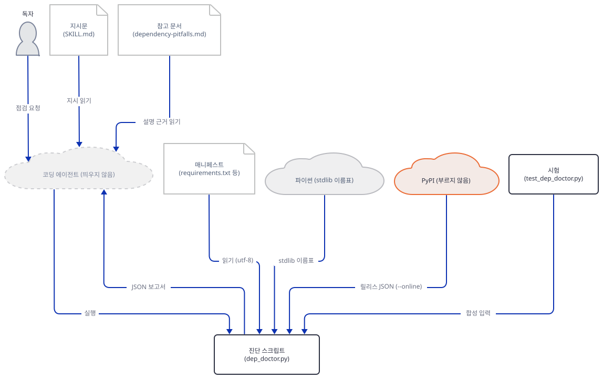

아래 그림이 래퍼 안쪽입니다. 가드는 `pypi.org`로 가는 이름 조회와 연결을 막고, 환경의 프록시 변수는 프록시 없는 열기가 무시합니다.

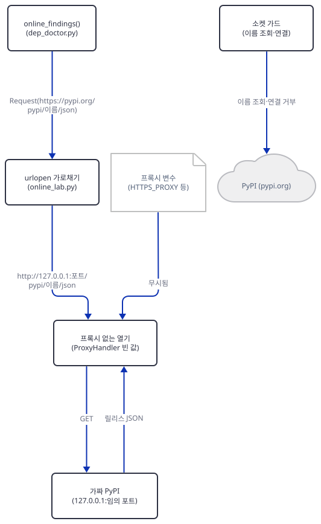

매니페스트에는 정확히 고정한 줄 다섯과 `flask>=3`을 둡니다. 둘째 줄은 같은 `requests`를 대소문자만 바꿔 적었습니다. 조회는 중복을 합쳐 한 번만 묻는지 보려는 것입니다.

```bash
cat > manifests/f-online.txt <<'EOF'
requests==2.31.0
Requests==2.31.0
demo-yanked==1.0.0
demo-partial==1.0.0
demo-gone==2.0
flask>=3
EOF
py -B online_lab.py $DD manifests/f-online.txt | py -B show.py
```

**확인.** 표준 출력(보고서)과 표준 오류(래퍼의 말)가 섞여 나옵니다.

```text
guard check: guard: connect refused: ('192.0.2.1', 80)
fake PyPI on 127.0.0.1:52142 saw ['/pypi/requests/json', '/pypi/demo-yanked/json', '/pypi/demo-partial/json', '/pypi/demo-gone/json']
2 medium duplicate-constraint requests
3 high yanked-release demo-yanked
5 low online-check-failed demo-gone
total 3
```

포트 번호는 실행마다 다릅니다. 가짜 서버가 본 요청은 넷이고, 이름은 `requests`(`Requests`와 합쳐서), `demo-yanked`, `demo-partial`, `demo-gone`입니다. `flask>=3`은 조회되지 않았습니다. 파일이 둘 있는 `demo-partial`은 야크가 하나뿐이라 보고되지 않았고(`all(...)`), 서버가 404를 준 `demo-gone`은 낮음 `online-check-failed`로 나왔고 진단은 이어졌습니다. 이 가짜 서버에서 받은 요청의 헤더는 `User-Agent: dependency-doctor/1.0`과 `Accept-Encoding`·`Host`·`Connection`뿐이었습니다(작성자가 헤더를 찍는 변형으로 확인). 진짜 `--online`이라면 여기에 내 IP와 이름이 더해져 PyPI에 보입니다. 이름만 가더라도 내부 패키지를 정확히 고정했다면 그 이름이 공개 PyPI에 질의로 나간다는 것은 알아 둘 일입니다(`acme_internal.tools==1.0`은 `acme-internal-tools`로 정규화돼 질의됐습니다. 소스상 사설 인덱스 설정은 읽지 않습니다). 이제 사유가 `null`인 응답을 줍니다.

```bash
printf 'demo-noreason==1.0.0\n' > manifests/g-noreason.txt
py -B online_lab.py $DD manifests/g-noreason.txt 2>&1 | tail -4; echo "exit=${PIPESTATUS[0]}"
```

```text
    if file_info.get("yanked_reason", "").strip()
       ^^^^^^^^^^^^^^^^^^^^^^^^^^^^^^^^^^^^^^^^
AttributeError: 'NoneType' object has no attribute 'strip'
exit=1
```

`get("yanked_reason", "")`는 키가 없을 때만 `""`을 줍니다. 키가 `null`로 있으면 `None`이 오고 `None.strip()`에서 `AttributeError`로 죽습니다. 이 예외는 `online_findings`의 `except (OSError, ValueError)`가 받지 않아 오프라인 진단까지 함께 잃습니다(`SKILL.md`는 "네트워크 실패는 낮음 보고로 바뀐다"고만 말합니다). 진짜 PyPI가 사유 없는 야크 파일에 `null`을 돌려주는지는 PyPI에 요청하지 않아 확인하지 못했습니다. 문서의 예시와 PEP 592가 가능하다고 말할 뿐입니다.

래퍼가 정말 줄 하나에도 기대지 않는지는 독자 명령이 아니라 작성자의 관찰 실험으로 쟀습니다. `online_lab.py`의 비어 있지 않은 줄을 하나씩 뺀 변형 65개를, 환경에 진짜 모양의 프록시 변수(`HTTPS_PROXY` 등)와 가짜 API 키가 있고 상위 폴더에 `.env`가 있는 상태에서 돌렸습니다. 변형 가운데 23개는 끝까지 돌았고 42개는 문법 오류나 단언으로 일찍 멈췄습니다. 바깥으로 나간 이름 조회·연결은 0이었고, 프록시 쪽으로 열린 연결도 0이었습니다. 이 실험의 첫판에서는 두 개가 샜습니다. 가드 설치 줄을 뺀 변형이 자체 점검 때문에 `192.0.2.1`에 실제로 연결을 시도했고, `urlopen` 가로채기 줄을 뺀 변형은 가드가 "루프백이면 허용"이라서 프록시 변수가 가리키는 루프백 프록시에 연결했습니다. 그래서 점검을 함수 비교와 가드 함수 직접 호출로 바꾸고, 가드가 가짜 서버의 포트 하나만 허용하게 좁혔습니다. 위 파일이 고친 판입니다.

### Step 8. 스크립트 시험, 3단계 기대, 에이전트가 따르는 흐름

**목적.** 2b단계 시험을 돌려 무엇을 보는지 읽고, 3단계 시험(`evals.json`)이 무엇을 기대하는지와 에이전트가 `SKILL.md`를 따르는 흐름을 소스로 읽습니다.

**할 일.** 스크립트 시험을 돕니다. 시험은 임시 폴더에 매니페스트를 쓰므로 `TEMP`가 랩으로 돌려져 있어야 합니다(Step 1).

```bash
py -B "$REPO/agent_skills/evals/dependency-doctor/test_dep_doctor.py" | tail -3
```

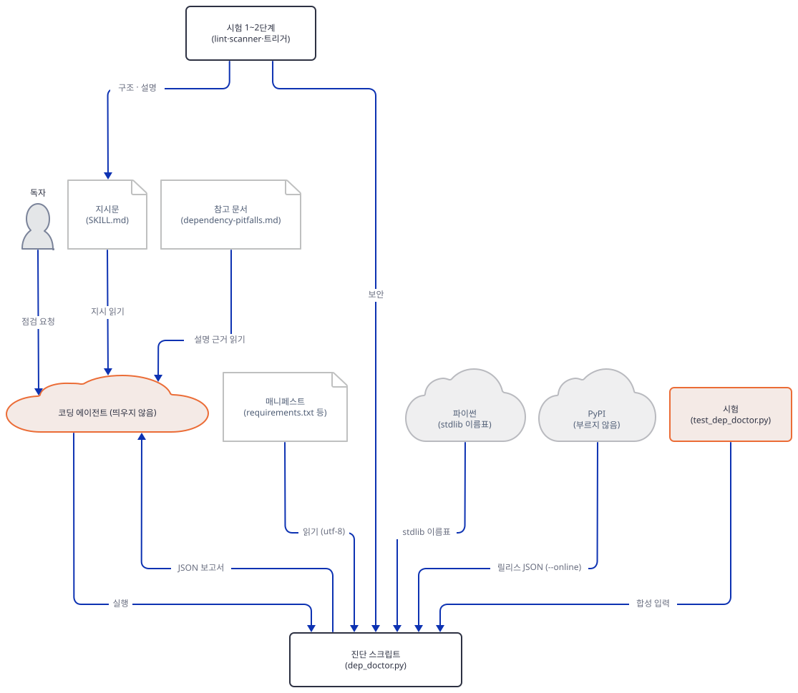

**확인.** 마지막 줄이 `PASS: 66/66 checks`입니다. 시험은 합성 매니페스트 다섯(`requirements.txt`, `pyproject.toml`, 표지, 플랫폼 표지, `package.json`)을 쓰고 분류·심각도·줄 번호·`why`·`fix`의 모양을 단언합니다. 표지 시험 둘이 눈에 띕니다. `dataclasses; python_version < "3.7"`이 활성 파이썬(3.7보다 높음)에서 조용히 사라지는지, `platform_system`이 다른 두 `torch` 고정이 충돌로 보이지 않는지입니다. 이 시험은 `--online`을 한 번도 켜지 않고, 파이썬 판을 바꿔 돌지도 않습니다. Step 3과 7의 차이는 시험이 잡지 않는 곳입니다.

3단계 `evals.json`의 기대는 에이전트가 실제로 돌아야 확인되므로 이 문서는 돌리지 않았고 읽기만 했습니다. 시험 1("check my requirements.txt and explain anything that looks wrong")의 기대는 `--json`이고 `--online`이 없는 실행, 각 보고 항목의 여섯 필드, 다섯 종류의 구분, 승인 없는 수정 금지입니다. 시험 2는 `pyproject.toml`만 점검하고 높음을 먼저 말하고 해결기·CVE 감사가 아니라고 밝히는 것입니다. 시험 3("is this exact package version yanked on PyPI?")은 `--online`을 넘기기 전에 허락을 묻고, 정확한 고정만 보내고, 모든 파일이 야크일 때만 야크라고 부르고, 야크를 CVE와 같다고 하지 않는 것입니다. 여섯 필드와 "모든 파일이 야크일 때만"은 이 문서가 스크립트로 확인했습니다. "이름과 버전을 보낸다"는 Step 7에서 본 것과 어긋나고, 나머지는 에이전트의 행동이라 확인하지 못했습니다. 에이전트가 `SKILL.md`를 따르는 흐름은 본문에서 이렇게 읽힙니다(그림의 말은 모두 `SKILL.md`가 시키는 것이고 실행한 적 없습니다). 시작할 때 이름과 설명만 올라와 있다가 사용자의 말이 설명과 맞으면 본문을 읽고, 경로가 없고 매니페스트가 여럿이면 묻고(저장소 전체를 훑지 말라는 지시가 있습니다),

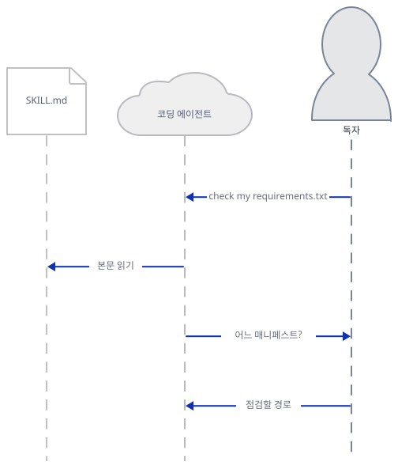

스크립트를 돌려 JSON을 받고,

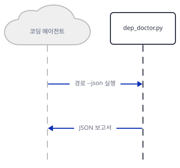

참고 문서를 읽은 뒤 높음부터 설명하고 수정을 제안해 승인을 기다리고,

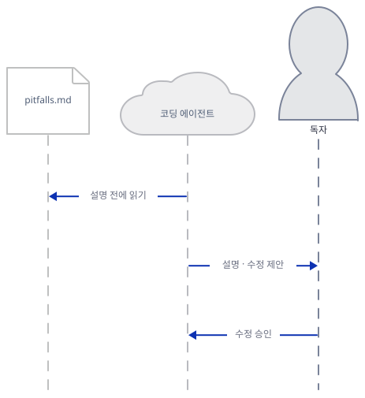

승인된 수정만 적용한 뒤 오프라인 진단을 다시 돌립니다(기존 설치·시험 명령도 다시 돌리라고 적혀 있습니다).

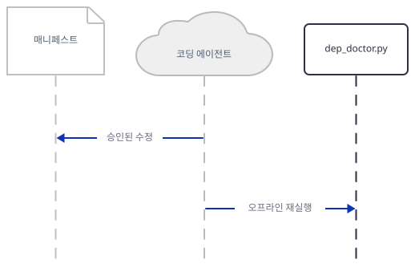

마지막으로 `agent_skills/README.md`의 "The bar" 다섯 줄을 이 문서가 본 것과 맞대 봅니다.

| README의 기준 | 이 문서가 본 것 |
|---|---|
| Real scripts | 485줄이고 표준 라이브러리만 씁니다. 파일 쓰기·하위 프로세스·환경변수 읽기가 소스에 없습니다(`grep`) |
| Researched references, with sources | `dependency-pitfalls.md` 74줄에 주소(URL)가 0개입니다. 출처는 달려 있지 않습니다 |
| Evidence over vibes | 단언 66개. 다만 모두 합성 매니페스트이고 파이썬 판은 하나입니다 |
| Local and private by default | 기본 실행의 소켓 연결 감시 기록이 0건이었습니다(Step 3~6, 8). `--online`은 선택이고 이름을 보냅니다 |
| Tested on real inputs | 시험 자체는 합성입니다. 이 문서가 실제 `requirements.txt` 159개를 돌렸고 모두 끝까지 돌았습니다. `pyproject.toml`과 `package.json`은 실제 파일에 돌려 보지 못했습니다 |

## 요청 한 건이 흐르는 과정

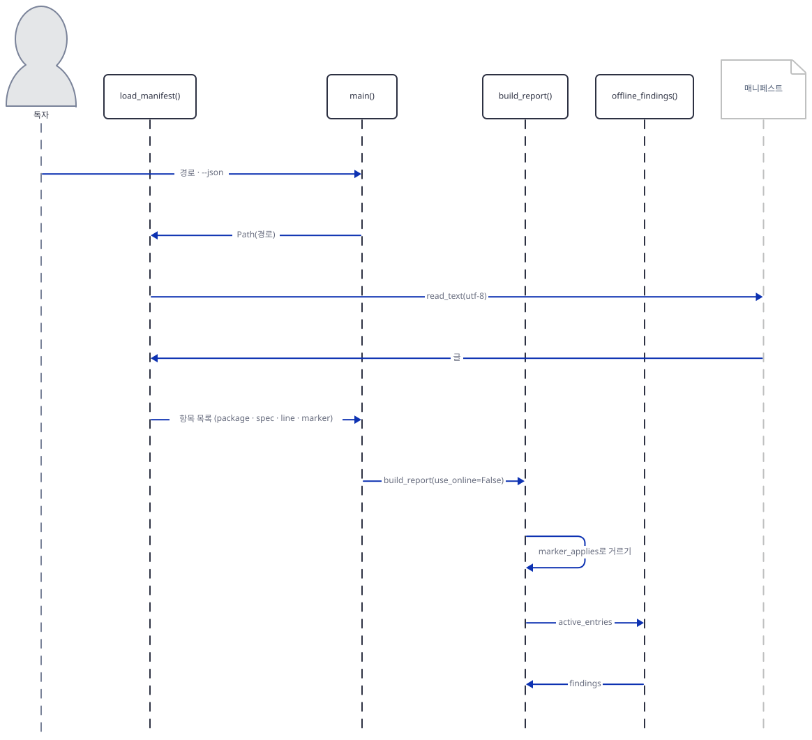

독자(또는 에이전트)가 `dep_doctor.py 경로 --json`을 실행하면 `main`이 `load_manifest`를 부르고, 이 함수가 파일 이름(`package.json`, `pyproject.toml`, `.txt`)으로 파서를 골라 UTF-8로 읽어 항목 목록(이름·제약·줄 번호·표지)을 돌려줍니다. `main`은 `build_report`로 넘깁니다. 첫 일은 현재 파이썬에 해당하지 않는 표지의 항목을 거르는 것이고, 남은 항목을 `offline_findings`에 줍니다. 여기서 백포트·표준 라이브러리·고정 없음·중복·충돌이 나옵니다.

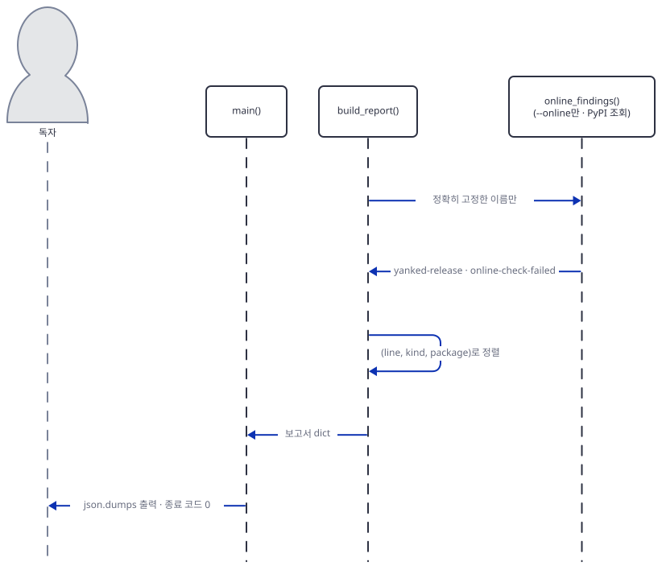

`--online`일 때만 정확히 고정한 이름을 PyPI에 묻는 결과가 더해지고, 보고서는 (줄, 종류, 이름)으로 정렬되어 JSON이나 사람용 글로 출력되며 종료 코드는 0입니다. 위 그림은 시험의 66개 단언이 지키는 JSON 모양(`file`, `findings`, `summary`)이 만들어지는 순서입니다.

## 실행 체크리스트

- [ ] `lab-env.sh`를 불러 `py`·`pyv`가 정의되었다(Step 1)
- [ ] 스킬을 `.claude/skills/dependency-doctor`로 복사했고 파일이 넷이다(Step 1)
- [ ] `fm.py`가 `description 583`·`compatibility 116`과 `SKILL.md lines: 151`을 찍는다(Step 1)
- [ ] 구조 시험이 오류 0·경고 0이고 보안 시험이 `0 CRITICAL, 0 WARN, 5 INFO`다(Step 2)
- [ ] 트리거 시험이 통과하고(`PYTHONUTF8=1` 필요) `trig.py`의 점수 여섯 줄을 읽었다(Step 2)
- [ ] `a-shadow.txt`가 높음 3건(백포트 둘, 표준 라이브러리 하나)이고 종료 코드 0이다(Step 3)
- [ ] `b-removed.txt`가 3.11에서 10건, 3.13·3.14에서 6건이다(Step 3)
- [ ] `d-pins.txt`가 8건이고 `flask`와 `click`이 충돌이 아니라 중복이다(Step 4)
- [ ] BOM 파일은 1건만 나오고 UTF-16 파일은 종료 코드 2다(Step 4)
- [ ] `pyproject.toml`에서 `httpx`가 3행으로 나오고 `[dependency-groups]`는 비어 있다(Step 5)
- [ ] `survey.py`가 `files 159 | files with no finding 77 | findings by kind {'unpinned': 299}`를 찍는다(Step 6)
- [ ] `online_lab.py`가 `guard check` 줄을 찍고 가짜 서버가 요청 넷을 본다(Step 7)
- [ ] `g-noreason.txt`에서 `AttributeError`가 나는 것을 보았다(Step 7)
- [ ] 스크립트 시험이 `PASS: 66/66 checks`다(Step 8)
- [ ] 끝나면 터미널을 닫고 `doctor-lab/`을 지웠다(그 안의 `fake-home`, `tmp` 포함)

## 문제 해결

| 증상 | 원인 | 해결 |
|---|---|---|
| 트리거 시험이 `UnicodeDecodeError: 'cp949' codec can't decode byte 0xe2` | `run_trigger_evals.py`가 `SKILL.md`를 인코딩 없이 열어 한국어 Windows에서 cp949로 읽는다 | `PYTHONUTF8=1`을 건다(`lab-env.sh`에 있음) |
| `dep_doctor.py: error: 'utf-8' codec can't decode byte 0xff`, 종료 코드 2 | 매니페스트가 UTF-16이다(Windows PowerShell 5.1의 `>`가 그렇게 쓴다고 하나 확인하지 못했다) | UTF-8로 다시 저장한다 |
| 보고서에 첫 줄의 항목이 없다 | 파일이 UTF-8 BOM으로 시작한다. 오류 없이 첫 줄이 건너뛰어진다 | BOM 없는 UTF-8로 저장한다 |
| `error: unsupported manifest` | 파일 이름이 `package.json`·`pyproject.toml`·`*.txt`가 아니다(`requirements.in` 등) | `.txt`로 복사해 돌린다 |
| 높음 건수가 파이썬 판마다 다르다 | 표준 라이브러리 이름과 표지를 돌린 파이썬으로 판정한다 | 지원하는 판마다 돌려 본다(Step 3) |
| 줄 번호가 엉뚱한 줄(예: `description`)을 가리킨다 | `pyproject.toml`·`package.json`의 줄 번호는 이름을 글에서 처음 찾은 곳이다 | 파일을 직접 열어 확인한다(Step 5) |
| 종료 코드가 항상 0이라 CI가 실패하지 않는다 | `main`이 보고서가 있어도 0을 돌려준다 | CI 관문으로 쓰지 않거나 JSON의 `summary.total`을 직접 검사한다(Step 4) |
| `online_lab.py`가 `AttributeError: 'NoneType' object has no attribute 'strip'`로 죽는다 | 응답의 `yanked_reason`이 `null`이다(`dep_doctor.py:407-409`) | 복사본에서 `(file_info.get("yanked_reason") or "")`로 고친다. 원본은 고치지 않았다 |
| 스킬 README의 `--online` 명령이 바로 `pypi.org`에 간다 | 그 줄은 래퍼 없이 실제 PyPI를 부른다 | 이 문서는 그 줄을 실행하지 않았다. 켤 때는 허락을 구한 뒤 이름이 나간다는 것을 알고 한다 |
| `uv`가 3.11 등을 못 찾는다 | `--no-python-downloads`가 받는 것을 막았다 | 그 판을 `uv python install`로 미리 받거나 그 비교를 건너뛴다 |

## 더 해보기

- `agent_skills/dependency-doctor/scripts/dep_doctor.py:404-411`의 `yanked_reason` 읽기를 복사본에서 `null`을 견디게 고치고 `g-noreason.txt`를 다시 돌려, 사유 없이 야크 처리된 항목이 보고되는지 보세요. 원본은 고치지 않습니다.
- `[dependency-groups]`의 항목도 읽도록 복사본의 `load_pyproject`(`agent_skills/dependency-doctor/scripts/dep_doctor.py:117-153`)를 고치고 `manifests/py/pyproject.toml`에서 `typing==3.7.4.3`이 높음으로 나오는지 확인한 뒤, 시험 66개가 여전히 통과하는지 보세요. 시험 파일은 자기 위치에서 `parents[2]/dependency-doctor/scripts/dep_doctor.py`를 고르므로(`agent_skills/evals/dependency-doctor/test_dep_doctor.py:18-23`) 그대로 돌리면 저장소 원본을 시험합니다. 고친 복사본을 시험하려면 시험 파일도 같은 상대 배치(`<x>/evals/dependency-doctor/test_dep_doctor.py`와 `<x>/dependency-doctor/scripts/dep_doctor.py`)로 복사해 돌리세요.
- `agent_skills/evals/dependency-doctor/trigger-cases.json`에 음성 사례 하나("update my lockfile" 같은 것)를 복사본에 넣고 `trig.py`의 점수와 통과선(1.15배)을 계산해, 설명의 어떤 낱말이 점수를 끌어올리는지 찾아보세요.

## 다음 날 예고

[Day 158 · 🔭 Scope Creep Detector](../day158-scope-creep-detector/README.md) — 변경(diff)이 말한 의도를 넘었는지 보는 스킬입니다. `agent_skills/scope-creep-detector`에는 `SKILL.md`(136줄), `scripts/scope_creep.py`(528줄), `references/scope-signals.md`(83줄)가 있고, 스크립트는 `git`을 하위 프로세스로 불러(`scope_creep.py:427-430`) diff를 읽습니다. 오늘 스크립트가 파일 하나를 읽기만 했다면 내일은 `git` 저장소를 읽습니다.
