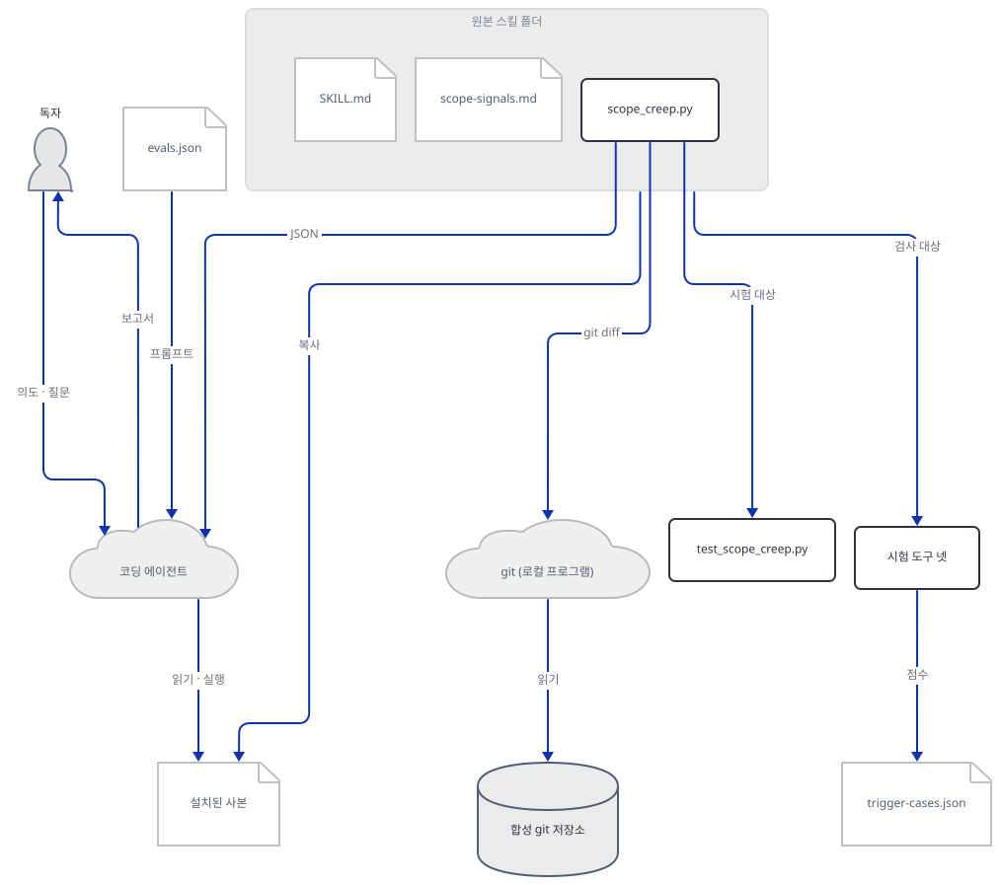
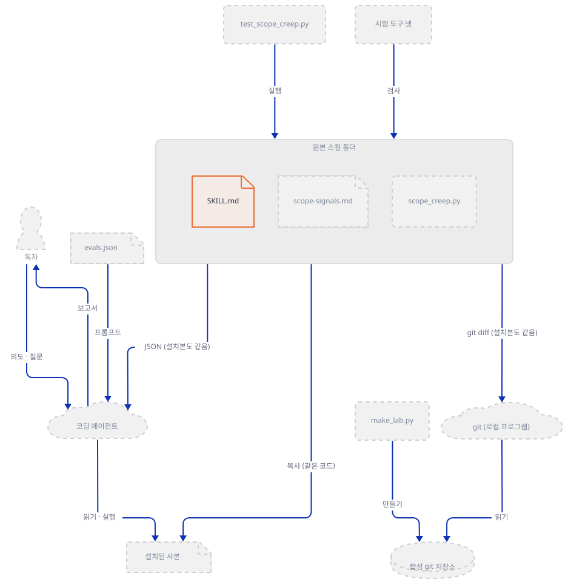
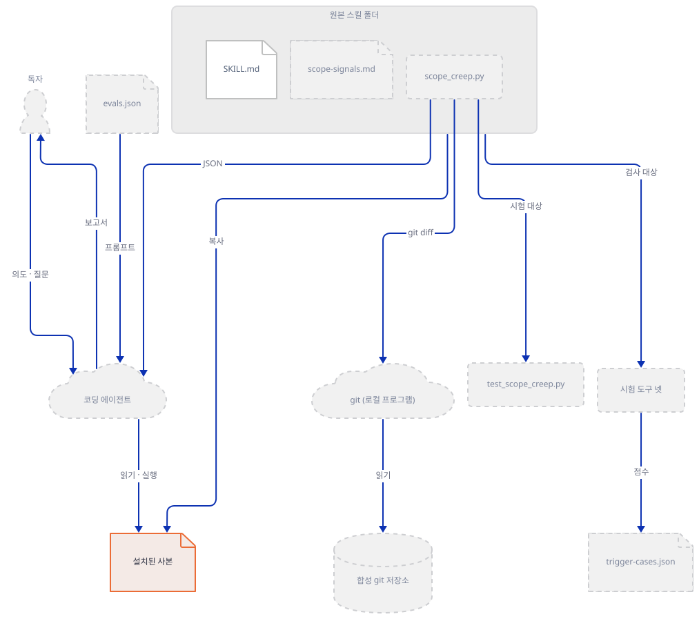
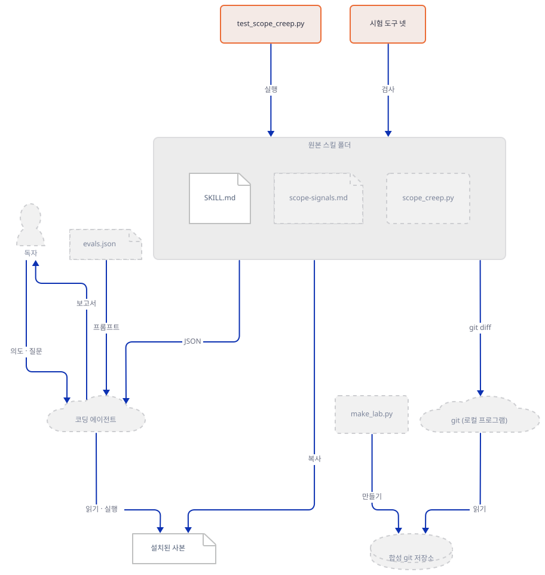
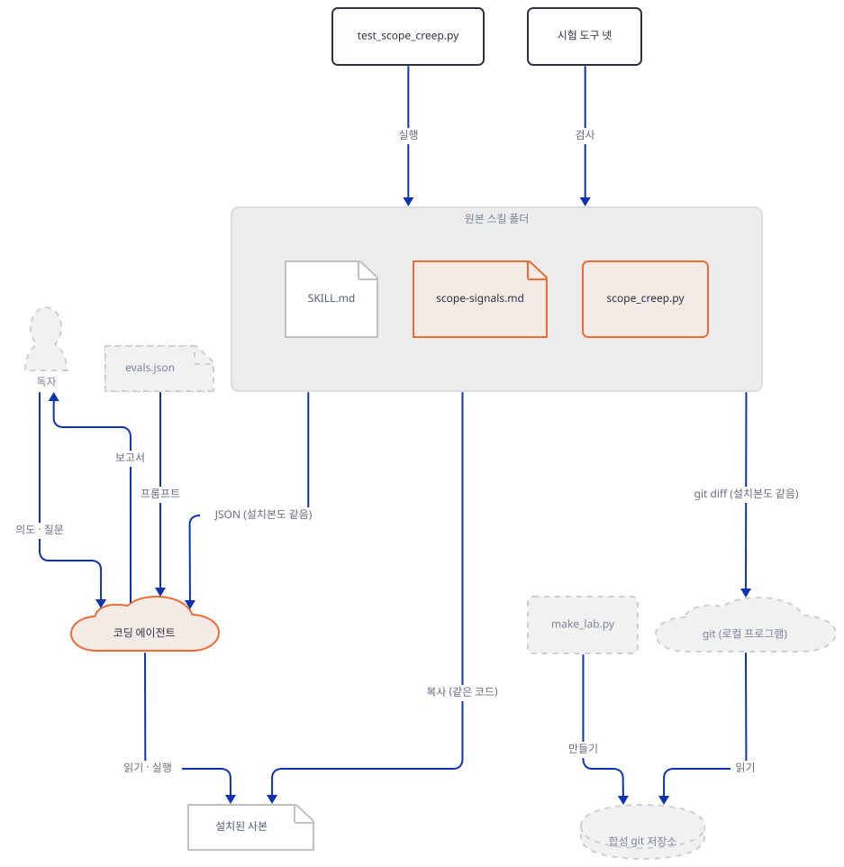
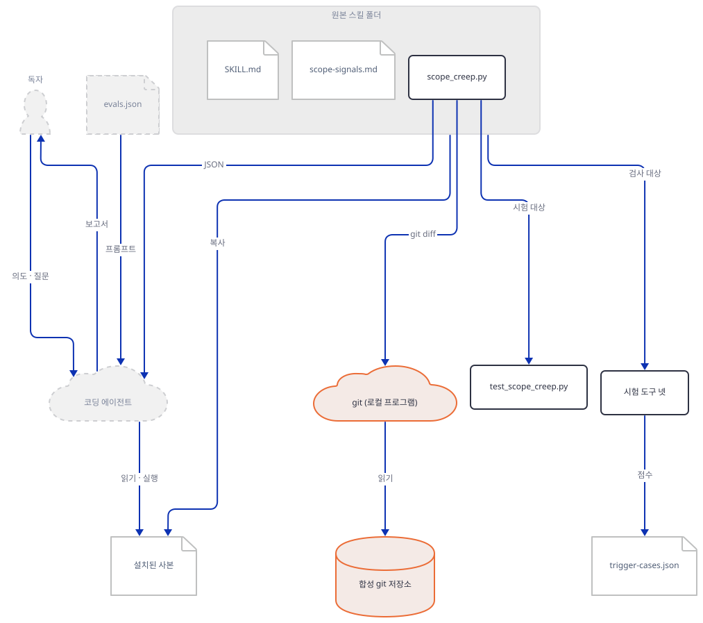
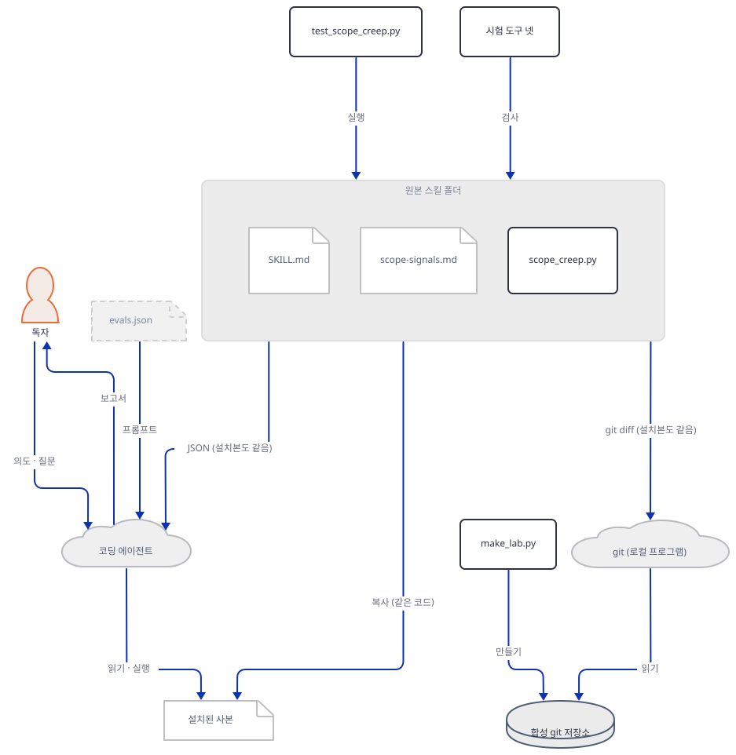
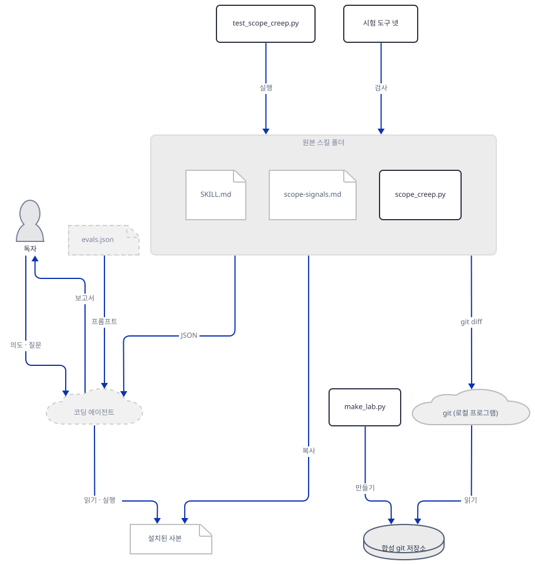
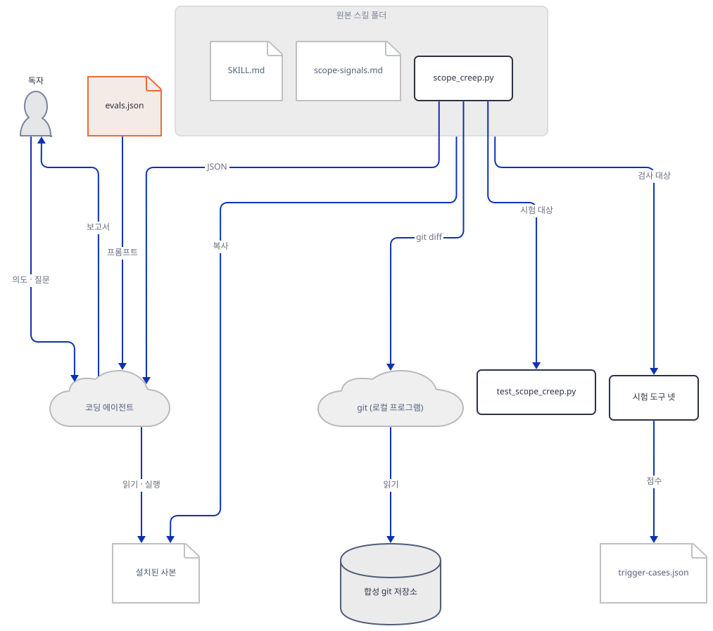
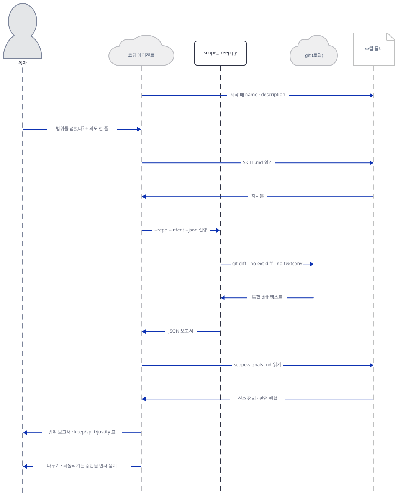

# Day 158 · 🔭 Scope Creep Detector

> 볼륨 16 🧩 Agent Skills · 난이도 ★★☆ · 예상 소요 140분(스킬은 528줄짜리 스크립트 하나와 지시문 둘뿐이지만, 직접 만든 저장소에서 스크립트를 열 번 넘게 돌리며 출력과 한계를 읽고, 시험 다섯 개의 출력을 해석하고, 판정표를 손으로 쓰는 데 시간이 듭니다) · API 비용 대략 0원(모델을 한 번도 부르지 않았습니다) · 원본 앱: `agent_skills/scope-creep-detector`

## 오늘 만들 것

"한 줄짜리 고침인데 diff에는 파일이 열한 개 들어 있다"는 상황에서, 변경이 원래 의도를 넘어 번졌는지 알려 주는 스킬을 따라 봅니다. 스킬의 중심은 `scripts/scope_creep.py`(528줄)입니다. 이 스크립트는 `git diff`를 읽고, 의도 한 줄과 파일 경로의 낱말이 겹치는지, 새 의존성·공개 함수 이름 변경·설정 파일 편집·너무 큰 덩어리(hunk)·공백만 바꾼 파일이 있는지를 세어 JSON으로 내놓습니다. 유지(keep)·분리(split)·정당화(justify)를 정하는 일은 스크립트가 아니라 에이전트와 사람의 몫이고, `SKILL.md`(136줄)와 `references/scope-signals.md`(83줄)가 그 방법을 적어 둡니다.

볼륨 16의 다섯째 날입니다. 스킬이 무엇이고 어떤 시험 단계가 있으며 어떻게 설치하는지는 [Day 154](../day154-advisor-orchestrator-worker/README.md)가 자세히 다루는 내용이므로 여기서는 이 스킬에 필요한 만큼만 적습니다. [Day 155](../day155-thinking-out-loud/README.md)의 스킬은 글만 있었고, [Day 156](../day156-commit-archaeologist/README.md)·[Day 157](../day157-dependency-doctor/README.md)과 오늘은 스크립트가 있는 스킬입니다. 그래서 오늘은 "약속이 지켜지는가"보다 "스크립트가 실제로 무엇을 보고 무엇을 못 보는가"를 묻습니다.

이 문서는 에이전트(Claude Code, Codex, Cursor 등)를 한 번도 띄우지 않았고 모델도 부르지 않았으며 3단계 행동 시험도 돌리지 않았습니다. 이 PC의 진짜 `~/.claude/skills`나 다른 에이전트 설정 폴더에는 아무것도 넣지 않았고 `npx skills add`도 실행하지 않았습니다. 스크립트는 스크래치 폴더에 만든 합성 git 저장소에만 돌렸고, 저장소의 이름과 메일은 가짜 값입니다. 그래서 "에이전트가 실제로 이렇게 판정한다"는 문장은 이 문서에 없습니다. 있는 것은 셋입니다. 지시문을 읽어 정리한 내용, 시험 다섯 개와 스크립트를 직접 돌린 출력, 그리고 제가 손으로 쓴 판정표(모델의 출력이 아니라 `SKILL.md`의 규칙을 따라 한 견본)입니다. 직접 돌려 보거나 소스로 확인한 것은 여덟입니다.

1. `SKILL.md`의 frontmatter는 명세의 필드 규칙을 지키고, 설명은 433자입니다. 구조 검사는 오류 0·경고 0입니다(Step 1, 3).
2. 시험 다섯(구조·보안·트리거·레지스트리·스크립트)이 모두 통과합니다. 스크립트 시험은 15개 확인입니다(Step 3).
3. 스크립트가 띄우는 하위 프로세스는 `git`뿐입니다. 가져오는 모듈은 표준 라이브러리 여덟이고, 소켓 가드 아래에서도 막힌 연결이 없었습니다(Step 3, 8).
4. 합성 저장소의 변경 열한 파일 가운데 다섯이 `in_scope`, 여섯이 `likely_creep`입니다. 그런데 `in_scope`에도 번진 변경이 둘 있고, `likely_creep`에도 꼭 필요한 파일이 하나 있습니다(Step 5, 6).
5. 작업 트리·스테이징·브랜치·표준 입력의 네 방식은 같은 변경에 같은 JSON을 냅니다. 다만 일부만 스테이징하면 어느 방식도 전체를 보지 못합니다(Step 7).
6. 새로 만들었지만 `git add`하지 않은 파일은 작업 트리 방식에서 아예 보이지 않습니다(Step 7).
7. 한국어 의도는 낱말이 모두 버려져 `in_scope`가 0이 되고, 기본 git 설정에서 한국어 파일 경로는 `\353\254\270…` 같은 8진수 이스케이프로 나옵니다(Step 7).
8. 대상 저장소의 `.git/config`에 `core.fsmonitor`가 있으면, 스크립트의 `--no-ext-diff --no-textconv`를 지켜도 그 명령이 실행됩니다(Step 7).



## 사전 준비

| 서비스/도구 | 용도 | 발급·설치 |
|---|---|---|
| Python 3.8 이상 | 스크립트와 저장소의 시험 도구를 돌린다. 스크립트 머리말은 3.11을 적고, 시험 도구 머리말은 3.8 이상을 적는다. 이 문서는 3.14.2로 확인했다 | [공통 사전 준비](../README.md#공통-사전-준비-한-번만) 절 참고 |
| git 2.28 이상 | 스크립트가 `git diff`를 부르고, 아래 합성 저장소 만들기가 `git init -b`를 쓴다. 이 문서는 2.52.0으로 확인했다 | 공통 사전 준비 |
| 이 저장소의 클론 | 스킬 원본과 시험 도구를 읽는다. 아래 명령은 모두 저장소 루트에서 시작한다 | `git clone https://github.com/Shubhamsaboo/awesome-llm-apps` |
| 코딩 에이전트 | 스킬을 실제로 불러 쓰는 쪽. **이 문서는 쓰지 않았고 필요하지도 않다** | 없음 |
| API 키·계정 | 필요 없다 | 없음 |

한국어 Windows에서는 출력과 파일 읽기가 `cp949`로 잡혀 있습니다. 저장소의 시험 도구에는 `-X utf8`을, 모든 파이썬 명령에는 `-B`를 붙입니다. `-B`는 저장소 안에 `__pycache__`를 만들지 않게 합니다.

## 아키텍처 한눈에 보기

| 컴포넌트 | 역할 | 코드 위치 |
|---|---|---|
| frontmatter | 이름, 언제 쓰는지를 말하는 설명, 라이선스, 작성자·버전 | `agent_skills/scope-creep-detector/SKILL.md:1-15` |
| 지시문 본문 | 의도 정하기, 실행 방식 넷, JSON 읽기, keep·split·justify 판정, 보고서 틀 | `agent_skills/scope-creep-detector/SKILL.md:16-136` |
| 신호 정의 | 관련도, 하위 시스템, 의존성, 이름 변경, 설정 편집, 큰 덩어리, 공백뿐인 파일, 판정 행렬 | `agent_skills/scope-creep-detector/references/scope-signals.md:1-83` |
| diff 읽기 | `git diff` 하위 프로세스 또는 파일·표준 입력 | `agent_skills/scope-creep-detector/scripts/scope_creep.py:426-463` |
| diff 해석 | 통합 diff를 파일과 덩어리로 쪼갬 | `agent_skills/scope-creep-detector/scripts/scope_creep.py:73-147` |
| 분류기 | 신호를 세고 `in_scope`·`likely_creep`로 가름 | `agent_skills/scope-creep-detector/scripts/scope_creep.py:326-423` |
| 출력 | JSON 또는 사람이 읽는 요약 | `agent_skills/scope-creep-detector/scripts/scope_creep.py:466-482, 519-523` |
| 시험 도구 넷 | 구조·보안·트리거·레지스트리 검사(모델 없음) | `agent_skills/evals/tools/` |
| 스크립트 시험(2b) | 임시 저장소에 섞인 diff를 만들어 15개 확인 | `agent_skills/evals/scope-creep-detector/test_scope_creep.py:1-306` |
| 시험 자료 | `trigger-cases.json`(42줄), `evals.json`(36줄, 3단계) | `agent_skills/evals/scope-creep-detector/` |
| 레지스트리 | 이름·설명·설치 명령·시험 폴더 | `agent_skills/registry.json:65-77` |
| 코딩 에이전트 | 스킬을 불러 읽고 스크립트를 실행하는 쪽 | 코드 없음 (외부. 이 문서는 띄우지 않음) |
| 이 문서의 합성 저장소 | 한 가지 고침에 군더더기를 섞은 연습용 저장소 | 코드 없음 (Step 5의 `make_lab.py`로 직접 만듦) |

## 단계별 진행

### Step 1. 원본을 읽기만 하고 frontmatter를 명세와 대조한다

**목적.** 원본 폴더에는 아무것도 쓰지 않고, 스킬이 무엇으로 이루어졌는지 확인합니다. 에이전트가 시작할 때 읽는 것은 본문이 아니라 frontmatter의 이름과 설명뿐이므로 그 부분을 명세와 한 줄씩 맞춰 봅니다.

**할 일.** 저장소 루트에서 줄 수와 파이썬 파일 수를 세고 스크래치 폴더를 만듭니다.

```bash
cd awesome-llm-apps
wc -l agent_skills/scope-creep-detector/SKILL.md agent_skills/scope-creep-detector/README.md agent_skills/scope-creep-detector/references/scope-signals.md agent_skills/scope-creep-detector/scripts/scope_creep.py
find agent_skills/scope-creep-detector -name "*.py" | wc -l
LAB=$(mktemp -d)
echo "$LAB"
```

```powershell
Set-Location awesome-llm-apps
foreach ($f in "SKILL.md","README.md","references/scope-signals.md","scripts/scope_creep.py") { "$f " + (Get-Content "agent_skills/scope-creep-detector/$f").Count }
(Get-ChildItem agent_skills/scope-creep-detector -Recurse -Filter *.py).Count
$LAB = Join-Path $env:TEMP "scd-lab"
New-Item -ItemType Directory $LAB | Out-Null
$LAB
```

(PowerShell 줄은 실행해 보지 못했습니다.) 이어서 `SKILL.md:1-15`를 봅니다. 설명은 원문 그대로입니다.

```yaml
---
name: scope-creep-detector
description: >-
  Analyzes git diffs against a stated intent to detect scope creep, unrelated
  files, broad pull requests, changes that grew beyond a fix, dependency
  additions, public API renames, config or CI edits, oversized hunks, and
  formatting-only files. Use when the user asks whether a change grew beyond
  the fix, a PR is too broad, or what unrelated stuff they touched, and wants
  keep, split, or justify guidance. Operates locally and offline.
license: Apache-2.0
metadata:
  author: "Matt Van Horn"
  version: "1.0.0"
  source: "https://github.com/Shubhamsaboo/awesome-llm-apps"
---
```



**확인.** 직접 확인한 출력입니다(2026-10-19).

```text
  136 agent_skills/scope-creep-detector/SKILL.md
   35 agent_skills/scope-creep-detector/README.md
   83 agent_skills/scope-creep-detector/references/scope-signals.md
  528 agent_skills/scope-creep-detector/scripts/scope_creep.py
  782 total
1
```

[agentskills.io 명세](https://agentskills.io/specification)와 [Anthropic의 Agent Skills 문서](https://platform.claude.com/docs/en/agents-and-tools/agent-skills/overview)(둘 다 2026-10-19에 읽음)와 이렇게 맞았습니다.

| 필드 | 명세의 규칙 | 이 스킬 |
|---|---|---|
| `name` | 1~64자, 소문자·숫자·하이픈, 처음과 끝이 하이픈이 아님, `--` 없음, 폴더 이름과 같음 | `scope-creep-detector`(20자), 폴더 이름과 같음 |
| `description` | 1~1024자, 무엇을 하고 언제 쓰는지 | 줄 바꿈을 공백으로 접으면 433자(직접 센 값). "Use when …"으로 언제 쓰는지를 말함 |
| `license` | 선택 | `Apache-2.0` |
| `metadata` | 선택, 문자열 키와 문자열 값의 맵 | `author`·`version`·`source` 셋, 모두 문자열 |
| `compatibility`·`allowed-tools` | 선택(`allowed-tools`는 실험적) | 없음 |

Anthropic 문서는 `name`에 `anthropic`·`claude` 낱말을 못 쓰게 하는데 이 이름에는 없습니다. 같은 문서의 점진적 불러오기 설명에 따르면 에이전트는 시작할 때 이름과 설명만 읽고, 요청이 설명에 맞으면 `SKILL.md` 본문을 읽고, `references/`는 필요할 때 읽습니다. 스크립트는 bash로 실행되고 **스크립트 코드는 맥락에 들어가지 않으며 출력만 들어갑니다.** 이 스킬에서 528줄의 코드는 모델에게 읽히지 않고, 모델이 보는 것은 JSON 출력이라는 뜻입니다. 본문 136줄은 명세의 권장(500줄 미만)에 맞습니다. `allowed-tools`가 없으므로 이 스킬은 `git`과 `python3` 실행을 미리 허락받지 않습니다. 실제로 에이전트가 허락을 묻는지는 에이전트마다 다르고, 이 문서는 확인하지 못했습니다.

### Step 2. 스크래치 프로젝트에 설치하고 폴더에 무엇이 들어갔는지 본다

**목적.** 설치가 폴더 복사라는 것을 실제로 해 보고, 무엇이 따라 들어가는지 봅니다. 이번에는 스크립트가 들어 있으므로 "설치"가 곧 "내 PC에서 돌 코드를 놓는 일"이라는 점이 중요합니다. 진짜 홈의 에이전트 설정 폴더는 건드리지 않습니다.

**할 일.** 스크래치 프로젝트를 만들고 Claude Code가 읽는 프로젝트 위치(`.claude/skills/`)와 여러 에이전트가 읽는 공용 위치(`.agents/skills/`)에 각각 복사합니다.

```bash
mkdir -p "$LAB/myproj/.claude/skills" "$LAB/myproj/.agents/skills"
cd "$LAB/myproj"
cp -r ~/awesome-llm-apps/agent_skills/scope-creep-detector .claude/skills/scope-creep-detector
cp -r ~/awesome-llm-apps/agent_skills/scope-creep-detector .agents/skills/scope-creep-detector
find .claude .agents -type f | sort
```

```powershell
New-Item -ItemType Directory "$LAB/myproj/.claude/skills","$LAB/myproj/.agents/skills" | Out-Null
Set-Location "$LAB/myproj"
Copy-Item -Recurse ~/awesome-llm-apps/agent_skills/scope-creep-detector .claude/skills/scope-creep-detector
Copy-Item -Recurse ~/awesome-llm-apps/agent_skills/scope-creep-detector .agents/skills/scope-creep-detector
Get-ChildItem .claude,.agents -Recurse -File | ForEach-Object FullName
```

(`~/awesome-llm-apps`는 클론한 위치로 바꿉니다. PowerShell 줄은 실행해 보지 못했습니다.)



**확인.** 직접 확인한 출력입니다(Git Bash, 스크래치 폴더).

```text
.agents/skills/scope-creep-detector/README.md
.agents/skills/scope-creep-detector/references/scope-signals.md
.agents/skills/scope-creep-detector/scripts/scope_creep.py
.agents/skills/scope-creep-detector/SKILL.md
.claude/skills/scope-creep-detector/README.md
.claude/skills/scope-creep-detector/references/scope-signals.md
.claude/skills/scope-creep-detector/scripts/scope_creep.py
.claude/skills/scope-creep-detector/SKILL.md
```

폴더에는 파일 넷입니다(`SKILL.md` 5,140바이트, `README.md` 1,231바이트, `scope-signals.md` 3,268바이트, `scope_creep.py` 18,609바이트). `diff -r`로 원본과 비교하면 같고, 설치된 사본에도 `skill_lint.py --strict`가 통과합니다. 설치된 사본의 스크립트를 스크래치 저장소에 돌리면 원본과 같은 요약이 나왔습니다. `evals/`는 따라오지 않습니다. `agent_skills/evals/README.md`가 "These files never ship in an install"이라고 적은 대로입니다.

저장소 README가 안내하는 다른 길 둘은 이 문서에서 실행하지 않았습니다.

- 진짜 홈에 두는 길: `~/.claude/skills/` 등. 저장소 README의 표가 에이전트별 위치를 적습니다. Anthropic 문서도 Claude Code는 개인용 `~/.claude/skills/`와 프로젝트용 `.claude/skills/`를 읽는다고 적습니다.
- `npx skills add https://github.com/Shubhamsaboo/awesome-llm-apps/tree/main/agent_skills/scope-creep-detector`. CLI의 저장소는 [vercel-labs/skills](https://github.com/vercel-labs/skills)이고, README는 기본이 프로젝트 설치(`-g`를 주면 사용자 폴더), 심볼릭 링크를 권장 방식으로 두고 `--copy`로 복사를 고르게 하며, 익명 사용 통계를 보내고 `DISABLE_TELEMETRY=1`이나 `DO_NOT_TRACK=1`로 끈다고 적습니다. 내려받기 10 MiB·풀면 25 MiB·파일 1,000개 제한은 직접 내려받는 주소에 대한 것이고 GitHub 트리 주소에 대한 제한은 이 README가 말하지 않습니다(2026-10-19에 읽음). CLI를 실행하지 않았으므로 직접 본 것이 아닙니다.

저장소 README의 "Before you install any skill"은 스킬이 에이전트의 권한(셸, 파일, 자격 증명)으로 돈다며 설치 전에 `SKILL.md`와 모든 스크립트를 읽으라고 합니다. Anthropic 문서의 "Treat like installing software"와 같은 말입니다. 이 스킬은 읽을 코드가 528줄 하나입니다. Step 3과 4가 그 읽기의 일부입니다.

### Step 3. 결정적 시험 다섯을 돌린다

**목적.** 저장소가 CI에서 돌리는 무료 시험 가운데 이 스킬에 걸리는 것을 직접 돌립니다. 이번에는 스크립트가 있으니 2b단계(스크립트 시험)도 해당됩니다. 모델은 부르지 않습니다.

**할 일.** 저장소 루트에서 다섯 줄입니다. 레지스트리 검사는 `--check`만 쓰고, `--write`는 `registry.json`을 다시 쓰므로 돌리지 않습니다.

```bash
python -B -X utf8 agent_skills/evals/tools/skill_lint.py agent_skills/scope-creep-detector --strict
python -B -X utf8 agent_skills/evals/tools/skill_scanner.py agent_skills/scope-creep-detector
python -B -X utf8 agent_skills/evals/tools/run_trigger_evals.py
python -B -X utf8 agent_skills/evals/tools/registry_lint.py --check --root .
python -B -X utf8 agent_skills/evals/scope-creep-detector/test_scope_creep.py
```

```powershell
python -B -X utf8 agent_skills/evals/tools/skill_lint.py agent_skills/scope-creep-detector --strict
python -B -X utf8 agent_skills/evals/tools/skill_scanner.py agent_skills/scope-creep-detector
python -B -X utf8 agent_skills/evals/tools/run_trigger_evals.py
python -B -X utf8 agent_skills/evals/tools/registry_lint.py --check --root .
python -B -X utf8 agent_skills/evals/scope-creep-detector/test_scope_creep.py
```

(저장소의 README는 `python3`로 적습니다. Windows에서는 `python`이고, 이 저장소의 `.venv`를 집지 않는지 먼저 `python --version`으로 봅니다. PowerShell 줄은 실행해 보지 못했습니다.)



**확인.** 직접 확인한 출력입니다. 이 PC에서는 `HOME`·`USERPROFILE`·`CLAUDE_CONFIG_DIR`·`TEMP`를 스크래치로 돌렸고, 루프백이 아닌 이름 조회와 연결을 거부하는 소켓 가드를 먼저 `192.0.2.1`로 단언한 뒤 그 아래서 돌렸습니다. 독자 명령에는 이 가드가 없습니다.

```text
Linting ...scope-creep-detector (strict=on)
  PASS — 0 error(s), 0 warning(s)

agent-skill security scan v1.0.0 — 1 skill(s) under agent_skills\scope-creep-detector
=== scope-creep-detector (agent_skills\scope-creep-detector) ===
  clean — no findings
Summary: 0 CRITICAL, 0 WARN, 0 INFO
Verdict guidance: no pattern hits. Still read SKILL.md end-to-end — natural-language attacks evade pattern scanners (OWASP AST08).

PASS  scope-creep-detector: 3 positives clear 3 near-misses (weakest 1.00 vs strongest 0.00)
trigger & routing: all clear (7 skills)

Checking registry at ... (mode=check)
  PASS — 0 error(s), 0 warning(s)

scope classification:
  PASS script exits successfully
  ...(14개 줄 생략)...
  PASS plain unified diff without git headers is parsed

PASS: 15/15 checks
```

(트리거 시험은 스킬 일곱 개를 모두 돌려서 줄이 일곱 개 나옵니다. 위에는 이 스킬의 줄만 옮겼습니다.) 소스(`agent_skills/evals/tools/`)의 머리말로 읽은 넷의 역할은 Day 155와 같습니다. 구조 검사는 이름·설명 길이·본문 줄 수·본문이 가리키는 파일이 있는지를, 보안 검사는 "원격 스크립트를 셸로 넘기는 줄" 같은 패턴을 정규식으로 찾고, 레지스트리 검사는 `registry.json`이 frontmatter와 같은지 봅니다. 보안 검사가 스스로 "자연어 공격은 패턴 스캐너를 피한다"고 적는 만큼 깨끗하다는 것은 위험한 줄이 없다는 뜻이지 안전하다는 보증이 아닙니다.

**스크립트 시험(2b)이 하는 일.** 임시 폴더에 git 저장소를 만들고 기준 커밋 뒤에 섞인 변경을 만듭니다. 파이썬 파서 수정(범위 안), CI 편집, 의존성 셋(`requirements.txt`·`package.json`·`pyproject.toml`), 공개 함수 이름 변경, 비공개 `_` 함수 이름 변경, 공백만 바꾼 파일, 45줄을 바꾼 큰 덩어리, 그리고 `.gitattributes`로 연결한 textconv 명령입니다. 이 명령이 실행되면 표지 파일이 생기게 해 두고 스크립트가 그것을 실행하지 않는지(`--no-textconv`의 효과)를 봅니다. 열다섯 확인 가운데 열넷은 작업 트리 방식의 `--json` 한 번이고, 하나는 git 머리글이 없는 평범한 diff를 `--diff`로 읽는 것입니다. 소스로 보면 이 시험은 `--staged`·`--base`·`--hunk-threshold`·의도 생략·인용된 경로를 한 번도 부르지 않습니다. 그 부분은 Step 7에서 직접 합니다.

이 시험을 소켓 가드와 하위 프로세스 기록 아래서 돌렸을 때 막힌 연결은 없었고, 파이썬이 부른 것은 `git`(init·config·add·commit)과 스크립트 자신(파이썬)뿐이었습니다. 시험은 임시 폴더를 `tempfile.mkdtemp`로 만들고 `finally`에서 지웁니다.

**트리거 시험이 모델이 아니라는 점.** `run_trigger_evals.py`의 머리말은 "Deterministic, CI-safe, no model."입니다. 점수는 프롬프트의 낱말(불용어와 세 글자 미만을 빼고 어미 `ing`·`ed`·`es`·`s`를 한 번 잘라 낸 것) 가운데 설명의 낱말과 겹치는 개수를 프롬프트 낱말 수의 제곱근으로 나눈 값이고, 양성의 최저점이 음성의 최고점의 1.15배를 넘어야 통과합니다. 사례별 점수는 저장소의 함수를 불러 쓰는 짧은 스크립트로 뽑았습니다. 아래 `trig_scores.py`를 `$LAB`에 저장합니다.

`trig_scores.py`

```python
import json, os, sys
sys.path.insert(0, sys.argv[1])
import run_trigger_evals as r

name = "scope-creep-detector"
desc = r.tokens(r.description_of(os.path.join(r.SKILLS_ROOT, name)))
print("description tokens:", len(desc))
cases = json.load(open(os.path.join(r.EVALS_ROOT, name, "trigger-cases.json"), encoding="utf-8"))["cases"]
for c in cases:
    pt = r.tokens(c["prompt"])
    print("%-26s %-5s score=%.2f %s" % (c["id"], c["should_trigger"], r.score(pt, desc), sorted(pt & desc)))
print("--- 제가 만든 프롬프트")
for p in ["formatting my code", "review the formatting changes", "is this pull request too broad"]:
    pt = r.tokens(p)
    print("%-34s score=%.2f %s" % (p, r.score(pt, desc), sorted(pt & desc)))
```

```bash
python -B -X utf8 "$LAB/trig_scores.py" agent_skills/evals/tools
```

직접 확인한 출력입니다.

```text
description tokens: 46
change-grew-beyond-fix     True  score=1.50 ['beyond', 'change', 'fix']
pr-too-broad               True  score=1.00 ['broad']
unrelated-files-touched    True  score=2.00 ['stuff', 'touch', 'unrelat', 'what']
near-miss-format           False score=0.00 []
near-miss-linter           False score=0.00 []
near-miss-commit-message   False score=0.00 []
--- 제가 만든 프롬프트
formatting my code                 score=0.71 ['formatt']
review the formatting changes      score=1.15 ['chang', 'formatt']
is this pull request too broad     score=1.73 ['broad', 'pull', 'request']
```

세 가지를 읽습니다. 첫째, 가장 약한 양성 `pr-too-broad`는 낱말 하나(`broad`)로 1.00점을 받습니다. "PR"은 세 글자 미만이라 버려지므로, 설명에 `broad`가 빠지면 이 사례는 0점이 됩니다. 둘째, 음성 `format my code`가 0.00인 것은 `format`이 설명의 `formatting`과 어간이 다르게 잘리기 때문입니다(`format` 대 `formatt`). 제가 만든 `formatting my code`는 0.71, `review the formatting changes`는 1.15로 가장 약한 양성(1.00)을 넘습니다. 시험이 통과하는 까닭 하나는 음성을 일부러 어간이 안 맞는 낱말로 고른 데 있다는 뜻이고, 이 시험이 "에이전트가 형식 정리 요청에 스킬을 켜지 않는다"를 증명하지 않는다는 뜻입니다. 셋째, `agent_skills/evals/README.md`가 스스로 "lexical approximation"이라고 밝힌 한계가 이 숫자들에 그대로 보입니다.

### Step 4. 지시문과 참고 문서와 스크립트 소스를 읽는다

**목적.** `SKILL.md`·`scope-signals.md`·`scope_creep.py`를 설명할 대상으로 읽어, 에이전트에게 무엇을 시키고 스크립트가 실제로 무엇을 하는지 맞춰 봅니다. 두 문서는 에이전트에게 주는 지시문이므로 이 문서는 그 지시를 따르지 않고 옮겨 적기만 합니다.

**할 일.** `SKILL.md`를 위에서 아래로 읽습니다.

- 의도 정하기(`41-48`). 사용자의 한 줄을 쓰고, 없으면 스크립트가 현재 브랜치 이름으로 되돌아갑니다. 그 이름이 `main`·분리된 HEAD처럼 일반적이거나 일과 무관하면 관련도에 뜻이 없으므로 한 줄을 먼저 물으라고 합니다.
- 실행(`50-85`). 작업 트리, `--staged`, `--base main`(병합 기준점 대비), `--diff 파일` 또는 `--diff -`(표준 입력)의 네 방식입니다. `--hunk-threshold`는 저장소에 문서화된 이유가 있을 때만 바꾸고 경고를 없애려고 조절하지 말라고 합니다.
- JSON 읽기(`87-101`). 모든 필드를 풀이하고 "빈 배열도 증거다. 신호가 감지되지 않았다고 말하되 범위 안임이 보장된다고 말하지 말라"고 합니다.
- 판정(`103-116`). `likely_creep`의 항목마다 **Keep**(의도에 꼭 필요하고 연결이 직접적일 때, 한 문장으로 설명), **Split**(따로 들어갈 수 있거나 다른 하위 시스템이거나 의도에 필요 없는 의존성·API 이름 변경·설정 편집·큰 덩어리일 때), **Justify**(안전하게 떼어 낼 수 없는 교차 편집일 때, 불변식이나 빌드 제약과 검토자 위험을 적음) 중 하나를 줍니다. 증거가 모호하면 Split을 권하고, 점수 0이 무관함의 증명이라고 말하지 말라고 합니다.
- 보고서(`118-131`). 여섯 부분(의도와 diff 출처, 파일과 하위 시스템과 총 증감, 범위 안 변경, 신호 증거가 있는 번짐 후보, 판정 표, 후속 묶음 제안)입니다. 한 덩어리에 섞인 큰 덩어리는 스크립트가 자동으로 쪼갤 수 없다고 말하고 가장 작은 일관된 편집을 설명하며, 분리·되돌리기·스테이징·커밋은 **적용하기 전에 묻습니다.**

`scope-signals.md`는 신호의 정의입니다. 이것을 스크립트 소스와 맞춰 봅니다.

| 신호 | 참고 문서가 말하는 것 | 스크립트에서 확인한 것 |
|---|---|---|
| 관련도 | 의도와 경로의 낱말이 하나라도 겹치면 `in_scope`, 아니면 `likely_creep`. `fix`·`feat`·`change` 같은 흔한 낱말은 뺌 | `tokenize`(`159-165`): 영숫자가 아닌 곳에서 끊고, 소문자로 바꾸고, `camelCase`를 나누고, 세 글자 미만과 불용어 열아홉 개를 버림. 어간 처리는 없음. 점수는 겹친 수 ÷ 의도 낱말 수(`373`). 판정은 겹침이 하나라도 있는가(`405`) |
| 하위 시스템 | 경로의 첫 성분, 루트 파일은 `(root)` | `subsystem`(`168-170`) |
| 새 의존성 | `requirements*.txt`·`package.json`·`pyproject.toml`의 추가 줄. 같은 이름이 같이 지워졌으면 버전 변경 | `find_new_dependencies`(`264-272`). 잠금 파일은 읽지 않음 |
| 공개 API 이름 변경 | 한 덩어리 안에서 12줄 이내의 `def`·`async def`·`class` 삭제와 추가 한 쌍, `_`로 시작하면 제외 | `find_api_renames`(`286-316`, 거리 한계 `306`), `declaration`(`275-283`). 파이썬 선언만 봄 |
| 설정·CI·빌드 | `.github/`는 ci, `Dockerfile`·Compose·Make 등은 build, `.toml`·`.yml`·`.yaml`은 config | `config_kind`(`173-183`) |
| 큰 덩어리 | 덩어리 하나의 추가+삭제가 80줄을 넘으면 | `361`: `churn > hunk_threshold`(엄격한 부등호) |
| 공백뿐인 파일 | 삭제·추가 줄 수가 같고 짝마다 공백을 모두 지우면 같음 | `lines_are_formatting_only`(`319-323`) |

참고 문서의 판정 행렬은 여덟 행입니다(`69-80`). 예를 들어 "경로가 의도와 겹치고 독립 신호가 없으면 Keep", "겹침이 없고 별도 하위 시스템이면 Split", "CI나 빌드 편집이 변경 동작에 꼭 필요하면 Justify", "공백뿐인 파일이 동작 변경에 섞였으면 Split"입니다. 마지막 두 문장은 "항상 증거를 적고, 휴리스틱 이름을 작성자의 동기에 대한 주장으로 바꾸지 말라"입니다.

스크립트의 진입 부분도 읽었습니다. 하위 프로세스는 `run_git` 한 곳(`426-440`)이고 명령은 `git -C <repo> diff --no-ext-diff --no-textconv --unified=3 [--cached | <base>...HEAD] --`와 `git -C <repo> branch --show-current` 둘뿐입니다. 출력은 UTF-8로 읽고 30초 안에 끝나지 않으면 멈춥니다. 가져오는 모듈은 `argparse`·`collections`·`json`·`os`·`re`·`shlex`·`subprocess`·`sys`이고 소켓을 다루는 모듈은 없습니다.



**확인.** 두 가지를 직접 확인했습니다. 하나, 스크립트의 가져오기와 문법입니다.

```bash
grep -nE "^(import|from) " agent_skills/scope-creep-detector/scripts/scope_creep.py
python -B -c "import ast,sys; ast.parse(open(sys.argv[1],encoding='utf-8').read(), feature_version=(3,8)); print('3.8 문법으로 읽힘')" agent_skills/scope-creep-detector/scripts/scope_creep.py
```

여덟 줄의 `import`가 나오고 "3.8 문법으로 읽힘"이 찍혔습니다. 머리말의 "Python 3.11 stdlib only"에서 "표준 라이브러리만"은 맞고, 3.11이라는 숫자는 문법 면에서는 필수가 아니었습니다(실행은 3.14.2로만 했고 3.8~3.10에서는 돌려 보지 못했습니다). 둘, 본문에 네트워크를 가리키는 말이 없다는 것입니다. `SKILL.md`에서 `http`·`curl`·`fetch`·`network`를 찾으면 `source:` URL 한 줄(`14`)과 설명의 "Operates locally and offline"·본문의 "makes no network calls" 같은 선언뿐입니다.

### Step 5. 합성 저장소를 만들고 스크립트를 돌린다

**목적.** 의도 한 줄과 어긋나는 변경이 섞인 diff를 직접 만들어, 스크립트가 무엇을 내놓는지 봅니다. 진짜 저장소가 아니라 이 연습을 위해 만든 저장소만 씁니다.

**할 일.** 이야기는 이렇습니다. 의도는 "fix tax rounding on invoice total"(송장 합계의 세금 반올림 고치기)입니다. 고침은 `billing/tax.py`에 반올림을 넣고(새 보조 파일 `billing/round_half.py` 포함), 그 시험을 더하고, `billing/invoice.py`의 합계 줄에 `round`를 넣는 것입니다. 그런데 작업 중에 다음이 섞였습니다. 세율 값 변경(`tax_rates.toml`), 송장 클라이언트의 제한 시간 변경, `describe` 함수의 출력 형식 변경(같은 덩어리에), 의존성 추가와 버전 올림, CI 린트 단계 추가, 공백 정리, 공개 함수 이름 변경, 45줄을 통째로 바꾼 보고서 파일입니다. 아래 `make_lab.py`를 `$LAB`에 저장합니다. 저장소의 사용자 이름과 메일은 이 저장소 안에서만 쓰는 가짜 값입니다.

`make_lab.py`

```python
"""Build a throwaway git repo with a tax-rounding fix mixed with unrelated edits.
Usage: python make_lab.py <empty-dir>"""
import os
import subprocess
import sys

root = os.path.abspath(sys.argv[1])
os.makedirs(root, exist_ok=True)


def git(*args):
    subprocess.run(["git", *args], cwd=root, check=True)


def put(path, text):
    full = os.path.join(root, path)
    os.makedirs(os.path.dirname(full) or root, exist_ok=True)
    with open(full, "w", encoding="utf-8", newline="\n") as handle:
        handle.write(text)


git("init", "-q", "-b", "main")
git("config", "user.name", "Lab User")             # fake identity, lives only in this repo
git("config", "user.email", "lab@example.invalid")

# ---- baseline -------------------------------------------------------------
put("billing/tax.py", "def compute_tax(amount, rate):\n    return amount * rate\n")
put("billing/invoice.py",
    "from billing.tax import compute_tax\n\n\n"
    "def invoice_total(items, rate):\n"
    "    subtotal = sum(price * qty for price, qty in items)\n"
    "    return subtotal + compute_tax(subtotal, rate)\n\n\n"
    "def describe(items):\n"
    "    return \", \".join(str(qty) + \"x\" for _price, qty in items)\n")
put("billing/tax_rates.toml", "[rates]\nus = 0.07\n")
put("tests/test_tax.py",
    "from billing.tax import compute_tax\n\n\n"
    "def test_tax_basic():\n    assert compute_tax(100, 0.07) == 7\n")
put("api/invoice_client.py", "TIMEOUT = 5\n\n\ndef fetch_invoice(invoice_id):\n    return {\"id\": invoice_id}\n")
put("web/views.py", "def render_invoice_page(invoice):\n    return \"<h1>Invoice</h1>\"\n")
put("web/report.py", "".join("ROW_%02d = %d\n" % (i, i) for i in range(45)))
put("utils/helpers.py", "def slug(text):\n    parts=text.lower().split( )\n    return \"-\".join(parts)\n")
put("requirements.txt", "click==8.1.7\nrequests==2.32.3\n")
put(".github/workflows/ci.yml", "name: CI\non: [push]\njobs:\n  test:\n    runs-on: ubuntu-latest\n    steps:\n      - run: pytest\n")
git("add", "-A")
git("commit", "-q", "-m", "baseline")
git("switch", "-q", "-c", "fix/tax-rounding")

# ---- the work: one real fix, plus what crept in ---------------------------
put("billing/tax.py",
    "from billing.round_half import round_half_even\n\n\n"
    "def compute_tax(amount, rate):\n    return round_half_even(amount * rate, 2)\n")
put("billing/round_half.py",
    "from decimal import Decimal, ROUND_HALF_EVEN\n\n\n"
    "def round_half_even(value, places):\n"
    "    quantum = Decimal(1).scaleb(-places)\n"
    "    return float(Decimal(str(value)).quantize(quantum, rounding=ROUND_HALF_EVEN))\n")
put("billing/invoice.py",
    "from billing.tax import compute_tax\n\n\n"
    "def invoice_total(items, rate):\n"
    "    subtotal = sum(price * qty for price, qty in items)\n"
    "    return round(subtotal + compute_tax(subtotal, rate), 2)\n\n\n"
    "def describe(items):\n"
    "    return \"; \".join(\"%dx @ %.2f\" % (qty, price) for price, qty in items)\n")
put("billing/tax_rates.toml", "[rates]\nus = 0.0725\n")
put("tests/test_tax.py",
    "from billing.tax import compute_tax\n\n\n"
    "def test_tax_basic():\n    assert compute_tax(100, 0.07) == 7\n\n\n"
    "def test_tax_rounds_half_even():\n    assert compute_tax(0.25, 0.1) == 0.02\n")
put("api/invoice_client.py", "TIMEOUT = 10\n\n\ndef fetch_invoice(invoice_id):\n    return {\"id\": invoice_id}\n")
put("web/views.py", "def render_invoice_html(invoice):\n    return \"<h1>Invoice</h1>\"\n")
put("web/report.py", "".join("COL_%02d = %d\n" % (i, i * 2) for i in range(45)))
put("utils/helpers.py", "def slug(text):\n    parts = text.lower().split()\n    return \"-\".join(parts)\n")
put("requirements.txt", "click==8.1.7\nrequests==2.32.4\nhttpx==0.27.0\n")
put(".github/workflows/ci.yml",
    "name: CI\non: [push]\njobs:\n  test:\n    runs-on: ubuntu-latest\n    steps:\n      - run: ruff check .\n      - run: pytest\n")
git("add", "-N", "billing/round_half.py")   # make the new file visible to a plain `git diff`
print("lab ready:", root)
```

```bash
python -B -X utf8 "$LAB/make_lab.py" "$LAB/shop"
cd "$LAB/shop"
git status --short
git diff --stat | tail -1
```

```powershell
python -B -X utf8 "$LAB/make_lab.py" "$LAB/shop"
Set-Location "$LAB/shop"
git status --short
git diff --stat | Select-Object -Last 1
```

(PowerShell 줄은 실행해 보지 못했습니다.) 마지막 `git add -N`(intent-to-add)이 왜 있는지는 Step 7에서 봅니다. 이제 스크립트를 돌립니다. 저장소 루트에서 시작하는 경로입니다. `~/awesome-llm-apps`는 클론한 위치로 바꿉니다.

```bash
python -B -X utf8 ~/awesome-llm-apps/agent_skills/scope-creep-detector/scripts/scope_creep.py --repo "$LAB/shop" --intent "fix tax rounding on invoice total"
python -B -X utf8 ~/awesome-llm-apps/agent_skills/scope-creep-detector/scripts/scope_creep.py --repo "$LAB/shop" --intent "fix tax rounding on invoice total" --json > "$LAB/report.json"
```

```powershell
python -B -X utf8 ~/awesome-llm-apps/agent_skills/scope-creep-detector/scripts/scope_creep.py --repo "$LAB/shop" --intent "fix tax rounding on invoice total"
python -B -X utf8 ~/awesome-llm-apps/agent_skills/scope-creep-detector/scripts/scope_creep.py --repo "$LAB/shop" --intent "fix tax rounding on invoice total" --json > "$LAB/report.json"
```



**확인.** 직접 확인한 출력입니다. 저장소 만들기 직후 `git status --short`는 열한 줄(`M` 열 줄과 `A` 한 줄)이고 `git diff --stat`의 마지막 줄은 `11 files changed, 68 insertions(+), 53 deletions(-)`였습니다. 스크립트의 사람용 출력은 다음과 같습니다.

```text
SCOPE REPORT
intent: fix tax rounding on invoice total
files: 11  additions: 68  deletions: 53
subsystems: (root)=1, .github=1, api=1, billing=4, tests=1, utils=1, web=2
in scope: 5
  KEEP? api/invoice_client.py (intent/path overlap: invoice)
  KEEP? billing/invoice.py (intent/path overlap: invoice)
  KEEP? billing/tax.py (intent/path overlap: tax)
  KEEP? billing/tax_rates.toml (intent/path overlap: tax; config edit)
  KEEP? tests/test_tax.py (intent/path overlap: tax)
likely creep: 6
  SPLIT OR JUSTIFY: .github/workflows/ci.yml (no intent/path keyword overlap; config edit)
  SPLIT OR JUSTIFY: billing/round_half.py (no intent/path keyword overlap)
  SPLIT OR JUSTIFY: requirements.txt (no intent/path keyword overlap; new dependency)
  SPLIT OR JUSTIFY: utils/helpers.py (no intent/path keyword overlap; formatting only)
  SPLIT OR JUSTIFY: web/report.py (no intent/path keyword overlap; oversized hunk)
  SPLIT OR JUSTIFY: web/views.py (no intent/path keyword overlap; public api rename)
```

`KEEP?`의 물음표와 `SPLIT OR JUSTIFY:`는 판정이 아니라 두 목록의 이름입니다. 스크립트는 keep·split·justify를 정하지 않습니다(`print_human`, `466-482`). 스크립트를 돌리는 동안 저장소가 바뀌지 않았는지도 확인했습니다. 실행 전후로 `.git/index`의 해시, `HEAD`, 브랜치 참조, `git status --porcelain`, 작업 트리 전체 파일의 해시가 모두 같았고, 스크립트가 띄운 하위 프로세스는 위 `git diff` 한 줄이었습니다. 이 한 번의 관찰은 "작업 트리·인덱스·커밋·브랜치를 바꾸지 않는다"는 주장(`SKILL.md:23-24`)과 부딪히지 않습니다. 다만 `git diff`는 상황에 따라 인덱스의 통계 정보를 갱신해 쓸 수 있는데 이번에는 그런 일이 없었다는 정도입니다.

### Step 6. 신호를 하나씩 읽고 판정표를 손으로 만든다

**목적.** JSON의 각 신호가 어느 변경에서 나왔는지 맞추고, 스크립트가 틀린 곳을 찾아 keep·split·justify를 직접 정합니다. 이 판정은 모델이 한 것이 아니라 제가 `SKILL.md`의 규칙을 따라 쓴 견본입니다.

**할 일.** `report.json`에서 필드를 봅니다.

```bash
python -B -X utf8 -c "
import json,sys
r=json.load(open(sys.argv[1],encoding='utf-8'))
for k in ('in_scope','likely_creep'):
    for i in r[k]: print(k, i['path'], i['relatedness'], i['signals'], '+%d -%d' % (i['additions'], i['deletions']))
print(r['new_deps']); print(r['api_renames']); print(r['stats']['oversized_hunks'])
" "$LAB/report.json"
```



**확인.** 직접 확인한 출력입니다.

```text
in_scope api/invoice_client.py 0.25 [] +1 -1
in_scope billing/invoice.py 0.25 [] +2 -2
in_scope billing/tax.py 0.25 [] +4 -1
in_scope billing/tax_rates.toml 0.25 ['config_edit'] +1 -1
in_scope tests/test_tax.py 0.25 [] +4 -0
likely_creep .github/workflows/ci.yml 0.0 ['config_edit'] +1 -0
likely_creep billing/round_half.py 0.0 [] +6 -0
likely_creep requirements.txt 0.0 ['new_dependency'] +2 -1
likely_creep utils/helpers.py 0.0 ['formatting_only'] +1 -1
likely_creep web/report.py 0.0 ['oversized_hunk'] +45 -45
likely_creep web/views.py 0.0 ['public_api_rename'] +1 -1
[{'line': 'httpx==0.27.0', 'name': 'httpx', 'path': 'requirements.txt'}]
[{'from': 'render_invoice_page', 'hunk': '@@ -1,2 +1,2 @@', 'kind': 'function', 'path': 'web/views.py'}]
[{'churn': 90, 'hunk': '@@ -1,45 +1,45 @@', 'path': 'web/report.py'}]
```

신호는 모두 예상한 변경에서 나왔습니다. `requirements.txt`에서는 `httpx`만 새 의존성이고 `requests==2.32.3`에서 `2.32.4`로 올린 줄은 같은 이름이 지워지고 다시 더해졌으므로 새 의존성이 아닙니다(`264-272`). `web/report.py`는 삭제 45와 추가 45가 덩어리 하나(`@@ -1,45 +1,45 @@`)이므로 churn이 90이고 기본 한계 80을 넘습니다. 공백만 고친 `utils/helpers.py`는 정규화한 줄이 같아 `formatting_only`입니다. 이제 판정을 쓰면서 스크립트가 틀린 곳을 셋 찾았습니다.

- **`in_scope`에 번짐이 있다.** `api/invoice_client.py`의 제한 시간 변경은 송장 클라이언트의 이름에 `invoice`가 있다는 이유만으로 범위 안입니다. 같은 이유로 `billing/tax_rates.toml`의 세율 값 변경(0.07에서 0.0725)은 `tax`가 겹쳐 범위 안에 놓이고, 세율은 반올림이 아니라 다른 변경입니다. 스크립트는 경로의 낱말만 보지 내용을 보지 않습니다. `billing/invoice.py`는 정말 고침 줄(`round(...)`)과 `describe`의 출력 형식 변경이 같은 덩어리에 있습니다. 파일 단위인 `in_scope`는 이 섞임을 말해 주지 않습니다.
- **`likely_creep`에 필요한 파일이 있다.** `billing/round_half.py`는 `tax.py`가 가져다 쓰는 고침의 일부인데 경로가 `round_half`라서 의도의 `rounding`과 겹치지 않습니다. 어간 처리가 없으므로 `round`와 `rounding`은 다른 낱말입니다.
- **관련도 점수는 변별력이 없다.** 범위 안 다섯 파일이 모두 0.25입니다. 점수는 "의도 낱말 넷 가운데 하나가 겹쳤다"일 뿐이라 진짜 고침(`tax.py`)과 번짐(`invoice_client.py`)이 같습니다.

판정표입니다. "행렬 기본값"은 `scope-signals.md`의 여덟 행에 신호를 대 본 값이고, 마지막 열이 제 판단입니다.

| 파일 | 스크립트 | 판정 | 근거 |
|---|---|---|---|
| `billing/tax.py` | 범위 안 | Keep | `compute_tax`가 반올림 보조 함수를 부름. 직접 연결 |
| `tests/test_tax.py` | 범위 안 | Keep | 반올림을 확인하는 새 시험 |
| `billing/round_half.py` | 번짐 후보, 신호 없음 | Keep | `tax.py`가 이 모듈을 가져옴. 같은 하위 시스템(`billing`)이라 "별도 하위 시스템이면 Split" 행도 해당 없음 |
| `billing/invoice.py` | 범위 안 | Keep(`invoice_total`의 `round`) + Split(`describe`의 형식 변경) | 한 덩어리에 섞여 있음. 스크립트는 못 쪼개므로 가장 작은 일관된 편집으로 줄 단위 분리를 제안 |
| `billing/tax_rates.toml` | 범위 안, `config_edit` | Split | 세율 값 변경은 반올림과 독립인 정책 변경 |
| `api/invoice_client.py` | 범위 안 | Split | 제한 시간 변경은 반올림과 무관 |
| `requirements.txt` | 번짐 후보, `new_dependency` | Split | `httpx` 추가와 `requests` 버전 올림 모두 고침에 쓰이지 않음 |
| `.github/workflows/ci.yml` | 번짐 후보, `config_edit` | Split | 린트 단계 추가는 고침 없이도 통과하는 독립 인프라 정책 |
| `utils/helpers.py` | 번짐 후보, `formatting_only` | Split | 동작 변경에 섞인 공백 정리 |
| `web/views.py` | 번짐 후보, `public_api_rename` | Split | 이름 변경이 고침에 필요 없음. 호출하는 곳이 있는지는 이 저장소에 없어 확인하지 못함 |
| `web/report.py` | 번짐 후보, `oversized_hunk` | Split | 서로 떼어 낼 수 있는 대량 재작성 |

Justify는 하나도 없습니다. 이 합성 변경 안에는 "안전하게 떼어 낼 수 없는 교차 편집"이 없기 때문입니다. `SKILL.md`가 말하는 Justify의 예(CI나 빌드 편집이 변경 동작에 꼭 필요한 경우)는 이 저장소로는 보이지 못했습니다.

### Step 7. 한계를 시험한다

**목적.** 스크립트가 어디까지 보는지 직접 재서 확인합니다. 아래 실험은 모두 합성 저장소의 사본에서만 했습니다. 각 실험은 `shop`을 새로 복사한 폴더에서 시작해, 앞 실험의 상태가 남지 않게 했습니다.

**할 일.** 먼저 네 입력 방식이 같은 변경에 같은 보고서를 내는지 봅니다. `shop2`에서 작업 트리 → `git add -A` → `--staged` → 커밋 → `--base main` → 표준 입력 순서로 돌립니다.

```bash
cd "$LAB" && cp -r shop shop2 && cp -r shop shop5
S=~/awesome-llm-apps/agent_skills/scope-creep-detector/scripts/scope_creep.py
I="fix tax rounding on invoice total"
cat > modes.sh <<'EOF'
n() { python -B -X utf8 "$S" --repo "$1" --intent "$I" --json "${@:2}" | python -B -X utf8 -c "import json,sys; print(json.load(sys.stdin)['stats']['files_touched'])"; }
echo "작업 트리 $(n $1)  --staged $(n $1 --staged)  --base main $(n $1 --base main)"
EOF
export S I
python -B -X utf8 $S --repo shop2 --intent "$I" --json > m_work.json
bash modes.sh shop2                                  # 스테이징 전
git -C shop2 add -A && bash modes.sh shop2           # 전부 add한 뒤
python -B -X utf8 $S --repo shop2 --intent "$I" --json --staged > m_staged.json
git -C shop2 commit -q -m "tax rounding" && bash modes.sh shop2   # 커밋한 뒤
python -B -X utf8 $S --repo shop2 --intent "$I" --json --base main > m_base.json
git -C shop2 diff main...HEAD | python -B -X utf8 $S --diff - --intent "$I" --json > m_stdin.json
cmp m_work.json m_staged.json && cmp m_work.json m_base.json && cmp m_work.json m_stdin.json && echo "같은 JSON"
git -C shop5 add billing/tax.py tests/test_tax.py && bash modes.sh shop5   # 둘만 add한 뒤
```

PowerShell 줄은 적지 않았습니다. 나머지 실험은 같은 방식으로 새 사본(`e1`·`e2`·…)에서 했고 핵심 명령만 적습니다.



**확인.** 직접 확인한 출력과 관찰입니다. 첫 실험은 네 방식이 모두 같은 열한 파일(`+68 -53`, 범위 안 5, 번짐 후보 6)을 내고 JSON이 바이트 단위로 같았습니다. 저장소 상태별로는 이렇습니다.

| 상태 | 작업 트리 방식 | `--staged` | `--base main` |
|---|---|---|---|
| 아직 스테이징 전 | 파일 11 | 0 | 0 |
| 전부 `git add`한 뒤 | 파일 **0** | 파일 11 | 0 |
| 커밋한 뒤 | 0 | 0 | 파일 11 |
| 일부(둘)만 `git add`한 뒤 | 파일 9 | 파일 **2** | 0 |
| 커밋한 뒤 `main` 브랜치로 돌아온 뒤 | 0 | 0 | 0 |

"전부 스테이징한 뒤 작업 트리 방식이 0"은 오류가 아니라 `git diff`의 정의(인덱스 대 작업 트리) 그대로입니다. 그러나 에이전트가 방식을 잘못 고르면 "신호 없음" 보고서가 나옵니다. 빈 저장소 변경에서 사람용 출력은 `files: 0 …`, `subsystems: none`, `in scope: 0`, `likely creep: 0`이고 JSON의 배열은 모두 비어 있습니다. `SKILL.md`가 "빈 배열도 증거다"라고 경고하는 까닭입니다. 일부만 스테이징했을 때는 어느 방식도 변경 전체(11)를 보지 못합니다(9와 2). 둘을 합치는 `git diff HEAD`를 만들어 `--diff -`로 넘기는 길이 있지만 지시문은 이를 말하지 않습니다.

나머지 관찰입니다.

| 실험 | 관찰 |
|---|---|
| 새 파일(`scripts/backfill.py`)을 만들고 `git add`하지 않음 | `git status`에는 `??`로 보이지만 보고서는 여전히 열한 파일, JSON에서 `backfill` 0건. 작업 트리 방식의 `git diff`는 추적하지 않는 파일을 보지 못한다. 합성 저장소에 `git add -N`이 있던 까닭이다(한 실험 중 스크래치 사본에서 `git reset`으로 그 표시가 풀렸을 때 `round_half.py`가 빠져 열 파일이 된 것을 우연히 직접 봤다) |
| 한국어 의도 `세금 반올림 수정` | `in_scope: 0`, 열한 파일 모두 번짐 후보, 이유는 `intent has no usable keywords`. 낱말 쪼개기가 `[^A-Za-z0-9]+`에서 끊어 한글을 모두 버린다(`161`). 영어 낱말을 섞은 `세금 tax 반올림 rounding`은 영어 낱말만 쓴다 |
| 의도 없이 브랜치 이름(`fix/tax-rounding`)으로 되돌아감 | 낱말이 `tax`·`rounding` 둘이 되어 `tax.py`·`tax_rates.toml`·`test_tax.py`만 범위 안. `billing/invoice.py`와 `api/invoice_client.py`는 번짐 후보로 넘어간다 |
| `main` 브랜치, 분리된 HEAD | 의도가 `main` 또는 `detached HEAD`가 되어 범위 안 0. `main`은 불용어라 이유가 `intent has no usable keywords`이고, `detached`·`head`는 낱말이지만 겹치는 경로가 없어 `no intent/path keyword overlap`이다 |
| 한국어 파일 경로(`문서/세금.md`), 기본 git 설정 | 경로가 `\353\254\270\354\204\234/\354\204\270\352\270\210.md`(글자 그대로의 역슬래시)로 나옴. `git diff`가 경로를 인용하며 8진수로 쓰기 때문이고, 스크립트가 이를 되돌리지 않는다. 공백이 든 경로(`my docs/tax notes.md`)는 정상 |
| 같은 저장소에 `core.quotepath=false` 설정, 또는 `git -c core.quotepath=false diff \| … --diff -` | 경로가 `문서/세금.md`로 정상 |
| `--hunk-threshold` 89·90·91 | 89에서는 `web/report.py`(churn 90)가 잡히고 90부터는 안 잡힌다. 한계 "초과"만 센다. 0은 `--hunk-threshold must be at least 1`로 종료 코드 2 |
| `--diff x --staged` | `--diff cannot be combined with --staged or --base`, 종료 코드 2 |
| `--repo`가 git 저장소가 아닌 폴더 | 종료 코드 2. 메시지가 `git diff --no-index`의 사용법 전체(130줄)로 길다 |

한국어 사용자에게 중요한 두 줄(한국어 의도와 한국어 경로)은 스크립트가 영어 식별자를 전제로 한다는 뜻입니다. 의도는 영어 낱말로 한 줄 적는 것이 안전하고, 한국어 경로가 있는 저장소는 위 `-c core.quotepath=false` 길로 보냅니다. 에이전트가 한국어 대화에서 의도를 어떻게 옮겨 넘기는지는 이 문서가 확인하지 못했습니다.

**관찰 실험: 대상 저장소의 설정이 실행되는가.** 스크립트는 `git diff`를 부르면서 `--no-ext-diff --no-textconv`를 줍니다. 2b 시험이 textconv가 실행되지 않음을 확인합니다. 그런데 git은 저장소의 `.git/config`가 정한 명령을 다른 길로도 실행할 수 있습니다. 가장 알려진 것이 `core.fsmonitor`입니다. 합성 저장소의 사본에 표지 파일만 쓰는 명령을 걸고 스크립트를 돌렸습니다. 이 실험은 독자가 따라 할 명령이 아니라, 제 저장소에서 제 명령이 실행되는지 본 관찰입니다.

```bash
cd "$LAB" && cp -r shop e4
printf 'import pathlib,sys\npathlib.Path(sys.argv[1]).write_text("fsmonitor ran")\n' > hook.py
git -C e4 config core.fsmonitor "python $LAB/hook.py $LAB/marker.txt"
python -B -X utf8 $S --repo e4 --intent "fix tax" | head -3
ls "$LAB/marker.txt" && cat "$LAB/marker.txt"
```

표지 파일이 생기고 `fsmonitor ran`이 찍혔습니다. 같은 저장소에서 `GIT_CONFIG_COUNT=1 GIT_CONFIG_KEY_0=core.fsmonitor GIT_CONFIG_VALUE_0=false`를 환경에 주거나 `git -c core.fsmonitor=false diff`로 부르면 표지 파일이 생기지 않았습니다. 그래서 "모든 것이 로컬로 돌고 네트워크를 쓰지 않는다"는 스킬의 문장은 스크립트 코드에 대해서는 맞지만, **다른 사람의 저장소를 가리키면 그 저장소의 git 설정이 내 권한으로 돈다**는 점은 문서에 없습니다. 이 스킬이 쓰기 좋은 대상은 내가 만든 저장소입니다. 받아 온 저장소에는 먼저 `.git/config`를 읽습니다.

### Step 8. 3단계 시험과 저장소 README의 주장을 대조한다

**목적.** 모델을 돌려야 하는 3단계 시험(`evals.json`)이 무엇을 보는지 읽고, 스킬 본문·스크립트와 맞는지 대조합니다. 3단계는 토큰을 쓰므로 돌리지 않습니다.

**할 일.** `evals.json`은 사례 셋이고 각 사례는 프롬프트와 `expectations[]`로 되어 있습니다.

| id | 프롬프트 | 기대 항목 수 | 무엇을 보는가 |
|---|---|---|---|
| 1 | "Did my change grow beyond the parser fix I intended?" | 4 | 한 줄 의도를 묻거나 도출함, 스크립트를 요청한 diff에 실행함, JSON 증거로 범위 안과 번짐을 가름, 번짐 후보마다 keep·split·justify를 줌 |
| 2 | "Is my PR too broad? Check the staged changes before I open it." | 3 | `--staged`를 쓰고 인덱스·작업 트리를 바꾸지 않음, 하위 시스템과 고위험 신호를 이름 댐, 분리 제안이 파일이나 덩어리를 묶되 바꾸지 않음 |
| 3 | "What unrelated stuff did I touch while fixing this null dereference?" | 3 | 키워드 관련도를 의도의 증명이라 부르지 않음, 파일 경로와 분류 이유를 인용함, 분리·되돌리기 편집 전에 물음 |

본문과 어긋나는 곳은 찾지 못했습니다. 사례 셋의 기대 항목은 모두 `SKILL.md`의 문장(`41-48`, `50-85`, `103-131`)에서 나옵니다. 오히려 이 시험이 보지 않는 곳이 Step 7의 한계들입니다. 사례 어느 것도 의도가 없는 경우, 스테이징을 일부만 한 경우, 추적하지 않는 새 파일, 한국어 의도·경로, 낯선 저장소의 설정을 다루지 않습니다. 사례 2의 "스테이징된 diff를 쓴다"가 지켜졌는지는 에이전트가 고른 명령줄로만 알 수 있습니다. 이 문서는 에이전트를 돌리지 않았으므로 어느 기대 항목도 실제로 만족되는지 확인하지 못했습니다.

저장소 `agent_skills/README.md`와 스킬 `README.md`의 문장도 대조했습니다.

- "Real scripts. Deterministic work runs as code" — 이 스킬은 만족합니다. 분류는 코드(528줄)이고 같은 입력에는 같은 출력을 냅니다(Step 7의 네 방식이 바이트 단위로 같았음).
- "Local and private by default. No network calls unless declared." — 스크립트는 소켓·HTTP 모듈을 가져오지 않고 하위 프로세스는 `git` 둘뿐이며, 소켓 가드 아래에서 막힌 연결이 없었습니다. 다만 Step 7의 `core.fsmonitor` 관찰이 보여 주듯 `git`이 읽는 저장소의 설정까지 이 약속에 들어가지는 않습니다.
- "Tested before shipped. On real inputs, not just happy-path fixtures." — 2b 시험은 합성 저장소 하나이고 작업 트리 방식뿐입니다. "real inputs"로 돌린 결과는 저장소에 남아 있지 않고, 이 문서도 진짜 저장소에는 돌리지 않았습니다.
- 스킬 `README.md`는 데모 GIF를 GitHub 릴리스 주소로 링크합니다(`README.md:5`). 이 문서는 그 주소를 열어 보지 않았습니다.



**확인.** 기대 항목 수(4, 3, 3)는 `agent_skills/evals/scope-creep-detector/evals.json`을 열어 직접 다시 셀 수 있습니다. `python -B -X utf8 -c "import json; print([len(e['expectations']) for e in json.load(open('agent_skills/evals/scope-creep-detector/evals.json', encoding='utf-8'))['evals']])"`가 `[4, 3, 3]`을 찍었습니다.

## 요청 한 건이 흐르는 과정



이 그림은 에이전트를 띄워 관찰한 것이 아니라 Anthropic 문서의 점진적 불러오기와 `SKILL.md`의 지시, 스크립트 소스를 이어 붙인 것입니다. 시작할 때 에이전트는 설치된 모든 스킬의 이름과 설명만 읽습니다(첫 메시지). 사용자가 변경이 번졌는지 묻고 의도 한 줄을 주면, 설명에 맞는다고 판단한 에이전트가 `SKILL.md` 본문을 읽습니다(셋째·넷째 메시지). 본문은 판정 전에 `scope-signals.md`를 읽으라고 하므로(`SKILL.md:89-91`) 에이전트는 그 파일도 읽습니다(다섯째·여섯째). 문서는 가리킨 파일이 필요할 때 읽힌다고 하므로 읽을지는 에이전트 몫입니다. 그다음 에이전트가 `--repo`와 `--intent`와 `--json`으로 스크립트를 실행하면 스크립트는 `git diff`를 하위 프로세스로 부르고, 받은 통합 diff를 분류해 JSON을 표준 출력으로 돌려줍니다. 에이전트는 JSON을 읽고 판정표를 포함한 보고서를 보내고, 분리나 되돌리기 같은 변경은 사용자의 승인을 먼저 묻습니다. 여기에 모델 호출이 몇 번 있는지, 에이전트가 어떤 방식(`--staged` 등)을 고르는지는 이 문서가 확인하지 못했습니다. 스크립트 코드는 맥락에 들어가지 않는다는 Anthropic 문서의 설명대로라면 모델이 보는 것은 출력(JSON) 뿐입니다.

## 실행 체크리스트

- [ ] `wc -l`로 네 파일이 136·35·83·528줄이고 파이썬 파일이 1개임을 확인했다
- [ ] 스크래치 프로젝트의 `.claude/skills/`에 복사하고 파일 넷만 들어간 것을 봤다
- [ ] 시험 다섯(`skill_lint.py --strict`, `skill_scanner.py`, `run_trigger_evals.py`, `registry_lint.py --check`, `test_scope_creep.py`)이 통과했다
- [ ] `make_lab.py`로 합성 저장소를 만들고 스크립트가 열한 파일을 다섯 범위 안과 여섯 번짐 후보로 가르는 것을 봤다
- [ ] 범위 안으로 분류된 파일 중 번짐이 둘, 번짐 후보 중 필요한 파일이 하나 있음을 찾았다
- [ ] 한국어 의도와 `git add`하지 않은 새 파일이 보고서에서 어떻게 사라지는지 봤다
- [ ] 진짜 `~/.claude`나 다른 에이전트 설정 폴더를 건드리지 않았고, 저장소에 `__pycache__`가 새로 생기지 않았다

## 문제 해결

| 증상 | 원인 | 해결 |
|---|---|---|
| `UnicodeEncodeError: 'cp949' codec can't encode character '—'`(`skill_lint.py`의 마지막 출력 줄) | 한국어 Windows의 기본 출력 인코딩이 `cp949`이고 도구가 `—`를 찍는다. 직접 확인했다 | 명령에 `-X utf8`을 붙인다 |
| `UnicodeDecodeError: 'cp949' codec can't decode byte 0xe2`(`run_trigger_evals.py`의 `open(...).read()`) | 도구가 스킬 일곱 개의 `SKILL.md`를 인코딩 지정 없이 연다. 다른 스킬의 `SKILL.md`에 UTF-8 글자가 있다. 직접 확인했다 | `-X utf8`. `scope_creep.py`와 `test_scope_creep.py`는 `-X utf8` 없이도 돌았다 |
| 보고서가 열한 파일이 아니라 0이다 | 방식이 상태와 안 맞다. 전부 스테이징했는데 작업 트리 방식을 쓰거나, 커밋했는데 `--staged`를 쓴다(Step 7 표) | 상태에 맞는 방식을 고른다. 일부만 스테이징했다면 `git diff HEAD`를 `--diff -`로 넘긴다(이 길은 이 문서가 시험하지 않았다) |
| 새로 만든 파일이 보고서에 없다 | 작업 트리 방식의 `git diff`는 추적하지 않는 파일을 보지 않는다 | `git add -N <파일>`로 intent-to-add를 하거나 `git add`로 스테이징하고 `--staged`를 쓴다 |
| 한국어 의도를 주면 `in_scope`가 0이다 | 낱말 쪼개기가 영숫자 밖을 모두 버려 한글이 낱말이 되지 못한다 | 의도를 영어 낱말로 적는다 |
| 파일 경로가 `\353\254\270…`로 나온다 | git이 한국어 경로를 인용하며 8진수로 쓰고 스크립트가 되돌리지 않는다 | `git -c core.quotepath=false diff \| python scope_creep.py --diff - …`로 넘기거나 `core.quotepath=false`를 설정한다 |
| `scope_creep.py: error: warning: Not a git repository…`와 긴 사용법 | `--repo`가 git 저장소가 아니면 `git diff`가 `--no-index` 모드로 빠진다. 종료 코드 2 | 저장소 안에서 돌리거나 `--repo`를 고친다 |
| 진짜 고침 파일이 `likely_creep`에 있다 | 경로 낱말에 의도 낱말이 정확히 없다(`round`·`rounding`). 어간 처리가 없다 | 의도 낱말과 경로가 겹치게 의도를 고치지 말고, Step 6처럼 연결을 확인해 Keep으로 정한다 |
| 설치했는데 에이전트가 스킬을 켜지 않는 것 같음 | 이 문서는 에이전트를 띄우지 않아 원인을 확인하지 못했다. 트리거 시험은 낱말 겹침이라 실제 켜짐을 보장하지 않는다(Step 3) | 설명(`description`)의 낱말이 실제 질문과 겹치는지 보고, 에이전트가 스킬 폴더를 읽는 위치(Step 2)에 설치했는지 확인한다 |

## 더 해보기

- 합성 저장소에 이름은 의도와 안 겹치지만 꼭 필요한 파일, 이름은 겹치지만 번진 파일을 몇 개 더 만들어, 스크립트의 점수가 판정과 얼마나 어긋나는지 세어 보세요. 어긋남의 수가 이 휴리스틱의 정확도에 대한 감각을 줍니다.
- `--diff -`로 `git diff HEAD`를 넘겨 Step 7의 부분 스테이징 문제를 직접 풀어 보고, 그 길을 `SKILL.md` 초안 문장으로 써 보세요. 원본 폴더는 고치지 않고 스크래치 사본에서 합니다.
- `scope_creep.py`의 `tokenize`에 어간 처리를 넣은 스크래치 사본을 만들어 `round_half.py`가 범위 안으로 들어오는지 보고, 그 대가로 다른 파일이 잘못 들어오는지도 보세요.

## 다음 날 예고

[Day 159 · ⚰️ Project Graveyard](../day159-project-graveyard/README.md) — 같은 볼륨의 여섯째 스킬이고 오늘보다 큽니다. `agent_skills/project-graveyard`에는 `scripts/graveyard.py`(555줄), `references/causes-of-death.md`(92줄), `SKILL.md`(229줄)가 있습니다. 스크립트의 기본 탐색 뿌리가 `~/dev`·`~/projects`·`~/code` 등 홈 아래 폴더 일곱 곳(`graveyard.py:30`)이라서, 인자 없이 돌리면 내 개발 폴더를 훑는 스크립트입니다. 오늘은 한 저장소의 변경을 봤고, 다음 날은 여러 저장소의 이력을 봅니다.
