# Day 159 · ⚰️ Project Graveyard

> 볼륨 16 🧩 Agent Skills · 난이도 ★☆☆ · 예상 소요 190분(스크립트 하나와 git만 있으면 되지만, 지시문과 명세를 읽고 합성 묘지로 출력을 여덟 단계에 걸쳐 따라 읽는 데 시간이 듭니다) · API 비용 대략 0원(API 키가 필요 없고 모델을 한 번도 부르지 않았습니다) · 원본 앱: `agent_skills/project-graveyard`

## 오늘 만들 것

"끝내지 못한 사이드 프로젝트가 왜 죽었는지 부검해 주고, 되살릴 하나를 골라 주는" 스킬 `project-graveyard`를 읽고, 그 스킬이 에이전트 대신 돌리게 하는 스크립트 `graveyard.py`를 합성 묘지에서 직접 돌려 봅니다. 앱이 아니라 폴더입니다. 스킬이 무엇이고 시험 단계가 어떻게 나뉘며 어떻게 설치하는지는 볼륨의 첫날 [Day 154](../day154-advisor-orchestrator-worker/README.md)가 다룹니다. [Day 155](../day155-thinking-out-loud/README.md)의 스킬은 스크립트가 없는 글 스킬이었고, [Day 156](../day156-commit-archaeologist/README.md)의 스킬은 저장소 하나의 파일 이력을 git으로 읽었습니다. 오늘 스킬은 같은 git을 쓰지만 저장소 하나가 아니라 **폴더 여러 개를 훑어** 프로젝트 수십 개를 한꺼번에 읽습니다. 그래서 이 날의 질문은 "무엇을 맞게 읽는가"보다 먼저 "어디를 훑고, 누구 것으로 세고, 무엇을 어디에 쓰는가"입니다.

파일은 `SKILL.md`(229줄), `references/causes-of-death.md`(92줄), `scripts/graveyard.py`(555줄)와 사람용 `README.md`(75줄)입니다. 스크립트는 파이썬 표준 라이브러리와 git만 씁니다. 에이전트가 읽는 지시문은 스크립트 출력을 묘비 보고서로 바꾸고(census·묘비·패턴·부활 한 건), 원인이 불확실한 둘에게만 질문하고, 부활 계획 전에 "세계 점검"을 하라고 시킵니다.

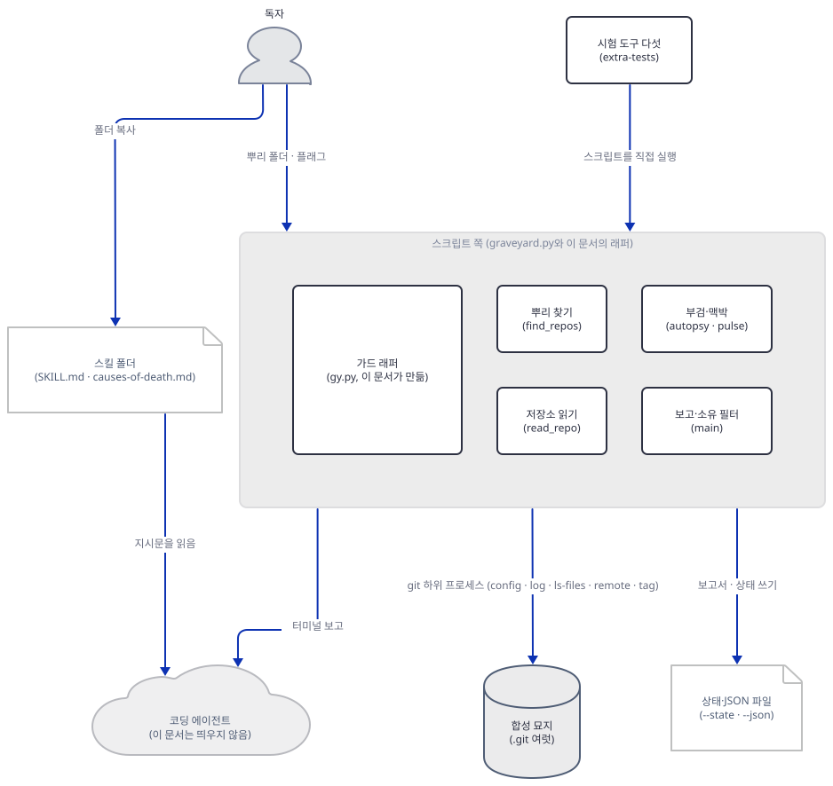

이 문서는 에이전트(Claude Code, Codex, Cursor 등)를 한 번도 띄우지 않았고 모델도 부르지 않았으며, 3단계 행동 시험도 돌리지 않았습니다. 이 PC의 진짜 `~/.claude/skills`나 다른 에이전트 설정 폴더에는 아무것도 넣지 않았고 `npx skills add`도 실행하지 않았습니다. **이 스크립트는 인자 없이 돌리면 홈 아래 개발 폴더를 훑기 때문에**, 이 문서의 모든 실행은 홈을 작업 폴더 안으로 바꾼 셸에서 했고, 뿌리 폴더를 명시했으며, 진짜 홈이나 진짜 개발 폴더를 훑는 실행은 한 번도 하지 않았습니다. 독자 명령도 같습니다. 줄 하나를 빼먹어도 진짜 홈이 훑이지 않도록 Step 2에서 거부하는 래퍼를 두고, 파일을 만들거나 목록을 찍는 블록은 목적지를 블록 안에서 정해 진짜 에이전트 설정 폴더 아래이면 멈춥니다. 묘지는 모두 직접 만든 가짜(작성자 `Dana Fixture`, 메일 `example.test`)입니다. 직접 돌려 보거나 소스로 확인한 것이 열하나입니다.

1. 머리말의 이름은 17자, 설명은 590자(한도 1024)이고 `skill_lint.py --strict`는 오류 0·경고 0입니다. 설명의 "Runs entirely locally"는 스크립트에 대해서는 맞고, 부활 단계의 "세계 점검"은 에이전트에게 검색을 시킵니다(Step 2, 8).
2. 인자 없이 돌리면 `~/dev`·`~/projects`·`~/code`·`~/src`·`~/Desktop`·`~/Documents/GitHub`·`~/Downloads` 일곱 곳을 훑습니다(`graveyard.py:30`). 홈을 바꾼 셸에서 돌리면 그 일곱 곳이 작업 폴더 안을 가리킵니다(Step 3).
3. 오래된 저장소 다섯 개를 놓아 보니 둘만 찾았습니다. 깊이 5 이상, `go`라는 이름의 폴더, 점으로 시작하는 폴더는 조용히 건너뜁니다(Step 3).
4. 저장소 13개를 읽는 한 번의 실행이 `git` 프로세스 80개(`config`·`log`·`ls-files`·`remote`·`tag`)를 시작했고, `.git` 파일 676개의 지문이 실행 전후로 같았고, 쓰기로 연 파일과 네트워크 시도는 0이었습니다(Step 4).
5. `git ls-files`는 훑은 저장소 자신의 `core.fsmonitor` 설정이 가리키는 명령을 실행합니다. 이 스크립트를 `~/Downloads` 같은 폴더에 그대로 쓰면 받아 온 저장소의 명령이 내 권한으로 돌 수 있고, 래퍼는 환경 변수 셋(`GIT_CONFIG_COUNT`·`KEY_0`·`VALUE_0`)으로 이것을 끕니다(Step 4).
6. 보고서의 "THE DEAD" 표는 펄스 순이 아니라 최근 순이고, 원인은 첫 번째 하나만 보입니다. 나머지는 `--json`에만 있습니다(Step 4, 5).
7. 원인 아홉 가지를 모두 한 번씩 일으켰고, 같은 저장소에서 둘이 맞으면 먼저 검사하는 쪽이 이깁니다. 새 프로젝트가 14일 안에 태어났다는 것만으로 `shiny_object`가 먼저 붙습니다(Step 5).
8. 판정이 틀리는 방식을 소스에서 읽고 만들어 확인했습니다. CI 워크플로 파일 하나가 "배포 설정"이고, "add support to …"가 "재작성"이고, `AUTHORS` 파일이 "로그인 벽"이고, `latest.json`이 "테스트가 있음"입니다(Step 5).
9. 소유 필터는 git 설정의 이메일에 달려 있습니다. 이메일이 아무 데도 없으면 아무것도 걸러지지 않아 죽은 프로젝트가 9개에서 11개로 늡니다. 실행한 폴더가 어떤 저장소 안이면 그 저장소의 로컬 이메일까지 "내 것"에 들어갑니다(Step 6).
10. `--mark-resurrected`는 경로가 있는지 보지 않고(오타도 기록), 다음 스캔은 "마지막 커밋으로부터" 침묵한 날을 세기 때문에 부활을 기록한 직후 "다시 죽는 중"이라고 말합니다. 따옴표로 막은 `~`는 보고서를 다 찍은 뒤 상태 파일 쓰기에서 죽습니다(Step 7).
11. `--redact`는 이름을 가리지만 셋이 남습니다. "내 것이 아님으로 건너뜀" 목록의 진짜 이름, `--json`의 `remote` 주소(진짜 프로젝트 이름과 사용자 이름), `--state`를 같이 주면 재발 감시 줄의 진짜 이름입니다. 저장소의 2b 시험은 이 틈을 보지 않습니다(Step 7, 8).

## 사전 준비

| 서비스/도구 | 용도 | 발급·설치 |
|---|---|---|
| Python 3 | 스킬 스크립트와 시험 도구 모두 표준 라이브러리만 씁니다. 이 문서는 3.14.2로 돌렸습니다. 스크립트 머리말은 3.8 이상이라고 적지만 그 아래 버전은 돌려 보지 못했습니다 | [공통 사전 준비](../README.md#공통-사전-준비-한-번만) 절 참고. 설치할 패키지는 없습니다 |
| git | 스크립트가 하위 프로세스로 부릅니다. 이 문서는 2.52.0으로 돌렸습니다 | 이미 있으면 `git --version`으로 확인 |
| bash | 이 문서의 명령은 모두 bash입니다. macOS·Linux 터미널이나 Windows의 Git Bash를 씁니다. PowerShell 형태는 실행해 보지 못해 적지 않았습니다 | Git Bash는 https://git-scm.com 에 들어 있습니다 |
| 이 저장소의 clone | 스킬 폴더, 시험 도구, 시험 자료를 가져옵니다. 아래에서 `REPO`라는 변수로 가리킵니다 | `git clone https://github.com/Shubhamsaboo/awesome-llm-apps` |
| 코딩 에이전트 | 필요 없음. 이 문서는 에이전트를 띄우지 않습니다 | 없음 |
| API 키·네트워크 | 필요 없음. clone 뒤에는 인터넷 없이 모두 돌아갑니다 | 없음 |

한국어 Windows에서는 시험 도구가 파일을 기본 인코딩(cp949)으로 열다가 멈추고(`run_trigger_evals.py`), 출력의 `—` 같은 글자에서 `UnicodeEncodeError`로 멈추기도 합니다(`skill_lint.py`는 `PYTHONUTF8=0`·`PYTHONIOENCODING=cp949`로 돌려 `UnicodeEncodeError: 'cp949' codec can't encode character`를 직접 재현했고, [Day 156](../day156-commit-archaeologist/README.md)의 문제 해결 표는 앞의 것을 적었습니다). 아래 환경 파일의 `PYTHONUTF8=1`과 `PYTHONIOENCODING=utf-8`이 둘 다 막습니다. 이 문서의 출력에 보이는 `...`은 제 작업 폴더의 경로를 줄인 것입니다.

## 아키텍처 한눈에 보기

| 컴포넌트 | 역할 | 코드 위치 |
|---|---|---|
| 스킬 이름·설명 | 에이전트가 시작할 때 읽는 메타데이터(frontmatter) | `agent_skills/project-graveyard/SKILL.md:1-17` |
| 실행 안내 | 뿌리 폴더를 묻는 규칙, 플래그 다섯, "스크립트는 읽기 전용" | `agent_skills/project-graveyard/SKILL.md:42-62` |
| 보고서·인터뷰·부활 지시 | 묘비 보고서 형식, 비문 규칙, 세계 점검, 부활 계획 | `agent_skills/project-graveyard/SKILL.md:64-183` |
| 재발 감시·네크로맨서·함정 | 상태 파일, 새 프로젝트 전 묘지 확인, 주의점 | `agent_skills/project-graveyard/SKILL.md:185-224` |
| 원인 분류표 | 원인 아홉의 신호·신뢰도·부활 방향 | `agent_skills/project-graveyard/references/causes-of-death.md:1-92` |
| 상수 | 기본 뿌리, 건너뛰는 폴더, 설정 파일·배포 표지·인증·결제 낱말 | `agent_skills/project-graveyard/scripts/graveyard.py:30-48` |
| git 호출 | 명령 하나를 돌려 UTF-8로 풀기, 실패하면 빈 문자열 | `agent_skills/project-graveyard/scripts/graveyard.py:51-61` |
| 저장소 찾기 | 뿌리를 걷기, git 없는 프로젝트 폴더 찾기 | `agent_skills/project-graveyard/scripts/graveyard.py:64-126` |
| 저장소 읽기 | 커밋 시각·이메일·제목, 원격, 파일, 마지막 세 커밋, 태그, 설정 파일 비율 | `agent_skills/project-graveyard/scripts/graveyard.py:129-190` |
| 부검·펄스 | 원인 후보 목록(`autopsy`), 0~100 점수(`pulse`) | `agent_skills/project-graveyard/scripts/graveyard.py:197-303` |
| 인자·상태·소유 필터 | 플래그, 상태 파일 읽기, `--mark-resurrected`, 내 이메일 모으기, 남의 저장소 거르기 | `agent_skills/project-graveyard/scripts/graveyard.py:310-417` |
| 보고서 출력 | 센서스, 죽은 목록, 패턴, 재발 감시, 펄스 상위 셋 | `agent_skills/project-graveyard/scripts/graveyard.py:419-519` |
| JSON·상태 쓰기 | `--json`, `--state` | `agent_skills/project-graveyard/scripts/graveyard.py:521-551` |
| 시험 도구 넷 | 구조(`skill_lint.py`), 보안(`skill_scanner.py`), 트리거(`run_trigger_evals.py`), 레지스트리(`registry_lint.py`) | `agent_skills/evals/tools/` |
| 스킬 시험 자료 | 스크립트 시험 16개, 트리거 사례 일곱, 행동 시험 넷 | `agent_skills/evals/project-graveyard/` |
| 레지스트리 | 이름·설명·설치 명령·시험 폴더 | `agent_skills/registry.json:52-64` |
| 코딩 에이전트 | 스킬을 불러 읽고 스크립트를 돌린 뒤 보고서를 쓰는 쪽 | 코드 없음 (외부. 이 문서는 띄우지 않음) |
| 이 문서의 래퍼와 합성 묘지 | 진짜 홈을 지키는 래퍼, 가짜 프로젝트들, git 호출 기록 | 코드 없음 (Step 2~4에서 직접 만듦) |

## 단계별 진행

### Step 1. 작업 폴더, 홈 바꾸기, 소켓 가드 — 줄 하나를 빠뜨려도 진짜 홈이 보이지 않게

**목적.** 이 문서의 실습이 이 PC의 진짜 홈을 보지도 쓰지도 못하게 하고, 파이썬이 바깥으로 연결을 열면 막히게 합니다. 이 스킬의 스크립트는 홈을 두 번 읽습니다. 기본 뿌리가 `~`로 시작하고(`graveyard.py:30`), 내 이메일을 `git config --global`에서 읽습니다(`graveyard.py:358`). 둘 다 홈을 바꾸면 작업 폴더 안을 향합니다. 파이썬은 Windows에서 `~`를 `USERPROFILE`로, 그 밖에서는 `HOME`으로 풀고, git은 `GIT_CONFIG_GLOBAL`을 직접 줄 수 있어서 셋을 모두 둡니다. 에이전트 설정 폴더(`CLAUDE_CONFIG_DIR`)와 임시 폴더(`TEMP`·`TMP`·`TMPDIR`)도 같이 돌립니다.

**할 일.** `REPO`를 자기 저장소 경로로 바꿔 아래 블록을 한 번에 붙입니다. 작업 폴더는 어떤 git 저장소 안에도 만들지 않습니다. 블록의 둘째 줄은 지금 폴더가 에이전트 설정 폴더(`.claude`·`.agents`·`.codex`·`.cursor`·`.copilot`·`.openclaw`·`.hermes`) 아래이면 `lab159`도 `env.sh`도 만들지 않습니다(적힌 경로를 소문자로 맞춰 봅니다). 환경 파일은 git 저장소 안인지를 확인하고, 저장소 안이거나 `REPO`가 틀렸으면 `return 1`로 환경 파일 불러오기를 멈춥니다. 그러면 `pyrun`이 정의되지 않아 뒤의 스크립트 실행 줄이 하나도 돌지 않습니다(저장소 안이면 `git`이 맨 위를 찾아 이 스크립트의 `git config user.email`이 그 저장소의 설정을 읽게 됩니다. Step 6에서 보입니다). 이후 블록은 새 터미널에서 시작한다면 `export REPO=…` 한 줄과 `. ./env.sh`(`lab159` 안에서)로 시작합니다. 원본 저장소에는 아무것도 쓰지 않습니다.

```bash
# --- Step 1: 작업 폴더, 환경 파일, 네트워크 가드 ---
# REPO는 awesome-llm-apps를 받은 폴더다(자기 경로로 바꾼다). 작업 폴더는 어떤 git 저장소 안에도 두지 않는다.
export REPO=/path/to/awesome-llm-apps
PRE=ok; case "$(pwd -P | tr 'A-Z' 'a-z')/" in */.claude/*|*/.agents/*|*/.codex/*|*/.cursor/*|*/.copilot/*|*/.openclaw/*|*/.hermes/*) PRE=no; echo "지금 폴더가 에이전트 설정 폴더 아래입니다. 다른 곳에서 시작하세요";; esac
[ "$PRE" = ok ] && mkdir -p lab159 && cd lab159 && cat > env.sh <<'EOT'
# 이 문서의 모든 명령은 이 파일을 불러온 셸에서 돌린다.
unset VIRTUAL_ENV
: "${REPO:?REPO를 먼저 지정하세요}"
export LAB="$(cd "$(dirname "${BASH_SOURCE[0]}")" && pwd)"
if git -C "$LAB" rev-parse --show-toplevel >/dev/null 2>&1; then echo "작업 폴더가 git 저장소 안입니다. 다른 곳에서 다시 시작하세요"; unset LAB; return 1; fi
test -f "$REPO/agent_skills/registry.json" || { echo "REPO가 저장소 루트가 아닙니다"; unset LAB; return 1; }
export REAL_HOME="${REAL_HOME:-$HOME}" REAL_CLAUDE_CONFIG_DIR="${REAL_CLAUDE_CONFIG_DIR:-${CLAUDE_CONFIG_DIR:-/none}}"
norm() { realpath -m "$(cygpath -u "$1" 2>/dev/null || echo "$1")"; }
for d in .claude .agents .codex .cursor .copilot .openclaw .hermes; do case "$(norm "$LAB")/" in "$(norm "$REAL_HOME")/$d"/*) echo "작업 폴더가 에이전트 설정 폴더 아래입니다: $LAB"; unset LAB; return 1 ;; esac; done
case "$(norm "$LAB")/" in "$(norm "$REAL_CLAUDE_CONFIG_DIR")"/*) echo "작업 폴더가 CLAUDE_CONFIG_DIR 아래입니다: $LAB"; unset LAB; return 1 ;; esac
cd "$LAB"
mkdir -p "$LAB/home/.claude" "$LAB/tmp" "$LAB/sg"
win() { if command -v cygpath >/dev/null 2>&1; then cygpath -m "$1"; else printf '%s' "$1"; fi; }
export HOME="$LAB/home" CLAUDE_CONFIG_DIR="$LAB/home/.claude" TMPDIR="$LAB/tmp"
export USERPROFILE="$(win "$LAB/home")" TEMP="$(win "$LAB/tmp")" TMP="$(win "$LAB/tmp")"
export GIT_CONFIG_GLOBAL="$(win "$LAB/home/.gitconfig")" GIT_CONFIG_NOSYSTEM=1
export PYTHONPATH="$(win "$LAB/sg")" PYTHONUTF8=1 PYTHONIOENCODING=utf-8 PYTHONDONTWRITEBYTECODE=1
export GUARD_LOG="$LAB/guard.log"
pyrun() { python -B "$@"; }
EOT
. ./env.sh
cat > sg/sitecustomize.py <<'EOT'
# 소켓 가드: 파이썬이 바깥으로 연결을 열려는 모든 시도를 막고 guard.log에 한 줄씩 남긴다.
import os, socket, sys
def _blocked(name):
    def f(*args, **kwargs):
        with open(os.environ["GUARD_LOG"], "a") as log:
            log.write("%s %r\n" % (name, args[:2]))
        sys.stderr.write("GUARD blocked: %s\n" % name)
        raise OSError("blocked by guard: " + name)
    return f
socket.socket.connect = _blocked("connect")
socket.socket.connect_ex = _blocked("connect_ex")
socket.create_connection = _blocked("create_connection")
socket.getaddrinfo = _blocked("getaddrinfo")
EOT
```

가드는 `sitecustomize.py`로 심은 파일 하나입니다. 파이썬이 시작할 때 자동으로 불러오며(`PYTHONPATH`가 `sg`를 가리킵니다), 연결과 이름 조회를 막고 `guard.log`에 한 줄씩 남깁니다. 이 스크립트에는 네트워크 낱말이 없지만(Step 4에서 다시 봅니다) 가드는 어차피 둡니다. 불러와졌는지는 문서 예시용으로 예약된 주소 `192.0.2.1`로 먼저 확인합니다. 실제로 연결되지 않는 주소입니다.

```bash
# --- 가드가 불러와졌는지 예약 주소(192.0.2.1)로 먼저 단언한다 ---
if pyrun -c "import socket; socket.create_connection(('192.0.2.1', 80), 1)" 2>&1 | grep -q "GUARD blocked"; then
  echo "guard loaded"
else
  echo "guard NOT loaded - stop here"; false
fi
cat "${GUARD_LOG:?}"
: > "${GUARD_LOG:?}"
pyrun -c "import os; print('~ ->', os.path.expanduser('~'))"
```

**확인.** 기대 출력입니다.

```text
guard loaded
create_connection (('192.0.2.1', 80), 1)
~ -> .../lab159/home
```

`guard loaded`가 나오지 않으면 여기서 멈춥니다. 가드는 파이썬 프로세스만 막고, 스크립트가 시작하는 `git`은 막지 못합니다. 뒤에서 `git`이 쓰는 명령이 어떤 것인지는 Step 4에서 인자로 셉니다. `~`가 작업 폴더 안의 `home`으로 풀리는 것도 마지막 줄에서 확인했습니다.

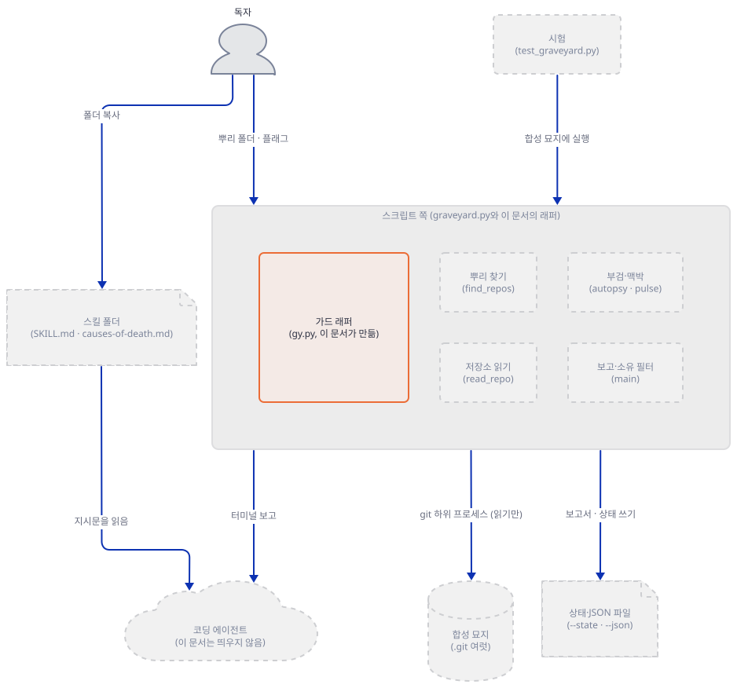

### Step 2. 스킬 폴더를 "설치"하고 머리말을 명세에 대조하고, 거부하는 래퍼를 만든다

**목적.** 스킬이 어떤 파일로 이루어졌고 머리말이 명세를 지키는지 보고, 진짜 에이전트 설정 폴더를 건드리지 않는 설치 모양을 만듭니다. 그리고 스크립트를 직접 부르는 대신 **뿌리가 작업 폴더 밖이면 거부하는 래퍼**를 거쳐 부르게 합니다. `SKILL.md`는 다른 에이전트에게 주는 지시문이므로 이 문서는 그것을 설명할 대상으로만 다루고 그 안의 지시를 따르지 않습니다.

**할 일.** 설치 길은 둘입니다. 하나는 저장소가 권하는 한 줄이고(`agent_skills/project-graveyard/README.md`의 설치 절), 이 문서는 **실행하지 않았습니다.** 그 CLI(skills.sh)가 무엇을 받는지는 Day 154 Step 5가 공개 문서로 확인한 것이 있고, 이 문서는 새로 확인하지 않았습니다.

```text
npx skills add https://github.com/Shubhamsaboo/awesome-llm-apps/tree/main/agent_skills/project-graveyard
```

다른 하나는 폴더 복사입니다. 개인 스킬의 자리 `~/.claude/skills/`는 이 PC의 진짜 Claude Code 설정이라 쓰지 않고, 프로젝트 스킬의 자리 `.claude/skills/<이름>/SKILL.md`로만 복사합니다.

이 블록은 앞 터미널의 변수에 기대지 않습니다. 목적지를 블록 안에서 정하고 정규화(`realpath -m`, Windows에서는 `cygpath -u`를 먼저)한 뒤, 홈 아래 `.claude`·`.agents`·`.codex`·`.cursor`·`.copilot`·`.openclaw`·`.hermes`나 `CLAUDE_CONFIG_DIR` 아래이면 멈춥니다. 여기서 "홈"과 "설정 폴더"는 환경 파일이 바꾸기 전의 값입니다. 환경 파일이 `REAL_HOME`·`REAL_CLAUDE_CONFIG_DIR`에 원래 값을 남겨 두기 때문이고(새 터미널에서는 아직 바뀌지 않았으므로 지금 값이 곧 원래 값입니다), 작업 폴더 자체가 그 아래이면 환경 파일이 `return 1`로 멈춥니다. `LAB`이 비어 있으면(새 터미널에서 `. ./env.sh`를 빠뜨렸으면) `${LAB:?}`가 그 줄에서 멈춥니다. 정규화에 쓰는 `realpath -m`은 GNU 도구라 macOS 기본 `realpath`에는 없어, 거기서는 가드 줄이 `P`를 비우고 블록이 멈춥니다.

```bash
# 새 터미널이어도, 줄 하나를 빼도 진짜 에이전트 설정 폴더에는 아무것도 쓰지 않게 목적지를 이 블록 안에서 정하고 검사한다.
norm() { realpath -m "$(cygpath -u "$1" 2>/dev/null || echo "$1")"; }
P="$(norm "${LAB:?먼저 . ./env.sh를 불러오세요}/project/.claude/skills")"
H="$(norm "${REAL_HOME:-$HOME}")"
for d in .claude .agents .codex .cursor .copilot .openclaw .hermes; do case "$P/" in "$H/$d"/*) echo "멈춥니다: $P"; P="" ;; esac; done
case "$P/" in "$(norm "${REAL_CLAUDE_CONFIG_DIR:-${CLAUDE_CONFIG_DIR:-/none}}")"/*) echo "멈춥니다: $P"; P="" ;; esac
mkdir -p "${P:?}"
cp -r "${REPO:?}/agent_skills/project-graveyard" "${P:?}/project-graveyard"
cd "${LAB:?}"
find project -type f | sort
find project -type f -exec wc -l {} +
```

```text
project/.claude/skills/project-graveyard/README.md
project/.claude/skills/project-graveyard/references/causes-of-death.md
project/.claude/skills/project-graveyard/scripts/graveyard.py
project/.claude/skills/project-graveyard/SKILL.md
   75 project/.claude/skills/project-graveyard/README.md
   92 project/.claude/skills/project-graveyard/references/causes-of-death.md
  555 project/.claude/skills/project-graveyard/scripts/graveyard.py
  229 project/.claude/skills/project-graveyard/SKILL.md
  951 total
```

이 가드를 가짜 홈에서 확인했습니다. 가짜 홈은 `.claude/skills/existing`과 가짜 `.credentials.json`, `.agents`, 가짜 `.gitconfig`를 둔 폴더입니다. 첫째, 환경 파일 없는 새 터미널(홈이 가짜 홈이고 `LAB`이 없음)에서 파일을 만들거나 목록을 찍는 블록 여섯(Step 2의 설치·목록, Step 3의 `home/dev` 복사, Step 4의 전역 설정, Step 6의 `side`, Step 7의 커밋)을 글자 그대로 대화형 bash에 붙여 돌렸고 가짜 홈의 파일 목록과 내용 지문이 그대로였습니다. 둘째, 설치 블록과 목록 블록의 줄을 하나씩 빼서 27판을 돌렸고 지문이 그대로였습니다. 셋째, 작업 폴더를 가짜 `.claude`와 가짜 `.agents` 아래에 두고 환경 파일을 불러온 두 판에서 환경 파일이 멈추고 `LAB`을 비웠으며 이어 붙인 설치 블록도 멈췄습니다. 이 둘째와 셋째는 비대화형 bash라 `${LAB:?}` 실패가 블록 전체를 끝냅니다. 붙여 넣는 터미널에서는 그 줄만 실패하고 다음 줄로 넘어가므로, 그 경우는 첫째 판(대화형)으로 확인했습니다. 줄 빼기는 나머지 네 블록에는 하지 않았는데, 그 블록들의 목적지가 모두 `${LAB:?}`로 시작해서 `LAB`이 정상이면 작업 폴더 안뿐이기 때문입니다. PowerShell 판은 쓰지 않았고 실행하지 못했습니다.

파일 넷, 951줄입니다. `evals/`는 설치되지 않습니다. 에이전트는 시작할 때 `name`과 `description`만 읽고, 스킬을 쓰기로 하면 `SKILL.md` 전체(229줄)를 읽고, `references/`와 `scripts/`는 필요할 때 읽거나 돌립니다. 이것이 agentskills.io 명세(https://agentskills.io/specification, 2026-10-19에 읽음)의 "점진적 불러오기"입니다. Claude Code 문서(https://code.claude.com/docs/en/skills, 같은 날)는 프로젝트 스킬 자리를 `.claude/skills/<skill-name>/SKILL.md`, 개인 스킬 자리를 `~/.claude/skills/<skill-name>/SKILL.md`로 적고, 스크립트를 "executed, not loaded"라고 적습니다. 두 문서는 웹 가져오기 도구를 거쳐 읽었기 때문에 인용은 짧은 낱말에 한정했습니다. 이제 머리말입니다.

`agent_skills/project-graveyard/SKILL.md:1-17`

```yaml
---
name: project-graveyard
description: >-
  Scans the developer's machine for dead side projects, autopsies each one from
  its git history (died at the payments wall, killed by a newer project,
  finished but never shipped), surfaces their personal death patterns, and picks
  the corpse most worth resurrecting — then helps ship it. Use when the user
  mentions abandoned, unfinished, or old side projects, asks "what should I
  finish", wants to revive or resurrect a project, says "run the graveyard",
  wonders why they never finish anything, or is about to start a new project
  that sounds like one they already built. Runs entirely locally.
license: Apache-2.0
metadata:
  author: "Shubham Saboo"
  version: "1.0.0"
  source: "https://github.com/Shubhamsaboo/awesome-llm-apps"
---
```

| 필드 | 명세가 말하는 것 | 이 스킬 |
|---|---|---|
| `name` | 필수. 1~64자, 소문자·숫자·하이픈, 처음과 끝·연속 하이픈 금지, 폴더 이름과 같아야 함 | `project-graveyard` 17자, 폴더 이름과 같음 |
| `description` | 필수. 1~1024자. 무엇을 하는지와 언제 쓰는지 | 590자(아래 출력). "Use when the user mentions abandoned, unfinished, or old side projects, asks "what should I finish" ..."로 에이전트가 들을 말을 적음 |
| `license` | 선택 | `Apache-2.0` |
| `compatibility` | 선택. 500자 이하. 환경 요건(시스템 패키지, 네트워크 등) | 없음 |
| `metadata` | 선택. 문자열 키와 문자열 값의 맵 | `author`·`version`·`source` 셋, 값이 모두 문자열 |
| `allowed-tools` | 선택, 실험적. 미리 허락해 둘 도구 | 없음 |

`allowed-tools`가 없다는 것은 스크립트를 돌릴 때마다 평소의 권한 규칙이 적용된다는 뜻입니다(Day 156 Step 1이 같은 문서를 근거로 적었습니다). 이 문서는 에이전트를 띄우지 않아서 실제로 허락을 묻는지는 확인하지 못했습니다. 길이는 직접 세 봅니다. 복사본이 린트를 통과하는지도 보고, 스크래치 프로젝트의 `.claude`만 나열합니다(같은 가드를 블록 안에 둡니다. 진짜 `~/.claude`는 나열하지 않습니다).

```bash
pyrun -c "
import re
t = open('project/.claude/skills/project-graveyard/SKILL.md', encoding='utf-8').read()
fm = t.split('---')[1]
desc = ' '.join(l.strip() for l in re.search(r'description: >-\n((?:  .*\n)+)', fm).group(1).splitlines())
print('name', len('project-graveyard'), '| description', len(desc), '| SKILL.md lines', t.count(chr(10)))
"
pyrun "$REPO/agent_skills/evals/tools/skill_lint.py" project/.claude/skills/project-graveyard --strict
# 스크래치 프로젝트의 .claude만 나열한다. 목적지를 이 블록 안에서 정하고 진짜 설정 폴더 아래이면 멈춘다.
norm() { realpath -m "$(cygpath -u "$1" 2>/dev/null || echo "$1")"; }
P="$(norm "${LAB:?먼저 . ./env.sh를 불러오세요}/project/.claude")"
H="$(norm "${REAL_HOME:-$HOME}")"
for d in .claude .agents .codex .cursor .copilot .openclaw .hermes; do case "$P/" in "$H/$d"/*) echo "멈춥니다: $P"; P="" ;; esac; done
case "$P/" in "$(norm "${REAL_CLAUDE_CONFIG_DIR:-${CLAUDE_CONFIG_DIR:-/none}}")"/*) echo "멈춥니다: $P"; P="" ;; esac
ls -A "${P:?}"
ls -A "${P:?}/skills"
```

```text
name 17 | description 590 | SKILL.md lines 229
Linting .../lab159\project\.claude\skills\project-graveyard (strict=on)
  PASS — 0 error(s), 0 warning(s)
skills
project-graveyard
```

이제 래퍼입니다. 스킬의 스크립트는 건드리지 않고 불러온 뒤, 그 안의 뿌리 찾기 함수 둘을 "뿌리가 작업 폴더 안인지 먼저 보는" 함수로 감쌉니다. 그리고 `~`가 작업 폴더 밖으로 풀리거나, 실행한 폴더가 작업 폴더 밖이거나, `--json`·`--state`(줄여 쓴 `--js`·`--sta`도)가 밖을 가리키면 아무것도 하지 않고 종료 코드 3으로 끝납니다. 또 스크립트가 시작하는 모든 git에 `core.fsmonitor=false`를 환경 변수로 줍니다(Step 4). 작업 폴더의 위치는 환경 변수가 아니라 이 파일 자신의 위치에서 정하므로 `. ./env.sh`를 빠뜨려도 거부합니다. 이 문서의 뒤 명령은 스크립트 실행이면 모두 `gy.py`를 거칩니다(`trace.py`도 안에서 `gy.py`를 실행합니다). 저장소의 시험 도구(Step 8)는 래퍼를 거치지 않습니다. 시험이 스캔마다 뿌리를 명시하고 임시 폴더에 묘지를 만들며, 뿌리 없이 부르는 `--mark-resurrected` 한 번은 스캔 없이 끝나기 때문입니다.

`lab159/gy.py`

```python
"""Run the installed graveyard.py, but refuse to leave this lab folder.

    python gy.py [graveyard.py flags and roots ...]

Refuses when: "~" expands outside the lab, the working folder is outside the lab,
a scan root is outside the lab, or --json/--state (also abbreviated, such as --js or --sta)
point outside the lab. It also tells every git the scanner starts to ignore a scanned
repository's own core.fsmonitor setting. The scanner's own source is loaded unmodified.
"""
import importlib.util
import os
import sys

LAB = os.path.normcase(os.path.realpath(os.path.dirname(os.path.abspath(__file__))))
SCRIPT = os.path.join(LAB, "project", ".claude", "skills", "project-graveyard", "scripts", "graveyard.py")


def inside(path):
    real = os.path.normcase(os.path.realpath(os.path.expanduser(path)))
    return real == LAB or real.startswith(LAB + os.sep)


def refuse(why):
    sys.stderr.write("gy.py: refusing to run: %s\n" % why)
    raise SystemExit(3)


if not inside("~"):
    refuse("'~' expands to %s, outside the lab" % os.path.expanduser("~"))
if not inside(os.getcwd()):
    refuse("working folder %s is outside the lab" % os.getcwd())
args = sys.argv[1:]
for i, a in enumerate(args):
    name, has_value, value = a.partition("=")
    for flag in ("--json", "--state"):
        if len(name) >= 3 and flag.startswith(name):
            target = value if has_value else args[i + 1] if i + 1 < len(args) else None
            if target is not None and not inside(target):
                refuse("%s %s points outside the lab" % (flag, target))

# git runs a repository's core.fsmonitor command during ls-files. Put one more setting on the
# command-line level (it beats the repository's own config) so the scanned repos cannot run it.
count = int(os.environ.get("GIT_CONFIG_COUNT") or 0)
os.environ["GIT_CONFIG_KEY_%d" % count] = "core.fsmonitor"
os.environ["GIT_CONFIG_VALUE_%d" % count] = "false"
os.environ["GIT_CONFIG_COUNT"] = str(count + 1)

spec = importlib.util.spec_from_file_location("graveyard", SCRIPT)
gy = importlib.util.module_from_spec(spec)
spec.loader.exec_module(gy)


def checked(fn):
    def wrapper(roots, *a, **k):
        for root in roots:
            if not inside(root):
                refuse("scan root %s is outside the lab" % root)
        return fn(roots, *a, **k)
    return wrapper


gy.find_repos = checked(gy.find_repos)
gy.find_unversioned = checked(gy.find_unversioned)
sys.exit(gy.main(args))
```

거부하는 네 경우를 일부러 만듭니다. 첫째 경우의 "밖"은 진짜 홈이 아니라 작업 폴더 옆에 만든 빈 폴더 `outside`입니다.

```bash
mkdir -p ../outside
OUT="$(cd ../outside && pwd)"
echo "--- 1) ~가 작업 폴더 밖을 가리키면"
HOME="$OUT" USERPROFILE="$(win "$OUT")" pyrun gy.py --no-art; echo "종료 코드 $?"
echo "--- 2) 뿌리 폴더가 작업 폴더 밖이면"
pyrun gy.py ../outside --no-art; echo "종료 코드 $?"
echo "--- 3) --json이 작업 폴더 밖이면"
pyrun gy.py --json ../report.json; echo "종료 코드 $?"
echo "--- 4) 실행 위치가 작업 폴더 밖이면"
(cd .. && pyrun lab159/gy.py lab159/home --no-art); echo "종료 코드 $?"
```

**확인.** 기대 출력입니다.

```text
--- 1) ~가 작업 폴더 밖을 가리키면
gy.py: refusing to run: '~' expands to .../outside, outside the lab
종료 코드 3
--- 2) 뿌리 폴더가 작업 폴더 밖이면
gy.py: refusing to run: scan root ../outside is outside the lab
종료 코드 3
--- 3) --json이 작업 폴더 밖이면
gy.py: refusing to run: --json ../report.json points outside the lab
종료 코드 3
--- 4) 실행 위치가 작업 폴더 밖이면
gy.py: refusing to run: working folder ... is outside the lab
종료 코드 3
```

넷 다 스크립트에 닿기 전에 멈췄습니다(`종료 코드 3`). 마지막 경우의 `...`은 작업 폴더 바로 위 경로입니다.

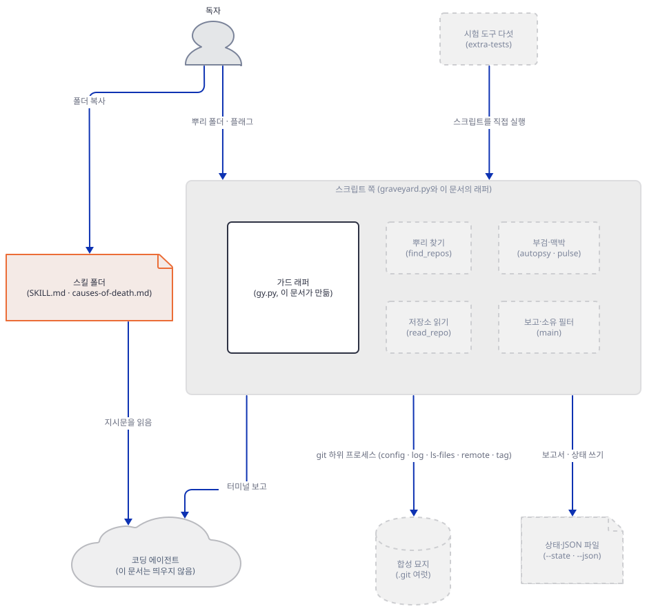

### Step 3. 어디를 훑는가 — 기본 뿌리, 쓰는 곳, 보이지 않는 곳

**목적.** 스크립트를 돌리기 **전에** 소스로 읽고 돌립니다. 인자 없이 돌리면 어디를 훑는지, 홈 밖의 파일이나 git 설정을 읽는 곳이 어디인지, 무엇에 쓰는지를 봅니다.

**할 일.** 뿌리가 없으면 상수 목록을 씁니다.

`agent_skills/project-graveyard/scripts/graveyard.py:30-33`

```python
DEFAULT_ROOTS = ["~/dev", "~/projects", "~/code", "~/src", "~/Desktop", "~/Documents/GitHub", "~/Downloads"]
SKIP_DIRS = {"node_modules", ".venv", "venv", ".tox", "vendor", ".cache", "Library",
             "__pycache__", ".npm", ".cargo", "go", ".local", ".Trash", "dist", "build"}
MAX_DEPTH = 4
```

`DEFAULT_ROOTS`가 일곱입니다. `SKILL.md`는 "No args scans the usual suspects (~/dev, ~/projects, ~/code, ~/Desktop, ...)"라고 줄여 쓰고(`SKILL.md:50`), 저장소 README는 "never 'everything on your machine'"이라고 합니다. 맞는 말이지만 일곱 곳에는 `~/Desktop`과 `~/Downloads`처럼 남의 저장소를 내려받아 두는 자리가 들어 있습니다. `MAX_DEPTH`는 4이고 건너뛰는 폴더(`SKIP_DIRS`)는 열다섯입니다. 파일 읽기·쓰기와 git 설정이 나오는 줄을 모아 봅니다.

```bash
grep -n "expanduser\|open(\|json.dump\|\"config\"\|DEFAULT_ROOTS\|my_emails" project/.claude/skills/project-graveyard/scripts/graveyard.py
```

```text
30:DEFAULT_ROOTS = ["~/dev", "~/projects", "~/code", "~/src", "~/Desktop", "~/Documents/GitHub", "~/Downloads"]
67:        root = Path(os.path.expanduser(root))
109:        root = Path(os.path.expanduser(root))
129:def read_repo(path, my_emails):
146:    mine = (sum(1 for c in commits if c["email"].lower() in my_emails)
147:            if my_emails else len(commits))
337:            state.update(json.load(open(args.state)))
346:        target = str(Path(os.path.expanduser(args.mark_resurrected)).resolve())
350:        with open(args.state, "w") as f:
351:            json.dump(state, f, indent=1)
356:    roots = args.roots or DEFAULT_ROOTS
357:    my_emails = {e.lower() for e in filter(None, [
358:        sh(["git", "config", "--global", "user.email"]),
359:        sh(["git", "config", "user.email"]),
382:        r = read_repo(p, my_emails)
385:        if not args.include_foreign and my_emails and r["mine"] / r["commits"] < 0.2:
522:        with open(args.json, "w") as f:
523:            json.dump({"generated": datetime.now().isoformat(timespec="seconds"),
549:        with open(args.state, "w") as f:
550:            json.dump(state, f, indent=1)
```

정리하면 이렇습니다.

| 줄 | 무엇을 | 어디에 |
|---|---|---|
| 30, 356 | 뿌리가 없으면 `DEFAULT_ROOTS` | 일곱 곳을 `~`로 풂(67·109행) |
| 358 | `git config --global user.email` | 전역 git 설정(`GIT_CONFIG_GLOBAL`을 주면 그 파일) |
| 359 | `git config user.email` | **스크립트를 돌린 폴더**가 속한 저장소의 설정 |
| 360 | `--me`로 준 이메일을 합침 | 설정을 읽는 것이 아니라 집합에 더하기만 함 |
| 337 | `--state` 파일을 읽음 | 파일이 있을 때만 |
| 350 | `--mark-resurrected`: 상태 파일을 씀 | `--state`가 가리키는 곳. 뒤에 바로 `return 0` |
| 522 | `--json`: 보고서를 씀 | `--json`이 가리키는 곳 |
| 549 | `--state`: 스캔 결과와 부활 목록을 씀 | `--state`가 가리키는 곳 |

쓰는 곳은 `open(..., "w")` 셋(350·522·549행)뿐이고 모두 사용자가 준 경로입니다. `--state`에는 기본 경로가 없습니다. `SKILL.md`가 권하는 `~/.project-graveyard.json`(177~178행)은 에이전트가 정하는 값입니다. `--me`는 git 설정을 읽는 플래그가 아닙니다. git 설정은 `--me`와 상관없이 **항상** 읽고, `--me`는 거기에 이메일을 더합니다. git 호출이 어떤 것인지는 Step 4에서 기록해 다시 확인합니다.

이제 홈을 바꾼 셸에서 뿌리 없이 돌립니다. 래퍼는 일곱 곳이 모두 작업 폴더 안이라서 막지 않습니다.

```bash
pyrun gy.py --no-art; echo "종료 코드 $?"
```

```text
No git repos found under: ~/dev, ~/projects, ~/code, ~/src, ~/Desktop, ~/Documents/GitHub, ~/Downloads
Pass the directories where your projects actually live.
종료 코드 1
```

"No git repos found under: ..."로 일곱 곳을 모두 보이고 종료 코드 1입니다. 홈 아래에 저장소가 없었기 때문입니다. 여기서 뿌리 없는 실행이 진짜 홈에서 일어났다면 같은 줄이 진짜 `~/Desktop`과 `~/Downloads`를 훑고 나서 나왔을 것입니다. 이제 깊은 곳과 숨은 곳에 오래된 저장소 다섯을 놓고 찾는지 봅니다.

`lab159/make_blind.py`

```python
"""Build one old repo in each of five places and see which ones the scanner can find.

    python make_blind.py blind
"""
import os
import subprocess
import sys
from datetime import datetime, timedelta

ROOT = os.path.abspath(sys.argv[1])
when = (datetime.now() - timedelta(days=100)).strftime("%Y-%m-%dT10:00:00")
env = dict(os.environ, GIT_CONFIG_GLOBAL=os.devnull, GIT_CONFIG_NOSYSTEM="1", GIT_AUTHOR_NAME="Dana Fixture",
           GIT_AUTHOR_EMAIL="dana@example.test", GIT_COMMITTER_NAME="Dana Fixture", GIT_COMMITTER_EMAIL="dana@example.test",
           GIT_AUTHOR_DATE=when, GIT_COMMITTER_DATE=when)

for rel in ["plain", "a/b/c/d", "a/b/c/d/e", "go/api-sketch", ".private/notes-app"]:
    d = os.path.join(ROOT, *rel.split("/"))
    os.makedirs(d)
    with open(os.path.join(d, "main.txt"), "w", newline="\n") as fh:
        fh.write("x\n")
    for args in (["init", "-q", "-b", "main"], ["add", "-A"], ["commit", "-q", "-m", "init"]):
        subprocess.run(["git", "-C", d, "-c", "commit.gpgsign=false", *args], env=env, check=True, capture_output=True)
print("built 5 repos under", os.path.basename(ROOT))
```

```bash
pyrun make_blind.py blind
find blind -name .git -type d | sort
pyrun gy.py blind --no-art --json blind.json | grep "^repos scanned"
pyrun -c "
import json
for d in json.load(open('blind.json'))['dead']:
    print('found:', d['path'].replace(chr(92), '/').split('/blind/')[1])
"
```

```text
built 5 repos under blind
blind/.private/notes-app/.git
blind/a/b/c/d/.git
blind/a/b/c/d/e/.git
blind/go/api-sketch/.git
blind/plain/.git
repos scanned: 2   alive: 0   finished: 0   dead: 2   not yours (skipped): 0
found: a/b/c/d
found: plain
```

다섯 개가 디스크에 있는데 둘만 찾았습니다. 걷기 코드(`find_repos`)가 깊이 4를 넘는 곳(`a/b/c/d/e`)을 자르고(`graveyard.py:73-75`), 점으로 시작하는 폴더(`.private`)와 `SKIP_DIRS`의 이름(`go`)을 들어가지 않습니다(76행). `go`는 `~/go`(Go의 작업 폴더)를 피하려는 이름으로 보이지만 어느 깊이의 `go`라는 폴더든 건너뜁니다. 못 찾은 것은 "못 찾았다"고 말하지 않습니다. 셋이 모두 오래된 저장소인데 센서스의 `repos scanned: 2`만 남습니다. 못 찾은 폴더를 뿌리로 직접 주면 찾습니다.

```bash
for r in blind/a/b/c/d/e blind/go blind/.private; do echo "--- 뿌리 $r"; pyrun gy.py "$r" --no-art | grep "^repos scanned"; done
```

```text
--- 뿌리 blind/a/b/c/d/e
repos scanned: 1   alive: 0   finished: 0   dead: 1   not yours (skipped): 0
--- 뿌리 blind/go
repos scanned: 1   alive: 0   finished: 0   dead: 1   not yours (skipped): 0
--- 뿌리 blind/.private
repos scanned: 1   alive: 0   finished: 0   dead: 1   not yours (skipped): 0
```

뿌리 자신은 깊이도 이름도 따지지 않기 때문입니다(`os.walk`의 첫 폴더). 마지막으로 기본 뿌리가 실제로 홈 아래를 읽는다는 것을 작업 폴더의 가짜 홈에서 봅니다. `~/dev`에 하나를 복사해 놓고 뿌리 없이 돌립니다.

```bash
mkdir -p "${LAB:?먼저 . ./env.sh를 불러오세요}/home/dev"
cp -r "${LAB:?}/blind/plain" "${LAB:?}/home/dev/plain"
pyrun gy.py --no-art | grep -E "^repos scanned|^plain|^No git"
```

```text
repos scanned: 1   alive: 0   finished: 0   dead: 1   not yours (skipped): 0
plain                             1d         1   unknown
plain                          pulse 30/100
```

`~/dev`에 둔 `plain`을 인자 없이 찾았습니다. 기본 뿌리가 읽은 `~`는 작업 폴더 안의 가짜 홈이었습니다.

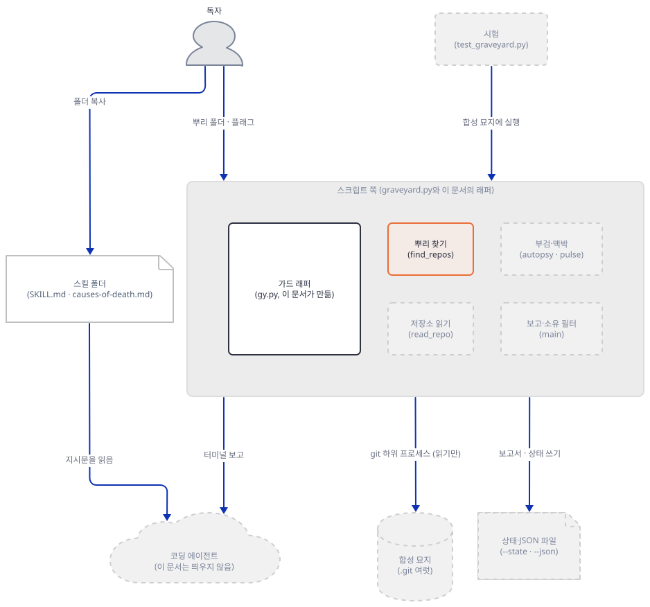

### Step 4. 합성 묘지를 만들고 처음 훑는다 — 보고서 읽기

**목적.** 각 원인을 일으킬 프로젝트를 git 이력으로 만들어 두고(정답을 압니다), 보고서의 네 덩이를 읽고, 스크립트가 git을 어떻게 부르는지 기록합니다.

**할 일.** 아래 파일을 `lab159/make_yard.py`로 저장합니다. 커밋 날짜는 모두 "N일 전 오전 10시"라서 언제 만들어도 보고서의 모양이 같습니다(월 이름과 점수의 일부는 오늘 날짜에 달려 있습니다). 모든 git 호출은 전역·시스템 설정을 읽지 않습니다. 열세 개 저장소와 git이 없는 폴더 하나를 만듭니다. 뒤에서 쓸 `lab159/snapshot.py`(뿌리 아래 모든 `.git` 파일의 지문을 찍는 도우미)도 함께 저장합니다.

`lab159/make_yard.py`

```python
"""Build a synthetic graveyard: one repo per cause of death, plus the cases the scanner must sort out.

    python make_yard.py yard

Every commit date is "N days ago at 10:00", so the shape of the report is the same whenever you run it.
All identities are fake (example.test). Nothing is read from or written outside the folder you name.
"""
import os
import subprocess
import sys
from datetime import datetime, timedelta

ROOT = os.path.abspath(sys.argv[1])
ME = ("Dana Fixture", "dana@example.test")
WORK = ("Dana Fixture", "dana@work.example.test")
MAINT = ("Maintainer Fixture", "maintainer@example.test")


def days_ago(n):
    return (datetime.now() - timedelta(days=n)).strftime("%Y-%m-%dT10:00:00")


def git(d, *args, who=None, date=None):
    env = dict(os.environ, GIT_CONFIG_GLOBAL=os.devnull, GIT_CONFIG_NOSYSTEM="1")
    if who:
        env.update(GIT_AUTHOR_NAME=who[0], GIT_AUTHOR_EMAIL=who[1], GIT_COMMITTER_NAME=who[0], GIT_COMMITTER_EMAIL=who[1])
    if date:
        env.update(GIT_AUTHOR_DATE=date, GIT_COMMITTER_DATE=date)
    subprocess.run(["git", "-C", d, "-c", "commit.gpgsign=false", *args], env=env, check=True, capture_output=True)


def repo(name):
    d = os.path.join(ROOT, name)
    os.makedirs(d)
    git(d, "init", "-q", "-b", "main")
    return d


def commit(d, n, msg, files, who=ME):
    for f in files:
        p = os.path.join(d, f)
        os.makedirs(os.path.dirname(p), exist_ok=True)
        with open(p, "a", newline="\n") as fh:
            fh.write("line\n")
    git(d, "add", "-A")
    git(d, "commit", "-q", "-m", msg, who=who, date=days_ago(n))


def remote(d, url):
    git(d, "remote", "add", "origin", url)


os.makedirs(ROOT)

# 1 boilerplate wall: config files only, dies 400 days ago; pay-wall is born 5 days later
d = repo("boiler-death")
for n, msg, files in [(420, "init", ["package.json", ".gitignore"]), (418, "eslint", [".eslintrc.json", ".prettierrc"]),
                      (414, "webpack hell", ["webpack.config.js", "tsconfig.json"]), (411, "more config", ["jest.config.js", "Dockerfile"]),
                      (408, "tailwind", ["tailwind.config.js", "postcss.config.js"]), (400, "vite instead", ["vite.config.js"])]:
    commit(d, n, msg, files)

# 2 payments wall: the last commits are stripe and billing
d = repo("pay-wall")
for n, msg, files in [(395, "init", ["main.py", "README.md"]), (380, "core logic", ["app/logic.py"]), (360, "users", ["app/users.py"]),
                      (340, "start stripe integration", ["app/stripe_checkout.py"]), (330, "fight stripe webhooks", ["app/billing.py"])]:
    commit(d, n, msg, files)

# 3 deploy fear: README, tests, 26 commits, a remote, no deploy config
d = repo("tab-sensei")
remote(d, "https://example.test/dana/tab-sensei.git")
commit(d, 300, "init", ["README.md", "package.json", "src/index.js"])
for i in range(1, 25):
    commit(d, 299 - int(i * 1.5), "feat: tab group %d" % i, ["src/tab%d.js" % i])
commit(d, 262, "polish readme", ["README.md", "tests/tabs.test.js"])

# 4 auth wall: the last commits are login, oauth, session
d = repo("login-wall")
for n, msg, files in [(290, "init", ["app.js", "README.md"]), (280, "routes", ["src/routes.js"]), (270, "views", ["src/views.js"]),
                      (260, "db", ["src/db.js"]), (255, "forms", ["src/forms.js"]), (248, "add login form", ["src/login.js"]),
                      (244, "oauth callback", ["src/oauth.js"]), (240, "session cookies", ["src/session.js"])]:
    commit(d, n, msg, files)

# 5 rewrite spiral: three rewrite/migrate/switch commits
d = repo("rewrite-loop")
msgs = ["init", "parser", "cli", "rewrite in typescript", "tests for parser", "migrate to vite", "docs", "plugins", "switch to bun", "config", "perf", "wip"]
for i, msg in enumerate(msgs):
    commit(d, 220 - i * 4, msg, ["src/f%d.js" % i])

# 6 scope explosion: 125 files under two top-level folders (apps, packages), no deploy config, lives 50 days
d = repo("mega-mono")
tops = ["apps/web", "apps/api", "apps/admin", "packages/ui", "packages/db"]
for c in range(10):
    files = ["%s/mod%03d.js" % (tops[(c * 5 + k) % 5], c * 12 + k) for k in range(12)]
    commit(d, 200 - c * 5, "add modules batch %d" % c, files)
commit(d, 150, "more modules", ["apps/web/mod999.js", "apps/api/mod998.js", "packages/ui/mod997.js", "packages/db/mod996.js", "apps/admin/mod995.js"])

# 7 slow fade: commits every 2-3 days, then one gap of 78 days
d = repo("recipe-scraper")
for n, msg, files in [(190, "init", ["scraper.py", "README.md", "requirements.txt"]), (188, "parse ingredients", ["parse.py"]),
                      (185, "handle pagination", ["pages.py"]), (183, "cache pages", ["cache.py"]), (180, "retry on 429", ["retry.py"]),
                      (178, "fix selectors", ["pick.py"]), (100, "nytimes cooking support", ["sites.py"])]:
    commit(d, n, msg, files)

# 8 and 9 one-day bursts; the second is born 5 days before killer-app
d = repo("one-night-1")
for i, msg in enumerate(["idea", "skeleton", "first screen", "second screen", "colors", "done?"]):
    commit(d, 108, msg, ["f%d.html" % i])
d = repo("one-night-2")
for i, msg in enumerate(["idea", "skeleton", "first screen", "second screen", "done?"]):
    commit(d, 60, msg, ["g%d.html" % i])

# alive: born 55 days ago, committed 3 days ago
d = repo("killer-app")
commit(d, 55, "init", ["README.md", "src/index.js"])
commit(d, 30, "second feature", ["src/more.js"])
commit(d, 3, "still going", ["src/latest_feature.js"])

# finished: silent for a year, but deploy config + remote + README
d = repo("shipped-tool")
commit(d, 380, "ship it", ["README.md", "vercel.json", "src.js"])
commit(d, 360, "fix typo", ["README.md"])
remote(d, "https://example.test/dana/shipped-tool.git")

# committed under a work address: skipped as not-yours unless you claim the address
d = repo("work-side")
for n, msg in [(163, "init"), (150, "a"), (140, "b"), (125, "c")]:
    commit(d, n, msg, ["w%d.txt" % n], who=WORK)

# a clone: 20 commits by someone else and one by you
d = repo("cloned-lib")
remote(d, "https://example.test/maintainer/cloned-lib.git")
for i in range(20):
    commit(d, 500 - i * 14, "upstream change %d" % i, ["lib%d.js" % i], who=MAINT)
commit(d, 215, "my one fix", ["lib0.js"])

# a project folder that never saw git
os.makedirs(os.path.join(ROOT, "never-born"))
for name, text in [("package.json", "{}\n"), ("app.js", "// big plans\n")]:
    with open(os.path.join(ROOT, "never-born", name), "w", newline="\n") as fh:
        fh.write(text)

print("built %d repos + 1 folder without git under %s" % (len([n for n in os.listdir(ROOT) if os.path.isdir(os.path.join(ROOT, n, ".git"))]), os.path.basename(ROOT)))
```

`lab159/snapshot.py`

```python
"""Print one fingerprint of every file under every .git below ROOT.

    python snapshot.py ROOT
"""
import hashlib
import os
import sys

root = os.path.abspath(sys.argv[1])
digest = hashlib.sha256()
count = repos = 0
for folder, dirs, files in os.walk(root):
    dirs.sort()
    if os.path.basename(folder) == ".git":
        repos += 1
    if ".git" in folder.split(os.sep):
        for name in sorted(files):
            path = os.path.join(folder, name)
            digest.update(os.path.relpath(path, root).encode())
            with open(path, "rb") as handle:
                digest.update(handle.read())
            count += 1
print("repos:", repos, "| git files:", count, "| fingerprint:", digest.hexdigest()[:16])
```

만든 프로젝트가 무엇을 보이려는지 표로 적어 둡니다. 정답을 알고 출력을 읽기 위한 것입니다.

| 폴더 | 이력 | 보이려는 것 |
|---|---|---|
| `boiler-death` | 420~400일 전, 설정 파일만 6커밋 | 설정만 만지다 죽음 (그리고 5일 뒤 `pay-wall`이 태어남) |
| `pay-wall` | 395~330일 전, 마지막 두 커밋이 stripe·billing | 결제의 벽 |
| `tab-sensei` | 300~262일 전, 26커밋, README·테스트·원격, 배포 설정 없음 | 배포가 두려워 못 냄 |
| `login-wall` | 290~240일 전, 마지막 세 커밋이 login·oauth·session | 인증의 벽 |
| `rewrite-loop` | 220~176일 전, 12커밋, 제목에 rewrite·migrate·switch | 계속 다시 만듦 |
| `mega-mono` | 200~150일 전, 파일 125개, 배포 설정 없음 | 커지기만 함 |
| `recipe-scraper` | 190~100일 전, 이틀 간격 뒤 78일 침묵 | 서서히 잦아듦 |
| `one-night-1`, `one-night-2` | 108일 전·60일 전 하루 | 하룻밤 폭발. 뒤쪽은 `killer-app`이 5일 뒤 태어남 |
| `killer-app` | 55일 전~3일 전 | 살아 있음 |
| `shipped-tool` | 380~360일 전, 원격·README·`vercel.json` | 끝났을 뿐 죽지 않음 |
| `work-side` | 163~125일 전, **회사 메일**로 커밋 | 내 것이 아닌 것으로 건너뜀 |
| `cloned-lib` | 남이 20커밋, 내가 1커밋 | 남의 저장소 |
| `never-born` | git 없음 | 부검할 이력이 없음 |

```bash
pyrun make_yard.py yard
# 전역 설정 파일을 이름으로 지정해 쓴다(환경 파일이 없는 터미널에서 진짜 ~/.gitconfig를 건드리지 않게)
git config --file "${LAB:?먼저 . ./env.sh를 불러오세요}/home/.gitconfig" user.name "Dana Fixture"
git config --file "${LAB:?}/home/.gitconfig" user.email dana@example.test
cat home/.gitconfig
pyrun snapshot.py yard
```

```text
built 13 repos + 1 folder without git under yard
[user]
	name = Dana Fixture
	email = dana@example.test
repos: 13 | git files: 676 | fingerprint: de54e5ec24f17eab
```

스캔에 쓸 내 이메일은 방금 쓴 전역 설정(`dana@example.test`)입니다. 이 블록의 `git config`는 환경 변수가 아니라 `--file`로 전역 설정 파일을 이름으로 지정합니다. 환경 파일이 없는 터미널에서 `git config --global`을 돌리면 진짜 `~/.gitconfig`가 바뀌기 때문입니다. 지문 줄은 만든 시각에 따라 값이 다릅니다. 이제 처음 훑습니다. 뿌리는 `yard` 하나입니다.

```bash
pyrun gy.py yard
```

```text

          .--------.
         /          \
        |   R.I.P.   |
        |    your    |
        |    side    |
        |  projects  |
     ___|____________|___
    ~ ~ ~ ~ ~ ~ ~ ~ ~ ~ ~

GRAVEYARD REPORT · 2026-10-19
============================================================
repos scanned: 13   alive: 1   finished: 1   dead: 9   not yours (skipped): 2
finished (shipped, just stable — not corpses): shipped-tool
skipped as not-yours (by commit email): cloned-lib, work-side
  (yours under another email? rerun with --me that@email.com, or --include-foreign)
unversioned (no git — died before their first commit): never-born
  no history means no autopsy; `git init` is the only medicine here
combined lifespan of the dead: ~359 days of your life
oldest corpse: boiler-death (silent since Sep 2025)

THE DEAD                        lived      commits  cause of death
------------------------------------------------------------
one-night-2                       1d         5   shiny object
recipe-scraper                   90d         7   slow fade
one-night-1                       1d         6   unknown
mega-mono                        50d        11   scope explosion
rewrite-loop                     44d        12   rewrite spiral
login-wall                       50d         8   auth wall
tab-sensei                       38d        26   deploy fear
pay-wall                         65d         5   payments wall
boiler-death                     20d         6   shiny object

PATTERNS
------------------------------------------------------------
- median lifespan of a dead project: 44 days
- 2 projects lived exactly one day: built in a single burst, never reopened.
- 2 of 9 were killed by a newer project. You don't abandon projects;
  you leave them for younger ones.
- 2 projects died at the same wall (auth/payments). That wall isn't moving;
  your approach to it has to.
- 1 finished project(s) never shipped. Building was never the problem.

STRONGEST PULSE --------/\_/\-------- (most resurrectable)
------------------------------------------------------------
tab-sensei                     pulse 71/100
   evidence: has a README; has tests; real code outweighs config; 26 commits of momentum; already on a remote
   cause:    README written, 26 commits in, tests present, and no deploy config anywhere. It worked. It just never shipped.
   to ship:  needs deploy config
recipe-scraper                 pulse 46/100
   evidence: has a README; real code outweighs config; corpse is still warm (<6 months)
   cause:    the last gap between commits was 31x the median — it didn't die, it drifted
   to ship:  needs deploy config, tests
login-wall                     pulse 37/100
   evidence: has a README; real code outweighs config
   cause:    the final commits touch auth code — died at the login screen
   to ship:  needs deploy config, tests
```

보고서는 네 덩이입니다. 센서스(`graveyard.py:434-457`)는 훑은 저장소 13개를 살아 있음 1·끝남 1·죽음 9·내 것 아님 2로 가르고, git이 없는 폴더 하나를 따로 셉니다. 죽은 목록("THE DEAD", 460~464행)의 "lived"는 첫 커밋부터 마지막 커밋까지의 날수이고 정렬은 **마지막 커밋이 최근인 순**입니다. 펄스 순이 아닙니다. `SKILL.md`는 묘비를 "worst-to-best pulse"로 쓰라고 하므로(`SKILL.md:93`) 순서를 바꾸는 것은 에이전트의 몫입니다. "combined lifespan"은 날수의 단순 합이라(420행에서 더하고 455행에서 찍습니다) 기간이 겹쳐도 그대로 더합니다. 패턴(467~486행)과 펄스 상위 셋(510~519행)은 출력에서 읽으면 됩니다. 펄스 상위 셋은 세 개까지만 찍고, 각각 증거·원인·"needs …"(빠진 것)를 붙입니다. 점수에는 "마지막 커밋이 180일 안"이 들어 있어(292행) 같은 묘지도 며칠 뒤에는 점수가 달라질 수 있습니다. 월 이름("silent since Sep 2025")도 오늘 날짜에 달려 있습니다. 이제 이 한 번이 무엇을 했는지 기록합니다.

`lab159/trace.py`는 `gy.py`를 같은 프로세스 안에서 돌리면서 git 하위 프로세스를 모두 세고, 쓰기로 연 파일과 네트워크 시도를 기록합니다.

`lab159/trace.py`

```python
"""Run gy.py in-process while recording every git subprocess, every file opened for writing,
and every network attempt. The scanner's own output is hidden.

    python trace.py [graveyard.py flags and roots ...]
"""
import collections
import contextlib
import io
import os
import runpy
import socket
import subprocess
import sys

calls, writes, attempts = [], [], []
real_run = subprocess.run


def traced_run(cmd, *a, **k):
    calls.append((cmd, k.get("cwd")))
    return real_run(cmd, *a, **k)


def refuse(*a, **k):
    attempts.append(a)
    raise OSError("network blocked by trace.py")


def audit(event, args):
    if event == "open" and isinstance(args[1], str) and any(c in args[1] for c in "wax+"):
        writes.append(os.path.basename(str(args[0])))


subprocess.run = traced_run
socket.getaddrinfo = refuse
socket.create_connection = refuse
socket.socket.connect = refuse
sys.addaudithook(audit)
sys.argv = [os.path.join(os.path.dirname(os.path.abspath(__file__)), "gy.py")] + sys.argv[1:]
code = 0
with contextlib.redirect_stdout(io.StringIO()), contextlib.redirect_stderr(io.StringIO()):
    try:
        runpy.run_path(sys.argv[0], run_name="__main__")
    except SystemExit as exc:
        code = exc.code
print("exit code:", code)
print("git processes:", len(calls), "| programs started:", sorted({c[0][0] for c in calls}))
for verb, n in sorted(collections.Counter(" ".join(c[0][1:3]) if c[0][1] in ("config", "remote") else c[0][1] for c in calls).items()):
    print("  %-14s x%d" % (verb, n))
print("repos touched:", len({c[1] for c in calls if c[1]}))
print("files opened for writing:", sorted(set(writes)) or "none")
print("network attempts:", len(attempts))
```

```bash
pyrun trace.py yard --no-art
pyrun snapshot.py yard
```

**확인.** 기대 출력입니다(지문 값은 이 문서와 다를 수 있고, 앞 Step의 지문 줄과 같으면 됩니다).

```text
exit code: 0
git processes: 80 | programs started: ['git']
  config --global x1
  config user.email x1
  log            x39
  ls-files       x13
  remote get-url x13
  tag            x13
repos touched: 13
files opened for writing: none
network attempts: 0
repos: 13 | git files: 676 | fingerprint: de54e5ec24f17eab
```

저장소 13개에 6개씩, 합쳐 78개와 전역·로컬 설정 읽기 2개로 git 프로세스가 80개입니다. 명령은 `config`·`log`·`ls-files`·`remote get-url`·`tag` 다섯 가지뿐입니다. `show`·`cat-file`·`blame`이 없으므로 스크립트가 읽는 것은 커밋 시각·작성자 이메일·제목, 파일 이름, 원격 주소, 태그 이름이고 파일 내용은 아닙니다. 저장소 README의 "It reads git metadata (commit dates, messages, filenames), never your code's contents"가 맞습니다. 다만 메타데이터에 이메일과 원격 주소가 들어 있다는 점은 Step 7에서 다시 봅니다. `.git` 파일 676개의 지문이 실행 전후로 같았고 쓰기로 연 파일은 없었고(`--json`·`--state`를 주지 않았습니다) 네트워크 시도는 0이었습니다. 이 확인도 파이썬이 시도하는 연결만 봅니다. git 자신이 네트워크를 쓰는지는 이 문서가 막아 보지 못했고, 쓰는 명령이 위 다섯 가지(설정과 저장소 안의 객체를 읽는 명령)라는 것만 인자로 확인했습니다.

그런데 "읽는 명령"이 "아무것도 실행하지 않는 명령"은 아닙니다. `read_repo`는 저장소마다 `git ls-files`를 부르고(`graveyard.py:150`), git은 그때 **그 저장소의 `.git/config`에 적힌 `core.fsmonitor` 명령을 실행합니다.** 인자 없이 돌리면 `~/Downloads`·`~/Desktop`까지 훑으므로(Step 3), 받아 온 저장소의 설정이 내 권한으로 명령을 돌릴 수 있습니다. 무해한 표지 기록 명령으로 확인합니다. 저장소 하나의 설정에 표지 파일에 한 줄 쓰는 스크립트를 걸고 세 가지로 돌립니다. 그 저장소에서 `git ls-files`만, 스킬 스크립트를 래퍼 없이 직접(홈은 가짜이고 뿌리는 이 폴더 하나입니다), 래퍼로입니다.

```bash
# 모든 경로가 $LAB 아래다. 환경 파일을 불러오지 않았으면 줄마다 멈춘다.
cat > "${LAB:?먼저 lab159 안에서 . ./env.sh를 불러오세요}/hook.sh" <<'EOT'
#!/bin/sh
echo "fsmonitor ran" >> "$(dirname "$0")/hook-marker.txt"
EOT
chmod +x "${LAB:?}/hook.sh"
E="${LAB:?}/evilroot/evil" M="${LAB:?}/hook-marker.txt"
mkdir -p "${E:?}"
git -C "${E:?}" init -q -b main
echo x > "${E:?}/a.txt"
git -C "${E:?}" add -A
git -C "${E:?}" -c user.name=Dana -c user.email=dana@example.test commit -q -m init
git -C "${E:?}" config core.fsmonitor "$(win "$LAB")/hook.sh"
: > "${M:?}"
echo "--- 1) 그 저장소에서 git ls-files만"
git -C "${E:?}" ls-files; echo "표지 줄 수: $(wc -l < "${M:?}")"; : > "${M:?}"
echo "--- 2) 스킬 스크립트를 래퍼 없이 직접"
pyrun "${LAB:?}/project/.claude/skills/project-graveyard/scripts/graveyard.py" "${LAB:?}/evilroot" --no-art | grep "^repos scanned"; echo "표지 줄 수: $(wc -l < "${M:?}")"; : > "${M:?}"
echo "--- 3) 래퍼로"
pyrun "${LAB:?}/gy.py" "${LAB:?}/evilroot" --no-art | grep "^repos scanned"; echo "표지 줄 수: $(wc -l < "${M:?}")"
```

```text
--- 1) 그 저장소에서 git ls-files만
warning: Empty last update token.
a.txt
표지 줄 수: 1
--- 2) 스킬 스크립트를 래퍼 없이 직접
repos scanned: 1   alive: 1   finished: 0   dead: 0   not yours (skipped): 0
표지 줄 수: 1
--- 3) 래퍼로
repos scanned: 1   alive: 1   finished: 0   dead: 0   not yours (skipped): 0
표지 줄 수: 0
```

`git ls-files`만으로 표지가 한 줄 생겼고 스킬 스크립트를 직접 돌려도 한 줄 생겼습니다(이 숫자는 앞 실행의 표지를 비운 뒤의 줄 수입니다). 래퍼로 돌리면 0줄입니다. 래퍼가 `GIT_CONFIG_COUNT`·`GIT_CONFIG_KEY_n`·`GIT_CONFIG_VALUE_n`을 환경에 더해 명령줄 수준의 `core.fsmonitor=false`를 주기 때문이고, 이 수준은 저장소 자신의 설정을 이깁니다. 스크립트가 git을 `-c` 옵션 없이 부르므로(`graveyard.py:51-61`) 스크립트 쪽에서 `-c core.fsmonitor=false`를 줄 방법은 없었고, 환경 변수가 그 자리를 대신했습니다. `GIT_CONFIG_PARAMETERS`는 따로 써 보지 않았습니다. 이 방어는 `core.fsmonitor`만 막습니다. 스크립트가 쓰는 다른 git 명령(`log`·`remote get-url`·`tag --list`·`config`)은 같은 저장소에서 표지를 만들지 않았지만, 저장소 설정이 실행하는 다른 장치까지 모두 막았다고 확인한 것은 아닙니다. 리뷰에서 확인한 예가 둘 있습니다. `.gitattributes`가 가리키는 `filter.<이름>.clean`과 `diff.external`은 이 환경 변수로 막히지 않고 `git status`·`git diff` 때 실행됩니다. 이 스크립트는 그 두 명령을 부르지 않습니다. 그래서 받아 온 저장소가 있는 폴더를 훑기 전에는 그 `.git/config`를 먼저 읽어 보는 편이 안전합니다. 스킬의 "The script is read-only"(`SKILL.md:62`)는 스크립트 코드에 대해서는 맞고, 훑은 저장소의 설정이 실행하는 명령까지 말하는 문장은 아닙니다.

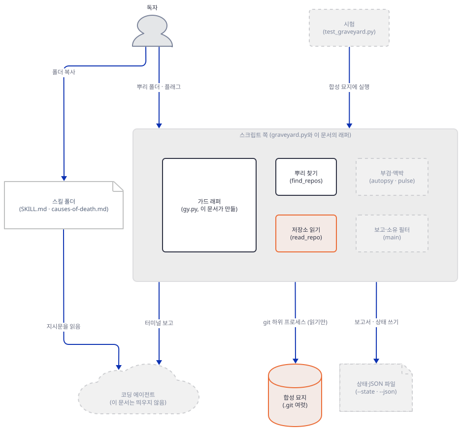

### Step 5. 원인 아홉 — 부검이 맞히는 것과 틀리는 것

**목적.** 원인 후보가 어떤 순서와 문턱으로 붙는지 읽고, 판정이 틀리는 입력을 만들어 확인합니다. 보고서는 후보 중 **첫 번째**만 표에 싣습니다. 나머지는 `--json`에만 있으므로 후보 전체를 찍는 도우미를 씁니다.

**할 일.** 아래 파일을 `lab159/causes.py`로 저장하고 Step 4의 묘지를 JSON으로 받아 읽습니다.

`lab159/causes.py`

```python
"""Print every cause the scanner found for each dead project in a --json report.

    python causes.py report.json
"""
import json
import sys

for d in json.load(open(sys.argv[1], encoding="utf-8"))["dead"]:
    print("%-15s pulse %3d  deploy=%-5s tests=%-5s  %s" % (d["name"], d["pulse"], d["has_deploy"], d["has_tests"],
                                                           " > ".join(c[0] for c in d["causes"])))
    for cause, evidence in d["causes"]:
        print("    %-16s %s" % (cause, evidence))
```

```bash
pyrun gy.py yard --no-art --json report.json > /dev/null
pyrun causes.py report.json
```

**확인.** 기대 출력입니다.

```text
one-night-2     pulse  31  deploy=False tests=False  shiny_object
    shiny_object     killed by `killer-app`, whose first commit came 5 day(s) after this repo's last
recipe-scraper  pulse  46  deploy=False tests=False  slow_fade
    slow_fade        the last gap between commits was 31x the median — it didn't die, it drifted
one-night-1     pulse  31  deploy=False tests=False  unknown
    unknown          no clear wound. Sometimes a project just stops.
mega-mono       pulse  32  deploy=False tests=False  scope_explosion
    scope_explosion  125 files across 2 top-level directories, zero deploy config — it grew instead of shipping
rewrite-loop    pulse  33  deploy=False tests=False  rewrite_spiral
    rewrite_spiral   history contains 3 rewrite/migration commits — it kept being rebuilt instead of finished
login-wall      pulse  37  deploy=False tests=False  auth_wall
    auth_wall        the final commits touch auth code — died at the login screen
tab-sensei      pulse  71  deploy=False tests=True   deploy_fear
    deploy_fear      README written, 26 commits in, tests present, and no deploy config anywhere. It worked. It just never shipped.
pay-wall        pulse  36  deploy=False tests=False  payments_wall
    payments_wall    the final commits touch payment code — died at the checkout
boiler-death    pulse   1  deploy=False tests=False  shiny_object > boilerplate_wall
    shiny_object     killed by `pay-wall`, whose first commit came 5 day(s) after this repo's last
    boilerplate_wall 100% of all file touches were config files — more time configuring than building
```

원인 아홉이 모두 나왔고, 소스의 순서(`autopsy`, 197~273행)가 곧 우선순위입니다.

| 원인 | 붙는 조건(소스) | 이 묘지 |
|---|---|---|
| `shiny_object` | 다른 저장소의 첫 커밋이 이 저장소 마지막 커밋 뒤 0~14일 안. 여럿이면 가장 가까운 것(211~223행) | `one-night-2`(`killer-app`), `boiler-death`(`pay-wall`) |
| `payments_wall` / `auth_wall` | 마지막 **세 커밋**이 건드린 파일 이름에 결제 낱말 / 인증 낱말이 들어 있음(225~229행) | `pay-wall` / `login-wall` |
| `boilerplate_wall` | 설정 파일 변경이 60% 이상이고 커밋 5개 이상(231~236행) | `boiler-death`(100%) |
| `deploy_fear` | README, 커밋 20개 이상, 배포 설정 없음, **태그 없음**(238~244행) | `tab-sensei` |
| `rewrite_spiral` | 제목에 rewrite·migrate to·port to·switch to가 둘 이상(246~253행) | `rewrite-loop`(3개) |
| `scope_explosion` | 파일 100개 초과, 배포 설정 없음, 수명 30일 초과(255~260행) | `mega-mono`(125개) |
| `slow_fade` | **앞의 어느 것도 안 붙었을 때만**, 간격 3개 이상이고 마지막 간격이 중앙값의 3배 초과(262~269행) | `recipe-scraper`(31배) |
| `unknown` | 아무것도 안 붙음(271~272행) | `one-night-1` |

`references/causes-of-death.md`의 서술과 소스가 다른 곳이 셋 있습니다. 분류표는 `scope_explosion`을 "many top-level directories"로 적지만 소스는 최상위 폴더 수를 조건으로 보지 않고 증거 문장에만 찍습니다(`mega-mono`는 둘). `slow_fade`는 분류표에 "no wall, no killer"라고 있지만 코드의 조건은 "아무 원인도 없을 때"로 더 넓습니다. `boilerplate_wall`의 커밋 5개 조건은 분류표에 없습니다. `boiler-death`는 `shiny_object > boilerplate_wall` 두 개가 붙었고 표에는 앞의 것만 보입니다. 패턴의 `deploy_fear` 줄은 후보 전체를 보는데(484행) 사망 원인 표는 첫 번째만 보기 때문입니다.

펄스는 항목 합입니다(`pulse`, 276~303행). README +15, 테스트 +20, 설정 비율 0.5 미만 +20, `min(15, 커밋 수 // 4)`, 원격 +10, 마지막 커밋이 180일 안 +10, 배포 설정 +10이고 100에서 자릅니다. `tab-sensei`는 15+20+20+6+10 = 71입니다. 재료가 "파일 이름에 test가 들어 있나"나 "원격 주소가 있나" 정도라서 점수는 부활할 만한가의 어림일 뿐입니다.

이제 틀리는 입력입니다. 소스에서 읽은 의심 네 가지를 두 저장소에 담았습니다.

- 배포 설정은 이름 목록에 있는지로 봅니다. 목록에 `.github/workflows`가 있습니다(`graveyard.py:43-44`). 시험 전용 워크플로도 "배포 설정"입니다.
- 테스트가 있는지는 파일 이름에 `test`나 `spec`이 들어 있는지입니다(160행).
- 재작성은 제목에 "port to"가 들어 있는지입니다(246~247행). "add **support to** …"에도 들어 있습니다.
- 인증은 마지막 세 커밋의 파일 이름에 `auth`가 들어 있는지입니다. 비교는 `last_touched.lower()`라서(155행) `AUTHORS`도 맞습니다.

`agent_skills/project-graveyard/scripts/graveyard.py:157-160`

```python
    has_deploy = any(
        m in files or any(f.startswith(m) for f in files) for m in DEPLOY_MARKERS
    )
    has_tests = any("test" in f.lower() or "spec" in f.lower() for f in files)
```

`lab159/make_traps.py`

```python
"""Build two repos whose verdicts are wrong in ways you can predict from the script's source.

    python make_traps.py traps
"""
import os
import subprocess
import sys
from datetime import datetime, timedelta

ROOT = os.path.abspath(sys.argv[1])
ME = ("Dana Fixture", "dana@example.test")


def days_ago(n):
    return (datetime.now() - timedelta(days=n)).strftime("%Y-%m-%dT10:00:00")


def git(d, *args, date=None):
    env = dict(os.environ, GIT_CONFIG_GLOBAL=os.devnull, GIT_CONFIG_NOSYSTEM="1",
               GIT_AUTHOR_NAME=ME[0], GIT_AUTHOR_EMAIL=ME[1], GIT_COMMITTER_NAME=ME[0], GIT_COMMITTER_EMAIL=ME[1])
    if date:
        env.update(GIT_AUTHOR_DATE=date, GIT_COMMITTER_DATE=date)
    subprocess.run(["git", "-C", d, "-c", "commit.gpgsign=false", *args], env=env, check=True, capture_output=True)


def commit(d, n, msg, files):
    for f in files:
        p = os.path.join(d, f)
        os.makedirs(os.path.dirname(p), exist_ok=True)
        with open(p, "a", newline="\n") as fh:
            fh.write("line\n")
    git(d, "add", "-A")
    git(d, "commit", "-q", "-m", msg, date=days_ago(n))


os.makedirs(ROOT)

# Looks like deploy fear (README, 22 commits, nothing deployed), but a test workflow sits in .github/workflows
d = os.path.join(ROOT, "ci-only")
os.makedirs(d)
git(d, "init", "-q", "-b", "main")
commit(d, 200, "init", ["README.md", "src/main.py", ".github/workflows/ci.yml"])
for i in range(1, 21):
    commit(d, 200 - i * 2, "feat: step %d" % i, ["src/step%d.py" % i])

# Three small mistakes in one repo
d = os.path.join(ROOT, "trap-words")
os.makedirs(d)
git(d, "init", "-q", "-b", "main")
commit(d, 180, "init", ["app.py"])
commit(d, 170, "add support to export CSV", ["export.py"])
commit(d, 160, "add support to import JSON", ["import_json.py"])
commit(d, 150, "ship the latest numbers", ["latest.json"])
commit(d, 140, "credits", ["AUTHORS"])
print("built 2 repos under", os.path.basename(ROOT))
```

```bash
pyrun make_traps.py traps
pyrun gy.py traps --no-art --json traps.json > /dev/null
pyrun causes.py traps.json
```

**확인.** 기대 출력입니다.

```text
built 2 repos under traps
trap-words      pulse  51  deploy=False tests=True   auth_wall > rewrite_spiral
    auth_wall        the final commits touch auth code — died at the login screen
    rewrite_spiral   history contains 2 rewrite/migration commits — it kept being rebuilt instead of finished
ci-only         pulse  60  deploy=True  tests=False  unknown
    unknown          no clear wound. Sometimes a project just stops.
```

`trap-words`는 `AUTHORS` 파일 때문에 "died at the login screen"이 되었고, 재작성 커밋은 "support to export CSV"와 "support to import JSON" 둘로 `rewrite_spiral`이 붙었고, `latest.json` 하나가 `tests=True`를 만들었습니다. `ci-only`는 README와 커밋 21개에 진짜 배포 설정이 없는데 CI 파일 하나 때문에 `deploy=True`, 원인은 `unknown`입니다. `SKILL.md`가 "Causes are evidence-based guesses, not verdicts — each comes with the evidence line"이라며 증거를 확인하고 말하라고 하는 이유가 이것입니다(`SKILL.md:67-69`). 에이전트가 증거 줄 "the final commits touch auth code"만 옮기고 `AUTHORS`가 마지막 커밋에 있었는지 확인하지 않으면 틀린 비문이 나옵니다.

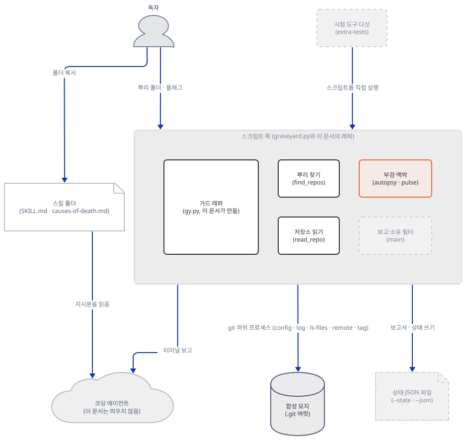

### Step 6. 누구의 것으로 세는가 — 소유 필터와 이메일

**목적.** "내 프로젝트"를 가르는 규칙을 소스로 읽고, 설정이 달라지면 센서스가 어떻게 달라지는지 봅니다.

**할 일.** 내 이메일 집합을 모으는 곳과 남의 저장소를 거르는 곳입니다.

`agent_skills/project-graveyard/scripts/graveyard.py:356-360`

```python
    roots = args.roots or DEFAULT_ROOTS
    my_emails = {e.lower() for e in filter(None, [
        sh(["git", "config", "--global", "user.email"]),
        sh(["git", "config", "user.email"]),
    ])} | {e.strip().lower() for e in args.me if e.strip()}
```

`agent_skills/project-graveyard/scripts/graveyard.py:385-387`

```python
        if not args.include_foreign and my_emails and r["mine"] / r["commits"] < 0.2:
            skipped.append("%s (%d/%d commits yours)" % (r["name"], r["mine"], r["commits"]))
            continue  # someone else's repo you cloned; not your corpse to bury
```

저장소마다 내 이메일로 쓴 커밋이 전체의 20% 미만이면 건너뜁니다. 그런데 **`my_emails`가 비어 있으면 조건(`and my_emails`)이 꺼져서 아무것도 거르지 않습니다.** 146~147행도 이메일이 없으면 모든 커밋을 내 것으로 셉니다. 네 가지 설정으로 같은 묘지를 훑고, 마지막 둘은 원인까지 봅니다.

```bash
echo "--- 기본 (전역 이메일 dana@example.test)"
pyrun gy.py yard --no-art | grep -E "^(repos scanned|skipped)"
echo "--- 전역 이메일 없음"
GIT_CONFIG_GLOBAL="$(win "$LAB/home/empty.gitconfig")" pyrun gy.py yard --no-art | grep -E "^(repos scanned|skipped)"
echo "--- --me dana@work.example.test"
pyrun gy.py yard --no-art --me dana@work.example.test --json me.json | grep -E "^(repos scanned|skipped)"
echo "--- --include-foreign"
pyrun gy.py yard --no-art --include-foreign | grep -E "^(repos scanned|skipped)"
echo "--- rewrite-loop의 원인: --me 없이, 있이"
pyrun causes.py report.json | grep -A1 "^rewrite-loop"
pyrun causes.py me.json | grep -A2 "^rewrite-loop"
```

**확인.** 기대 출력입니다.

```text
--- 기본 (전역 이메일 dana@example.test)
repos scanned: 13   alive: 1   finished: 1   dead: 9   not yours (skipped): 2
skipped as not-yours (by commit email): cloned-lib, work-side
--- 전역 이메일 없음
repos scanned: 13   alive: 1   finished: 1   dead: 11   not yours (skipped): 0
--- --me dana@work.example.test
repos scanned: 13   alive: 1   finished: 1   dead: 10   not yours (skipped): 1
skipped as not-yours (by commit email): cloned-lib
--- --include-foreign
repos scanned: 13   alive: 1   finished: 1   dead: 11   not yours (skipped): 0
--- rewrite-loop의 원인: --me 없이, 있이
rewrite-loop    pulse  33  deploy=False tests=False  rewrite_spiral
    rewrite_spiral   history contains 3 rewrite/migration commits — it kept being rebuilt instead of finished
rewrite-loop    pulse  33  deploy=False tests=False  shiny_object > rewrite_spiral
    shiny_object     killed by `work-side`, whose first commit came 13 day(s) after this repo's last
    rewrite_spiral   history contains 3 rewrite/migration commits — it kept being rebuilt instead of finished
```

- 전역 이메일이 있으면 `work-side`(회사 메일)와 `cloned-lib`(남의 저장소)가 모두 "내 것 아님"으로 빠지고 죽은 프로젝트는 9개입니다.
- 전역 이메일이 어디에도 없으면 아무것도 빠지지 않고 11개가 됩니다. 센서스는 거른 것이 없다고 말할 뿐 이메일이 없다는 것은 알려 주지 않습니다.
- `--me`로 회사 메일을 더하면 `work-side`가 들어옵니다. `--include-foreign`은 20% 문턱을 끄고 남의 저장소까지 가져옵니다.
- 소유 필터는 **누가 죽였는지**도 바꿉니다. 거른 저장소는 `autopsy`의 후보 목록에 없으므로 킬러가 될 수 없습니다. `rewrite-loop`는 `--me` 없이는 `rewrite_spiral`이었는데 회사 메일을 더하자 163일 전에 태어난 `work-side`(13일 뒤)가 킬러로 붙어 `shiny_object > rewrite_spiral`이 됩니다.

`SKILL.md`의 주의("Ownership filter uses git email … claim yours with `--me that@email.com`", 211~214행)와 같지만, 이메일이 아예 없을 때 필터가 꺼진다는 것은 쓰여 있지 않습니다. 이제 359행이 읽는 곳을 확인합니다. 스크립트를 **어떤 저장소 안에서** 돌리면 그 저장소의 로컬 이메일도 "내 것"에 들어갑니다.

```bash
mkdir "${LAB:?먼저 . ./env.sh를 불러오세요}/side"
git -C "${LAB:?}/side" init -q -b main
git -C "${LAB:?}/side" config user.email dana@work.example.test
echo "--- side/ 안에서 실행 (그 저장소의 로컬 이메일이 work 주소)"
(cd side && pyrun ../gy.py ../yard --no-art | grep -E "^(repos scanned|skipped)")
echo "--- 작업 폴더에서 실행"
pyrun gy.py yard --no-art | grep -E "^(repos scanned|skipped)"
```

**확인.** 기대 출력입니다.

```text
--- side/ 안에서 실행 (그 저장소의 로컬 이메일이 work 주소)
repos scanned: 13   alive: 1   finished: 1   dead: 10   not yours (skipped): 1
skipped as not-yours (by commit email): cloned-lib
--- 작업 폴더에서 실행
repos scanned: 13   alive: 1   finished: 1   dead: 9   not yours (skipped): 2
skipped as not-yours (by commit email): cloned-lib, work-side
```

같은 묘지, 같은 명령이 실행한 폴더에 따라 죽은 목록이 9개와 10개로 달랐습니다. 에이전트는 사용자가 작업하던 저장소 안에서 스크립트를 돌리기 쉬우므로, 그 저장소의 이메일이 회사 주소이면 이 일이 벌어집니다. 이 문서의 래퍼가 작업 폴더 밖에서의 실행을 거부하는 까닭의 하나이기도 합니다.

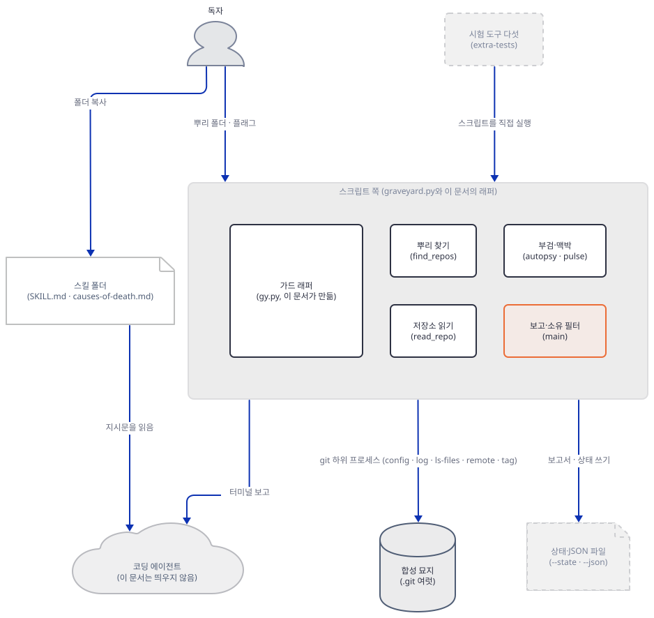

### Step 7. 상태 파일, 재발 감시, 그리고 보고서가 내보내는 것

**목적.** `--state`·`--mark-resurrected`·재발 감시를 실행하고, 이 기능들의 모서리와 `--redact`가 실제로 가리는 범위를 확인합니다.

**할 일.** 부활을 기록하려면 `--state`가 필수입니다. 기록은 스캔 없이 상태 파일만 쓰고 끝납니다(342~354행). 두 프로젝트를 부활로 기록하고, 곧바로 스캔합니다.

```bash
pyrun gy.py --state state.json --mark-resurrected yard/tab-sensei
pyrun gy.py --state state.json --mark-resurrected yard/recipe-scraper
cat state.json; echo
pyrun gy.py yard --no-art --state state.json | sed -n '/RELAPSE/,/STRONGEST/p'
```

**확인.** 기대 출력입니다.

```text
recorded: tab-sensei resurrected 2026-10-19. The next scan holds it to that.
recorded: recipe-scraper resurrected 2026-10-19. The next scan holds it to that.
{
 "resurrections": [
  {
   "path": ".../lab159\\yard\\tab-sensei",
   "name": "tab-sensei",
   "date": "2026-10-19"
  },
  {
   "path": ".../lab159\\yard\\recipe-scraper",
   "name": "recipe-scraper",
   "date": "2026-10-19"
  }
 ],
 "last_scan": null
}
RELAPSE WATCH
------------------------------------------------------------
- tab-sensei: resurrected 2026-10-19, silent for 262 days since. It's dying again — decide: recommit or bury it honestly.
- recipe-scraper: resurrected 2026-10-19, silent for 100 days since. It's dying again — decide: recommit or bury it honestly.

STRONGEST PULSE --------/\_/\-------- (most resurrectable)
```

상태 파일에는 경로와 이름과 날짜만 있습니다. 재발 감시는 기록 직후인데도 둘 다 "It's dying again"이라고 합니다. 소스가 침묵 일수를 **마지막 커밋으로부터** 세기 때문입니다.

`agent_skills/project-graveyard/scripts/graveyard.py:498-504`

```python
            silent_days = int((datetime.now().timestamp() - r["last"]) / 86400)
            if silent_days > 14:
                lines.append("- %s: resurrected %s, silent for %d days since. It's dying again — "
                             "decide: recommit or bury it honestly." % (res["name"], res["date"], silent_days))
            else:
                lines.append("- %s: resurrected %s, last commit %dd ago. Holding."
                             % (res["name"], res["date"], silent_days))
```

부활을 기록한 날이 아니라 마지막 커밋이 기준이라, 새 커밋이 하나도 없으면 첫 스캔부터 "다시 죽는 중"입니다. 14일 문턱의 뜻은 "기록한 뒤 14일 안에 커밋하라"로 읽어야 합니다. 이제 `--redact`입니다. 방금 훑은 묘지를 가려서 JSON까지 받고, 가려졌어야 할 이름이 남았는지 셉니다. `tab-sensei`는 아직 죽은 상태입니다.

```bash
pyrun gy.py yard --no-art --redact --json redacted.json | grep -E "^(skipped|finished|unversioned)"
echo "--- --redact --state: 재발 감시 줄"
pyrun gy.py yard --no-art --redact --state state.json | sed -n '/RELAPSE/,/STRONGEST/p'
grep -o "tab-sensei\|dana\|example.test" redacted.json | sort | uniq -c
pyrun -c "
import json
d = [x for x in json.load(open('report.json'))['dead'] if x['name'] == 'tab-sensei'][0]
print({k: d[k] for k in ('path', 'remote')})
"
```

**확인.** 기대 출력입니다.

```text
finished (shipped, just stable — not corpses): project-3
skipped as not-yours (by commit email): cloned-lib, work-side
unversioned (no git — died before their first commit): 1 project folder(s)
--- --redact --state: 재발 감시 줄
RELAPSE WATCH
------------------------------------------------------------
- tab-sensei: resurrected 2026-10-19, silent for 262 days since. It's dying again — decide: recommit or bury it honestly.
- recipe-scraper: resurrected 2026-10-19, silent for 100 days since. It's dying again — decide: recommit or bury it honestly.

STRONGEST PULSE --------/\_/\-------- (most resurrectable)
      1 dana
      1 example.test
      1 tab-sensei
{'path': '.../lab159\\yard\\tab-sensei', 'remote': 'https://example.test/dana/tab-sensei.git'}
```

본문의 "project-N" 이름은 가려졌습니다. 그런데 세 곳에서 샙니다. "skipped as not-yours" 줄은 거른 저장소의 진짜 이름(`cloned-lib`, `work-side`)을 그대로 찍습니다(`graveyard.py:439-441`). `skipped` 목록이 가리기(391~399행) 전에 만들어지기 때문입니다. `--json`의 `dead` 항목은 `remote` 키를 그대로 실어서 `https://example.test/dana/tab-sensei.git`처럼 진짜 프로젝트 이름과 사용자 이름이 남습니다(530~531행). 셋째는 `--state`를 같이 줄 때의 재발 감시입니다. 위 출력의 마지막 줄들처럼 `RELAPSE WATCH`가 상태 파일의 진짜 이름(`tab-sensei`, `recipe-scraper`)을 그대로 찍습니다(`graveyard.py:489-504`). 상태 파일은 일부러 진짜 이름을 담기 때문입니다(536~537행). `SKILL.md`는 공유용 보고서에 `--redact`를 권하고(136~137행) 부활 기록은 `--state`로 남기라고 하므로 이 둘이 같이 쓰이기 쉽습니다. `--redact` 없는 JSON의 `path`는 작업 폴더의 절대 경로이고, 실제 PC에서는 사용자 이름이 든 경로입니다. 저장소 2b 시험의 `--redact` 확인은 한 프로젝트 이름이 출력에 없는지와 킬러 이름이 가려졌는지만 보므로(`test_graveyard.py:139-140`) 이 셋은 보지 못합니다. 이제 이 상태 파일 쪽의 모서리입니다.

```bash
pyrun gy.py --mark-resurrected yard/tab-sensei; echo "종료 코드 $?"
pyrun gy.py --state state-typo.json --mark-resurrected yard/tab-sensai
(pyrun gy.py yard --no-art --state '~/graveyard.json' > tilde.txt 2>&1; echo "종료 코드 $?"; tail -1 tilde.txt)
pyrun gy.py yard --no-art --state state-typo.json | sed -n '/RELAPSE/,/^$/p'
```

**확인.** 기대 출력입니다.

```text
error: --mark-resurrected needs --state FILE to write into
종료 코드 2
recorded: tab-sensai resurrected 2026-10-19. The next scan holds it to that.
종료 코드 1
FileNotFoundError: [Errno 2] No such file or directory: '~/graveyard.json'
RELAPSE WATCH
------------------------------------------------------------
- tab-sensai: resurrected 2026-10-19, no longer found on disk. Buried for good, or moved.
```

- `--state` 없는 `--mark-resurrected`는 종료 코드 2의 오류 한 줄로 끝납니다.
- 없는 경로(오타 `tab-sensai`)도 "recorded"라고 기록합니다. 다음 스캔은 그것을 "no longer found on disk. Buried for good, or moved."라고 말합니다.
- `--state '~/graveyard.json'`처럼 `~`가 셸에서 풀리지 않은 채 파일에 닿으면, 스크립트는 보고서를 **끝까지 찍은 뒤** 마지막에 `FileNotFoundError`로 죽고 상태는 남지 않습니다(`os.path.expanduser`를 `--state`에는 쓰지 않습니다). `SKILL.md:177-183`의 예시는 따옴표 없이 쓰므로 셸이 풀어 주지만, 에이전트가 셸 없이 인자 목록으로 프로세스를 띄우면 이 일이 납니다. 종료 코드 1이 `종료 코드` 줄에 보입니다.

마지막으로 실제로 부활시키면 감시가 무엇을 말하는지 봅니다. 새 커밋을 하나 더하고(이 줄이 이 문서에서 스캔 대상 저장소에 쓰는 유일한 줄입니다) 다시 스캔합니다. 네크로맨서 모드가 하라는 대로 상태 파일에서 이름을 찾아도 봅니다(`SKILL.md:197-199`).

```bash
git -C "${LAB:?먼저 . ./env.sh를 불러오세요}/yard/tab-sensei" commit --allow-empty -q -m "resume work on tab groups"
pyrun gy.py yard --no-art --state state.json | sed -n '/RELAPSE/,/STRONGEST/p'
grep -n "tab" state.json
```

**확인.** 기대 출력입니다.

```text
RELAPSE WATCH
------------------------------------------------------------
- tab-sensei: resurrected 2026-10-19, last commit 0d ago. Holding.
- recipe-scraper: resurrected 2026-10-19, silent for 100 days since. It's dying again — decide: recommit or bury it honestly.

STRONGEST PULSE --------/\_/\-------- (most resurrectable)
4:   "path": ".../lab159\\yard\\tab-sensei",
5:   "name": "tab-sensei",
75:    "name": "tab-sensei",
76:    "path": ".../lab159\\yard\\tab-sensei"
```

`tab-sensei`는 살아 있는 쪽으로 옮겨져 "Holding"이 되었습니다. 상태 파일의 이름은 최근 스캔의 `alive` 목록(75행)과 부활 기록(5행) 두 곳에 있습니다. 상태 파일에는 이름·경로·원인·펄스뿐이고 README 내용은 없으므로, `SKILL.md`가 말하는 "name and README overlap"의 README 쪽은 에이전트가 직접 열어 읽어야 합니다.

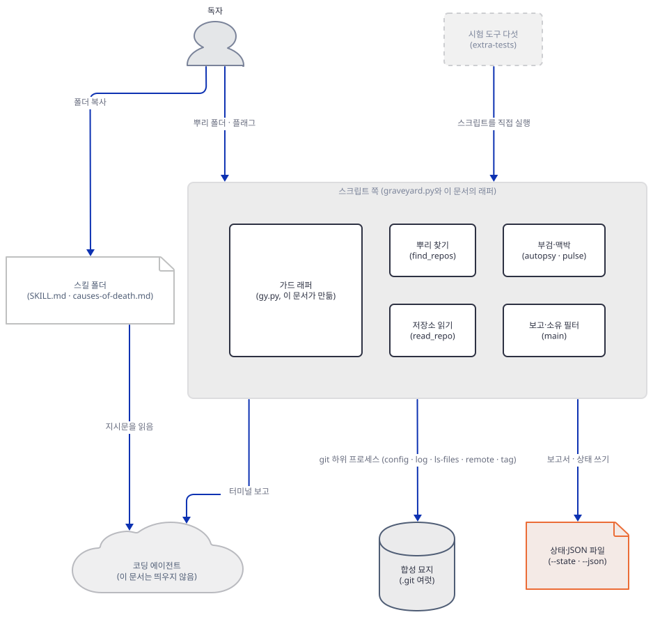

### Step 8. 결정적 시험 다섯과 행동 시험 읽기

**목적.** 저장소가 이 스킬에 대해 돌리는 구조·보안·트리거·레지스트리·스크립트 시험을 직접 돌려 출력을 읽고, 시험이 보지 못하는 것을 구분합니다. 행동 시험(3단계)은 모델을 부르므로 돌리지 않고 읽기만 합니다.

**할 일.** 시험 도구는 저장소 안 파일을 읽으므로 저장소 맨 위에서 돌립니다. 레지스트리 검사는 현재 폴더를 저장소 맨 위로 보므로 반드시 그 자리에서 돌립니다(Day 156 문제 해결 표). 환경 파일의 `PYTHONDONTWRITEBYTECODE=1`과 `python -B`가 저장소 안에 `__pycache__`가 생기지 않게 합니다.

```bash
cd "$REPO"
pyrun agent_skills/evals/tools/skill_lint.py agent_skills/project-graveyard --strict
pyrun agent_skills/evals/tools/skill_scanner.py agent_skills/project-graveyard
pyrun agent_skills/evals/tools/run_trigger_evals.py | grep "project-graveyard"
pyrun agent_skills/evals/tools/registry_lint.py
time pyrun agent_skills/evals/project-graveyard/test_graveyard.py
cd "$LAB"
```

**확인.** 이 스킬의 부분입니다(트리거 시험은 저장소의 모든 스킬을 한꺼번에 돌려 줄이 여럿이라 `grep`으로 이 스킬의 줄만 남겼습니다).

```text
Linting <REPO>\agent_skills\project-graveyard (strict=on)
  PASS — 0 error(s), 0 warning(s)
agent-skill security scan v1.0.0 — 1 skill(s) under agent_skills\project-graveyard

=== project-graveyard (agent_skills\project-graveyard) ===
  clean — no findings

Summary: 0 CRITICAL, 0 WARN, 0 INFO
Verdict guidance: no pattern hits. Still read SKILL.md end-to-end — natural-language attacks evade pattern scanners (OWASP AST08).
PASS  project-graveyard: 3 positives clear 3 near-misses (weakest 1.63 vs strongest 0.76)
Checking registry at <REPO> (mode=check)
  PASS — 0 error(s), 0 warning(s)
classification:
  PASS census separates alive/finished/dead
  PASS shipped-tool is finished, not eulogized
  PASS almost-shipped died of deploy fear
  PASS pay-wall died at the payments wall
  PASS boiler-death: shiny object takes precedence
  PASS kill-chain names the killer
  PASS config ratio is sane (<=100%)
  PASS unversioned folder counted, not autopsied
redaction:
  PASS names are redacted
  PASS kill-chain survives redaction
state and relapse:
  PASS state records the scan
  PASS state includes finished (necromancer needs it)
  PASS resurrection is recorded
  PASS relapse is detected and named
json report:
  PASS report has alive/finished/dead keys
  PASS dead entries carry causes and pulse

PASS — 16/16 checks

real	0m7.459s
user	0m0.000s
sys	0m0.046s
```

시험 다섯이 모두 통과했고 가드 로그(`guard.log`)는 비어 있었습니다. 시험이 무엇을 보고 무엇을 못 보는지 정리합니다. 도구 다섯과 입력의 관계는 아래 그림입니다. 3단계(`evals.json`)는 모델을 부르므로 돌리지 않아 그림에 없습니다.

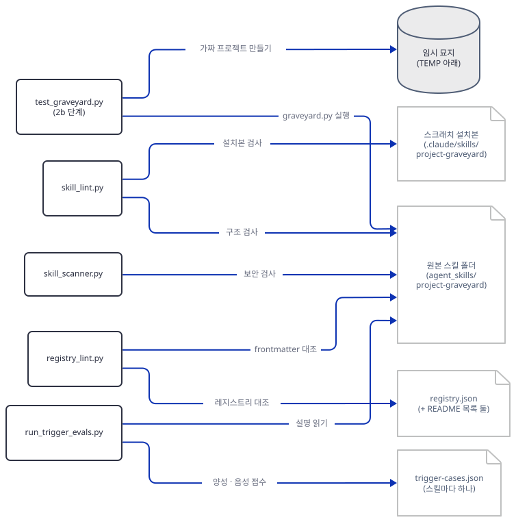

| 단계 | 도구 | 보는 것 | 한계 |
|---|---|---|---|
| 1 구조 | `skill_lint.py --strict` | 명세 필드 규칙, 이름과 폴더 일치, 본문 길이, 본문이 가리키는 상대 경로의 존재 | 지시문이 쓸모 있는지는 모름 |
| 1b 보안 | `skill_scanner.py` | 설치 유인 문구, 원격 스크립트 파이프, 인증 정보 파일 읽기, 코드에 감춘 페이로드, 스크립트의 네트워크 낱말 | 패턴만 봄. 이 도구 자신이 "natural-language attacks evade pattern scanners"라고 적음 |
| 2 트리거 | `run_trigger_evals.py` | `trigger-cases.json`의 양성 문장이 설명과 낱말이 겹치는 정도가 음성보다 1.15배 넘게 높은가 | 의미가 아니라 낱말 겹침 |
| 레지스트리 | `registry_lint.py` | `registry.json`이 각 `SKILL.md`에서 다시 만든 것과 같은가 | 설치 명령이 실제로 동작하는지는 모름 |
| 2b 스크립트 | `test_graveyard.py` | 임시 묘지를 만들어 분류·정리·redact·상태·JSON 확인 16개 | 아래 |

2b 시험이 안 보는 것은 이 문서의 앞 Step에서 본 것들입니다. 시험은 항상 같은 이메일을 `--me`로 주고 저장소도 그 이메일 하나뿐이라서 Step 6의 "이메일이 없으면 필터가 꺼짐"과 "실행 폴더에 따라 달라짐"이 없고, 남의 저장소·회사 메일 저장소를 만들지 않으며, 깊이·`go`·숨은 폴더의 사각지대(Step 3)도 없고, `--redact` 확인은 Step 7의 두 틈을 놓칩니다. 저장소 README는 시험이 "16 checks, ~10 seconds"라고 적는데 이 PC에서는 5.9초에 16개였습니다. 시험은 임시 폴더를 만들고 끝에 지우려 하지만 읽기 전용 git 객체 때문에 `TEMP` 아래에 `graveyard-eval-…`가 남았습니다(`tmp/` 아래에서 확인했습니다. 작업 폴더째 지우면 됩니다). 이 시험을 이 PC의 진짜 임시 폴더에 남기지 않으려면 `TEMP`를 돌린 셸에서 돌려야 합니다.

트리거 시험을 직접 만져 봅니다. 시험이 쓰는 두 함수로 같은 방식으로 점수를 매기는 도우미입니다.

`lab159/try_prompts.py`

```python
"""Score prompts against a skill description the way run_trigger_evals.py does.

    python try_prompts.py REPO_ROOT "prompt one" "prompt two" ...
"""
import importlib.util
import sys

root = sys.argv[1]
spec = importlib.util.spec_from_file_location("trig", root + "/agent_skills/evals/tools/run_trigger_evals.py")
trig = importlib.util.module_from_spec(spec)
spec.loader.exec_module(trig)

description = trig.tokens(trig.description_of(root + "/agent_skills/project-graveyard"))
for prompt in sys.argv[2:]:
    words = trig.tokens(prompt)
    print("%.2f  %-62s shared=%s" % (trig.score(words, description), prompt, sorted(words & description)))
```

```bash
pyrun try_prompts.py "$REPO" "run the graveyard on my machine, my projects are in ~/dev and ~/hacks" "I have like 30 half-finished side projects and it's honestly depressing. why do I never finish anything?" "of all my old abandoned repos, which one is actually worth finishing?" "my disk is full, find old projects with giant node_modules folders I can delete" "help me archive some of my old GitHub repos and clean up my profile" "walk me through the git history of this repo and explain how the architecture evolved" "which of my old repos should I revive" "delete my unused repos"
```

```text
1.63  run the graveyard on my machine, my projects are in ~/dev and ~/hacks shared=['graveyard', 'machine', 'project', 'run']
2.02  I have like 30 half-finished side projects and it's honestly depressing. why do I never finish anything? shared=['anyth', 'finish', 'like', 'never', 'project', 'side', 'why']
1.77  of all my old abandoned repos, which one is actually worth finishing? shared=['abandon', 'finish', 'old', 'one', 'worth']
0.63  my disk is full, find old projects with giant node_modules folders I can delete shared=['old', 'project']
0.76  help me archive some of my old GitHub repos and clean up my profile shared=['help', 'old']
0.67  walk me through the git history of this repo and explain how the architecture evolved shared=['git', 'history']
1.00  which of my old repos should I revive                          shared=['old', 'revive']
0.00  delete my unused repos                                         shared=[]
```

앞 셋이 `trigger-cases.json`의 낱말 시험 양성, 다음 셋이 음성입니다. 양성 가운데 가장 약한 것이 1.63, 음성 가운데 가장 강한 것이 0.76입니다. 마지막 두 줄은 제가 더한 문장입니다. "which of my old repos should I revive"는 1.00으로 음성과 양성 사이에 걸치고, 뜻이 비슷한 "delete my unused repos"는 겹치는 낱말이 없어 0입니다. 이 시험은 설명을 고치다 낱말이 빠지는 사고를 잡는 안전망이지, 에이전트가 실제로 이 스킬을 고를지의 예측이 아닙니다. 사례 일곱 가운데 하나(`necromancer-mode`)는 `lexical: false`라서 이 시험에서 빠집니다. "newsletter analytics dashboard를 만들어 달라"는 요청에는 설명과 겹치는 낱말이 거의 없기 때문입니다(이 사례를 같은 방식으로 재면 0.38이었습니다). 이 사례는 행동 시험의 몫입니다.

```bash
pyrun -c "
import json
base = '$(win "$REPO")/agent_skills/evals/project-graveyard/'
cases = json.load(open(base + 'trigger-cases.json', encoding='utf-8'))['cases']
evals = json.load(open(base + 'evals.json', encoding='utf-8'))['evals']
print('trigger cases', len(cases), '| should_trigger', sum(c['should_trigger'] for c in cases), '| lexical:false', sum(c.get('lexical') is False for c in cases))
print('behavior evals', len(evals), '| expectations per eval', [len(e['expectations']) for e in evals])
"
```

```text
trigger cases 7 | should_trigger 4 | lexical:false 1
behavior evals 4 | expectations per eval [4, 4, 4, 3]
```

행동 시험 `evals.json`은 모델을 부르는 시험이라 돌리지 않았습니다. 읽어 보면 질문 넷에 기대 항목(`expectations[]`)이 4·4·4·3개 있고, 모두 에이전트가 한 일을 판정하는 문장입니다. 예를 들면 "The skill ran scripts/graveyard.py with the user-provided roots and no others", "The agent asked where projects live (or confirmed roots) before scanning broadly", "Exactly one project is proposed for resurrection, with a plan of at most 7 steps ending at shipped", "The user's new project is not blocked or argued against"입니다. 뿌리를 에이전트가 먼저 묻는지는 이 시험으로만 볼 수 있고, 스크립트가 뿌리를 안 받았을 때 홈을 훑는 것은 스크립트가 막지 못합니다. 이 문서가 래퍼를 둔 이유입니다. 그 결과는 이 문서에 없습니다.

한 가지 더 있습니다. 머리말과 저장소 README는 "Runs entirely locally"·"zero network calls"라고 합니다. 스크립트에 대해서는 맞다고 위 실행이 보였습니다(네트워크 낱말 0, 스캐너 clean, 시도 0). 그러나 부활 단계의 세계 점검은 에이전트에게 "Search whether what blocked it got easier since it died"와 "Search whether the world shipped the idea"를 시킵니다(`SKILL.md:146-151`). 검색은 에이전트가 쓰는 도구의 일이고 그 쿼리가 어디로 가는지는 이 문서가 확인하지 못했습니다. 스크립트가 아무것도 내보내지 않는다는 것과, 스킬을 쓰는 동안 아무것도 나가지 않는다는 것은 다른 말입니다.

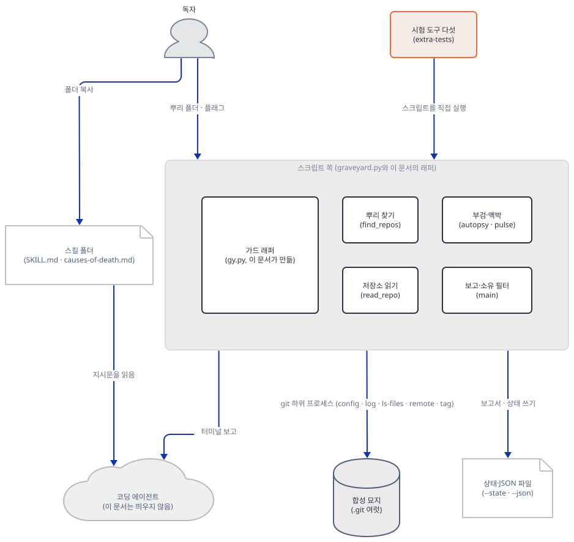

## 요청 한 건이 흐르는 과정

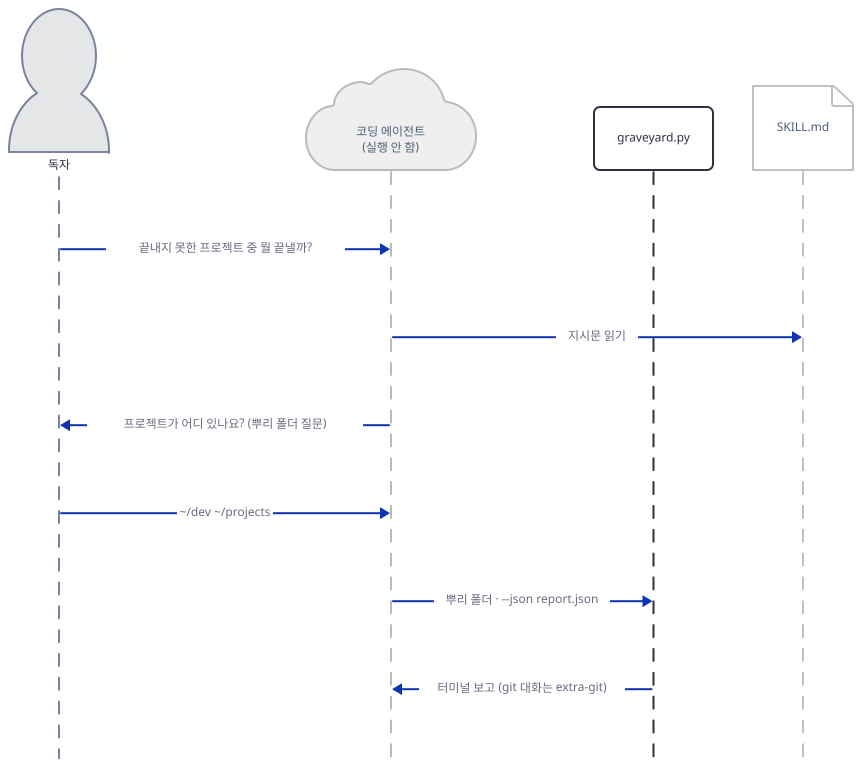

사용자가 에이전트에게 "끝내지 못한 프로젝트 중 뭘 끝낼까?"를 묻습니다. 에이전트는 시작할 때 읽어 둔 설명을 보고 이 스킬이 맞다고 판단해 `SKILL.md` 전체를 읽습니다(소스로 읽은 흐름이고 이 문서는 에이전트를 띄우지 않았습니다). 지시문은 뿌리를 모르면 묻게 합니다("one question beats sweeping someone's home directory uninvited", `SKILL.md:48-49`). 사용자가 폴더를 알려 주면 에이전트가 `graveyard.py 뿌리… --json report.json`을 돌리고 터미널 보고를 받습니다. 스크립트가 git과 나누는 대화는 아래 그림에 따로 있고, 이 문서가 Step 4에서 센 80번 가운데 저장소마다의 여섯 번입니다.

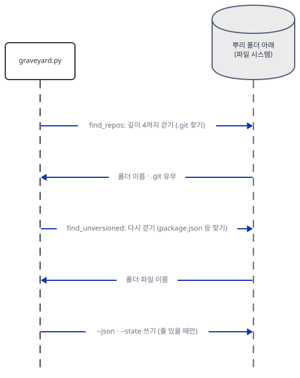

스크립트는 먼저 뿌리 폴더를 깊이 4까지 걸어 `.git`이 있는 폴더와, git 없이 프로젝트 표지 파일만 있는 폴더를 찾습니다(Step 3). `--json`·`--state`를 줬다면 끝에 그 파일을 씁니다. 그다음 git과의 대화입니다.

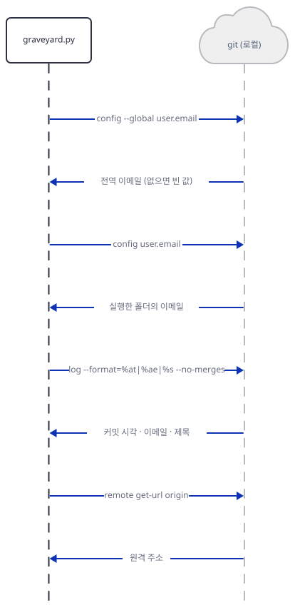

스크립트는 내 이메일을 설정에서 받고(전역과 실행한 폴더), 저장소마다 커밋 로그와 원격 주소를 읽습니다.

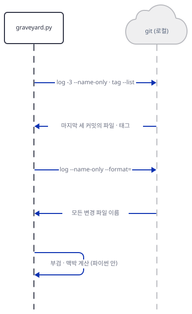

이어서 추적 파일, 마지막 세 커밋의 파일 이름, 태그, 모든 변경 파일 이름을 읽고, 부검과 펄스 계산은 파이썬 안에서 합니다. 이 두 그림의 메시지가 모두 한 저장소에 대한 것이고, 저장소마다 반복해서 이 문서가 Step 4에서 센 80번이 됩니다. 그다음은 에이전트의 일입니다.

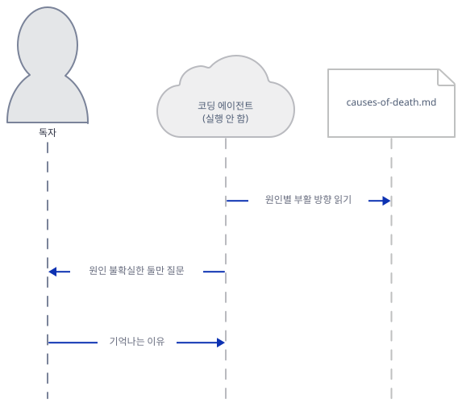

에이전트는 `references/causes-of-death.md`에서 원인별 부활 방향을 읽고, 원인이 `unknown`이나 `slow_fade`인 프로젝트에 한해 둘이나 셋만 묻고(`SKILL.md:73-85`), 법의학이 보인 것은 **(forensic)**, 사용자가 말한 것은 **(confirmed)**로 표시합니다.

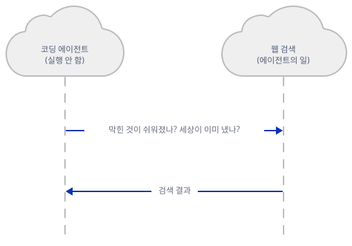

세계 점검은 에이전트가 검색으로 합니다. 스크립트가 아니므로 이 문서는 그 쿼리가 어디로 가는지 확인하지 못했습니다(Step 8).

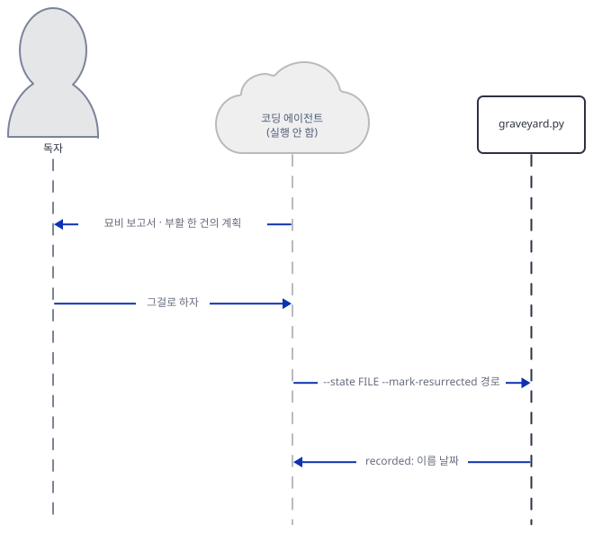

에이전트는 단계 7개 이하의 부활 계획을 하나만 세우고, 사용자가 하겠다고 하면 `--state FILE --mark-resurrected 경로`를 돌려 기록합니다. 아래는 Step 4의 결과로 제가 손으로 만든 견본이고, 모델의 출력이 아닙니다. `SKILL.md:104-123`의 묘비 카드 형식을 따라 부활 후보 하나만 카드로 새겼습니다. 비문 "It worked. It just never shipped."는 스크립트가 `deploy_fear` 증거 문장에 이미 넣어 둔 말입니다(`graveyard.py:243`).

```text
        .------------------------.
       /                          \
      |        tab-sensei          |
      |   Dec 2025 — Jan 2026      |
      |   26 commits · 38 days     |
      |                            |
      |   died of deploy fear      |
      |                            |
      |   "It worked. It just      |
      |     never shipped."        |
   ___|____________________________|___
      ~ ~ ~ ~ ~ ~ ~ ~ ~ ~ ~ ~ ~ ~
```

> **센서스.** 훑은 열세 개 중 아홉이 죽었고 합쳐 359일을 살았습니다. 가장 오래된 시체는 `boiler-death`입니다. 둘은 내 것이 아니라서 빠졌고(회사 메일 하나, 남의 저장소 하나), 하나는 git 없이 죽었습니다.
>
> **패턴.** 하룻밤에 끝난 것이 둘, 새 프로젝트에 밀려 죽은 것이 둘, 같은 벽(결제·인증)에서 죽은 것이 둘입니다.
>
> **부활.** `tab-sensei` 하나입니다. 펄스 71로 가장 높고, 부족한 것은 배포 설정 하나입니다. 계획의 0단계는 "아직 돌아가는지 확인"입니다. 건드리기 전에 먼저 묻습니다.

## 실행 체크리스트

- [ ] 작업 폴더 `lab159`를 어떤 git 저장소 안에도 두지 않고(환경 파일이 확인합니다), 환경 파일이 홈·임시 폴더·git 전역 설정을 작업 폴더 안으로 돌렸다
- [ ] `guard loaded`가 나왔고 `~ ->` 줄이 작업 폴더 안의 `home`을 보인다
- [ ] 스킬 폴더를 `project/.claude/skills/`로 복사했고 파일이 넷(951줄)이며 `evals/`가 없다. 진짜 `~/.claude/skills`에는 아무것도 넣지 않았다
- [ ] 래퍼의 네 거부(홈, 뿌리, `--json`, 실행 위치)가 모두 종료 코드 3으로 끝난다
- [ ] 설치·목록 블록이 `LAB`이 비었거나 진짜 설정 폴더 아래이면 멈추는 것을 알고, 스크래치 `.claude`만 나열했다
- [ ] 뿌리 없는 실행이 일곱 기본 뿌리를 보이고 종료 코드 1로 끝나며, 다섯 저장소 가운데 둘만 찾았다
- [ ] 묘지 보고서가 `alive: 1   finished: 1   dead: 9   not yours (skipped): 2`를 보인다
- [ ] `trace.py`가 `git` 프로세스 80개, 쓰기 파일 없음, 네트워크 시도 0을 보이고 `snapshot.py` 지문이 앞뒤로 같다
- [ ] `causes.py`가 원인 아홉을 모두 보이고 `boiler-death`가 `shiny_object > boilerplate_wall`이다
- [ ] 함정 저장소에서 `trap-words`가 `auth_wall > rewrite_spiral`·`tests=True`, `ci-only`가 `deploy=True`·`unknown`이다
- [ ] 전역 이메일이 없으면 죽은 프로젝트가 11개, `--me`를 주면 10개, `side/` 안에서 돌리면 10개다
- [ ] 부활 기록 직후 재발 감시가 "dying again", 새 커밋 뒤 `tab-sensei`가 "Holding"이다
- [ ] `--redact`를 줘도 "skipped" 줄, JSON `remote`, `--state`를 같이 줄 때의 재발 감시 줄에 진짜 이름이 남는 것을 확인했다
- [ ] 훑은 저장소의 `core.fsmonitor` 표지가 직접 실행에서는 한 줄, 래퍼 실행에서는 0줄이다
- [ ] 저장소 맨 위에서 시험 다섯이 모두 통과하고 2b 시험이 16개 확인을 보인다
- [ ] 이 문서가 에이전트를 띄우지 않았고 `npx skills add`와 진짜 홈 쪽 설치를 실행하지 않았음을 기억한다

## 문제 해결

| 증상 | 원인 | 해결 |
|---|---|---|
| `gy.py: refusing to run: '~' expands to …, outside the lab` | 홈이 작업 폴더 밖을 가리킵니다. 새 터미널에서 `. ./env.sh`를 빠뜨렸거나 `HOME`·`USERPROFILE`을 바꾸지 못했습니다 | `export REPO=…` 후 `lab159`에서 `. ./env.sh`를 불러옵니다. 래퍼가 진짜 홈을 훑는 일을 막은 것입니다 |
| `gy.py: refusing to run: scan root … is outside the lab` | 뿌리 폴더가 작업 폴더 밖입니다 | 작업 폴더 안에 묘지를 두거나, 밖의 폴더를 정말 훑어야 하면 래퍼를 거치지 않고 스크립트를 직접 부르되 홈을 바꾸고 뿌리를 명시하고, 그 폴더의 저장소 설정(`core.fsmonitor`)을 먼저 읽어 봅니다. 이 문서는 하지 않았습니다 |
| `No git repos found under: ~/dev, ~/projects, …` 후 종료 코드 1 | 뿌리를 안 줘서 기본 일곱 곳을 훑었는데 저장소가 없습니다 | 뿌리를 줍니다. 홈이 가짜라면 정상입니다 |
| 저장소가 있는데 보고서에 없습니다 | 깊이 5 이상(`MAX_DEPTH`), 이름이 `go`·`build`·`dist`·`vendor`·`Library` 등(`SKIP_DIRS`), 점으로 시작하는 폴더 아래에 있습니다. 스크립트는 건너뛴 것을 알리지 않습니다(직접 확인) | 그 폴더 자체를 뿌리로 줍니다. 뿌리 자신의 이름과 깊이는 따지지 않습니다(직접 확인, Step 3) |
| `skipped as not-yours`에 내 프로젝트가 있습니다 | 그 저장소를 쓴 이메일이 내 이메일 집합에 없습니다 | `--me 그메일`을 더하거나 `--include-foreign`을 줍니다 |
| 남의 저장소가 죽은 목록에 섞여 있습니다 | 이메일이 전역·실행 폴더 어디에도 설정되어 있지 않아 소유 필터가 꺼졌습니다(직접 확인) | `git config --global user.email`을 설정합니다 |
| 같은 명령인데 폴더에 따라 죽은 목록이 다릅니다 | 실행 폴더의 저장소 로컬 이메일이 "내 것"에 들어갑니다(직접 확인) | 저장소 밖 폴더에서 돌립니다 |
| 보고서 끝에서 `FileNotFoundError: … '~/graveyard.json'` | 셸이 풀어 주지 않은 `~`를 `--state`에 줬습니다. 보고서는 이미 찍힌 뒤입니다(직접 확인) | 절대 경로를 주거나 따옴표 없이 씁니다 |
| 부활을 기록한 직후인데 "It's dying again" | 침묵 일수가 마지막 커밋 기준입니다(직접 확인) | 새 커밋을 한 뒤 다시 스캔합니다 |
| "Buried for good, or moved." | 기록한 경로가 없거나 오타입니다. `--mark-resurrected`는 경로를 검사하지 않습니다(직접 확인) | 상태 파일을 열어 잘못된 항목을 지우고 다시 기록합니다 |
| 공유용 보고서인데 진짜 이름이 보입니다 | `--redact`가 "skipped" 줄, JSON `remote`, `--state`를 같이 줄 때의 `RELAPSE WATCH` 줄을 가리지 않습니다(직접 확인) | 공유 전에 그 줄들과 JSON을 직접 손보고, 공유용 실행에는 `--state`를 주지 않습니다 |
| 받아 온 저장소가 있는 폴더(`~/Downloads` 등)를 훑으려 합니다 | `git ls-files`가 훑은 저장소의 `core.fsmonitor` 명령을 실행합니다(직접 확인, Step 4) | 먼저 그 폴더의 `.git/config`를 읽어 봅니다. 이 문서의 래퍼는 `core.fsmonitor`만 환경 변수로 끕니다 |
| 2b 시험이 끝났는데 `TEMP` 아래에 `graveyard-eval-…`가 남습니다 | 읽기 전용 git 객체를 `rmtree(ignore_errors=True)`가 지우지 못합니다(직접 확인) | `TEMP`를 작업 폴더로 돌린 셸에서 돌리고, 실습 뒤 `lab159`를 지웁니다 |

## 더 해보기

- Step 3의 사각지대를 고치는 시험을 스크래치에서 써 보세요. `make_blind.py`의 `go/api-sketch`를 `SKIP_DIRS`에서 `go`를 빼는 사본 스크립트로 찾아지게 만들고, 그러면 `~/go` 같은 진짜 작업 폴더에서 어떤 저장소가 몰려 들어오는지 합성 폴더로 가늠해 보세요. 스킬의 `scripts/` 원본이 아니라 스크래치 사본을 고칩니다.
- Step 7의 `--redact` 틈을 막는 최소 수정(거른 목록, `remote`, 재발 감시 줄)을 스크래치 사본에 넣고, `test_graveyard.py`를 본떠 그 틈을 잡는 확인 두 개를 써서 사본에서 통과시켜 보세요. 가려진 보고서에 이름이 하나도 남지 않았는지 `grep`으로 세는 확인이면 됩니다.
- `causes.py`로 받은 후보 목록을 써서, 펄스와 원인을 함께 본 "한 줄 요약표"를 만드는 작은 스크립트를 짜 보세요. 후보가 둘 이상인 프로젝트만 골라 이유를 보이게 하면 Step 5의 `boiler-death`와 `rewrite-loop` 같은 사례를 자동으로 찾습니다.

## 다음 날 예고

[Day 160 · 👁️ First Reader](../day160-first-reader/README.md) — 같은 볼륨의 다음 스킬로, 오늘까지의 스킬 가운데 가장 큽니다. `agent_skills/first-reader`에는 `SKILL.md`(306줄), 참고 문서 넷(`references/`, 합쳐 325줄), 스크립트 일곱(`scripts/`, 합쳐 1,534줄: `feed.py` 511줄, `room.py` 411줄, `room_template.html` 286줄, `signals.py` 115줄, `skim.py` 87줄, `ask.py` 72줄, `recall.py` 52줄)이 들어 있습니다. 초안을 독자가 읽는 것처럼 한 구절씩 보여 주며 "어디서 읽기를 그만두는가"를 재는 스킬이고, `SKILL.md`의 머리말은 `feed.py`가 읽는 동안 `127.0.0.1`의 루프백 HTTP 서버를 연다고 적습니다. 오늘이 "어디를 훑고 무엇을 쓰는가"를 소스로 읽는 날이었다면, 내일은 같은 질문을 서버를 여는 스크립트에 던집니다. 서버는 루프백으로만 열고 브라우저 없이 확인합니다.
