# Day 160 · 👁️ First Reader

> 볼륨 16 🧩 Agent Skills · 난이도 ★★☆(스크립트는 표준 라이브러리만 쓰고 키가 필요 없지만, 안전 검사와 로컬 서버, 토큰 주소, 프록시, 페이지 조립까지 여덟 걸음을 거칩니다) · 예상 소요 240분(초안 하나와 손으로 쓴 독자 기록을 만들고 도우미 스크립트 여덟을 저장해 돌리며, 서버와 페이지 조립을 소스로 읽고 프록시·인코딩·이스케이프 실험을 따라 하는 시간이 듭니다. 낱말이 4,879개로 분당 20선을 넘기는 날이라 시간을 늘렸습니다) · API 비용 대략 0원(모델을 부르지 않았고 바깥 주소에는 한 번도 연결하지 않았습니다) · 원본 앱: `agent_skills/first-reader`

## 오늘 만들 것

초안(블로그 글이나 README 같은 글) 하나를 "처음 읽는 사람"처럼 읽어 보고 그 결과를 알려 주는 코딩 에이전트용 스킬을 설치하고, 그 스크립트가 무엇을 맡고 무엇을 에이전트에게 남기는지 손으로 만든 초안과 손으로 쓴 독자 기록으로 하나씩 확인합니다. 원본은 `SKILL.md`(306줄), 사람이 읽는 `README.md`(104줄), `references/`의 문서 넷(`personas.md` 59줄, `report.md` 87줄, `room.md` 112줄, `interview.md` 67줄), 스크립트 일곱(`feed.py` 511줄, `room.py` 411줄, `room_template.html` 286줄, `signals.py` 115줄, `skim.py` 87줄, `ask.py` 72줄, `recall.py` 52줄)이고, 시험은 `agent_skills/evals/first-reader/`에 따로 있습니다. 볼륨 15의 Day 152~153은 모델 가중치의 일부를 학습했고, 볼륨 16은 앱이 아니라 에이전트에게 주는 지시 묶음입니다. 스킬이 무엇이고 어떻게 설치되며 시험 단계가 무엇인지는 [Day 154](../day154-advisor-orchestrator-worker/README.md)가 자세히 다루니(Step 2에서 머리말을 명세에 대조하고 Step 5에서 스크래치 프로젝트에 설치합니다), 오늘은 [agentskills.io 명세](https://agentskills.io/specification)에서 이 스킬에 닿는 것만 짧게 씁니다.

이 스킬의 얼개는 이렇습니다. `SKILL.md`에 따르면 에이전트는 먼저 초안을 훑어보는 "스캐너" 한 명(`skim.py`가 보여 주는 화면만 보고 열지 말지 정함)을 두고, 이어 성향이 다른 독자 둘(우호적인 독자와 회의적인 독자)을 하위 에이전트로 만들어 초안을 한 번에 한 토막씩만 받아 읽게 합니다. 토막은 `feed.py`가 127.0.0.1에 여는 작은 HTTP 서버에서 나옵니다. 독자는 토막을 받을 때마다 느낀 점을 한 줄 적어야 다음 토막을 받고, 더 읽기 싫으면 그 자리에서 그만둡니다. 끝나면 로그만 새 에이전트에게 보여 주며 무엇이 기억에 남았는지 묻고(`recall.py`), 초안에 얼마나 값비싼 신호(숫자, 고유명사, 인정)가 있는지 세고(`signals.py`), 결과를 한 장의 페이지(`room.py`)로 묶으며, 나중에 독자에게 되물을 수 있게 합니다(`ask.py`). 독자 흉내와 판단은 에이전트의 몫이고, 스크립트는 토막 내기와 시간 제한, 기록 보관, 인쇄, 계산을 돕습니다. 이 문서는 그 경계를 소스와 실행으로 긋습니다.

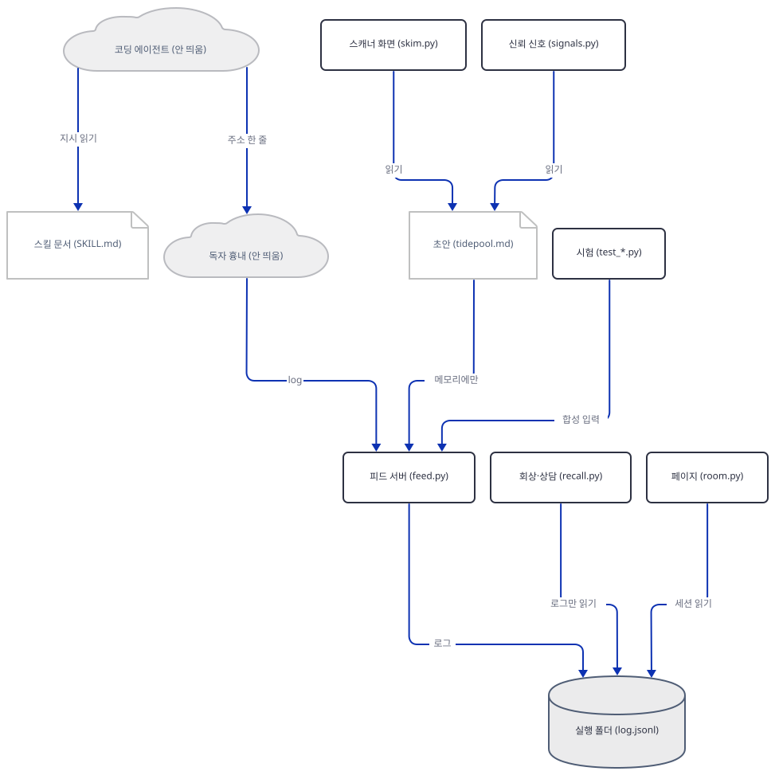

이 문서는 **코딩 에이전트를 한 번도 띄우지 않았고**(Claude Code도 다른 것도), 독자 흉내를 위한 하위 에이전트도 모델도 부르지 않았습니다. 독자의 "생각"은 제가 손으로 쓴 기록입니다. 진짜 `~/.claude/skills` 같은 에이전트 설정 폴더에는 아무것도 넣지 않았고, `npx skills add`도 실행하지 않았고, 모델을 부르는 3단계 시험도 돌리지 않았으며, 브라우저로 페이지를 열지도 않았습니다. 서버는 `127.0.0.1`에만 열었고 확인은 `curl --noproxy '*'`와 파이썬 클라이언트로 했습니다. `SKILL.md`와 `references/`는 다른 에이전트에게 주는 지시문이므로 설명할 대상으로 읽기만 했고, 그 안의 지시를 따르지 않았습니다. 직접 돌리거나 소스로 확인한 것이 열둘입니다.

1. 스킬을 프로젝트의 `.claude/skills/first-reader`로 복사하면 파일 열셋(108,838바이트)이 따라오고 시험 폴더는 따라오지 않습니다(Step 1).
2. 머리말은 명세 필드 가운데 `name`·`description`·`compatibility`만 갖고(`description` 806자, `compatibility` 239자), `license`와 `metadata`는 없습니다. 둘 다 명세에서 선택 필드이고 구조·레지스트리 시험은 통과하지만, 스킬 `README.md`는 맨 끝에 Apache-2.0이라고 쓰고 `registry.json`의 `license`는 빈 문자열입니다(Step 2).
3. `compatibility`의 두 주장, "표준 라이브러리만"과 "외부 네트워크 없음"은 소스로 맞았습니다. 스크립트의 import는 표준 라이브러리뿐이고, 외부 주소는 없고, 읽는 환경변수는 `READER_FEED` 하나입니다(Step 2).
4. 1단계 구조 시험, 1b단계 보안 시험, 레지스트리 시험, 2단계 트리거 시험이 통과했고, 2b단계 시험은 단언 47개가 모두 `ok`였습니다. 가드에 잡힌 바깥 접속 시도는 0건입니다(Step 3).
5. 트리거 시험은 모델을 쓰지 않는 낱말 겹침 점수(겹친 낱말 수 ÷ 프롬프트 낱말 수의 제곱근)입니다. 양성 8개 가운데 가장 약한 것이 1.51이고 음성 7개 가운데 가장 센 것이 0.89입니다(Step 3).
6. 초안 454낱말은 토막 넷(102·139·98·115낱말)으로 나뉘고, 스캐너 화면은 제목 넷과 본문 문단의 첫머리, 숫자만 보여 줍니다. `signals.py`는 이 초안에서 "인정" 문장을 0개로 셌는데, 글에는 실제로 인정이 둘 있습니다(Step 4).
7. 피드 서버는 127.0.0.1의 임의 포트에서만 듣고, 토큰은 24자입니다. 틀린 토큰, 토큰 없음, 관리자 주소를 독자 길로, 독자 주소를 관리자 길로 쓰기, 잘못된 방식은 모두 같은 404입니다(Step 5).
8. 25자 미만의 기록은 거절되고, 토막을 받은 지 낱말당 0.08초(최소 2초)가 지나기 전의 다음 토막 요청도 거절됩니다. 그만두기(`quit`)는 시간 제한이 없습니다(Step 6).
9. 독자가 모두 끝나기 전에는 초안 낱말이 실행 폴더(`run1`) 어디에도 없고, 끝난 뒤에야 `state.json`에 토막 전부가 써집니다. 서버는 아무도 `start`하지 않으면 `--idle`로도 닫히지 않고, 한 번이라도 `start`했으면 닫혔습니다(Step 6).
10. `READER_FEED` 클라이언트는 프록시 변수가 있으면, 변수가 없을 때는 Windows의 시스템 프록시가 있으면 루프백 요청도 프록시로 보냅니다. 루프백에 기록 서버를 프록시 자리에 세워 보니 토큰이 든 주소와 토막 본문을 받았고, `NO_PROXY=127.0.0.1`이 있으면 두 경우 모두 0건이었습니다(Step 6).
11. 회상 번들과 상담 번들에는 독자가 로그에 인용한 것 말고 초안 낱말이 들어 있지 않았습니다(Step 7).
12. 페이지 템플릿은 열면 `fonts.googleapis.com`에서 글꼴을 받는 줄을 갖고 있습니다(브라우저로 열어 보지는 않았고 파일의 두 줄을 읽었습니다). 속성에 들어가는 값은 큰따옴표를 이스케이프하지 않아 속성이 끼어들 수 있고, 초안의 HTML 태그와 링크 대상은 이스케이프되거나 버려집니다(Step 8).
13. 설치·쓰기·목록 블록은 새 터미널, 줄 하나 빼기, 대소문자만 다른 설정 폴더 철자, 임시 폴더가 설정 폴더 아래인 경우를 가짜 홈에서 돌려도 `~/.claude` 같은 설정 폴더를 바꾸지 않았습니다(Step 1). 한국어 Windows(cp949)에서는 `PYTHONUTF8` 없이 `feed.py`·`recall.py`·`ask.py`·`skim.py`와 시험 도구가 모두 깨졌고 변수가 있으면 모두 통과했습니다(Step 4).

## 사전 준비

| 서비스/도구 | 용도 | 발급·설치 |
|---|---|---|
| uv | 설치된 파이썬 3.13을 찾아 스크립트를 돌린다 | [공통 사전 준비](../README.md#공통-사전-준비-한-번만) 절 참고 |
| Python | 스킬 머리말은 "Python 3"만 요구한다. 이 문서는 3.13.3으로 돌렸고, 없으면 `lab-env.sh`의 `3.13`을 설치된 판으로 바꾼다 | `uv python install 3.13` 또는 공통 사전 준비 |
| bash, curl, git, `cygpath`(Windows) 또는 `realpath` | 이 문서의 명령은 모두 bash다. Windows는 Git Bash를 쓴다. 이 문서는 Git Bash(Windows)에서만 돌려 보았고 PowerShell 판은 없다 | https://git-scm.com 에 들어 있다 |
| 이 저장소의 복제본 | 설치할 스킬 폴더와 시험 파일의 출처 | `git clone`. 아래에서 `REPO`로 부른다 |
| 인터넷 | 필요 없다. 이 문서의 어떤 명령도 바깥 주소에 연결하지 않는다 | 없음 |
| 코딩 에이전트, 모델 API 키 | 필요 없다. 독자 흉내는 손으로 쓴 기록으로 대신한다 | 없음 |
| `npx skills add …` | 레지스트리와 스킬 README가 적은 설치 명령 | **이 문서는 실행하지 않았다.** 아래 참고 |

**설치 명령에 대해.** `agent_skills/registry.json`과 스킬 README의 설치 줄은 `npx skills add https://github.com/Shubhamsaboo/awesome-llm-apps/tree/main/agent_skills/first-reader`입니다. `skills` CLI는 GitHub의 `vercel-labs/skills`(MIT)입니다(2026-10-19에 그 README를 읽음). README에 따르면 소스는 GitHub 주소나 `owner/repo`, GitLab·Azure Repos 주소, 다른 git 주소, 로컬 경로, `SKILL.md`나 압축 파일을 가리키는 주소까지이고, 기본은 프로젝트 범위(`./<에이전트>/skills/`)이며 `-g`를 주면 홈의 `~/<에이전트>/skills/`에 넣습니다. 이 CLI는 익명 사용 통계를 모으고 `DISABLE_TELEMETRY=1`이나 `DO_NOT_TRACK=1`로 끕니다. 이 문서는 그 CLI도 `npm`도 돌리지 않고, 같은 결과(프로젝트의 `.claude/skills/<스킬>` 폴더)를 복사로 만듭니다. 홈 쪽 설치는 하지 않았습니다. `agent_skills/README.md`는 설치 전에 `SKILL.md`와 모든 스크립트를 읽으라고 합니다. 이 스킬의 스크립트 일곱 가운데 파이썬 여섯은 이 문서가 읽었고(Step 4~8), 템플릿 HTML은 Step 8에서 필요한 줄을 읽었습니다.

⚠ **초안을 서버에 넘긴다는 점.** 이 스킬을 진짜로 쓰면 초안 전문이 하위 에이전트와 모델 제공자에게 갑니다(독자 에이전트가 토막을 받아 읽으므로). 그리고 `SKILL.md`는 결과 페이지를 Artifact로 게시할 수 있다면 비공개 링크로 올리라고 합니다(`SKILL.md`의 7단계). 페이지에는 초안 전문이 들어 있으니 무엇을 어디에 올릴지는 쓰는 사람이 정합니다. 이 문서는 어느 쪽도 하지 않았습니다.

## 아키텍처 한눈에 보기

| 컴포넌트 | 역할 | 코드 위치 |
|---|---|---|
| 머리말 | `name`·`description`·`compatibility`. 에이전트가 시작할 때 읽는 것 | `agent_skills/first-reader/SKILL.md:1-5` |
| 사용자 계약 | "review this", "ask S …", "again", "quick read", 붙여넣기. 중간 보고는 한 줄, 결과는 쉬운 말 | `agent_skills/first-reader/SKILL.md:23-72` |
| 단계 0~7 | 범위 정하기, 독자 정하기, 스캐너, 시간 읽기, 회상, 신뢰 장부, 자기 읽기와 보고서, 페이지 | `agent_skills/first-reader/SKILL.md:95-248` |
| 에이전트가 맡은 일과 보호 규칙 | 서브에이전트가 없을 때, 페이지를 둘 곳, 해서는 안 되는 일 | `agent_skills/first-reader/SKILL.md:250-306` |
| 토막 내기·피드 서버·클라이언트 | 85낱말 토막, 토큰 주소, 제한 시간, 기록, 끝나면 `state.json` | `agent_skills/first-reader/scripts/feed.py:63-511` |
| 스캐너 화면 | 제목, 첫 문장 둘, 문단 머리 아홉 낱말, 숫자·굵은 글·링크 글자 | `agent_skills/first-reader/scripts/skim.py:40-83` |
| 신뢰 신호 | 숫자, 고유명사류, 인정, 얼버무림, "옮겨 써도 되는 문장" 세기 | `agent_skills/first-reader/scripts/signals.py:22-110` |
| 회상 시험 | 로그만으로 답하는 여섯 문항 | `agent_skills/first-reader/scripts/recall.py:21-48` |
| 상담 | 독자의 성향과 로그, 질문을 한 묶음으로 | `agent_skills/first-reader/scripts/ask.py:26-68` |
| 페이지 조립 | 세션과 주석 파일에서 HTML 한 장 | `agent_skills/first-reader/scripts/room.py:255-407` |
| 페이지 틀 | CSS·`<script>`와 자리표시 | `agent_skills/first-reader/scripts/room_template.html:1-286` |
| 참고 문서 넷 | 독자 정하기, 보고서 순서, 페이지 주석 형식, 저자 면담 | `agent_skills/first-reader/references/*.md` |
| 레지스트리 항목 | 이름·설명·라이선스·`install`·`evals_dir` | `agent_skills/registry.json:44-51` |
| 시험 | 구조·보안·레지스트리·트리거 도구, 스크립트 시험 47단언, 행동 시험 열 개 | `agent_skills/evals/tools/`, `agent_skills/evals/first-reader/test_first_reader.py:1-228`, `evals.json:1-115` |
| 독자 흉내(하위 에이전트), 모델 | 진짜 독자 | 코드 없음 (이 문서는 띄우지 않음. 손으로 쓴 기록으로 대신) |
| 이 문서의 랩 | 소켓 가드, 초안, 도우미 스크립트 | 코드 없음 (Step 1~8에서 직접 만듦) |

## 단계별 진행

### Step 1. 랩 폴더와 안전 검사, 소켓 가드, 그리고 설치

**목적.** 이 문서의 실습이 이 PC의 진짜 홈과 에이전트 설정을 보지도 쓰지도 못하게 하고, 파이썬이 루프백 말고는 어디에도 연결을 못 열게 한 다음, 스킬을 프로젝트의 `.claude/skills/`로 복사합니다. 이 스킬은 서버를 띄우는 스킬이라 앞 날들의 가드와 한 가지가 다릅니다. 루프백 연결은 허용해야 합니다.

**할 일.** 이 문서의 블록은 "지금 어느 폴더인지"에 기대지 않습니다. 첫 블록이 `REPO`와 `LAB`을 한 철자의 절대 경로로 정합니다(Windows Git Bash는 `/c/Users/…` 꼴이고 `cygpath -u 'C:\Users\…'`가 바꿔 줍니다). 그리고 `labsafe`로 `LAB`을 검사해 안전하지 않으면 `LAB`을 비웁니다. 안전하지 않다는 것은 절대 경로가 아니거나, 마지막 폴더 이름이 `reader-lab`이 아니거나, `~/.claude`·`.agents`·`.codex`·`.cursor`·`.copilot`·`.openclaw`·`.hermes`·`CLAUDE_CONFIG_DIR` 아래라는 뜻입니다. 대소문자는 구별하지 않고 비교합니다(Windows 경로는 `.CLAUDE`와 `.claude`를 같은 폴더로 봅니다). 이후 쓰기·설치·목록의 목적지는 모두 `"${LAB:?}/…"`나 `"$(W …)"`(`LAB`이 비면 빈 문자열이 되어 명령이 실패합니다)로 씁니다. 블록 첫 줄 `. "${LAB:?…}/lab-env.sh" || unset LAB`는 `lab-env.sh` 안에서 같은 검사를 다시 합니다. 터미널에 줄을 붙여 넣으면 한 줄이 실패해도 다음 줄이 계속 도므로, 맨 위 한 줄의 검사에 기대지 않고 줄마다 목적지가 스스로 막히게 한 것입니다. 새 터미널에서 이어 갈 때는 아래 첫 블록의 `export REPO=…`와 `export LAB=…` 두 줄(같은 철자)을 먼저 치고 다음 블록부터 붙입니다. 두 경로는 자기 것으로 바꾸고, `LAB`은 이미 있는 폴더가 아니어야 합니다.

```bash
# --- Step 1: 랩 폴더 ---
# 두 경로는 자기 것으로 바꾼다. Windows Git Bash는 /c/Users/… 처럼 한 철자로 적는다(`cygpath -u 'C:\Users\…'`).
# LAB의 마지막 폴더 이름은 reader-lab이어야 하고, 에이전트 설정 폴더(~/.claude 등) 밖이어야 한다.
export REPO=/path/to/awesome-llm-apps
export LAB=/path/to/reader-lab
labsafe() {  # 랩 경로 하나를 받아, 안전하면 0. 절대 경로가 아니거나 이름이 reader-lab이 아니거나 에이전트 설정 폴더 아래면 1(대소문자 구별 없음)
  local l h c d
  l="$(cygpath -u "$1" 2>/dev/null || printf '%s' "$1")"; l="$(printf '%s' "${l%/}" | tr 'A-Z' 'a-z')"
  h="$(cygpath -u "$HOME" 2>/dev/null || printf '%s' "$HOME")"; h="$(printf '%s' "${h%/}" | tr 'A-Z' 'a-z')"
  case "$l" in /*) ;; *) return 1 ;; esac
  [ "${l##*/}" = reader-lab ] || return 1
  for d in .claude .agents .codex .cursor .copilot .openclaw .hermes; do
    case "$l/" in "$h/$d/"*) return 1 ;; esac
  done
  if [ -n "${CLAUDE_CONFIG_DIR:-}" ]; then
    c="$(cygpath -u "$CLAUDE_CONFIG_DIR" 2>/dev/null || printf '%s' "$CLAUDE_CONFIG_DIR")"; c="$(printf '%s' "${c%/}" | tr 'A-Z' 'a-z')"
    case "$l/" in "$c/"*) return 1 ;; esac
  fi
  return 0
}
test -f "${REPO:?}/agent_skills/registry.json" || { echo "멈춤: REPO가 저장소 루트가 아닙니다"; unset LAB; }
labsafe "${LAB:-}" || { echo "멈춤: LAB이 안전하지 않습니다"; unset LAB; }
test ! -e "${LAB:?}" || { echo "멈춤: LAB이 이미 있습니다"; unset LAB; }
mkdir "${LAB:?}" && mkdir "${LAB:?}/guard" "${LAB:?}/drafts"
```

작성자는 이 블록들을 가짜 홈(`.claude/.credentials.json`·`settings.json`·`skills/existing`, `.agents`·`.codex`·`.cursor`·`.copilot`을 둔)에서 다음 판으로 돌렸습니다. 판마다 설정 폴더 다섯의 파일 목록·크기·해시와 가짜 `TEMP`를 앞뒤로 맞대고, 출력에 `credentials`가 나오는지도 셌습니다. 새 터미널에서 아무 변수 없이 첫 블록 셋을 건너뛰고 붙인 판, `REPO`만 있는 판, `LAB`을 홈·`~/.claude/reader-lab`·`~/.CLAUDE/reader-lab`(철자만 다름)·`~/.agents/skills/reader-lab`·이름이 `mylab`인 폴더로 준 판, 첫 블록의 줄을 하나씩 뺀 판, `TEMP`·`TMP`·`TMPDIR`를 `~/.claude`로 둔 판입니다. 위 판은 모두 열다섯이고 작업 폴더가 홈이거나 `~/.claude`인 판도 들어 있습니다. 결과는 모두 같았습니다. 설정 폴더 다섯의 목록·크기·해시와 가짜 `TEMP`는 그대로였고(홈 맨 위에 생긴 것은 대화형 셸의 `.bash_history`뿐), 출력에 `credentials`는 나오지 않았고, 셸의 프록시 변수 자리에 세운 루프백 기록 프록시가 받은 요청은 0건이었습니다. 새 터미널 판은 `py: command not found`와 `${LAB:?…}` 오류로 멈췄고, 안전하지 않은 `LAB`은 `멈춤: LAB이 안전하지 않습니다`와 함께 비워졌으며 `.CLAUDE`처럼 철자만 다른 경우도 막혔습니다(두 판은 제 시간 제한에 걸려 끝까지 가지 못했습니다). 도구가 변화를 보는지는 양성 대조로 확인했습니다. 옛 블록에서 `cd reader-lab` 한 줄만 빼고 같은 가짜 홈에서 돌리니 설정 폴더에 파일 15개가 생기고 `credentials`가 출력에 나타나 지문 변화로 잡혔습니다(그 판은 서버를 기다리는 고리에 시한이 없어 끝나지 않았습니다). 가드는 따로 시험했습니다. 가드 파일의 줄을 하나씩 뺀 36판에서 27판은 `py`가 돌기를 거절했고 4판은 탐침이 멈췄습니다. 나머지 5판은 가드가 남아 있었습니다(`localhost` 비교 줄을 뺀 판은 `localhost`까지 막고, 오류 글 줄을 뺀 판은 글만 줄고, `deny` 호출 줄을 뺀 판은 루프백이 아닌 `connect`가 연결 없이 지나가고, 프록시 지우기 조건 줄을 뺀 판은 지우기가 반복문 안으로 옮겨질 뿐이고, `NO_PROXY` 줄을 뺀 판은 시스템 프록시가 없는 PC에서 통과합니다. 시스템 프록시가 있으면 탐침의 `getproxies` 단언이 멈출 것이라고 소스로 읽었고 그 판은 시험하지 못했습니다). 가드 파일이 아예 없는 판은 `py`가 거절했고, 가드 없이 바깥 이름 조회만 실패하는 PC를 흉내 낸 판은 탐침이 "가드가 이 랩의 guard 폴더에서 불러와지지 않았습니다"로 멈췄습니다. 문서에는 이 범위만 적습니다. PowerShell과 macOS·Linux는 돌려 보지 못했습니다.

가드는 `sitecustomize.py`입니다. 이 폴더가 `PYTHONPATH`에 있으면 파이썬이 시작할 때 자동으로 불러옵니다. 루프백(`ipaddress`의 `is_loopback`이거나 이름이 정확히 `localhost`)말고는 연결과 이름 조회를 막고, `http_proxy` 같은 프록시 변수는 지우고 `NO_PROXY`를 걸고, 막은 것을 `guard.log`에 남깁니다. 프록시 쪽을 이렇게 하는 까닭은 Step 6에서 봅니다.

```bash
cat > "${LAB:?}/guard/sitecustomize.py" <<'EOF'
# 소켓 가드: 이 폴더가 PYTHONPATH에 있으면 파이썬이 시작할 때 자동으로 불러온다.
# 루프백(127.0.0.1, ::1, localhost)만 허용하고 나머지 연결·이름 조회는 막아 guard.log에 한 줄씩 남긴다.
import ipaddress, os, socket, sys


def is_loop(host):
    if isinstance(host, bytes):
        host = host.decode("ascii", "replace")
    if host == "localhost":
        return True
    try:
        return ipaddress.ip_address(host).is_loopback
    except ValueError:
        return False


def deny(name, target):
    with open(os.environ["GUARD_LOG"], "a") as log:
        log.write("%s %r\n" % (name, target))
    sys.stderr.write("GUARD blocked: %s %r\n" % (name, target))
    raise OSError("blocked by guard: " + name)


def wrap_addr(name, orig):
    def f(self, address, *rest):
        if isinstance(address, tuple) and is_loop(address[0]):
            return orig(self, address, *rest)
        deny(name, address)
    return f


def wrap_host(name, orig):
    def f(host, *rest, **kw):
        if is_loop(host):
            return orig(host, *rest, **kw)
        deny(name, host)
    return f


socket.socket.connect = wrap_addr("connect", socket.socket.connect)
socket.socket.connect_ex = wrap_addr("connect_ex", socket.socket.connect_ex)
for _n in ("getaddrinfo", "gethostbyname", "gethostbyname_ex", "gethostbyaddr"):
    setattr(socket, _n, wrap_host(_n, getattr(socket, _n)))

# 프록시 변수는 지우고 NO_PROXY를 건다(Step 6에서 왜 필요한지 본다). 관찰 실험만 GUARD_KEEP_PROXY=1로 남긴다.
if not os.environ.get("GUARD_KEEP_PROXY"):
    for _k in list(os.environ):
        if _k.lower() in ("http_proxy", "https_proxy", "all_proxy", "ftp_proxy", "grpc_proxy"):
            del os.environ[_k]
    os.environ["NO_PROXY"] = os.environ["no_proxy"] = "127.0.0.1,localhost,::1"
EOF
```

랩 환경 파일은 다시 한 번 `labsafe`로 검사하고, 홈과 임시 폴더를 모두 랩으로 돌립니다(HOME·USERPROFILE·CLAUDE_CONFIG_DIR·TEMP·TMP·TMPDIR). 파이썬을 가드와 함께만 부르는 함수 `py`도 정의합니다. `py`는 부를 때마다 먼저 이름 조회 넷(`getaddrinfo` 등)과 `connect`·`connect_ex`가 모두 가드 함수인지 확인하고, 아니면 돌지 않습니다. 가드 폴더나 가드 파일이 빠지거나 가드 파일의 줄이 하나 빠져 오류가 나도 가드 없는 실행이 되지 않게 하려는 것입니다. 또 `py`는 부를 때마다 홈·임시 폴더를 랩으로 다시 정해 주므로 위의 변수 줄 하나를 빼도 파이썬의 임시 파일이 진짜 `%TEMP%`로 가지 않습니다. `NO_PROXY`도 이 파일과 가드 파일 두 곳에서 루프백으로 겁니다. 가드 파일의 그 줄을 빼고 Windows 시스템 프록시가 켜져 있으면 루프백 피드 요청이 그 프록시로 가는 것을 리뷰에서 재현했고(로컬 기록 프록시가 토큰 주소와 기록 본문 7건을 받음), 이 줄을 더한 뒤에는 0건이었습니다. `W`는 랩 안의 경로를 만드는 함수이고, 루프백 주소만 받는 `lcurl`, 독자 한 명의 셸을 흉내 내는 `rd`, 출력에서 토큰을 가리는 `mask`도 정의합니다.

```bash
cat > "${LAB:?}/lab-env.sh" <<'EOF'
# 이 문서의 모든 명령은 이 파일을 불러온 셸에서 돌린다.
unset VIRTUAL_ENV
labsafe() {  # 랩 경로 하나를 받아, 안전하면 0. 절대 경로가 아니거나 이름이 reader-lab이 아니거나 에이전트 설정 폴더 아래면 1(대소문자 구별 없음)
  local l h c d
  l="$(cygpath -u "$1" 2>/dev/null || printf '%s' "$1")"; l="$(printf '%s' "${l%/}" | tr 'A-Z' 'a-z')"
  h="$(cygpath -u "$HOME" 2>/dev/null || printf '%s' "$HOME")"; h="$(printf '%s' "${h%/}" | tr 'A-Z' 'a-z')"
  case "$l" in /*) ;; *) return 1 ;; esac
  [ "${l##*/}" = reader-lab ] || return 1
  for d in .claude .agents .codex .cursor .copilot .openclaw .hermes; do
    case "$l/" in "$h/$d/"*) return 1 ;; esac
  done
  if [ -n "${CLAUDE_CONFIG_DIR:-}" ]; then
    c="$(cygpath -u "$CLAUDE_CONFIG_DIR" 2>/dev/null || printf '%s' "$CLAUDE_CONFIG_DIR")"; c="$(printf '%s' "${c%/}" | tr 'A-Z' 'a-z')"
    case "$l/" in "$c/"*) return 1 ;; esac
  fi
  return 0
}
LAB="$(cd "$(dirname "${BASH_SOURCE[0]}")" && pwd)"
if ! labsafe "$LAB" || [ -z "${REPO:-}" ]; then
  echo "멈춤: LAB이 안전하지 않거나 REPO가 비었습니다" >&2
  unset LAB
  return 1
fi
export LAB REPO
cd "$LAB"
mkdir -p "$LAB/fake-home/.claude" "$LAB/tmp" "$LAB/uvcache"
win() { if command -v cygpath >/dev/null 2>&1; then cygpath -m "$1"; else printf '%s' "$1"; fi; }
export LAB_NATIVE="$(win "$LAB")"
export HOME="$LAB/fake-home"
export CLAUDE_CONFIG_DIR="$LAB/fake-home/.claude"
export USERPROFILE="$(win "$LAB/fake-home")"
export TMPDIR="$LAB/tmp" TEMP="$(win "$LAB/tmp")" TMP="$(win "$LAB/tmp")"
export UV_CACHE_DIR="$LAB/uvcache" GUARD_LOG="$LAB/guard.log"
export PYTHONUTF8=1 PYTHONIOENCODING=utf-8 PYTHONDONTWRITEBYTECODE=1
export NO_PROXY=127.0.0.1,localhost,::1 no_proxy=127.0.0.1,localhost,::1  # 가드 파일의 같은 줄과 두 겹
export FR="$LAB/.claude/skills/first-reader/scripts"
# 랩 안의 경로: 쓰는 모든 목적지는 "$(W 상대경로)"로 쓴다. LAB이 비면 빈 문자열이 되어 명령이 실패한다.
W() { printf '%s' "${LAB:?}/$1"; }
# 파이썬은 언제나 가드가 켜진 채로, 홈·임시 폴더가 랩인 채로 돈다. 가드가 안 켜졌으면 돌지 않는다.
PYEXE="$(uv python find --no-python-downloads 3.13)"
py() {
  local g; g="$(win "$LAB/guard")"
  PYTHONPATH="$g" "$PYEXE" -B -c "
import socket, sys
want = [(socket.getaddrinfo, 'wrap_host'), (socket.gethostbyname, 'wrap_host'), (socket.gethostbyname_ex, 'wrap_host'),
        (socket.gethostbyaddr, 'wrap_host'), (socket.socket.connect, 'wrap_addr'), (socket.socket.connect_ex, 'wrap_addr')]
sys.exit(0 if all(getattr(f, '__qualname__', '').startswith(p) for f, p in want) else 1)" 2>/dev/null \
    || { echo "가드가 켜지지 않았습니다(guard/sitecustomize.py가 없거나 오류). 중단합니다" >&2; return 1; }
  HOME="$LAB/fake-home" USERPROFILE="$(win "$LAB/fake-home")" TMPDIR="$LAB/tmp" TEMP="$(win "$LAB/tmp")" TMP="$(win "$LAB/tmp")" \
    PYTHONPATH="$g" "$PYEXE" -B "$@"
}
# 루프백 주소만 받는 curl: lcurl <주소> [curl 옵션...]. 프록시는 쓰지 않는다.
lcurl() {
  case "$1" in
    http://127.0.0.1:*) curl --noproxy '*' -sS "${@:2}" "$1" ;;
    *) echo "거부: 루프백(127.0.0.1)이 아닌 주소 $1" >&2; return 1 ;;
  esac
}
# 독자 한 명의 셸: 그 독자의 주소만 READER_FEED로 걸고 feed.py를 부른다.
rd() { READER_FEED="$1" py "$FR/feed.py" "${@:2}"; }
# 출력에서 토큰만 가린다.
mask() { sed -E 's#(127\.0\.0\.1:[0-9]+/)[A-Za-z0-9_-]{24}#\1<토큰>#g'; }
EOF
```

가드가 불러와졌는지 예약 주소(`192.0.2.1`, 실제로 연결되지 않는 문서용 주소)로 먼저 확인합니다. `probe.py`는 네트워크를 쓰기 전에 가드 파일이 이 랩의 `guard` 폴더에서 불러와졌는지, 이름 조회와 `connect`가 가드 함수인지, 프록시 설정이 남아 있지 않은지를 단언합니다. 그다음 막혀야 할 두 호출이 `blocked by guard` 오류 글과 `guard.log` 두 줄로 막히는지 봅니다. 이름 조회 대상은 존재하지 않음이 보장된 `example.invalid`입니다.

```bash
. "${LAB:?새 터미널이면 B01의 export 두 줄을 먼저}/lab-env.sh" || unset LAB
cat > "$(W probe.py)" <<'EOF'
import os, socket, sys, urllib.request
from pathlib import Path

# 1. 네트워크를 쓰기 전에: 가드가 이 랩의 guard 폴더에서 불러와졌는지, 이름 조회가 가드 함수인지 본다.
mod = sys.modules.get("sitecustomize")
guard_dir = Path(os.environ["LAB_NATIVE"], "guard")
if not (mod and Path(mod.__file__).resolve().parent == guard_dir.resolve()):
    raise SystemExit("멈춤: 가드가 이 랩의 guard 폴더에서 불러와지지 않았습니다")
for f, p in [(socket.getaddrinfo, "wrap_host"), (socket.gethostbyname, "wrap_host"), (socket.socket.connect, "wrap_addr"),
             (socket.socket.connect_ex, "wrap_addr")]:
    if not getattr(f, "__qualname__", "").startswith(p):
        raise SystemExit("멈춤: %s가 가드 함수가 아닙니다" % f.__qualname__)
if not set(urllib.request.getproxies()) <= {"no"}:
    raise SystemExit("멈춤: 프록시 설정이 남아 있습니다: %r" % (urllib.request.getproxies(),))

# 2. 막혀야 할 것이 가드 때문에 막히는지(오류 글에 표지가 있는지, guard.log에 줄이 느는지) 본다.
log = Path(os.environ["GUARD_LOG"])
n0 = len(log.read_text().splitlines()) if log.exists() else 0
for name, call in [
    ("예약 주소 192.0.2.1 연결", lambda: socket.create_connection(("192.0.2.1", 80), 1)),
    ("이름 조회 example.invalid", lambda: socket.getaddrinfo("example.invalid", 443)),
]:
    try:
        call()
    except OSError as e:
        if "blocked by guard" not in str(e):
            raise SystemExit("멈춤: 가드가 아닌 오류로 실패했습니다: %r" % (e,))
        print("막힘:", name, "->", e)
    else:
        raise SystemExit("멈춤: 막히지 않았습니다: " + name)
n1 = len(log.read_text().splitlines())
if n1 != n0 + 2:
    raise SystemExit("멈춤: guard.log가 두 줄 늘지 않았습니다(%d -> %d)" % (n0, n1))

# 3. 루프백은 통과해야 한다.
srv = socket.socket()
srv.bind(("127.0.0.1", 0))
srv.listen(1)
socket.create_connection(("127.0.0.1", srv.getsockname()[1]), 1).close()
print("루프백 연결은 통과")
print("guard loaded")
EOF
py "$(W probe.py)"
cat "$(W guard.log)"
: > "$(W guard.log)"
```

```text
GUARD blocked: getaddrinfo '192.0.2.1'
GUARD blocked: getaddrinfo 'example.invalid'
막힘: 예약 주소 192.0.2.1 연결 -> blocked by guard: getaddrinfo
막힘: 이름 조회 example.invalid -> blocked by guard: getaddrinfo
루프백 연결은 통과
guard loaded
getaddrinfo '192.0.2.1'
getaddrinfo 'example.invalid'
```

`guard loaded`가 나오지 않으면 여기서 멈춥니다. 막힌 것은 파이썬이 이름을 찾는 단계에서이고(`getaddrinfo`), 연결 시도 이전입니다. 탐침이 오류 글의 표지와 `guard.log`를 직접 확인하므로, 가드가 빠진 채로 바깥 DNS가 막혀 있어서 "막힌 것처럼" 보이는 경우에도 통과하지 않습니다. 이제 설치입니다. 설치는 폴더 복사입니다. 목적지는 모두 `LAB` 아래 절대 경로이고 목록은 `LAB` 안에서만 찍습니다.

```bash
. "${LAB:?새 터미널이면 B01의 export 두 줄을 먼저}/lab-env.sh" || unset LAB
mkdir -p "$(W .claude/skills)"
cp -r "${REPO:?}/agent_skills/first-reader" "$(W .claude/skills/first-reader)"
( cd "${LAB:?}" && find .claude -type f | sort && find .claude -type f | wc -l )
py -c "import pathlib, sys; p = pathlib.Path(sys.argv[1]); print(sum(f.stat().st_size for f in p.rglob('*') if f.is_file()), 'bytes')" "$(W .claude/skills/first-reader)"
```

```text
.claude/skills/first-reader/README.md
.claude/skills/first-reader/references/interview.md
.claude/skills/first-reader/references/personas.md
.claude/skills/first-reader/references/report.md
.claude/skills/first-reader/references/room.md
.claude/skills/first-reader/scripts/ask.py
.claude/skills/first-reader/scripts/feed.py
.claude/skills/first-reader/scripts/recall.py
.claude/skills/first-reader/scripts/room.py
.claude/skills/first-reader/scripts/room_template.html
.claude/skills/first-reader/scripts/signals.py
.claude/skills/first-reader/scripts/skim.py
.claude/skills/first-reader/SKILL.md
13
108838 bytes
```

파일은 열셋이고 `evals/`는 없습니다. 스크립트 일곱, 참고 문서 넷, `SKILL.md`, 스킬 `README.md`입니다. 시험 파일은 설치에 따라오지 않으므로 Step 3의 시험은 저장소의 파일을 씁니다. `LAB`을 코딩 에이전트의 작업 폴더 아래에 두면 이 설치본이 그 에이전트 세션에서 프로젝트 스킬로 발견될 수 있으므로(Anthropic 문서가 프로젝트의 `.claude/skills/`를 스킬을 찾는 자리로 적습니다), 이 문서의 랩은 어떤 에이전트의 작업 폴더도 아닌 곳에 두고 끝나면 랩 폴더를 지웁니다.

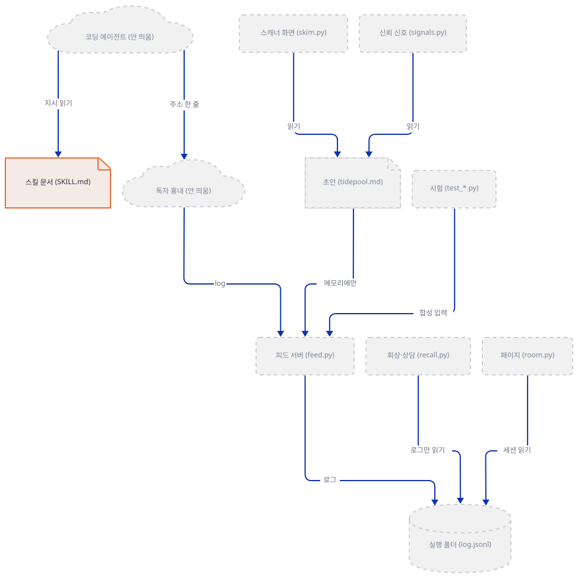

설치가 어떤 길로 이루어지는지는 아래 그림이 보여 줍니다. 이 문서가 한 것은 복사(`cp -r`) 한 길뿐이고, `skills` CLI와 홈 설치(`-g`)는 하지 않았습니다.

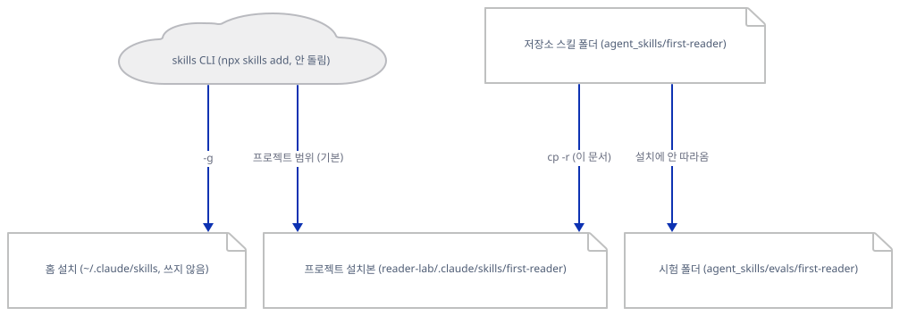

**확인.** `guard loaded`와 파일 13개, 108,838바이트가 나오고 `guard.log`는 막은 두 줄만 있다가 `: > guard.log`로 비워집니다.


### Step 2. 머리말을 명세에 대조하고, 스킬이 한 약속을 소스와 맞댄다

**목적.** 머리말 필드가 명세와 맞는지 보고, `compatibility`가 하는 주장이 소스와 맞는지 봅니다.

**할 일.** 머리말을 출력하고 한계와 맞대는 `fm.py`를 저장해 돌립니다. `SKILL.md`는 에이전트에게 주는 지시문이므로 이 스크립트는 읽고 출력만 하고, 그 안의 지시를 따르지 않습니다.

```bash
. "${LAB:?새 터미널이면 B01의 export 두 줄을 먼저}/lab-env.sh" || unset LAB
cat > "$(W fm.py)" <<'EOF'
"""설치한 스킬의 SKILL.md 머리말을 출력하고 agentskills.io 한계와 맞대 본다. SKILL.md는 읽기만 한다."""
import pathlib, re, sys

skill = pathlib.Path(sys.argv[1])
text = (skill / "SKILL.md").read_text(encoding="utf-8")
block = text.split("---")[1]
body = text.split("---", 2)[2].lstrip("\n")
print("--- frontmatter ---")
print(block.strip("\n"))
print("--- checks ---")
name = re.search(r"^name:\s*(\S+)", block, re.M).group(1)
desc = re.search(r"^description:\s*(.+)$", block, re.M).group(1)
compat = re.search(r"^compatibility:\s*(.+)$", block, re.M).group(1)
print("name", name, "| same as folder:", name == skill.name,
      "| allowed characters:", bool(re.fullmatch(r"[a-z0-9]+(-[a-z0-9]+)*", name)), "| length", len(name), "(limit 64)")
print("description", len(desc), "characters (limit 1024)")
print("compatibility", len(compat), "characters (limit 500)")
print("top-level keys:", re.findall(r"^([a-z-]+):", block, re.M))
print("SKILL.md lines:", len(text.splitlines()), "| body lines:", len(body.splitlines()), "| body words:", len(body.split()))
EOF
py "$(W fm.py)" "$(W .claude/skills/first-reader)"
```

```text
--- frontmatter ---
name: first-reader
description: Beta readers for any draft, run by simulating how a real reader experiences it, moment by moment. A skim gate, a no-lookahead timed read  …
compatibility: Python 3 stdlib only, offline, no dependencies. feed.py runs a loopback http server on 127.0.0.1 during a read so reader subagents rece …
--- checks ---
name first-reader | same as folder: True | allowed characters: True | length 12 (limit 64)
description 806 characters (limit 1024)
compatibility 239 characters (limit 500)
top-level keys: ['name', 'description', 'compatibility']
SKILL.md lines: 306 | body lines: 300 | body words: 2619
```

(출력의 `description`·`compatibility` 줄은 길어서 앞부분만 적었습니다.) 명세(agentskills.io, 2026-10-19에 읽음)는 필수 필드를 `name`(최대 64자, 소문자·숫자·하이픈, 폴더 이름과 같음)과 `description`(1~1024자)으로 두고, 선택 필드로 `license`(이름이나 동봉 파일 이름), `compatibility`(최대 500자, 필요한 제품·시스템 패키지·네트워크 접근), `metadata`(문자열 맵), `allowed-tools`(실험적)를 둡니다. 이 스킬의 머리말은 필수 둘에 `compatibility`를 더한 것이고 한계 안입니다. `license`와 `metadata`가 없는 것은 명세를 어기지 않습니다. 다만 이 저장소의 다른 스킬들은 `license: Apache-2.0`과 `metadata`(작성자·버전·출처)를 가졌고(`registry.json`의 다른 항목), 이 스킬의 `registry.json` 항목은 `license`가 빈 문자열이고 `metadata`가 `{}`입니다. 스킬 폴더에는 `LICENSE` 파일도 없고, 스킬 `README.md` 맨 끝의 "Apache-2.0"이 라이선스의 유일한 표시입니다. 명세의 progressive disclosure는 이름과 설명이 시작할 때만 읽히고(약 100토큰), 본문은 스킬이 쓰일 때 읽히며, 참고·스크립트는 필요할 때 읽힌다는 것입니다. 이 스킬의 `SKILL.md`는 머리말을 포함해 306줄이고, 머리말을 뺀 본문은 300줄·2,619낱말(`fm.py`가 세어 줍니다)로 명세 권고 500줄 아래입니다.

이제 `compatibility` 문장을 소스와 맞댑니다. 문장은 둘을 주장합니다. 하나는 "Python 3 stdlib only, offline, no dependencies", 다른 하나는 "feed.py runs a loopback http server on 127.0.0.1 … nothing leaves the machine and there is no external network access"입니다.

```bash
. "${LAB:?새 터미널이면 B01의 export 두 줄을 먼저}/lab-env.sh" || unset LAB
( cd "${LAB:?}" || exit 1
S=.claude/skills/first-reader/scripts
grep -n "os.environ\|dotenv\|getenv" $S/*.py
grep -n "https\?://" $S/*.py | grep -v "127.0.0.1" || echo "스크립트의 외부 주소: 없음"
py -c "
import ast, glob, sys
mods = set()
for f in glob.glob(sys.argv[1] + '/*.py'):
    for n in ast.walk(ast.parse(open(f, encoding='utf-8').read())):
        if isinstance(n, ast.Import):
            mods |= {a.name for a in n.names}
        elif isinstance(n, ast.ImportFrom):
            mods.add(n.module)
print(sorted(mods))
" $S
grep -n "audience.json\|manifest.json" $S/*.py || echo "audience.json·manifest.json을 읽는 코드: 없음" )
```

```text
.claude/skills/first-reader/scripts/feed.py:367:    return getattr(args, "feed", None) or os.environ.get("READER_FEED")
스크립트의 외부 주소: 없음
['argparse', 'html', 'http.server', 'json', 'os', 'pathlib', 're', 'secrets', 'statistics', 'sys', 'threading', 'time', 'urllib', 'urllib.error']
audience.json·manifest.json을 읽는 코드: 없음
```

import는 모두 표준 라이브러리이고, 스크립트에 `127.0.0.1이 아닌` 주소는 없으며, 환경변수는 `feed.py:367`의 `READER_FEED` 하나입니다. 그러니 상위 폴더의 `.env`나 셸의 API 키는 이 스크립트들이 읽을 길이 없습니다(그래도 이 문서는 따라 하기에서 셸에 가짜 키와 프록시 변수를 걸고, 상위 폴더에 가짜 키가 든 `.env`를 두고 끝까지 돌려 바깥 0을 확인했습니다). `audience.json`과 `manifest.json`은 `SKILL.md`(133~141행)와 `references/room.md`가 에이전트에게 쓰라고 하는 파일인데, 이것을 읽거나 쓰는 코드는 없습니다. 에이전트가 직접 쓰는 약속 파일입니다. 한편 "nothing leaves the machine"은 스크립트가 아니라 **페이지**에 대해서는 맞지 않을 수 있는데, 이것은 Step 8에서 봅니다.

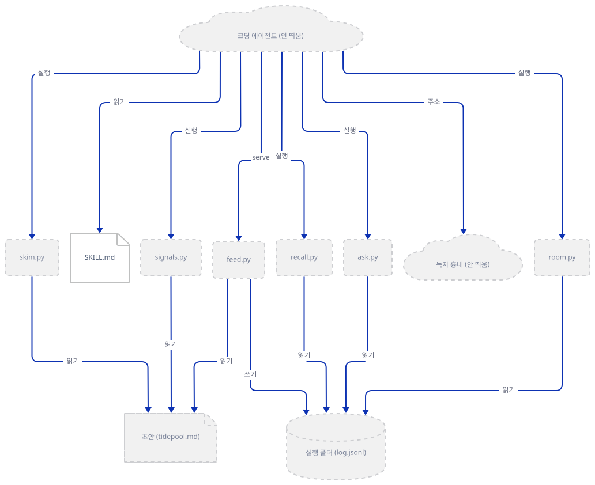

**확인.** `name`이 폴더와 같고, `description` 806자와 `compatibility` 239자가 한계 안이고, 최상위 키가 `name`·`description`·`compatibility` 셋입니다. 외부 주소 검색은 "없음"입니다.

### Step 3. 1~2b단계 시험과 3단계 시험이 보는 것

**목적.** 저장소가 스킬마다 거는 시험 가운데 모델 없이 도는 것(구조 1, 보안 1b, 레지스트리, 트리거 2, 스크립트 2b)을 돌리고, 모델을 쓰는 3단계는 무엇을 보는지만 읽습니다.

**할 일.** 구조·보안·트리거·레지스트리 시험입니다. 레지스트리 시험은 저장소 루트에서 읽기만 하는 검사 모드로 돕니다(`--write`는 레지스트리를 다시 쓰니 쓰지 않습니다).

```bash
. "${LAB:?새 터미널이면 B01의 export 두 줄을 먼저}/lab-env.sh" || unset LAB
T="${REPO:?}/agent_skills/evals/tools"
py "$T/skill_lint.py" "$(W .claude/skills/first-reader)" --strict
py "$T/skill_scanner.py" "$(W .claude/skills)"
py "$T/run_trigger_evals.py"
( cd "${REPO:?}" && py "$T/registry_lint.py" )
cat "$(W guard.log)"; echo "가드 기록 줄 수: $(wc -l < "$(W guard.log)")"
```

```text
Linting ...\reader-lab\.claude\skills\first-reader (strict=on)
  PASS — 0 error(s), 0 warning(s)
agent-skill security scan v1.0.0 — 1 skill(s) under ...\reader-lab\.claude\skills

=== first-reader (...\reader-lab\.claude\skills\first-reader) ===
  [INFO] NET01 scripts\feed.py:58
      Script makes network calls (python network import), declared via 'compatibility'.
      > from http.server import BaseHTTPRequestHandler, ThreadingHTTPServer
  [INFO] NET01 scripts\feed.py:60
      Script makes network calls (python network import), declared via 'compatibility'.
      > from urllib import request as urlrequest
  [INFO] NET01 scripts\feed.py:61
      Script makes network calls (python network import), declared via 'compatibility'.
      > from urllib.error import HTTPError

Summary: 0 CRITICAL, 0 WARN, 3 INFO
Verdict guidance: no pattern hits. Still read SKILL.md end-to-end — natural-language attacks evade pattern scanners (OWASP AST08).
PASS  advisor-orchestrator-worker: 3 positives clear 3 near-misses (weakest 2.02 vs strongest 1.51)
PASS  commit-archaeologist: 3 positives clear 3 near-misses (weakest 1.73 vs strongest 0.89)
PASS  dependency-doctor: 3 positives clear 3 near-misses (weakest 1.50 vs strongest 1.15)
PASS  first-reader: 8 positives clear 7 near-misses (weakest 1.51 vs strongest 0.89)
PASS  project-graveyard: 3 positives clear 3 near-misses (weakest 1.63 vs strongest 0.76)
PASS  scope-creep-detector: 3 positives clear 3 near-misses (weakest 1.00 vs strongest 0.00)
PASS  thinking-out-loud: 4 positives clear 3 near-misses (weakest 1.15 vs strongest 0.32)

trigger & routing: all clear (7 skills)
Checking registry at <REPO> (mode=check)
  PASS — 0 error(s), 0 warning(s)
가드 기록 줄 수: 0
```

구조 시험은 이름이 폴더와 같은지, 설명 길이, 본문 줄 수(500줄을 넘으면 `--strict`에서 오류), 본문이 가리키는 상대 경로가 실제로 있는지를 봅니다. 보안 시험의 정보 3건은 모두 `feed.py`의 `http.server`와 `urllib` import이고, "declared via 'compatibility'"라고 적힌 것은 머리말이 네트워크 사용을 밝히고 있기 때문입니다. 이 시험은 문자열 패턴만 찾으며(끝의 안내가 "자연어로 된 공격은 패턴 검사기를 피한다"고 적습니다) 그 줄들이 무엇에 쓰이는지는 말해 주지 않습니다. 그것은 Step 5~6의 실행이 보여 줍니다. 트리거 시험은 저장소의 스킬 일곱 전부를 돌립니다. 점수를 보려고 같은 함수를 부르는 `trig.py`를 만듭니다.

```bash
. "${LAB:?새 터미널이면 B01의 export 두 줄을 먼저}/lab-env.sh" || unset LAB
cat > "$(W trig.py)" <<'EOF'
"""first-reader의 트리거 사례를 run_trigger_evals.py와 같은 함수로 채점한다."""
import json, math, os, sys

sys.path.insert(0, sys.argv[1] + "/agent_skills/evals/tools")
import run_trigger_evals as t

skills = {
    name: t.tokens(t.description_of(os.path.join(t.SKILLS_ROOT, name)))
    for name in sorted(os.listdir(t.SKILLS_ROOT))
    if os.path.exists(os.path.join(t.SKILLS_ROOT, name, "SKILL.md"))
}
cases = json.load(open(os.path.join(t.EVALS_ROOT, "first-reader", "trigger-cases.json"), encoding="utf-8"))["cases"]
for case in cases:
    words = t.tokens(case["prompt"])
    best = max(skills, key=lambda name: t.score(words, skills[name]))
    shared = len(words & skills["first-reader"])
    print("%-23s trigger=%-5s score=%.2f (겹침 %d / sqrt(%d)) best=%s" % (
        case["id"], case["should_trigger"], t.score(words, skills["first-reader"]), shared, len(words), best))
EOF
py "$(W trig.py)" "${REPO:?}"
```

```text
human-review            trigger=True  score=2.24 (겹침 5 / sqrt(5)) best=first-reader
hold-attention          trigger=True  score=1.63 (겹침 4 / sqrt(6)) best=first-reader
hollow-after-deslop     trigger=True  score=2.33 (겹침 7 / sqrt(9)) best=first-reader
first-reader-role       trigger=True  score=1.79 (겹침 4 / sqrt(5)) best=first-reader
what-survives           trigger=True  score=1.79 (겹침 4 / sqrt(5)) best=first-reader
beta-readers            trigger=True  score=1.51 (겹침 4 / sqrt(7)) best=first-reader
quick-read              trigger=True  score=2.27 (겹침 6 / sqrt(7)) best=first-reader
where-they-bounce       trigger=True  score=1.63 (겹침 4 / sqrt(6)) best=first-reader
near-miss-deslop        trigger=False score=0.89 (겹침 2 / sqrt(5)) best=first-reader
near-miss-humanize      trigger=False score=0.50 (겹침 1 / sqrt(4)) best=project-graveyard
near-miss-grammar       trigger=False score=0.00 (겹침 0 / sqrt(4)) best=scope-creep-detector
near-miss-voice-rewrite trigger=False score=0.58 (겹침 1 / sqrt(3)) best=commit-archaeologist
near-miss-summarize     trigger=False score=0.00 (겹침 0 / sqrt(2)) best=advisor-orchestrator-worker
near-miss-write-post    trigger=False score=0.35 (겹침 1 / sqrt(8)) best=project-graveyard
near-miss-seo           trigger=False score=0.00 (겹침 0 / sqrt(6)) best=dependency-doctor
```

`trigger-cases.json`은 양성 여덟(예: "review this draft like a human reader would", "quick read: would a busy engineer even open this post?")과 음성 일곱(예: "remove the AI slop words and em dashes from this draft", "humanize this text so it does not sound like AI", "summarize this article for me")을 둡니다. 점수는 프롬프트와 `description`에서 어간을 거칠게 줄인 낱말이 겹친 수를 프롬프트 낱말 수의 제곱근으로 나눈 값입니다(`run_trigger_evals.py:64-67`. 출력의 괄호가 그 식입니다. `beta-readers`는 4/√7 = 1.51입니다). 가장 약한 양성 1.51이 가장 센 음성 0.89의 1.15배(1.02)를 넘어야 통과합니다. 에이전트가 이 스킬을 실제로 고르는지가 아니라 설명에 사람들이 쓰는 낱말이 들었는지를 보는 시험입니다. 가장 센 음성이 "슬롭 낱말 지우기"(`near-miss-deslop`, 0.89)이고 그것이 이 스킬에 가장 가깝게 나오는데, 겹친 낱말이 `draft`와 `slop` 둘(2/√5 = 0.89)이기 때문입니다. 설명에 draft와 anti-slop이 들어 있습니다(겹친 낱말은 `trig.py`가 아니라 같은 함수를 따로 불러 확인했습니다). 이어 2b단계, 스크립트 시험을 돌립니다. 시험 파일은 저장소의 스크립트를 시험하고(설치한 복사본이 아니라), 임시 폴더는 랩의 `tmp`를 씁니다.

```bash
. "${LAB:?새 터미널이면 B01의 export 두 줄을 먼저}/lab-env.sh" || unset LAB
py "${REPO:?}/agent_skills/evals/first-reader/test_first_reader.py" > "$(W t2b.out)" 2>&1; echo "종료 코드 $?"
grep -c '^\[ok\]' "$(W t2b.out)"
grep -c 'FAIL' "$(W t2b.out)"
tail -1 "$(W t2b.out)"
cat "$(W guard.log)"; echo "가드 기록 줄 수: $(wc -l < "$(W guard.log)")"
py -c "
import json, sys
base = sys.argv[1] + '/agent_skills/evals/first-reader/'
e = json.load(open(base + 'evals.json', encoding='utf-8'))['evals']
c = json.load(open(base + 'trigger-cases.json', encoding='utf-8'))['cases']
print('행동 시험', len(e), '개, 기대 항목', sum(len(x['expectations']) for x in e), '개')
print('트리거 사례 양성', sum(x['should_trigger'] for x in c), '개, 음성', sum(not x['should_trigger'] for x in c), '개')
" "${REPO:?}"
```

```text
종료 코드 0
47
0
all first-reader script tests passed
가드 기록 줄 수: 0
행동 시험 10 개, 기대 항목 40 개
트리거 사례 양성 8 개, 음성 7 개
```

단언 47개가 모두 `ok`입니다. 여섯 묶음입니다(`test_first_reader.py:42, 53, 68, 89, 136, 145`). 스캐너 화면이 전문을 흘리지 않는지, 신호 계산이 두 표준 초안(`hollow-clean.md`와 `human-tells.md`)을 갈라내는지, 파일 방식의 피드가 토막을 하나씩만 내는지, 서버 방식의 피드가 디스크에 아무것도 안 쓰고 시간 제한과 토큰을 지키는지, 긴 문단이 토막으로 쪼개지는지, 페이지가 조립되는지입니다. 마지막 묶음 안에 상담 번들(`ask.py`), 스캐너 판정, 지난 실행 띠(`previous`) 단언도 들어 있습니다. 네 시험 도구와 그 입력 자료는 아래 그림과 같습니다.

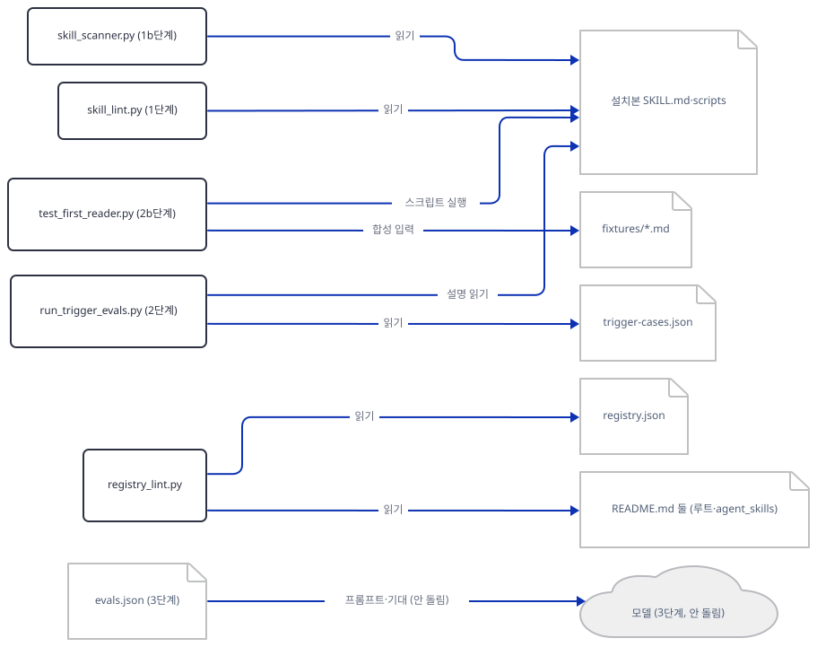

 3단계(`evals.json`)는 모델을 쓰므로 돌리지 않았고 읽기만 했습니다. 시험 열 개에 기대 항목 40개이고, 예를 들어 1번은 "에이전트가 초안을 시간 읽기 전에 열지 않는다", "독자는 주소와 토큰만 받고 경로는 받지 않는다", "결과에 번호 매긴 수정 목록이 없다", "질문이 정확히 하나로 끝난다" 같은 것을 봅니다. 8번은 "독자로 읽고 내 목소리로 약한 부분을 고쳐 줘"라고 하면 읽기는 하되 다시 쓰기는 한 문장으로 거절하는지를 봅니다.


**확인.** 구조 시험 `PASS — 0 error(s), 0 warning(s)`, 보안 `0 CRITICAL, 0 WARN, 3 INFO`, 트리거 `first-reader: 8 positives clear 7 near-misses (weakest 1.51 vs strongest 0.89)`, 레지스트리 `PASS`, 2b `ok` 47개, 가드 기록 0줄입니다.

### Step 4. 초안 하나를 손으로 쓰고, 스캐너 화면과 토막과 신호를 본다

**목적.** 독자가 보게 될 것을 만들기 전에, 스크립트가 초안 한 편으로 무엇을 내는지 봅니다. 아래 초안은 제가 쓴 가상의 도구 글입니다(실제 제품이 아닙니다). 첫 문단은 구체적이고 가운데 두 문단은 일부러 광고 문구로 채웠고, 뒤에는 한계를 인정하는 대목이 있습니다. 실제 사용에서는 에이전트가 이 단계의 출력을 먼저 읽지 않습니다(`SKILL.md:80-86`은 독자 실험이 끝나기 전에 초안을 열지 말라고 합니다). 지금은 스크립트를 이해하려는 작성자의 자리이므로 읽습니다.

**할 일.**

```bash
. "${LAB:?새 터미널이면 B01의 export 두 줄을 먼저}/lab-env.sh" || unset LAB
cat > "$(W drafts/tidepool.md)" <<'EOF'
# Tidepool 0.4: a build cache that tells you why it missed

Last March our CI took 41 minutes to build a repo that changes eleven lines a day. I spent a week blaming the runners. The runners were fine. Our cache was missing 63% of the time, and nothing in any log told us why.

That is the problem Tidepool 0.4 exists to solve. Caches are fast when they hit and baffling when they miss, and most tools treat a miss as a non-event. Tidepool treats a miss as a bug report. Every miss comes with the one input that changed.

## Why caching matters

Modern software teams face unprecedented pressure to ship quickly. Build times are a critical factor in developer productivity, and a well-designed caching strategy can unlock significant gains across the organization. By leveraging intelligent caching, teams can reduce waste, improve velocity, and deliver more value to their customers. In today's fast-moving landscape, the ability to build quickly is more important than ever, and teams that invest in their tooling will be well positioned for long-term success.

Tidepool is a powerful, flexible, and developer-friendly solution that integrates seamlessly into your existing workflow. Whether you are a small startup or a large enterprise, Tidepool scales with your needs and adapts to the way your team works. Our mission is to empower every engineer to build better software, faster, with confidence and clarity at every step of the journey.

## How a miss is explained

Each cache key is built from a list of named inputs: source files, the compiler version, and the environment variables you opt in. When a lookup misses, Tidepool compares the new input list to the closest earlier one and prints the difference. On our own repo the first week showed that 38 of 41 misses came from a single input: a timestamp that a code generator wrote into a header. We deleted that line. The miss rate went from 63% to 9%, and the median build dropped from 41 minutes to 12.

It is not magic. The closest earlier key is chosen by a simple count of shared inputs, so when two branches diverge a lot, the explanation can point at the wrong ancestor. We shipped that in 0.4 knowing it, and it burned a teammate on a Friday. A better match is planned for 0.5, and I do not yet know whether it will cost more than it saves.

## Getting started

Install Tidepool, add a tidepool.toml to your repository, and run `tidepool explain` after your next build. Tidepool is open source under the Apache-2.0 license, and the changelog is on GitHub. We would love your feedback, and we are excited to see what you build.
EOF
wc -w < "$(W drafts/tidepool.md)"
cat > "$(W chunks.py)" <<'EOF'
"""feed.py의 chunk()가 초안을 어떻게 나누는지 본다."""
import sys

sys.path.insert(0, sys.argv[1] + "/agent_skills/first-reader/scripts")
import feed

text = open(sys.argv[2], encoding="utf-8").read()
for i, c in enumerate(feed.chunk(text), 1):
    print(i, len(c.split()), "낱말", repr(c.replace("\n", " / ")[:60]))
EOF
py "$(W chunks.py)" "${REPO:?}" "$(W drafts/tidepool.md)"
```

```text
454
1 102 낱말 '# Tidepool 0.4: a build cache that tells you why it missed /'
2 139 낱말 '## Why caching matters /  / Modern software teams face unpre'
3 98 낱말 '## How a miss is explained /  / Each cache key is built from'
4 115 낱말 'It is not magic. The closest earlier key is chosen by a simp'
```

`feed.py:68-98`의 `chunk()`는 문단을 모아 85낱말(`TARGET_WORDS`)을 넘으면 한 토막으로 닫고, 한 문단이 200낱말(`MAX_WORDS`)을 넘으면 문장 단위로 쪼개며, 맨 앞의 제목은 뒤따르는 문단에 붙입니다. 그래서 토막은 85낱말에 딱 맞지 않고 102·139·98·115낱말이 되었습니다. 이어 스캐너 화면입니다.

```bash
. "${LAB:?새 터미널이면 B01의 export 두 줄을 먼저}/lab-env.sh" || unset LAB
py "$FR/skim.py" "$(W drafts/tidepool.md)"
```

```text
SCANNER VIEW (what a skimming reader fixates on; the full text is withheld)
stats: 454 words | ~2 min full read | ~5 phone screens
fixation tokens: numbers=['0.4', '41', '63%', '0.4', '38', '41', '63%', '9%', '41', '12', '0.4', '0.5']
------------------------------------------------------------
# Tidepool 0.4: a build cache that tells you why it missed
Last March our CI took 41 minutes to build a repo that changes eleven lines a day.
That is the problem Tidepool 0.4 exists to solve.
## Why caching matters
Modern software teams face unprecedented pressure to ship quickly. ...
Tidepool is a powerful, flexible, and developer-friendly solution that ...
## How a miss is explained
Each cache key is built from a list of ...
It is not magic. The closest earlier key is ...
## Getting started
Install Tidepool, add a tidepool.toml to your repository, and ...
------------------------------------------------------------
Question for the reader: from this view alone, say (1) what you think this piece is and what it will argue, (2) whether your cast persona commits to a full read or moves on, and (3) the single element above that decided it.
```

스캐너가 보는 것은 제목 넷(`#` 하나와 `##` 셋)과 본문 문단의 첫머리, 숫자 열둘뿐입니다. 본문 문단은 앞 두 개만 첫 문장 전체를 보여 주고(`That is the problem Tidepool 0.4 exists to solve.`까지), 나머지는 첫 아홉 낱말과 "..."입니다. 두 번째 토막의 광고 문구는 "Modern software teams face unprecedented pressure to ship quickly. ..."에서 잘립니다. 454낱말 가운데 이 화면이 내보내는 것은 한 줌이고, 이것으로 열지 말지를 정하는 일은 스캐너 에이전트의 몫입니다. 스크립트는 화면만 만듭니다. 다음은 `signals.py`입니다.

```bash
. "${LAB:?새 터미널이면 B01의 export 두 줄을 먼저}/lab-env.sh" || unset LAB
py "$FR/signals.py" "$(W drafts/tidepool.md)" --json > "$(W signals.json)"
py -c "
import json, sys
d = json.load(open(sys.argv[1], encoding='utf-8'))
print('낱말', d['words'], '문장', d['sentences'])
print('숫자', d['costly']['numbers']['count'], d['costly']['numbers']['sample'])
print('고유명사류', d['costly']['named_entities']['count'], d['costly']['named_entities']['sample'])
print('1인칭 문장', d['costly']['first_person_sentences'], '| 인정 문장', d['costly']['admissions_against_interest']['count'])
print('얼버무림 문장', d['free']['hedged_sentences']['count'], '| 확신 문장', d['free']['certainty_sentences']['count'])
print('옮겨 써도 되는 문장', d['portable_sentences']['count'], '/', d['sentences'], d['portable_sentences']['share'])
for s in d['portable_sentences']['sample'][:2]:
    print('  -', s)
" "$(W signals.json)"
```

```text
낱말 429 문장 27
숫자 11 ['41', '63%', '0.4', '38', '41', '63%', '41', '12.', '0.4', '0.5,']
고유명사류 9 ['March', 'CI', 'Tidepool', 'Friday', 'Apache', 'GitHub']
1인칭 문장 5 | 인정 문장 0
얼버무림 문장 0 | 확신 문장 0
옮겨 써도 되는 문장 12 / 27 0.44
  - The runners were fine.
  - Caches are fast when they hit and baffling when they miss, and most tools treat a miss as a non-event.
```

세 가지를 짚습니다. 첫째, "숫자"는 패턴 `\b[\w$][\w.,:%$-]*\d[\w.,:%$-]*`(`signals.py:62`)에 맞는 낱말마다 셉니다. 첫 글자 뒤에 숫자가 하나 더 있어야 맞으므로 한 자리로 시작하는 `9%`는 세지 않고(스캐너 화면의 숫자 열둘에는 있습니다) `Apache-2.0`은 셉니다. 영어 11개는 그렇게 나온 수입니다. `12.`와 `0.5,`처럼 문장부호가 붙은 채로 샘플에 남습니다. 둘째, 인정 문장이 0입니다. 글에는 "it burned a teammate on a Friday"와 "I do not yet know whether it will cost more than it saves"가 있지만 패턴(`signals.py:26`)은 `I don't know`, `I'm not sure`, `didn't work`, `failed` 같은 정해진 표현만 찾기 때문입니다. `SKILL.md:212-220`이 "이 세기는 바닥이다. 인정 검출기는 특히 덜 센다. 0을 믿지 말고 자기 읽기에서 확인하라"고 한 것이 이 경우입니다. 셋째, "옮겨 써도 되는 문장"(숫자·1인칭·대문자 고유명사가 없는 문장)이 12개인데 샘플에 "The runners were fine."이 있습니다. 구체적인 문단 안의 짧은 문장도 그렇게 셉니다. 얼버무림과 확신 문장이 0인 것도 같은 까닭입니다. 영어 낱말 목록만 보기 때문입니다. 한국어 글에 돌리면 숫자와 문장은 세지만 나머지 패턴은 맞지 않을 것입니다.

```bash
. "${LAB:?새 터미널이면 B01의 export 두 줄을 먼저}/lab-env.sh" || unset LAB
printf '지난 3월 우리 CI는 41분이 걸렸다. 나는 일주일 동안 러너를 탓했다. 러너는 멀쩡했다. 캐시가 63퍼센트 빗나가고 있었다.\n' > "$(W drafts/ko.md)"
py "$FR/signals.py" "$(W drafts/ko.md)" --json | head -14 | tr -d '\r\n '; echo
```

```text
{"words":15,"sentences":3,"sentence_len":{"mean":5,"sd":0.8,"burstiness":0.16,"max":6,"min":4},"costly":{"numbers":{"count":2,"per100w":13.33,
```

한국어 네 문장(두 낱말짜리 하나는 세지 않습니다)에서 낱말 15개, 문장 3개, 숫자 2개를 셌습니다. 글에는 `3월`·`41분`·`63퍼센트`로 숫자가 셋이지만 한 자리로 시작하는 `3월`은 같은 패턴에 걸리지 않아 둘입니다. 영어 패턴이 한국어를 보지 못하므로, 한국어 초안이면 이 부분은 에이전트가 직접 읽어 채워야 합니다. 마지막으로 이 PC가 한국어 Windows일 때의 함정입니다. 기본 입출력 인코딩(cp949)이 줄표(—) 같은 글자를 표현하지 못하는데, 이것은 `skim.py` 하나의 문제가 아닙니다. 아래 블록은 같은 조건(두 변수 없이, 출력을 파이프로 받음)에서 스킬의 스크립트와 시험 도구를 돌립니다.

```bash
. "${LAB:?새 터미널이면 B01의 export 두 줄을 먼저}/lab-env.sh" || unset LAB
mkdir -p "$(W cp)"
printf '# A launch — with a dash\n\nOne short paragraph here that has enough words to be real, with 3 numbers: 41 63%% 9.\n' > "$(W drafts/dash.md)"
printf '한국어 한 줄: 훑어본 사람이 열겠다고 답했다. 숫자 41과 63이 첫 두 줄에 있다.\n' > "$(W cp/skim.txt)"
py "$FR/feed.py" start "$(W drafts/dash.md)" --session "$(W cp/s)" --persona t > /dev/null
py "$FR/feed.py" quit "$(W cp/s)" --log "needle=-2 stopping here — the dash again, long enough to log" > /dev/null
T="${REPO:?}/agent_skills/evals/tools"
cpcheck() { local n="$1" out rc; shift; out="$( "$@" 2>&1 )"; rc=$?; echo "$n: 종료 $rc | $(printf '%s' "$out" | tail -1 | tr -d '\r' | cut -c1-84)"; }
cpcases() {
  cpcheck "skim.py(줄표 제목)" py "$FR/skim.py" "$(W drafts/dash.md)"
  cpcheck "feed.py start(줄표 토막)" py "$FR/feed.py" start "$(W drafts/dash.md)" --session "$(W cp/s2)" --persona t
  cpcheck "recall.py(줄표 기록)" py "$FR/recall.py" "$(W cp/s)"
  cpcheck "ask.py(한국어 skim.txt)" py "$FR/ask.py" "$(W cp)" skim "q"
  cpcheck "run_trigger_evals.py" py "$T/run_trigger_evals.py"
  cpcheck "skill_lint.py" py "$T/skill_lint.py" "$(W .claude/skills/first-reader)"
}
echo "--- PYTHONUTF8·PYTHONIOENCODING 없이"; ( unset PYTHONUTF8 PYTHONIOENCODING; cpcases )
echo "--- 랩 환경(두 변수 있음)"; cpcases
```

```text
--- PYTHONUTF8·PYTHONIOENCODING 없이
skim.py(줄표 제목): 종료 1 | UnicodeEncodeError: 'cp949' codec can't encode character '\u2014' in position 11: il
feed.py start(줄표 토막): 종료 1 | UnicodeEncodeError: 'cp949' codec can't encode character '\u2014' in position 11: il
recall.py(줄표 기록): 종료 1 | UnicodeEncodeError: 'cp949' codec can't encode character '\u2014' in position 34: il
ask.py(한국어 skim.txt): 종료 1 | UnicodeDecodeError: 'cp949' codec can't decode byte 0xed in position 0: illegal mult
run_trigger_evals.py: 종료 1 | UnicodeDecodeError: 'cp949' codec can't decode byte 0xe2 in position 7280: illegal m
skill_lint.py: 종료 1 | UnicodeEncodeError: 'cp949' codec can't encode character '\u2014' in position 7: ill
--- 랩 환경(두 변수 있음)
skim.py(줄표 제목): 종료 0 | Question for the reader: from this view alone, say (1) what you think this piece is 
feed.py start(줄표 토막): 종료 0 | --- record your moment log with: feed.py next --log "..." (or feed.py quit --log "..
recall.py(줄표 기록): 종료 0 |    because you read this?
ask.py(한국어 skim.txt): 종료 0 | Answer in your own voice, in under 120 words, from that decision and nothing else. I
run_trigger_evals.py: 종료 0 | trigger & routing: all clear (7 skills)
skill_lint.py: 종료 0 |   PASS — 0 error(s), 0 warning(s)
```

첫 묶음이 두 변수 없이 돈 것이고 한국어 Windows(cp949)에서 모두 실패했습니다. 출력을 인쇄하는 쪽(`feed.py:363`의 `print(res["text"])`, `recall.py`의 로그 인쇄)은 `UnicodeEncodeError`로, 인코딩 없이 파일을 읽는 쪽(`ask.py`의 `skim.txt` 읽기, `run_trigger_evals.py:59`)은 `UnicodeDecodeError`로 죽습니다. 이 스킬의 핵심인 `feed.py` 클라이언트가 줄표가 든 토막을 인쇄하다가 죽었습니다(이 문서는 파일 방식으로 시험했습니다). 서버 방식의 클라이언트도 같은 `print`로 토막을 인쇄하므로(`feed.py:363`) 같은 토막에서 죽을 것이고, 다시 `start`해도 같은 토막을 다시 인쇄하다 죽어 독자가 그 토막을 끝내 받지 못할 것입니다(소스로 따진 것이고 서버 방식은 시험하지 못했습니다). 둘째 묶음은 랩 환경이 `PYTHONUTF8=1`과 `PYTHONIOENCODING=utf-8`을 걸고 돈 것이고 모두 통과했습니다. 그래서 이 문서의 랩은 두 변수를 켜는 쪽을 택했고, 이 스킬을 실제로 쓸 때도 에이전트의 셸(또는 사용자 환경 변수)에 `PYTHONUTF8=1`을 두는 것을 권합니다. 콘솔 창에 직접 출력하면 파이썬이 UTF-8 콘솔 입출력을 써서 나지 않을 수 있습니다(PEP 528). 에이전트가 도구 호출로 스크립트를 부르면 출력이 파이프로 잡히므로 이 경우가 됩니다. 다른 운영체제에서는 재현하지 못했습니다.

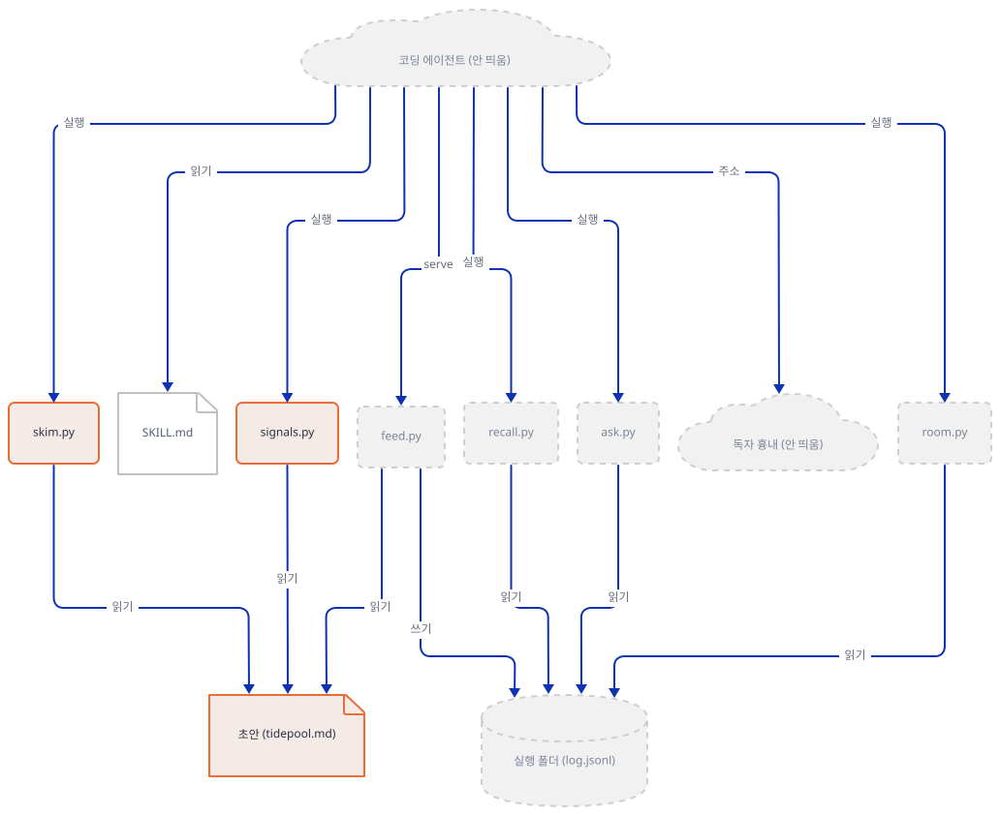

**확인.** 454낱말, 토막 102·139·98·115, 스캐너 화면 첫 줄 `stats: 454 words | ~2 min full read | ~5 phone screens`, 신호 JSON의 인정 문장 0과 옮겨 써도 되는 문장 12/27입니다.

### Step 5. 피드 서버를 127.0.0.1에 열고, 토큰 주소가 무엇을 지키는지 본다

**목적.** 독자들이 한 토막씩 받는 서버를 띄우고, 서버가 어디에 열리는지, 주소의 토큰이 무엇을 막는지 봅니다. 이 서버는 이 문서가 확인한 대로 루프백에만 열립니다.

**할 일.** 서버를 이 터미널의 백그라운드로 띄웁니다. 같은 터미널에서 Step 6까지 쓰고 Step 6 끝에서 닫습니다. 서버 출력에는 모든 토큰이 들어 있으니 `run1`이 아닌 랩 바닥의 `feed.out`에 둡니다(다만 `--ready-file`이 쓰는 `run1/feed.json`에도 관리자 토큰까지 모든 주소가 있습니다. `SKILL.md:163`도 그렇게 시킵니다). 서버가 뜨기를 기다리는 고리에는 시한(20초)이 있고, `run1`이 이미 있으면 `mkdir`가 실패해 서버를 띄우지 않습니다(지우고 다시 하세요). `--dwell 0.02`는 시연을 빠르게 하려고 제한 시간을 낱말당 0.02초로 낮춘 것입니다(기본값은 0.08, Step 6에서 봅니다).

```bash
. "${LAB:?새 터미널이면 B01의 export 두 줄을 먼저}/lab-env.sh" || unset LAB
# run1이 이미 있으면 mkdir이 실패해 서버가 뜨지 않는다(지우고 다시 하세요). 기다림에는 시한이 있다.
mkdir "$(W run1)" && py "$FR/feed.py" serve "$(W drafts/tidepool.md)" --run "$(W run1)" --readers keen,skeptic \
  --persona "keen=a build engineer who reads release posts to find out what changed" \
  --persona "skeptic=a staff engineer who has read forty cache posts and wants a reason to stop" \
  --dwell 0.02 --ready-file "$(W run1/feed.json)" > "$(W feed.out)" 2>&1 &
SRV=$!
for _ in $(seq 1 100); do
  [ -s "$(W run1/feed.json)" ] && break
  kill -0 $SRV 2>/dev/null || { echo "서버가 뜨지 못했습니다"; break; }
  sleep 0.2
done
mask < "$(W feed.out)"
mask < "$(W run1/feed.json)"; echo
( cd "${LAB:?}" && find run1 -type f | sort )
```

```text
FEED serving 4 passages, 454 words, readers: keen, skeptic
reader keen: READER_FEED=http://127.0.0.1:61547/<토큰>
reader skeptic: READER_FEED=http://127.0.0.1:61547/<토큰>
admin: http://127.0.0.1:61547/<토큰>
Give each reader ONLY its own READER_FEED line. Nothing else about the piece.
{"base": "http://127.0.0.1:61547", "admin": "http://127.0.0.1:61547/<토큰>", "readers": {"keen": "http://127.0.0.1:61547/<토큰>", "skeptic": "http://127.0.0.1:61547/<토큰>"}}
run1/feed.json
run1/keen/log.jsonl
run1/skeptic/log.jsonl
```

(포트와 토큰은 실행마다 다릅니다. 토큰은 `<토큰>`으로 가렸습니다.) `feed.py:299`가 `ThreadingHTTPServer(("127.0.0.1", args.port), Handler)`로 열고, `--port`의 기본값이 0이라 운영체제가 임의의 높은 포트를 골라 줍니다. 호스트를 바꾸는 옵션은 없습니다. 주소 셋(독자 둘과 관리자)은 `secrets.token_urlsafe(18)`로 만든 24자 토큰을 경로에 답니다(`feed.py:132, 137`). 서버는 처음에 `run1/<독자>/log.jsonl`만 비어 있는 채로 만들고, 초안은 메모리에만 올립니다(`feed.py:127-128`). `feed.json`은 주소만 담습니다. 이제 주소를 꺼내고, 운영체제가 보는 듣는 주소를 확인합니다.

```bash
. "${LAB:?새 터미널이면 B01의 export 두 줄을 먼저}/lab-env.sh" || unset LAB
cat > "$(W feedaddr.py)" <<'EOF'
"""feed.json에서 주소 하나를 꺼낸다. 사용법: feedaddr.py <feed.json> base|admin|<읽는 이 이름>"""
import json, sys

d = json.load(open(sys.argv[1], encoding="utf-8"))
print(d["base"] if sys.argv[2] == "base" else d["admin"] if sys.argv[2] == "admin" else d["readers"][sys.argv[2]])
EOF
BASE=$(py "$(W feedaddr.py)" "$(W run1/feed.json)" base)
KEEN=$(py "$(W feedaddr.py)" "$(W run1/feed.json)" keen)
SKEPTIC=$(py "$(W feedaddr.py)" "$(W run1/feed.json)" skeptic)
ADMIN=$(py "$(W feedaddr.py)" "$(W run1/feed.json)" admin)
PORT=${BASE##*:}
netstat -an | grep LISTEN | grep ":$PORT "
```

```text
  TCP    127.0.0.1:61547        0.0.0.0:0              LISTENING
```

`127.0.0.1:포트`에서만 `LISTENING`입니다. `0.0.0.0`이나 PC의 다른 주소로는 열려 있지 않습니다. 이 PC의 다른 서비스들도 줄에 섞여 나올 수 있으니 `grep`으로 내 포트만 걸렀습니다. 이제 주소의 토큰이 무엇을 하는지 `curl`로 봅니다. 프록시를 쓰지 않는 `lcurl`로, 루프백이 아닌 주소는 아예 거절합니다.

```bash
. "${LAB:?새 터미널이면 B01의 export 두 줄을 먼저}/lab-env.sh" || unset LAB
lcurl "$SKEPTIC/start" | head -c 330; echo ' ...'
lcurl "$BASE/not-a-token/start" -w ' -> HTTP %{http_code}\n'
lcurl "$BASE/start" -w ' -> HTTP %{http_code}\n'
lcurl "$ADMIN/start" -w ' -> HTTP %{http_code}\n'
lcurl "$KEEN/progress" -w ' -> HTTP %{http_code}\n'
lcurl "$KEEN/next" -w ' -> HTTP %{http_code}\n'
lcurl http://example.com/ || true
py "$FR/feed.py" progress --admin "$ADMIN" | tr -d '\r\n '; echo
```

```text
{"header": "--- CHUNK 1/4 (352 words remain after this) ---", "text": "# Tidepool 0.4: a build cache that tells you why it missed\n\nLast March our CI took 41 minutes to build a repo that changes eleven lines a day. I spent a week blaming the runners. The runners were fine. Our cache was missing 63% of the time, and nothing in a ...
{"error": "not found"} -> HTTP 404
{"error": "not found"} -> HTTP 404
{"error": "not found"} -> HTTP 404
{"error": "not found"} -> HTTP 404
{"error": "not found"} -> HTTP 404
거부: 루프백(127.0.0.1)이 아닌 주소 http://example.com/
{"keen":{"chunk":1,"of":4,"started":false,"done":false,"quit_at":null},"skeptic":{"chunk":1,"of":4,"started":true,"done":false,"quit_at":null}}
```

맨 위 줄은 독자의 `start`가 돌려주는 JSON입니다(`header`·`text`·`footer`, 그리고 처음 받을 때만 `briefing`). 나머지는 모두 같은 `{"error": "not found"}`와 404입니다. 틀린 토큰, 토큰 없음, 관리자 주소로 독자 길(`/start`), 독자 주소로 관리자 길(`/progress`), 독자 주소에 `GET /next`(이 길은 POST만 받음)가 모두 구별되지 않습니다(`feed.py:250-283`). 이어 `example.com`을 `lcurl`에 주면 거절하고, 마지막 줄은 관리자 길 `progress`입니다. 이 줄에서 스캐너 `start`를 방금 부른 `skeptic`만 `started: true`입니다.

여기서 토큰이 하는 일이 분명해집니다. 서버는 루프백에만 열려 있으니 **같은 PC에서 돌아가는 프로세스는 누구나 포트에 연결할 수 있고**, 토큰은 그 연결이 어느 독자의 토막을 받는지를 가르는 열쇠일 뿐입니다. 한 독자가 다른 독자의 토막을 앞서 받거나 관리자 길(`progress`, `close`)을 쓰지 못하게 합니다. 서버에는 로그를 돌려주는 길이 없고(`feed.py:250-283`), 로그는 실행 폴더의 파일(`log.jsonl`)입니다. 토큰이 추측될 일은 없지만(18바이트 무작위), 토큰을 아는 프로세스는 그 독자가 됩니다. 그리고 이 보호는 독자 에이전트의 프롬프트에 초안 경로나 실행 폴더가 없다는 가정 위에 서 있습니다(`SKILL.md:166-171`). 서버 프로세스의 명령줄에는 `feed.py serve <초안 경로> --run <실행 폴더>`가 그대로 있고(위 서버 실행 줄), 실행 폴더의 `feed.json`에는 관리자 토큰까지 모든 주소가 있으므로, 같은 PC에서 프로세스 목록을 보거나 실행 폴더를 읽을 수 있는 독자 에이전트는 초안 경로와 관리자 길까지 알아낼 수 있습니다. 이 문서는 프로세스 목록을 읽어 보지 않았으니 소스에서 따진 한계입니다. 막는 것은 독자가 우연히나 성의 없이 앞 토막을 훔쳐보는 길이지 작정한 독자가 아닙니다.

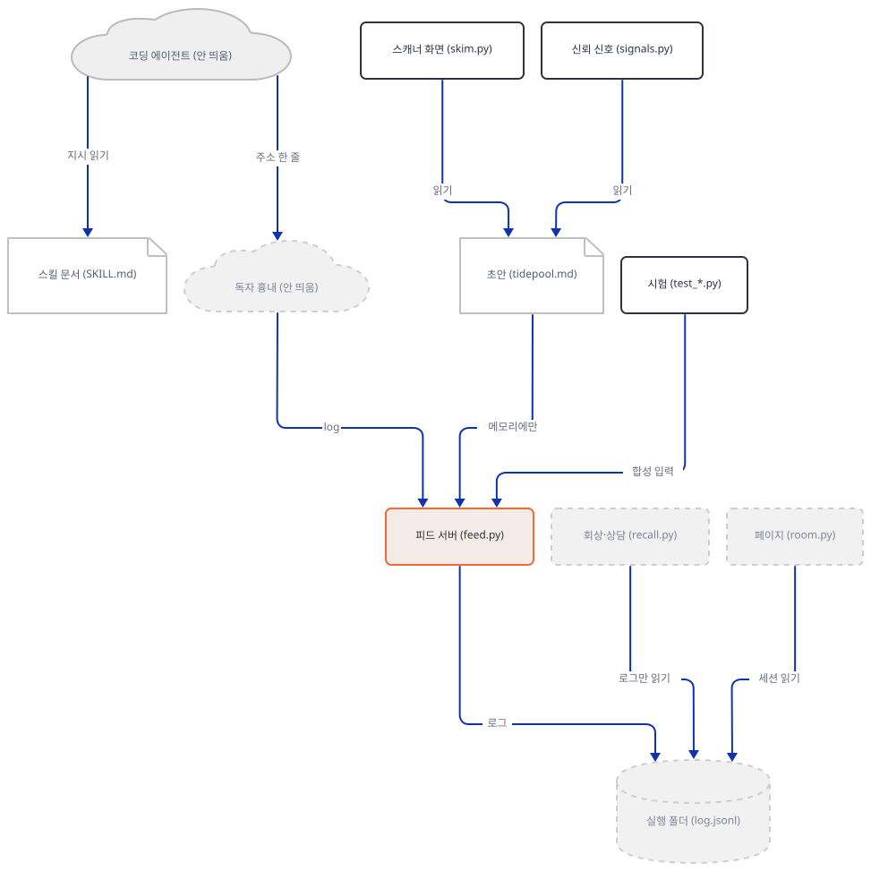

**확인.** `LISTENING`이 `127.0.0.1:포트` 한 줄이고, `lcurl`의 404가 다섯 번 나오고 `example.com`은 거절됩니다.

### Step 6. 독자 둘이 읽는다 — 손으로 쓴 기록으로, 제한과 디스크와 프록시를 본다

**목적.** 독자의 "느낌"은 에이전트가 쓰는 것이므로 이 문서는 제가 손으로 쓴 기록으로 대신합니다. 스크립트가 기록을 받는 규칙(길이, 시간)과 서버가 디스크에 쓰는 때, 그리고 클라이언트가 프록시 변수를 어떻게 다루는지를 봅니다.

**할 일.** 독자 한 명은 `rd "$KEEN" …`처럼 자기 주소만 `READER_FEED`로 걸고 명령을 부릅니다(`lab-env.sh`의 `rd`). 먼저 시작하고, 너무 짧은 기록과 너무 빠른 요청을 거절당합니다. 그 사이에 `SKEPTIC`이 처음 보는 토막을 다시 `start`로 받아 봅니다.

```bash
. "${LAB:?새 터미널이면 B01의 export 두 줄을 먼저}/lab-env.sh" || unset LAB
rd "$KEEN" start | head -3 | cut -c1-110
rd "$KEEN" next --log hi
rd "$KEEN" next --log "needle=+2 expected a release-notes list; got a March CI story. Leaning in."
rd "$SKEPTIC" start | head -2 | cut -c1-110
READER_FEED="$BASE/not-a-token" py "$FR/feed.py" start
```

```text
SESSION keen | persona: a build engineer who reads release posts to find out what changed | 4 chunks, 454 word
You are this persona encountering this text cold. React honestly; your persona's patience budget is real, and 
--- CHUNK 1/4 (352 words remain after this) ---
REFUSED: log entry under 25 chars. What happened in you during that chunk? needle=?, expected what, got what?
--- CHUNK 2/4 (213 words remain after this) ---
## Why caching matters

Modern software teams face unprecedented pressure to ship quickly. Build times are a critical factor in developer productivity, and a well-designed caching strategy can unlock significant gains across the organization. By leveraging intelligent caching, teams can reduce waste, improve velocity, and deliver more value to their customers. In today's fast-moving landscape, the ability to build quickly is more important than ever, and teams that invest in their tooling will be well positioned for long-term success.

Tidepool is a powerful, flexible, and developer-friendly solution that integrates seamlessly into your existing workflow. Whether you are a small startup or a large enterprise, Tidepool scales with your needs and adapts to the way your team works. Our mission is to empower every engineer to build better software, faster, with confidence and clarity at every step of the journey.
--- record your moment log with: feed.py next --log "..." (or feed.py quit --log "..." if your persona stops here) ---
(re-showing the current passage; nothing advanced)
--- CHUNK 1/4 (352 words remain after this) ---
feed error: 404 (wrong READER_FEED address or the feed has closed)
```

(첫 줄 `start`는 `head -3`로 앞부분만 보였습니다.) 기록은 25자(`MIN_LOG_CHARS`) 이상이어야 하고(`feed.py:165-167`), 토막을 받은 지 `max(2초, 낱말 수 × 제한값)`이 지나야 다음 토막을 받습니다(`feed.py:117-120`, `170-175`). 기본값 0.08은 238낱말/분으로 읽는 사람이 낱말당 쓰는 약 0.25초의 약 3분의 1이라 "정직한 독자는 모르고 서두른 독자는 걸린다"는 코드 주석의 뜻입니다. 이 초안의 토막 넷은 기본값에서 8.2초, 11.1초, 7.8초, 9.2초(합 36.3초)가 최소입니다. 이 문서는 시연을 위해 0.02로 낮췄습니다. 거절 글의 경과 초(`… and 2s have passed.`)는 앞 두 호출의 속도에 달려 실행마다 다르고(0s가 나올 수도 있습니다), 느린 PC에서 이 줄 앞에서 2.04초가 지나면 두 번째 `next`가 거절되지 않고 `keen`이 한 토막 앞서 가서 뒤의 출력이 한 토막씩 밀립니다. 거절을 확실히 보려면 두 호출 사이에 간격을 두지 마세요. `start`를 다시 부르면 현재 토막을 다시 보여 줄 뿐 앞으로 가지 않고(`feed.py:151-161`), 마지막 줄의 엉뚱한 토큰은 서버가 살아 있는 상태에서 `feed error: 404 (wrong READER_FEED address or the feed has closed)`로 끝납니다(`feed.py:348-349`). 이제 두 독자가 읽습니다. `keen`은 끝까지, `skeptic`은 둘째 토막에서 그만둡니다. 기록은 제가 쓴 것입니다.

```bash
. "${LAB:?새 터미널이면 B01의 export 두 줄을 먼저}/lab-env.sh" || unset LAB
sleep 3
rd "$KEEN" next --log "needle=+2 expected a release-notes list; got a March CI story, 41 minutes and a 63% miss rate. Leaning in: I have lived this and nobody told me why either." | sed -n 1,3p
rd "$SKEPTIC" next --log "needle=0 expected a launch post; got a confession about 41-minute CI and a 63% miss rate. Interesting, but opening anecdotes are often staged. Still reading." | sed -n 1,3p
sleep 3
rd "$KEEN" next --log 'needle=-1 expected the mechanism; got "unprecedented pressure" and "seamlessly", prose I have read in a hundred launch posts. Started skimming the second paragraph.' | sed -n 1,3p
rd "$SKEPTIC" quit --log 'needle=-2 expected the mechanism after that opening; got "unprecedented pressure" and "powerful, flexible, and developer-friendly". The same post I have read forty times. Stopping here.'
py "$FR/feed.py" progress --admin "$ADMIN" | tr -d '\r\n '; echo
grep -rl "tidepool.toml" "$(W run1)" || echo "run1에서 tidepool.toml이 든 파일: 없음"
( cd "${LAB:?}" && find run1 -type f | sort )
```

```text
--- CHUNK 3/4 (115 words remain after this) ---
## How a miss is explained

--- CHUNK 2/4 (213 words remain after this) ---
## Why caching matters

--- CHUNK 4/4 (0 words remain after this) ---
It is not magic. The closest earlier key is chosen by a simple count of shared inputs, so when two branches diverge a lot, the explanation can point at the wrong ancestor. We shipped that in 0.4 knowing it, and it burned a teammate on a Friday. A better match is planned for 0.5, and I do not yet know whether it will cost more than it saves.

Reader stopped at chunk 2/4. That stop point is the primary finding.
{"keen":{"chunk":4,"of":4,"started":true,"done":false,"quit_at":null},"skeptic":{"chunk":2,"of":4,"started":true,"done":true,"quit_at":2}}
run1에서 tidepool.toml이 든 파일: 없음
run1/feed.json
run1/keen/log.jsonl
run1/skeptic/log.jsonl
```

`skeptic`이 그만두는 `quit`은 시간 제한을 보지 않습니다(`feed.py:204`의 `check_dwell=False`, 그만두는 것은 아무것도 드러내지 않기 때문입니다). 그만두는 줄은 `QUIT`로 표시되고 `quit_at`이 2가 됩니다. 중요한 확인은 마지막 두 줄입니다. 독자 하나가 이미 끝났는데도(`done: true`) 다른 독자가 아직 읽는 동안에는 초안 낱말(`tidepool.toml`은 마지막 토막에만 있습니다)이 실행 폴더 `run1` 어디에도 없고 `run1`에는 `feed.json`과 `log.jsonl`뿐입니다(초안 파일 `drafts/tidepool.md` 자체는 물론 디스크에 있습니다. 확인한 것은 서버가 쓰는 곳입니다). 이제 `keen`이 끝까지 읽고 마지막 한 줄을 남깁니다.

```bash
. "${LAB:?새 터미널이면 B01의 export 두 줄을 먼저}/lab-env.sh" || unset LAB
sleep 3
rd "$KEEN" next --log "needle=+2 expected more adjectives; got named inputs, a timestamp in a generated header, 63% to 9% and 41 to 12 minutes. Won me back; I would try the explain command." | sed -n 1,2p
sleep 3
rd "$KEEN" next --log "needle=+1 expected a pitch; got an admitted limit, the wrong ancestor that burned a teammate on a Friday. I trust the numbers more now."
rd "$KEEN" quit --log "needle=+1 final: a clean close, but I wanted the 0.5 plan. Would try tidepool explain on our repo this week."
grep -rl "tidepool.toml" "$(W run1)" | sed "s#^${LAB}/##"
py "$FR/feed.py" transcript "$(W run1/keen)"
py "$FR/feed.py" transcript "$(W run1/skeptic)"
```

```text
END OF PIECE. The reader finished. Add one final log line for the ending itself via: feed.py quit --log "final: ..."
Session already finished.
Final reaction recorded. Session complete.
run1/keen/state.json
run1/skeptic/state.json
READING TRANSCRIPT | persona: a build engineer who reads release posts to find out what changed | finished of 4 chunks
[chunk 1] needle=+2 expected a release-notes list; got a March CI story. Leaning in.
[chunk 2] needle=+2 expected a release-notes list; got a March CI story, 41 minutes and a 63% miss rate. Leaning in: I have lived this and nobody told me why either.
[chunk 3] needle=-1 expected the mechanism; got "unprecedented pressure" and "seamlessly", prose I have read in a hundred launch posts. Started skimming the second paragraph.
[chunk 4] needle=+2 expected more adjectives; got named inputs, a timestamp in a generated header, 63% to 9% and 41 to 12 minutes. Won me back; I would try the explain command.
[chunk 4] FINAL needle=+1 final: a clean close, but I wanted the 0.5 plan. Would try tidepool explain on our repo this week.
READING TRANSCRIPT | persona: a staff engineer who has read forty cache posts and wants a reason to stop | QUIT at chunk 2 of 4 chunks
[chunk 1] needle=0 expected a launch post; got a confession about 41-minute CI and a 63% miss rate. Interesting, but opening anecdotes are often staged. Still reading.
[chunk 2] QUIT needle=-2 expected the mechanism after that opening; got "unprecedented pressure" and "powerful, flexible, and developer-friendly". The same post I have read forty times. Stopping here.
```

네 번째 토막에서 `next`를 하면 서버가 `END OF PIECE`를 돌려주고, 끝 반응은 `quit --log "final: …"`로 남깁니다. 두 번째 줄은 `FINAL`로 표시됩니다(그만둔 것이 아니므로 `QUIT`이 아닙니다). 모든 독자가 끝나는 순간 `flush()`가 `state.json`에 토막 전부를 쓰므로(`feed.py:225-232`) 이제야 초안 낱말이 `run1`에 나타납니다. 읽는 동안 로그는 `log.jsonl`에 바로 흐르지만 거기에는 독자가 쓴 말과 그가 인용한 것만 있습니다. 서버가 스스로 닫히는지는 `SKILL.md`가 아니라 `feed.py`의 설명문(34~35행)과 감시 고리(`feed.py:314-331`)에 있습니다. 모든 독자가 끝나면 닫히지만 끝난 뒤에도 90초는 조용해질 때까지 열려 있고, `--idle`(기본 1800초) 닫기는 누군가 한 번이라도 `start`한 뒤에만 켜집니다(`feed.py:325`). 이것을 `--idle 3`으로 시험합니다. 아무도 `start`하지 않은 서버와 한 번 `start`한 서버를 12초 뒤에 봅니다.

```bash
. "${LAB:?새 터미널이면 B01의 export 두 줄을 먼저}/lab-env.sh" || unset LAB
# 서버 수명: --idle 3으로, 아무도 start하지 않은 서버와 한 번 start한 서버를 12초 뒤에 본다.
idle_case() {
  local d="$(W idle-$1)" a pt
  mkdir "$d" || return 1
  py "$FR/feed.py" serve "$(W drafts/tidepool.md)" --run "$d" --readers a --idle 3 --ready-file "$d/feed.json" > "$d.out" 2>&1 &
  for _ in $(seq 1 100); do [ -s "$d/feed.json" ] && break; sleep 0.2; done
  a="$(py "$(W feedaddr.py)" "$d/feed.json" a)"
  [ "$2" = yes ] && rd "$a" start > /dev/null
  sleep 12
  pt="$(py "$(W feedaddr.py)" "$d/feed.json" base)"; pt="${pt##*:}"
  if netstat -an | grep LISTEN | grep ":$pt " > /dev/null; then echo "$1: 12초 뒤에도 듣는 중"; else echo "$1: 12초 뒤 닫힘"; fi
  py "$FR/feed.py" close --admin "$(py "$(W feedaddr.py)" "$d/feed.json" admin 2>/dev/null)" > /dev/null 2>&1 || true
}
idle_case nostart no
idle_case started yes
```

```text
nostart: 12초 뒤에도 듣는 중
started: 12초 뒤 닫힘
```

아무도 `start`하지 않은 서버는 `--idle`을 줘도 12초 뒤에 듣는 채로 남았고(시험 블록이 `close`로 닫았습니다), 한 번 `start`한 서버는 닫혔습니다. 그래서 정상 순서에서도 마지막에 `close`를 부릅니다. 서버가 남았을 때는 `feed.py close --admin <관리자 주소>`로 닫고, 주소를 잃었으면 `netstat -ano | grep 127.0.0.1:<포트>`로 PID를 찾아 Git Bash에서 `taskkill //PID <PID> //F`로 멈춥니다(`taskkill`은 Windows 명령이라 Git Bash에서는 `/PID`가 경로로 바뀌지 않게 `//PID`로 씁니다).

```bash
. "${LAB:?새 터미널이면 B01의 export 두 줄을 먼저}/lab-env.sh" || unset LAB
py "$FR/feed.py" close --admin "$ADMIN"
sleep 1
netstat -an | grep LISTEN | grep ":$PORT " || echo "포트 $PORT: 비었음"
```

```text
{"ok": true, "closed": true}
포트 61547: 비었음
```

이제 프록시입니다. `READER_FEED` 클라이언트(`feed.py:340-351`)는 표준 라이브러리 `urllib.request.urlopen`을 씁니다. 이것은 환경의 `http_proxy`를 따릅니다. 게다가 이름이 `_proxy`로 끝나는 변수가 하나도 없으면 Windows에서는 레지스트리의 시스템 프록시를 씁니다(Python 3.13.3 `Lib/urllib/request.py`의 `getproxies()`는 `getproxies_environment() or getproxies_registry()`, 2741~2748행이고 macOS도 같은 꼴입니다). `NO_PROXY`처럼 값이 있는 `*_proxy` 변수가 하나라도 있으면 레지스트리는 보지 않습니다. 회사 PC나 학교 PC처럼 프록시가 걸린 환경에서 독자 에이전트가 이 명령을 부르면 루프백 요청도 프록시로 갈 수 있습니다. 그 모양을 실제 프록시 없이 보려고, 루프백에 **기록 서버**를 프록시처럼 세우고 `feed.py`를 그 프록시 변수와 함께 돌립니다. 기록 서버는 받은 요청을 적고 루프백의 피드로 그대로 넘겨 줍니다.

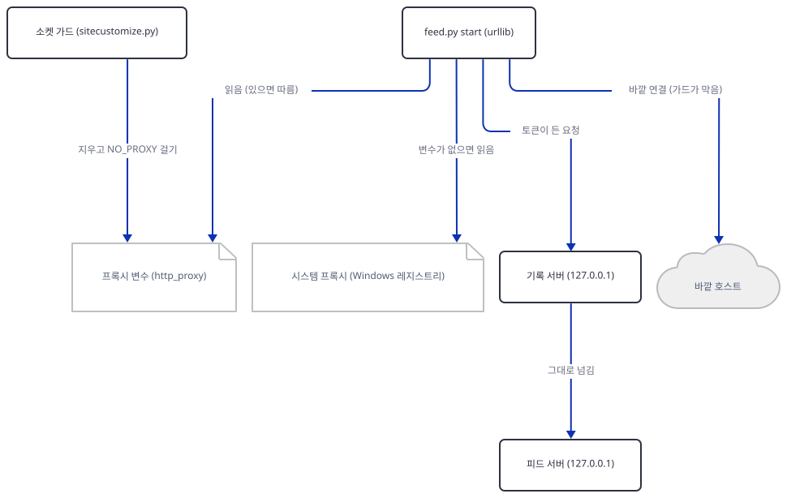

```bash
. "${LAB:?새 터미널이면 B01의 export 두 줄을 먼저}/lab-env.sh" || unset LAB
cat > "$(W leak_probe.py)" <<'EOF'
"""READER_FEED 클라이언트가 프록시 설정을 따르는지 본다. 프록시 자리에는 루프백의 기록 서버를 둔다."""
import http.client, http.server, json, os, shutil, subprocess, sys, tempfile, threading, time
from pathlib import Path
from urllib.parse import urlsplit

lab = Path(os.environ["LAB_NATIVE"]).resolve()
tmp = Path(tempfile.gettempdir()).resolve()
if lab not in tmp.parents:
    raise SystemExit("멈춤: 임시 폴더가 랩 밖입니다: %s" % tmp)

FEED = Path(sys.argv[1]) / "agent_skills/first-reader/scripts/feed.py"
seen = []


class Tap(http.server.BaseHTTPRequestHandler):
    """프록시처럼 절대 주소 요청을 받아 기록하고, 루프백의 피드로 그대로 넘긴다."""
    def log_message(self, *a):
        pass

    def handle_any(self):
        u = urlsplit(self.path)
        n = int(self.headers.get("Content-Length") or 0)
        body = self.rfile.read(n) if n else b""
        if u.hostname != "127.0.0.1":
            self.send_error(403)
            return
        c = http.client.HTTPConnection(u.hostname, u.port, timeout=10)
        c.request(self.command, u.path, body or None, {"Content-Type": "application/json"})
        r = c.getresponse()
        data = r.read()
        seen.append((self.command, self.path.split("/")[-1], body[:50], data[:60]))
        self.send_response(r.status)
        self.send_header("Content-Length", str(len(data)))
        self.end_headers()
        self.wfile.write(data)

    do_GET = do_POST = handle_any


tap = http.server.ThreadingHTTPServer(("127.0.0.1", 0), Tap)
threading.Thread(target=tap.serve_forever, daemon=True).start()
tap_url = "http://127.0.0.1:%d" % tap.server_address[1]

work = Path(tempfile.mkdtemp())
(work / "d.md").write_text("alpha " * 40 + ".\n\n" + "omega " * 40 + ".\n")
ready = work / "ready.json"
srv = subprocess.Popen([sys.executable, "-B", str(FEED), "serve", str(work / "d.md"), "--run", str(work / "run"),
                        "--readers", "a", "--ready-file", str(ready)], stdout=subprocess.DEVNULL)
try:
    for _ in range(100):
        if ready.exists():
            break
        time.sleep(0.1)
    else:
        raise SystemExit("서버가 뜨지 못했습니다")
    addr = json.loads(ready.read_text())["readers"]["a"]
    base = dict(os.environ, READER_FEED=addr)
    for k in [k for k in base if k.lower().endswith("_proxy")]:
        del base[k]
    cases = {
        "프록시 변수 없음": {},
        "HTTP_PROXY만": {"HTTP_PROXY": tap_url, "GUARD_KEEP_PROXY": "1"},
        "HTTP_PROXY + NO_PROXY=127.0.0.1": {"HTTP_PROXY": tap_url, "NO_PROXY": "127.0.0.1", "GUARD_KEEP_PROXY": "1"},
        "HTTP_PROXY + 가드 기본값": {"HTTP_PROXY": tap_url},
    }
    for label, extra in cases.items():
        before = len(seen)
        r = subprocess.run([sys.executable, "-B", str(FEED), "start"], env=dict(base, **extra),
                           capture_output=True, text=True)
        print("%-34s 프록시가 받은 요청 %d건, 피드 응답 %s" % (
            label, len(seen) - before, "정상" if "CHUNK 1/" in r.stdout else "실패"))
    first = seen[0] if seen else None
    # Windows는 프록시 변수가 하나도 없으면 레지스트리의 시스템 프록시를 쓴다. 레지스트리 자리는 기록 서버로 바꿔치기해 흉내 낸다.
    if sys.platform == "win32":
        import urllib.request as ur
        sys.path.insert(0, str(FEED.parent))
        import feed
        ur.getproxies_registry = lambda: {"http": tap_url}
        for label, no_proxy in [("시스템 프록시 흉내(변수 없음)", None), ("시스템 프록시 흉내 + NO_PROXY=127.0.0.1", "127.0.0.1")]:
            for k in [k for k in os.environ if k.lower().endswith("_proxy")]:
                del os.environ[k]
            if no_proxy:
                os.environ["NO_PROXY"] = no_proxy
            ur._opener = None
            before = len(seen)
            feed._call(addr, "start")
            print("%-34s 프록시가 받은 요청 %d건" % (label, len(seen) - before))
    if first:
        print("프록시가 본 첫 요청: %s http://127.0.0.1:포트/<토큰>/%s" % (first[0], first[1]))
        print("프록시가 본 응답 앞부분:", first[3].decode())
finally:
    srv.kill()
    tap.shutdown()
    shutil.rmtree(work, ignore_errors=True)
EOF
py "$(W leak_probe.py)" "${REPO:?}"
cat "$(W guard.log)"; echo "가드 기록 줄 수: $(wc -l < "$(W guard.log)")"
```

```text
프록시 변수 없음                          프록시가 받은 요청 0건, 피드 응답 정상
HTTP_PROXY만                        프록시가 받은 요청 1건, 피드 응답 정상
HTTP_PROXY + NO_PROXY=127.0.0.1    프록시가 받은 요청 0건, 피드 응답 정상
HTTP_PROXY + 가드 기본값                프록시가 받은 요청 0건, 피드 응답 정상
시스템 프록시 흉내(변수 없음)                  프록시가 받은 요청 1건
시스템 프록시 흉내 + NO_PROXY=127.0.0.1    프록시가 받은 요청 0건
프록시가 본 첫 요청: GET http://127.0.0.1:포트/<토큰>/start
프록시가 본 응답 앞부분: {"header": "--- CHUNK 1/1 (0 words remain after this) ---", 
가드 기록 줄 수: 0
```

`HTTP_PROXY`만 있는 경우, 기록 서버가 요청 1건을 받았고 거기에는 토큰이 든 주소(`http://127.0.0.1:포트/<토큰>/start`)와 응답의 토막 본문(`"text"` 첫머리)이 모두 담겼습니다. 아래 두 줄은 Windows의 시스템 프록시를 `getproxies_registry`를 바꿔치기해 흉내 낸 것(이 PC의 실제 레지스트리는 건드리지 않았습니다)이고 변수가 없으면 1건, `NO_PROXY=127.0.0.1`이 있으면 0건이었습니다. 이것이 실제 프록시였다면 토큰이 든 주소와 토막 본문이 프록시에 보였을 것이고, 같은 `urlopen`으로 나가는 `next`·`quit`의 `POST` 본문(독자의 로그 줄)도 같은 길을 탈 것입니다(이 문서는 `start`만 시험했고 나머지는 소스에서 읽은 것입니다). 이 문서의 가드는 프록시 변수를 지우고 `NO_PROXY`를 걸어 두 경우를 모두 0건으로 막습니다. 시스템 프록시를 막는 것은 `NO_PROXY` 쪽입니다(변수를 지우기만 하면 레지스트리가 살아납니다). `no_proxy=localhost`만으로는 `127.0.0.1`이 빠지지 않는다는 것도 확인했습니다(`NO_PROXY`는 주소를 그대로 적어야 합니다). 이 실험은 작성자의 관찰이고 이 가드 때문에 이 문서를 따라 하는 사람의 셸에서는 일어나지 않습니다. 작성자는 같은 실험을 회사식 이름의 프록시(`proxy.example.com`)로도 한 번 했는데, 가드가 그 이름 조회를 `getaddrinfo 'proxy.example.com'`으로 막고 `feed unreachable … blocked by guard`로 끝났습니다. 즉 가드가 없었다면 그 이름으로 조회가 나갔을 것입니다. `SKILL.md`(166~173행)가 독자 에이전트에게 주라는 것은 `export READER_FEED=<주소>`와 명령 셋이고 `NO_PROXY`는 없습니다. 프록시가 걸린 환경에서 이 스킬을 쓸 때는 독자의 셸에 `NO_PROXY=127.0.0.1`이 있는지 확인하는 것이 안전합니다. `curl`로 직접 확인할 때 `--noproxy '*'`를 붙이는 것도 같은 까닭입니다.

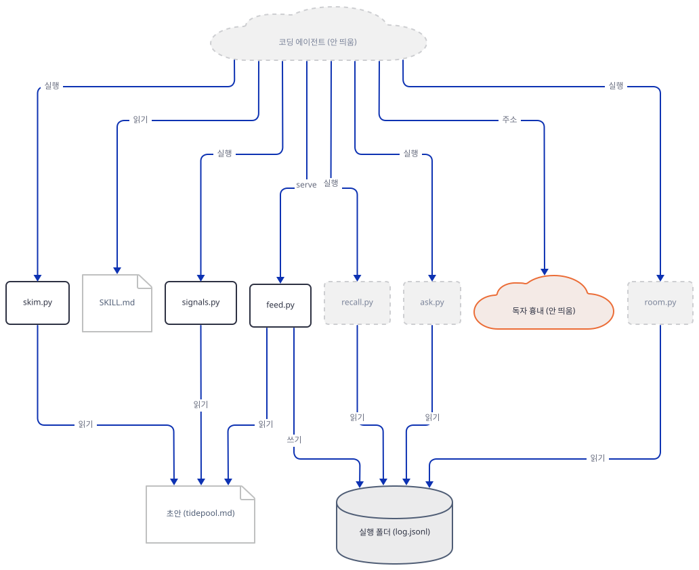

**확인.** `grep`이 `tidepool.toml`을 "없음"으로, `keen`이 다 끝난 뒤에는 `state.json` 둘로, `--idle` 시험이 "듣는 중"과 "닫힘"으로, 서버가 닫힌 뒤에는 `포트 …: 비었음`, 프록시 실험이 변수만 있을 때와 시스템 프록시 흉내에서 1건·나머지 0건, 가드 기록 0줄입니다.

### Step 7. 회상 시험과 독자 상담 — 로그만 가진 새 에이전트에게 줄 글

**목적.** 독자 기록이 끝난 뒤 스크립트가 만드는 두 가지 글을 봅니다. 하나는 기억에 남은 것을 묻는 시험지(`recall.py`), 다른 하나는 독자에게 되묻는 질문지(`ask.py`)입니다. 둘 다 새 에이전트에게 줄 글을 인쇄할 뿐, 답은 에이전트가 합니다. 이 문서는 모델을 부르지 않으니 답은 만들지 않았습니다.

**할 일.**

```bash
. "${LAB:?새 터미널이면 B01의 export 두 줄을 먼저}/lab-env.sh" || unset LAB
py "$FR/recall.py" "$(W run1/skeptic)" > "$(W recall-skeptic.txt)"
sed -n 3,6p "$(W recall-skeptic.txt)" | cut -c1-150
grep -c -e "tidepool.toml" -e "Apache" -e "Friday" "$(W recall-skeptic.txt)"
echo "A cache build tool launch post. I would open it: 41 minutes and 63% are in the first two lines." > "$(W run1/skim.txt)"
py "$FR/ask.py" "$(W run1)" skeptic "what would have kept you past passage 2?" | cut -c1-150
py "$FR/ask.py" "$(W run1)" all "did you notice the timestamp example?" | grep "====="
```

```text
persona: a staff engineer who has read forty cache posts and wants a reason to stop | quit at chunk 2 of 4
------------------------------------------------------------
[chunk 1] needle=0 expected a launch post; got a confession about 41-minute CI and a 63% miss rate. Interesting, but opening anecdotes are often stage
[chunk 2] QUIT needle=-2 expected the mechanism after that opening; got "unprecedented pressure" and "powerful, flexible, and developer-friendly". The
0
===== reader: skeptic =====
You are a staff engineer who has read forty cache posts and wants a reason to stop. Earlier today you read a piece one passage at a time and stopped a

[passage 1] needle=0 expected a launch post; got a confession about 41-minute CI and a 63% miss rate. Interesting, but opening anecdotes are often sta
[passage 2] QUIT needle=-2 expected the mechanism after that opening; got "unprecedented pressure" and "powerful, flexible, and developer-friendly". T

The author asks you: what would have kept you past passage 2?

Answer as yourself, in under 150 words, grounded only in what you noted at the time. Quote your own notes where they answer it. Do not invent details 
===== reader: keen =====
===== reader: skeptic =====
===== reader: skim =====
```

`recall.py`(`recall.py:21-48`)는 독자의 `state.json`에서 성향과 끝난 방식을, `log.jsonl`에서 기록 전부를 인쇄하고 여섯 문항을 붙입니다. 요약, 가리키기(실제로 남은 낱말), 정점, 끝, 무게 중심, 하나의 행동입니다. 기록에 없는 것은 "nothing survived"라고 답하라고 합니다. 그래서 `skeptic`의 번들에는 그가 읽지 못한 셋째·넷째 토막의 낱말이 없고(`tidepool.toml`, `Apache`, `Friday`를 센 `grep -c`가 0), `keen`이 쓴 `Friday`도 그의 번들에만 있습니다. 읽은 토막을 인용한 기록 낱말(`unprecedented pressure`, `powerful, flexible, and developer-friendly`)만 남습니다. 이것이 이 스킬의 "회상은 로그에서만"이라는 약속이 코드로 지켜지는 모양입니다. 다만 이 약속은 "로그에 적힌 만큼"이라서, 독자가 인용을 적게 하면 시험이 가난해집니다. `ask.py`는 독자의 성향, 몇 번째 토막에서 그만뒀거나 끝났는지, 로그를 "passage" 번호와 함께 싣고 질문과 규칙(150낱말 이내, 기록한 것만, 다시 쓰기 제안 금지)을 붙입니다. `all`은 독자마다 번들 하나에 스캐너(`skim.txt`가 있으면)를 더해 셋을 냅니다. 스캐너 번들은 스캐너가 한 말(`skim.txt`) 전문을 싣는데, 이 문서에서는 제가 손으로 쓴 두 문장입니다.

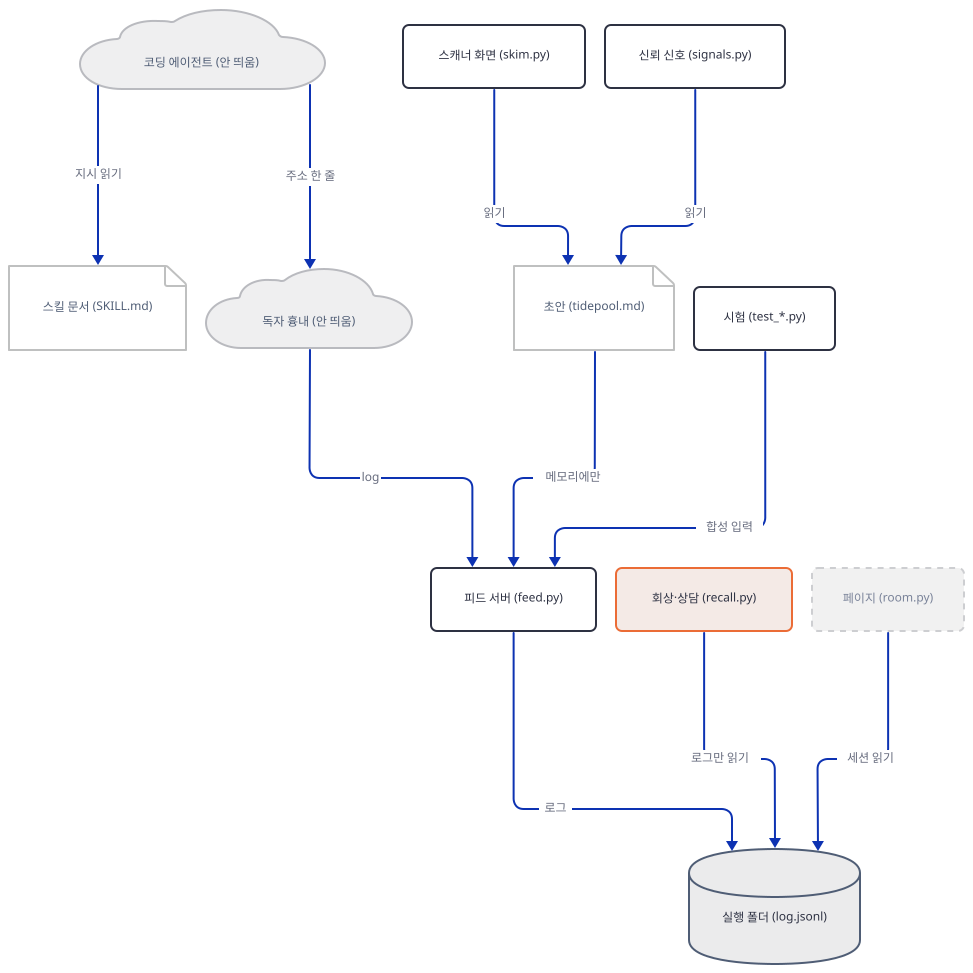

**확인.** 회상 번들에 읽지 않은 낱말 셋이 0번, 상담 `all`이 `keen`·`skeptic`·`skim` 셋입니다.

### Step 8. 페이지를 조립하고, 에이전트와 스크립트의 경계를 긋는다

**목적.** 세션 폴더와 주석 파일로 HTML 한 장을 만들고(브라우저로는 열지 않고 파일로만 읽습니다), 페이지가 바깥에 닿는 곳과 값을 이스케이프하는 방식을 봅니다. 그리고 `SKILL.md`의 지시 가운데 무엇이 코드로 강제되고 무엇이 글로만 남는지 가릅니다.

**할 일.** 주석 파일(`references/room.md`가 정한 형식, 제가 손으로 쓴 값)을 쓰고 조립합니다.

```bash
. "${LAB:?새 터미널이면 B01의 export 두 줄을 먼저}/lab-env.sh" || unset LAB
cat > "$(W run1/room-annotations.json)" <<'EOF'
{
  "title": "First read: Tidepool 0.4: a build cache that tells you why it missed",
  "skim": {"commits": true, "said": "A launch post for a build cache that explains its misses. I would open it: 41 minutes and 63% are in the first two lines."},
  "verdict_lead": "One reader finished and one left at the second passage.",
  "verdict_rest": "Both liked the opening story. The generic middle is where the skeptic stopped.",
  "readers": {
    "keen": {"initial": "K", "label": "build engineer", "title": "a build engineer who reads release posts to find out what changed"},
    "skeptic": {"initial": "S", "label": "staff skeptic", "title": "a staff engineer who has read forty cache posts and wants a reason to stop"}
  },
  "excerpts": {"skeptic": {"2": "The same post I have read forty times. Stopping here."}},
  "flags": {"1": "best moment", "2": "attention dropped"},
  "memory_phrases": ["41 minutes", "63%"],
  "portable_sentences": ["Modern software teams face unprecedented pressure to ship quickly."],
  "entities": ["Tidepool", "CI"],
  "opinions": ["The middle section reads like any other launch post."]
}
EOF
py "$FR/room.py" "$(W run1)" --out "$(W room.html)" --annotations "$(W run1/room-annotations.json)"
grep -o 'class="chunk"' "$(W room.html)" | wc -l
grep -o 'class="chip [a-z0-9]*">[+-]\?[0-9]' "$(W room.html)" | sort | uniq -c
grep -o 'class="fold">[^<]*' "$(W room.html)"
grep -o '<section class="chunk"[^>]*data-unseen-r1="1"' "$(W room.html)" | wc -l
grep -o 'https\?://[^"'"'"' )<]*' "$(W room.html)" | sort | uniq -c
```

```text
wrote ...\reader-lab\room.html (27271 bytes, 4 passages, 2 readers)
4
      2 class="chip n0">0
      1 class="chip n1">+1
      3 class="chip n2">+2
      1 class="chip nm1">-1
      2 class="chip nm2">-2
class="fold">S stopped here. They never saw anything below this line.
2
      1 https://fonts.googleapis.com
      1 https://fonts.googleapis.com/css2?family=Geist:wght@400;500;600&family=Geist+Mono:wght@400;500&display=swap
```

`room.py`는 토막 넷과 독자 둘로 27,363자짜리 페이지를 만듭니다(스크립트가 `bytes`라고 찍는 수는 `len(page)`, 곧 글자 수입니다. Windows에서 파일은 CRLF 줄 끝 때문에 이보다 큽니다). 토막마다 `<section class="chunk">`가 하나이고(4개), 독자의 느낌 숫자(`needle=`)는 기록에서 정규식으로 뽑아 칩으로 그립니다(`+2` 셋, `+1` 하나, `0` 둘, `-1` 하나, `-2` 둘). `skeptic`이 그만둔 자리에는 `S stopped here. They never saw anything below this line.`라는 접는 선이 들어가고, 그 아래 토막 둘에 `data-unseen-r1`이 붙어 흐려집니다. 주석에 기억 낱말을 주면 "what stuck" 렌즈 단추가 생기고, 신뢰 렌즈도 같습니다. 이 페이지가 바깥에 닿는 곳이 마지막 두 줄입니다. 템플릿 4~5행의 `<link rel="preconnect" href="https://fonts.googleapis.com">`과 그 CSS 주소입니다. 이 문서는 페이지를 브라우저로 열지 않았고 그 CSS도 받지 않았습니다. 열면 브라우저가 Google Fonts에서 Geist 글꼴을 받으려 할 것이고, Google Fonts CSS의 글꼴 파일은 보통 `fonts.gstatic.com`에서 오므로 두 호스트에 요청이 여러 번 갈 것으로 보입니다(추정입니다). 1b단계 보안 스캐너의 출력(Step 3)에는 이 줄이 없습니다. 페이지의 바깥 의존은 그 시험이 보는 대상이 아닌 것입니다. 스킬 `README.md`(18행)의 "sends nothing off your machine"과 `room.py` 머리 설명의 "self-contained"는 스크립트에 대해서는 맞지만 이 페이지에 대해서는 글꼴 두 줄만큼 다릅니다. 이어 속성 이스케이프를 봅니다. `room.py:36-37`의 `esc()`는 `html.escape(t, quote=False)`라서 큰따옴표를 이스케이프하지 않는데, 같은 `esc()`가 속성 값에도 씁니다(`room.py:306, 319, 327`의 `title="…"`, `aria-label="…"`). 큰따옴표가 든 값을 주석에 넣어 봅니다(손으로 만든 입력입니다).

```bash
. "${LAB:?새 터미널이면 B01의 export 두 줄을 먼저}/lab-env.sh" || unset LAB
cat > "$(W attr_test.py)" <<'EOF'
"""annotations 값에 큰따옴표를 넣으면 속성이 깨지는지 본다(손으로 만든 입력, 브라우저 없이 파일로만 확인)."""
import json, os, re, subprocess, sys
from pathlib import Path

lab = Path(os.environ["LAB_NATIVE"])
ann = json.loads((lab / "run1/room-annotations.json").read_text(encoding="utf-8"))
ann["flags"] = {"1": 'best" data-x="injected', "2": "attention dropped"}
ann["readers"]["skeptic"]["initial"] = 'S" data-y="injected'
(lab / "run1/ann-attr.json").write_text(json.dumps(ann), encoding="utf-8")
subprocess.run([sys.executable, "-B", sys.argv[1], str(lab / "run1"), "--out", str(lab / "room-attr.html"),
                "--annotations", str(lab / "run1/ann-attr.json")], check=True, stdout=subprocess.DEVNULL)
page = (lab / "room-attr.html").read_text(encoding="utf-8")
tags = re.findall(r'<[^>]*\sdata-[xy]="injected[^>]*>', page)
for t in tags[:2]:
    print(t[:120])
print("data-x·data-y 속성이 끼어든 태그 수:", len(tags))
EOF
py "$(W attr_test.py)" "$FR/room.py"
printf '# t\n\nHello  and [click](https://example.com/x) and **bold** end of the paragraph, with enough words here.\n' > "$(W drafts/html.md)"
py "$FR/feed.py" start "$(W drafts/html.md)" --session "$(W xs/a)" --persona p > /dev/null
py "$FR/feed.py" quit "$(W xs/a)" --log "needle=-2 stopping here <b>x</b> because of the test" > /dev/null
py "$FR/room.py" "$(W xs)" --out "$(W room-html.html)" > /dev/null
grep -o "Hello.*paragraph" "$(W room-html.html)"
grep -c "
<i class="fmark" title="best" data-x="injected">
data-x·data-y 속성이 끼어든 태그 수: 5
Hello &lt;img src=x onerror=alert(1)&gt; and click and <strong>bold</strong> end of the paragraph
0
0
```

주석의 `flags` 값이나 독자의 `initial`에 큰따옴표가 있으면 속성이 끝나고 새 속성이 끼어듭니다(태그 5개에서 확인). 이 템플릿은 `onclick`과 인라인 `<script>`를 쓰는 페이지이므로 끼어든 속성이 `onmouseover` 같은 것이었다면 페이지를 여는 사람의 브라우저에서 실행됩니다. 현실의 위험은 크지 않습니다. 그 값은 에이전트가 주석에 쓰는 것이고 초안에서 그대로 오지 않기 때문입니다. 속성에 들어가는 값은 `flags`(`room.py:319, 326-327`), 독자 머리글자(`room.py:325-327`), 독자 `title`(`room.py:306`)입니다. `references/room.md`는 `flags`를 "사람이 할 법한 쉬운 말"로 쓰라고 하고, `excerpts`(독자의 말을 인용하는 곳)는 요소 내용으로 들어가 `quote=False`여도 안전합니다(`room.py:307`). 그런데 `title`은 주석에 없으면 `feed.py serve --persona`의 한 줄 성향으로 떨어지므로(`room.py:270`) 큰따옴표가 든 성향 문장 하나로도 주석 없이 속성이 깨집니다. 초안 본문과 독자 로그는 안전합니다. 본문의 ``는 이스케이프되고, 링크는 글자만 남고 대상이 버려지며(`room.py:67`), 굵은 글만 태그가 됩니다.

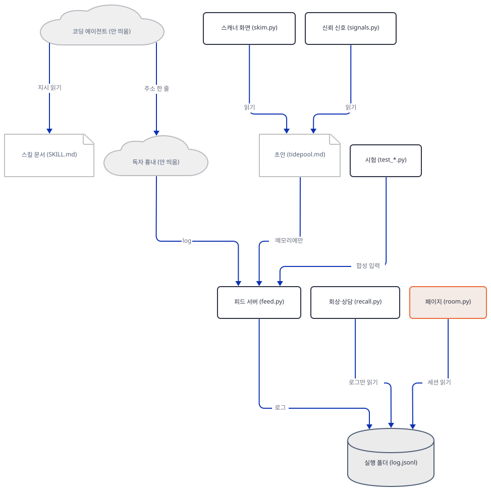

마지막으로 `SKILL.md`의 지시를 코드가 지키는지 가릅니다. 아래는 이 문서가 소스와 실행으로 본 것입니다.

| `SKILL.md`의 지시 | 누가 지키나 | 근거 |
|---|---|---|
| 독자는 앞 토막을 미리 못 본다 | 코드(서버). 단 독자의 프롬프트에 경로가 없다는 가정 위에 | `feed.py:145-161, 182-196`, Step 5·6 |
| 사람이 읽을 시간보다 빨리 넘기지 못한다 | 코드(낱말당 0.08초, 최소 2초) | `feed.py:117-120, 170-175` |
| 기록 없이는 다음 토막이 없다 | 코드(25자 이상) | `feed.py:165-167` |
| 끝나기 전에는 초안이 디스크에 없다 | 코드 | `feed.py:127-128, 225-232`, Step 6 |
| 회상은 로그만으로 | 코드가 번들을 그렇게 만든다. 답하는 것은 새 에이전트 | `recall.py:21-48`, Step 7 |
| 상담은 로그만으로, 다시 쓰기 제안 금지 | 글(번들 속 지시). 에이전트가 따를지는 모델 몫 | `ask.py:26-50` |
| 오케스트레이터는 초안을 열지 않는다 | 글뿐. 이를 강제하는 코드는 없다 | `SKILL.md:80-86` |
| 수정 목록·점수·다시 쓰기를 내지 않는다 | 글뿐(페이지는 수정 단추를 갖지 않는다) | `SKILL.md:293-296`, 시험 `page: no suggested fixes` |
| 독자를 정하고 `audience.json`을 쓴다 | 글뿐. 읽는 코드 없다 | Step 2의 `grep` |
| 독자의 느낌, 그만둘 자리, 회상 답, 암시된 저자 | 에이전트(하위 에이전트와 모델) | `SKILL.md:120-248` |

정리하면 스크립트는 독자 에이전트가 "속이기 어렵게" 하는 장치(토막, 시간, 기록, 토큰)와 계산·인쇄를 맡고, 독자를 만들고 느끼고 판단하는 일은 전부 에이전트에게 남습니다. 에이전트가 이 규칙을 따르는지는 `evals.json`의 3단계가 보는 것이고 이 문서는 돌리지 않았습니다. 끝으로 정리 상태를 확인합니다.

```bash
. "${LAB:?새 터미널이면 B01의 export 두 줄을 먼저}/lab-env.sh" || unset LAB
cat "$(W guard.log)"; echo "가드 기록 줄 수: $(wc -l < "$(W guard.log)")"
( cd "${REPO:?}" && git status --short -- agent_skills; find agent_skills -name __pycache__ | wc -l )
```

```text
가드 기록 줄 수: 0
0
rc=0
```

저장소의 `agent_skills`에는 바뀐 것도 `__pycache__`도 없고 가드 기록은 0줄입니다.

## 요청 한 건이 흐르는 과정

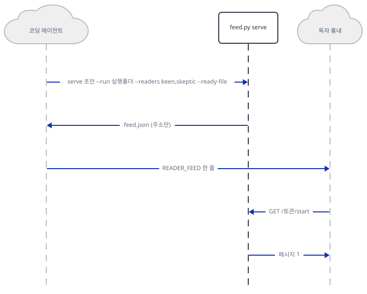

`SKILL.md`의 순서는 스캐너, 서버, 시간 읽기, 회상, 신뢰 장부, 자기 읽기, 페이지, 상담입니다. 에이전트가 스캐너 하위 에이전트에게 초안 경로를 주면 스캐너가 `skim.py`를 스스로 돌려 그 화면만 보고 "열지 말지"를 한 줄로 답합니다(`SKILL.md:145-150`).


그다음 에이전트가 `feed.py serve`를 띄우고, 서버가 `feed.json`(주소만)을 에이전트에게 돌려줍니다. 에이전트는 독자 흉내에게 `READER_FEED` 한 줄만 주고, 독자가 `GET /토큰/start`로 첫 토막을 받습니다.

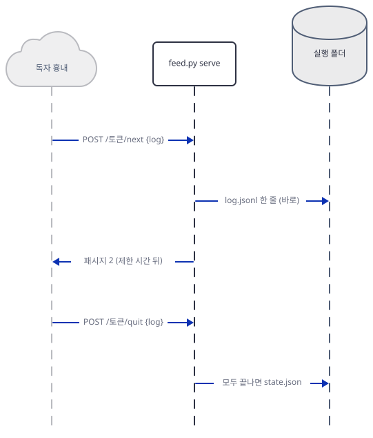

독자는 `POST /토큰/next`에 기록을 실어 보냅니다. 서버는 그 줄을 바로 `log.jsonl`에 쓰고 제한 시간이 지나야 다음 토막을 줍니다. 그만두면(`quit`) 마지막 줄을 쓰고, 모든 독자가 끝나면 `state.json`을 씁니다.

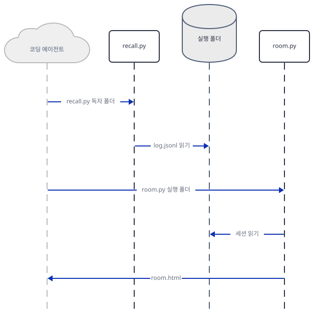

그 뒤 에이전트가 독자 폴더로 `recall.py`를 부르면 스크립트는 실행 폴더의 로그와 여섯 문항을 번들로 돌려주고, 에이전트가 그 번들만 새 하위 에이전트에게 건네 답을 받습니다. 스크립트가 하는 일은 번들 인쇄까지입니다.

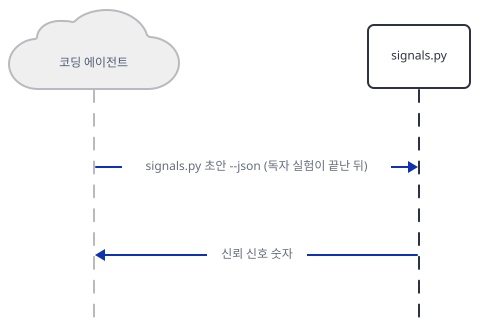

신뢰 장부는 독자 실험이 모두 끝난 뒤에 `signals.py`를 불러 숫자를 받습니다. 그 출력이 초안 문장을 인용하므로 일찍 읽으면 에이전트가 오염되기 때문입니다(`SKILL.md:210-212`).

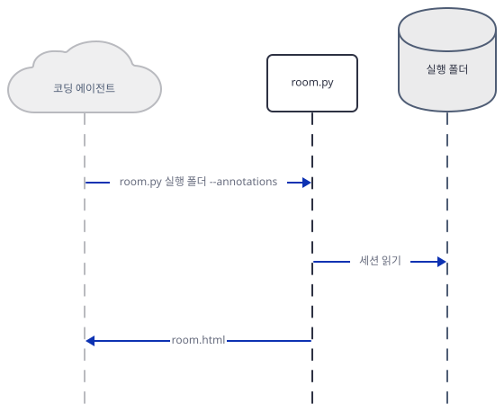

그다음 에이전트가 `room.py`로 페이지를 만듭니다. `room.py`는 실행 폴더의 세션을 읽어 `room.html`을 쓰고, 이 페이지의 구조는 아래 그림과 같습니다.

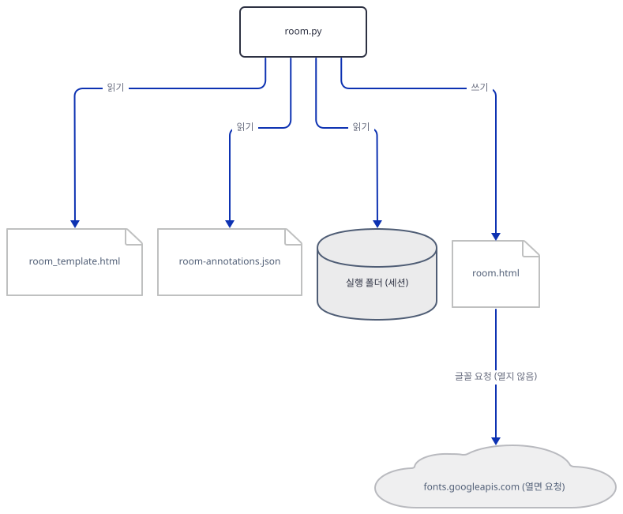

끝으로 독자에게 되묻는 질문은 `ask.py`가 번들을 만들고 새 하위 에이전트가 독자의 목소리로 답합니다.

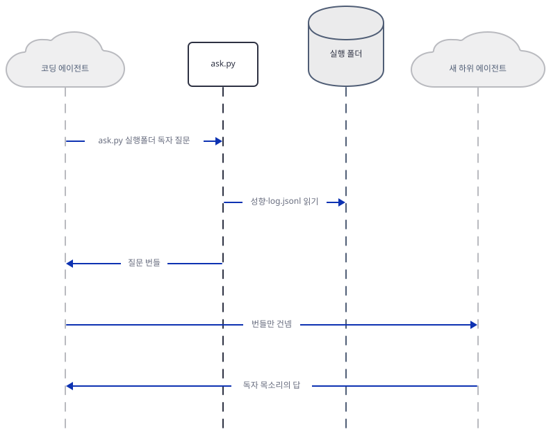

독자의 모든 말, 회상의 답, 암시된 저자의 묘사, 보고서의 문장은 이 그림들에 나오지 않는 에이전트 쪽 일입니다.

## 실행 체크리스트

- [ ] 랩의 `lab-env.sh`가 홈·임시 폴더를 랩으로 돌리고 가드 `probe.py`가 `guard loaded`를 냈다
- [ ] 스킬을 `.claude/skills/first-reader`로 복사해 파일 13개(108,838바이트)를 확인했다. 진짜 홈에는 아무것도 넣지 않았다
- [ ] 첫 블록이 `LAB`을 `reader-lab`으로 정해 설정 폴더 밖임을 검사했고, 블록마다 `lab-env.sh`를 다시 불러 같은 검사를 했다
- [ ] 머리말이 `name`·`description`·`compatibility`뿐이고 `license`·`metadata`가 없음을 확인했다
- [ ] 구조·보안·트리거·레지스트리 시험과 2b 시험(47단언)이 통과했고 가드 기록이 0줄이다
- [ ] 서버가 `127.0.0.1:포트`에서만 `LISTENING`이었고, 틀린 길이 모두 404였다
- [ ] 짧은 기록과 빠른 요청이 거절되었고, 독자가 다 끝나기 전에는 초안 낱말이 디스크에 없었다
- [ ] 프록시 실험에서 `HTTP_PROXY`만 있을 때만 기록 서버가 요청을 받았고, 서버를 `close`로 닫아 포트가 비었다
- [ ] 회상 번들에 읽지 않은 낱말이 없었고, 페이지에서 `fonts.googleapis.com` 줄과 속성 끼어들기를 확인했다
- [ ] `git status --short -- agent_skills`가 비어 있고 `__pycache__`가 없다
- [ ] 남은 서버가 없고(`netstat`로 확인), 끝나면 랩 폴더 하나를 지웠다(`LAB`을 `echo`로 확인한 뒤 그 폴더만. 와일드카드는 쓰지 않는다)

## 문제 해결

| 증상 | 원인 | 해결 |
|---|---|---|
| `UnicodeEncodeError: 'cp949' codec can't encode character '\u2014'`(`skim.py`·`feed.py start`·`recall.py`), `UnicodeDecodeError: 'cp949' codec can't decode byte …`(`ask.py`·`run_trigger_evals.py`), 시험 도구의 `PASS — …` 출력 | 한국어 Windows의 기본 입출력 인코딩(cp949)이 줄표를 표현하지 못하고 UTF-8 파일을 못 읽는다. 출력을 파이프로 받는 에이전트의 도구 호출에서 난다 | `PYTHONUTF8=1`과 `PYTHONIOENCODING=utf-8`(랩 환경이 이미 건다. 실제로 스킬을 쓸 때도 에이전트의 셸에 건다) |
| `py: command not found` 또는 `가드가 켜지지 않았습니다 … 중단합니다` | `. "${LAB}/lab-env.sh"`를 안 불렀거나 `guard/sitecustomize.py`가 없거나 오류가 난다 | B01의 두 `export` 줄을 치고 `lab-env.sh`를 부른다. 가드 파일을 다시 쓴다 |
| `멈춤: LAB이 안전하지 않습니다` | `LAB`의 마지막 폴더 이름이 `reader-lab`이 아니거나 에이전트 설정 폴더 아래이거나 절대 경로가 아니다 | 설정 폴더 밖의 절대 경로로 다시 정한다 |
| 서버가 남아 있다 | 아무도 `start`하지 않으면 `--idle`로도 안 닫히고 `close`를 안 불렀다 | `feed.py close --admin <주소>`. 주소를 잃었으면 `netstat -ano`로 PID를 찾아 `taskkill //PID <PID> //F` |
| `REFUSED: log entry under 25 chars. …` | 기록이 25자 미만이다 | 무슨 느낌이었는지(needle, 기대, 실제)를 한 문장으로 쓴다 |
| `REFUSED: too fast: a person needs about 2s … and 1s have passed.` | 토막을 받은 지 제한 시간이 지나지 않았다 | 기다렸다가 다시 부른다. 그만두는 것(`quit`)은 기다릴 필요가 없다 |
| `feed error: 404 (wrong READER_FEED address or the feed has closed)` | 서버는 살아 있는데 토큰이 틀렸다 | 자기 독자의 주소(`feed.json`)를 다시 건다 |
| `feed unreachable at …: … [WinError 10061] …. Is the feed still running?` | 서버가 닫혔거나 주소가 틀렸다 | 서버를 다시 띄운다. 닫힌 세션은 `state.json`이 있다 |
| `FileNotFoundError: … state.json` (`recall.py`) | 독자가 모두 끝나지 않았거나 서버를 닫지 않아 `state.json`이 아직 없다 | 모든 독자가 끝나게 하거나 `close`를 부른다 |
| `No sessions (state.json + log.jsonl) found under …` (`room.py`) | 실행 폴더가 아니거나 세션이 아직 flush되지 않았다 | 독자 폴더들의 부모를 준다 |
| 프록시가 걸린 환경에서 독자 명령이 프록시로 간다 | `urllib`이 `http_proxy`를 따르고, 변수가 없으면 Windows·macOS는 시스템 프록시 설정을 쓰며, 루프백을 자동으로 빼 주지 않는다 | 독자의 셸에 `NO_PROXY=127.0.0.1`을 둔다(`no_proxy=localhost`만으로는 부족하다) |

## 더 해보기

- 자기 글 하나로 Step 4~7을 되풀이하고, 독자 성향을 `references/personas.md`의 인내 예산표에 맞춰 바꿔 봅니다. 독자 기록은 직접 써 보고(손 흉내), 같은 초안을 빠르게 읽는 독자와 느리게 읽는 독자로 나눠 `recall.py` 번들이 어떻게 달라지는지 봅니다.
- 페이지의 속성 이스케이프를 고쳐 봅니다. `room.py`와 `room_template.html`을 함께(설치본의 `scripts/` 폴더째로) 랩의 다른 폴더로 복사해 `esc()`의 `quote=False`를 지우고(원본은 건드리지 않습니다. `room.py`는 자기 옆의 템플릿을 읽습니다) `attr_test.py`를 돌려 태그 수가 0이 되는지 확인합니다. 글꼴 두 줄을 지우고 시스템 글꼴로 바꾸면 페이지가 오프라인에서도 같은지 `grep`으로 확인합니다.
- `references/room.md`의 `previous` 형식으로 다시 읽기 페이지를 만들어 봅니다(시험이 `run1`을 자기 자신으로 주는 방법을 씁니다). 한국어 초안을 위한 `signals.py` 복사본을 만들어 얼버무림·확신·인정 패턴을 한국어 어미로 바꿔 보고, 영어 판과 점수가 같은 글에서 어떻게 달라지는지 봅니다.

## 다음 날 예고

[Day 161 · ♾️ Self-Improving Agent Skills](../day161-self-improving-agent-skills/README.md) — 볼륨 16을 닫는 날입니다. 오늘까지는 스킬을 읽고 설치하고 스크립트를 돌렸지만, `agent_skills/self-improving-agent-skills`는 스킬을 **고치는 앱**입니다. 스킬 폴더를 zip으로 올리면 Google ADK 에이전트들이 시험 장면과 평가 기준을 만들고 반복해서 스킬을 개선한다고 소개합니다. 파이썬 백엔드는 `backend/app.py`(589줄), `adk_optimizer.py`(380줄), `test_app.py`(179줄)와 `requirements.txt`(6줄)이고, 화면은 Node의 Next.js(`frontend/`)입니다.
