# Day 161 · ♾️ Self-Improving Agent Skills

> 볼륨 16 🧩 Agent Skills · 난이도 ★★★ · 예상 소요 260분(파이썬 파일 스물일곱 개를 직접 만들고, 터미널 셋에서 가짜 서버를 대본을 바꿔 가며 여러 번 다시 띄우고, 줄을 하나씩 뺀 판과 실험 열두 개의 출력을 읽고 소스와 맞대 보는 데 시간이 듭니다) · API 비용 대략 0원(Gemini를 한 번도 부르지 않았습니다. 진짜 키로 쓴다면 20라운드 한 번에 모델을 약 150번 부르고 1달러 안팎입니다. 어림입니다) · 원본 앱: `agent_skills/self-improving-agent-skills`

## 오늘 만들 것

스킬 폴더를 zip으로 올리면 모델이 시험 시나리오와 채점 기준을 만들고, 에이전트 셋이 돌아가며 `SKILL.md`를 한 번에 한 군데씩 고쳐서 점수가 오르면 남기고 아니면 되돌린 뒤, 고친 스킬을 zip으로 내려받게 해 주는 앱을 따라 봅니다. 파이썬 백엔드(FastAPI, `app.py` 589줄), Google ADK로 만든 에이전트 셋(`adk_optimizer.py` 380줄), Next.js 화면(TypeScript 1,564줄), 모델 선택만 시험하는 `test_app.py`(179줄)로 이루어집니다. 앱 README는 이 반복이 Karpathy의 autoresearch에서 왔다고 밝힙니다. 바꾸고, 재고, 낫다면 남기고 아니면 버리고, 되풀이하는 모양입니다.

볼륨 16의 마지막 날입니다. 스킬이 무엇이고 evals에 어떤 단계가 있으며 어떻게 설치하는지는 [Day 154](../day154-advisor-orchestrator-worker/README.md)가 자세히 다룹니다. Day 154~160은 코딩 에이전트에게 설치하는 스킬 일곱 개를 읽었고, 오늘은 스킬이 아니라 **스킬을 고치는 앱**입니다. 이 폴더에는 `SKILL.md`가 없고(Step 1), 저장소의 스킬 시험 도구가 스킬로 받아들이지 않습니다. 그래서 오늘 질문은 앞날들의 "스킬이 약속을 지키는가"가 아니라 "이 앱이 점수를 믿을 만하게 올리는가, 그리고 이 앱을 내 PC에서 돌려도 안전한가"입니다.

이 문서는 Gemini를 한 번도 부르지 않았고(가짜 서버만 썼고 키는 모두 `fake-`로 시작하는 가짜입니다), 코딩 에이전트도 띄우지 않았으며, Next.js 화면은 실행하지 않았습니다(`npm install`도 하지 않았습니다. 화면은 소스로만 읽었습니다). 가짜 서버는 모델이 아니라 **대본**입니다. 그래서 이 문서에 나오는 "점수가 25%, 50%, 75%, 100%로 오른다"는 출력은 유지·되돌림·호출 수·멈춤 같은 **반복의 기계 장치**를 보이는 것이지, Gemini가 스킬을 잘 고친다는 증거가 아닙니다. 직접 돌려 보거나 소스로 확인한 것은 아홉입니다.

1. `agent_skills/self-improving-agent-skills`에는 `SKILL.md`가 없습니다. 스킬 구조 검사는 오류 1, 보안 검사는 "SKILL.md 없음", 레지스트리 검사는 통과이고 레지스트리에는 이 앱이 없습니다(Step 1).
2. `requirements.txt`는 하한만 있어서 오늘 `google-adk` 2.12.0이 풀리고, 이 판은 Python 3.11 이상을 요구합니다. 앱 README는 3.10 이상이라고 적습니다(Step 1).
3. `python app.py`는 서버를 `0.0.0.0`에 엽니다. 앱은 ADK를 라이브러리로만 쓰고 `adk` 명령을 쓰지 않으며, 불러온 뒤에도 `google.adk.cli` 모듈이 하나도 올라오지 않습니다(Step 2).
4. zip의 위험한 이름 여섯 개(`..`, 절대 경로, 드라이브 문자)는 건너뛰어지고 점 두 개가 든 멀쩡한 이름 하나도 함께 빠집니다. 그런데 서버는 압축을 디스크에 풀지 않으므로 이 검사가 지키는 것은 다른 곳입니다. 크기 한도는 풀기 **전**에는 압축 크기에만, 파일 하나 1 MB는 풀어 읽은 **뒤**에 걸려서, 130,801바이트 zip이 서버 메모리를 약 256 MB 올렸습니다. Windows에서는 폴더 안 파일 하나짜리 zip이 "No SKILL.md found"로 거절되고, 폴더로 감싼 zip의 `references/`는 분석에 실리지 않습니다(Step 3, 4).
5. API 키를 요청 본문으로 받는 설계는 키가 서버 프로세스의 환경변수 하나(`GOOGLE_API_KEY`)에 덮어써진다는 뜻입니다. 두 세션을 동시에 돌리면 한쪽 요청에 다른 쪽 키가 실렸고, 빈 문자열 키는 서버 셸의 `GEMINI_API_KEY`로 이어졌으며, CORS는 어떤 Origin이든 되돌려 주고 인증은 없습니다. 서버 셸에 Vertex 설정이 있으면 요청의 키는 무시되고 진짜 자격 증명(gcloud 로그인)을 찾으러 갑니다. 키가 응답이나 로그에 남지는 않았습니다(Step 4).
6. 20라운드 한 번은 모델 요청 151건(시나리오 3개 기준)이고 입력만 약 26만 토큰(어림)입니다. README가 말하는 "목표 통과율에서 멈춤"은 코드에 없어서 100%가 된 뒤에도 남은 16라운드가 다 돌았습니다(Step 5).
7. 점수가 **오르면** 남기는 규칙(`>`) 때문에, 아무것도 바꾸지 않은 변경이 판정 잡음 하나로 "개선"이 되었고, 머리말을 지운 변경이 점수만 올라 남아서 구조 검사가 실패하는 스킬이 내려왔습니다(Step 5).
8. 멈춤 버튼은 멈추지 않습니다. 멈춘 뒤에도 요청이 48건 더 나갔고 상태는 `stopped`에서 다시 `complete`가 되었습니다. 화면은 SSE 주소를 부르지 않고 3초마다 상태를 읽으며, 예제 버튼 둘은 서버에 없는 이름이라 404입니다(Step 6, 7).
9. 모델 셋은 모두 공식 문서에 있고 종료 예정이 없습니다. 기본값 `gemini-3.8-flash`만 안정판이고 나머지 둘은 프리뷰입니다. 시험 19개는 통과하지만 모델 선택만 다루고 줄 적용 범위는 41%입니다(Step 8).

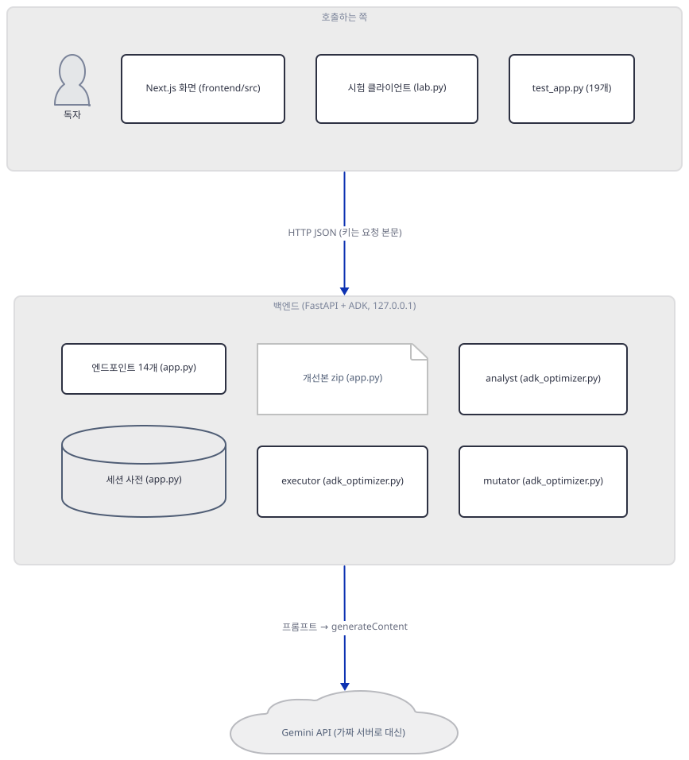

위 그림의 "호출하는 쪽"과 "백엔드"는 묶음이고, 묶음 안 상자 사이의 관계는 [`extra-structure`](diagrams/extra-structure.svg)에 화살표로 따로 그렸습니다. 거기에는 엔드포인트가 읽는 형제 스킬 폴더와, `SkillOptimizer`가 요청 키를 덮어쓰고 google-genai가 첫 호출 때 읽는 프로세스 환경변수 `GOOGLE_API_KEY`도 있습니다. 요청 흐름은 아래 "요청 한 건이 흐르는 과정"에 에이전트별로 나눠 그렸습니다.

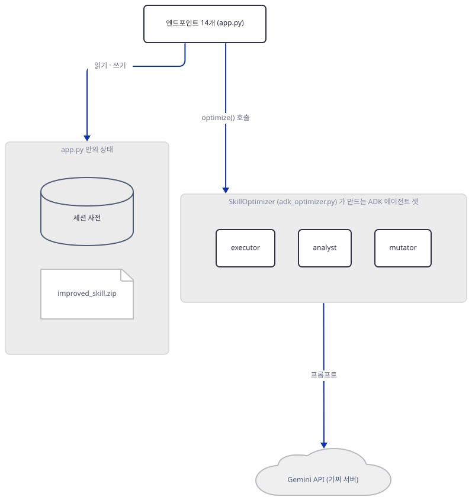

## 사전 준비

| 서비스/도구 | 용도 | 발급·설치 |
|---|---|---|
| Python 3.11 이상 | 백엔드와 모든 시험 스크립트. 오늘 풀리는 `google-adk` 2.12.0이 3.11 이상을 요구한다. 이 문서는 3.12.10으로 확인했다 | [공통 사전 준비](../README.md#공통-사전-준비-한-번만) 절 참고 |
| uv | 스크래치 가상환경과 설치 | 공통 사전 준비 |
| git, 이 저장소의 클론 | 원본 폴더를 읽는다. 아래 명령은 모두 저장소 루트에서 시작한다 | `git clone https://github.com/Shubhamsaboo/awesome-llm-apps` |
| Node.js·npm | **필요 없다.** 이 문서는 화면을 실행하지 않았고 `npm install`도 하지 않았다(Step 7) | 없음 |
| Gemini API 키 | 진짜로 쓸 때만 필요하다. **이 문서는 쓰지 않았다**(가짜 키 `fake-…`만) | [Google AI Studio](https://aistudio.google.com/apikey) |
| 코딩 에이전트 | 이 앱은 에이전트를 띄우지 않고, 이 문서도 띄우지 않았다 | 없음 |

한국어 Windows에서는 출력이 `cp949`로 깨질 수 있어 `PYTHONUTF8=1`과 `PYTHONIOENCODING=utf-8`을 환경 파일에 넣습니다. `PYTHONDONTWRITEBYTECODE=1`은 저장소 안에 `__pycache__`를 만들지 않게 합니다. 터미널은 셋을 씁니다. 가짜 Gemini 서버(터미널 A), 백엔드(터미널 B), 그리고 명령을 치는 터미널 C입니다. 세 터미널 모두 Step 1의 환경 파일을 불러옵니다.

## 아키텍처 한눈에 보기

| 컴포넌트 | 역할 | 코드 위치 |
|---|---|---|
| 엔드포인트 14개 | 업로드, 분석, 설정 저장, 시작·멈춤·상태·스트림, 내려받기, 예제, 모델 목록, 건강 확인 | `agent_skills/self-improving-agent-skills/backend/app.py:186-582` |
| 업로드 검사 | zip 항목 이름·확장자·크기·개수 | `app.py:24-31, 175-232` |
| 세션 사전 | 올린 파일·시나리오·점수·결과를 서버 메모리에 보관, 1시간 뒤 정리 | `app.py:33, 63-76, 148-172` |
| 모델 이름 결정 | 요청의 모델, 없으면 `GEMINI_MODEL`, 없으면 기본값 | `app.py:39-60`, `adk_optimizer.py:24` |
| 요청 모양 | 키를 본문으로 받는 세 모델 | `app.py:104-125` |
| `SkillOptimizer` | 키를 환경변수에 쓰고 에이전트 셋을 만든다 | `adk_optimizer.py:48-90` |
| executor·analyst·mutator | 실행·채점·분석 / 실패 진단 / 한 군데 수정(둘은 `output_schema`) | `adk_optimizer.py:56-90, 30-42` |
| 최적화 루프 | 기준선, 라운드마다 진단→수정→재채점, 유지·되돌림 | `adk_optimizer.py:167-272` |
| 채점·진단·수정 도우미 | 시나리오마다 실행과 채점, 분석가에게 실패 다섯 건, 수정가에게 전문 | `adk_optimizer.py:276-368` |
| Next.js 화면 | 네 단계 화면, 3초 폴링, 차트와 diff | `frontend/src/app/page.tsx`, `frontend/src/components/*.tsx` |
| 시험 | 모델 선택 19개(가짜 optimizer) | `agent_skills/self-improving-agent-skills/backend/test_app.py:1-179` |
| 이 문서의 가드와 가짜 서버 | 루프백 가드, 대본 Gemini, 시험 클라이언트 | 코드 없음 (Step 2~6에서 직접 만듦) |

## 단계별 진행

### Step 1. 폴더를 읽고 오늘 풀리는 의존성으로 설치한다 — 이 폴더는 스킬이 아니다

**목적.** 원본에는 아무것도 쓰지 않고, 앱이 무엇으로 이루어졌고 오늘 어떤 판으로 설치되는지 확인합니다. 그리고 이 폴더가 저장소의 스킬 시험 도구에 어떻게 보이는지 봅니다.

**할 일.** 저장소 루트에서 시작합니다. 먼저 작업 폴더와 환경 파일을 만듭니다. `LAB`은 저장소 밖의 새 폴더로 자기 경로로 바꿉니다. 환경 파일은 HOME·USERPROFILE·CLAUDE_CONFIG_DIR·TEMP와 gcloud 설정 폴더(`CLOUDSDK_CONFIG`)를 이 폴더로 돌려서, 이 문서가 부르는 프로세스가 진짜 홈의 설정과 gcloud 자격 증명을 보지 않게 합니다. Windows의 `APPDATA`는 돌리지 않습니다. 돌리면 uv가 관리하는 Python을 찾지 못하고 새로 내려받으려 하기 때문입니다. 대신 google-auth가 `CLOUDSDK_CONFIG`를 `%APPDATA%\gcloud`보다 먼저 보는 점에 기댑니다(Step 4에서 시험합니다). 환경 파일의 첫 줄들은 `LAB`이 비었거나 `.claude`·`.agents` 같은 에이전트 설정 폴더(또는 `CLAUDE_CONFIG_DIR`) 아래이면 멈춥니다. 마지막 세 줄은 이 셸에서 따로 `adk`를 치는 경우를 위한 준비입니다. 새 홈에 `{"telemetry": false}`를 미리 쓰고, `adk`를 칠 때는 `adk telemetry disable`을 먼저 한 번(이 홈의 설정만 바뀝니다) 하고 `adk … < /dev/null`처럼 stdin을 닫습니다. 첫 질문의 Enter가 텔레메트리를 켜기 때문입니다([Day 149](../day149-release-radar-agent/README.md)).

```bash
cd awesome-llm-apps
export REPO="$PWD"
export LAB=/path/to/d161-lab          # 저장소 밖의 새 폴더(자기 경로로 바꾼다)
mkdir -p "$LAB/home" "$LAB/tmp" "$LAB/uvcache" "$LAB/work"
cat > "$LAB/env.sh" <<'EOF'
# Day 161 작업 셸의 환경. 이 문서의 모든 명령은 이 파일을 불러온 셸에서 돌린다.
: "${REPO:?REPO를 먼저 정하세요}" "${LAB:?LAB을 먼저 정하세요}"
_lab=$(cd "$LAB" 2>/dev/null && pwd -P) || { echo "LAB 폴더가 없습니다: $LAB"; return 1; }
_low=$(printf '%s/' "$_lab" | tr 'A-Z' 'a-z')
case "$_low" in
  */.claude/*|*/.agents/*|*/.codex/*|*/.cursor/*|*/.copilot/*|*/.openclaw/*|*/.hermes/*)
    echo "LAB이 에이전트 설정 폴더 아래입니다: $_lab"; return 1 ;;
esac
if [ -n "${CLAUDE_CONFIG_DIR:-}" ] && _cfg=$(cd "$CLAUDE_CONFIG_DIR" 2>/dev/null && pwd -P); then
  _cfg=$(printf '%s/' "$_cfg" | tr 'A-Z' 'a-z')
  case "$_low" in "$_cfg"*) echo "LAB이 CLAUDE_CONFIG_DIR 아래입니다"; return 1 ;; esac
fi
export HOME="$LAB/home" USERPROFILE="$LAB/home" CLAUDE_CONFIG_DIR="$LAB/home/.claude"
export TEMP="$LAB/tmp" TMP="$LAB/tmp" TMPDIR="$LAB/tmp"
export CLOUDSDK_CONFIG="$LAB/home/gcloud"
export UV_CACHE_DIR="$LAB/uvcache"
export PYTHONUTF8=1 PYTHONIOENCODING=utf-8 PYTHONDONTWRITEBYTECODE=1
export NO_PROXY=127.0.0.1,localhost,::1 no_proxy=127.0.0.1,localhost,::1
export BACKEND="$REPO/agent_skills/self-improving-agent-skills/backend"
export FAKE_PORT=51873 APP_PORT=51877 APP2_PORT=51881
case "$(uname -s)" in MINGW*|MSYS*|CYGWIN*) VBIN=Scripts/python.exe ;; *) VBIN=bin/python ;; esac
export PY="$LAB/venv/$VBIN"
unset VIRTUAL_ENV
EOF
source "$LAB/env.sh" && {
  mkdir -p "$LAB/home/.adk" "$LAB/home/gcloud"
  printf '{"telemetry": false}\n' > "$LAB/home/.adk/config.json"
  cd "$LAB/work"
}
```

```powershell
Set-Location awesome-llm-apps
$env:REPO = (Get-Location).Path
$env:LAB = "C:\d161-lab"              # 저장소 밖의 새 폴더(자기 경로로 바꾼다)
$ok = $true
if (-not (Test-Path $env:LAB)) { New-Item -ItemType Directory -Force $env:LAB | Out-Null }
$low = ((Resolve-Path $env:LAB).Path.TrimEnd('\') + '\').ToLower()
foreach ($d in '.claude','.agents','.codex','.cursor','.copilot','.openclaw','.hermes') {
  if ($low.Contains("\$d\")) { Write-Host "LAB이 에이전트 설정 폴더($d) 아래입니다"; $ok = $false }
}
if ($env:CLAUDE_CONFIG_DIR -and (Test-Path $env:CLAUDE_CONFIG_DIR)) {
  $cfg = ((Resolve-Path $env:CLAUDE_CONFIG_DIR).Path.TrimEnd('\') + '\').ToLower()
  if ($low.StartsWith($cfg)) { Write-Host "LAB이 CLAUDE_CONFIG_DIR 아래입니다"; $ok = $false }
}
if ($ok) {
  New-Item -ItemType Directory -Force "$env:LAB\home","$env:LAB\tmp","$env:LAB\uvcache","$env:LAB\work","$env:LAB\home\.adk","$env:LAB\home\gcloud" | Out-Null
  [IO.File]::WriteAllText("$env:LAB\home\.adk\config.json", '{"telemetry": false}' + "`n")
  $env:HOME = "$env:LAB\home"; $env:USERPROFILE = "$env:LAB\home"; $env:CLAUDE_CONFIG_DIR = "$env:LAB\home\.claude"
  $env:TEMP = "$env:LAB\tmp"; $env:TMP = "$env:LAB\tmp"; $env:TMPDIR = "$env:LAB\tmp"; $env:UV_CACHE_DIR = "$env:LAB\uvcache"
  $env:CLOUDSDK_CONFIG = "$env:LAB\home\gcloud"
  $env:PYTHONUTF8 = "1"; $env:PYTHONIOENCODING = "utf-8"; $env:PYTHONDONTWRITEBYTECODE = "1"
  $env:NO_PROXY = "127.0.0.1,localhost,::1"
  $env:BACKEND = "$env:REPO\agent_skills\self-improving-agent-skills\backend"
  $env:FAKE_PORT = "51873"; $env:APP_PORT = "51877"; $env:APP2_PORT = "51881"
  $PY = "$env:LAB\venv\Scripts\python.exe"
  Remove-Item Env:VIRTUAL_ENV -ErrorAction SilentlyContinue
  Set-Location "$env:LAB\work"
}
```

(PowerShell 줄은 이 문서에서 Windows PowerShell 5.1로 환경 블록의 점검 부분과 환경변수 앞붙임·로그 인코딩만 시험했고, 나머지는 실행해 보지 못했습니다. 이 문서의 명령은 모두 Git Bash로 돌렸습니다. 파일을 만드는 `cat > x.py <<'EOF'` 블록과 `grep`·`sed`·`head`·`cut`·`for` 같은 셸 도구가 든 블록은 Git Bash에서 치는 것이 가장 안전합니다. 서버를 띄우는 터미널 A·B·B2와 파이썬만 부르는 줄은 PowerShell에서 `"$PY" x.py`를 `& $PY x.py`로, `$APP_PORT`를 `$env:APP_PORT`로, `curl`을 `curl.exe`로 바꿔 씁니다. `VAR=값 명령`꼴의 앞붙임은 PowerShell에서는 세션에 남으므로 위 블록처럼 `try { … } finally { Remove-Item Env:… }`로 감쌉니다. 새 터미널마다 위 블록을 다시 실행합니다.) 이어서 줄 수와 `.env` 흔적을 세고, 가상환경을 만들어 앱의 `requirements.txt`를 그대로 설치합니다. `psutil`은 Step 3의 메모리 재기, `pytest`와 `coverage`는 Step 8에 씁니다.

```bash
cd "${LAB:?먼저 Step 1의 환경 블록을 실행하세요}/work" || return
cd "$REPO/agent_skills/self-improving-agent-skills"
wc -l README.md backend/app.py backend/adk_optimizer.py backend/test_app.py backend/requirements.txt
cat frontend/src/app/*.tsx frontend/src/components/*.tsx | wc -l
git ls-files . | wc -l
git ls-files . | grep -i "\.env" || echo "(.env 로 시작하는 추적 파일 없음)"
grep -rn -i "dotenv" backend || echo "(백엔드에 dotenv 줄 없음)"
cd "$LAB/work"
```

```bash
cd "${LAB:?먼저 Step 1의 환경 블록을 실행하세요}/work" || return
uv venv --python 3.12 "$LAB/venv"
uv pip install --python "$PY" -r "$BACKEND/requirements.txt" psutil pytest coverage 2>&1 | grep -E "^(Resolved|Prepared|Installed)"
uv pip list --python "$PY" | grep -E -i "^(fastapi|uvicorn|starlette|pydantic|python-multipart|google-adk|google-genai|httpx|opentelemetry-sdk) "
uv pip list --python "$PY" | tail -n +3 | wc -l
"$PY" -c "import importlib.metadata as m; print({p: m.metadata(p)['Requires-Python'] for p in ('google-adk', 'starlette', 'fastapi')})"
uv pip compile "$BACKEND/requirements.txt" --python-version 3.10 --no-header --no-annotate | grep -E "^(google-adk|starlette)=="
```

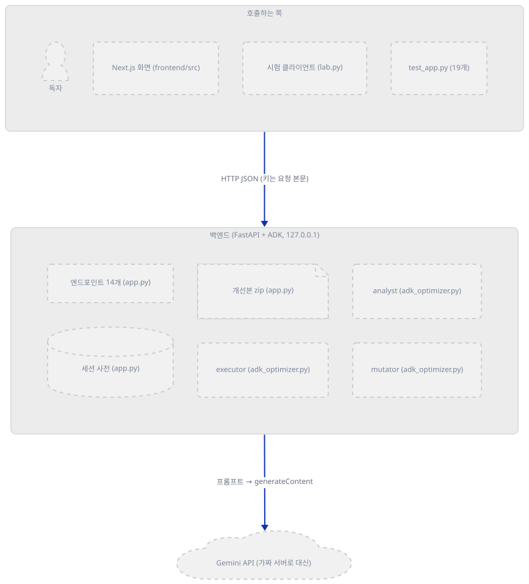

**확인.** 직접 확인한 출력입니다(2026-10-19, Windows Git Bash, Python 3.12.10).

```text
  263 README.md
  589 backend/app.py
  380 backend/adk_optimizer.py
  179 backend/test_app.py
    6 backend/requirements.txt
 1417 total
1564
21
(.env 로 시작하는 추적 파일 없음)
(백엔드에 dotenv 줄 없음)
```

백엔드 파이썬이 1,148줄(`app.py` 589 + `adk_optimizer.py` 380 + `test_app.py` 179)이고 화면이 1,564줄입니다. 추적 파일 21개 중 `.env`로 시작하는 파일이 없는데, 앱 README(75~77행)는 `cp .env.example .env`를 안내합니다. 이 명령은 실패합니다. 백엔드에는 `dotenv`를 쓰는 줄도 없어서 `.env`를 만들어도 읽지 않습니다. README(198행)가 `GOOGLE_API_KEY`를 `.env`에 둘 수 있다고 하지만 Step 4에서 보듯 소용이 없습니다.

```text
Using CPython 3.12.10
Creating virtual environment at: <LAB>/venv
Activate with: source <LAB>/venv/Scripts/activate
Resolved 57 packages in 736ms
Prepared 57 packages in 4.53s
Installed 57 packages in 1.53s
Using Python 3.12.10 environment at: <LAB>\venv
fastapi                            0.141.1
google-adk                         2.12.0
google-genai                       2.31.0
httpx                              0.28.1
opentelemetry-sdk                  1.42.1
pydantic                           2.14.1
python-multipart                   0.0.32
starlette                          1.9.0
uvicorn                            0.54.0
Using Python 3.12.10 environment at: <LAB>\venv
57
{'google-adk': '>=3.11', 'starlette': '>=3.11', 'fastapi': '>=3.10'}
warning: The requested Python version 3.10 is not available; 3.13.3 will be used to build dependencies instead.
Resolved 51 packages in 127ms
google-adk==2.11.0
starlette==1.7.0
```

`requirements.txt`는 `>=` 하한만 있어서 오늘은 `fastapi` 0.141.1, `uvicorn` 0.54.0, `starlette` 1.9.0, `pydantic` 2.14.1, `python-multipart` 0.0.32, `google-genai` 2.31.0, `google-adk` 2.12.0으로 풀리고, 시험 도구까지 57개 패키지입니다. `google-adk` 2.12.0과 `starlette` 1.9.0은 `Requires-Python >=3.11`이라서 앱 README(56행)의 "Python 3.10+"는 이 문서가 시험한 판(2.12.0·1.9.0)에는 맞지 않습니다. 3.10으로 해석만 해 보면 더 낮은 `google-adk` 2.11.0과 `starlette` 1.7.0이 나와 이 문서와 다른 조합이 됩니다(해석만 봤고 3.10에서 설치하거나 돌려 보지는 않았으므로 3.10에서 앱이 안 된다는 뜻은 아닙니다. 3.10이 없으면 위처럼 uv가 경고합니다). 다음은 같은 폴더를 저장소의 스킬 시험 도구에 보여 줍니다. 읽기만 하는 검사입니다.

```bash
cd "${LAB:?먼저 Step 1의 환경 블록을 실행하세요}/work" || return
cd "$REPO"
"$PY" -B -X utf8 agent_skills/evals/tools/skill_lint.py agent_skills/self-improving-agent-skills --strict
"$PY" -B -X utf8 agent_skills/evals/tools/skill_scanner.py agent_skills/self-improving-agent-skills
"$PY" -B -X utf8 agent_skills/evals/tools/registry_lint.py --check
grep -c '"name"' agent_skills/registry.json
cd "$LAB/work"
```

```text
Linting <REPO>\agent_skills\self-improving-agent-skills (strict=on)
  ERROR: SKILL.md not found in <REPO>\agent_skills\self-improving-agent-skills (required at the skill root)
  FAIL — 1 error(s), 0 warning(s)
error: no SKILL.md found under agent_skills\self-improving-agent-skills
Fix: agent skills are directories with a SKILL.md at their root. If you meant to scan a single file, name it SKILL.md or pass its parent directory.
Checking registry at <REPO> (mode=check)
  PASS — 0 error(s), 0 warning(s)
7
```

구조 검사(`skill_lint.py`)는 "SKILL.md not found"로 실패하고, 보안 검사(`skill_scanner.py`)는 "no SKILL.md found"로 멈추며, 레지스트리 검사는 통과하지만 레지스트리의 스킬 일곱 개에 이 앱이 없습니다. `agent_skills/README.md`가 표(27행)에 이 앱을 올려 둘 뿐입니다. 시험 단계 1~2b는 스킬 하나에 대한 검사이므로 오늘은 해당하지 않습니다. 대신 이 앱이 하려는 일이 3단계 행동 시험의 간이판입니다. `evals.json`의 `prompt`와 `expectations[]`처럼 앱은 시나리오(`input`)와 예·아니오 기준(`question`)을 모델에게 만들게 합니다. 다만 3단계는 실제 에이전트 세션이 스킬을 따르는지 보고, 이 앱은 `SKILL.md` 글을 프롬프트로 주고 모델이 따라 하는 척한 출력을 채점합니다(Step 5).

### Step 2. 가드와 가짜 Gemini를 세우고 서버를 127.0.0.1로 연다

**목적.** 앱을 돌리기 전에 바깥으로 나갈 길을 막고, 모델 자리에 가짜 서버를 둡니다. 원본의 마지막 줄(`app.py:587-589`)이 `uvicorn.run(app, host="0.0.0.0", port=8891)`이라서 `python app.py`는 같은 네트워크의 누구에게나 서버를 엽니다. 이 문서는 원본을 고치지 않고 `app.py`를 불러오기만 한 뒤 uvicorn을 `127.0.0.1`로 직접 엽니다.

**할 일.** 파일 셋을 만듭니다. `guard.py`는 소켓 연결·이름 조회·asyncio 연결을 루프백 밖으로 못 나가게 막고, 루프백 밖에서 **듣는 것**(bind)과 `gcloud` 실행도 막으며, 환경변수를 프로세스 안에서 직접 정합니다. `fake_gemini.py`는 127.0.0.1의 한 포트에서 `generateContent` 요청에 대본대로 답합니다. 키가 `fake-`로 시작하지 않으면 401로 거절하고 키 전체는 기록하지 않습니다. `serve_backend.py`가 둘을 엮어 서버를 엽니다.

```bash
cd "${LAB:?먼저 Step 1의 환경 블록을 실행하세요}/work" || return
cat > guard.py <<'EOF'
"""루프백 가드. 서버를 띄우는 파일이 가장 먼저 불러온다.

1) 환경변수를 이 프로세스 안에서 직접 정한다(셸이나 .env의 진짜 값이 이기지 못하게).
2) 소켓 연결·이름 조회·asyncio 연결을 루프백 밖으로는 못 나가게 막고, 막은 횟수를 센다.
3) ADK 2.x의 텔레메트리 전송 하위 프로세스를 띄우지 못하게 한다.
"""
import asyncio.base_events as be
import ipaddress
import os
import socket
import subprocess
import sys
import urllib.request
from urllib.parse import urlparse

LOOPBACK = {"127.0.0.1", "localhost", "::1"}
PROXY_VARS = ("HTTP_PROXY", "HTTPS_PROXY", "ALL_PROXY", "http_proxy", "https_proxy", "all_proxy", "grpc_proxy")
# 비어 있어야 하는 변수: 셸에 진짜 값이 있어도 이 프로세스에서는 없는 것으로 친다.
EMPTY_VARS = ("GOOGLE_CLOUD_PROJECT", "GOOGLE_CLOUD_LOCATION", "GOOGLE_APPLICATION_CREDENTIALS", "GOOGLE_GENAI_USE_VERTEXAI")

BLOCKED = []
INSTALLED = False
_connect, _bind, _gai, _create = socket.socket.connect, socket.socket.bind, socket.getaddrinfo, be.BaseEventLoop.create_connection


def is_loopback(host: str) -> bool:
    if host in LOOPBACK:
        return True
    try:
        return ipaddress.ip_address(host).is_loopback
    except ValueError:
        return False


def _note(kind: str, host: str) -> None:
    BLOCKED.append((kind, host))
    with open("blocked.log", "a", encoding="utf-8", newline="\n") as f:
        f.write(f"{kind} {host}\n")


def install() -> None:
    """두 번 불러도 한 번만 설치한다."""
    global INSTALLED
    if INSTALLED:
        return
    urllib.request.install_opener(urllib.request.build_opener(urllib.request.ProxyHandler({})))
    urllib.request.getproxies = lambda: {}  # httpx·aiohttp는 이것으로 프록시를 찾는다

    def guarded_connect(self, address):
        host = address[0] if isinstance(address, tuple) else str(address)
        if self.family in (socket.AF_INET, socket.AF_INET6) and not is_loopback(host):
            _note("connect", host)
            raise ConnectionRefusedError(f"가드: 루프백 밖 연결을 막았습니다 ({host})")
        return _connect(self, address)

    def guarded_bind(self, address):
        host = address[0] if isinstance(address, tuple) else str(address)
        if self.family in (socket.AF_INET, socket.AF_INET6) and not is_loopback(host):
            _note("bind", host)
            raise OSError(f"가드: 루프백 밖에서 듣는 것을 막았습니다 ({host})")
        return _bind(self, address)

    def guarded_getaddrinfo(host, *a, **k):
        if isinstance(host, (str, bytes)):
            name = host.decode() if isinstance(host, bytes) else host
            if name and not is_loopback(name):
                _note("dns", name)
                raise socket.gaierror(f"가드: 루프백 밖 이름 조회를 막았습니다 ({name})")
        return _gai(host, *a, **k)

    async def guarded_create_connection(self, protocol_factory, host=None, port=None, **kw):
        if isinstance(host, str) and host and not is_loopback(host):
            _note("asyncio", host)
            raise ConnectionRefusedError(f"가드: 루프백 밖 연결을 막았습니다 ({host})")
        return await _create(self, protocol_factory, host, port, **kw)

    socket.socket.connect = guarded_connect
    socket.socket.bind = guarded_bind
    socket.getaddrinfo = guarded_getaddrinfo
    be.BaseEventLoop.create_connection = guarded_create_connection

    real_popen = subprocess.Popen

    class GuardedPopen(real_popen):
        """하위 프로세스는 이 가드를 물려받지 않는다. ADK의 텔레메트리 전송 프로세스와 gcloud는 띄우지 못하게 한다."""

        def __init__(self, args, *a, **k):
            text = " ".join(map(str, args)) if isinstance(args, (list, tuple)) else str(args)
            if "_metrics_reporter" in text:
                _note("subprocess", "adk metrics reporter")
                raise OSError("가드: ADK 텔레메트리 전송 프로세스를 막았습니다")
            if "gcloud" in text.lower():  # google-auth가 프로젝트 아이디를 찾으려고 부른다. 진짜 gcloud 설정을 읽는다
                _note("subprocess", "gcloud")
                raise OSError("가드: gcloud 실행을 막았습니다")
            super().__init__(args, *a, **k)

    subprocess.Popen = GuardedPopen
    INSTALLED = True


def point_at_fake(port: int, shell_keys: dict | None = None) -> None:
    """모델이 127.0.0.1:<port>의 가짜 서버만 보게 환경을 직접 정하고 가드를 설치한다."""
    os.environ["GOOGLE_GEMINI_BASE_URL"] = f"http://127.0.0.1:{port}/gemini"
    for name in EMPTY_VARS + ("GOOGLE_API_KEY", "GEMINI_API_KEY"):
        os.environ[name] = ""
    os.environ.update(shell_keys or {})  # 서버 셸에 키가 있는 경우를 흉내 내는 실험용(가짜 값만)
    for name in PROXY_VARS:
        os.environ[name] = ""
    os.environ["NO_PROXY"] = os.environ["no_proxy"] = "127.0.0.1,localhost,::1"
    install()


def require_installed() -> None:
    ok = (
        INSTALLED
        and socket.getaddrinfo.__name__ == "guarded_getaddrinfo"
        and socket.socket.bind.__name__ == "guarded_bind"
        and be.BaseEventLoop.create_connection.__name__ == "guarded_create_connection"
        and subprocess.Popen.__name__ == "GuardedPopen"
    )
    if not ok:
        sys.exit("가드: 소켓 가드가 설치되어 있지 않습니다. 중단합니다.")


def check_env() -> None:
    require_installed()
    host = urlparse(os.environ.get("GOOGLE_GEMINI_BASE_URL", "")).hostname or ""
    if not is_loopback(host):
        sys.exit(f"가드: GOOGLE_GEMINI_BASE_URL 호스트가 루프백이 아닙니다 ({host or '비어 있음'}). 중단합니다.")
    for name in ("GOOGLE_API_KEY", "GEMINI_API_KEY"):
        value = os.environ.get(name, "")
        if value and not value.startswith("fake-"):
            sys.exit(f"가드: {name}이 가짜 값이 아닙니다. 중단합니다.")
    for name in EMPTY_VARS + PROXY_VARS:
        if os.environ.get(name):
            sys.exit(f"가드: {name}이 비어 있지 않습니다. 중단합니다.")
    for name in ("NO_PROXY", "no_proxy"):
        if "127.0.0.1" not in os.environ.get(name, "").split(","):
            sys.exit(f"가드: {name}에 127.0.0.1이 없습니다. 중단합니다.")
EOF
```

```bash
cd "${LAB:?먼저 Step 1의 환경 블록을 실행하세요}/work" || return
cat > fake_gemini.py <<'EOF'
"""가짜 Gemini 서버. 127.0.0.1의 한 포트에서 generateContent 요청에 대본대로 답한다(실제 모델이 아니다).

사용: python fake_gemini.py <포트> <기록 파일>
환경변수(모두 선택):
  D161_NOISE    판정이 뒤집히는 확률(기본 0). 0.2면 채점마다 20%가 거꾸로 나온다
  D161_SEED     잡음의 씨앗(기본 7)
  D161_DELAY    요청마다 기다릴 초(기본 0)
  D161_MUTATOR  rule(기본: 실패한 규칙 하나를 추가) | noop(바꾸지 않음) | break(2번째 변경이 머리말을 지움)

대본의 규칙: SKILL.md에 `RULE n` 줄이 있으면 실행 결과에 `satisfies-n`이 들어가고,
채점은 `satisfies-<평가 번호>`가 결과에 있는지만 본다. 모델이 하는 일이 아니라 반복의 기계 장치를 보이기 위한 것이다.
"""
import json
import os
import random
import re
import sys
import time
from http.server import BaseHTTPRequestHandler, ThreadingHTTPServer

PORT, LOG = int(sys.argv[1]), sys.argv[2]
NOISE = float(os.environ.get("D161_NOISE", "0"))
DELAY = float(os.environ.get("D161_DELAY", "0"))
MUTATOR = os.environ.get("D161_MUTATOR", "rule")
RNG = random.Random(int(os.environ.get("D161_SEED", "7")))
STRATEGIES = ["add_example", "add_constraint", "restructure", "add_edge_case"]
STATE = {"mutations": 0, "analyses": 0}

SCENARIOS = [
    {"id": 1, "name": "짧은 요청", "description": "짧은 요청", "input": "summarize the note"},
    {"id": 2, "name": "긴 요청", "description": "긴 요청", "input": "summarize the long report"},
    {"id": 3, "name": "빈 요청", "description": "빈 요청", "input": "(empty)"},
]
EVALS = [
    {"id": n, "name": f"규칙 {n}", "criterion": f"RULE {n}", "question": f"Does the output satisfy rule {n}?",
     "pass_condition": f"satisfies-{n} appears", "fail_condition": f"satisfies-{n} is missing"}
    for n in (1, 2, 3, 4)
]


def log(**fields) -> None:
    with open(LOG, "a", encoding="utf-8", newline="\n") as f:
        f.write(json.dumps(fields, ensure_ascii=False) + "\n")


def between(text: str, start: str, end: str | None) -> str:
    i = text.index(start) + len(start)
    j = text.index(end, i) if end else len(text)
    return text[i:j]


def reply_for(role: str, prompt: str):
    """(모드, 답 글, 기록할 덧붙임)"""
    if prompt.startswith("Analyze this agent skill"):
        STATE["analyses"] += 1
        heads = re.findall(r"^## (references/\S+)$", prompt, flags=re.M)
        return "analyze", json.dumps({"scenarios": SCENARIOS, "evals": EVALS}), {"reference_files": heads, "has_reference_block": "Reference files:" in prompt}
    if prompt.startswith("Execute this skill:"):
        skill = between(prompt, "Execute this skill:\n\n", "\n\nUser request:\n")
        rules = sorted(set(re.findall(r"^RULE (\d+)", skill, flags=re.M)), key=int)
        return "execute", "OUTPUT " + " ".join(f"satisfies-{n}" for n in rules), {"skill_chars": len(skill)}
    if prompt.startswith("Evaluate this output"):
        output = between(prompt, "\n\nOutput: ", "\n\nCriteria:\n")
        evals = json.loads(between(prompt, "\n\nCriteria:\n", "\n\nReturn JSON:"))
        results = []
        for e in evals:
            ok = f"satisfies-{e['id']}" in output
            if NOISE and RNG.random() < NOISE:
                ok = not ok
            results.append({"eval_id": e["id"], "passed": ok, "reason": "fake judge"})
        return "score", json.dumps({"results": results}), {}
    if prompt.startswith("Diagnose these failures"):
        failed = json.loads(between(prompt, "Failed evals:\n", None))
        k = min(f["eval_id"] for f in failed)
        strategy = STRATEGIES[STATE["mutations"] % 4]
        return "diagnose", json.dumps({"diagnosis": f"RULE {k} is missing", "mutation_strategy": strategy,
                                       "target_section": "end", "suggested_change": f"add RULE {k}"}), {}
    if prompt.startswith("Apply this fix"):
        STATE["mutations"] += 1
        skill = between(prompt, "SKILL.md:\n", "\n\nDiagnosis: ")
        k = re.search(r"Change: add RULE (\d+)", prompt)
        if MUTATOR == "noop" or not k:
            new, desc = skill, "no change"
        else:
            new, desc = skill.rstrip("\n") + f"\nRULE {k.group(1)}: handle case {k.group(1)}.\n", f"Add RULE {k.group(1)}"
            if MUTATOR == "break" and STATE["mutations"] == 2:
                new = new.split("---", 2)[2].lstrip("\n")  # 머리말 전체를 지움
                desc += " (and drop the frontmatter)"
        return "mutate", json.dumps({"description": desc, "reasoning": "fake", "new_skill_md": new}), {}
    return "unknown", "fake: unknown prompt", {}


class Server(ThreadingHTTPServer):
    allow_reuse_address = False  # Windows에서 다른 서버와 같은 포트에 겹쳐 뜨지 않게
    daemon_threads = True


class Handler(BaseHTTPRequestHandler):
    def log_message(self, *a):
        pass

    def _send(self, status, payload):
        raw = json.dumps(payload).encode("utf-8")
        self.send_response(status)
        self.send_header("Content-Type", "application/json")
        self.send_header("Content-Length", str(len(raw)))
        self.end_headers()
        self.wfile.write(raw)

    def do_GET(self):
        self._send(200, {"ok": True}) if self.path == "/_ping" else self._send(404, {"error": "fake"})

    def do_POST(self):
        n = int(self.headers.get("Content-Length") or 0)
        body = json.loads(self.rfile.read(n) or b"{}")
        m = re.search(r"/models/([^:/]+):(\w+)", self.path)
        model, verb = (m.group(1), m.group(2)) if m else ("?", "?")
        key = self.headers.get("x-goog-api-key") or ""
        if not key.startswith("fake-"):  # 가짜가 아닌 키가 오면 거절하고 기록한다(키 전체는 적지 않는다)
            log(kind="REJECTED-KEY", key_prefix=key[:4], path=self.path.split("?")[0])
            return self._send(401, {"error": {"code": 401, "message": "fake: key is not a fake- key", "status": "UNAUTHENTICATED"}})
        if model == "gemini-does-not-exist":  # 없는 모델 이름: 진짜 API처럼 404를 돌려준다
            log(kind="gemini-404", model=model, key=key[:14])
            return self._send(404, {"error": {"code": 404, "message": f"models/{model} is not found for API version v1beta", "status": "NOT_FOUND"}})
        system = " ".join(p.get("text", "") for p in body.get("systemInstruction", {}).get("parts", []))
        role = (re.search(r'internal name is "(\w+)"', system) or [None, "?"])[1]
        contents = body.get("contents", [])
        prompt = " ".join(p.get("text", "") for p in (contents[-1].get("parts", []) if contents else []))
        time.sleep(DELAY)
        mode, text, extra = reply_for(role, prompt)
        gc = body.get("generationConfig", {})
        skill = (re.search(r"^name: (\S+)", prompt, flags=re.M) or [None, None])[1]
        log(kind="gemini", verb=verb, model=model, role=role, mode=mode, key=key[:14], skill=skill, user_chars=len(prompt),
            system_chars=len(system), out_chars=len(text), schema=bool(gc.get("responseSchema") or gc.get("responseJsonSchema")),
            mime=gc.get("responseMimeType"), **extra)
        self._send(200, {
            "candidates": [{"content": {"role": "model", "parts": [{"text": text}]}, "finishReason": "STOP", "index": 0}],
            "usageMetadata": {"promptTokenCount": 1, "candidatesTokenCount": 1, "totalTokenCount": 2},
            "modelVersion": model,
        })


if __name__ == "__main__":
    print(f"가짜 Gemini가 127.0.0.1:{PORT}에서 기다립니다. 기록: {LOG}", flush=True)
    Server(("127.0.0.1", PORT), Handler).serve_forever()
EOF
```

```bash
cd "${LAB:?먼저 Step 1의 환경 블록을 실행하세요}/work" || return
cat > serve_backend.py <<'EOF'
"""백엔드를 가드 아래에서 127.0.0.1로만 연다. 모델은 가짜 서버가 대신한다.

사용: BACKEND=<backend 폴더> python serve_backend.py <가짜 Gemini 포트> <앱 포트> [로그 파일]
로그 파일을 주면 화면에 찍는 글을 UTF-8로 그 파일에도 적는다(셸의 tee는 PowerShell 5.1에서 UTF-16이라 쓰지 않는다).
원본 app.py의 마지막 줄은 host="0.0.0.0"이라 `python app.py`는 모든 네트워크 인터페이스에 열린다.
여기서는 app.py를 불러오기만 하고 uvicorn을 우리가 127.0.0.1로 연다.
"""
import json
import os
import sys

sys.path.insert(0, os.path.dirname(os.path.abspath(__file__)))
import guard  # noqa: E402

sys.path.insert(0, os.environ["BACKEND"])  # 원본 app.py·adk_optimizer.py가 있는 폴더(복사하지 않고 읽기만 한다)

fake_port, app_port = int(sys.argv[1]), int(sys.argv[2])
if len(sys.argv) > 3:

    class Tee:
        """화면과 로그 파일에 같이 쓴다."""

        def __init__(self, stream, path):
            self.stream, self.file = stream, open(path, "a", encoding="utf-8", newline="\n", buffering=1)

        def write(self, text):
            self.file.write(text)
            return self.stream.write(text)

        def flush(self):
            self.file.flush()
            self.stream.flush()

        def isatty(self):
            return False

    sys.stdout, sys.stderr = Tee(sys.stdout, sys.argv[3]), Tee(sys.stderr, sys.argv[3])
guard.point_at_fake(fake_port, json.loads(os.environ.get("D161_SHELL_KEYS", "{}")))

# 쓰기가 이 프로세스 밖으로 새지 않게 한다: 바이트코드(원본 폴더의 __pycache__)와 임시 파일(내려받기 zip)
sys.dont_write_bytecode = True
import tempfile  # noqa: E402

tempfile.tempdir = os.path.join(os.path.dirname(os.path.abspath(__file__)), "tmp")
os.makedirs(tempfile.tempdir, exist_ok=True)

# ADK 2.x의 `adk` 명령은 첫 실행에 텔레메트리를 묻고(Enter는 켬), 동의가 있으면 하위 프로세스가 사용 기록을 보낸다.
# 이 앱은 `adk` 명령을 쓰지 않으므로(소스로 확인) 이 서버 프로세스에서는 아래 줄들이 막을 대상이 없다.
# 이 줄들은 이 프로세스 안에서만 든다. 같은 셸에서 따로 `adk`를 치는 경우는 환경 파일의 준비(Step 1)가 맡는다.
adk_home = os.path.join(os.path.dirname(os.path.abspath(__file__)), "adk-home")  # 이 파일 옆의 새 폴더
os.makedirs(os.path.join(adk_home, ".adk"), exist_ok=True)
os.environ["HOME"] = os.environ["USERPROFILE"] = adk_home  # 1) 진짜 홈의 동의 기록을 읽지도 쓰지도 않는다
with open(os.path.join(adk_home, ".adk", "config.json"), "w", encoding="utf-8", newline="\n") as f:
    f.write('{"telemetry": false}\n')  # 2) 새 홈에는 거절을 미리 적는다
sys.stdin = open(os.devnull)  # 3) 질문이 뜨지 않게 stdin을 닫는다
os.environ["ADK_DISABLE_LOAD_DOTENV"] = "1"  # 4) `adk` 명령이 .env를 읽지 못하게 한다(2.x에만 있는 스위치)
# 5) guard.install()이 텔레메트리 전송 하위 프로세스의 실행도 막는다
guard.check_env()

import app as backend  # noqa: E402  (원본 app.py. __main__ 블록은 실행되지 않는다)
import uvicorn  # noqa: E402

print(f"서버 PID {os.getpid()} (psutil로 메모리를 볼 때 쓴다)", flush=True)
uvicorn.run(backend.app, host="127.0.0.1", port=app_port, log_level="info", use_colors=False)
EOF
```

`serve_backend.py`의 ADK 관련 줄은 [Day 149](../day149-release-radar-agent/README.md)가 `adk` 명령의 텔레메트리(첫 실행의 질문, 하위 프로세스가 `play.googleapis.com`으로 보내는 사용 기록, 가드를 물려받지 않는 점)를 자세히 적은 방어선과 비슷한 다섯 겹입니다. 홈을 새 폴더로 바꾸고, 그 홈에 `{"telemetry": false}`를 미리 쓰고, stdin을 닫고, 가드가 전송 하위 프로세스 실행을 거절하게 하는 넷은 같고, 넷째 줄이 다릅니다. Day 149는 동의를 읽는 함수가 늘 `False`를 돌려주게 했는데 여기서는 `adk`가 `.env`를 읽지 못하게 하는 스위치(`ADK_DISABLE_LOAD_DOTENV`, 텔레메트리와는 무관)를 켭니다. 그리고 이 줄들은 **이 서버 프로세스 안에서만** 듭니다. 이 앱은 `adk` 명령을 쓰지 않으니 이 프로세스에서는 막을 대상이 없고, 같은 셸이나 다른 터미널에서 따로 `adk`를 치는 경우는 이 줄들이 닿지 않습니다. 그 경우의 대비는 Step 1의 환경 파일과 새 홈의 `config.json`입니다. 먼저 이 앱이 `adk`를 쓰지 않는다는 것을 소스로 확인하고, 원본이 서버를 어디에 여는지도 열지 않고 확인합니다. `probe_main.py`는 `app.py`를 `__main__`으로 돌리되 `uvicorn.run`만 가로채 인자를 찍습니다. `adk_library_check.py`는 두 백엔드 파일에서 `adk` 명령과 하위 프로세스 줄을 찾고, `app`을 불러온 뒤 올라온 ADK 모듈과 사용 통계 코드가 든 파일을 봅니다.

```bash
cd "${LAB:?먼저 Step 1의 환경 블록을 실행하세요}/work" || return
cat > probe_main.py <<'EOF'
"""`python app.py`가 서버를 어디에 여는지 연다 하지 않고 본다: uvicorn.run을 가로채 인자만 찍는다.
사용: BACKEND=<backend 폴더> python probe_main.py"""
import os
import runpy
import sys

sys.path.insert(0, os.path.dirname(os.path.abspath(__file__)))
import guard  # noqa: E402

guard.install()  # 가로채기 줄이 빠져도 0.0.0.0에서 듣는 것(bind)은 가드가 막는다
guard.require_installed()
backend = os.environ["BACKEND"]
sys.path.insert(0, backend)
import uvicorn  # noqa: E402


def fake_run(app, **kwargs):
    print("uvicorn.run 인자:", kwargs)


uvicorn.run = fake_run
runpy.run_path(os.path.join(backend, "app.py"), run_name="__main__")
EOF
```

```bash
cd "${LAB:?먼저 Step 1의 환경 블록을 실행하세요}/work" || return
cat > adk_library_check.py <<'EOF'
"""이 앱이 ADK를 라이브러리로만 쓰는지 본다. 모델은 부르지 않는다.
사용: BACKEND=<backend 폴더> python adk_library_check.py
"""
import os
import re
import sys

sys.path.insert(0, os.path.dirname(os.path.abspath(__file__)))
import guard  # noqa: E402

guard.install()  # 소켓 가드(모델 주소는 정하지 않는다: 부르지 않으므로)
backend = os.environ["BACKEND"]
sys.path.insert(0, backend)

# 1) 소스: 백엔드 두 파일이 adk 명령이나 하위 프로세스를 쓰는지
for name in ("app.py", "adk_optimizer.py"):
    text = open(os.path.join(backend, name), encoding="utf-8").read()
    hits = re.findall(r"^.*(?:subprocess|os\.system|Popen|google\.adk\.cli|\badk (?:web|run|eval)).*$", text, flags=re.M)
    print(f"{name}: adk 명령·하위 프로세스 줄 {len(hits)}개 {hits}")
    imports = re.findall(r"^(?:from|import) (google\.\S+|opentelemetry\S*)", text, flags=re.M)
    print(f"{'':16s} google·opentelemetry import: {imports}")

# 2) 실행: 앱 모듈을 불러온 뒤 ADK의 명령줄·텔레메트리 모듈이 로드됐는지
import app  # noqa: E402,F401

cli = sorted(m for m in sys.modules if m.startswith("google.adk.cli"))
tel = sorted(m for m in sys.modules if m.startswith("google.adk") and "telemetry" in m)
print("app을 불러온 뒤 로드된 google.adk.cli 모듈:", cli)
print("로드된 google.adk의 telemetry 모듈:", tel)
print("google.adk 아래 로드된 모듈 수:", sum(m.startswith("google.adk") for m in sys.modules))
print("막은 연결 시도:", guard.BLOCKED)

# 3) 설치된 ADK에서 사용 통계(텔레메트리) 전송 코드가 있는 파일: 이름이 `cli`나 `utils/_telemetry_config`인지 본다
import google.adk  # noqa: E402

adk_root = os.path.dirname(google.adk.__file__)
needles = ("play.googleapis", "_metrics_collector", "read_telemetry_consent")
found = []
for folder, _, names in os.walk(adk_root):
    for name in names:
        if name.endswith(".py"):
            path = os.path.join(folder, name)
            if any(n in open(path, encoding="utf-8", errors="ignore").read() for n in needles):
                found.append(os.path.relpath(path, adk_root).replace(os.sep, "/"))
print("사용 통계 전송 코드가 든 파일:", sorted(found))

from opentelemetry import trace  # noqa: E402

print("OpenTelemetry 추적 제공자:", type(trace.get_tracer_provider()).__name__, "(SDK의 TracerProvider가 아니면 내보낼 곳이 없다)")
print("OTEL_* 환경변수:", sorted(k for k in os.environ if k.startswith("OTEL_")) or "없음")
EOF
```

```bash
cd "${LAB:?먼저 Step 1의 환경 블록을 실행하세요}/work" || return
"$PY" probe_main.py
"$PY" adk_library_check.py
```

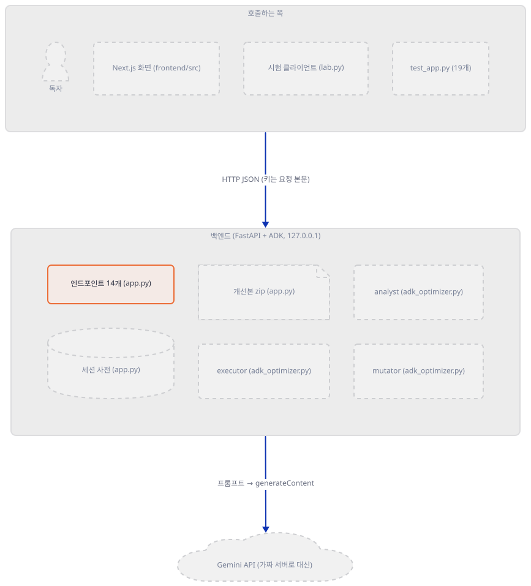

터미널 A에서 가짜 Gemini를, 터미널 B에서 백엔드를 띄웁니다. 터미널마다 Step 1의 환경 블록을 먼저 실행합니다. B는 출력을 UTF-8로 `app.log`에도 남깁니다(Step 3·4에서 읽습니다. 셸의 `tee`는 쓰지 않습니다. Windows PowerShell 5.1의 `Tee-Object`는 파일을 UTF-16LE로 써서, 바이트로 ASCII 키를 세는 Step 4의 검사가 키가 있어도 0을 내기 때문입니다).

```bash
# 터미널 A
cd "$LAB/work"
"$PY" fake_gemini.py "$FAKE_PORT" fake.log
```

```bash
# 터미널 B
cd "$LAB/work"
"$PY" serve_backend.py "$FAKE_PORT" "$APP_PORT" app.log
```

```powershell
# 터미널 A (PowerShell)
Set-Location "$env:LAB\work"; & $PY fake_gemini.py $env:FAKE_PORT fake.log
# 터미널 B (PowerShell)
Set-Location "$env:LAB\work"; & $PY serve_backend.py $env:FAKE_PORT $env:APP_PORT app.log
```

터미널 C에서 서버가 어디에 열렸는지 봅니다.

```bash
cd "${LAB:?먼저 Step 1의 환경 블록을 실행하세요}/work" || return
curl --noproxy '*' -s "http://127.0.0.1:$APP_PORT/health"; echo
curl --noproxy '*' -s "http://127.0.0.1:$APP_PORT/api/models"; echo
netstat -ano | grep ":$APP_PORT " | grep LISTENING
```

**확인.** 직접 확인한 출력입니다.

```text
uvicorn.run 인자: {'host': '0.0.0.0', 'port': 8891}
app.py: adk 명령·하위 프로세스 줄 0개 []
                 google·opentelemetry import: []
adk_optimizer.py: adk 명령·하위 프로세스 줄 0개 []
                 google·opentelemetry import: ['google.adk.agents', 'google.adk.runners', 'google.adk.sessions', 'google.genai']
app을 불러온 뒤 로드된 google.adk.cli 모듈: []
로드된 google.adk의 telemetry 모듈: ['google.adk.telemetry', 'google.adk.telemetry.context']
google.adk 아래 로드된 모듈 수: 133
막은 연결 시도: []
사용 통계 전송 코드가 든 파일: ['cli/_telemetry/_metrics_reporter.py', 'cli/api_server.py', 'cli/cli_tools_click.py', 'cli/dev_server.py', 'utils/_telemetry_config.py']
OpenTelemetry 추적 제공자: ProxyTracerProvider (SDK의 TracerProvider가 아니면 내보낼 곳이 없다)
OTEL_* 환경변수: ['OTEL_EXPORTER_OTLP_ENDPOINT']
```

```text
{"status":"healthy"}
{"default":"gemini-3.8-flash","suggestions":["gemini-3.8-flash","gemini-3-flash-preview","gemini-3.1-pro-preview"]}
  TCP    127.0.0.1:51877        0.0.0.0:0              LISTENING       39108
```

`app.py`를 `__main__`으로 돌리되 `uvicorn.run`만 가로채 보면 원본은 `host='0.0.0.0'`, 포트 8891입니다. 이 문서의 서버는 `127.0.0.1:51877`에만 듭니다(`netstat`의 마지막 줄. 다른 OS는 `lsof -nP -iTCP:$APP_PORT -sTCP:LISTEN`). 두 백엔드 파일에는 `adk` 명령이나 하위 프로세스 줄이 0개이고, `google`에서 가져오는 것은 `google.adk.agents`·`runners`·`sessions`와 `google.genai`뿐입니다. `app`을 불러온 뒤 `google.adk.cli` 모듈은 하나도 올라오지 않았습니다. 사용 통계를 보내는 코드는 설치된 ADK에서 `cli/` 아래 파일 넷과 `utils/_telemetry_config.py`에만 있습니다. 올라온 `google.adk.telemetry` 모듈 둘은 OpenTelemetry 추적용인데, 추적 제공자가 SDK의 `TracerProvider`가 아니라 `ProxyTracerProvider`이고 내보낼 곳이 없습니다. 이 확인은 `OTEL_EXPORTER_OTLP_ENDPOINT`가 셸에 있는 상태에서 했습니다. 막힌 연결은 0건입니다. 그래서 이 앱을 라이브러리로 쓰는 한 텔레메트리 질문과 전송 하위 프로세스는 나오지 않습니다. 같은 셸에서 `adk web` 같은 명령을 직접 치면 사정이 달라집니다. 별개 프로세스라서 서버 파일의 줄은 하나도 닿지 않고, stdin이 터미널이면 ADK 2.12.0은 텔레메트리를 켤지 묻고 Enter가 켭니다(Day 149가 소스로 확인한 `cli_tools_click.py`의 동작입니다). 이 문서의 환경 파일은 그 셸의 HOME을 새 폴더로 돌리고 거기에 거절을 미리 써 두었습니다.

독자 명령에서 줄 하나를 빠뜨려도 안전한지 줄을 하나씩 뺀 판으로 시험했습니다. 셸에는 진짜 모양의 키(`AIzaSy…` 꼴의 가짜), Vertex 설정, 프록시 변수(감시용 가짜 프록시를 가리킴), `OTEL_EXPORTER_OTLP_ENDPOINT`를 두었고, Windows의 `APPDATA`는 가짜 폴더에 가짜 gcloud 자격 증명 파일(가짜 갱신 토큰)을 두어 독자의 모양을 흉내 냈습니다. `serve_backend.py`는 38판입니다. 20판은 `NameError`·`ModuleNotFoundError`·`IndentationError`나 가드의 "소켓 가드가 설치되어 있지 않습니다"(`point_at_fake` 줄을 뺀 판)로 서버가 뜨기 전에 멈췄고(한 판은 `uvicorn.run`이 없어 서버가 열리지 않음), 18판은 줄이 빠진 채 서버가 떠서 모델 호출이 있는 한 라운드까지 끝냈습니다. `probe_main.py` 14판에서는 `uvicorn.run = fake_run` 줄을 뺀 판이 원본의 `0.0.0.0:8891` 열기를 시도했지만 가드의 bind 막기가 거절했습니다(8891에 듣는 프로세스 0). `probe_vertex.py`는 `GOOGLE_APPLICATION_CREDENTIALS`가 없는 셸과 있는 셸에서 각각 23판, 환경 파일은 줄을 하나씩 뺀 16판을 `probe_vertex.py`와 함께 돌렸습니다. 환경 파일에서 `CLOUDSDK_CONFIG` 줄(이나 그 앞의 점검 줄)을 뺀 판은 탐침이 아무것도 하지 않고 "멈춤:"으로 끝났고, 가드 줄을 뺀 판은 `require_installed()`가 멈췄습니다. 모든 판에서 루프백 밖으로 나가려던 시도, 감시 프록시에 닿은 연결, 파이썬 하위 프로세스(gcloud 포함) 실행이 0이었고 가드 기록에는 의도한 Vertex 관찰의 메타데이터 서버 줄과 그 bind 거절 한 줄뿐이었습니다. 원본의 `__pycache__`와 진짜 TEMP는 환경 파일의 해당 줄을 빼도 `serve_backend.py`가 스스로 바이트코드를 끄고 임시 폴더를 `work/tmp`로 돌려 지켜졌습니다(원본 대신 복사본으로 확인했습니다).

### Step 3. zip 올리기 — 위험한 이름과 크기 제한

**목적.** `/api/upload`(`app.py:186-232`)가 zip의 항목을 어떻게 거르는지, "zip slip"(항목 이름에 `..`나 절대 경로를 넣어 압축을 푸는 쪽의 폴더 밖에 쓰게 하는 공격)을 막는지, 크기 한도가 무엇을 막는지 직접 만든 zip으로 확인합니다. 모든 zip은 직접 지은 가짜 스킬이고 위험한 것은 이름뿐입니다. 서버는 압축을 디스크에 풀지 않으므로 내 PC에는 아무것도 풀리지 않습니다.

**할 일.** 먼저 소스를 읽습니다. 순서는 이렇습니다. 이름이 `.zip`이 아니면 400(189행), 읽은 크기가 10 MB를 넘으면 413(192행)이고 이 검사는 풀기 **전**입니다. 항목마다 디렉터리·`__MACOSX`·`.DS_Store`는 조용히 건너뛰고(199행), `_is_safe_path`(`".." not in name and not os.path.isabs(name)`, 181~183행)가 아니면 경고하고 건너뛰고, 확장자가 허용 목록(`.md .txt .json .yaml .yml .py .js .ts .html .css .xml .toml .cfg .ini .sh`, 28~31행)에 없으면 **읽기 전에** 건너뛰고, 그다음에야 `zf.read(name)`으로 전부 풀어 읽고(207행) 1 MB를 넘으면 건너뛰고(208행), 이미 50개면 멈춥니다(211행). 읽은 파일은 `{이름: 글}` 사전에 담길 뿐입니다(215행). 이어서 공통 앞 폴더를 벗기는 `os.path.commonpath`·`relpath`(218~223행)가 있습니다. 시험용 zip을 만듭니다.

```bash
cd "${LAB:?먼저 Step 1의 환경 블록을 실행하세요}/work" || return
cat > mkzips.py <<'EOF'
"""합성 zip을 만든다. 모두 직접 지은 가짜 스킬이고, 위험한 항목은 이름만 위험하다(내용은 한 줄 글).

사용: python mkzips.py <출력 폴더>
"""
import io
import os
import sys
import zipfile

out = sys.argv[1]
os.makedirs(out, exist_ok=True)

SKILL = (
    "---\nname: rule-demo\ndescription: A tiny skill used to try the optimizer loop\nlicense: MIT\n---\n"
    "# Rule demo\nAnswer the request in one sentence.\n"
)


def write(name: str, entries) -> None:
    path = os.path.join(out, name)
    with zipfile.ZipFile(path, "w", zipfile.ZIP_DEFLATED) as zf:
        for entry_name, data in entries:
            info = zipfile.ZipInfo("x")
            info.filename = entry_name  # 생성자를 거치면 \가 /로 바뀐다. 이름을 그대로 적으려고 나중에 대입한다
            info.compress_type = zipfile.ZIP_DEFLATED
            zf.writestr(info, data)
    print(f"{name:14s} {os.path.getsize(path):>9,d} bytes")


# 1) 정상: 폴더 하나 안에 SKILL.md, references, scripts, 그림(비텍스트)
write("good.zip", [
    ("rule-demo/SKILL.md", SKILL),
    ("rule-demo/references/notes.md", "# notes\nextra context\n"),
    ("rule-demo/scripts/run.py", "print('hello')\n"),
    ("rule-demo/assets/logo.png", b"\x89PNG\r\n\x1a\n" + b"\x00" * 32),
    ("rule-demo/.DS_Store", b"junk"),
])

# 2) 이름이 위험한 항목들(zip slip 모양). 앞의 SKILL.md는 정상이다
write("hostile.zip", [
    ("rule-demo/SKILL.md", SKILL),
    ("../evil.md", "dotdot at start"),
    ("rule-demo/../../evil2.md", "dotdot in the middle"),
    ("..\\evil3.md", "dotdot with backslash"),
    ("/abs.md", "absolute with slash"),
    ("C:/win-abs.md", "windows drive letter with slash"),
    ("C:\\win-abs2.md", "windows drive letter with backslash"),
    ("rule-demo/notes..md", "two dots inside a harmless name"),
    ("rule-demo/./dot.md", "single dot component"),
    ("rule-demo//double.md", "empty component"),
])

# 3) 개수: 텍스트 파일 60개
write("many.zip", [("pile/SKILL.md", SKILL)] + [(f"pile/f{n:02d}.md", f"file {n}\n") for n in range(59)])

# 4) 크기: 1 MB를 겹치는 파일 하나(압축하면 작다)와 정상 파일
write("bigfile.zip", [("big/SKILL.md", SKILL), ("big/huge.md", b"a" * (1024 * 1024 + 1))])

# 5) 압축 폭탄 모양: 풀면 128 MiB인데 압축은 작다
write("bomb.zip", [("bomb/SKILL.md", SKILL), ("bomb/zeros.md", b"\x00" * (128 * 1024 * 1024))])

# 6) 큰 바깥 크기: 10 MB를 넘는 zip(압축이 거의 안 되는 데이터)
write("over10mb.zip", [("o/SKILL.md", SKILL), ("o/noise.md", os.urandom(10 * 1024 * 1024 + 1024))])

# 7) 머리말이 접힌 설명(>-)을 쓰는 스킬, SKILL.md가 없는 zip, zip이 아닌 파일
write("folded.zip", [("fold/SKILL.md", "---\nname: fold\ndescription: >-\n  A folded\n  description line.\n---\n# Fold\n"), ("fold/references/a.md", "a\n")])
write("noskill.zip", [("x/readme.md", "no skill here\n")])
with open(os.path.join(out, "notzip.zip"), "wb") as f:
    f.write(b"this is not a zip file\n")
print("notzip.zip     (zip이 아닌 파일)")

# 8) SKILL.md가 둘: 안쪽 폴더의 것이 먼저 나온다
write("twoskills.zip", [
    ("two/examples/SKILL.md", "---\nname: inner\ndescription: inner example\n---\n# Inner\n"),
    ("two/SKILL.md", SKILL),
    ("two/references/OLD-SKILL.md", "an old copy kept for reference\n"),
])

# 9) 맨 위에 폴더가 없는 zip(스킬 폴더 안에서 내용물만 묶은 모양)
write("flat.zip", [("SKILL.md", SKILL), ("references/notes.md", "# notes\nextra context\n")])

# 10) 압축이 안 되는 60 MB: 10 MB 한도는 본문을 다 읽은 뒤에 보므로 413이어도 서버 메모리는 오른다
write("over60mb.zip", [("o/SKILL.md", SKILL), ("o/noise.md", os.urandom(60 * 1024 * 1024))])
EOF
```

```bash
cd "${LAB:?먼저 Step 1의 환경 블록을 실행하세요}/work" || return
"$PY" mkzips.py zips
```

```text
good.zip             804 bytes
hostile.zip        1,430 bytes
many.zip           6,601 bytes
bigfile.zip        1,369 bytes
bomb.zip         130,801 bytes
over10mb.zip   10,490,313 bytes
folded.zip           302 bytes
noskill.zip          136 bytes
notzip.zip     (zip이 아닌 파일)
twoskills.zip        566 bytes
flat.zip             365 bytes
over60mb.zip   62,934,084 bytes
```

`good.zip`은 폴더 하나에 `SKILL.md`·`references/`·`scripts/`·그림을 담았고, `hostile.zip`은 `SKILL.md` 하나와 이름이 이상한 항목 아홉을 담았습니다. `bomb.zip`은 풀면 128 MiB인데 압축은 130,801바이트입니다. 화면 대신 백엔드를 부르는 시험 클라이언트와 올리기 시험을 만듭니다. 클라이언트는 프록시 환경변수를 읽지 않고(`trust_env=False`) 루프백 주소만 부릅니다. 요청 모양은 `UploadStep.tsx`에서 읽은 그대로입니다. 두 번째 인자 `APP_PID`는 터미널 B가 처음에 찍은 서버 PID입니다.

```bash
cd "${LAB:?먼저 Step 1의 환경 블록을 실행하세요}/work" || return
cat > lab.py <<'EOF'
"""화면(Next.js) 대신 백엔드를 부르는 시험용 클라이언트. 요청 모양은 frontend/src/components/*.tsx에서 읽은 그대로다.

사용: python lab.py <명령> ...   (포트는 APP_PORT 환경변수, 기본 51877)
  up <zip>                       POST /api/upload
  flow <zip> [라운드] [모델]       업로드 → 분석 → 설정 저장 → 시작 → 3초 대신 0.3초 간격 상태 확인 → 내려받기
"""
import io
import json
import os
import sys
import time
import zipfile

import httpx

BASE = f"http://127.0.0.1:{os.environ.get('APP_PORT', '51877')}"
KEY = "fake-key-" + "A" * 12
client = httpx.Client(base_url=BASE, trust_env=False, timeout=60)  # 프록시 환경변수를 읽지 않는다


def show(label, r):
    body = r.text if len(r.text) < 300 else r.text[:300] + "..."
    print(f"{label}: HTTP {r.status_code} {body}")


def upload(path):
    with open(path, "rb") as f:
        return client.post("/api/upload", files={"file": (os.path.basename(path), f, "application/zip")})


def flow(path, rounds=3, model=None):
    r = upload(path)
    show("upload", r)
    r.raise_for_status()
    sid = r.json()["session_id"]
    body = {"session_id": sid, "gemini_api_key": KEY}
    if model:
        body["model"] = model
    r = client.post("/api/analyze", json=body)
    data = r.json()
    print(f"analyze: HTTP {r.status_code} 시나리오 {len(data['scenarios'])}개, 평가 {len(data['evals'])}개, model={data['model']}")
    scenarios = [{**s, "selected": True, "editing": False} for s in data["scenarios"]]
    evals = [{**e, "selected": True, "editing": False} for e in data["evals"]]
    r = client.post("/api/update-config", json={"session_id": sid, "scenarios": scenarios, "evals": evals})
    show("update-config", r)
    body = {"gemini_api_key": KEY, "max_rounds": rounds}
    if model:
        body["model"] = model
    r = client.post(f"/api/start/{sid}", json=body)
    show("start", r)
    seen = 0
    while True:
        time.sleep(0.3)
        st = client.get(f"/api/status/{sid}").json()
        for e in st["experiments"][seen:]:
            print(f"  실험 {e['experiment_id']:>2d}  {e['status']:8s} {e['pass_rate']:5.1f}%  {e.get('description', '')}")
        seen = len(st["experiments"])
        if st["status"] in ("complete", "error", "stopped"):
            break
    print("상태:", st["status"], "| 오류:", st["error"])
    fr = st["final_result"] or {}
    print("기준선", fr.get("baseline_score"), "→ 최종", fr.get("final_score"), "| 실험", fr.get("experiments_run"), "유지", fr.get("kept"), "버림", fr.get("discarded"))
    r = client.get(f"/api/download/{sid}")
    print("download:", r.status_code, r.headers.get("content-type"), len(r.content), "bytes")
    with zipfile.ZipFile(io.BytesIO(r.content)) as zf:
        print("  zip 안:", zf.namelist())
        return sid, zf.read([n for n in zf.namelist() if n.endswith("SKILL.md")][0]).decode()


if __name__ == "__main__":
    cmd = sys.argv[1]
    if cmd == "up":
        show("upload", upload(sys.argv[2]))
    elif cmd == "flow":
        sid, md = flow(sys.argv[2], int(sys.argv[3]) if len(sys.argv) > 3 else 3, sys.argv[4] if len(sys.argv) > 4 else None)
        print("--- 개선된 SKILL.md ---")
        print(md)
EOF
```

```bash
cd "${LAB:?먼저 Step 1의 환경 블록을 실행하세요}/work" || return
cat > probe_zip.py <<'EOF'
"""zip 올리기 시험. 사용: python probe_zip.py <zip 폴더> [서버 PID]
서버 PID를 주면 올릴 때마다 서버 프로세스의 최대 작업 집합(MB)도 적는다(psutil 필요)."""
import os
import sys
import time

sys.path.insert(0, os.path.dirname(os.path.abspath(__file__)))
import lab  # noqa: E402

zdir = sys.argv[1]
proc = None
if len(sys.argv) > 2:
    import psutil

    proc = psutil.Process(int(sys.argv[2]))


def peak_mb():
    return f"  서버 최대 {proc.memory_info().peak_wset / 2**20:,.0f} MB" if proc else ""


for name in ("good", "hostile", "many", "bigfile", "over60mb", "bomb", "over10mb", "noskill", "notzip", "twoskills", "folded"):
    t = time.time()
    r = lab.upload(os.path.join(zdir, name + ".zip"))
    dt = time.time() - t
    if r.status_code == 200:
        d = r.json()
        print(f"{name:10s} HTTP 200  파일 {len(d['file_list']):>2d}개  {d['file_list'][:12]}  ({dt:.1f}s){peak_mb()}")
        if name in ("twoskills", "folded"):
            print(f"{'':10s} 메타데이터 {d['metadata']}")
    else:
        print(f"{name:10s} HTTP {r.status_code}  {r.text[:120]}  ({dt:.1f}s){peak_mb()}")

# 폴더 올리기(/api/upload-files)에도 같은 이름 검사가 있는지: 브라우저는 폴더 안 파일마다 상대 경로를 이름으로 보낸다
names = ["pile/SKILL.md", "pile/../evil.md", "pile/.secret.md", ".top.md", "pile/notes..md", "pile/logo.png", "pile/refs/a.md"]
files = [("files", (n, b"text\n" if n.endswith(".md") else b"\x89PNG", "text/plain")) for n in names]
r = lab.client.post("/api/upload-files", files=files)
print(f"upload-files HTTP {r.status_code}", r.json()["file_list"] if r.status_code == 200 else r.text[:120])
print("  보낸 이름:", names)
EOF
```

```bash
export APP_PID=12345      # 터미널 B가 찍은 "서버 PID" 값으로 바꾼다
```

```bash
cd "${LAB:?먼저 Step 1의 환경 블록을 실행하세요}/work" || return
"$PY" probe_zip.py zips "$APP_PID"
```

```bash
cd "${LAB:?먼저 Step 1의 환경 블록을 실행하세요}/work" || return
grep -E "Skipping|Max file" app.log | sed -e 's/^INFO:app://' -e 's/^WARNING:app://'
```

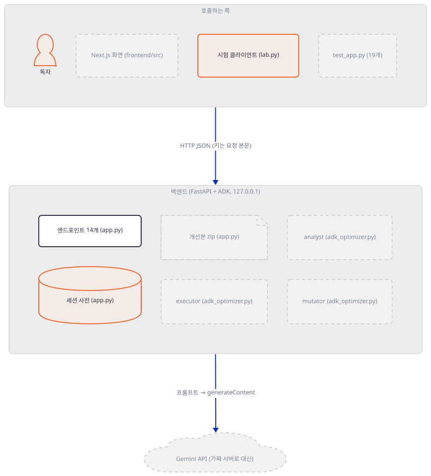

**확인.** 직접 확인한 출력입니다.

```text
good       HTTP 200  파일  3개  ['SKILL.md', 'references\\notes.md', 'scripts\\run.py']  (0.0s)  서버 최대 83 MB
hostile    HTTP 200  파일  3개  ['SKILL.md', 'dot.md', 'double.md']  (0.0s)  서버 최대 83 MB
many       HTTP 200  파일 50개  ['SKILL.md', 'f00.md', 'f01.md', 'f02.md', 'f03.md', 'f04.md', 'f05.md', 'f06.md', 'f07.md', 'f08.md', 'f09.md', 'f10.md']  (0.0s)  서버 최대 83 MB
bigfile    HTTP 400  {"detail":"No SKILL.md found"}  (0.0s)  서버 최대 83 MB
over60mb   HTTP 413  {"detail":"Upload exceeds 10MB limit"}  (0.2s)  서버 최대 143 MB
bomb       HTTP 400  {"detail":"No SKILL.md found"}  (0.2s)  서버 최대 339 MB
over10mb   HTTP 413  {"detail":"Upload exceeds 10MB limit"}  (0.0s)  서버 최대 339 MB
noskill    HTTP 400  {"detail":"No SKILL.md found"}  (0.0s)  서버 최대 339 MB
notzip     HTTP 400  {"detail":"Invalid zip file"}  (0.0s)  서버 최대 339 MB
twoskills  HTTP 200  파일  3개  ['examples\\SKILL.md', 'SKILL.md', 'references\\OLD-SKILL.md']  (0.0s)  서버 최대 339 MB
           메타데이터 {'name': 'inner', 'description': 'inner example'}
folded     HTTP 200  파일  2개  ['SKILL.md', 'references\\a.md']  (0.0s)  서버 최대 339 MB
           메타데이터 {'name': 'fold', 'description': '>-'}
upload-files HTTP 200 ['SKILL.md', '.secret.md', 'refs\\a.md']
  보낸 이름: ['pile/SKILL.md', 'pile/../evil.md', 'pile/.secret.md', '.top.md', 'pile/notes..md', 'pile/logo.png', 'pile/refs/a.md']
```

터미널 B가 찍는 경고를 `app.log`에서 걸러 보면 이렇습니다.

```text
Skipping non-text file: rule-demo/assets/logo.png
Skipping unsafe zip entry: ../evil.md
Skipping unsafe zip entry: rule-demo/../../evil2.md
Skipping unsafe zip entry: ../evil3.md
Skipping unsafe zip entry: /abs.md
Skipping unsafe zip entry: C:/win-abs.md
Skipping unsafe zip entry: C:/win-abs2.md
Skipping unsafe zip entry: rule-demo/notes..md
Max file count reached, skipping remaining entries
Skipping oversized file: big/huge.md (1048577 bytes)
Skipping oversized file: bomb/zeros.md (134217728 bytes)
Skipping unsafe path: pile/../evil.md
Skipping unsafe path: pile/notes..md
Skipping non-text file: pile/logo.png
```

읽는 법입니다.

- **위험한 이름은 건너뛰어집니다.** `../evil.md`, `rule-demo/../../evil2.md`, `../evil3.md`(원래 `..\evil3.md`), `/abs.md`, `C:/win-abs.md`, `C:/win-abs2.md`(원래 `C:\win-abs2.md`) 여섯이 "unsafe zip entry"로 빠지고 `SKILL.md`와 `dot.md`(`./dot.md`), `double.md`(`//double.md`)가 남습니다. 거절 규칙은 `..`라는 **부분 문자열**이라 `rule-demo/notes..md`처럼 점 둘이 든 멀쩡한 이름도 함께 빠져서 로그에는 일곱 줄이 찍힙니다. Windows에서 파이썬은 zip을 읽을 때 `\`를 `/`로 바꾸므로 `..\evil3.md`는 `../evil3.md`로 읽혀 걸립니다. 앱을 POSIX에서 돌리면 `\`가 이름 안의 글자로 남아 `..`만 걸립니다. 이 판단은 소스에서 한 것이고 POSIX에서 돌려 보지는 못했습니다.
- **그 검사가 지키는 것은 디스크가 아닙니다.** 서버는 항목을 `{이름: 글}` 사전에만 담고 풀어 쓰지 않습니다. 이름은 나중에 `/api/download`가 `improved_skill.zip`에 다시 적는 이름이 됩니다(`app.py:499-504`). 그러니 이 검사의 실제 대상은 그 zip을 **내려받아 푸는 사람의 PC**입니다. `_is_safe_path`가 `os.path.isabs`에 기대는 점은 파이썬 판에 따라 다릅니다. 아래 `paths.py`는 파이썬 3.12에서는 `/abs.md`가 Windows에서도 절대 경로로 잡히지만 3.14.2에서는 아니라고 보여 줍니다. 그렇다고 3.13 이상의 Windows에서 `/abs.md`가 내려받는 zip에 실리는 것은 아닙니다. 다른 이름과 섞이면 `os.path.commonpath`가 루트 이름과 상대 이름을 섞지 못해 `ValueError`를 던지고 업로드 전체가 500이 되며, 루트 이름만 있으면 `relpath`가 앞의 `\`를 벗깁니다(아래 `up314.py` 출력으로 직접 확인했습니다). 내려받는 zip에 실릴 수 있는 쪽은 `C:/…`를 절대 경로로 보지 못하는 POSIX입니다. `zipfile.writestr`는 이름을 그대로 적습니다(따로 확인했습니다). 이 POSIX 경로는 서버를 띄워 보지 못했습니다.
- **개수는 50개에서 조용히 잘립니다.** `many.zip`(60개)이 50개로 올라오고 응답에는 잘렸다는 말이 없습니다(서버 로그에만 "Max file count reached").
- **크기 한도는 풀기 전에 하나, 뒤에 하나입니다.** `over10mb.zip`(10,490,313바이트)은 413입니다. 그런데 항목 하나가 1 MB를 넘는지는 `zf.read`로 **다 읽은 뒤**에 보므로, `bomb.zip`(130,801바이트)이 올라가자 서버 최대 작업 집합이 시험 시작 때의 83 MB에서 339 MB로 약 256 MB 뛰었습니다(`bigfile.zip`은 1 MB 남짓이라 눈에 띄지 않습니다. 표의 `over60mb` 줄이 143 MB인 것은 아래 60 MB 시험입니다). 이 압축비는 1,026배(134,217,728 ÷ 130,801)입니다. 같은 비율이라면 한도의 10 MB zip은 약 10 GB를 풀게 합니다. 이것은 산수이고 돌려 보지 않았습니다. 이 요청은 업로드한 사람이 서버 메모리를 쓰게 합니다. 10 MB 검사도 같습니다. `upload_skill`은 `await file.read()`로 본문을 **다 읽은 뒤**에 길이를 보므로(`app.py:191-192`) 413은 돌려줄 뿐 서버가 읽는 양을 제한하지 않습니다. 압축이 안 되는 60 MB짜리 `over60mb.zip`은 413인데 서버 최대 작업 집합이 83 MB에서 143 MB로 올랐습니다(표의 `over60mb` 줄).
- **Windows에서는 폴더 안 파일 하나짜리 zip이 거절됩니다.** `bigfile.zip`과 `bomb.zip`은 큰 파일이 빠지고 `SKILL.md`만 남았는데 응답은 400 "No SKILL.md found"입니다. 원인은 218~223행입니다. 파일이 하나일 때 `os.path.commonpath`가 그 파일 경로 자신을 돌려주는데, Windows에서는 슬래시가 역슬래시로 바뀌어 `common != file_list[0]`이 참이 되고 `relpath(이름, 이름)`이 `.`이 되어 파일이 사라집니다. 아래 `paths.py`가 같은 계산을 보여 줍니다. 스킬을 `SKILL.md` 하나로 쓰고 폴더째 묶으면 만나는 가장 흔한 모양입니다. 폴더 없이 묶거나 파일이 둘 이상이면 됩니다.
- **같은 이유로 `file_list`가 역슬래시를 갖습니다.** `references\notes.md`처럼 나오는 이름은 Step 4에서 분석 프롬프트에서 `references/` 파일이 빠지는 원인이 됩니다.
- **`SKILL.md`가 둘이면 먼저 나온 것이 이깁니다.** `twoskills.zip`은 안쪽 `examples/SKILL.md`가 먼저 나와서 세션의 이름이 `inner`가 됩니다. 이 영향은 Step 6에서 봅니다.
- **머리말을 읽는 줄이 YAML이 아닙니다.** `folded.zip`의 `description: >-`(접힌 설명)는 `">-"`가 되고, 안쪽에 들여 쓴 `metadata:`의 하위 키는 위로 올라옵니다(`parse_skill_frontmatter`, `app.py:128-145`). 줄마다 `strip()`을 한 뒤 `startswith(" ")`를 검사하니 그 검사는 늘 거짓입니다. [agentskills.io 명세](https://agentskills.io/specification)는 머리말을 YAML이라고 하고 `metadata`를 문자열 키·값의 맵으로 정의합니다. 이 저장소의 일곱 스킬 가운데 여섯이 `description: >-`를 써서 예제 목록의 설명도 `>-`가 됩니다(Step 6).
- **폴더 올리기(`/api/upload-files`)도 같은 이름 검사를 합니다.** `pile/../evil.md`와 `pile/notes..md`와 `.top.md`(맨 앞 점)와 `logo.png`가 빠지고, 하위 폴더의 `.secret.md`는 통과합니다(맨 앞 점만 걸러서).

같은 계산을 파이썬 판에 따라 비교합니다. 3.14가 없으면 마지막 두 줄은 건너뜁니다.

```bash
cd "${LAB:?먼저 Step 1의 환경 블록을 실행하세요}/work" || return
cat > paths.py <<'EOF'
"""app.py의 경로 검사가 쓰는 함수가 Windows(ntpath)와 POSIX(posixpath)에서 어떻게 다른지 본다. 서버를 띄우지 않는다."""
import ntpath
import posixpath
import sys

print("python", sys.version.split()[0])
for name in ("/abs.md", "C:/x.md", "C:\\x.md"):
    print(f"  isabs({name!r}): nt={ntpath.isabs(name)}, posix={posixpath.isabs(name)}")
for mod in (ntpath, posixpath):
    one = mod.commonpath(["big/SKILL.md"])
    print(f"  {mod.__name__}.commonpath(['big/SKILL.md']) = {one!r}, same as the name: {one == 'big/SKILL.md'}")
    if one != "big/SKILL.md":
        print(f"  {mod.__name__}.relpath('big/SKILL.md', {one!r}) = {mod.relpath('big/SKILL.md', one)!r}")
EOF
```

```bash
cd "${LAB:?먼저 Step 1의 환경 블록을 실행하세요}/work" || return
"$PY" paths.py
python3.14 -B paths.py | head -4
```

```text
python 3.12.10
  isabs('/abs.md'): nt=True, posix=True
  isabs('C:/x.md'): nt=True, posix=False
  isabs('C:\\x.md'): nt=True, posix=False
  ntpath.commonpath(['big/SKILL.md']) = 'big\\SKILL.md', same as the name: False
  ntpath.relpath('big/SKILL.md', 'big\\SKILL.md') = '.'
  posixpath.commonpath(['big/SKILL.md']) = 'big/SKILL.md', same as the name: True
python 3.14.2
  isabs('/abs.md'): nt=False, posix=True
  isabs('C:/x.md'): nt=True, posix=False
  isabs('C:\\x.md'): nt=True, posix=False
```

파이썬 3.14용 가상환경을 하나 더 만들어 같은 `hostile.zip`과 루트 이름만 든 zip을 올려 봅니다. 서버 없이 `TestClient`로 `app.py`를 부르고 모델도 네트워크도 쓰지 않습니다.

```bash
cd "${LAB:?먼저 Step 1의 환경 블록을 실행하세요}/work" || return
cat > up314.py <<'EOF'
"""파이썬 판이 달라지면 업로드 검사가 어떻게 달라지는지 본다(서버 없이 TestClient, 모델·네트워크 없음).
사용: BACKEND=<backend 폴더> python up314.py <hostile.zip 이 든 폴더>"""
import io
import os
import sys
import zipfile

sys.dont_write_bytecode = True
sys.path.insert(0, os.environ["BACKEND"])
from fastapi.testclient import TestClient  # noqa: E402

import app as backend  # noqa: E402

print("python", sys.version.split()[0])
client = TestClient(backend.app)


def post(label, data):
    r = client.post("/api/upload", files={"file": ("s.zip", data, "application/zip")})
    names = r.json().get("file_list") if r.status_code == 200 else r.json()
    print(f"  {label:28s} HTTP {r.status_code} {names}")
    return r


post("hostile.zip", open(os.path.join(sys.argv[1], "hostile.zip"), "rb").read())
buf = io.BytesIO()
with zipfile.ZipFile(buf, "w") as zf:
    zf.writestr("/SKILL.md", "---\nname: rooted\ndescription: d\n---\n# x\n")
    zf.writestr("/abs.md", "rooted only")
post("rooted names only", buf.getvalue())
EOF
```

```bash
cd "${LAB:?먼저 Step 1의 환경 블록을 실행하세요}/work" || return
uv venv --python 3.14 "$LAB/venv314"
uv pip install --python "$LAB/venv314/$VBIN" -r "$BACKEND/requirements.txt" httpx 2>&1 | grep -E "^(Resolved|Installed)"
for v in venv venv314; do "$LAB/$v/$VBIN" up314.py zips 2>&1 | grep -E "^(python|  (hostile|rooted))"; done
```

```text
Using CPython 3.14.2 interpreter at: C:\Users\<you>\AppData\Local\Python\pythoncore-3.14-64\python.exe
Creating virtual environment at: <LAB>/venv314
Activate with: source <LAB>/venv314/Scripts/activate
Resolved 50 packages in 226ms
Installed 50 packages in 1.49s
python 3.12.10
  hostile.zip                  HTTP 200 ['SKILL.md', 'dot.md', 'double.md']
  rooted names only            HTTP 400 {'detail': 'No SKILL.md found'}
python 3.14.2
  hostile.zip                  HTTP 500 {'detail': 'Error processing file'}
  rooted names only            HTTP 200 ['SKILL.md', 'abs.md']
```

3.12에서는 `hostile.zip`이 통과하고 루트 이름만 든 zip은 400입니다(`/SKILL.md`가 거절되어 스킬이 없습니다). 3.14.2에서는 `hostile.zip`이 통째로 500 `Error processing file`이고(루트 이름 `/abs.md`가 상대 이름과 섞여 `commonpath`가 실패), 루트 이름만 든 zip은 통과해 `abs.md`가 됩니다.

### Step 4. 분석과 API 키 — 키를 요청 본문으로 받는다는 것

**목적.** `/api/analyze`가 모델에게 무엇을 보내는지, 그리고 API 키를 요청 본문으로 받는 설계(`app.py:104-125`의 `gemini_api_key: str`)가 실제로 무엇을 뜻하는지 가짜 키로 확인합니다.

**할 일.** `analyze_skill`(`adk_optimizer.py:139-165`)은 `SKILL.md`와, 이름에 `references/`가 든 파일만 프롬프트에 넣습니다. `README.md`와 `scripts/`는 들어가지 않습니다. 같은 `good.zip`을 폴더째 올린 것과 폴더 없이 올린 `flat.zip`으로 가짜 서버가 받은 분석 프롬프트를 비교합니다. `showlog.py`가 가짜 서버의 기록을 요약합니다.

```bash
cd "${LAB:?먼저 Step 1의 환경 블록을 실행하세요}/work" || return
cat > showlog.py <<'EOF'
"""가짜 Gemini 서버의 기록(fake.log)을 요약한다. 사용: python showlog.py <기록 파일>"""
import collections
import json
import sys

rows = [json.loads(line) for line in open(sys.argv[1], encoding="utf-8")]
rows = [r for r in rows if r["kind"] == "gemini"]
print("요청", len(rows), "건")
for (role, mode), n in sorted(collections.Counter((r["role"], r["mode"]) for r in rows).items()):
    sizes = [r["user_chars"] for r in rows if r["role"] == role and r["mode"] == mode]
    print(f"  {role:9s} {mode:9s} {n:>3d}건  프롬프트 {min(sizes):,d}~{max(sizes):,d}자")
print("모델:", sorted({r["model"] for r in rows}), "| 키 앞부분:", sorted({r["key"] for r in rows}))
chars = sum(r["user_chars"] + r["system_chars"] for r in rows)
print(f"입력 합계 {chars:,d}자 ≈ {chars // 4:,d}토큰 (자수 ÷ 4의 어림)")
for r in rows:
    if r["mode"] == "analyze":
        print("분석 프롬프트:", f"{r['user_chars']:,d}자", "| 'Reference files:' 블록:", r["has_reference_block"], "| 참고 파일:", r["reference_files"])
EOF
```

```bash
cd "${LAB:?먼저 Step 1의 환경 블록을 실행하세요}/work" || return
: > fake.log
"$PY" lab.py flow zips/good.zip 1 > flow1.txt; head -2 flow1.txt | cut -c1-150
"$PY" showlog.py fake.log | tail -1
: > fake.log
"$PY" lab.py flow zips/flat.zip 1 > flow1.txt; head -2 flow1.txt | cut -c1-150
"$PY" showlog.py fake.log | tail -1
```

```text
upload: HTTP 200 {"session_id":"6f9ac089-112a-49c7-9969-aafde0c9b633","file_list":["SKILL.md","references\\notes.md","scripts\\run.py"],"metadata":{"n
analyze: HTTP 200 시나리오 3개, 평가 4개, model=gemini-3.8-flash
분석 프롬프트: 675자 | 'Reference files:' 블록: False | 참고 파일: []
upload: HTTP 200 {"session_id":"9292148d-d5d0-4ef3-bf28-0eeba04fe90f","file_list":["SKILL.md","references/notes.md"],"metadata":{"name":"rule-demo","d
analyze: HTTP 200 시나리오 3개, 평가 4개, model=gemini-3.8-flash
분석 프롬프트: 739자 | 'Reference files:' 블록: True | 참고 파일: ['references/notes.md']
```

`good.zip`은 폴더로 감쌌고 `references/notes.md`가 있는데 분석 프롬프트(675자)에는 `Reference files:` 블록이 없습니다. 파일 이름이 `references\notes.md`라 `"references/" in k`(`adk_optimizer.py:144`)가 거짓이기 때문입니다(Windows 한정). `flat.zip`은 같은 파일이 있고 프롬프트(739자)에 블록이 있습니다. 모델은 이 차이를 알 수 없습니다.

이제 키입니다. `SkillOptimizer.__init__`의 첫 줄(`adk_optimizer.py:51`)이 `os.environ["GOOGLE_API_KEY"] = api_key`입니다. **프로세스 전체의 환경변수 하나**를 요청마다 덮어쓰는 것입니다. 이것이 낳는 결과를 하나씩 시험합니다. 먼저 서버 셸에 키가 있는 경우를 흉내 내려고 터미널 B2에서 두 번째 백엔드를 `D161_SHELL_KEYS`(가짜 값)로 띄웁니다. 이 변수는 `serve_backend.py`가 가드 설정 뒤에 환경에 얹습니다.

```bash
# 터미널 B2
cd "${LAB:?먼저 Step 1의 환경 블록을 실행하세요}/work" || return
D161_SHELL_KEYS='{"GOOGLE_API_KEY":"fake-shell-google-1111","GEMINI_API_KEY":"fake-shell-gemini-2222"}' \
  "$PY" serve_backend.py "$FAKE_PORT" "$APP2_PORT" app2.log
```

```powershell
# 터미널 B2 (PowerShell). 환경변수 앞붙임은 세션에 남으므로 끝나면 지웁니다
Set-Location "$env:LAB\work"
try {
  $env:D161_SHELL_KEYS = '{"GOOGLE_API_KEY":"fake-shell-google-1111","GEMINI_API_KEY":"fake-shell-gemini-2222"}'
  & $PY serve_backend.py $env:FAKE_PORT $env:APP2_PORT app2.log
} finally { Remove-Item Env:D161_SHELL_KEYS -ErrorAction SilentlyContinue }
```

```bash
cd "${LAB:?먼저 Step 1의 환경 블록을 실행하세요}/work" || return
cat > probe_keys.py <<'EOF'
"""API 키를 요청 본문으로 받는 설계가 무엇을 뜻하는지 가짜 키로 시험한다.

사용: python probe_keys.py single | race <fake 기록 파일>
  single  서버 셸에 GOOGLE_API_KEY·GEMINI_API_KEY가 있을 때 요청마다 어떤 키가 모델 서버에 닿는지
  race    서로 다른 키로 스킬 둘을 동시에 최적화하면 키가 섞이는지
"""
import io
import json
import os
import sys
import threading
import time
import zipfile
from collections import Counter

sys.path.insert(0, os.path.dirname(os.path.abspath(__file__)))
import lab  # noqa: E402


def zip_bytes(name: str) -> bytes:
    buf = io.BytesIO()
    with zipfile.ZipFile(buf, "w") as zf:
        zf.writestr(f"{name}/SKILL.md", f"---\nname: {name}\ndescription: key race {name}\n---\n# {name}\n")
        zf.writestr(f"{name}/notes.md", "notes\n")
    return buf.getvalue()


def new_session(name: str) -> str:
    r = lab.client.post("/api/upload", files={"file": (f"{name}.zip", zip_bytes(name), "application/zip")})
    return r.json()["session_id"]


def last_key(logfile: str) -> str:
    with open(logfile, encoding="utf-8") as f:
        return json.loads(f.readlines()[-1])["key"]


if sys.argv[1] == "single":
    logfile = sys.argv[2]
    sid = new_session("single")
    for label, key in (("요청 본문의 키 fake-req-key-1", "fake-req-key-1"), ("요청 본문의 키가 빈 문자열", "")):
        r = lab.client.post("/api/analyze", json={"session_id": sid, "gemini_api_key": key})
        print(f"{label:34s} → HTTP {r.status_code}, 모델 서버가 받은 키 앞부분: {last_key(logfile)!r}")
    r = lab.client.post("/api/analyze", json={"session_id": sid})
    print(f"{'gemini_api_key 필드 없음':34s} → HTTP {r.status_code} {r.json()['detail'][0]['msg']}")

elif sys.argv[1] == "race":
    logfile = sys.argv[2]
    keys = {"skill-a": "fake-keyA-" + "a" * 8, "skill-b": "fake-keyB-" + "b" * 8}
    sids = {n: new_session(n) for n in keys}

    def run(n):
        c = lab.client
        a = c.post("/api/analyze", json={"session_id": sids[n], "gemini_api_key": keys[n]}).json()
        c.post("/api/update-config", json={"session_id": sids[n], "scenarios": a["scenarios"], "evals": a["evals"]})
        c.post(f"/api/start/{sids[n]}", json={"gemini_api_key": keys[n], "max_rounds": 3})
        while c.get(f"/api/status/{sids[n]}").json()["status"] == "running":
            time.sleep(0.2)

    threads = [threading.Thread(target=run, args=(n,)) for n in keys]
    for t in threads:
        t.start()
        time.sleep(0.15)  # B가 조금 늦게 시작한다
    for t in threads:
        t.join()
    rows = [json.loads(l) for l in open(logfile, encoding="utf-8")]
    rows = [r for r in rows if r.get("skill") in keys]
    for n in keys:
        c = Counter(r["key"] for r in rows if r["skill"] == n)
        print(f"{n}: 보낸 키 {keys[n][:14]!r} / 모델 서버가 받은 키별 요청 수 {dict(c)}")
EOF
```

```bash
cd "${LAB:?먼저 Step 1의 환경 블록을 실행하세요}/work" || return
: > fake.log
APP_PORT="$APP2_PORT" "$PY" probe_keys.py single fake.log
```

```powershell
# PowerShell: APP_PORT를 이 명령에만 바꿉니다
$old = $env:APP_PORT
try { $env:APP_PORT = $env:APP2_PORT; & $PY probe_keys.py single fake.log } finally { $env:APP_PORT = $old }
```

동시에 돌리는 시험은 가짜 서버를 `D161_DELAY=0.03`으로 다시 띄웁니다(터미널 A를 멈추고 아래로 바꿉니다. 기록도 비웁니다). 두 스킬을 서로 다른 키로 동시에 최적화합니다.

```bash
# 터미널 A (다시)
cd "${LAB:?먼저 Step 1의 환경 블록을 실행하세요}/work" || return
D161_DELAY=0.03 "$PY" fake_gemini.py "$FAKE_PORT" fake.log
```

```powershell
# 터미널 A (다시, PowerShell). 앞붙임 변수는 끝나면 지웁니다
Set-Location "$env:LAB\work"
try { $env:D161_DELAY = "0.03"; & $PY fake_gemini.py $env:FAKE_PORT fake.log } finally { Remove-Item Env:D161_DELAY -ErrorAction SilentlyContinue }
```

```bash
cd "${LAB:?먼저 Step 1의 환경 블록을 실행하세요}/work" || return
for i in 1 2 3; do : > fake.log; APP_PORT="$APP2_PORT" "$PY" probe_keys.py race fake.log; echo; done
```

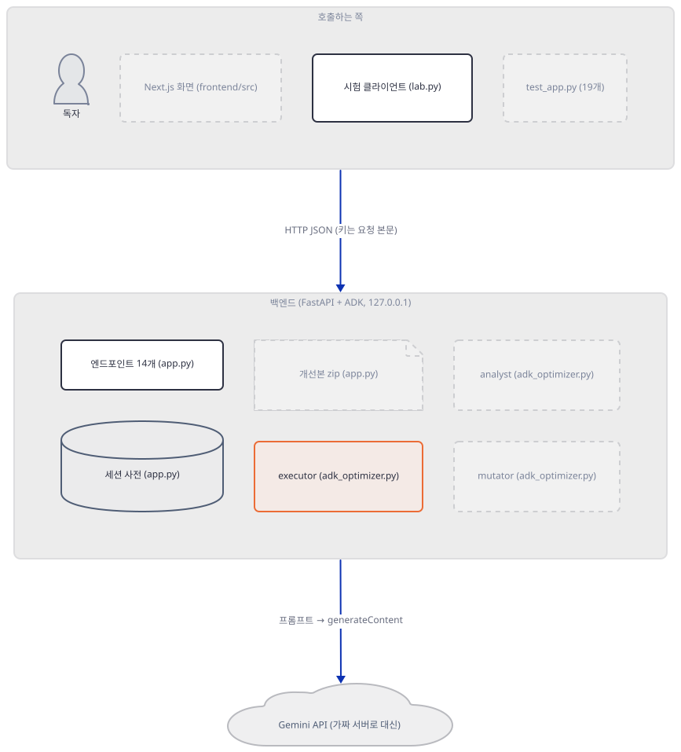

**확인.** 직접 확인한 출력입니다.

```text
요청 본문의 키 fake-req-key-1            → HTTP 200, 모델 서버가 받은 키 앞부분: 'fake-req-key-1'
요청 본문의 키가 빈 문자열                    → HTTP 200, 모델 서버가 받은 키 앞부분: 'fake-shell-gem'
gemini_api_key 필드 없음               → HTTP 422 Field required
```

```text
skill-a: 보낸 키 'fake-keyA-aaaa' / 모델 서버가 받은 키별 요청 수 {'fake-keyA-aaaa': 17}
skill-b: 보낸 키 'fake-keyB-bbbb' / 모델 서버가 받은 키별 요청 수 {'fake-keyB-bbbb': 1, 'fake-keyA-aaaa': 18}

skill-a: 보낸 키 'fake-keyA-aaaa' / 모델 서버가 받은 키별 요청 수 {'fake-keyA-aaaa': 13}
skill-b: 보낸 키 'fake-keyB-bbbb' / 모델 서버가 받은 키별 요청 수 {'fake-keyB-bbbb': 2, 'fake-keyA-aaaa': 16}

skill-a: 보낸 키 'fake-keyA-aaaa' / 모델 서버가 받은 키별 요청 수 {'fake-keyA-aaaa': 2, 'fake-keyB-bbbb': 14}
skill-b: 보낸 키 'fake-keyB-bbbb' / 모델 서버가 받은 키별 요청 수 {'fake-keyB-bbbb': 16}
```

- **빈 키는 서버 셸의 다른 키로 이어집니다.** 첫 요청의 키는 그대로 모델 서버에 닿습니다(`fake-req-key-1`). 둘째는 빈 문자열인데 `HTTP 200`이고 모델 서버가 받은 키는 서버 셸에 있던 **`GEMINI_API_KEY`**(`fake-shell-gem…`)입니다. 첫 요청이 `GOOGLE_API_KEY`를 덮어썼고, 빈 문자열은 거짓이라 `google-genai`가 `GOOGLE_API_KEY or GEMINI_API_KEY`(설치된 `google/genai/_api_client.py`의 `get_env_api_key`)의 뒤쪽으로 넘어간 것입니다. 키 필드를 빼면 422이지만 빈 문자열은 통과합니다. 서버를 띄운 셸에 `GEMINI_API_KEY`가 있으면 **키 없는 요청이 서버 주인의 키로 모델을 부른다**는 뜻입니다.
- **셸이나 `.env`의 `GOOGLE_API_KEY`는 첫 요청이 덮어씁니다.** 앱 README는 `.env`의 `GOOGLE_API_KEY`가 "로컬 개발용 선택 사항"이라고 하지만, 요청이 키를 보내면 그 값이, 빈 값을 보내도 빈 값이 이깁니다. 앞 단계의 확인대로 코드는 `.env`를 읽지도 않습니다.
- **동시에 돌면 키가 섞입니다.** 환경변수가 하나이고 ADK의 클라이언트는 첫 호출 때 만들어지므로 먼저 시작한 세션의 요청에 나중에 시작한 세션의 키가 실립니다. 세 번 돌린 결과가 위와 같습니다. 세 번 모두 스킬 A의 요청 16·17·15건 가운데 A의 키는 1·2·2건뿐이고 나머지는 B의 키였습니다. 문서를 쓰며 앞서 탐색한 실행에서는 방향이 반대인 판도 있었으니, 누구의 키로 나가는지는 타이밍이 정합니다. 쓴 사람의 키로 남의 스킬 글이 나가고, 남의 계정에 요금이 붙습니다. 방향과 건수는 실행마다 다릅니다.
- **서버를 여럿이 쓰면 안 되는 설계입니다.** 인증이 없고(`app.py`에서 `authorization`·`Depends`·`request.headers`를 찾으면 0줄) 세션 아이디가 유일한 비밀입니다.

다음은 Vertex 설정이 셸에 있는 경우, CORS, 키가 남는 곳입니다.

이 탐침은 일부러 Vertex 모드를 켭니다. 그러면 google-auth가 독자의 **진짜 자격 증명**을 찾습니다. Windows에서 gcloud 로그인이 있으면 `%APPDATA%\gcloud\application_default_credentials.json`(갱신 토큰)을 읽고, 프로젝트를 얻으려고 `gcloud config get project`를 하위 프로세스로 띄웁니다. 그래서 `probe_vertex.py`는 시작 전에 `CLOUDSDK_CONFIG`가 `LAB` 아래인지(환경 파일을 불러왔는지)와 `GOOGLE_APPLICATION_CREDENTIALS`가 없는지를 확인하고 아니면 아무것도 하지 않고 멈춥니다. google-auth는 `CLOUDSDK_CONFIG`가 있으면 `%APPDATA%\gcloud` 대신 그 폴더를 보므로(설치된 google-auth 2.62.0의 `_cloud_sdk.py`), 비어 있는 새 `gcloud` 폴더를 가리키면 진짜 자격 증명에 닿지 않습니다. 가드는 `gcloud` 실행을 거절하고, 가드 설치를 `require_installed()`가 한 번 더 확인합니다.

```bash
cd "${LAB:?먼저 Step 1의 환경 블록을 실행하세요}/work" || return
cat > probe_vertex.py <<'EOF'
"""독자의 셸에 Vertex AI 설정이 있으면 키를 요청 본문으로 줘도 어디로 가는지 본다(가짜 값, 소켓 가드 아래).
사용: BACKEND=<backend 폴더> python probe_vertex.py
이 탐침은 일부러 Vertex 모드를 켠다. 그러면 google-auth가 독자의 진짜 자격 증명(gcloud 로그인)을 찾는다.
그래서 시작하기 전에 두 가지를 확인하고 하나라도 어긋나면 아무것도 하지 않고 멈춘다.
"""
import os
import sys

lab = os.path.realpath(os.environ.get("LAB", "/nonexistent-lab"))
gcloud = os.path.realpath(os.environ.get("CLOUDSDK_CONFIG", "/nonexistent-gcloud"))
if not (gcloud + os.sep).startswith(lab + os.sep):
    sys.exit("멈춤: CLOUDSDK_CONFIG가 LAB 아래가 아닙니다. 환경 파일을 불러오세요(진짜 gcloud 자격 증명을 읽을 수 있습니다).")
if os.environ.get("GOOGLE_APPLICATION_CREDENTIALS"):
    sys.exit("멈춤: GOOGLE_APPLICATION_CREDENTIALS가 설정돼 있습니다. 이 탐침은 그 파일을 읽게 됩니다. 지우고 다시 하세요.")

import asyncio  # noqa: E402

sys.path.insert(0, os.path.dirname(os.path.abspath(__file__)))
import guard  # noqa: E402

guard.install()  # 루프백 밖으로는 나가지 못하고(시도는 BLOCKED에 남는다) gcloud도 띄우지 못한다
guard.require_installed()  # 위 줄이 빠졌으면 여기서 멈춘다
os.environ.update(GOOGLE_GENAI_USE_VERTEXAI="true", GOOGLE_CLOUD_PROJECT="fake-project", GOOGLE_CLOUD_LOCATION="us-central1")
os.environ["GOOGLE_GEMINI_BASE_URL"] = ""
sys.path.insert(0, os.environ["BACKEND"])
from adk_optimizer import SkillOptimizer  # noqa: E402

opt = SkillOptimizer(api_key="fake-key-from-request")  # 요청 본문의 키 역할
try:
    asyncio.run(opt._ask(opt.executor, "hello"))
except BaseException as e:  # noqa: BLE001
    print("예외:", type(e).__name__, str(e)[:160].replace("\n", " "))
print("막은 시도:", guard.BLOCKED)
EOF
```

```bash
cd "${LAB:?먼저 Step 1의 환경 블록을 실행하세요}/work" || return
"$PY" probe_vertex.py 2>&1 | tail -2
```

```text
예외: DefaultCredentialsError Your default credentials were not found. To set up Application Default Credentials, see https://cloud.google.com/docs/authentication/external/set-up-adc for mor
막은 시도: [('dns', '169.254.169.254'), ('dns', '169.254.169.254'), ('dns', '169.254.169.254')]
```

```bash
cd "${LAB:?먼저 Step 1의 환경 블록을 실행하세요}/work" || return
GOOGLE_APPLICATION_CREDENTIALS=/path/to/some-credentials.json "$PY" probe_vertex.py
```

```text
멈춤: GOOGLE_APPLICATION_CREDENTIALS가 설정돼 있습니다. 이 탐침은 그 파일을 읽게 됩니다. 지우고 다시 하세요.
```

서버 셸에 `GOOGLE_GENAI_USE_VERTEXAI=true`와 프로젝트가 있으면 요청 본문의 키는 **무시됩니다**. 프로세스가 환경변수의 `GOOGLE_API_KEY`만 고치기 때문에 `google-genai`는 Vertex 모드로 가고, 빈 `gcloud` 폴더에서는 응용 프로그램 기본 자격 증명을 찾느라 메타데이터 서버 주소(`169.254.169.254`)로 세 번 연결을 시도했습니다(가드가 막았습니다). 둘째 블록은 `GOOGLE_APPLICATION_CREDENTIALS`가 있으면 멈추는 것을 보입니다. 이 설정을 서버를 띄우는 셸에 둔 독자나, 환경 파일 없이 Windows에서 gcloud 로그인이 있는 독자의 서버는 진짜 자격 증명으로 Vertex AI를 부릅니다. 이 문서는 그 길을 시험하지 않았습니다. 작성 과정에서 가짜 `APPDATA`(가짜 갱신 토큰 파일)와 감시 프록시로 같은 탐침을 돌려, `CLOUDSDK_CONFIG` 없이 돌리면 그 파일을 읽고 `oauth2.googleapis.com`으로 토큰 갱신을 시도하는 것을 봤습니다. 이어서 CORS와 인증, 키가 남는 곳을 봅니다.

```bash
cd "${LAB:?먼저 Step 1의 환경 블록을 실행하세요}/work" || return
curl --noproxy '*' -s -i -X OPTIONS -H "Origin: http://evil.example" -H "Access-Control-Request-Method: POST" -H "Access-Control-Request-Headers: content-type" "http://127.0.0.1:$APP_PORT/api/analyze" | grep -i -E "^(HTTP|access-control-allow-(origin|credentials|methods))"
curl --noproxy '*' -s -i -H "Origin: http://evil.example" "http://127.0.0.1:$APP_PORT/api/models" | grep -i -E "^(HTTP|access-control-allow-(origin|credentials))"
```

```bash
cd "${LAB:?먼저 Step 1의 환경 블록을 실행하세요}/work" || return
grep -n -i -E "authorization|Depends|api_key_header|request\.headers" "$BACKEND/app.py" || echo "(인증을 보는 줄이 없다)"
grep -n "allow_origins\|allow_credentials" "$BACKEND/app.py"
```

```bash
cd "${LAB:?먼저 Step 1의 환경 블록을 실행하세요}/work" || return
cat > probe_keyleak.py <<'EOF'
"""요청 본문으로 보낸 키가 응답·내려받기·서버 로그에 남는지 센다. 사용: python probe_keyleak.py <zip> <서버 로그>..."""
import contextlib
import io
import os
import sys
import zipfile

sys.path.insert(0, os.path.dirname(os.path.abspath(__file__)))
import lab  # noqa: E402

with contextlib.redirect_stdout(io.StringIO()):  # flow의 출력은 필요 없다
    sid, _ = lab.flow(sys.argv[1], 2)
key = lab.KEY.encode()
status = lab.client.get(f"/api/status/{sid}").content
zbytes = lab.client.get(f"/api/download/{sid}").content
inner = b"".join(zipfile.ZipFile(io.BytesIO(zbytes)).read(n) for n in zipfile.ZipFile(io.BytesIO(zbytes)).namelist())
print("키가 든 곳(발견 횟수): /api/status 응답", status.count(key), "| 내려받은 zip 안의 파일들", inner.count(key), "| 내려받은 zip 자체", zbytes.count(key))


def count_in_log(path: str) -> int:
    """Windows PowerShell 5.1의 Tee-Object는 로그를 UTF-16LE로 쓴다. 그 바이트에서는 ASCII 키가 보이지 않으므로 글로 바꿔 센다."""
    raw = open(path, "rb").read()
    if raw[:2] in (b"\xff\xfe", b"\xfe\xff"):
        text = raw.decode("utf-16", errors="replace")
    else:
        text = raw.decode("utf-8", errors="replace")
    return text.count(lab.KEY)


for path in sys.argv[2:]:
    print(f"  서버 로그 {os.path.basename(path)}: {count_in_log(path)}")
EOF
```

```bash
cd "${LAB:?먼저 Step 1의 환경 블록을 실행하세요}/work" || return
: > fake.log
"$PY" probe_keyleak.py zips/good.zip app.log app2.log
```

```text
HTTP/1.1 200 OK
access-control-allow-methods: DELETE, GET, HEAD, OPTIONS, PATCH, POST, PUT, QUERY
access-control-allow-credentials: true
access-control-allow-origin: http://evil.example
HTTP/1.1 200 OK
access-control-allow-origin: http://evil.example
access-control-allow-credentials: true
```

```text
(인증을 보는 줄이 없다)
96:    allow_origins=["*"],
97:    allow_credentials=True,
```

```text
키가 든 곳(발견 횟수): /api/status 응답 0 | 내려받은 zip 안의 파일들 0 | 내려받은 zip 자체 0
  서버 로그 app.log: 0
  서버 로그 app2.log: 0
```

검사가 로그 인코딩에 속지 않는지도 봅니다. 서버 로그를 Windows PowerShell 5.1의 `Tee-Object`로 남기면 파일이 UTF-16LE(BOM 있음)라서 바이트로 ASCII 키를 세는 검사는 키가 있어도 0을 냅니다(Microsoft 문서: "Tee-Object uses "Unicode" (UTF-16LE) encoding when it writes to files", PowerShell 6부터는 BOM 없는 UTF-8). 이 문서의 서버는 로그를 스스로 UTF-8로 쓰지만, 검사 쪽(`probe_keyleak.py`의 `count_in_log`)도 BOM을 보고 글로 바꿔 셉니다. 아래는 그런 UTF-16 파일을 파이썬으로 만들어 시험한 것입니다. PowerShell 5.1 자체는 이 문서에서 실행해 보지 못했습니다.

```bash
cd "${LAB:?먼저 Step 1의 환경 블록을 실행하세요}/work" || return
"$PY" -c "open('app_utf16.log', 'w', encoding='utf-16').write('server log line with fake-key-' + 'A' * 12 + '\n')"
"$PY" -c "print('바이트로 센 값:', open('app_utf16.log', 'rb').read().count(b'fake-key-' + b'A' * 12))"
: > fake.log
"$PY" probe_keyleak.py zips/good.zip app.log app_utf16.log
```

```text
바이트로 센 값: 0
키가 든 곳(발견 횟수): /api/status 응답 0 | 내려받은 zip 안의 파일들 0 | 내려받은 zip 자체 0
  서버 로그 app.log: 0
  서버 로그 app_utf16.log: 1
```

`allow_origins=["*"]`와 `allow_credentials=True`(`app.py:96-97`)를 함께 두면 Starlette는 요청의 `Origin`을 그대로 돌려줍니다. 가짜 `http://evil.example`을 보내도 `access-control-allow-origin: http://evil.example`이고 자격 증명 허용이 켜져 있습니다. 어떤 웹 페이지의 스크립트든 브라우저를 통해 이 API를 부르고 응답을 읽을 수 있다는 서버 쪽 사실입니다. 브라우저가 로컬 주소로 가는 요청에 따로 거는 제한은 이 문서에서 시험하지 않았습니다. 앞의 "빈 키" 결과와 합치면 `0.0.0.0`으로 연 서버와 인증 없음과 CORS `*`는 서로 겹쳐 위험이 커지는 조합입니다. 반대로 요청 본문의 키는 응답(`/api/status`)에도, 내려받은 zip에도, 서버 로그 둘에도 한 번도 나오지 않았습니다(발견 0). 화면은 키 입력란을 `type="password"`로 두고 React 상태에만 들고 있으며 `localStorage`에는 테마만 씁니다(Step 7). 안내문 "Stored locally, sent only to the backend"(`UploadStep.tsx:316-318`)의 "저장"은 사실 저장이 아니라 요청마다 다시 보내는 것입니다. 마지막으로 Google 요금표에서 무료 단계의 `Used to improve our products` 칸이 `gemini-3.8-flash`에 `Yes`입니다(Step 8). 무료 키로 쓰면 올린 스킬 글이 제품 개선에 쓰일 수 있다는 뜻입니다.

### Step 5. 최적화 루프 — 호출 수, 유지와 되돌림, 그리고 점수의 한계

**목적.** 세 에이전트가 하는 일, 호출 수, "점수가 오르면 남긴다"는 규칙이 가진 한계를 가짜 서버로 직접 돌려 봅니다.

**할 일.** `SkillOptimizer`(`adk_optimizer.py:48-90`)는 같은 모델 문자열로 에이전트 셋을 만듭니다. **executor**는 세 모드(실행·분석·채점)를 한 에이전트가 맡고, **analyst**와 **mutator**는 Pydantic `output_schema`(`FailureAnalysis`, `SkillMutation`)를 가져 요청에 JSON 응답 설정이 붙습니다(가짜 서버 기록에서 `schema=True`, `mime=application/json`. executor는 둘 다 없음). 루프(167~272행)는 이렇습니다. 기준선 점수를 재고, 라운드마다 analyst가 실패 다섯 건과 `SKILL.md`의 앞 2,000자만 보고 진단하고(`adk_optimizer.py:339-341`), mutator가 전문을 받아 새 `SKILL.md` 전문을 돌려주고, executor가 다시 실행·채점하고, **`new_pct > baseline_pct`면 남기고** 아니면 버립니다(`adk_optimizer.py:220`). 채점은 시나리오마다 executor가 스킬 글을 프롬프트로 받아 "출력"을 만들고(실행), **같은 executor가** 그 출력을 기준에 비춰 JSON으로 채점합니다(`adk_optimizer.py:285-300`). 이 앱의 README가 예로 드는 `project-graveyard`를 올려 20라운드를 돌립니다. `zipdir.py`는 README의 `zip -r` 대신 같은 일을 하는 파이썬 한 파일입니다.

```bash
cd "${LAB:?먼저 Step 1의 환경 블록을 실행하세요}/work" || return
cat > zipdir.py <<'EOF'
"""폴더 하나를 zip으로 묶는다(README의 `zip -r project-graveyard.zip project-graveyard/` 대신). 사용: python zipdir.py <폴더> <출력 zip>"""
import os
import sys
import zipfile

src, out = os.path.abspath(sys.argv[1]), sys.argv[2]
base = os.path.dirname(src)
with zipfile.ZipFile(out, "w", zipfile.ZIP_DEFLATED) as zf:
    for root, dirs, files in os.walk(src):
        dirs[:] = [d for d in dirs if d != "__pycache__"]
        for name in sorted(files):
            path = os.path.join(root, name)
            zf.write(path, os.path.relpath(path, base).replace(os.sep, "/"))
print(out, os.path.getsize(out), "bytes")
EOF
```

```bash
cd "${LAB:?먼저 Step 1의 환경 블록을 실행하세요}/work" || return
"$PY" zipdir.py "$REPO/agent_skills/project-graveyard" zips/project-graveyard.zip
: > fake.log
"$PY" lab.py flow zips/project-graveyard.zip 20 > flow20.txt
head -1 flow20.txt | cut -c1-200
sed -n '5,9p;24,29p' flow20.txt
"$PY" showlog.py fake.log
```

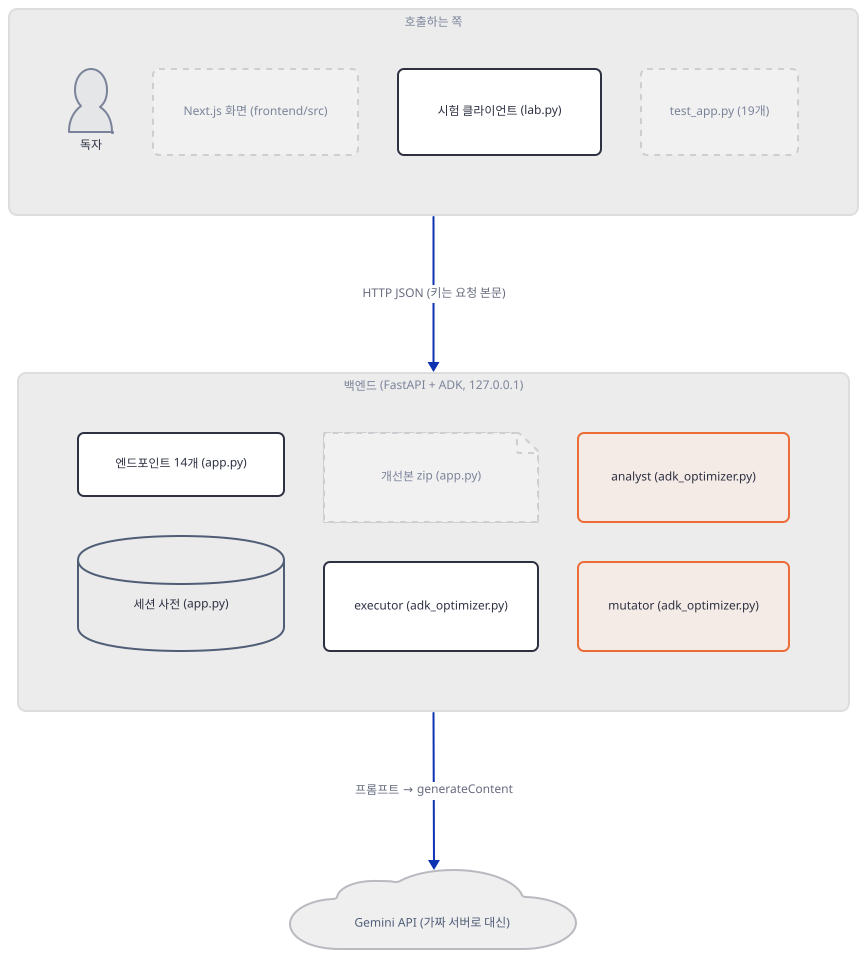

**확인.** 직접 확인한 출력입니다. 올린 파일 넷, 실험 20, 요청 151건입니다.

```text
zips/project-graveyard.zip 18314 bytes
upload: HTTP 200 {"session_id":"93e5f032-bcf8-446c-b55d-50ec1fd0053d","file_list":["README.md","SKILL.md","references\\causes-of-death.md","scripts\\graveyard.py"],"metadata":{"name":"project-graveyar
  실험  0  baseline   0.0%  
  실험  1  keep      25.0%  Add RULE 1
  실험  2  keep      50.0%  Add RULE 2
  실험  3  keep      75.0%  Add RULE 3
  실험  4  keep     100.0%  Add RULE 4
  실험 19  discard  100.0%  no change
  실험 20  discard  100.0%  no change
상태: complete | 오류: None
기준선 0.0 → 최종 100.0 | 실험 20 유지 4 버림 16
download: 200 application/zip 49875 bytes
  zip 안: ['README.md', 'SKILL.md', 'references/causes-of-death.md', 'scripts/graveyard.py', 'CHANGELOG.json']
요청 151 건
  analyst   diagnose    4건  프롬프트 2,362~2,556자
  executor  analyze     1건  프롬프트 11,138~11,138자
  executor  execute    63건  프롬프트 10,649~10,759자
  executor  score      63건  프롬프트 1,230~1,295자
  mutator   mutate     20건  프롬프트 10,750~10,832자
모델: ['gemini-3.8-flash'] | 키 앞부분: ['fake-key-AAAAA']
입력 합계 1,065,852자 ≈ 266,463토큰 (자수 ÷ 4의 어림)
분석 프롬프트: 11,138자 | 'Reference files:' 블록: False | 참고 파일: []
```

- **호출 수는 셈이 됩니다.** 분석 1 + 기준선(시나리오 3 × 2) 6 + 라운드 1~4(분석가 1 + 수정 1 + 재채점 6 = 8)가 32 + 라운드 5~20(분석가는 실패가 없어 부르지 않음, 수정 1 + 재채점 6 = 7)이 112 = 151. 실패가 있으면 분석가를 부르고, 없으면 `All passed`로 건너뛰지만(`adk_optimizer.py:327-334`) mutator는 그래도 부릅니다.
- **README의 "목표 통과율에서 멈춤"은 코드에 없습니다.** `StartRequest`(`app.py:122-125`)에 목표 점수 필드가 없고 루프는 `range(1, max_rounds + 1)`을 다 돕니다. 점수가 100%가 된 4라운드 뒤로 16라운드가 "no change"로 돌았습니다. 화면은 `max_rounds: 20`을 고정해서 보냅니다(`RunningStep.tsx:61`).
- **입력의 대부분이 `SKILL.md` 전문의 반복입니다.** 입력 합계 1,065,852자(≈ 266,000토큰, 자수 ÷ 4의 어림)에서 실행 프롬프트 63개가 각각 스킬 전문(약 10.6K자)을 담아 약 63%입니다. analyst의 프롬프트는 2.4~2.6K자뿐이고 mutator는 전문 10.8K자입니다.
- **비용 어림(⚠ 추정).** 공식 요금표(2026-10-16 갱신)의 `gemini-3.8-flash` 유료 입력은 100만 토큰당 $0.75(2026-12-31까지, 2027-01-01부터 $1.50)이므로 입력 26.6만 토큰은 $0.20(나중엔 $0.40)입니다. 출력은 가짜 서버가 짧게 답해서 재지 못했습니다. 100만 토큰당 $3.75(생각 토큰 포함)에 mutator가 스킬 전문(약 2.7K토큰)을 20번 돌려주는 것만 해도 약 5만 토큰입니다. 실행·채점 출력과 생각 토큰까지 10만~30만 토큰이라고 가정하면 0.4~1.1달러입니다. 합쳐 **1달러 안팎**이지만 모델이 실제로 얼마나 쓰는지는 모르는 어림입니다.
- **스크립트는 한 번도 돌지 않습니다.** 올린 `scripts/graveyard.py`(25,533바이트)는 어느 프롬프트에도 없습니다. 모델은 `SKILL.md` 글만 받고 "이 스킬이 낼 출력"을 흉내 냅니다. 스크립트가 일하는 스킬은 이 방식으로 재면 스크립트가 낸 결과를 모델이 지어내게 됩니다. 그리고 고치는 것도 `SKILL.md` 하나뿐입니다(`skill_md`는 이름이 `SKILL.md`로 끝나는 첫 파일, `adk_optimizer.py:141-143`).

이제 점수라는 신호를 의심해 봅니다. 가짜 서버의 판정을 25% 확률로 뒤집고(`D161_NOISE=0.25`, 씨앗 7) 변경은 아무것도 바꾸지 않게(`D161_MUTATOR=noop`) 한 뒤 12라운드를 돌립니다. 터미널 A를 아래처럼 다시 띄웁니다.

```bash
# 터미널 A (다시)
cd "${LAB:?먼저 Step 1의 환경 블록을 실행하세요}/work" || return
D161_MUTATOR=noop D161_NOISE=0.25 "$PY" fake_gemini.py "$FAKE_PORT" fake.log
```

```powershell
# 터미널 A (다시, PowerShell)
Set-Location "$env:LAB\work"
try { $env:D161_MUTATOR = "noop"; $env:D161_NOISE = "0.25"; & $PY fake_gemini.py $env:FAKE_PORT fake.log }
finally { Remove-Item Env:D161_MUTATOR,Env:D161_NOISE -ErrorAction SilentlyContinue }
```

```bash
cd "${LAB:?먼저 Step 1의 환경 블록을 실행하세요}/work" || return
cat > probe_noise.py <<'EOF'
"""아무것도 바꾸지 않는 변경도 '개선'으로 남는지 본다. 사용: python probe_noise.py <zip> [라운드]
가짜 모델 서버를 D161_MUTATOR=noop D161_NOISE=0.25로 띄워 둔다(판정의 25%가 거꾸로 나온다)."""
import io
import os
import sys
import zipfile

sys.path.insert(0, os.path.dirname(os.path.abspath(__file__)))
import lab  # noqa: E402

zip_path, rounds = sys.argv[1], int(sys.argv[2]) if len(sys.argv) > 2 else 20
original = zipfile.ZipFile(zip_path).read("rule-demo/SKILL.md").decode()
sid, improved = lab.flow(zip_path, rounds)
print("개선된 SKILL.md가 원본과 같은가:", improved.replace("\r\n", "\n") == original)
EOF
```

```bash
cd "${LAB:?먼저 Step 1의 환경 블록을 실행하세요}/work" || return
"$PY" probe_noise.py zips/good.zip 12 > noise.txt
sed -n '5,17p' noise.txt
grep -E "^(기준선|개선된)" noise.txt
```

```text
  실험  0  baseline  50.0%  
  실험  1  discard   25.0%  no change
  실험  2  discard   50.0%  no change
  실험  3  discard    8.3%  no change
  실험  4  discard   25.0%  no change
  실험  5  discard    8.3%  no change
  실험  6  discard   33.3%  no change
  실험  7  discard   25.0%  no change
  실험  8  discard   41.7%  no change
  실험  9  discard    8.3%  no change
  실험 10  keep      66.7%  no change
  실험 11  discard   33.3%  no change
  실험 12  discard   41.7%  no change
기준선 50.0 → 최종 66.7 | 실험 12 유지 1 버림 11
개선된 SKILL.md가 원본과 같은가: True
```

아무것도 바꾸지 않았는데 기준선 50.0%에서 10라운드의 "no change"가 66.7%로 **남겨졌고**(`keep`) 최종 보고는 50.0 → 66.7, "유지 1"입니다. 내려받은 `SKILL.md`는 원본과 같습니다. 판정이 한 번 운 좋게 오르면 `baseline = result`(`adk_optimizer.py:234`)로 그 점수가 새 기준이 되어 이후 라운드는 더 높은 값을 넘어야 합니다. 앱은 한 번의 표본만 비교하고 같은 스킬을 다시 재지 않습니다. 이 잡음 25%는 제가 정한 값이라 실제 Gemini 판정이 얼마나 흔들리는지는 모릅니다. 시나리오 3개 × 기준 4개면 확인이 12개라 한 칸이 8.3%포인트입니다.

다음은 점수는 오르는데 구조가 깨지는 변경입니다. mutator의 지시문은 "YAML 머리말과 전체 구조를 유지하라"(`adk_optimizer.py:86-87`)이지만 검사하는 코드는 없습니다. 가짜 mutator가 두 번째 변경에서 머리말을 지우게 하고(`D161_MUTATOR=break`) 4라운드를 돌린 뒤, 내려받은 결과를 스크래치에 풀어 저장소의 구조 검사에 넣습니다. 비교용으로 정상 변경(`rule`)의 결과도 같은 검사를 받습니다.

```bash
# 터미널 A (다시)
cd "${LAB:?먼저 Step 1의 환경 블록을 실행하세요}/work" || return
D161_MUTATOR=break "$PY" fake_gemini.py "$FAKE_PORT" fake.log
```

```powershell
# 터미널 A (다시, PowerShell)
Set-Location "$env:LAB\work"
try { $env:D161_MUTATOR = "break"; & $PY fake_gemini.py $env:FAKE_PORT fake.log } finally { Remove-Item Env:D161_MUTATOR -ErrorAction SilentlyContinue }
```

```bash
cd "${LAB:?먼저 Step 1의 환경 블록을 실행하세요}/work" || return
cat > probe_break.py <<'EOF'
"""점수가 오르면 구조를 깨는 변경도 남는지 본다. 사용: python probe_break.py <zip> <풀어 둘 폴더>
가짜 모델 서버를 D161_MUTATOR=break로 띄워 둔다(두 번째 변경이 머리말 전체를 지운다)."""
import io
import os
import sys
import zipfile

sys.path.insert(0, os.path.dirname(os.path.abspath(__file__)))
import lab  # noqa: E402

zip_path, dest = sys.argv[1], sys.argv[2]
sid, improved = lab.flow(zip_path, 4)
print("개선된 SKILL.md 첫 줄:", repr(improved.splitlines()[0]), "| 머리말(---)로 시작하는가:", improved.startswith("---"))
data = lab.client.get(f"/api/download/{sid}").content
os.makedirs(dest, exist_ok=True)
zipfile.ZipFile(io.BytesIO(data)).extractall(os.path.join(dest, "rule-demo"))  # 스크래치에만 푼다
print("풀어 둔 곳:", os.path.join(dest, "rule-demo"), sorted(os.listdir(os.path.join(dest, "rule-demo"))))
EOF
```

```bash
cd "${LAB:?먼저 Step 1의 환경 블록을 실행하세요}/work" || return
"$PY" probe_break.py zips/good.zip broken | tail -3 | cut -c1-120
```

```bash
# 터미널 A (다시, 기본 대본으로. 앞의 앞붙임 변수가 남아 있지 않은 새 실행)
cd "${LAB:?먼저 Step 1의 환경 블록을 실행하세요}/work" || return
"$PY" fake_gemini.py "$FAKE_PORT" fake.log
```

```powershell
# 터미널 A (다시, 기본 대본으로, PowerShell). 앞에서 지우지 않았다면 먼저 지웁니다
Remove-Item Env:D161_MUTATOR,Env:D161_NOISE,Env:D161_DELAY -ErrorAction SilentlyContinue
Set-Location "$env:LAB\work"; & $PY fake_gemini.py $env:FAKE_PORT fake.log
```

```bash
cd "${LAB:?먼저 Step 1의 환경 블록을 실행하세요}/work" || return
"$PY" probe_break.py zips/good.zip intact | tail -2 | cut -c1-120
```

```bash
cd "${LAB:?먼저 Step 1의 환경 블록을 실행하세요}/work" || return
for d in intact broken; do
  echo "== $d"
  "$PY" -B -X utf8 "$REPO/agent_skills/evals/tools/skill_lint.py" "$d/rule-demo" --strict
done
```

```text
  zip 안: ['SKILL.md', 'references/notes.md', 'scripts/run.py', 'CHANGELOG.json']
개선된 SKILL.md 첫 줄: '# Rule demo' | 머리말(---)로 시작하는가: False
풀어 둔 곳: broken\rule-demo ['CHANGELOG.json', 'SKILL.md', 'references', 'scripts']
```

```text
개선된 SKILL.md 첫 줄: '---' | 머리말(---)로 시작하는가: True
풀어 둔 곳: intact\rule-demo ['CHANGELOG.json', 'SKILL.md', 'references', 'scripts']
```

```text
== intact
Linting <LAB>\work\intact\rule-demo (strict=on)
  WARN:  description is only 43 characters — too thin to trigger reliably; add what the skill does plus 'Use when …' contexts with the keywords users actually type
  WARN:  description never states when to use the skill: add an explicit 'Use when …' clause with trigger phrases — the description is the only text agents see before activation
  PASS — 0 error(s), 2 warning(s)
== broken
Linting <LAB>\work\broken\rule-demo (strict=on)
  ERROR: frontmatter parse error: SKILL.md must begin with a '---' YAML frontmatter block on line 1
  FAIL — 1 error(s), 0 warning(s)
```

머리말을 지운 변경은 점수가 25%에서 50%로 올랐으므로 남았고(`Add RULE 2 (and drop the frontmatter)`가 `keep`), 내려받은 `SKILL.md`는 `---`로 시작하지 않습니다. 정상 변경의 결과는 구조 검사가 통과(경고 둘은 설명이 43자로 얇다는 것)하지만 머리말 없는 결과는 "frontmatter parse error"로 **실패**합니다. [명세](https://agentskills.io/specification)가 `description`을 에이전트가 처음 읽는 글로 정의하는 만큼, 이 앱이 점수만 보고 남긴 변경이 스킬을 에이전트에게 보이지 않게 만들 수 있습니다. 이것은 가짜 mutator가 그렇게 대본에 있어서 나온 결과이고 Gemini가 그렇게 한다는 말은 아닙니다. 다만 앱에는 그것을 막는 줄이 없습니다. 마지막으로 앱 README는 이 루프를 Karpathy의 [autoresearch](https://github.com/karpathy/autoresearch)에서 왔다고 소개합니다. 그 저장소의 README(2026-10-19에 읽음)는 에이전트가 코드를 고치고, 5분 학습한 뒤 결과가 나아졌는지 보고, 남기거나 버리고 되풀이한다고 설명합니다. 모양은 같지만 거기서 재는 것은 실제 학습 결과이고, 이 앱이 재는 것은 같은 모델이 자기 출력에 매긴 예·아니오입니다.

### Step 6. 멈춤·상태·내려받기와 오류 — 화면이 부르는 나머지 길

**목적.** 화면이 시작한 뒤 부르는 길(상태, 멈춤, 내려받기), 화면이 부르지 않는 길(스트림), 그리고 오류가 어떻게 올라오는지 봅니다.

**할 일.** 가짜 서버를 느리게(`D161_DELAY=0.1`) 띄우고 여섯 라운드를 시작한 뒤 1.5초 만에 멈춤을 부릅니다. 같은 세션에 시작을 한 번 더 보내는 것도 같이 봅니다(`RunningStep.tsx:69`가 이 400을 알아서 넘기는 줄입니다).

```bash
# 터미널 A (다시)
cd "${LAB:?먼저 Step 1의 환경 블록을 실행하세요}/work" || return
D161_DELAY=0.1 "$PY" fake_gemini.py "$FAKE_PORT" fake.log
```

```powershell
# 터미널 A (다시, PowerShell)
Set-Location "$env:LAB\work"
try { $env:D161_DELAY = "0.1"; & $PY fake_gemini.py $env:FAKE_PORT fake.log } finally { Remove-Item Env:D161_DELAY -ErrorAction SilentlyContinue }
```

```bash
cd "${LAB:?먼저 Step 1의 환경 블록을 실행하세요}/work" || return
cat > probe_stop.py <<'EOF'
"""멈춤 버튼이 하는 일을 본다. 사용: python probe_stop.py <zip> <fake 기록 파일>
가짜 모델 서버를 느리게(D161_DELAY=0.1) 띄워 두고 돌린다."""
import os
import sys
import time

sys.path.insert(0, os.path.dirname(os.path.abspath(__file__)))
import lab  # noqa: E402

zip_path, logfile = sys.argv[1], sys.argv[2]


def n_requests():
    with open(logfile, encoding="utf-8") as f:
        return sum(1 for _ in f)


c = lab.client
sid = c.post("/api/upload", files={"file": ("s.zip", open(zip_path, "rb"), "application/zip")}).json()["session_id"]
a = c.post("/api/analyze", json={"session_id": sid, "gemini_api_key": lab.KEY}).json()
c.post("/api/update-config", json={"session_id": sid, "scenarios": a["scenarios"], "evals": a["evals"]})
c.post(f"/api/start/{sid}", json={"gemini_api_key": lab.KEY, "max_rounds": 6})
again = c.post(f"/api/start/{sid}", json={"gemini_api_key": lab.KEY, "max_rounds": 6})
print(f"같은 세션에 시작을 한 번 더 → HTTP {again.status_code} {again.json()}")
time.sleep(1.5)
before = n_requests()
r = c.post(f"/api/stop/{sid}")
print(f"멈춤 요청 → HTTP {r.status_code} {r.json()} | 그때까지 모델 서버가 받은 요청 {before}건")
t0 = time.time()
last = None
while True:
    st = c.get(f"/api/status/{sid}").json()
    if st["status"] != last:
        print(f"  +{time.time() - t0:4.1f}s 상태 {st['status']!r}, 요청 누계 {n_requests()}건, 실험 {len(st['experiments'])}개")
        last = st["status"]
    if st["status"] == "complete":
        break
    time.sleep(0.2)
print(f"끝난 뒤 모델 서버가 받은 요청 {n_requests()}건 (멈춤 뒤 {n_requests() - before}건 더)")
EOF
```

`probe_stop.py`는 기록 파일의 줄 수를 세므로 시작 전에 기록을 비웁니다(PowerShell은 `Clear-Content fake.log`).

```bash
cd "${LAB:?먼저 Step 1의 환경 블록을 실행하세요}/work" || return
: > fake.log
"$PY" probe_stop.py zips/good.zip fake.log
```

가짜 서버를 기본 대본으로 되돌립니다. 터미널 A를 멈추고 앞붙임 변수 없이 다시 띄웁니다(PowerShell은 `Remove-Item Env:D161_DELAY`를 먼저 합니다).

```bash
# 터미널 A (다시, 기본 대본)
cd "${LAB:?먼저 Step 1의 환경 블록을 실행하세요}/work" || return
"$PY" fake_gemini.py "$FAKE_PORT" fake.log
```

나머지를 봅니다. `probe_sse.py`는 화면이 쓰지 않는 `/api/stream`을 읽고, `probe_names.py`는 `SKILL.md`가 둘인 zip을 개선해 내려받고, `probe_errors.py`는 오류가 올라오는 길을 보고, `probe_examples.py`는 예제 목록을 봅니다.

```bash
cd "${LAB:?먼저 Step 1의 환경 블록을 실행하세요}/work" || return
cat > probe_sse.py <<'EOF'
"""/api/stream 이 보내는 이벤트를 본다(화면은 이 주소를 부르지 않는다). 사용: python probe_sse.py <zip>"""
import json
import os
import sys

sys.path.insert(0, os.path.dirname(os.path.abspath(__file__)))
import lab  # noqa: E402

c = lab.client
sid = c.post("/api/upload", files={"file": ("s.zip", open(sys.argv[1], "rb"), "application/zip")}).json()["session_id"]
a = c.post("/api/analyze", json={"session_id": sid, "gemini_api_key": lab.KEY}).json()
c.post("/api/update-config", json={"session_id": sid, "scenarios": a["scenarios"], "evals": a["evals"]})
c.post(f"/api/start/{sid}", json={"gemini_api_key": lab.KEY, "max_rounds": 2})
with c.stream("GET", f"/api/stream/{sid}") as r:
    print("HTTP", r.status_code, r.headers["content-type"])
    for line in r.iter_lines():
        if line.startswith("data: "):
            ev = json.loads(line[6:])
            d = ev["data"]
            print(f"  data: type={ev['type']!r:20} keys={sorted(d)}")
print("스트림이 닫혔다")
EOF
```

```bash
cd "${LAB:?먼저 Step 1의 환경 블록을 실행하세요}/work" || return
cat > probe_names.py <<'EOF'
"""두 SKILL.md가 든 zip을 한 번 개선해 내려받고, 어느 파일의 내용이 바뀌었는지 본다."""
import io
import os
import sys
import zipfile

sys.path.insert(0, os.path.dirname(os.path.abspath(__file__)))
import lab  # noqa: E402

lab.client.timeout = 60
r = lab.upload(sys.argv[1])
sid = r.json()["session_id"]
print("올린 파일:", r.json()["file_list"], "| 메타데이터 이름:", r.json()["metadata"].get("name"))
a = lab.client.post("/api/analyze", json={"session_id": sid, "gemini_api_key": lab.KEY}).json()
lab.client.post("/api/update-config", json={"session_id": sid, "scenarios": a["scenarios"], "evals": a["evals"]})
lab.client.post(f"/api/start/{sid}", json={"gemini_api_key": lab.KEY, "max_rounds": 1})
import time
while lab.client.get(f"/api/status/{sid}").json()["status"] == "running":
    time.sleep(0.3)
z = zipfile.ZipFile(io.BytesIO(lab.client.get(f"/api/download/{sid}").content))
for n in z.namelist():
    text = z.read(n).decode()
    name = next((l for l in text.splitlines() if l.startswith("name:")), "(name: 줄 없음)")
    print(f"  {n:28s} {name:16s} RULE 1 있음: {'RULE 1' in text}")
EOF
```

```bash
cd "${LAB:?먼저 Step 1의 환경 블록을 실행하세요}/work" || return
cat > probe_errors.py <<'EOF'
"""오류가 화면까지 어떻게 올라오는지 본다. 사용: python probe_errors.py <zip>"""
import os
import sys
import time

sys.path.insert(0, os.path.dirname(os.path.abspath(__file__)))
import lab  # noqa: E402

c = lab.client
sid = c.post("/api/upload", files={"file": ("s.zip", open(sys.argv[1], "rb"), "application/zip")}).json()["session_id"]
for label, model in (("모델 이름이 모양부터 틀림", "bad name!"), ("모양은 맞지만 없는 모델", "gemini-does-not-exist")):
    r = c.post("/api/analyze", json={"session_id": sid, "gemini_api_key": lab.KEY, "model": model})
    print(f"analyze, {label} → HTTP {r.status_code} {r.json()}")
# 분석을 건너뛰고 설정을 직접 저장한 뒤 없는 모델로 시작하면 오류가 어디에 남는가
c.post("/api/update-config", json={"session_id": sid, "scenarios": [{"id": 1, "input": "x"}], "evals": [{"id": 1, "name": "e"}]})
print("start →", c.post(f"/api/start/{sid}", json={"gemini_api_key": lab.KEY, "model": "gemini-does-not-exist"}).json())
while c.get(f"/api/status/{sid}").json()["status"] == "running":
    time.sleep(0.2)
st = c.get(f"/api/status/{sid}").json()
print("status:", st["status"], "| error 앞 120자:", (st["error"] or "")[:120].replace("\n", " "))
EOF
```

```bash
cd "${LAB:?먼저 Step 1의 환경 블록을 실행하세요}/work" || return
cat > probe_examples.py <<'EOF'
"""/api/examples 목록과 각 예제 불러오기, 그리고 화면이 쓰는 두 이름을 시험한다."""
import os
import sys

sys.path.insert(0, os.path.dirname(os.path.abspath(__file__)))
import lab  # noqa: E402

ex = lab.client.get("/api/examples").json()["examples"]
print("목록:", len(ex), "개")
for e in ex:
    print(f"  {e['path']:28s} 설명: {e['description'][:24]!r}")
names = [e["path"] for e in ex] + ["code-reviewer", "content-writer", "..", "%2e%2e", "self-improving-agent-skills"]
for n in names:
    r = lab.client.post(f"/api/examples/{n}/load")
    if r.status_code == 200:
        d = r.json()
        print(f"load {n:28s} HTTP 200 파일 {len(d['file_list'])}개")
    else:
        print(f"load {n:28s} HTTP {r.status_code} {r.text[:90]}")
EOF
```

```bash
cd "${LAB:?먼저 Step 1의 환경 블록을 실행하세요}/work" || return
"$PY" probe_sse.py zips/good.zip
```

```bash
cd "${LAB:?먼저 Step 1의 환경 블록을 실행하세요}/work" || return
"$PY" probe_names.py zips/twoskills.zip
```

```bash
cd "${LAB:?먼저 Step 1의 환경 블록을 실행하세요}/work" || return
"$PY" probe_errors.py zips/good.zip
```

```bash
cd "${LAB:?먼저 Step 1의 환경 블록을 실행하세요}/work" || return
"$PY" probe_examples.py
```

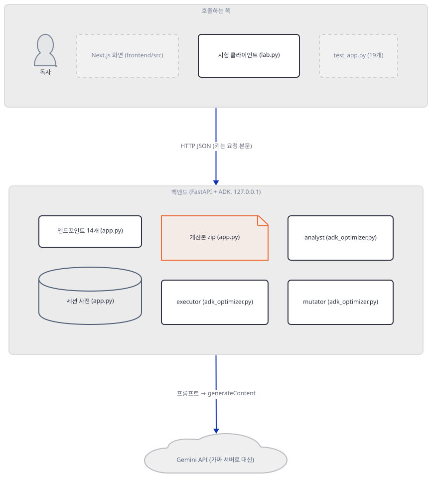

**확인.** 직접 확인한 출력입니다.

```text
같은 세션에 시작을 한 번 더 → HTTP 400 {'detail': 'Optimization already running'}
멈춤 요청 → HTTP 200 {'status': 'stopped'} | 그때까지 모델 서버가 받은 요청 5건
  + 0.0s 상태 'stopped', 요청 누계 5건, 실험 0개
  +20.7s 상태 'complete', 요청 누계 53건, 실험 7개
끝난 뒤 모델 서버가 받은 요청 53건 (멈춤 뒤 48건 더)
```

```text
HTTP 200 text/event-stream; charset=utf-8
  data: type='baseline'           keys=['passed', 'per_eval', 'score', 'total']
  data: type='experiment_start'   keys=['round']
  data: type='experiment_result'  keys=['description', 'kept', 'per_eval', 'round', 'score', 'status', 'strategy']
  data: type='experiment_start'   keys=['round']
  data: type='experiment_result'  keys=['description', 'kept', 'per_eval', 'round', 'score', 'status', 'strategy']
  data: type='complete'           keys=['baseline_score', 'final_score', 'improved_skill_md', 'mutation_log', 'score_history', 'strategy_stats']
스트림이 닫혔다
```

```text
올린 파일: ['examples\\SKILL.md', 'SKILL.md', 'references\\OLD-SKILL.md'] | 메타데이터 이름: inner
  examples/SKILL.md            name: inner      RULE 1 있음: True
  SKILL.md                     name: inner      RULE 1 있음: True
  references/OLD-SKILL.md      name: inner      RULE 1 있음: True
  CHANGELOG.json               (name: 줄 없음)     RULE 1 있음: True
```

```text
analyze, 모델 이름이 모양부터 틀림 → HTTP 400 {'detail': 'Invalid model name'}
analyze, 모양은 맞지만 없는 모델 → HTTP 500 {'detail': 'Analysis failed. Check your API key and try again.'}
start → {'status': 'started', 'model': 'gemini-does-not-exist'}
status: error | error 앞 120자: 404 NOT_FOUND. {'error': {'code': 404, 'message': 'models/gemini-does-not-exist is not found for API version v1beta', 's
```

```text
목록: 7 개
  advisor-orchestrator-worker  설명: '>-'
  commit-archaeologist         설명: '>-'
  dependency-doctor            설명: '>-'
  first-reader                 설명: 'Beta readers for any dra'
  project-graveyard            설명: '>-'
  scope-creep-detector         설명: '>-'
  thinking-out-loud            설명: '>-'
load advisor-orchestrator-worker  HTTP 500 Internal Server Error
load commit-archaeologist         HTTP 200 파일 4개
load dependency-doctor            HTTP 200 파일 4개
load first-reader                 HTTP 200 파일 13개
load project-graveyard            HTTP 200 파일 4개
load scope-creep-detector         HTTP 200 파일 4개
load thinking-out-loud            HTTP 200 파일 3개
load code-reviewer                HTTP 404 {"detail":"Example skill not found"}
load content-writer               HTTP 404 {"detail":"Example skill not found"}
load ..                           HTTP 404 {"detail":"Not Found"}
load %2e%2e                       HTTP 400 {"detail":"Invalid example name"}
load self-improving-agent-skills  HTTP 400 {"detail":"No SKILL.md found"}
```

`cp949_check.py`는 서버 없이 `TestClient`로 같은 두 엔드포인트를 UTF-8 모드를 끄고 부릅니다.

```bash
cd "${LAB:?먼저 Step 1의 환경 블록을 실행하세요}/work" || return
cat > cp949_check.py <<'EOF'
"""UTF-8 모드가 아닐 때(한국어 Windows 기본 cp949) 예제 목록이 어떻게 되는지 본다. 사용: BACKEND=<backend 폴더> python -X utf8=0 cp949_check.py"""
import locale
import os
import sys

sys.dont_write_bytecode = True
sys.path.insert(0, os.environ["BACKEND"])
from fastapi.testclient import TestClient  # noqa: E402

import app as backend  # noqa: E402

print("preferred encoding:", locale.getpreferredencoding(False), "| utf8_mode:", sys.flags.utf8_mode)
c = TestClient(backend.app, raise_server_exceptions=False)
print("/api/examples ->", c.get("/api/examples").status_code)
for n in ("project-graveyard", "commit-archaeologist", "thinking-out-loud"):
    print("load", n, "->", c.post(f"/api/examples/{n}/load").status_code)
EOF
```

```bash
cd "${LAB:?먼저 Step 1의 환경 블록을 실행하세요}/work" || return
"$PY" -X utf8=0 -B cp949_check.py 2>&1 | grep -E "^(preferred|/api|load)"
```

```text
preferred encoding: cp949 | utf8_mode: 0
/api/examples -> 500
load project-graveyard -> 500
load commit-archaeologist -> 500
load thinking-out-loud -> 500
```

- **멈춤은 상태 글자만 바꿉니다.** `/api/stop`(`app.py:475-485`)은 `stop_requested`를 `True`로 쓰고 상태를 `stopped`로 바꾸지만, 그 값을 읽는 줄이 `app.py`와 `adk_optimizer.py` 어디에도 없습니다. 멈춤을 보낼 때 가짜 서버가 받은 요청이 5건이었는데 끝나고 보니 53건, 멈춘 뒤에도 **48건**이 더 나갔고 상태는 20초 뒤 `complete`로 돌아왔습니다. 화면은 `stopped`를 받으면 폴링을 접고 멈춘 줄 알지만 서버는 남은 라운드를 다 돌고, 진짜 모델이라면 그만큼의 요금이 붙습니다. 상태가 `complete`로 덮이는 것은 콜백(`app.py:395-396`)과 끝부분(`app.py:462`)이 상태를 다시 쓰기 때문입니다.
- **화면은 폴링, 서버는 스트림도 줍니다.** `/api/stream`은 `baseline`·`experiment_start`·`experiment_result`·`complete` 이벤트를 SSE로 보내고 `complete`에는 개선된 `SKILL.md` 전문이 실립니다. 그런데 화면에는 `EventSource`도 이 주소 호출도 없고(Step 7의 `grep`), `/api/status`를 3초마다 읽습니다. README가 이 앱의 특징으로 내세우는 "SSE로 실시간 진행"은 화면에서는 쓰이지 않습니다.
- **`SKILL.md`가 둘이면 다 덮어씁니다.** `/api/download`(`app.py:499-504`)는 이름이 `SKILL.md`로 끝나는 **모든** 파일에 개선된 글을 씁니다. `twoskills.zip`을 개선해 내려받으면 안쪽 `examples/SKILL.md`(`name: inner`)가 개선 대상으로 뽑혔고, 결과 zip의 **루트 `SKILL.md`와 `references/OLD-SKILL.md`까지** 그 글로 바뀌었습니다. 내려받는 zip에는 `CHANGELOG.json`이 덧붙습니다(`app.py:505-507`).
- **`/api/analyze`는 원인을 숨기고 `/api/start`는 드러냅니다.** 모양이 틀린 모델 이름은 400 `Invalid model name`으로 바로 거절되지만, 모양이 맞고 서버에 없는 모델은 분석에서 500 `Analysis failed. Check your API key and try again.`로만 올라옵니다(`app.py:295-297`). 로그에는 트레이스백이 남지만 화면에는 "키를 확인하라"는 말만 갑니다. 시작한 뒤의 오류는 `status.error`에 원문이 담겨 404 `NOT_FOUND`가 그대로 보입니다.
- **예제 버튼은 서버가 모르는 이름입니다.** 화면의 두 예제(`code-reviewer`, `content-writer`, `UploadStep.tsx:53-64`)는 `/api/examples/<이름>/load`에서 404이고, 서버가 실제로 갖는 목록(`agent_skills/` 아래 `SKILL.md`가 있는 폴더 일곱)은 화면이 부르지 않습니다. 목록의 설명은 `description: >-`인 여섯 스킬에서 `>-`입니다. 일곱 중 하나(`advisor-orchestrator-worker`)는 폴더에 JPEG가 있어 `open(..., "r")`이 UTF-8로 읽다가 500입니다(`app.py:559`. 위 출력은 환경 파일이 `PYTHONUTF8=1`을 켠 UTF-8 모드의 것입니다. 아래 `cp949_check.py`를 `-X utf8=0`으로 돌리면 한국어 Windows의 기본 인코딩(cp949)이 되어 목록 자체가 500이 됩니다). 이 앱의 폴더 자신은 `SKILL.md`가 없어 불러지지 않습니다. 앱 README의 구조도(49~50행)가 `frontend/` 아래에 두는 `code-reviewer/`·`content-writer/` 폴더도 저장소에 없습니다.
- **세션은 메모리에만 있습니다.** `sessions` 사전(`app.py:33`)에 담기고 5분마다 1시간이 지난 것을 지웁니다(`app.py:63-76`. 실행 중인 세션은 지우지 않습니다). 서버를 다시 띄우면 모두 사라집니다. 내려받는 zip을 만드는 임시 폴더는 60초 뒤에 지웁니다(`app.py:513-518`).

### Step 7. Next.js 화면을 소스로 읽는다 (실행하지 않음)

**목적.** 화면이 부르는 요청이 지금까지 시험한 요청과 같은지, 화면에만 있는 결정이 무엇인지 소스로 읽습니다. **이 문서는 화면을 실행하지 않았고 `npm install`도 하지 않았습니다.** 설치 스크립트가 임의 코드를 돌리고 패키지 수백 개를 내려받기 때문입니다. 그래서 지금까지의 `lab.py`가 화면의 자리였습니다.

**할 일.** 화면은 `page.tsx`(116줄)가 단계(1~4)와 세션 아이디·키·모델·시나리오·평가·결과를 `useState`로 들고, 네 컴포넌트가 단계마다 하나씩입니다. `UploadStep`(407줄)이 업로드·분석을, `ConfigStep`(373)이 시나리오와 기준의 편집·재생성·저장을, `RunningStep`(313)이 시작·폴링·멈춤과 차트를, `ResultsStep`(190)이 점수·변경 목록·diff·내려받기를 맡습니다. 요청을 부르는 줄을 모으고, 고정된 값과 저장소 사용, HTML을 직접 넣는 곳을 찾고, 의존성 잠금 파일을 읽습니다.

```bash
cd "${LAB:?먼저 Step 1의 환경 블록을 실행하세요}/work" || return
cd "$REPO/agent_skills/self-improving-agent-skills/frontend"
grep -rn "fetch(" src | cut -c1-110
grep -rn "EventSource\|/api/stream" src || echo "(화면에 EventSource도 /api/stream 호출도 없다)"
grep -n "max_rounds\|3000" src/components/RunningStep.tsx
grep -rn "localStorage" src | cut -c1-90
grep -rn "dangerouslySetInnerHTML" src | cut -c1-90
sed -n 53,64p src/components/UploadStep.tsx
cd "$LAB/work"
```

```bash
cd "${LAB:?먼저 Step 1의 환경 블록을 실행하세요}/work" || return
cat > lockscan.py <<'EOF'
"""package-lock.json을 읽기만 한다(설치하지 않는다). 사용: python lockscan.py <package-lock.json>"""
import collections
import json
import sys
from urllib.parse import urlparse

lock = json.load(open(sys.argv[1], encoding="utf-8"))
pk = {k: v for k, v in lock["packages"].items() if k}
print("lockfileVersion", lock["lockfileVersion"], "| 패키지", len(pk), "개 | 이름은", lock["name"], lock["version"])
hosts = collections.Counter(urlparse(v["resolved"]).netloc for v in pk.values() if "resolved" in v)
print("내려받는 곳:", dict(hosts))
scripts = sorted(k.split("node_modules/")[-1] for k, v in pk.items() if v.get("hasInstallScript"))
print("설치 스크립트가 있는 패키지:", scripts)
for name in ("next", "react", "react-dom", "recharts", "diff", "lucide-react", "tailwindcss", "typescript"):
    v = pk.get(f"node_modules/{name}")
    if v:
        print(f"  {name:13s} {v['version']:10s} engines={v.get('engines')}")
print("개발 전용:", sum(1 for v in pk.values() if v.get("dev")), "개 | 선택(optional):", sum(1 for v in pk.values() if v.get("optional")), "개")
EOF
```

```bash
cd "${LAB:?먼저 Step 1의 환경 블록을 실행하세요}/work" || return
"$PY" lockscan.py "$REPO/agent_skills/self-improving-agent-skills/frontend/package-lock.json"
```

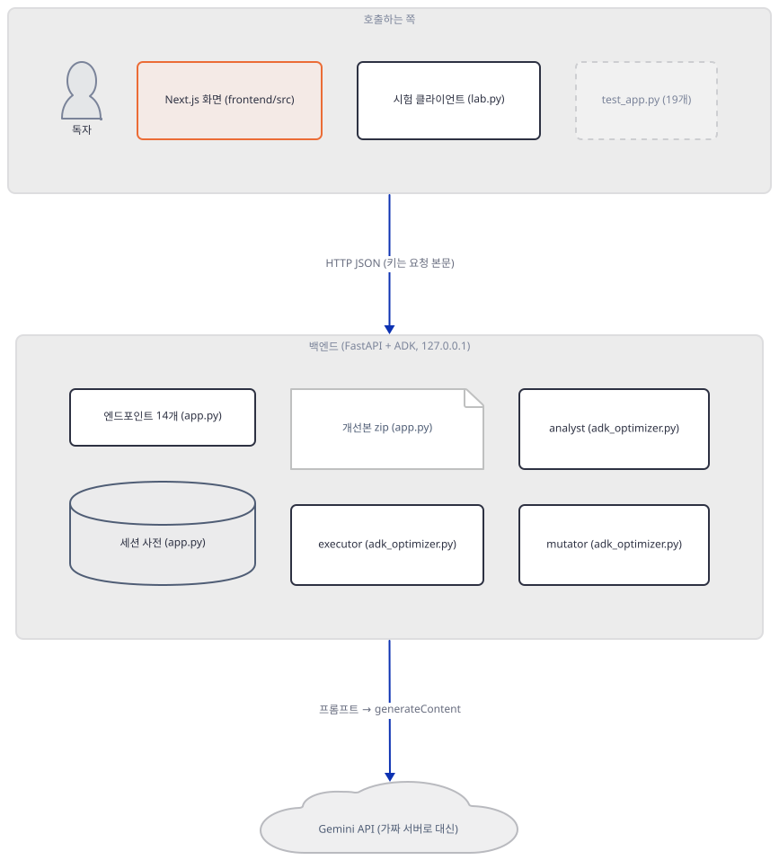

**확인.** 직접 확인한 출력입니다(읽기만 했습니다).

```text
src/components/ConfigStep.tsx:106:      const response = await fetch(`${API_BASE}/api/regenerate`, {
src/components/ConfigStep.tsx:141:      const response = await fetch(`${API_BASE2}/api/update-config`, {
src/components/ResultsStep.tsx:22:      const response = await fetch(
src/components/RunningStep.tsx:54:      const startResponse = await fetch(
src/components/RunningStep.tsx:81:            const res = await fetch(`${API_BASE}/api/status/${sessionId}`);
src/components/RunningStep.tsx:135:      await fetch(`${API_BASE2}/api/stop/${sessionId}`, {
src/components/UploadStep.tsx:83:    fetch(`${API_BASE}/api/models`)
src/components/UploadStep.tsx:141:      const response = await fetch(`${API_BASE}/api/upload`, {
src/components/UploadStep.tsx:168:      const response = await fetch(`${API_BASE}/api/upload-files`, {
src/components/UploadStep.tsx:191:      const response = await fetch(`${API_BASE}/api/analyze`, {
src/components/UploadStep.tsx:216:      const loadResponse = await fetch(`${API_BASE}/api/examples/${examplePa
src/components/UploadStep.tsx:227:      const analyzeResponse = await fetch(`${API_BASE}/api/analyze`, {
(화면에 EventSource도 /api/stream 호출도 없다)
61:            max_rounds: 20,
78:          await new Promise((r) => setTimeout(r, 3000));
src/app/layout.tsx:24:              var theme = localStorage.getItem('theme');
src/components/ThemeToggle.tsx:9:    const saved = localStorage.getItem("theme");
src/components/ThemeToggle.tsx:27:      localStorage.setItem("theme", "dark");
src/components/ThemeToggle.tsx:31:      localStorage.setItem("theme", "light");
src/app/layout.tsx:21:        <script dangerouslySetInnerHTML={{
const EXAMPLE_SKILLS = [
  {
    name: "Code Reviewer",
    description: "Reviews code for security, performance, and best practices",
    path: "code-reviewer",
  },
  {
    name: "Content Writer",
    description: "Writes marketing copy for landing pages and emails",
    path: "content-writer",
  },
];
```

```text
lockfileVersion 3 | 패키지 140 개 | 이름은 self-improving-skills-frontend 1.0.0
내려받는 곳: {'registry.npmjs.org': 140}
설치 스크립트가 있는 패키지: ['sharp']
  next          15.5.15    engines={'node': '^18.18.0 || ^19.8.0 || >= 20.0.0'}
  react         19.2.4     engines={'node': '>=0.10.0'}
  react-dom     19.2.4     engines=None
  recharts      2.15.4     engines={'node': '>=14'}
  diff          7.0.0      engines={'node': '>=0.3.1'}
  lucide-react  0.468.0    engines=None
  tailwindcss   4.2.1      engines=None
  typescript    5.9.3      engines={'node': '>=14.17'}
개발 전용: 46 개 | 선택(optional): 59 개
```

- **요청이 같습니다.** 화면이 부르는 열두 곳이 `lab.py`가 보낸 요청과 같은 주소·같은 본문 모양입니다. 키는 네 곳(`UploadStep.tsx:194, 230`, `ConfigStep.tsx:111`, `RunningStep.tsx:60`)이 요청 본문에 담습니다. 주소는 `NEXT_PUBLIC_API_URL`이고 없으면 `http://localhost:8891`(`UploadStep.tsx:17`)입니다. 이 문서의 서버는 `127.0.0.1`로 열어 두었으니 화면을 쓰려면 `NEXT_PUBLIC_API_URL=http://127.0.0.1:51877`을 줘야 하고, `localhost`가 `::1`로 풀리면 `127.0.0.1`에만 연 서버에 닿지 않을 수 있습니다(시험하지 않았습니다).
- **고정된 값.** 반복은 `max_rounds: 20`, 상태는 3,000 ms마다. 목표 점수를 고르는 입력란은 없습니다(서버가 받지 않으니까요).
- **저장.** `localStorage`는 테마(`theme`)에만 씁니다. 키·세션 아이디·결과는 React 상태에만 있어 새로고침하면 사라지고 서버의 세션은 남습니다.
- **HTML을 직접 넣는 곳은 한 곳**이고 `layout.tsx`의 테마 스크립트(고정 문자열)입니다. 모델이 만든 글은 모두 React의 글 노드로 그려지므로 HTML로 해석되지 않습니다(소스로 확인).
- **diff는 빈 줄을 숨깁니다.** `ResultsStep.tsx`가 `diffLines`로 원본과 개선본을 비교하고 `filter((l) => l.trim())`으로 빈 줄을 뺍니다. 줄바꿈만 바뀐 변경은 이 화면에서 보이지 않습니다. "Top Changes"는 `keep` 상태 앞 다섯 개입니다.
- **의존성.** `package.json`은 `^` 범위이고 `package-lock.json`(lockfileVersion 3)이 140개 패키지를 모두 `registry.npmjs.org`로 못 박습니다. `next`는 15.5.15로 잠겼고 Node `^18.18.0 || ^19.8.0 || >= 20.0.0`을 요구합니다. 설치 스크립트가 있다고 표시된 패키지는 `sharp` 하나입니다. 앱 README는 `npm install`을 안내하는데, 잠금 파일대로 설치하려면 `npm ci`를 씁니다.

독자가 화면까지 띄우려면 앱 README(84~95행)의 명령이 이렇습니다. **이 문서는 아래 명령을 실행하지 않았습니다.**

```bash
cd agent_skills/self-improving-agent-skills/frontend
export NEXT_TELEMETRY_DISABLED=1   # PowerShell: $env:NEXT_TELEMETRY_DISABLED = "1"
npm install        # 이 문서는 실행하지 않았다
npm run dev        # 이 문서는 실행하지 않았다
```

실행하기 전에 알아 둘 점은 공식 문서로 읽은 것입니다. Next.js는 기본으로 익명 사용 통계를 모으고 `NEXT_TELEMETRY_DISABLED=1`이나 `next telemetry disable`로 끕니다([nextjs.org/telemetry](https://nextjs.org/telemetry), 2026-10-19에 읽음). 이 화면은 `next/font/google`(`layout.tsx:2`)로 Inter 글꼴을 쓰는데, 문서는 글꼴 CSS와 파일을 **빌드할 때 내려받아** 정적 파일로 두고 방문자의 브라우저는 Google에 요청하지 않는다고 합니다([글꼴 API](https://nextjs.org/docs/app/api-reference/components/font)). 그러니 `build`는 Google 글꼴 서버에서 받을 것으로 읽힙니다. 개발 서버(`dev`)도 그럴 것으로 보이나 이 문서는 확인하지 못했습니다. 모두 직접 해 본 것이 아니라 문서의 문장입니다.

### Step 8. 시험과 모델 상태, 마무리

**목적.** 앱이 가진 시험이 무엇을 보는지, 모델 제안 셋이 오늘 공식 문서에서 어떤 상태인지 확인하고 오늘을 닫습니다.

**할 일.** `test_app.py`를 **복사본**에서 돌립니다(원본 폴더에 아무것도 쓰지 않으려는 것입니다). 같은 시험을 `coverage`로 한 번 더 돌려 어느 줄이 시험에 닿는지 봅니다. 그다음 공식 문서 세 쪽(모델, 폐기, 요금)을 내려받아 글로 바꾸고 모델 셋의 행을 뽑습니다. 이 단계의 `curl`만 바깥(Google 문서 서버)에 닿는 읽기 요청이고 키는 싣지 않습니다.

```bash
cd "${LAB:?먼저 Step 1의 환경 블록을 실행하세요}/work" || return
cp -r "$BACKEND" "$LAB/tcopy"
cd "$LAB/tcopy"
"$PY" -B -m pytest -p no:cacheprovider -q 2>&1 | tail -2
COVERAGE_FILE="$LAB/tcopy.cov" "$PY" -B -m coverage run --include="app.py,adk_optimizer.py" -m pytest -p no:cacheprovider -q 2>&1 | tail -1
COVERAGE_FILE="$LAB/tcopy.cov" "$PY" -B -m coverage report | cut -c1-72
cd "$LAB/work"
```

```bash
cd "${LAB:?먼저 Step 1의 환경 블록을 실행하세요}/work" || return
cat > htmltext.py <<'EOF'
import re, sys, html
t = open(sys.argv[1], encoding="utf-8", errors="replace").read()
t = re.sub(r"(?is)<(script|style)[^>]*>.*?</\1>", " ", t)
t = re.sub(r"(?i)</(tr|p|div|li|h\d|table|section)>", "\n", t)
t = re.sub(r"(?i)</t[dh]>", " | ", t)
t = re.sub(r"<[^>]+>", " ", t)
t = html.unescape(t)
t = re.sub(r"[ \t\r\f\v]+", " ", t)
t = re.sub(r"\n\s*\n+", "\n", t)
open(sys.argv[2], "w", encoding="utf-8", newline="\n").write(t)
EOF
```

```bash
cd "${LAB:?먼저 Step 1의 환경 블록을 실행하세요}/work" || return
cat > modelrows.py <<'EOF'
"""htmltext.py가 만든 문서 글에서 모델 셋의 폐기 표 행과 요금표 행을 뽑는다. 사용: python modelrows.py <docs 폴더>"""
import os
import sys

docs = sys.argv[1]
dep = [line.strip() for line in open(os.path.join(docs, "deprecations.txt"), encoding="utf-8")]
price = [line.strip() for line in open(os.path.join(docs, "pricing.txt"), encoding="utf-8")]
stamp = next(x for x in dep if x.startswith("Last updated"))
print("폐기 문서:", stamp)
for model in ("gemini-3.8-flash", "gemini-3-flash-preview", "gemini-3.1-pro-preview"):
    i = dep.index(f"{model} |")
    cells = [x.rstrip(" |") for x in dep[i : i + 4]]
    print(f"  {cells[0]:24s} 출시 {cells[1]:20s} 종료 {cells[2]:26s} 대체 {cells[3] or '-'}")
print("요금표(100만 토큰당, 유료 단계):")
for model, key in (("gemini-3.8-flash", "gemini-3.8-flash"), ("gemini-3-flash-preview", "gemini-3-flash-preview"), ("gemini-3.1-pro-preview", "gemini-3.1-pro-preview")):
    i = next(n for n, x in enumerate(price) if x == key or x.startswith(key + " "))
    out = {}
    for label in ("Input price", "Output price (including thinking tokens)", "Used to improve our products"):
        j = next(n for n in range(i, len(price)) if price[n].rstrip(" |") == label)
        out[label] = (price[j + 1], price[j + 2])
    print(f"  {model}")
    for label, (free, paid) in out.items():
        print(f"    {label[:28]:28s} 무료 단계: {free.rstrip(' |')[:24]:24s} 유료 단계: {paid.rstrip(' |')[:90]}")
EOF
```

```bash
cd "${LAB:?먼저 Step 1의 환경 블록을 실행하세요}/work" || return
mkdir -p docs
for p in models deprecations pricing; do
  curl -sL "https://ai.google.dev/gemini-api/docs/$p" -o "docs/$p.html"
  "$PY" htmltext.py "docs/$p.html" "docs/$p.txt"
done
"$PY" modelrows.py docs
```

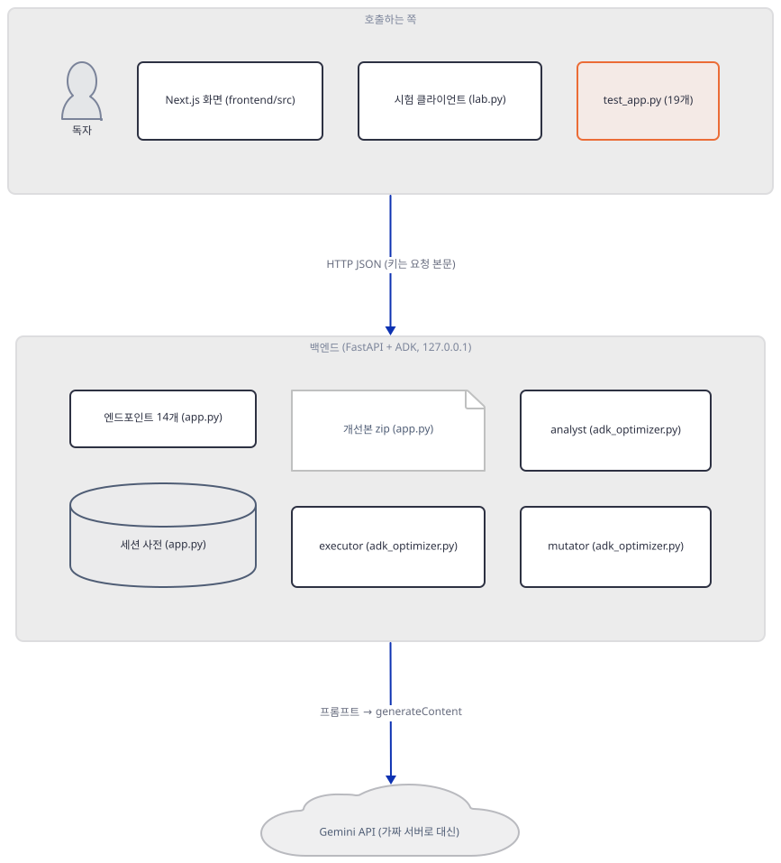

**확인.** 직접 확인한 출력입니다.

```text
-- Docs: https://docs.pytest.org/en/stable/how-to/capture-warnings.html
19 passed, 1 warning in 1.32s
19 passed, 1 warning in 2.50s
Name               Stmts   Miss  Cover
--------------------------------------
adk_optimizer.py     135     99    27%
app.py               374    200    47%
--------------------------------------
TOTAL                509    299    41%
```

```text
폐기 문서: Last updated 2026-10-12 UTC.
  gemini-3.8-flash         출시 September 2, 2026    종료 No shutdown date announced 대체 -
  gemini-3-flash-preview   출시 December 17, 2025    종료 No shutdown date announced 대체 gemini-3.6-flash
  gemini-3.1-pro-preview   출시 February 19, 2026    종료 No shutdown date announced 대체 -
요금표(100만 토큰당, 유료 단계):
  gemini-3.8-flash
    Input price                  무료 단계: Free of charge           유료 단계: $0.75 through December 31, 2026. $1.50 starting January 1, 2027.
    Output price (including thin 무료 단계: Free of charge           유료 단계: $3.75 through December 31, 2026. $7.50 starting January 1, 2027.
    Used to improve our products 무료 단계: Yes                      유료 단계: No
  gemini-3-flash-preview
    Input price                  무료 단계: Free of charge           유료 단계: $0.50 (text / image / video) $1.00 (audio)
    Output price (including thin 무료 단계: Free of charge           유료 단계: $3.00
    Used to improve our products 무료 단계: Yes                      유료 단계: No
  gemini-3.1-pro-preview
    Input price                  무료 단계: Not available            유료 단계: $2.00, prompts $4.00, prompts > 200k tokens
    Output price (including thin 무료 단계: Not available            유료 단계: $12.00, prompts $18.00, prompts > 200k
    Used to improve our products 무료 단계: N/A                      유료 단계: No
```

시험 19개가 모두 통과합니다(경고 하나는 `fastapi.testclient`가 `httpx` 대신 `httpx2`를 권하는 것). 그런데 `SkillOptimizer`를 가짜로 바꿔 끼우고 모델 선택(기본값, `GEMINI_MODEL`, 이름 모양 검사 정규식, 요청에서 분석·재생성·시작으로의 전달, 이름이 틀리면 세션이 `running`이 되기 전에 400)만 다룹니다. `app.py`의 줄 47%, `adk_optimizer.py`의 줄 27%에만 닿고, 닿지 않는 곳이 이 문서가 본 결함이 있는 곳입니다. 업로드(`app.py:189-232, 238-270`), 최적화 루프와 유지·되돌림(`adk_optimizer.py:177-266`), 멈춤과 내려받기, 예제입니다. 마지막 시험 하나는 진짜 `SkillOptimizer`를 만들어 에이전트 셋이 같은 모델을 쓰는지만 봅니다(네트워크 없이 에이전트는 호출 전까지 평범한 객체입니다).

모델 셋(`MODEL_SUGGESTIONS`, `app.py:39`)입니다.

| 모델 | 공식 문서의 상태(폐기 문서 2026-10-12 갱신) | 요금(100만 토큰, 유료, 요금표 2026-10-16 갱신) |
|---|---|---|
| `gemini-3.8-flash`(기본값) | 'Gemini 3 models' 표, 출시 2026-09-02, 종료일 없음 | 입력 $0.75, 출력 $3.75 (2026-12-31까지. 2027-01-01부터 $1.50·$7.50) |
| `gemini-3-flash-preview` | 'Preview models', 출시 2025-12-17, 종료일 없음, 권장 대체 `gemini-3.6-flash` | 입력 $0.50, 출력 $3.00 |
| `gemini-3.1-pro-preview` | 'Preview models', 출시 2026-02-19, 종료일 없음 | 입력 $2.00, 출력 $12.00 (프롬프트 20만 토큰 초과는 더 비쌈) |

셋 다 오늘 공식 폐기 문서에 종료일이 없어 ⚠를 달지 않습니다. 다만 모델 문서(2026-10-13 갱신)는 프리뷰 모델이 "최소 2주 예고로 폐기될 수 있다"고 적습니다. `gemini-3-flash-preview`는 폐기 문서가 이미 `gemini-3.6-flash`를 권장 대체로 적어 두었습니다. 저장소 이력의 마지막 커밋(`c8f8b99f`)이 죽은 `gemini-3-pro-preview` 제안을 바꿨다고 적는데, 폐기 문서도 그 모델의 종료일을 2026-03-09로 적고 있어 맞습니다. 요금표에서 무료 단계는 `gemini-3.8-flash`와 `gemini-3-flash-preview`에서 "Used to improve our products"가 `Yes`이고 유료 단계는 `No`입니다.

마무리로 서버를 정리합니다. 터미널 A·B·B2에서 Ctrl+C로 끝내고, 포트가 비었는지 봅니다.

```bash
# 각 서버 터미널에서 Ctrl+C. 그다음 터미널 C에서
netstat -ano | grep -E ":($FAKE_PORT|$APP_PORT|$APP2_PORT) " | grep LISTENING || echo "서버 없음"
git -C "$REPO" status --short agent_skills
find "$REPO/agent_skills" -name __pycache__
```

앞 두 줄이 비어 있으면 원본 폴더에 아무것도 쓰지 않은 것입니다.

## 요청 한 건이 흐르는 과정

화면에서 "스킬을 올리고 분석하고 시작하는" 한 번의 흐름입니다. 사람(독자)이 화면에 zip과 키와 모델 이름을 줍니다.

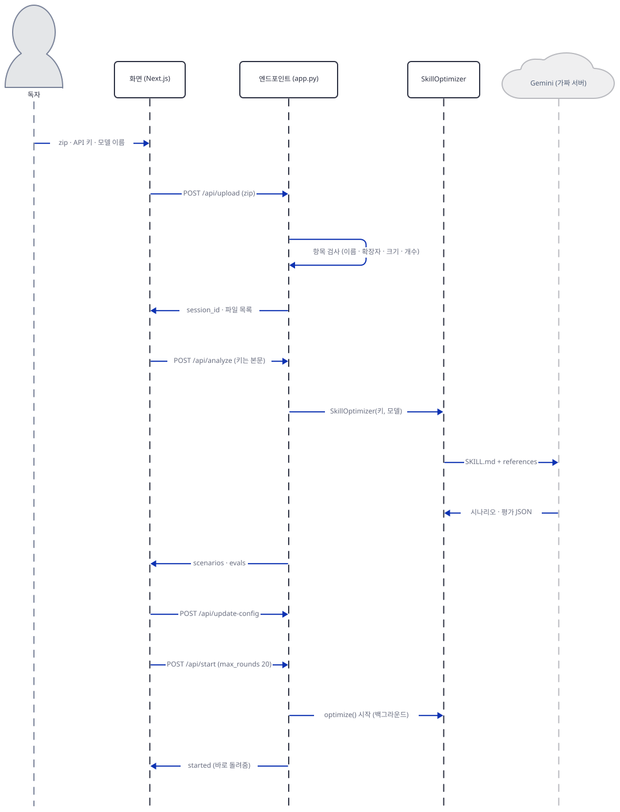

1. 화면이 `POST /api/upload`로 zip을 보냅니다. 엔드포인트가 항목을 검사하고(자기 자신에게 오는 화살표. 이름·확장자·크기·개수), 세션 아이디와 파일 목록을 돌려줍니다(Step 3).
2. 키와 모델을 받으면 화면이 `POST /api/analyze`를 보냅니다. 엔드포인트는 `SkillOptimizer(키, 모델)`을 만들어 환경변수에 키를 쓰고, `analyze_skill(skill_files)`를 부릅니다. optimizer가 `SKILL.md`와 이름에 `references/`가 든 파일(Windows에서 폴더째 묶은 zip이면 빠집니다)을 모델에게 보내 시나리오와 평가 JSON을 받고, 그것이 엔드포인트를 거쳐 화면으로 돌아갑니다(Step 4).

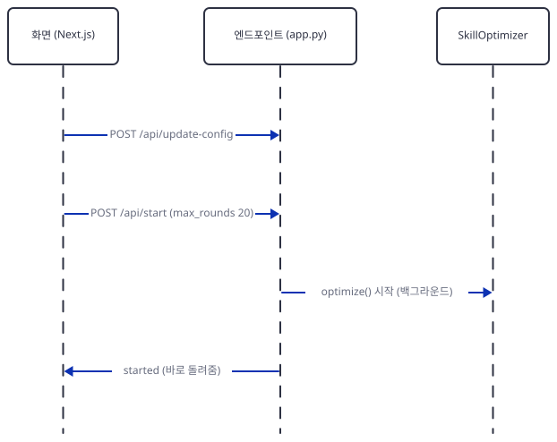

3. 사용자가 고른 것을 `POST /api/update-config`로 저장하고 `POST /api/start`를 보냅니다. 엔드포인트는 백그라운드 작업으로 `optimize()`를 시작하고 **바로** `started`를 돌려줍니다(Step 5, 6).

이제 백그라운드 작업이 도는 장면을 에이전트별로 나눠 그렸습니다. 먼저 기준선입니다. 시나리오마다 executor가 두 번 모델을 부릅니다. 실행 프롬프트(`Execute this skill:`)와 채점 프롬프트(`Evaluate this output`)이고 응답도 둘입니다. 그림은 한 시나리오만 그렸고 시나리오 수만큼 되풀이됩니다. 끝나면 `baseline` 이벤트가 콜백으로 엔드포인트에 갑니다.

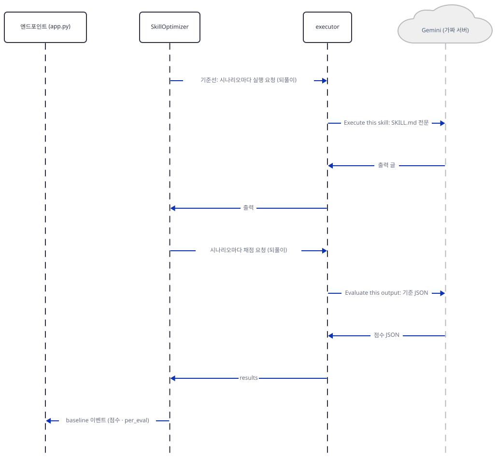

다음은 라운드의 앞부분입니다. 라운드가 시작되면 `experiment_start` 이벤트가 가고, analyst가 실패 다섯 건과 `SKILL.md`의 앞 2,000자로 진단하고(실패가 없으면 이 부분을 건너뜁니다), mutator가 진단과 전문으로 새 `SKILL.md`를 만듭니다. 두 에이전트 모두 `output_schema`를 걸어 JSON을 받습니다.

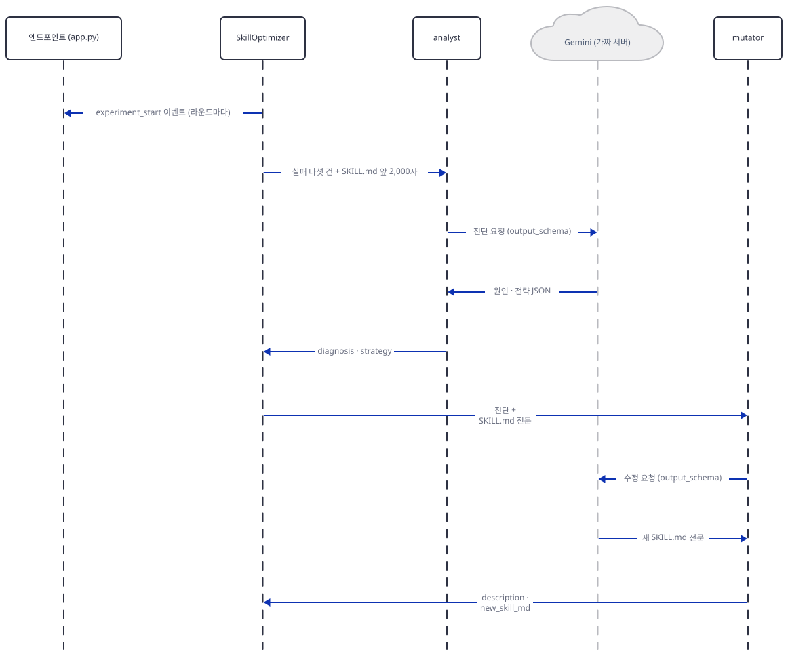

그다음은 라운드의 뒷부분입니다. executor가 새 `SKILL.md`로 다시 실행하고 다시 채점합니다. 시나리오마다 되풀이하는 것은 기준선과 같습니다.

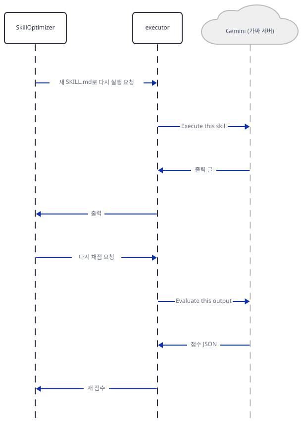

점수가 오르면 남기고 아니면 되돌리는 판정은 optimizer 안에서 일어나고(자기 자신에게 오는 화살표), 그 결과가 `experiment_result` 이벤트로 엔드포인트에 갑니다. 이 둘이 라운드마다 되풀이되고, 모든 라운드가 끝나면 `complete` 이벤트가 갑니다. 그동안 화면은 3초마다 `GET /api/status`로 지금까지의 실험을 읽고, `complete`가 되면 `final_result`를 받아 결과 화면으로 가서 `GET /api/download`로 `improved_skill.zip`을 받습니다. 폴링은 루프와 **동시에** 돌지만 그림은 읽기 쉽게 이 장면에 모아 그렸습니다.

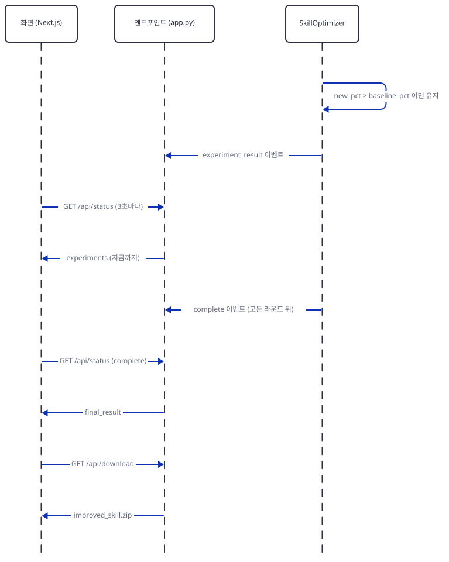

## 실행 체크리스트

- [ ] 환경 파일을 불러온 셸(터미널 A·B·C)에서만 명령을 쳤다(HOME·TEMP가 스크래치)
- [ ] `python app.py`를 직접 돌리지 않았다(`0.0.0.0`으로 열린다). `serve_backend.py`로만 띄웠다
- [ ] 서버가 `127.0.0.1:<포트>`에만 듣는 것을 `netstat`으로 봤다
- [ ] 키는 `fake-`로 시작하는 값만 썼고, 가짜 서버가 `fake-`가 아닌 키를 401로 거절하는 것을 알고 있다
- [ ] 작업 폴더의 `blocked.log`(가드가 막은 시도)가 비어 있거나, 있다면 Step 4의 Vertex 관찰 세 줄뿐이다
- [ ] 화면은 실행하지 않았고 `npm install`도 하지 않았다
- [ ] 서버를 모두 끝냈고 포트가 비었다
- [ ] 원본 `agent_skills/`에서 `git status --short`가 비어 있고 `__pycache__`가 없다

## 문제 해결

| 증상 | 원인 | 해결 |
|---|---|---|
| 앱 README의 `cp .env.example .env`가 실패한다 | 저장소에 `.env.example`이 없다. 백엔드는 `.env`를 읽지도 않는다 | 키는 요청으로 보내는 값뿐이다. 이 문서는 `.env`를 만들지 않았다 |
| `python app.py`로 띄웠더니 같은 네트워크에서 서버가 보인다 | `app.py:589`가 `host="0.0.0.0"` | `serve_backend.py`나 `uvicorn app:app --host 127.0.0.1 --port <포트>`(가드 없이는 쓰지 않는다) |
| 설치가 `requires-python`으로 실패하거나 `google-adk`가 예상과 다르다 | 오늘 `google-adk` 2.12.0과 `starlette` 1.9.0은 Python 3.11 이상 | Python 3.11 이상을 쓴다(3.10은 해석만 해 봤다) |
| 폴더에 담은 `SKILL.md` 하나짜리 zip이 400 "No SKILL.md found" | Windows에서 `commonpath`가 역슬래시로 바뀌어 파일 하나가 `.`이 된다(`app.py:218-223`) | 폴더 없이 `SKILL.md`를 맨 위에 두고 묶거나 파일을 둘 이상 넣는다 |
| 폴더로 묶은 스킬의 `references/`가 분석에 안 실린다 | Windows에서 이름이 `references\x.md`가 되어 `"references/" in k`가 거짓이다 | 폴더 없이 묶는다(`flat.zip`처럼). 안 실렸다는 것은 서버 기록의 `has_reference_block`으로 안다 |
| 업로드한 파일이 50개를 넘었는데 아무 경고가 없다 | 51번째부터 조용히 버린다(`app.py:211-213`) | 파일을 줄여 올린다 |
| 분석이 500 "Analysis failed. Check your API key and try again." | 어떤 예외든 같은 문장으로 올라온다(`app.py:295-297`). 없는 모델 이름도 이 문장이다 | 서버 터미널의 트레이스백을 본다. 모델 이름을 확인한다 |
| 멈춤을 눌렀는데 요청이 계속 나간다 | `stop_requested`를 읽는 줄이 없다 | 서버를 끝낸다. 고치려면 루프 안에서 `session["stop_requested"]`를 본다("더 해보기") |
| 예제 버튼을 누르면 "Failed to load example" | 화면의 `code-reviewer`·`content-writer`가 서버에 없다 | 자기 스킬을 zip으로 올린다 |
| `/api/examples` 목록이 500이다(UTF-8 모드가 아닐 때) | `app.py:533, 559`의 `open(..., "r")`가 기본 인코딩(한국어 Windows는 cp949)으로 읽는다 | `PYTHONUTF8=1`을 건다(환경 파일). 원본 README대로 `python app.py`를 치면 만난다 |
| 예제 `advisor-orchestrator-worker`가 500 | 폴더의 JPEG를 UTF-8 글로 읽으려 한다(`app.py:559`) | 그 예제를 쓰지 않는다 |
| 키를 비워 보냈더니 모델이 불린다 | 서버 셸의 `GEMINI_API_KEY`가 쓰인다 | 서버를 띄우는 셸에서 `GOOGLE_API_KEY`·`GEMINI_API_KEY`를 지운다(이 문서의 `guard.py`는 프로세스 안에서 둘 다 빈 값으로 덮는다) |
| 셸에 Vertex 설정이 있는데 키가 소용없다 | 요청의 키는 `GOOGLE_API_KEY`만 바꾼다. Vertex 모드는 gcloud 로그인 같은 진짜 자격 증명을 쓴다 | 서버 셸에서 `GOOGLE_GENAI_USE_VERTEXAI`를 지운다. 환경 파일은 `CLOUDSDK_CONFIG`를 `LAB` 아래로 돌려 gcloud 설정을 읽지 않게 한다(Windows의 `APPDATA`는 돌리지 않는다) |
| `probe_vertex.py`가 "멈춤:"으로 끝난다 | `CLOUDSDK_CONFIG`가 `LAB` 아래가 아니거나 `GOOGLE_APPLICATION_CREDENTIALS`가 설정돼 있다(진짜 자격 증명을 읽게 된다) | 환경 파일을 불러오고, 그 변수를 지운다 |
| `NEXT_PUBLIC_API_URL`을 안 줬는데 화면이 서버에 못 간다 | 화면의 기본값이 `http://localhost:8891` | 서버를 그 포트로 열거나 변수를 준다 |
| 한국어 Windows에서 출력이 깨지거나 `UnicodeEncodeError` | 파이프·파일 출력이 cp949로 나간다 | `PYTHONUTF8=1`·`PYTHONIOENCODING=utf-8`을 건다(환경 파일) |
| `address already in use` | 이미 같은 포트에 서버가 있다 | 포트를 49152~65535의 다른 값으로 바꾼다(`FAKE_PORT`·`APP_PORT`·`APP2_PORT`, 환경 파일) |

## 더 해보기

- 스크래치 사본의 `upload_skill`에서 `await file.read()` 앞에 `Content-Length`(없으면 읽는 만큼)로 10 MB를 먼저 검사하게 바꾸고 `over60mb.zip`을 다시 올려 서버 최대 작업 집합이 오르지 않는지 `probe_zip.py`로 보세요.
- 스크래치 사본의 `app.py`에서 업로드의 `zf.read(name)` 앞에 `zf.getinfo(name).file_size > MAX_FILE_SIZE`를 검사하게 바꾸고 `bomb.zip`을 다시 올려, 서버 메모리가 더 뛰지 않는지 `probe_zip.py`로 보세요. 같은 곳에서 압축을 푼 총량 한도도 넣어 보세요.
- `SkillOptimizer`가 환경변수 대신 `google.adk.models.Gemini(client=genai.Client(api_key=...))`를 에이전트 셋에 넘기도록 스크래치 사본을 고치고 `probe_keys.py race`를 다시 돌려, 섞임이 0이 되는지 확인하세요.
- 루프 안에서 `session["stop_requested"]`를 보게 하거나 목표 통과율을 받게 해서 `probe_stop.py`의 "멈춤 뒤 요청"이 0이 되게 해 보세요. 진짜 키를 가진 뒤라면, 같은 스킬의 기준선을 세 번 재서 판정이 얼마나 흔들리는지 먼저 재 보고 그 폭보다 작은 향상은 버리는 규칙을 넣어 보세요. 그 폭이 얼마인지는 이 문서가 모릅니다.

## 다음 날 예고

[Day 162 · 🪡 Needle - A New Way to Find](../day162-needle/README.md) — 볼륨 17 AI 브라우저 도구의 첫날이고 Node 앱입니다. `advanced_llm_apps/needle`에는 README(168줄)와 서버(`server/search.mjs` 170줄), React 화면(`src/App.jsx` 477줄), 크롬 확장(`extension/content.js` 217줄, `manifest.json`), Vercel 배포용 함수(`api/search.js` 27줄)와 테스트 네 파일이 있습니다. 파이썬이 하나도 없어서 오늘처럼 화면만 소스로 읽는 일이 아니라 앱 전체가 Node입니다. 웹페이지에서 문장을 찾을 때 키워드 일치가 아니라 의미로 찾는 앱이고, 질문과 문단을 Vercel AI Gateway를 거쳐 `typesafe-ai/jev` 모델에게 보내 문단마다 점수와 가장 중요한 문장을 받습니다(`server/search.mjs`가 `THRESHOLD = 0.58`로 거릅니다). 오늘의 앱은 모델에게 글을 만들게 했지만 Needle은 모델에게 고르게만 합니다.
