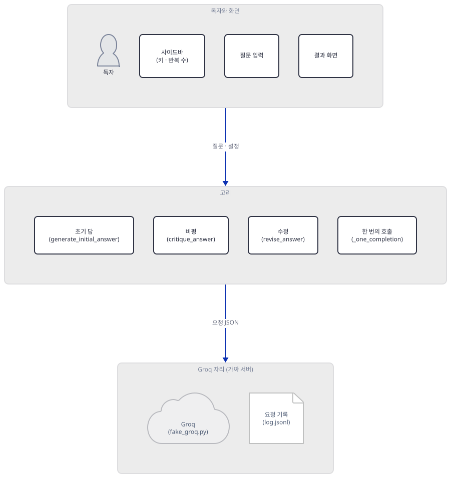
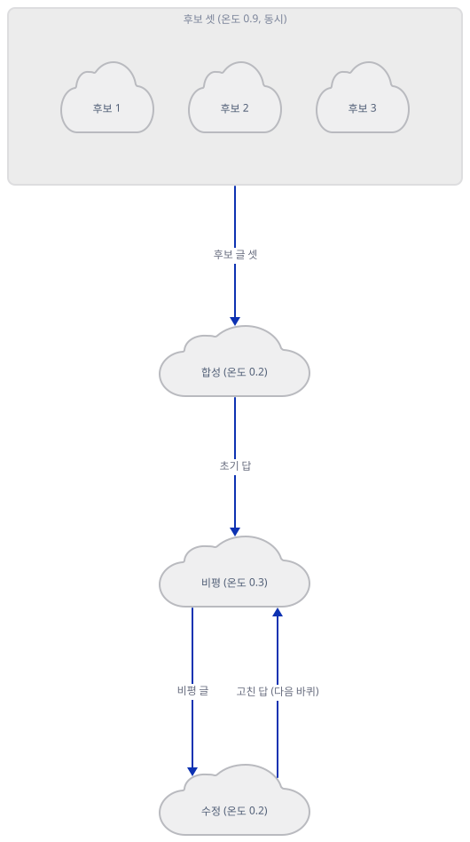
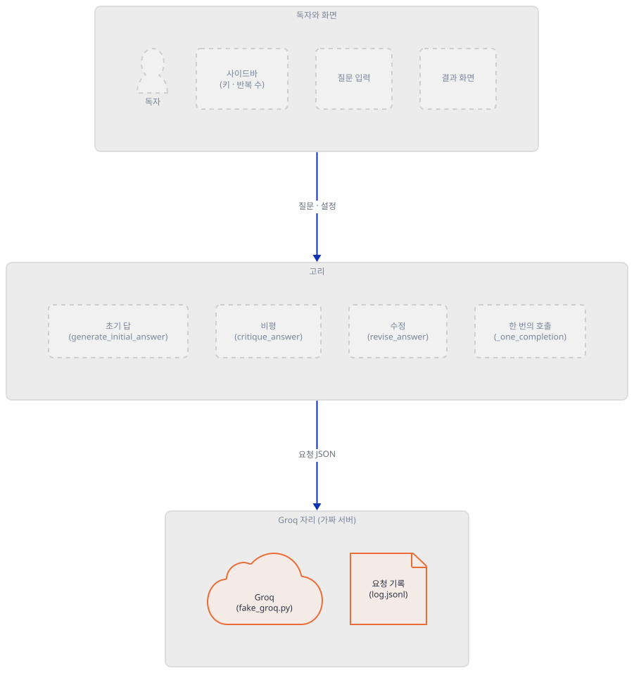
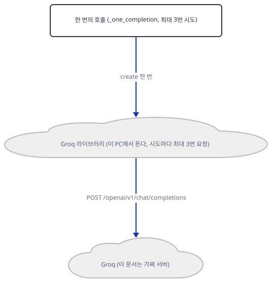
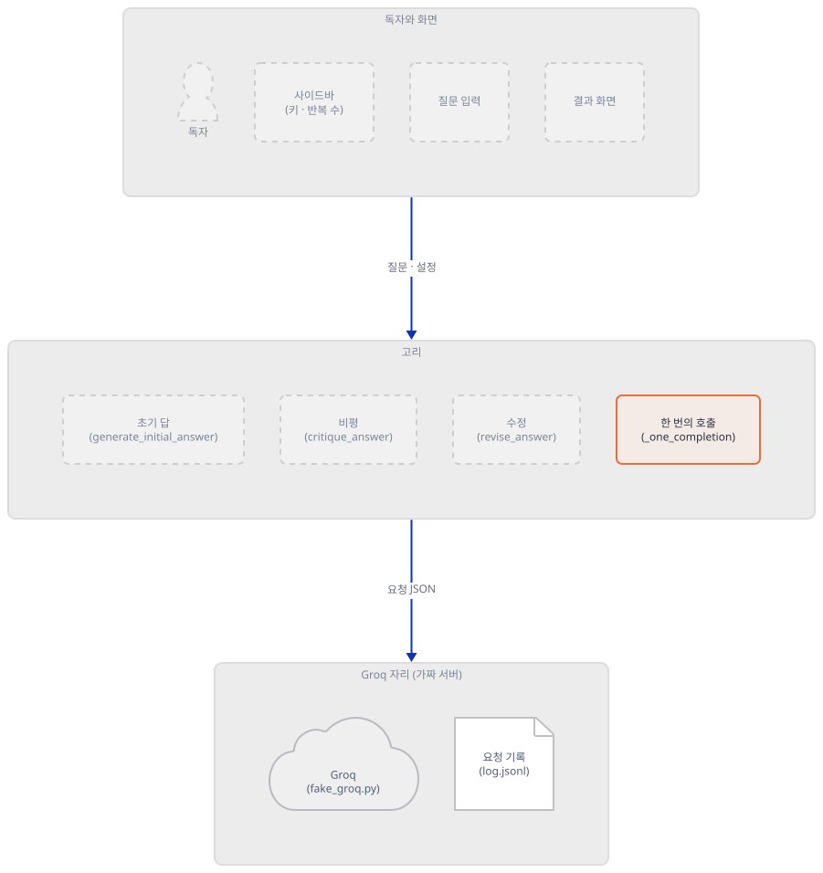
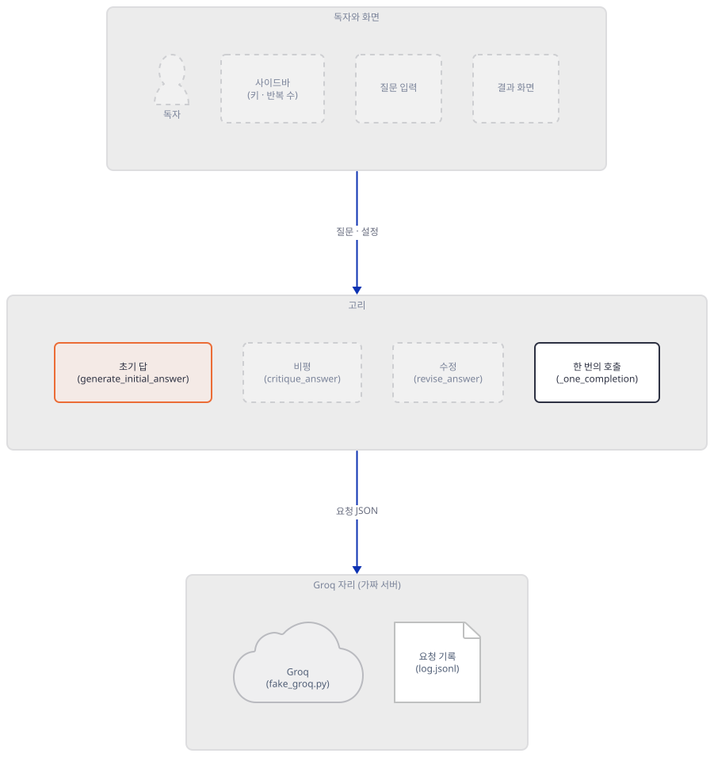
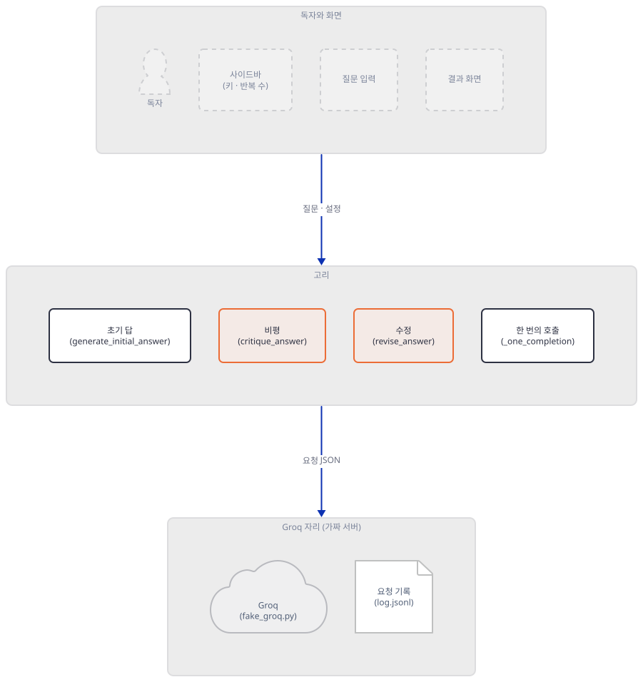
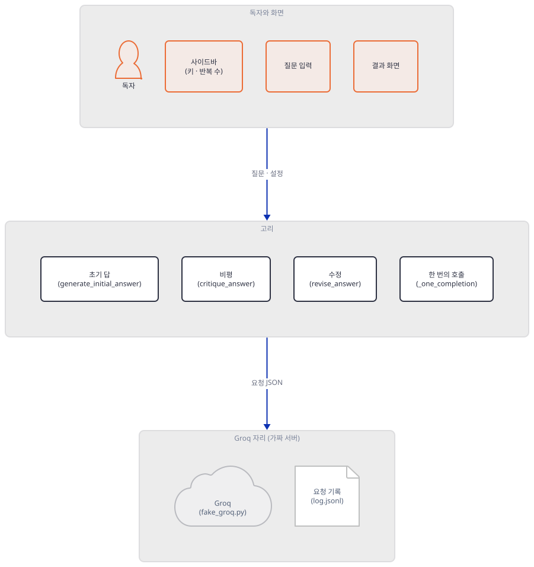
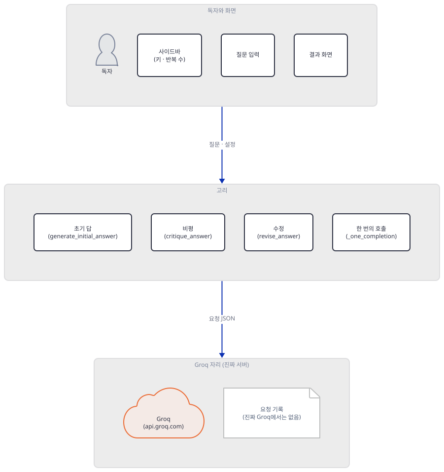
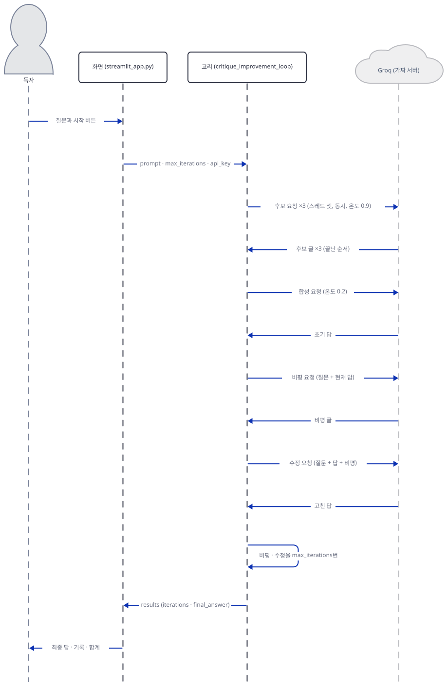

# Day 164 · 🔄 GPT-OSS Advanced Critique & Improvement Loop

> 볼륨 18 🧪 기타 LLM 앱 · 난이도 ★☆☆ · 예상 소요 100분(파일 일곱을 직접 만들고, 터미널에서 서버 셋을 띄우고, 요청 기록과 소스를 맞대 보는 데 시간이 듭니다) · API 비용 대략 0원(이 문서는 Groq를 한 번도 부르지 않았습니다. 진짜 키로 한 번 돌릴 때의 상한은 Step 6에서 계산합니다) · 원본 앱: `advanced_llm_apps/gpt_oss_critique_improvement_loop`

## 오늘 만들 것

질문 하나를 넣으면 모델이 답을 쓰고, 같은 모델이 그 답의 결점을 짚고, 다시 고치는 일을 1~3번 되풀이하는 Streamlit 앱을 따라 봅니다. 앱은 `streamlit_app.py` 한 파일(228줄, 마지막 줄에 개행이 없어 `wc -l`은 227)이고, 모델은 Groq로 부르는 `openai/gpt-oss-120b`입니다(`streamlit_app.py:21`). 볼륨 17의 두 날(Day 162·163)이 브라우저 확장과 Node 서버였다면 오늘은 Python 한 파일로 돌아옵니다. 볼륨 18은 그동안 볼륨에 들지 않은 앱을 모은 "기타 LLM 앱"(`days.json`의 볼륨 이름)이고, 오늘 이 볼륨에서 새로 보는 것은 앱의 중심 꼴 하나입니다. 답을 만드는 모델과 답을 흠잡는 모델이 같은 모델이고, 흠잡은 글을 다시 입력으로 넣어 고치게 하는 **고리**입니다.

이 문서는 진짜 Groq를 부르지 않았습니다. Groq 자리에는 **제가 쓴 가짜 서버**(`fake_groq.py`)가 있고, 이 서버는 모델이 아니라 요청을 기록하고 정해진 글(`CAND1`, `SYNTH1`…)을 돌려줍니다. 그래서 아래 출력은 "앱이 무엇을 몇 번 어떻게 보내는가"를 보이는 것이지 GPT-OSS가 답을 잘 고치는지는 보이지 않습니다. 화면은 브라우저 없이 Streamlit의 `AppTest`로 돌렸습니다. 알게 된 것은 여섯입니다.

1. 모델 호출은 `4 + 2n`번입니다. 후보 셋과 합성 하나(4번)에 `n`번의 바퀴마다 비평과 수정이 하나씩 붙습니다. 슬라이더 기본값 `n=2`면 8번입니다(Step 4·5).
2. 나란히 도는 것은 **후보 셋뿐**입니다. 합성·비평·수정은 모두 앞 결과를 기다리며 순서대로 갑니다(Step 3).
3. 후보 셋은 똑같은 요청입니다. 합성 글에 붙는 "Candidate 1·2·3"의 번호는 만든 순서가 아니라 **끝난 순서**입니다(Step 3).
4. 비평과 수정 요청은 `user` 메시지 하나뿐이고 시스템 지시문이 없습니다. 두 번째 바퀴의 비평은 첫 바퀴의 비평을 보지 못합니다(Step 4).
5. 멈춤 조건이 없습니다. 파일 머리 주석은 "Repeat if needed"라고 하지만 코드는 고른 횟수를 무조건 채웁니다. 화면의 "Total Iterations"는 바퀴 수가 아니라 초기 답을 포함한 `n+1`입니다(Step 4·5).
6. 호출 하나가 실패하면 앱이 3번, 그 안에서 Groq 라이브러리가 최대 3번씩 요청해 **최대 9번**이 나가고, 끝내 실패하면 이미 만든 초기 답도 화면에 남지 않습니다(Step 5).



위 그림은 묶음 사이의 관계만 보입니다. 호출 순서는 [`extra-loop`](diagrams/extra-loop.svg)에, 호출 하나의 재시도 구조는 Step 2의 [`extra-retry`](diagrams/extra-retry.svg)에, 요청 한 건의 흐름은 아래 "요청 한 건이 흐르는 과정"에 그렸습니다.



## 사전 준비

| 서비스/도구 | 용도 | 발급·설치 |
|---|---|---|
| Python 3.12, uv | 앱과 시험. 이 문서는 3.12.10으로 확인했고 다른 판은 시험하지 않았습니다 | [공통 사전 준비](../README.md#공통-사전-준비-한-번만) 참고 |
| bash(Git Bash) | 아래 명령 전부. **이 문서는 bash 전용입니다**(PowerShell 판은 싣지 않았습니다) | Windows는 Git for Windows |
| 이 저장소의 클론 | 원본 폴더를 읽고 사본을 만듭니다 | `git clone https://github.com/Zihun/awesome-llm-apps.git` |
| `streamlit`, `groq` | 앱의 `requirements.txt`는 `streamlit>=1.32.0`과 `groq>=0.5.0` 둘뿐입니다. 이 문서는 streamlit 1.66.0, groq 1.7.0으로 확인했습니다 | Step 1에서 설치. **PyPI에 닿는 유일한 단계입니다** |
| Groq API 키 | 진짜로 쓸 때만. **이 문서는 가짜 값 `fake-key-not-real`만 썼습니다** | [Groq 콘솔](https://console.groq.com/keys) |

모델 `openai/gpt-oss-120b`는 Groq의 폐기 문서(2026-10-21에 읽음, <https://console.groq.com/docs/deprecations>)에서 폐기 대상이 아니라 다른 모델들(`llama-3.3-70b-versatile`, `qwen/qwen3-32b` 등)의 **권장 대체**로 올라 있습니다. 모델 문서(<https://console.groq.com/docs/model/openai/gpt-oss-120b>)은 컨텍스트 131,072토큰, 최대 출력 65,536토큰, 추론 모델이라고 적습니다.

터미널은 최대 넷을 씁니다. 가짜 Groq 서버는 터미널 A(47110), 일부러 실패하는 가짜 서버는 터미널 C(47113), Streamlit 서버는 터미널 D(47120)에 띄워 두고, 나머지 명령은 모두 터미널 B에서 칩니다. 새 터미널에서는 `cd awesome-llm-apps`, `export REPO="$PWD"`, `export LAB=…`(Step 1과 같은 값)을 먼저 하고 각 블록 첫 줄이 환경 파일을 불러옵니다. 포트는 이 문서가 고른 값이고, 다른 프로그램이 쓰고 있으면 바꾸십시오(바꾸면 `env.sh`의 `FAKE_PORT`와 명령의 포트도 맞춥니다).

## 아키텍처 한눈에 보기

| 컴포넌트 | 역할 | 코드 위치 |
|---|---|---|
| 한 번의 호출 | 메시지 하나를 Groq에 보내고 글을 받는다. 실패하면 0.5초·1초 쉬며 3번까지 | `advanced_llm_apps/gpt_oss_critique_improvement_loop/streamlit_app.py:33-51` |
| 초기 답 | 같은 질문을 스레드 셋으로 동시에 보내고, 후보 셋을 합쳐 달라고 한 번 더 부른다 | `streamlit_app.py:54-79` |
| 비평 | 질문과 현재 답을 주고 결점을 불릿으로 쓰게 한다 | `streamlit_app.py:82-92` |
| 수정 | 질문·현재 답·비평을 주고 고치게 한다 | `streamlit_app.py:95-106` |
| 고리 | 위 셋을 이어 `max_iterations`번 되풀이하고 결과 딕셔너리를 만든다 | `streamlit_app.py:109-149` |
| 화면 | 사이드바(키·반복 수), 질문 칸, 버튼 둘, 결과·기록·합계 | `streamlit_app.py:152-228` |
| 이 문서의 가드·가짜 서버·시험 스크립트 | 루프백 가드, 가짜 Groq, 함수를 하나씩 부르는 스크립트, `AppTest` 구동 | 코드 없음(Step 1~5에서 직접 만듦) |

## 단계별 진행

### Step 1. 실습 폴더, 앱 사본, 가짜 Groq 서버

**목적.** 원본에는 아무것도 쓰지 않고, 사본과 가짜 서버로 이 문서의 모든 실험을 돌릴 바탕을 만듭니다.

**할 일.** 저장소 루트에서 시작합니다. `LAB`은 저장소 밖의 새 폴더로 자기 경로로 바꿉니다. 블록은 `LAB`이 비었거나 자리 표시 값 그대로이거나 절대 경로가 아니거나 `.claude`·`.agents` 같은 에이전트 설정 폴더(또는 `CLAUDE_CONFIG_DIR`) 아래이면 폴더를 하나도 만들지 않고 멈춥니다(대소문자는 가리지 않습니다). 환경 파일은 HOME·USERPROFILE·CLAUDE_CONFIG_DIR·TEMP를 이 폴더로 돌리고 프록시 변수를 지웁니다. 루프백 요청이 독자의 프록시로 가지 않게 하려는 것이고, 이 문서는 프록시가 켜진 환경을 시험하지 않았습니다. 이후 블록에서 파일을 쓰는 줄은 모두 `"${LAB:?}/…"` 절대 경로로 씁니다. 환경 블록을 건너뛰고 붙여 넣어도 지금 폴더에 파일이 생기지 않게 하려는 것입니다.

```bash
cd awesome-llm-apps
export REPO="$PWD"
export LAB=/path/to/d164-lab          # 저장소 밖의 새 폴더(자기 절대 경로로 바꾼다)
_ok=1; _n() { { cygpath -m "$1" 2>/dev/null || printf '%s' "$1"; } | tr 'A-Z\\' 'a-z/'; }
case "$LAB" in ""|/path/to/*) echo "LAB을 자기 경로로 바꾸세요"; _ok=0 ;; esac
case "$LAB" in /*|[A-Za-z]:[/\\]*) ;; *) echo "LAB은 절대 경로여야 합니다: $LAB"; _ok=0 ;; esac
case "$(_n "$LAB")/" in
  */.claude/*|*/.agents/*|*/.codex/*|*/.cursor/*|*/.copilot/*|*/.openclaw/*|*/.hermes/*)
    echo "LAB이 에이전트 설정 폴더 아래입니다: $LAB"; _ok=0 ;;
esac
if [ -n "${CLAUDE_CONFIG_DIR:-}" ]; then
  _c=$(_n "$CLAUDE_CONFIG_DIR")
  case "$(_n "$LAB")/" in "${_c%/}"/*) echo "LAB이 CLAUDE_CONFIG_DIR 아래입니다"; _ok=0 ;; esac
fi
[ "$_ok" = 1 ] && mkdir -p "$LAB/home" "$LAB/tmp" "$LAB/lab" && cat > "$LAB/env.sh" <<'EOF'
# Day 164 작업 셸의 환경. 이 문서의 모든 명령은 이 파일을 불러온 셸에서 돌린다.
: "${REPO:?REPO를 먼저 정하세요}" "${LAB:?LAB을 먼저 정하세요}"
_n() { { cygpath -m "$1" 2>/dev/null || printf '%s' "$1"; } | tr 'A-Z\\' 'a-z/'; }
_lab=$(cd "$LAB" 2>/dev/null && pwd -P) || { echo "LAB 폴더가 없습니다: $LAB"; return 1; }
_low="$(_n "$_lab")/"
case "$_low" in
  */.claude/*|*/.agents/*|*/.codex/*|*/.cursor/*|*/.copilot/*|*/.openclaw/*|*/.hermes/*)
    echo "LAB이 에이전트 설정 폴더 아래입니다: $_lab"; return 1 ;;
esac
if [ -n "${CLAUDE_CONFIG_DIR:-}" ] && _cfg=$(cd "$CLAUDE_CONFIG_DIR" 2>/dev/null && pwd -P); then
  _cfg="$(_n "$_cfg")/"
  case "$_low" in "$_cfg"*) echo "LAB이 CLAUDE_CONFIG_DIR 아래입니다"; return 1 ;; esac
fi
export HOME="$LAB/home" USERPROFILE="$LAB/home" CLAUDE_CONFIG_DIR="$LAB/home/.claude"
export TEMP="$LAB/tmp" TMP="$LAB/tmp" TMPDIR="$LAB/tmp"
# 프록시를 쓰지 않는다. 루프백 요청이 독자의 프록시로 가면 안 된다.
unset HTTP_PROXY HTTPS_PROXY ALL_PROXY http_proxy https_proxy all_proxy
export NO_PROXY=127.0.0.1,localhost,::1 no_proxy=127.0.0.1,localhost,::1
export LABW=$(cygpath -m "$_lab" 2>/dev/null || printf '%s' "$_lab")   # 파이썬에 넘기는 Windows 꼴 경로
export APP="$LABW/lab/app" FAKE_PORT=47110
PY="$LAB/venv/Scripts/python.exe"; [ -x "$PY" ] || PY="$LAB/venv/bin/python"; export PY
EOF
[ "$_ok" = 1 ] && source "$LAB/env.sh" && cd "$LAB/lab"
```

앱 폴더를 사본으로 가져오고 가상환경을 만듭니다. 앱은 `.env`를 읽지 않습니다(`python-dotenv`를 불러오는 줄이 없고 키는 `os.getenv("GROQ_API_KEY")`와 `Groq()`가 읽는 환경변수뿐입니다, `streamlit_app.py:111,163`). 그래서 사본에 진짜 키가 딸려 올 길은 없습니다.

```bash
source "${LAB:?}/env.sh" && cd "${LAB:?}/lab" || return
[ -e "${LAB:?}/lab/app" ] || cp -r "${REPO:?}/advanced_llm_apps/gpt_oss_critique_improvement_loop" "${LAB:?}/lab/app"
ls -A "${LAB:?}/lab/app"
unset VIRTUAL_ENV
uv venv -q --python 3.12 "${LAB:?}/venv"
source "${LAB:?}/env.sh"             # 새로 생긴 가상환경의 python 경로를 다시 구한다
uv pip install -q --python "$PY" -r "${LAB:?}/lab/app/requirements.txt"
"$PY" -c "import groq, streamlit; print(groq.__version__, streamlit.__version__)"
```

이제 루프백 밖으로 못 나가게 하는 가드와 가짜 Groq 서버를 씁니다. `guard.py`는 불러오는 순간 예약 주소 `192.0.2.1`(문서용으로 비워 둔 주소)로 스스로 시험하고, 막히지 않았으면 멈춥니다. 가짜 서버는 모든 요청을 `log.jsonl`에 한 줄씩 적고, 질문 글을 보고 어떤 호출인지(후보·합성·비평·수정) 가려 그에 맞는 글을 돌려줍니다. 호출마다 0.4초씩 쉬므로 "동시"와 "차례로"가 시간으로 보입니다.

```bash
source "${LAB:?}/env.sh" && cd "${LAB:?}/lab" || return
cat > "${LAB:?}/lab/guard.py" <<'EOF'
"""루프백 밖으로 나가는 연결과 이름 조회를 막는다. 불러오는 순간 예약 주소(192.0.2.1)로 스스로 시험한다."""
import socket

_connect = socket.socket.connect
_lookup = socket.getaddrinfo


def _loop(host):
    h = str(host).lower().strip("[]")
    return h == "localhost" or h == "::1" or h.startswith("127.")


def _connect_guard(self, address):
    if not _loop(address[0]):
        raise OSError("guard: blocked connect %r" % (address,))
    return _connect(self, address)


def _lookup_guard(host, *a, **k):
    if host is not None and not _loop(host):
        raise OSError("guard: blocked lookup %r" % (host,))
    return _lookup(host, *a, **k)


socket.socket.connect = _connect_guard
socket.getaddrinfo = _lookup_guard

try:
    socket.create_connection(("192.0.2.1", 80), 1)
except OSError as e:
    assert "guard: blocked" in str(e), "가드가 일하지 않는다: %s" % e
else:
    raise SystemExit("가드가 일하지 않는다")
EOF
```

```bash
source "${LAB:?}/env.sh" && cd "${LAB:?}/lab" || return
cat > "${LAB:?}/lab/fake_groq.py" <<'EOF'
"""가짜 Groq 서버. 모델이 아니라 요청을 기록하고 정해진 글을 돌려주는 정규식 몇 줄이다."""
import json, os, sys, threading, time
from http.server import BaseHTTPRequestHandler, ThreadingHTTPServer

PORT = int(sys.argv[1])
LOG = sys.argv[2]
FAIL_KIND = os.environ.get("FAKE_FAIL_KIND", "")   # 예: critique -> 비평 요청에는 늘 500
lock = threading.Lock()
count = {"cand": 0, "synth": 0, "critique": 0, "revise": 0}


def kind_of(text):
    if text.startswith("You are given 3 candidate answers"):
        return "synth"
    if "Act as a critical reviewer" in text:
        return "critique"
    if "Revise the original answer" in text:
        return "revise"
    return "cand"


class H(BaseHTTPRequestHandler):
    def log_message(self, *a):
        pass

    def do_POST(self):
        body = json.loads(self.rfile.read(int(self.headers["Content-Length"])))
        text = body["messages"][-1]["content"]
        kind = kind_of(text)
        t0 = time.time()
        with lock:
            if not os.path.exists(LOG) or os.path.getsize(LOG) == 0:   # 기록을 비우면 번호도 처음부터
                count.update(cand=0, synth=0, critique=0, revise=0)
            count[kind] += 1
            n = count[kind]
            with open(LOG, "a", encoding="utf-8") as f:
                f.write(json.dumps({
                    "t": round(t0, 3), "path": self.path, "auth": self.headers.get("Authorization", "")[:12],
                    "thread": threading.current_thread().name[-2:], "kind": kind, "n": n,
                    "model": body["model"], "temperature": body["temperature"],
                    "max_completion_tokens": body["max_completion_tokens"], "top_p": body["top_p"],
                    "stream": body["stream"], "roles": [m["role"] for m in body["messages"]],
                    "chars": len(text), "text": text}, ensure_ascii=False) + "\n")
        time.sleep(0.4)
        if kind == FAIL_KIND:
            self.send_response(500)
            self.send_header("retry-after-ms", "1")
            self.send_header("Content-Type", "application/json")
            self.end_headers()
            self.wfile.write(b'{"error":{"message":"fake failure"}}')
            return
        reply = {"cand": "CAND%d" % n, "synth": "SYNTH%d" % n,
                 "critique": "• CRITIQUE%d" % n, "revise": "REVISED%d" % n}[kind]
        out = json.dumps({"id": "fake", "object": "chat.completion", "created": 0, "model": body["model"],
                          "choices": [{"index": 0, "finish_reason": "stop",
                                       "message": {"role": "assistant", "content": reply}}],
                          "usage": {"prompt_tokens": 1, "completion_tokens": 1, "total_tokens": 2}}).encode()
        self.send_response(200)
        self.send_header("Content-Type", "application/json")
        self.send_header("Content-Length", str(len(out)))
        self.end_headers()
        self.wfile.write(out)


ThreadingHTTPServer(("127.0.0.1", PORT), H).serve_forever()
EOF
```



**확인.** 터미널 A에서 가짜 서버를 띄우고(끝날 때까지 열어 둡니다), 터미널 B에서 환경 파일을 불러온 뒤 서버에 요청을 한 건 보내 봅니다.

```bash
# 터미널 A: 가짜 Groq 서버(끝날 때까지 열어 둔다)
source "${LAB:?}/env.sh" && cd "${LAB:?}/lab" || return
"$PY" fake_groq.py 47110 log.jsonl
```

```bash
source "${LAB:?}/env.sh" && cd "${LAB:?}/lab" || return
curl -s --noproxy '*' http://127.0.0.1:47110/openai/v1/chat/completions \
  -H 'Content-Type: application/json' \
  -d '{"model":"m","messages":[{"role":"user","content":"hi"}],"temperature":0,"max_completion_tokens":5,"top_p":1,"stream":false}'
echo
"$PY" -c "import guard; print('guard ok')"
: > "${LAB:?}/lab/log.jsonl"
```

```text
{"id": "fake", "object": "chat.completion", "created": 0, "model": "m", "choices": [{"index": 0, "finish_reason": "stop", "message": {"role": "assistant", "content": "CAND1"}}], "usage": {"prompt_tokens": 1, "completion_tokens": 1, "total_tokens": 2}}
guard ok
```

`/openai/v1/chat/completions`는 Groq의 주소이고(Step 2에서 라이브러리 소스로 확인합니다), `CAND1`은 가짜 서버가 첫 후보 요청에 돌려주는 글입니다. 요청 본문의 `stream`·`temperature`·`max_completion_tokens`·`top_p`는 `streamlit_app.py:38-45`가 쓰는 이름입니다. 마지막 줄은 기록을 비우는 것입니다. 비우면 가짜 서버의 번호도 처음부터 다시 셉니다.

### Step 2. 한 번의 호출: 어디로, 무엇을 싣고, 실패하면 몇 번

**목적.** 앱의 모든 호출이 지나가는 `_one_completion` 하나를 읽고, 요청이 어디로 가는지 확인합니다.

**읽기.** 함수는 `chat.completions.create`를 `stream=False`로 부르고 첫 후보의 글을 돌려줍니다. 모델은 상수 `MODEL`, 상한은 `MAX_COMPLETION_TOKENS = 1024`이고(`streamlit_app.py:21-22`) `top_p`는 1입니다.

```python
def _one_completion(client: Groq, messages: List[Dict[str, str]], temperature: float) -> str:
    """Single non-streaming completion with basic retries."""
    delay = 0.5
    for attempt in range(3):
        try:
            resp = client.chat.completions.create(
                model=MODEL,
                messages=messages,
                temperature=temperature,
                max_completion_tokens=MAX_COMPLETION_TOKENS,
                top_p=1,
                stream=False,
            )
            return resp.choices[0].message.content
        except GroqError:
            if attempt == 2:
                raise
            time.sleep(delay)
            delay *= 2
```

`GroqError`만 잡으므로 연결 실패·시간 초과·상태 코드 오류(라이브러리가 모두 `GroqError`의 자손으로 던진다, 설치된 `_exceptions.py`의 21·25·57·69·74줄) 모두 3번까지 다시 합니다. 그런데 라이브러리 자신도 요청을 다시 보냅니다. 설치된 groq 1.7.0의 `_constants.py` 10줄에 `DEFAULT_MAX_RETRIES = 2`가 있습니다. 그러므로 서버가 늘 실패하면 앱의 시도 하나가 요청 3번이고 앱은 3번 시도하니 **호출 하나에 최대 9번**입니다(Step 5에서 셉니다).



주소는 groq 1.7.0 `_client.py`의 88~91줄에서 정해집니다. `base_url`을 따로 주지 않으면 환경변수 `GROQ_BASE_URL`을, 그것도 없으면 `https://api.groq.com`을 씁니다. 앱은 `Groq(api_key=…)`나 `Groq()`만 부르므로 환경변수 하나로 요청이 모두 가짜 서버로 갑니다. 이 문서의 `common.py`가 그 일을 합니다. 가드를 먼저 불러오고, 주소와 키를 정하고, 앱 모듈을 불러옵니다. 앱 모듈을 불러오면 화면 코드가 한 번 돌지만 버튼이 눌리지 않으므로(`generate_clicked`가 거짓) 요청은 나가지 않고 Streamlit의 "스크립트가 `streamlit run` 없이 돌고 있다" 경고만 납니다. 그 경고가 터미널을 어지럽히지 않게 표준 오류를 파일로 돌립니다.

```bash
source "${LAB:?}/env.sh" && cd "${LAB:?}/lab" || return
cat > "${LAB:?}/lab/common.py" <<'EOF'
"""calls.py가 쓰는 공통 준비. 가드가 먼저, 그다음 주소와 키를 가짜로 정하고, 앱 모듈을 불러온다."""
import os, sys

import guard  # noqa: F401  이 줄이 빠지면 아래 단언이 실패한다

os.environ["GROQ_BASE_URL"] = "http://127.0.0.1:%s" % os.environ["FAKE_PORT"]  # 빠지면 api.groq.com으로 가려다 가드에 막힌다
os.environ["GROQ_API_KEY"] = "fake-key-not-real"                              # 진짜 키가 환경에 있어도 덮는다
assert os.environ["GROQ_BASE_URL"].startswith("http://127.0.0.1:")

sys.path.insert(0, os.environ["APP"])
import streamlit_app as sa  # noqa: E402  화면 코드도 한 번 돈다(경고가 나오지만 버튼은 눌리지 않는다)
from groq import Groq  # noqa: E402


def client():
    return Groq()
EOF
```

```bash
source "${LAB:?}/env.sh" && cd "${LAB:?}/lab" || return
cat > "${LAB:?}/lab/calls.py" <<'EOF'
"""앱의 함수를 하나씩 직접 부른다. 사용: calls.py one|init|crit|rev"""
import sys

from common import client, sa

what, c = sys.argv[1], client()
if what == "one":
    print(repr(sa._one_completion(c, [{"role": "user", "content": "hello"}], 0.5)))
elif what == "init":
    print(repr(sa.generate_initial_answer(c, "Explain recursion.")))
elif what == "crit":
    print(repr(sa.critique_answer(c, "Explain recursion.", "ANSWER-A")))
elif what == "rev":
    print(repr(sa.revise_answer(c, "Explain recursion.", "ANSWER-A", "• NOTE-1")))
EOF
```

```bash
source "${LAB:?}/env.sh" && cd "${LAB:?}/lab" || return
cat > "${LAB:?}/lab/show.py" <<'EOF'
"""요청 기록(log.jsonl)을 한 줄씩 보인다. 사용: show.py <기록> [text]  (text를 붙이면 요청 글도 찍는다)"""
import json, sys

rows = [json.loads(line) for line in open(sys.argv[1], encoding="utf-8")]
t0 = rows[0]["t"]
for r in rows:
    print("%4.1fs %-8s #%d temp=%s max=%s top_p=%s stream=%s roles=%s %d자" % (
        r["t"] - t0, r["kind"], r["n"], r["temperature"], r["max_completion_tokens"], r["top_p"], r["stream"], r["roles"], r["chars"]))
print(rows[0]["path"], rows[0]["auth"], rows[0]["model"])
if len(sys.argv) > 2:
    for r in rows:
        print("-----", r["kind"], r["n"])
        print(r["text"])
EOF
```



**확인.** 호출 하나를 보내고 서버 쪽 기록을 봅니다.

```bash
source "${LAB:?}/env.sh" && cd "${LAB:?}/lab" || return
"$PY" calls.py one 2>err.txt
"$PY" show.py log.jsonl text
```

```text
'CAND1'
 0.0s cand     #1 temp=0.5 max=1024 top_p=1 stream=False roles=['user'] 5자
/openai/v1/chat/completions Bearer fake- openai/gpt-oss-120b
----- cand 1
hello
```

경로는 Groq의 `/openai/v1/chat/completions`이고 `Authorization`은 `Bearer fake-`로 시작하며(가짜 키입니다) 모델은 `openai/gpt-oss-120b`입니다. 메시지는 `user` 하나, 온도 0.5는 제가 `calls.py`에서 넣은 값입니다. 가짜 서버가 `hello`를 "후보 요청"으로 가렸기 때문에 `cand`로 적힙니다. 터미널 B의 출력이 비었으면 `err.txt`를 보십시오. 가드가 막았다면 `guard: blocked …`가 거기 있습니다.

### Step 3. 초기 답: 후보 셋은 동시에, 합성은 그 뒤에

**목적.** "Pro Mode"라고 불리는 첫 단계가 실제로 무엇을 몇 번 보내는지, 무엇이 나란히 도는지 봅니다.

**읽기.** 같은 질문으로 `_one_completion`을 온도 0.9로 세 번 `ThreadPoolExecutor(max_workers=3)`에 맡기고 `as_completed` 순서대로 모읍니다(`streamlit_app.py:56-65`). 모은 글에 `--- Candidate {i+1} ---` 머리를 달아(`streamlit_app.py:68-70`) 합성 프롬프트에 넣고 온도 0.2로 한 번 더 부릅니다(`streamlit_app.py:72-79`).

```python
    # Generate 3 candidates in parallel
    candidates = []
    with cf.ThreadPoolExecutor(max_workers=3) as ex:
        futures = [
```

`as_completed`는 **끝나는 순서**로 돌려주므로 후보 번호는 만든 순서가 아닙니다. 그리고 세 후보는 입력이 같은 요청 셋입니다. 서로 다른 글이 나오는 것은 온도 0.9라는 무작위성 때문입니다. 스레드에서 Streamlit 함수는 부르지 않습니다(스레드가 부르는 것은 `_one_completion`뿐, `st.spinner`는 바깥의 주 스레드가 씁니다, `:120,132,135`).



**확인.** `generate_initial_answer`를 직접 부르고 요청 네 건을 봅니다. `text`를 붙여 요청 글도 찍습니다.

```bash
source "${LAB:?}/env.sh" && cd "${LAB:?}/lab" || return
: > log.jsonl
"$PY" calls.py init 2>err.txt
"$PY" show.py log.jsonl text
```

```text
'SYNTH1'
 0.0s cand     #1 temp=0.9 max=1024 top_p=1 stream=False roles=['user'] 18자
 0.0s cand     #2 temp=0.9 max=1024 top_p=1 stream=False roles=['user'] 18자
 0.0s cand     #3 temp=0.9 max=1024 top_p=1 stream=False roles=['user'] 18자
 0.4s synth    #1 temp=0.2 max=1024 top_p=1 stream=False roles=['user'] 236자
/openai/v1/chat/completions Bearer fake- openai/gpt-oss-120b
----- cand 1
Explain recursion.
----- cand 2
Explain recursion.
----- cand 3
Explain recursion.
----- synth 1
You are given 3 candidate answers. Synthesize them into ONE best answer, eliminating repetition and ensuring coherence:

--- Candidate 1 ---
CAND2
--- Candidate 2 ---
CAND1
--- Candidate 3 ---
CAND3

Return the single best final answer.
```

요청 셋의 시각이 `0.0s`로 같습니다. 동시에 나간 것이고, 하나가 0.4초 걸리는 가짜 서버에서 합성이 `0.4s`에 시작합니다. 차례로 보냈다면 합성은 1.2초 뒤에 시작했을 것입니다. 합성 요청의 "Candidate 1"에는 `CAND2`가 들어 있습니다. 가짜 서버가 번호를 요청이 **도착한 순서**로 붙였는데, 앱은 **끝난 순서**로 모으므로 어긋납니다. 세 요청이 같은 순간에 서버에 닿아 그 순서는 실행마다 다를 수 있습니다(이 문서의 출력은 한 번의 실행입니다).

### Step 4. 비평과 수정: 매번 새 요청, 기억은 답 하나뿐

**목적.** 비평과 수정 프롬프트가 무엇을 싣는지, 고리가 몇 번 도는지 봅니다.

**읽기.** 비평 프롬프트는 `Original question`, `Answer to critique`에 이어 "결점·빠진 정보·불분명한 설명을 나열하라, 건설적이되 철저하게, `•`로 시작하는 불릿 목록으로"를 시킵니다(`:84-90`, 온도 0.3). 수정 프롬프트는 질문·원래 답·비평을 싣고 "비평 항목을 **모두** 다루라, 좋은 부분은 유지하라"고 시킵니다(`:97-104`, 온도 0.2). 고리는 `for iteration in range(max_iterations)` 안에서 `current_answer`를 비평하고, 그 결과로 고친 답을 다시 `current_answer`로 둡니다.

```python
    for iteration in range(max_iterations):
        with st.spinner(f"Critiquing iteration {iteration + 1}..."):
            critiques = critique_answer(client, prompt, current_answer)
        
        with st.spinner(f"Revising iteration {iteration + 1}..."):
            revised_answer = revise_answer(client, prompt, current_answer, critiques)
            
            results["iterations"].append({
                "type": "improvement",
                "answer": revised_answer,
                "critiques": critiques
            })
            
            current_answer = revised_answer
```

이 코드에서 나오는 사실이 셋입니다. (1) 호출 수는 후보 3 + 합성 1 + 바퀴마다 2이므로 `4 + 2n`이고 슬라이더(1~3)로 6·8·10번입니다. (2) 비평·수정 요청은 모두 `messages=[{"role": "user", …}]` 하나로, 시스템 지시도 대화 기록도 없습니다. 두 번째 바퀴의 비평 요청에는 **첫 바퀴의 비평이 들어 있지 않습니다**(수정 요청에만 들어갑니다). 같은 결점이 되풀이될 수 있다는 뜻입니다. (3) 고리를 일찍 끝내는 조건이 없습니다. 파일 머리 주석의 "4. Repeat if needed"(`:7`)와 달리 비평이 "문제 없음"이라 해도 정한 횟수만큼 더 돕니다.



**확인.** 비평 하나와 수정 하나를 직접 부릅니다. 앞 단계의 답 대신 `ANSWER-A`, 비평 대신 `• NOTE-1`이라는 표지를 넣습니다.

```bash
source "${LAB:?}/env.sh" && cd "${LAB:?}/lab" || return
: > log.jsonl
"$PY" calls.py crit 2>err.txt
"$PY" show.py log.jsonl text
: > log.jsonl
"$PY" calls.py rev 2>err.txt
"$PY" show.py log.jsonl text
```

```text
'• CRITIQUE1'
 0.0s critique #1 temp=0.3 max=1024 top_p=1 stream=False roles=['user'] 267자
/openai/v1/chat/completions Bearer fake- openai/gpt-oss-120b
----- critique 1
Original question: Explain recursion.

Answer to critique:
ANSWER-A

Act as a critical reviewer. List specific flaws, missing information, unclear explanations, or areas that need improvement. Be constructive but thorough. Format as a bulleted list starting with '•'.
'REVISED1'
 0.0s revise   #1 temp=0.2 max=1024 top_p=1 stream=False roles=['user'] 255자
/openai/v1/chat/completions Bearer fake- openai/gpt-oss-120b
----- revise 1
Original question: Explain recursion.

Original answer:
ANSWER-A

Critiques to address:
• NOTE-1

Revise the original answer to address every critique point. Maintain the good parts, fix the issues, and add missing information. Return the improved answer.
```

비평 요청에는 표지 `ANSWER-A`만, 수정 요청에는 `ANSWER-A`와 `• NOTE-1`이 함께 들어 있습니다. 이 출력의 첫 줄(`'• CRITIQUE1'`, `'REVISED1'`)은 가짜 서버가 돌려준 글입니다.

### Step 5. 화면 전체를 돌리고, 일부러 실패시키기

**목적.** 슬라이더를 누르고 버튼을 눌렀을 때 화면에 무엇이 나오는지, 호출이 모두 몇 번 나가는지, 실패하면 어떻게 되는지 봅니다. 브라우저 없이 Streamlit의 `AppTest`가 대본을 돌립니다.

**읽기.** 화면은 사이드바에 키 입력칸(기본값이 환경변수 `GROQ_API_KEY`, 가려서 보임)과 슬라이더(1~3, 기본 2)를 두고(`:161-166`), 본문에 질문 칸과 버튼 둘을 둡니다. "🔄 Random Sample Prompt"는 앱에 박힌 예제 질문 넷 중 하나를 질문 칸에 넣을 뿐 모델을 부르지 않습니다(`:24-29,172-174,180`). 질문이 비었으면 `st.error`로 멈추고(`:185-187`), 고리가 예외를 던지면 `st.exception`으로 예외만 보이고 멈춥니다(`:189-193`). 성공하면 최종 답, "Show Improvement History" 확장기, 지표 셋(`Total Iterations`, `Improvement Rounds`, `Final Answer Length`)이 나옵니다(`:196-228`). 앞의 둘은 `results["total_iterations"]`와 슬라이더 값이고 끝의 하나는 최종 답의 글자 수입니다. `total_iterations`는 `len(results["iterations"])`라서 초기 답을 포함합니다(`:147`). 슬라이더가 2일 때 "Total Iterations"가 3으로 나오는 이유입니다.

`AppTest`는 설치된 streamlit 1.66.0에 있습니다. `at.run()`으로 대본을 한 번 돌리고, 위젯을 찾아 값을 바꾸고 버튼을 `click()`하면 다시 돕니다.

```bash
source "${LAB:?}/env.sh" && cd "${LAB:?}/lab" || return
cat > "${LAB:?}/lab/drive.py" <<'EOF'
"""AppTest로 앱 대본을 돌려 버튼을 누른다. 사용: drive.py <포트> <슬라이더 값> <질문>"""
import os, sys, time

import guard  # noqa: F401  이 줄이 빠지면 아래 단언이 실패한다

PORT, ITER, PROMPT = sys.argv[1], int(sys.argv[2]), sys.argv[3]
os.environ["GROQ_BASE_URL"] = "http://127.0.0.1:%s" % PORT   # 이 줄이 빠지면 api.groq.com으로 가려다 가드에 막힌다
os.environ["GROQ_API_KEY"] = "fake-key-not-real"             # 진짜 키가 환경에 있어도 덮는다
assert os.environ["GROQ_BASE_URL"].startswith("http://127.0.0.1:")

from streamlit.testing.v1 import AppTest

at = AppTest.from_file(os.path.join(os.environ["APP"], "streamlit_app.py"), default_timeout=90)
at.run()
print("처음 화면: 버튼", [b.label for b in at.button], "| 슬라이더", at.sidebar.slider[0].value)
at.sidebar.slider[0].set_value(ITER)
at.text_area[0].set_value(PROMPT)
t0 = time.time()
at.button[1].click().run()
print("걸린 시간 %.1f초" % (time.time() - t0))
if at.exception:
    print("예외:", at.exception[0].value[:200])
for sub in at.subheader:
    print("subheader:", sub.value)
print("markdown:", [m.value for m in at.markdown if m.value.startswith("###")])
print("metric:", [(m.label, m.value) for m in at.metric])
print("본문(write):", [m.value for m in at.markdown if not m.value.startswith("#") and m.value != "---"][:12])
EOF
```



**확인.** 먼저 성공하는 쪽을 돌립니다. `drive.py`의 인자는 가짜 서버 포트, 슬라이더 값, 질문입니다.

```bash
source "${LAB:?}/env.sh" && cd "${LAB:?}/lab" || return
: > log.jsonl
"$PY" drive.py 47110 2 "Explain recursion." 2>err.txt
"$PY" show.py log.jsonl
```

```text
처음 화면: 버튼 ['🔄 Random Sample Prompt', '🚀 Start Critique Loop'] | 슬라이더 2
걸린 시간 2.8초
subheader: 🎯 Final Answer
markdown: ['### 🚀 Initial Answer', '### 🔍 Iteration 1', '### 🔍 Iteration 2']
metric: [('Total Iterations', '3'), ('Improvement Rounds', '2'), ('Final Answer Length', '8')]
본문(write): ['Generate high-quality answers through iterative critique and improvement using GPT-OSS.', 'REVISED2', 'SYNTH1', '**Critiques:**', '• CRITIQUE1', '**Improved Answer:**', 'REVISED1', '**Critiques:**', '• CRITIQUE2', '**Improved Answer:**', 'REVISED2']
 0.0s cand     #1 temp=0.9 max=1024 top_p=1 stream=False roles=['user'] 18자
 0.0s cand     #2 temp=0.9 max=1024 top_p=1 stream=False roles=['user'] 18자
 0.0s cand     #3 temp=0.9 max=1024 top_p=1 stream=False roles=['user'] 18자
 0.4s synth    #1 temp=0.2 max=1024 top_p=1 stream=False roles=['user'] 236자
 0.9s critique #1 temp=0.3 max=1024 top_p=1 stream=False roles=['user'] 265자
 1.3s revise   #1 temp=0.2 max=1024 top_p=1 stream=False roles=['user'] 256자
 1.7s critique #2 temp=0.3 max=1024 top_p=1 stream=False roles=['user'] 267자
 2.1s revise   #2 temp=0.2 max=1024 top_p=1 stream=False roles=['user'] 258자
/openai/v1/chat/completions Bearer fake- openai/gpt-oss-120b
```

호출은 후보 3·합성 1·비평 2·수정 2로 8번이고 `4 + 2n`(n=2)과 맞습니다. 비평 #2의 요청은 265자가 아니라 267자입니다. 첫 바퀴의 **수정 결과**(`REVISED1`, 8자)가 합성 결과(`SYNTH1`, 6자)를 대신해 들어갔기 때문입니다. 지표의 `Total Iterations`는 3, `Improvement Rounds`는 2, `Final Answer Length`는 `REVISED2`의 글자 수 8입니다. 본문 목록의 첫 항목 `REVISED2`가 최종 답이고, 그 뒤가 기록입니다.

이제 비평 요청에만 늘 500을 돌려주는 서버(포트 47113, 터미널 C)를 하나 더 띄우고 그쪽으로 돌립니다. 슬라이더는 1로 둡니다. 세는 것은 서버 기록의 비평 요청 수입니다.

```bash
# 터미널 C: 비평 요청에만 늘 500을 돌려주는 가짜 서버(끝날 때까지 열어 둔다)
source "${LAB:?}/env.sh" && cd "${LAB:?}/lab" || return
FAKE_FAIL_KIND=critique "$PY" fake_groq.py 47113 fail.jsonl
```

```bash
source "${LAB:?}/env.sh" && cd "${LAB:?}/lab" || return
"$PY" drive.py 47113 1 "Explain recursion." 2>err.txt
grep -c '"kind": "critique"' fail.jsonl
"$PY" show.py fail.jsonl | cut -c1-32
```

```text
처음 화면: 버튼 ['🔄 Random Sample Prompt', '🚀 Start Critique Loop'] | 슬라이더 2
걸린 시간 6.3초
예외: Error code: 500 - {'error': {'message': 'fake failure'}}
markdown: []
metric: []
본문(write): ['Generate high-quality answers through iterative critique and improvement using GPT-OSS.']
9
 0.0s cand     #1 temp=0.9 max=1
 0.0s cand     #2 temp=0.9 max=1
 0.0s cand     #3 temp=0.9 max=1
 0.4s synth    #1 temp=0.2 max=1
 0.8s critique #1 temp=0.3 max=1
 1.2s critique #2 temp=0.3 max=1
 1.7s critique #3 temp=0.3 max=1
 2.6s critique #4 temp=0.3 max=1
 3.0s critique #5 temp=0.3 max=1
 3.4s critique #6 temp=0.3 max=1
 4.8s critique #7 temp=0.3 max=1
 5.2s critique #8 temp=0.3 max=1
 5.6s critique #9 temp=0.3 max=1
/openai/v1/chat/completions Bear
```

비평 요청이 **아홉 번** 나갔습니다(`3 × 3`, 앱 시도 3번에 라이브러리 재시도가 시도마다 두 번 더). 라이브러리는 응답 머리 `retry-after-ms`가 있으면 그 시간만 쉬는데 가짜 서버가 1ms를 보내서 빨리 끝납니다. 진짜 서버가 `429`와 `retry-after`를 주면 그만큼 기다립니다(이 문서는 시험하지 않았습니다). 화면에는 예외 한 줄(`Error code: 500 …`)만 있고, 후보 셋·합성에 쓴 4번의 호출 결과는 **버려집니다**. 지표도, 기록 확장기도 없고 `results`가 만들어지기 전에 예외가 났기 때문입니다. 진짜 키에서 429가 자주 나면 호출 4번의 비용이 날아가고 다시 처음부터 시작해야 합니다.

마지막으로 서버로 띄운 화면이 뜨는지만 봅니다. `streamlit run` 대신 가드를 불러오는 `serve.py`를 씁니다. 주소는 `127.0.0.1`, 헤드리스, 사용 통계 끔이고 브라우저는 열지 않습니다. 터미널 D에서 띄우고 터미널 B에서 `/_stcore/health`만 봅니다. 화면을 눈으로 누르는 일은 하지 않았습니다.

```bash
source "${LAB:?}/env.sh" && cd "${LAB:?}/lab" || return
cat > "${LAB:?}/lab/serve.py" <<'EOF'
"""가드를 불러온 뒤 streamlit을 띄운다. 사용: serve.py <앱 파일> <앱 포트> <가짜 서버 포트>"""
import os, sys

import guard  # noqa: F401

app, port, fake = sys.argv[1], sys.argv[2], sys.argv[3]
os.environ["GROQ_BASE_URL"] = "http://127.0.0.1:%s" % fake
os.environ["GROQ_API_KEY"] = "fake-key-not-real"
sys.argv = ["streamlit", "run", app, "--server.address", "127.0.0.1", "--server.port", port,
            "--server.headless", "true", "--browser.gatherUsageStats", "false"]
from streamlit.web import cli
cli.main()
EOF
```

```bash
# 터미널 D: 가드를 불러온 Streamlit 서버(끝날 때까지 열어 둔다)
source "${LAB:?}/env.sh" && cd "${LAB:?}/lab" || return
"$PY" serve.py app/streamlit_app.py 47120 47110
```

```bash
source "${LAB:?}/env.sh" && cd "${LAB:?}/lab" || return
sleep 5
curl -s --noproxy '*' http://127.0.0.1:47120/_stcore/health; echo
```

```text
ok
```

### Step 6. 진짜 Groq로 쓸 때 (이 문서는 실행하지 않았습니다)

**목적.** 진짜 키로 돌릴 때 달라지는 것과 한도를 정리합니다. 이 단계의 숫자는 공식 문서를 읽어 계산한 것이고 청구서로 확인하지 못했습니다.

**할 일.** 앱 README는 `cd critique_improvement_streamlit_demo`로 시작하지만 그 폴더는 이 저장소에 없습니다(폴더 이름은 `gpt_oss_critique_improvement_loop`입니다). 독자의 진짜 환경에서는 가짜 서버·가드 없이 이렇게 돌립니다.

```bash
cd awesome-llm-apps/advanced_llm_apps/gpt_oss_critique_improvement_loop
uv venv
uv pip install -r requirements.txt
export GROQ_API_KEY=발급받은_키        # 또는 사이드바 입력칸에 붙여 넣기
uv run --no-project streamlit run streamlit_app.py
```

`pip`를 쓰면 `pip install -r requirements.txt`입니다. Streamlit에는 사용 통계 설정(`browser.gatherUsageStats`)이 있으므로 끄려면 `--browser.gatherUsageStats false`를 붙이십시오. 이 문서의 `serve.py`는 그 설정을 끈 채로 띄웠고, 통계가 실제로 나가는지는 시험하지 않았습니다.

**한도와 비용.** 상한은 호출마다 1,024토큰입니다(`:22`). Groq의 추론 문서(<https://console.groq.com/docs/reasoning>, 2026-10-21에 읽음)는 gpt-oss에서 이 값의 기본이 1,024이고 "복잡한 추론에는 너무 낮을 수 있다"고 경고합니다. 추론에 쓴 토큰이 이 한도에 드는지는 그 문서가 적지 않아 **확인하지 못했습니다.** 들어간다면 추론이 길어진 호출은 본문이 짧게 잘리거나 비어 돌아올 수 있고, 앱은 `resp.choices[0].message.content`를 그대로 돌려주므로(`:46`) 빈 글이 합성·비평 프롬프트에 들어갑니다. 값은 공식 요금표(모델 문서, 2026-10-21에 읽음) 입력 $0.15·출력 $0.60(100만 토큰당)로 계산했습니다. 호출 하나의 출력이 1,024토큰을 넘을 수 없다고 보면(추론 토큰까지 이 한도에 드는지는 위에서 확인하지 못했습니다) `n=2`의 8번은 출력 8,192토큰 이하(약 $0.005), 입력은 가장 긴 호출(합성, 후보 셋 3,072토큰 남짓)을 넣어 합쳐도 1만 토큰 안팎(약 $0.0015)이라 **한 번에 1센트 미만**이 상한입니다. 429나 5xx가 되풀이되면 호출마다 최대 9번 요청이 나가고(Step 2), 거부된 요청이 요금으로 잡히는지는 확인하지 못했습니다.



**확인.** 이 단계의 명령은 위의 실행입니다. 가짜 서버 자리에 진짜 Groq가 들어가는 것 말고 이 문서의 어떤 단계와도 달라지는 줄이 없습니다. 사이드바에 키를 넣고, 슬라이더를 1로 두고, 버튼을 한 번 눌러 보십시오. 호출이 6번 나갑니다.

## 요청 한 건이 흐르는 과정



독자가 질문과 시작 버튼을 누르면 화면은 `critique_improvement_loop(prompt, max_iterations, api_key)`를 부릅니다. 고리는 같은 질문 세 건을 스레드 셋으로 동시에 보내 후보 글을 받고, 후보를 합성 요청 하나에 실어 초기 답을 받습니다. 이후 비평 요청(질문과 현재 답)과 수정 요청(질문·현재 답·비평)을 `max_iterations`번 되풀이합니다. 마지막 수정 결과가 `final_answer`이고 `iterations`에는 초기 답과 바퀴마다의 (비평, 고친 답)이 쌓입니다. 화면은 이 딕셔너리로 최종 답·기록·지표를 그립니다. 요청은 모두 직렬이고, 병렬은 후보 셋뿐입니다.

## 실행 체크리스트

- [ ] `LAB`을 바꾸고 환경 블록을 불러왔다. 에이전트 설정 폴더 아래가 아니다
- [ ] 가드가 `192.0.2.1`을 막았고(`guard ok`가 찍힌다) 가짜 서버가 47110에서 응답한다
- [ ] 호출 하나(Step 2)에서 경로 `/openai/v1/chat/completions`, 모델 `openai/gpt-oss-120b`, 메시지 `user` 하나를 확인했다
- [ ] 후보 셋의 시각이 같고 합성이 그 뒤에 시작한다(Step 3)
- [ ] 비평·수정 요청의 글을 읽고 첫 바퀴의 비평이 둘째 바퀴 비평 요청에 없음을 확인했다(Step 4)
- [ ] 슬라이더 2의 8번 호출, `Total Iterations` 3을 확인했다(Step 5)
- [ ] 실패하는 서버로 비평 요청 9번과 결과가 사라지는 것을 확인했다(Step 5)
- [ ] 가짜 서버 셋(47110·47113)과 Streamlit(47120)을 모두 끄고 포트가 비었다

## 문제 해결

| 증상 | 원인 | 해결 |
|---|---|---|
| `LAB을 자기 경로로 바꾸세요` 등으로 환경 블록이 멈춤 | `LAB`이 자리 표시 값이거나 절대 경로가 아니거나 에이전트 설정 폴더 아래 | 저장소 밖의 새 절대 경로로 바꾼다 |
| `guard: blocked lookup 'api.groq.com'` | 앱이 가짜 서버가 아니라 진짜 Groq 주소로 가려 했다(`GROQ_BASE_URL`을 정하는 줄이 빠졌다). 가드가 막았으므로 정상이다 | `common.py`의 `GROQ_BASE_URL` 줄을 되돌린다 |
| `가드가 일하지 않는다` | `guard.py`가 `192.0.2.1` 연결을 막지 못했다. 가드가 불러와지지 않았거나 어떤 프록시가 연결을 가로챘다 | 멈추고 원인을 찾는다. 이 상태로 앱을 돌리지 않는다 |
| `KeyError: 'FAKE_PORT'`나 `KeyError: 'APP'` | 환경 파일(`env.sh`)을 불러오지 않은 터미널이다 | `source "$LAB/env.sh"` |
| 서버 시작 때 `Address already in use` | 47110(또는 47113·47120)을 다른 프로그램이나 이전 서버가 쓰는 중 | 이전 서버를 끄거나 포트를 바꾼다(`FAKE_PORT`와 서버 인자를 같게) |
| `Error code: 500 …`가 화면에 나오고 결과가 없다 | Groq(여기서는 47113 가짜 서버)가 5xx를 주었다. 앱이 3번 시도하고 포기했다 | Step 5. 진짜 서버라면 잠시 뒤에 다시 한다 |
| 진짜 앱에서 `The api_key client option must be set …` | 키가 환경변수에도 사이드바에도 없다(groq 1.7.0 `_client.py` 78~84줄) | `GROQ_API_KEY`를 넣거나 입력칸에 붙여 넣는다 |
| 진짜 앱에서 429(`rate_limit_exceeded`) | Groq의 요청·토큰 한도에 걸렸다. 앱은 모른 채 다시 시도한다(Step 2). 한도 값은 이 문서가 확인하지 못했다 | 잠시 뒤에 다시 하거나 반복 수를 1로 줄인다 |
| 최종 답이 비었거나 짧게 끊긴다 | 상한 1,024토큰(`:22`)에 추론이 걸렸을 수 있다(Step 6, 확인하지 못함) | `MAX_COMPLETION_TOKENS`를 늘려 보고, 응답의 `finish_reason`을 본다 |
| 앱 README의 `cd critique_improvement_streamlit_demo`가 실패 | 그런 폴더가 없다. 폴더 이름은 `gpt_oss_critique_improvement_loop` | 이 문서의 Step 6 명령을 쓴다 |
| 앱 README의 "20-40% improvement" | 근거가 되는 시험·측정 코드가 이 폴더에 없다. 이 문서의 가짜 서버도 품질을 재지 못한다 | 믿지 말고 자기 질문으로 비교한다 |

## 더 해보기

- `common.py`에서 `GROQ_BASE_URL`을 정하는 줄(과 바로 아래 `assert`)만 지우고 `calls.py one`을 다시 돌려 보세요. 막히면 `guard: blocked lookup 'api.groq.com'`이 나옵니다. 그 다음 `import guard`만 지우고 돌리면 어떻게 되는지, 그리고 왜 둘 중 한 줄만 빠져서는 바깥에 닿지 않는지 설명해 보세요.
- `fake_groq.py`를 고쳐 수정 요청 하나에 5초를 쉬게 하고 `drive.py`의 시간을 재 보세요. 비평·수정이 순서대로라서 `n`번 바퀴가 `n × 5`초 이상 늘어나는지, 후보 셋 단계에는 영향이 없는지 확인할 수 있습니다.
- 앱을 고친다면 어디를 고칠지 생각해 보세요. 두 번째 바퀴 비평에 첫 바퀴의 비평을 보이게 하기, 비평이 "문제 없음"이면 고리를 멈추기, 실패했을 때 이미 만든 초기 답은 보여 주기 가운데 하나를 사본에서 고쳐 `drive.py`로 호출 수가 어떻게 변하는지 세 보세요.

## 다음 날 예고

[Day 165 · 📄 Resume & Job Matcher](../day165-resume-job-matcher/README.md) — 짧은 Streamlit 앱 `app.py`(93줄)입니다. 올린 PDF·TXT 이력서와 직무 설명에서 글을 뽑아(PDF는 `pymupdf`의 `fitz`) 로컬 Ollama의 `/api/generate`로 보내 적합도 점수와 제안을 받습니다. 오늘 앱이 Groq(바깥 서버)에 보내던 요청이, 내일은 이 PC에서 도는 모델 서버로 갑니다.
