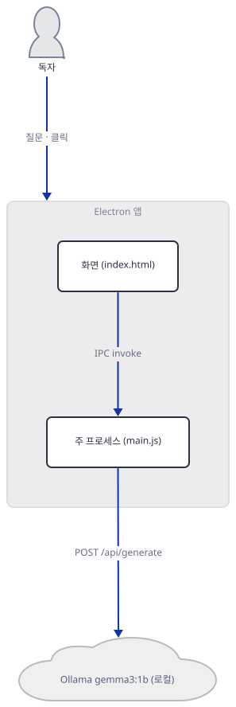
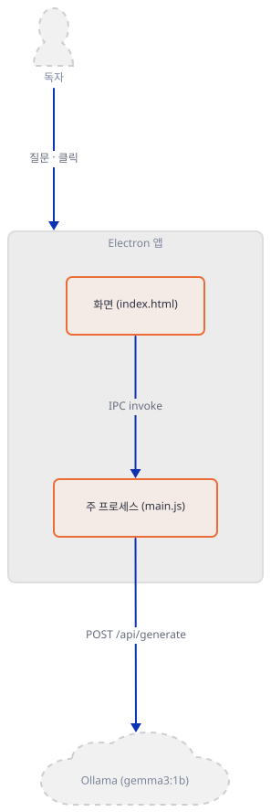
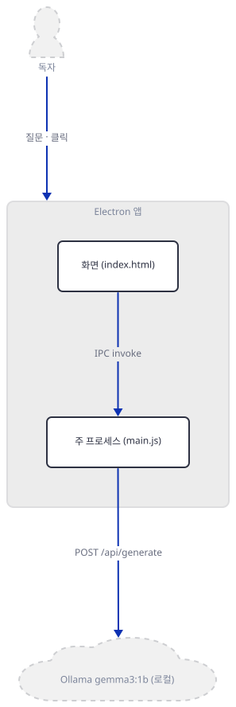
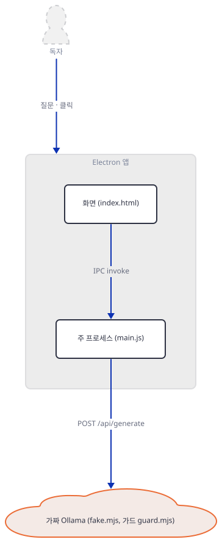
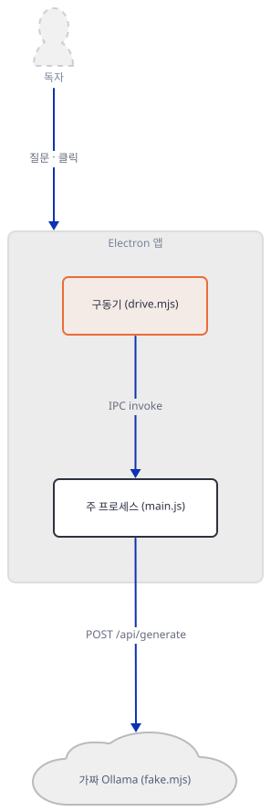
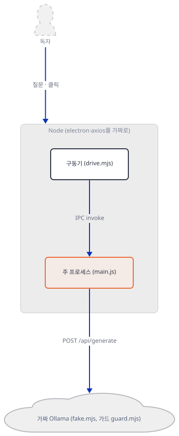
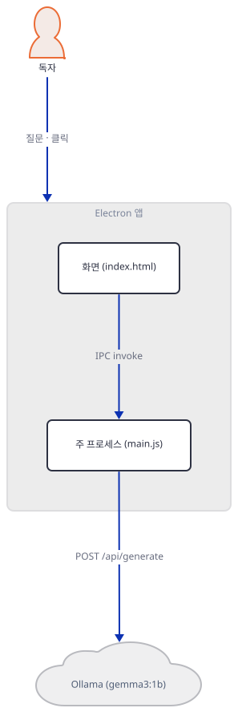
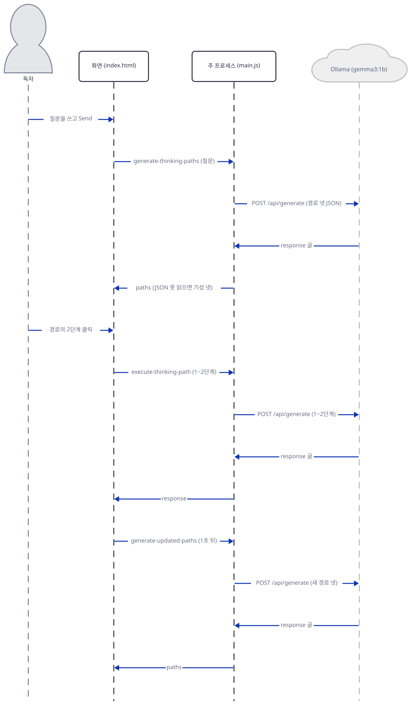

# Day 166 · ThinkPath Chatbot  🧠

> 볼륨 18 🧪 기타 LLM 앱 · 난이도 ★★☆ ⚠ Electron 27(지원 종료) · 예상 소요 100분(손으로 하는 일이 많습니다. 파일 넷을 만들고, 터미널 둘에서 가짜 서버와 명령을 돌리고, 소스 1,232줄 가운데 IPC 손잡이와 화면 함수를 따라 읽습니다) · API 비용 대략 0원(이 문서는 진짜 Ollama를 한 번도 부르지 않았습니다. 진짜로 쓰면 로컬 모델이라 토큰 값은 없고 내 PC의 시간과 메모리를 씁니다) · 원본 앱: `advanced_llm_apps/thinkpath_chatbot_app`

## 오늘 만들 것

질문을 하나 쓰면 모델이 "생각 경로" 넷(이름 하나와 단계 셋씩)을 카드로 내놓고, 독자가 경로 하나의 N번째 단계를 누르면 1~N단계까지만 풀어 답하는 데스크톱 채팅 앱을 따라 봅니다. Electron 창 하나에 화면(`index.html`, 884줄)과 주 프로세스(`main.js`, 348줄)가 있고, 주 프로세스가 `http://localhost:11434/api/generate`로 Ollama의 `gemma3:1b`를 부릅니다. 배우는 것은 둘입니다. 하나는 Electron의 두 프로세스가 `ipcMain.handle`/`ipcRenderer.invoke`로 말하는 모양이고, 하나는 "모델에게 JSON을 시키고 정규식으로 꺼내 쓰는" 길이 어디서 조용히 무너지는가입니다.

이 문서는 **Electron을 띄우지 않았고, `npm`을 한 번도 돌리지 않았고, 진짜 Ollama를 부르지 않았습니다.** 앱 폴더의 `github thinkpath video.mp4`(약 20MB)도 열지 않았습니다. 대신 `main.js`를 **한 글자도 고치지 않고** Node로 불러, 가짜 `electron`(손잡이를 기록만 함)과 가짜 `axios`(같은 모양의 `post`)를 끼운 뒤 손잡이를 화면처럼 불렀습니다. 상대는 내가 쓴 가짜 Ollama입니다. 가짜 서버는 모델이 아니라 문자열 몇 줄이라서, 아래 출력은 요청과 응답의 **모양과 배선**을 보일 뿐 모델이 잘한다는 증거가 아닙니다. 화면은 `index.html`에서 함수 하나(`formatThinkingResponse`)만 잘라 문자열로 돌렸습니다. 알게 된 것은 일곱입니다.

1. 모델 이름과 주소가 설정 없이 `main.js`에 네 번씩 박혀 있습니다(`model: 'gemma3:1b'`가 57·107·184·247줄). 앱 README는 "main.js line 45를 고치라"고 하지만 45줄은 창 닫기 손잡이입니다(Step 2).
2. 대화 기억이 없습니다. 호출마다 새 프롬프트이고, 화면이 `conversationContext`를 넘겨도 `main.js`는 그 값을 쓰지 않으며, 직전 답은 앞 500자만 들어갑니다(Step 5).
3. 3단계를 누르면 1~3단계를 **처음부터 다시 생성**합니다. 가짜 서버 기록에서 프롬프트가 966자 → 1,189자 → 1,357자로 커졌습니다(Step 5). 앱 README의 "토큰 70% 절감" 표를 받쳐 주는 측정 코드는 저장소에 없습니다.
4. 경로 JSON은 "첫 `{`부터 마지막 `}`까지"를 한 번에 파싱합니다. 모델이 JSON 뒤에 `}` 하나만 붙여도 파싱이 실패하고, 앱은 **오류 없이** 키워드로 고른 기성 경로 넷으로 바꿉니다(Step 4).
5. 모델 호출이 실패할 때 `main.js`가 돌려주는 기성 경로는 쓰이지 않습니다. 화면이 `success`가 거짓이면 경로를 버리고 오류 글만 보이기 때문입니다. 그 값은 배열도 아니고 `{paths: […]}` 객체입니다(Step 4).
6. 창이 뜨자마자 보이는 "Connected to Llama"는 `send-to-llm`에 `'test'`를 실제로 생성시켜 본 결과입니다(`index.html:452`). 모델이 없어도 "Disconnected"가 됩니다(Step 4).
7. 보안 설정이 `nodeIntegration: true`, `contextIsolation: false`인데, 모델의 답을 `innerHTML`에 그대로 넣습니다. 모델이 HTML 태그를 내면 Node API(`require`)를 가진 화면 안에서 해석됩니다. 이 문서는 태그가 **걸러지지 않고 남는 데까지** 확인했고 실행해 보지는 않았습니다(Step 6).



## 사전 준비

| 서비스/도구 | 용도 | 발급·설치 |
|---|---|---|
| Node.js 22 이상 | 가짜 서버, 가드, 구동기. 이 문서는 24.12.0으로 확인했습니다 | [공통 사전 준비](../README.md#공통-사전-준비-한-번만) 참고 |
| bash(Git Bash) | 아래 명령 전부. **이 문서는 bash 전용입니다**(PowerShell 판은 싣지 않았습니다) | Windows는 Git for Windows |
| git, 이 저장소의 클론 | 원본 폴더를 읽고 파일 셋을 사본으로 가져옵니다 | `git clone https://github.com/Shubhamsaboo/awesome-llm-apps` |
| npm | **쓰지 않았습니다.** `npm install`은 `electron`을 받는데, `package-lock.json`에서 `electron`(27.3.11)과 `fsevents`(macOS 전용)가 `hasInstallScript: true`입니다. Electron의 설치 스크립트가 실행 파일을 내려받는다는 점은 이 문서가 직접 확인하지 않았습니다 | Step 7 |
| Ollama와 `gemma3:1b` | 진짜로 쓸 때만. **이 문서는 쓰지 않았습니다.** Ollama 라이브러리 페이지에서 `gemma3:1b`는 806MB, 컨텍스트 32K로 올라 있습니다 | Step 7 |

터미널은 둘을 씁니다. 가짜 Ollama를 한 터미널(A)에 띄우고, 나머지 명령은 터미널 B에서 칩니다. 두 터미널 모두 Step 1의 `env.sh`를 불러옵니다.

## 아키텍처 한눈에 보기

| 컴포넌트 | 역할 | 코드 위치 |
|---|---|---|
| 창 | 1200×800(최소 800×600), 프레임 없는 Electron 창. `nodeIntegration: true`, `contextIsolation: false` | `advanced_llm_apps/thinkpath_chatbot_app/main.js:7-28` |
| 창 제어 손잡이 | 최소화·최대화·닫기·최대화 여부. 화면의 신호등 버튼이 부른다 | `main.js:31-51` |
| 연결 확인 | `'test'`를 생성시켜 성공이면 "Connected" | `main.js:54-72`, `index.html:450-459` |
| 경로 만들기 | 질문 → 경로 넷 JSON → 정규식으로 꺼냄 → 실패하면 키워드 폴백 | `main.js:162-215`, `266-334` |
| 단계 실행 | 경로 이름과 1~N단계를 프롬프트로 짜서 생성 | `main.js:218-264`, `index.html:638-696` |
| 이어 갈 경로 | 직전 답 앞 500자로 새 경로 넷 | `main.js:75-161`, `index.html:619-636` |
| 화면 조립 | 경로 카드, 답 말풍선, 답 서식(`formatThinkingResponse`) | `index.html:561-617`, `715-788` |
| 이 문서의 가짜 Ollama·가드·구동기·렌더 시험 | 진짜 Ollama 대신, 연결 제한, 손잡이 부르기, 화면 함수 돌리기 | 코드 없음(Step 3~6에서 직접 만듦) |

## 단계별 진행

### Step 1. 앱 파일 셋을 사본으로 두고 환경을 정한다

**목적.** 원본에는 아무것도 쓰지 않고, 필요한 파일만 새 폴더로 가져옵니다. `main.js`는 `.env`를 읽지 않지만(소스로 확인: `dotenv`가 없습니다), 사본을 쓰는 습관은 같습니다. `electron`과 `axios`는 이 폴더에 없으므로 `node main.js`는 그대로는 돌지 않습니다. 그래서 Step 4의 구동기가 둘을 끼워 줍니다.

**할 일.** 저장소 루트에서 시작합니다. `LAB`은 저장소 밖의 새 폴더로, 자기 절대 경로로 바꿉니다. 블록은 `LAB`이 비었거나 자리 표시 값 그대로이거나 절대 경로가 아니거나 `.claude`·`.agents` 같은 에이전트 설정 폴더(또는 `CLAUDE_CONFIG_DIR`) 아래이면 폴더를 하나도 만들지 않고 멈춥니다(대소문자는 가리지 않습니다). 환경 파일은 HOME·USERPROFILE·CLAUDE_CONFIG_DIR·TEMP를 이 폴더로 돌리고 프록시 변수를 지웁니다. Node 24는 `NODE_USE_ENV_PROXY=1`이면 `HTTP_PROXY`·`NO_PROXY`를 읽어 요청을 프록시로 보내므로([Node 24 CLI 문서](https://nodejs.org/docs/latest-v24.x/api/cli.html)), 이 문서의 루프백 요청이 독자의 프록시로 가지 않게 그 변수를 지우고 `NO_PROXY`를 루프백으로 둡니다. 이후 블록에서 파일을 쓰는 줄은 모두 `"${LAB:?}/…"` 절대 경로입니다. 대화식 터미널에 붙여 넣다가 환경 블록을 건너뛰어도 지금 폴더에 파일이 생기지 않게 하려는 것입니다.

```bash
cd awesome-llm-apps
export REPO="$PWD"
export LAB=/path/to/d166-lab          # 저장소 밖의 새 폴더(자기 절대 경로로 바꾼다)
_ok=1; _n() { { cygpath -m "$1" 2>/dev/null || printf '%s' "$1"; } | tr 'A-Z\\' 'a-z/'; }
case "$LAB" in ""|/path/to/*) echo "LAB을 자기 경로로 바꾸세요"; _ok=0 ;; esac
case "$LAB" in /*|[A-Za-z]:[/\\]*) ;; *) echo "LAB은 절대 경로여야 합니다: $LAB"; _ok=0 ;; esac
case "$(_n "$LAB")/" in
  */.claude/*|*/.agents/*|*/.codex/*|*/.cursor/*|*/.copilot/*|*/.openclaw/*|*/.hermes/*)
    echo "LAB이 에이전트 설정 폴더 아래입니다: $LAB"; _ok=0 ;;
esac
if [ -n "${CLAUDE_CONFIG_DIR:-}" ]; then
  _c=$(_n "$CLAUDE_CONFIG_DIR")
  case "$(_n "$LAB")/" in "${_c%/}"/*) echo "LAB이 CLAUDE_CONFIG_DIR 아래입니다"; _ok=0 ;; esac
fi
[ "$_ok" = 1 ] && mkdir -p "$LAB/home" "$LAB/tmp" "$LAB/work/thinkpath" && cat > "$LAB/env.sh" <<'EOF'
# Day 166 작업 셸의 환경. 이 문서의 모든 명령은 이 파일을 불러온 셸에서 돌린다.
: "${REPO:?REPO를 먼저 정하세요}" "${LAB:?LAB을 먼저 정하세요}"
_n() { { cygpath -m "$1" 2>/dev/null || printf '%s' "$1"; } | tr 'A-Z\\' 'a-z/'; }
_lab=$(cd "$LAB" 2>/dev/null && pwd -P) || { echo "LAB 폴더가 없습니다: $LAB"; return 1; }
_low="$(_n "$_lab")/"
case "$_low" in
  */.claude/*|*/.agents/*|*/.codex/*|*/.cursor/*|*/.copilot/*|*/.openclaw/*|*/.hermes/*)
    echo "LAB이 에이전트 설정 폴더 아래입니다: $_lab"; return 1 ;;
esac
if [ -n "${CLAUDE_CONFIG_DIR:-}" ] && _cfg=$(cd "$CLAUDE_CONFIG_DIR" 2>/dev/null && pwd -P); then
  _cfg="$(_n "$_cfg")/"
  case "$_low" in "$_cfg"*) echo "LAB이 CLAUDE_CONFIG_DIR 아래입니다"; return 1 ;; esac
fi
export HOME="$LAB/home" USERPROFILE="$LAB/home" CLAUDE_CONFIG_DIR="$LAB/home/.claude"
export TEMP="$LAB/tmp" TMP="$LAB/tmp" TMPDIR="$LAB/tmp"
unset HTTP_PROXY HTTPS_PROXY ALL_PROXY http_proxy https_proxy all_proxy NODE_USE_ENV_PROXY
export NO_PROXY=127.0.0.1,localhost,::1 no_proxy=127.0.0.1,localhost,::1
export LABW=$(cygpath -m "$_lab")               # node에 넘기는 Windows 꼴 경로
export APPW="$LABW/work/thinkpath"
export FAKE_PORT=47301                          # 가짜 Ollama의 포트. 진짜 Ollama의 11434가 아니다
EOF
[ "$_ok" = 1 ] && source "$LAB/env.sh" && cd "$LAB/work"
```

앱 파일 셋(`main.js`·`index.html`·`package.json`)만 가져옵니다. mp4와 `package-lock.json`은 가져오지 않습니다.

```bash
for f in main.js index.html package.json; do
  cp "${REPO:?}/advanced_llm_apps/thinkpath_chatbot_app/$f" "${LAB:?}/work/thinkpath/$f"
done
ls "${LAB:?}/work/thinkpath"
```



**확인.** 출력이 세 줄이어야 합니다.

```text
index.html
main.js
package.json
```

### Step 2. IPC 손잡이를 소스로 따라간다

**목적.** 화면이 부르는 이름과 주 프로세스가 받는 이름을 맞대 봅니다. Electron의 `ipcMain.handle(채널, 함수)`는 화면의 `ipcRenderer.invoke(채널, 값)`에 대한 답을 약속(Promise)으로 돌려줍니다. 이 앱은 그 다리 여덟 개가 전부입니다.

**할 일.** 사본에서 두 파일의 채널 이름을 뽑습니다.

```bash
cd "${LAB:?}/work/thinkpath"
grep -n "ipcMain.handle" main.js | cut -c1-60
grep -n "ipcRenderer.invoke" index.html | sed 's/^\([0-9]*\): *const .*= await /\1: /; s/^\([0-9]*\): *await /\1: /' | cut -c1-70
grep -n "model:" main.js
```



**확인.** 손잡이 여덟(창 제어 넷, LLM 넷)과 화면 쪽 호출 여덟, 모델 이름 넷이 보여야 합니다.

```text
31:ipcMain.handle('window-minimize', () => {
35:ipcMain.handle('window-maximize', () => {
45:ipcMain.handle('window-close', () => {
49:ipcMain.handle('window-is-maximized', () => {
54:ipcMain.handle('send-to-llm', async (event, message) => {
75:ipcMain.handle('generate-updated-paths', async (event, { 
162:ipcMain.handle('generate-thinking-paths', async (event, 
218:ipcMain.handle('execute-thinking-path', async (event, { 
452: ipcRenderer.invoke('send-to-llm', 'test');
495: ipcRenderer.invoke('window-close');
499: ipcRenderer.invoke('window-minimize');
503: ipcRenderer.invoke('window-maximize');
528: ipcRenderer.invoke('generate-thinking-paths', message);
621: ipcRenderer.invoke('generate-updated-paths', {
654: ipcRenderer.invoke('execute-thinking-path', {
798: ipcRenderer.invoke('generate-updated-paths', {
57:      model: 'gemma3:1b',
107:      model: 'gemma3:1b',
184:      model: 'gemma3:1b',
247:      model: 'gemma3:1b',
```

읽을 것은 셋입니다. 첫째, `window-is-maximized`는 받는 쪽만 있고 부르는 쪽이 없습니다. 둘째, `generate-updated-paths`는 두 곳에서 부릅니다. 하나는 답이 나온 1초 뒤 자동(`index.html:678-680`, 위 621줄), 하나는 "🔄 Generate New Approaches Based on Conversation" 버튼(위 798줄, `Ctrl/Cmd+R`도 같은 함수를 부릅니다. `index.html:877-879`)입니다. 셋째, 모델 이름이 네 곳이라 앱 README의 "line 45 한 줄만 바꾸라"는 안내로는 모델이 바뀌지 않습니다. 앱 README를 따라 첫 `model:`을 찾으면 57줄인데, 거기만 바꾸면 연결 확인(`'test'`)만 새 모델로 가고 경로 만들기·단계 실행·이어 갈 경로는 옛 모델을 씁니다. 어느 한 곳만 바꾸면 호출마다 모델이 갈립니다(예: 184줄만 바꾸면 경로만 새 모델이 만듭니다). 주소(`localhost:11434`)도 네 곳에 박혀 있어 다른 컴퓨터의 Ollama를 쓰려면 네 곳을 모두 고쳐야 합니다.

### Step 3. 가짜 Ollama와 연결 제한 가드를 만든다

**목적.** 진짜 Ollama가 떠 있는 PC에서도 이 문서가 그쪽으로 새지 않게 합니다. 가드는 이 프로세스의 소켓 연결을 `127.0.0.1:47301` 하나로만 열어 두고, 시작할 때 `192.0.2.1`(문서용 예약 주소)과 `127.0.0.1:11434`로 연결을 시도해 **막히는 것을 확인한 뒤에야** `armed`를 내보냅니다. 막히지 않으면 그 자리에서 멈춥니다. 가짜 Ollama는 `POST /api/generate`에 프롬프트를 보고 정해진 글을 돌려주고, `POST /mode`로 응답 꼴을 바꾸며, 받은 요청을 `fake.log`에 남깁니다.

**할 일.** 파일 둘을 만듭니다.

```bash
cat > "${LAB:?}/fake.mjs" <<'EOF'
// 가짜 Ollama. 루프백 한 포트에서 POST /api/generate 와 POST /mode 만 받는다. 모델이 아니라 문자열 몇 줄이다.
// /mode 로 다음 응답의 꼴을 바꾼다. 받은 요청은 fake.log 에 한 줄씩 남긴다.
import http from "node:http";
import { appendFileSync } from "node:fs";

const PORT = Number(process.env.FAKE_PORT ?? (() => { throw new Error("FAKE_PORT가 없습니다"); })());
const LOG = process.env.LABW + "/fake.log";
let mode = "normal";

const paths = {
  paths: [
    { name: "Root Cause", steps: ["Identify the problem", "Trace underlying causes", "Propose solutions"] },
    { name: "Quick Win", steps: ["List cheap fixes", "Pick one", "Try it"] },
    { name: "Compare Options", steps: ["List alternatives", "Score them", "Recommend"] },
    { name: "Big Picture", steps: ["Define goals", "Map constraints", "Plan"] },
  ],
};

function reply(prompt) {
  if (prompt === "test") return "ok";
  if (prompt.includes("strategic thinking assistant") || prompt.includes("Generate 4 NEW")) {
    if (mode === "fenced") return "Sure! Here you go:\n```json\n" + JSON.stringify(paths) + "\n```\nHope this helps.";
    if (mode === "greedy") return "Here are the paths: " + JSON.stringify(paths) + "\nHope this helps :}";
    if (mode === "nojson") return "I think you should just think harder about it.";
    return JSON.stringify(paths);
  }
  if (prompt.includes("I'm following the")) {
    const steps = prompt.split("\n").filter((l) => /^Step \d+: /.test(l));
    const body = steps.map((l) => "**" + l + "**\n- fake reasoning for this step").join("\n\n");
    const extra = mode === "evil" ? '\n\n' : "";
    return "**Following \"fake\" Approach:**\n\n" + body + "\n\n**Current Progress:**\nDone " + steps.length + " step(s)." + extra;
  }
  return "?";
}

http.createServer(async (req, res) => {
  let raw = "";
  for await (const c of req) raw += c;
  const send = (code, o) => { res.writeHead(code, { "Content-Type": "application/json" }); res.end(JSON.stringify(o)); };
  if (req.method === "POST" && req.url === "/mode") { mode = JSON.parse(raw).mode; return send(200, { mode }); }
  if (req.method === "POST" && req.url === "/api/generate") {
    const body = JSON.parse(raw);
    appendFileSync(LOG, JSON.stringify({ mode, keys: Object.keys(body), model: body.model, stream: body.stream, prompt: body.prompt }) + "\n");
    if (mode === "missing") return send(404, { error: 'model "' + body.model + '" not found, try pulling it first' });
    return send(200, { model: body.model, response: reply(body.prompt), done: true });
  }
  send(404, { error: "no such fake route" });
}).listen(PORT, "127.0.0.1", () => console.log("fake ollama on 127.0.0.1:" + PORT));
EOF
cat > "${LAB:?}/guard.mjs" <<'EOF'
// 독자용 가드. 이 프로세스의 소켓 연결을 127.0.0.1:FAKE_PORT 하나로만 허용한다.
// 진짜 Ollama 의 11434 를 포함해 다른 곳은 모두 거부한다. 먼저 192.0.2.1 과 11434 로 단언하고, 막히지 않으면 멈춘다.
import net from "node:net";

const PORT = Number(process.env.FAKE_PORT ?? (() => { throw new Error("FAKE_PORT가 없습니다"); })());
if (!(PORT > 1024 && PORT !== 11434)) throw new Error("FAKE_PORT가 이상합니다: " + PORT);

const connect = net.Socket.prototype.connect;
net.Socket.prototype.connect = function (...args) {
  const first = Array.isArray(args[0]) ? args[0][0] : args[0];
  const second = Array.isArray(args[0]) ? args[0][1] : args[1];
  const port = Number(first && typeof first === "object" ? first.port : first);
  const host = first && typeof first === "object" ? first.host : second;
  if (port !== PORT || !["127.0.0.1", "localhost"].includes(String(host ?? "localhost"))) {
    throw Object.assign(new Error("lab guard blocked " + host + ":" + port), { code: "EGUARD" });
  }
  return connect.apply(this, args);
};

for (const [host, port] of [["192.0.2.1", 80], ["127.0.0.1", 11434]]) {
  try { net.connect(port, host).on("error", () => {}).destroy(); throw new Error("가드가 " + host + ":" + port + "를 막지 않았습니다"); }
  catch (e) { if (e.code !== "EGUARD") throw e; }
}
export const armed = true;
EOF
ls "${LAB:?}"
```

터미널 A에서 가짜 서버를 띄웁니다. 이 터미널도 `env.sh`를 불러옵니다.

```bash
# 터미널 A
export REPO=/path/to/awesome-llm-apps   # 저장소 절대 경로
export LAB=/path/to/d166-lab            # Step 1과 같은 값
source "${LAB:?}/env.sh" && cd "${LAB:?}" && : > fake.log && node fake.mjs
```

터미널 B에서 모드 바꾸기 요청이 닿는지 봅니다. `--noproxy '*'`는 독자의 프록시 설정이 루프백 요청을 가로채지 않게 합니다.

```bash
# 터미널 B (Step 1의 셸)
curl -s --noproxy '*' -X POST "http://127.0.0.1:${FAKE_PORT:?}/mode" -d '{"mode":"normal"}'; echo
```



**확인.** 터미널 A에 `fake ollama on 127.0.0.1:47301`이 뜨고, 터미널 B에 `{"mode":"normal"}`이 찍혀야 합니다. 가드의 단언은 Step 4의 구동기가 불러올 때 돕니다.

### Step 4. 손잡이를 부른다: 경로 만들기와 그 실패들

**목적.** 화면이 하듯 `send-to-llm`과 `generate-thinking-paths`를 부르고, 모델 응답이 여러 꼴일 때 무엇이 돌아오는지 봅니다. 구동기 `drive.mjs`는 가드를 먼저 불러온 뒤(`armed`가 없으면 `ReferenceError`로 멈춥니다), `electron`·`axios`를 가짜로 바꿔 끼우고 사본 `main.js`를 `require`합니다. 가짜 `axios.post`는 주소가 정확히 `http://localhost:11434/api/generate`일 때만 `127.0.0.1:47301`로 보냅니다. 그러므로 `main.js`는 자기가 11434에 말한다고 믿지만 실제 연결은 47301로만 나가고, 그 밖의 연결은 가드가 막습니다. 가짜 `axios`는 진짜 `axios`가 아닙니다. 상태 코드 오류의 글(`Request failed with status code 404`)은 잠금 판 axios 1.11.0(`package-lock.json:229-230`)의 소스 `lib/core/settle.js`가 거부할 때 만드는 글(`'Request failed with status code ' + response.status`)을 따라 한 것입니다([v1.11.0 소스](https://raw.githubusercontent.com/axios/axios/v1.11.0/lib/core/settle.js)에서 읽어 확인함). 연결 거부 같은 다른 오류의 글은 이 문서가 보증하지 않습니다.

**할 일.** 구동기와 요약기를 만듭니다. 화면 쪽에서 `main.js`에 건네는 값은 `index.html`을 읽고 같은 모양으로 맞췄습니다(`execute`·`updated`의 인자 이름은 `main.js:75`·`218`의 구조 분해와 같습니다).

```bash
cat > "${LAB:?}/drive.mjs" <<'EOF'
// Electron 없이 main.js 를 그대로 불러 IPC 손잡이를 렌더러처럼 부른다.
// 'electron' 은 ipcMain.handle 만 기록하는 가짜로, 'axios' 는 같은 모양의 post 를 가진 가짜로 바꿔 끼운다.
// 가짜 axios 는 main.js 가 쓰는 주소가 정확히 http://localhost:11434/api/generate 일 때만 127.0.0.1:FAKE_PORT 로 보낸다.
import { armed } from "./guard.mjs";
if (armed !== true) throw new Error("가드가 없습니다");
import http from "node:http";
import Module, { createRequire } from "node:module";

const PORT = Number(process.env.FAKE_PORT);
const handlers = {};
const electron = {
  app: { whenReady: () => new Promise(() => {}), on() {}, quit() {} },
  BrowserWindow: class { static getAllWindows() { return []; } },
  ipcMain: { handle: (name, fn) => (handlers[name] = fn) },
};
const post = (path, body) =>
  new Promise((resolve, reject) => {
    const req = http.request({ host: "127.0.0.1", port: PORT, path, method: "POST", headers: { "Content-Type": "application/json" } }, (res) => {
      let raw = "";
      res.on("data", (c) => (raw += c));
      res.on("end", () => {
        if (res.statusCode >= 400) reject(new Error("Request failed with status code " + res.statusCode));
        else resolve({ status: res.statusCode, data: JSON.parse(raw) });
      });
    });
    req.on("error", reject);
    req.end(JSON.stringify(body));
  });
const axios = {
  post: (url, body) => {
    if (url !== "http://localhost:11434/api/generate") throw new Error("이 문서의 가짜 axios는 이 주소만 받습니다: " + url);
    return post("/api/generate", body);
  },
};
const load = Module._load;
Module._load = function (request, ...rest) {
  if (request === "electron") return electron;
  if (request === "axios") return axios;
  return load.call(this, request, ...rest);
};
createRequire(import.meta.url)(process.env.APPW + "/main.js");

const mode = (m) => post("/mode", { mode: m });
const call = (name, arg) => handlers[name]({}, arg);
const brief = (r) => {
  if (!r || !("paths" in r)) return r;
  const list = Array.isArray(r.paths) ? r.paths : r.paths.paths;
  return { success: r.success, error: r.error, "paths는": Array.isArray(r.paths) ? "배열" : "객체", names: list.map((p) => p.name) };
};
const show = (label, r) => console.log(label.padEnd(30), JSON.stringify(brief(r)).slice(0, 190));
console.log("handlers:", Object.keys(handlers).join(", "));

const which = process.argv[2];
if (which === "paths") {
  await mode("normal");
  show("send-to-llm 'test'", await call("send-to-llm", "test"));
  show("paths, plain JSON", await call("generate-thinking-paths", "How do I cut churn?"));
  await mode("fenced");
  show("paths, prose + fence", await call("generate-thinking-paths", "How do I cut churn?"));
  await mode("greedy");
  show("paths, JSON then '}'", await call("generate-thinking-paths", "How do I cut churn?"));
  await mode("nojson");
  show("paths, no JSON, plain query", await call("generate-thinking-paths", "How do I cut churn?"));
  show("paths, no JSON, query 'code'", await call("generate-thinking-paths", "Review my code"));
  show("paths, no JSON, query 'data'", await call("generate-thinking-paths", "Which data matters?"));
  await mode("missing");
  show("paths, model missing (404)", await call("generate-thinking-paths", "How do I cut churn?"));
} else if (which === "run") {
  await mode("normal");
  const steps = ["Identify the problem", "Trace underlying causes", "Propose solutions"];
  for (const n of [1, 2, 3]) {
    const r = await call("execute-thinking-path", { query: "How do I cut churn?", pathName: "Root Cause", steps, executeUpToStep: n });
    show("execute up to step " + n, { success: r.success, stepsExecuted: r.stepsExecuted, response: r.response });
  }
  const r = await call("generate-updated-paths", {
    originalQuery: "How do I cut churn?", lastResponse: "x".repeat(900), conversationContext: [{ big: "y".repeat(5000) }],
    lastPathName: "Root Cause", lastStepsExecuted: 2,
  });
  show("updated paths", { success: r.success, names: r.paths.map((p) => p.name) });
  await mode("nojson");
  const f = await call("generate-updated-paths", { originalQuery: "q", lastResponse: "r", conversationContext: [], lastPathName: "Root Cause", lastStepsExecuted: 2 });
  show("updated paths, no JSON", { success: f.success, names: f.paths.map((p) => p.name) });
}
process.exit(0);
EOF
cat > "${LAB:?}/logsum.mjs" <<'EOF'
// fake.log 를 요약한다. 요청마다 본문 키, 모델, stream, 프롬프트 길이(글자), 프롬프트 첫 줄.
import { readFileSync } from "node:fs";
const rows = readFileSync(process.env.LABW + "/fake.log", "utf8").trim().split("\n").map((l) => JSON.parse(l));
rows.forEach((r, i) => console.log(String(i + 1).padStart(2), r.keys.join(","), r.model, "stream=" + r.stream, String(r.prompt.length).padStart(5) + "자", JSON.stringify(r.prompt.split("\n")[0].slice(0, 60))));
EOF
cd "${LAB:?}" && : > fake.log && node drive.mjs paths
```



**확인.** 출력은 다음과 같습니다(가짜 서버를 이 순서로 모드를 바꿔 가며 불렀습니다).

```text
handlers: window-minimize, window-maximize, window-close, window-is-maximized, send-to-llm, generate-updated-paths, generate-thinking-paths, execute-thinking-path
send-to-llm 'test'             {"success":true,"response":"ok"}
paths, plain JSON              {"success":true,"paths는":"배열","names":["Root Cause","Quick Win","Compare Options","Big Picture"]}
paths, prose + fence           {"success":true,"paths는":"배열","names":["Root Cause","Quick Win","Compare Options","Big Picture"]}
paths, JSON then '}'           {"success":true,"paths는":"배열","names":["Analytical","Creative","Practical","Comprehensive"]}
paths, no JSON, plain query    {"success":true,"paths는":"배열","names":["Analytical","Creative","Practical","Comprehensive"]}
paths, no JSON, query 'code'   {"success":true,"paths는":"배열","names":["Step by Step","Best Practices","Quick Prototype","Comprehensive"]}
paths, no JSON, query 'data'   {"success":true,"paths는":"배열","names":["Data Driven","Comparative","Root Cause","Strategic"]}
paths, model missing (404)     {"success":false,"error":"Request failed with status code 404","paths는":"객체","names":["Analytical","Creative","Practical","Comprehensive"]}
```

여기서 일곱 줄을 읽습니다.

- `prose + fence`에서 경로가 정상으로 나온 것은 정규식(`main.js:115`·`193`)이 코드 울타리와 앞뒤 말을 건너뛰기 때문입니다.
- `JSON then '}'`는 같은 JSON인데 뒤에 `}` 하나가 붙어 "첫 `{`부터 마지막 `}`"가 JSON이 아니게 되었고, 앱은 오류 없이 기성 경로(Analytical 등)를 냈습니다. `success`는 여전히 `true`입니다. 독자는 모델이 만든 경로인지 기성품인지 화면에서 알 수 없습니다.
- 기성 경로는 질문에 `code`·`program`·`function`이 있으면 코드용, `analyz`·`data`·`research`가 있으면 분석용입니다(`main.js:267-268`). `includes`라서 "Which data matters?"도 분석용이 되고, `database`나 `metadata`도 걸립니다.
- 404 줄이 중요합니다. 모델이 없으면(Ollama의 [오류 문서](https://docs.ollama.com/api/errors)는 `404`를 "Not Found (model doesn't exist, etc.)"로, 본문을 `{"error": "…"}` 꼴의 JSON으로 적습니다. 가짜 서버의 404는 이 꼴을 따랐고 본문 글자는 **내 가짜 서버의 선택**이며 진짜 글자는 확인하지 못했습니다) `axios`가 던진 오류가 `catch`(`main.js:208-213`)로 가서 `success: false`와 함께 기성 경로를 담습니다. 그런데 그 값은 `generateFallbackPaths`의 반환 그대로라 `{paths: […]}` 객체이고, 화면(`index.html:528-541`)은 `success`가 거짓이면 경로를 쓰지 않고 오류 글만 보입니다. 이 기성 경로는 어느 화면에서도 쓰이지 않습니다.
- 첫 줄이 연결 표시등의 정체입니다. 시작할 때 `'test'`를 정말 생성시켜(`index.html:452`) 성공하면 "Connected to Llama", 아니면 "Disconnected"입니다. 이 호출은 모델을 메모리에 올리는 일이기도 합니다.

요청 본문은 셋뿐입니다. 터미널 B에서 확인합니다.

```bash
cd "${LAB:?}" && node logsum.mjs
```

```text
 1 model,prompt,stream gemma3:1b stream=false     4자 "test"
 2 model,prompt,stream gemma3:1b stream=false   620자 "You are a strategic thinking assistant. For the following qu"
 3 model,prompt,stream gemma3:1b stream=false   620자 "You are a strategic thinking assistant. For the following qu"
 4 model,prompt,stream gemma3:1b stream=false   620자 "You are a strategic thinking assistant. For the following qu"
 5 model,prompt,stream gemma3:1b stream=false   620자 "You are a strategic thinking assistant. For the following qu"
 6 model,prompt,stream gemma3:1b stream=false   615자 "You are a strategic thinking assistant. For the following qu"
 7 model,prompt,stream gemma3:1b stream=false   620자 "You are a strategic thinking assistant. For the following qu"
 8 model,prompt,stream gemma3:1b stream=false   620자 "You are a strategic thinking assistant. For the following qu"
```

줄 2~8이 `generate-thinking-paths` 일곱 번입니다(`'code'` 질문이 5자 짧아 615자입니다). 모델, 프롬프트, `stream: false`뿐이고 `format: "json"`도 `options`도 시간 제한도 없습니다. Ollama API 문서는 `format`에 `json`이나 JSON 스키마를 줄 수 있다고 하며, 이 앱은 쓰지 않습니다. `main.js`가 `timeout`을 주지 않습니다(소스로 확인). 잠금 판 axios 1.11.0의 소스 `lib/defaults/index.js`는 `timeout: 0,`이고 그 위 주석이 "If set to 0 (default) a timeout is not created."입니다([v1.11.0 소스](https://raw.githubusercontent.com/axios/axios/v1.11.0/lib/defaults/index.js)에서 읽어 확인함). 기본이 제한 없음이므로 모델이 느리면 화면은 "Analyzing…"에서 계속 기다립니다.

### Step 5. 단계 실행과 이어 갈 경로를 부른다

**목적.** `execute-thinking-path`가 단계 N을 어떻게 프롬프트로 짜는지, 그리고 `generate-updated-paths`가 무엇을 모델에 싣는지 봅니다.

**할 일.**

```bash
cd "${LAB:?}" && : > fake.log && node drive.mjs run | cut -c1-120 && node logsum.mjs | sed -n '1,5p'
```



**확인.** 출력은 다음과 같습니다.

```text
handlers: window-minimize, window-maximize, window-close, window-is-maximized, send-to-llm, generate-updated-paths, gene
execute up to step 1           {"success":true,"stepsExecuted":1,"response":"**Following \"fake\" Approach:**\n\n**Step 
execute up to step 2           {"success":true,"stepsExecuted":2,"response":"**Following \"fake\" Approach:**\n\n**Step 
execute up to step 3           {"success":true,"stepsExecuted":3,"response":"**Following \"fake\" Approach:**\n\n**Step 
updated paths                  {"success":true,"names":["Root Cause","Quick Win","Compare Options","Big Picture"]}
updated paths, no JSON         {"success":true,"names":["Continue Deep","New Angle","Apply Practical","Expand Context"]}
 1 model,prompt,stream gemma3:1b stream=false   966자 "Original question: \"How do I cut churn?\""
 2 model,prompt,stream gemma3:1b stream=false  1189자 "Original question: \"How do I cut churn?\""
 3 model,prompt,stream gemma3:1b stream=false  1357자 "Original question: \"How do I cut churn?\""
 4 model,prompt,stream gemma3:1b stream=false  1383자 "Based on this conversation context:"
 5 model,prompt,stream gemma3:1b stream=false   866자 "Based on this conversation context:"
```

읽을 것입니다. 프롬프트가 단계마다 커진다는 것은 1단계 요청에 1단계만, 2단계 요청에 1·2단계 문장이 **모두** 들어가고(`main.js:222-224`), 형식 지시도 2단계 줄·3단계 줄이 조건부로 붙기(`235`·`238`) 때문입니다. 그래서 3단계를 눌러도 앞 두 단계의 답을 이어받지 않고 모델이 1~3단계를 다시 씁니다. 화면에는 앞 말풍선이 그대로 남은 채 새 말풍선이 하나 더 붙습니다(`index.html:715-732`). README의 "Cumulative Logic: Step 3 = Steps 1 + 2 + 3 executed together"가 이 뜻입니다. 로컬 모델에서는 토큰이 돈이 아니라 시간이고, 여기서는 더 깊이 갈수록 오래 걸립니다.

네 번째 줄(1,383자)이 `generate-updated-paths`입니다. 다섯 번째 줄(866자)은 같은 호출에 짧은 입력을 준 경우입니다. 이 호출에 **직전 답 900자와 5,000자짜리 `conversationContext`를 줬는데도** 프롬프트는 1,383자입니다. `lastResponse.substring(0, 500)`(`main.js:81`)만 들어가고 `conversationContext`는 구조 분해만 될 뿐 프롬프트 어디에도 쓰이지 않기 때문입니다. 이 앱의 "Context Awareness"는 마지막 답 500자입니다. 모델 응답을 JSON으로 읽지 못하면 이 호출도 기성 "Continue Deep" 넷으로 바뀌며 `success`는 `true`입니다(마지막 줄).

### Step 6. 화면의 답 서식 함수를 돌려 보고 보안 설정을 읽는다

**목적.** 모델의 답이 화면에 들어가기 전에 지나는 함수 `formatThinkingResponse`(`index.html:736-788`)를 문자열로 돌려, 어떤 HTML이 나오는지 봅니다. DOM도 Electron도 쓰지 않습니다. **이 Step은 IPC도 `main.js`도 가짜 Ollama도 거치지 않습니다**(그림의 화살표는 앱의 평상 배선이고, 오늘 돌리는 것은 `index.html`의 함수 하나입니다). 파일에서 함수 본문만 잘라 `new Function`으로 만듭니다.

**할 일.**

```bash
cat > "${LAB:?}/render.mjs" <<'EOF'
// index.html 에서 formatThinkingResponse 함수 하나만 잘라 내 문자열로 돌린다. DOM 도 Electron 도 쓰지 않는다.
import { readFileSync } from "node:fs";
const html = readFileSync(process.env.APPW + "/index.html", "utf8");
const start = html.indexOf("function formatThinkingResponse(content) {");
const end = html.indexOf("async function updateThinkingPaths()");
if (start < 0 || end < start) throw new Error("함수를 찾지 못했습니다");
const format = new Function(html.slice(start, end) + "\nreturn formatThinkingResponse;")();

const model = '**Following "Root Cause" Approach:**\n\n**Step 1: Identify the problem**\n- churn is high\n\n**Current Progress:**\nDone.';
console.log("정상 응답  ->", format(model));
const evil = model + '\n\n';
console.log("주입 응답  ->", format(evil).slice(-80));
console.log("태그가 그대로 남았나:", format(evil).includes(' <strong>Following "Root Cause" Approach:</strong></p><p><div class="thinking-step"><h4>🔹 </div><div class="thinking-step"><h4>🔹 Step 1: Identify the problem</h4></h4><br>- churn is high</p><p><strong>Current Progress:</strong><br>Done.</div>
주입 응답  -> one.</p><p></div>
태그가 그대로 남았나: true
```

두 가지를 읽습니다.

첫째, 서식 함수는 정규식 열 몇 개를 차례로 겁니다. 정상 응답에서도 `<h4>`가 겹치고 `</p>`가 짝 없이 남습니다(Chromium은 이런 HTML을 너그럽게 고쳐 읽습니다). `**Following "…" Approach:**`를 `<h3>🎯`로 바꾸는 규칙은 앞선 일반 굵은 글씨 규칙(`**…**` → `<strong>`)이 먼저 지나가서 **한 번도 걸리지 않습니다**(일반 굵은 글씨 규칙은 `index.html:745`, 머리글 규칙은 `765`이고, 출력에는 `<strong>Following…`이 보입니다). 모델이 조금만 다른 모양으로 답해도 서식이 무너지는 구조입니다.

둘째, 모델이 낸 ``는 **걸러지지 않고 그대로 남았습니다.** 이 함수의 결과는 `messageEl.innerHTML = …`(`index.html:723-731`)에 들어가고, 경로 카드의 `path.name`·단계 글도 `innerHTML`(`561-616`)로 들어갑니다. 반면 독자가 쓴 질문은 `textContent`(`480`)입니다. `main.js:12-13`은 `nodeIntegration: true`, `contextIsolation: false`입니다. [Electron 보안 문서](https://www.electronjs.org/docs/latest/tutorial/security)는 "It is paramount that you do not enable Node.js integration in any renderer."라고 하고, XSS가 "더 위험해지는" 이유를 "A cross-site-scripting (XSS) attack is more dangerous if an attacker can jump out of the renderer process."로 설명합니다. 그래서 읽은 결론은 이렇습니다. 이 화면에서 모델이 낸 태그가 실행되면 그 코드는 `require`로 `child_process`·`fs`를 쓸 수 있습니다. 이 결론은 문서와 소스로 읽은 것이고 Electron을 띄워 실행해 보지는 않았습니다. 위험의 크기도 가려 읽어야 합니다. 이 앱은 로컬 모델과 혼자 쓰는 창이고 `loadFile('index.html')`로 자기 파일만 엽니다. 공격이 성립하려면 모델의 답에 태그가 실려야 하며, 독자가 HTML에 대해 묻거나(모델이 코드 예시를 내면 그 태그가 말풍선에 풀립니다), 질문에 남이 쓴 글을 붙여 넣을 때입니다. 고치는 길은 `contextIsolation: true`와 `nodeIntegration: false`에 `preload.js`로 필요한 손잡이만 여는 것, 그리고 모델의 글을 `textContent`나 이스케이프를 거쳐 넣는 것입니다.

### Step 7. 진짜로 쓰려면 (이 문서는 실행하지 않았다)

**목적.** 진짜 Ollama와 Electron으로 돌리는 길과, 그때 달라지는 점입니다. 아래는 앱 README와 소스를 읽어 정리한 것이고 **이 문서는 하나도 실행하지 않았습니다.**

**할 일.** 독자에게 Ollama가 설치돼 있다면 다음 순서입니다.

```bash
ollama pull gemma3:1b                                  # 806MB
cd awesome-llm-apps/advanced_llm_apps/thinkpath_chatbot_app
npm install                                           # electron 27.3.11 설치 스크립트가 돈다
npm start                                             # electron .
```



**확인.** 창이 뜨면 위쪽에 "● Connecting…"이 "● Connected to Llama"로 바뀌어야 합니다. 바뀌지 않으면 아래 문제 해결 표를 봅니다. 알아 둘 것은 넷입니다.

- `npm install`이 받는 `electron`은 27.3.11입니다. [Electron 문서](https://www.electronjs.org/docs/latest/tutorial/electron-timelines)는 최신 안정 주 버전 셋만 지원한다고 적습니다. 공식 [Release Schedule](https://releases.electronjs.org/schedule)의 27.0.0 행은 Stable 2023-10-09, **End of Life 2024-04-16**, Chromium M118, Node v18.17.1입니다(읽어 확인함). 곧 `npm install`이 잠금 파일대로 받는 27.3.11은 **이미 지원이 끝난 런타임**입니다. 이 앱처럼 `nodeIntegration: true`로 모델의 글을 `innerHTML`에 넣는 구조(Step 6)에서는 더 무겁게 받아들일 일입니다. 더 새 Electron으로 올려도 이 앱의 `nodeIntegration`·`contextIsolation` 설정이 그대로 도는지는 이 문서가 확인하지 않았습니다.
- 앱 README의 `git clone … && cd thinkpath-ai`는 폴더 이름이 어긋납니다. 클론하면 `ThinkPath-Chatbot`이 생기는데 `cd`는 `thinkpath-ai`로 갑니다. 이 저장소에서는 `advanced_llm_apps/thinkpath_chatbot_app`으로 들어가세요.
- `npm run dev`는 `concurrently "npm run start" "npm run watch"`(`package.json:8-9`)라서 `npm start`가 하나, `watch`(`nodemon --exec npm run start`) 아래 `npm start`가 하나, 곧 **Electron 창이 둘** 뜹니다(소스로 읽음, 실행 안 함). `nodemon`은 파일이 바뀔 때마다 그쪽을 다시 띄웁니다. 개발 도구(DevTools)는 `NODE_ENV=development`일 때만 열리는데(`main.js:25`) `dev` 스크립트는 그 값을 정하지 않습니다.
- `icon: path.join(__dirname, 'assets/icon.png')`(`main.js:19`)의 `assets/` 폴더는 저장소에 없습니다. 이것이 Windows에서 창을 막는지는 실행하지 않아 모릅니다.

## 요청 한 건이 흐르는 과정



독자가 질문을 쓰고 Send를 누르면 화면은 질문을 `textContent`로 말풍선에 붙이고, `generate-thinking-paths`를 부릅니다(`index.html:506-547`). 주 프로세스는 질문을 "strategic thinking assistant" 프롬프트에 넣어 `/api/generate`로 보내고, 응답에서 첫 `{`~마지막 `}`를 `JSON.parse`합니다. 성공하면 모델의 경로 넷이, 실패하면 키워드로 고른 기성 경로 넷이 같은 `success: true`로 화면에 갑니다. 화면은 경로 카드를 `innerHTML`로 만듭니다. 카드의 단계를 누르면 `execute-thinking-path`가 그 경로의 1~N단계 프롬프트로 한 번 더 부르고, 답을 서식 함수에 통과시켜 말풍선에 넣습니다. 1초 뒤 화면이 `generate-updated-paths`를 자동으로 부르고, 이어 갈 경로 넷이 카드를 바꿉니다. 이때 카드 아래 입력창이 `innerHTML`로 새로 만들어지므로, 그 사이에 쓰던 글자는 사라질 수 있습니다(`index.html:561-616`이 입력창을 다시 그림, 실행해 보지는 않았습니다). 모델 호출은 시작할 때 `'test'` 한 번, 질문 하나에 경로 만들기 한 번이고, 단계를 누를 때마다 단계 실행과 1초 뒤 이어 갈 경로가 두 번씩 더 나갑니다(`index.html:452`·`654`·`678-680`). 매번 앞 호출과 독립입니다.

## 실행 체크리스트

- [ ] `LAB`이 저장소 밖의 새 폴더이고 `env.sh`가 만들어졌다
- [ ] 사본에 `main.js`·`index.html`·`package.json` 셋이 있다
- [ ] `grep`으로 손잡이 여덟, 모델 이름 넷을 확인했다
- [ ] 가짜 Ollama가 `127.0.0.1:47301`에서 듣고 `/mode`가 응답한다
- [ ] `drive.mjs paths`의 여덟 줄이 위와 같다(`JSON then '}'`가 기성 경로)
- [ ] `drive.mjs run`의 프롬프트 길이가 966 → 1,189 → 1,357자로 커진다
- [ ] `render.mjs`가 `태그가 그대로 남았나: true`를 찍는다
- [ ] 터미널 A의 가짜 서버를 `Ctrl+C`로 끝냈다

## 문제 해결

| 증상 | 원인 | 해결 |
|---|---|---|
| `FAKE_PORT가 없습니다` | `env.sh`를 불러오지 않은 셸 | `source "$LAB/env.sh"` |
| `ReferenceError: armed is not defined` | `drive.mjs`에서 가드를 불러오는 줄이 빠졌다. 의도한 동작이다(작성자가 줄을 빼 보았고, 가짜 서버로도 나가지 않고 멈췄습니다) | 줄을 되돌린다 |
| `lab guard blocked …` | 가짜 서버가 아닌 곳으로 연결하려 했다. 11434로 가는 길도 여기서 막힌다 | 정상. 진짜 Ollama를 부르려면 이 문서의 구동기가 아니라 Step 7 |
| `ECONNREFUSED 127.0.0.1:47301` | 터미널 A의 가짜 서버가 꺼졌다 | 다시 띄운다 |
| `EADDRINUSE` 47301 | 이전 가짜 서버가 남았거나 다른 프로그램이 쓰는 중 | 이전 터미널에서 `Ctrl+C`. 다른 프로그램이면 `env.sh`의 `FAKE_PORT`를 바꾼다 |
| 진짜 앱의 표시등이 "Disconnected" | Ollama가 꺼졌거나, `gemma3:1b`가 없거나, 11434가 다른 프로그램의 것(`send-to-llm`이 오류면 모두 같은 표시) | `ollama list`로 모델을 확인하고 `ollama pull gemma3:1b` |
| 진짜 앱에서 모델을 바꿨는데 일부 호출만 새 모델로 간다(예: 57줄만 바꾸면 연결 확인만) | 모델 이름이 네 곳이다(`main.js:57·107·184·247`). 앱 README의 "line 45"는 틀렸다 | 네 곳 모두 바꾼다 |
| 경로가 늘 Analytical·Creative·Practical·Comprehensive다 | 모델 응답이 JSON이 아니거나 `}`가 뒤에 더 붙어 기성 경로로 떨어지고 있다 | 더 큰 모델을 쓰거나 `format: "json"`을 추가해 본다(Step 4) |
| 진짜 앱에서 입력창에 쓰던 글이 사라진다 | 경로 카드를 다시 그리며 입력창도 새로 만든다(소스로 읽음) | 질문을 보낸 뒤에 다음 글을 쓴다 |

## 더 해보기

- `fake.mjs`의 `reply()`와 `/mode`에 `format: "json"`을 흉내 내는 모드를 더하고 `drive.mjs`에서 불러 보세요. Ollama API 문서대로 `format`을 주면 응답이 JSON만 되는지 가짜 서버에서 모양만 맞추고, `main.js`의 네 곳 가운데 두 곳(`106`·`183`)에 그 필드를 더했을 때 `greedy` 모드의 실패가 사라지는지 사본에서 확인해 보세요. 원본은 고치지 않습니다.
- `index.html`의 `displayThinkingPaths`와 `addMessageWithPath`가 `innerHTML`로 넣는 값(`path.name`, `step`, `pathName`, 서식 결과)을 `textContent`나 이스케이프 함수로 바꾸는 패치를 사본에 만들고, `render.mjs`의 `태그가 그대로 남았나`가 `false`가 되는지 보세요. 서식(굵은 글씨, 목록)을 지키려면 어디서 이스케이프하는 것이 맞는지 생각해 보세요.
- 단계 N을 누를 때마다 1~N단계를 다시 쓰는 구조를 바꿔 보세요. 앞 단계의 답을 `conversationContext`로 프롬프트에 넣고 "N번째 단계만 하라"고 시키면 프롬프트 길이가 어떻게 달라지는지 `logsum.mjs`로 재 봅니다. 앱 README의 절감 표가 말하는 "partial analysis"와 무엇이 같고 다른지 따져 보세요.

## 다음 날 예고

[Day 167 · Cursor Ai Experiments](../day167-cursor-ai-experiments/README.md) — 시리즈의 마지막 날입니다. `advanced_llm_apps/cursor_ai_experiments`에는 서로 이어지지 않는 실험 다섯이 있습니다. CrewAI 다중 에이전트 연구자(`multi_agent_researcher.py` 146줄), ScrapeGraphAI 웹 스크레이퍼(`ai_web_scrapper.py` 49줄), 오늘처럼 로컬 Ollama를 쓰는 ChatGPT 흉내(`chatgpt_clone_llama3.py` 40줄)와 LM Studio 판(`local_chatgpt_clone/` 36줄), RouteLLM 라우터(`llm_router_app/llm_router.py` 52줄)입니다. 오늘 본 "로컬 모델 서버에 주소가 박혀 있다"가 거기서도 나오고, 167일 전체를 돌아보는 "시리즈 마무리" 절이 있습니다.
