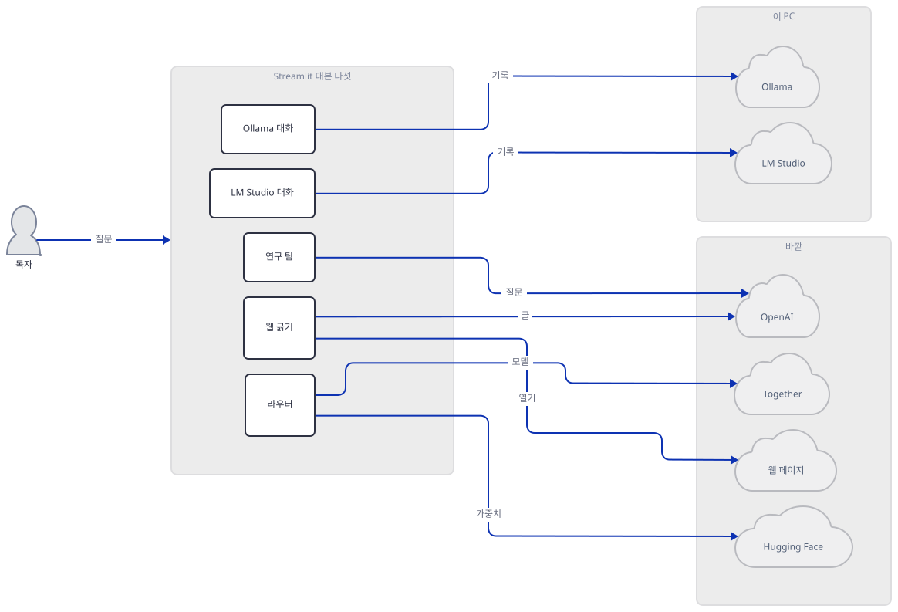
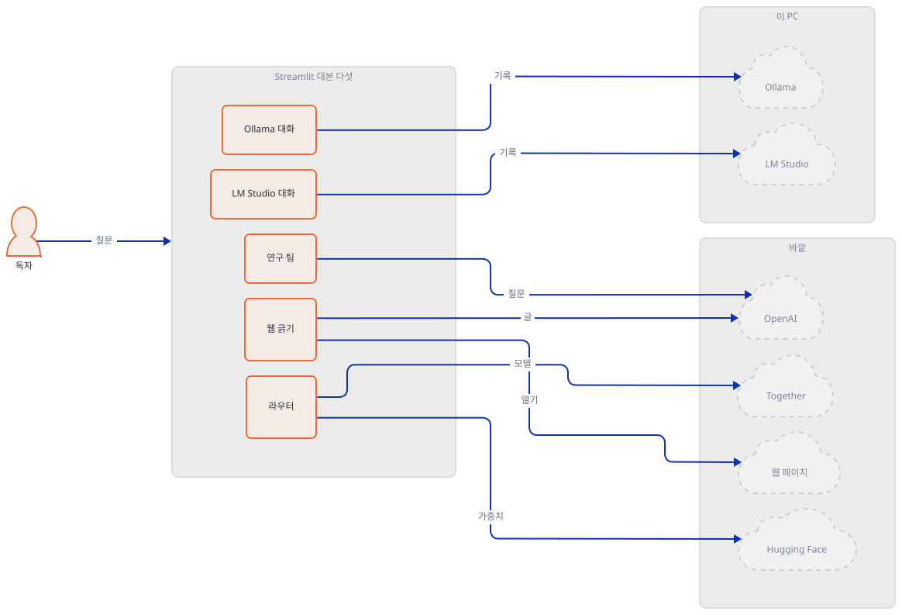
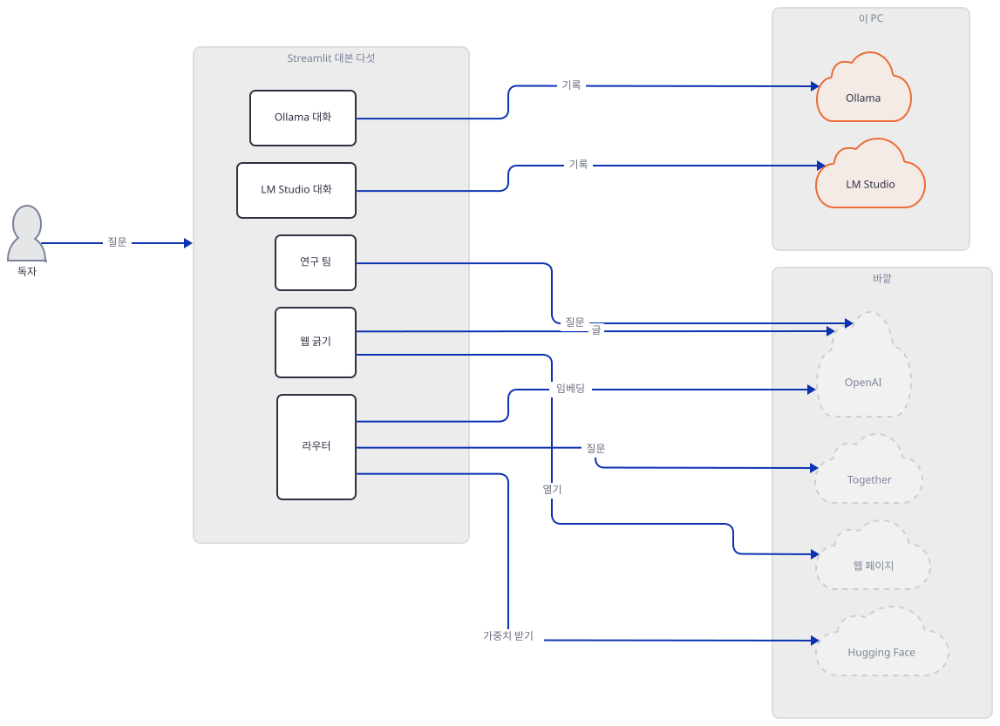
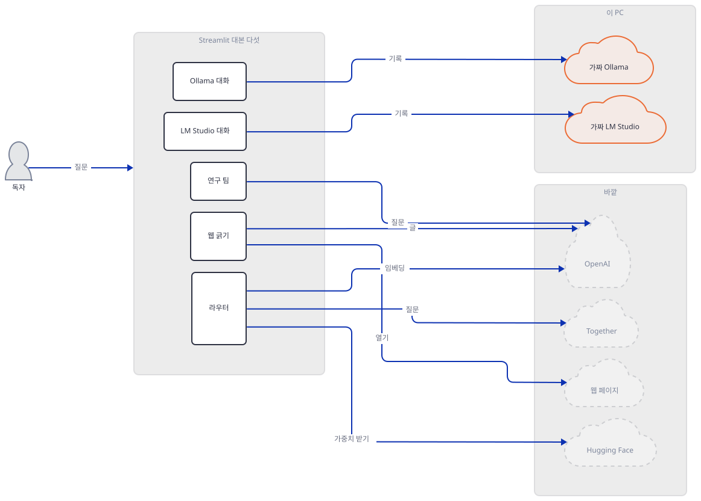
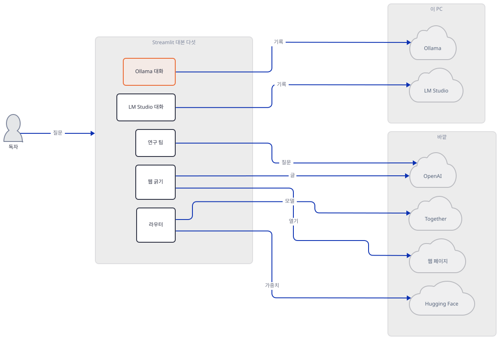
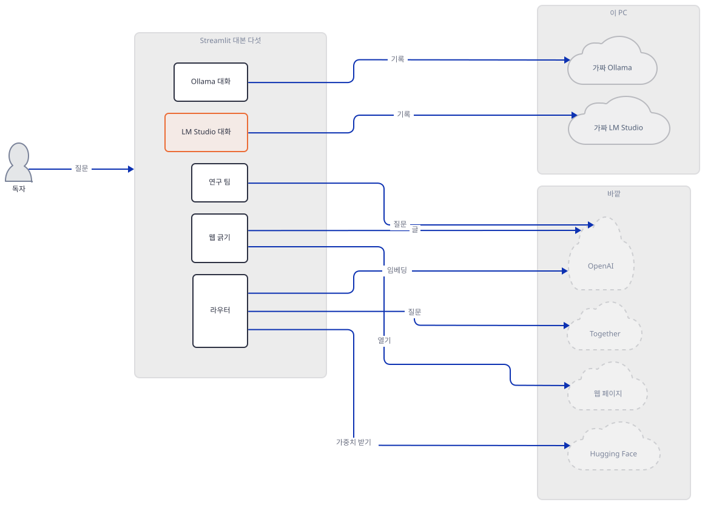
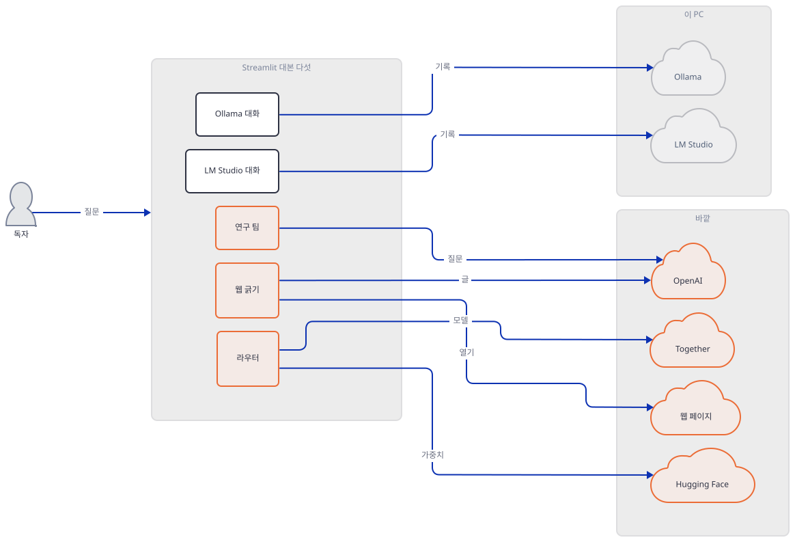
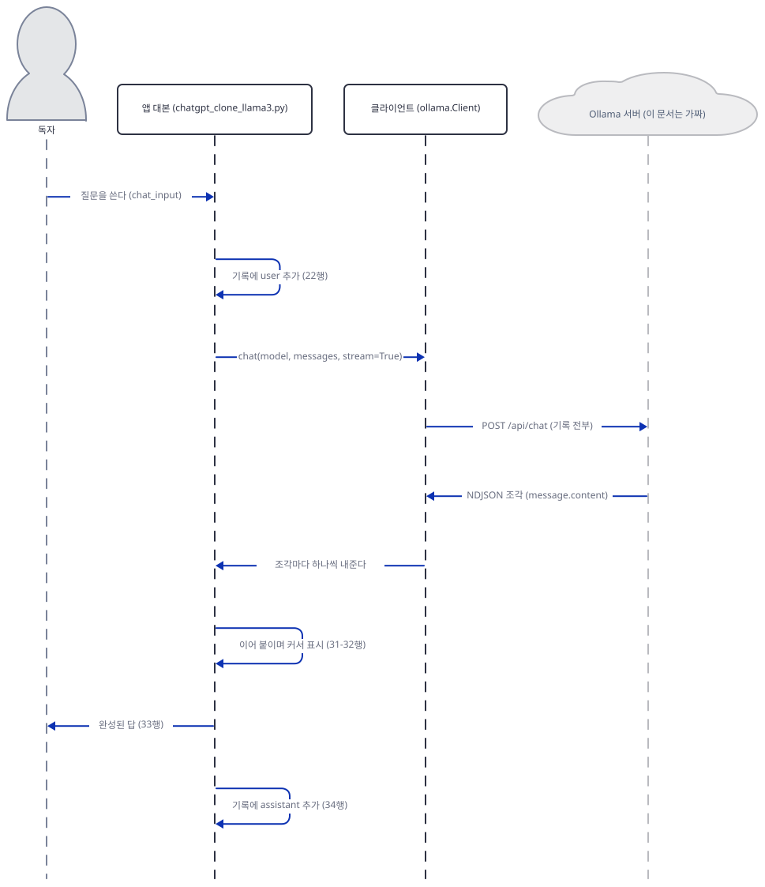

# Day 167 · Cursor Ai Experiments

> 볼륨 18 🧪 기타 LLM 앱 · 난이도 ★★☆ · 예상 소요 100분(파일 셋을 만들고 서버 셋을 띄워 두 실험과 가드를 뺀 판을 돌린 뒤, 설치하지 않은 세 앱의 소스와 공식 문서를 읽는 데 시간이 듭니다) · API 비용 대략 0원(이 문서는 OpenAI도 Together도 한 번도 부르지 않았습니다. 진짜 키로 쓸 때의 호출 수는 Step 6에 셉니다) · 원본 앱: `advanced_llm_apps/cursor_ai_experiments`

## 오늘 만들 것

폴더 하나에 작은 실험 다섯이 들어 있습니다. 이름에 Cursor가 있지만 폴더 안 어디에도 그 글자가 없습니다(Step 2의 `grep`). 다섯 모두 Streamlit 대본 한 파일이고, 파이썬 코드가 모두 323줄입니다. 달라지는 것은 모델을 어디서 얻느냐입니다. 둘은 이 PC에서 도는 서버(Ollama, LM Studio)에 대화 기록을 보내고, 셋은 바깥 서비스를 씁니다(CrewAI 연구 팀, ScrapeGraphAI 웹 긁기, RouteLLM 라우터). 시리즈의 마지막 날이고, 볼륨 18의 마지막 날입니다. 앞 세 날([Day 164](../day164-gpt-oss-critique-improvement-loop/README.md)~[Day 166](../day166-thinkpath-chatbot-app/README.md))이 한 앱을 깊이 팠다면 오늘은 다섯을 얕게 봅니다.

이 문서는 실험 가운데 **가벼운 둘(①②)만 돌렸습니다.** 진짜 Ollama도 LM Studio도 부르지 않았고, 그 자리에 **내가 쓴 가짜 서버**를 세웠습니다. 가짜 서버는 모델이 아니라 받은 메시지 수를 세어 말하는 쉰일곱 줄입니다. 그래서 아래 "응답"은 배선과 요청 모양을 보이는 것이지 모델 품질을 보이는 것이 아닙니다. 나머지 셋(③④⑤)은 무겁습니다. 설치하지 않았고, 한 번도 실행하지 않았고, **소스와 공식 문서만 읽었습니다.** 알게 된 것은 여섯입니다.

1. ①②는 질문 하나에 요청 하나입니다. 그리고 매번 **대화 기록 전부**를 보냅니다. 두 번째 질문의 요청에는 메시지가 셋(user, assistant, user) 들어 있었습니다(Step 4·5). 기억은 모델이 아니라 `st.session_state`가 가집니다.
2. 두 앱이 서버 주소를 정하는 방식이 다릅니다. ①은 `Client()`가 환경변수 `OLLAMA_HOST`를 읽고 없으면 `127.0.0.1:11434`로 갑니다. ②는 `base_url`을 소스에 박았습니다. 그래서 이 문서는 ①은 환경변수로, ②는 실행기가 SDK 생성자를 감싸서 가짜 서버로 보냈습니다. **실행기 없이 `streamlit run`으로 띄우면 요청이 독자의 진짜 서버로 갑니다.** 실행기 안에서는 소켓 가드가 허용한 포트 말고는 막으므로, 주소를 돌리는 줄 하나를 빼도 진짜 서버에 닿지 않고 가드 오류로 끝납니다(Step 3).
3. 서버가 없거나 모델이 없으면 앱이 죽지 않고 화면에 예외를 띄웁니다. 그런데 사용자 메시지는 이미 기록에 들어간 뒤입니다. 오류 뒤의 다음 질문은 user 메시지를 두 개 연속으로 보냅니다(소스로 확인, Step 4).
4. ⑤ 라우터는 질문마다 OpenAI 임베딩을 **한 번 더** 부르고, 임계값 `0.11593`은 앱의 모델 쌍이 아닌 다른 쌍에서 맞춘 값이며, 약한 모델은 Together가 2026-02-25에 서버리스에서 내렸다고 적은 모델입니다(Step 6).
5. ④ 웹 긁기는 `headless: False`라서 브라우저 창을 띄우고, `pip install playwright`만으로는 브라우저가 내려오지 않습니다. ScrapeGraphAI 2.2.4의 텔레메트리는 이 앱의 쓰임(스키마 없음)에서는 보내지 않는 쪽으로 소스에 적혀 있습니다(Step 6).
6. ③ 연구 팀과 ④가 키를 받는 방식이 다릅니다. ③은 키를 **프로세스 전체의 환경변수**로 넣습니다(Step 6).



라우터에서 OpenAI로 가는 화살표 하나(라벨 "임베딩")는 임베딩 호출과 강한 모델 `gpt-4o-mini`의 답 호출을 함께 뜻합니다(Step 6).

## 사전 준비

| 서비스/도구 | 용도 | 발급·설치 |
|---|---|---|
| Python 3.12, uv | 상자(가상환경) 만들기. 로드맵의 요구는 3.11~3.13입니다 | [공통 사전 준비](../README.md#공통-사전-준비-한-번만) 참고 |
| bash(Git Bash) | 아래 명령 전부. **이 문서는 bash 전용입니다**(PowerShell 판은 싣지 않았습니다) | Windows는 Git for Windows |
| git, 이 저장소의 클론 | 원본 폴더를 읽고 사본을 만듭니다 | `git clone https://github.com/Shubhamsaboo/awesome-llm-apps` |
| `streamlit`, `ollama`, `openai` | 실험 ①②. 가벼운 셋만 설치합니다. 이 문서는 1.51.0·0.6.1·2.54.0으로 돌렸습니다 | Step 1의 `uv pip install` |
| Ollama + `llama3.1` 모델 | ①을 **진짜로** 쓸 때만. **이 문서는 쓰지 않았습니다** | [ollama.com](https://ollama.com/download) |
| LM Studio + Llama 3 모델 | ②를 진짜로 쓸 때만. 이 문서는 쓰지 않았습니다 | [lmstudio.ai](https://lmstudio.ai/) |
| `crewai`, `scrapegraphai`, `playwright`, `routellm`(+ torch) | ③④⑤. **이 문서는 설치하지 않았습니다**(무겁습니다). 소스는 읽기만 했습니다 | 필요할 때만 |
| OpenAI·Together 키 | ③④⑤를 진짜로 쓸 때만. 이 문서는 키를 쓰지 않았습니다 | [OpenAI](https://platform.openai.com/api-keys), [Together](https://api.together.ai/) |

터미널 하나로 충분합니다. 가짜 서버는 같은 터미널에서 백그라운드로 띄우고 같은 터미널에서 끕니다. 터미널을 새로 열었다면 `export REPO=… LAB=…; source "$LAB/env.sh"`로 환경을 다시 불러옵니다.

## 아키텍처 한눈에 보기

| 컴포넌트 | 역할 | 코드 위치 |
|---|---|---|
| ① Ollama 대화 | `Client()`로 `/api/chat`에 기록 전부를 스트리밍으로 보낸다 | `advanced_llm_apps/cursor_ai_experiments/chatgpt_clone_llama3.py:1-40` |
| ② LM Studio 대화 | OpenAI SDK로 `localhost:1234/v1`에 기록 전부를 보낸다(스트리밍 없음) | `advanced_llm_apps/cursor_ai_experiments/local_chatgpt_clone/chatgpt_clone_llama3.py:1-36` |
| ③ 연구 팀(CrewAI) | 연구자·작가·편집자 에이전트 셋이 태스크 셋을 차례로 | `advanced_llm_apps/cursor_ai_experiments/multi_agent_researcher.py:1-146` |
| ④ 웹 긁기(ScrapeGraphAI) | 주소와 질문을 받아 페이지에서 답을 뽑는다 | `advanced_llm_apps/cursor_ai_experiments/ai_web_scrapper.py:1-49` |
| ⑤ 라우터(RouteLLM) | 질문마다 강한 모델과 약한 모델 가운데 고른다 | `advanced_llm_apps/cursor_ai_experiments/llm_router_app/llm_router.py:1-52` |
| 이 문서의 가짜 서버·실행기 | 가짜 Ollama와 OpenAI 호환 서버, 소켓 가드, 브라우저 없는 실행기 | 코드 없음(Step 3에서 직접 만듦) |

번호는 이 문서가 붙인 것입니다(③ 연구 팀, ④ 웹 긁기). 파일 이름 `ai_web_scrapper.py`의 철자는 원본 그대로입니다. 줄 수는 편집기에서 보이는 수입니다. 마지막 줄에 개행이 없는 파일이 많아서 `wc -l`은 하나씩 적게 셉니다.

## 단계별 진행

### Step 1. 사본을 두고 가벼운 상자를 만든다

**목적.** 원본에는 아무것도 쓰지 않고, 사본과 독립 가상환경 안에서 가벼운 의존성 셋만 설치합니다.

**할 일.** 저장소 루트에서 시작합니다. `LAB`은 저장소 밖의 새 폴더로 자기 경로로 바꿉니다. 블록은 `LAB`이 비었거나 자리 표시 값 그대로이거나 절대 경로가 아니거나 `.claude`·`.agents` 같은 에이전트 설정 폴더(또는 `CLAUDE_CONFIG_DIR`) 아래이면 폴더를 하나도 만들지 않고 멈춥니다(대소문자는 가리지 않습니다). 환경 파일은 HOME·USERPROFILE·CLAUDE_CONFIG_DIR·TEMP를 이 폴더로 돌리고, 프록시 변수를 지우고 `NO_PROXY`를 루프백으로 둡니다. 파이썬의 `httpx`와 `requests`는 프록시 환경변수를 읽으므로(`trust_env`), 독자 셸에 프록시가 켜져 있으면 루프백 요청도 프록시로 갈 수 있기 때문입니다. 이 문서는 그것을 시험하지 않고 변수를 지워서 막습니다. 이후 블록에서 파일을 만드는 줄은 모두 `"${LAB:?}/…"` 절대 경로로 씁니다. 환경 블록을 건너뛰고 붙여 넣어도 지금 폴더에 파일이 생기지 않게 하려는 것입니다. 이 문서가 쓴 포트(47401·47402·47403·47409)는 그대로 써도 되고, 이미 쓰는 포트이면 `env.sh`에서 바꿉니다.

```bash
cd awesome-llm-apps
export REPO="$PWD"
export LAB=/path/to/d167-lab          # 저장소 밖의 새 폴더(자기 절대 경로로 바꾼다)
_ok=1; _n() { { cygpath -m "$1" 2>/dev/null || printf '%s' "$1"; } | tr 'A-Z\\' 'a-z/'; }
case "$LAB" in ""|/path/to/*) echo "LAB을 자기 경로로 바꾸세요"; _ok=0 ;; esac
case "$LAB" in /*|[A-Za-z]:[/\\]*) ;; *) echo "LAB은 절대 경로여야 합니다: $LAB"; _ok=0 ;; esac
case "$(_n "$LAB")/" in
  */.claude/*|*/.agents/*|*/.codex/*|*/.cursor/*|*/.copilot/*|*/.openclaw/*|*/.hermes/*)
    echo "LAB이 에이전트 설정 폴더 아래입니다: $LAB"; _ok=0 ;;
esac
if [ -n "${CLAUDE_CONFIG_DIR:-}" ]; then
  _c=$(_n "$CLAUDE_CONFIG_DIR")
  case "$(_n "$LAB")/" in "${_c%/}"/*) echo "LAB이 CLAUDE_CONFIG_DIR 아래입니다"; _ok=0 ;; esac
fi
[ "$_ok" = 1 ] && mkdir -p "$LAB/home" "$LAB/tmp" "$LAB/work" && cat > "$LAB/env.sh" <<'EOF'
# Day 167 작업 셸의 환경. 이 문서의 모든 명령은 이 파일을 불러온 셸에서 돌린다.
: "${REPO:?REPO를 먼저 정하세요}" "${LAB:?LAB을 먼저 정하세요}"
_n() { { cygpath -m "$1" 2>/dev/null || printf '%s' "$1"; } | tr 'A-Z\\' 'a-z/'; }
_lab=$(cd "$LAB" 2>/dev/null && pwd -P) || { echo "LAB 폴더가 없습니다: $LAB"; return 1; }
_low="$(_n "$_lab")/"
case "$_low" in
  */.claude/*|*/.agents/*|*/.codex/*|*/.cursor/*|*/.copilot/*|*/.openclaw/*|*/.hermes/*)
    echo "LAB이 에이전트 설정 폴더 아래입니다: $_lab"; return 1 ;;
esac
if [ -n "${CLAUDE_CONFIG_DIR:-}" ] && _cfg=$(cd "$CLAUDE_CONFIG_DIR" 2>/dev/null && pwd -P); then
  _cfg="$(_n "$_cfg")/"
  case "$_low" in "$_cfg"*) echo "LAB이 CLAUDE_CONFIG_DIR 아래입니다"; return 1 ;; esac
fi
export HOME="$LAB/home" USERPROFILE="$LAB/home" CLAUDE_CONFIG_DIR="$LAB/home/.claude"
export TEMP="$LAB/tmp" TMP="$LAB/tmp" TMPDIR="$LAB/tmp"
export PYTHONUTF8=1 PYTHONIOENCODING=utf-8 STREAMLIT_BROWSER_GATHER_USAGE_STATS=false STREAMLIT_LOGGER_LEVEL=error
# 프록시를 쓰지 않는다. httpx는 프록시 환경변수를 읽는다.
unset HTTP_PROXY HTTPS_PROXY ALL_PROXY http_proxy https_proxy all_proxy
export NO_PROXY=127.0.0.1,localhost,::1 no_proxy=127.0.0.1,localhost,::1
export LABW=$(cygpath -m "$_lab" 2>/dev/null || printf '%s' "$_lab")   # 파이썬에 넘기는 꼴
export APP="$LAB/work/cursor_ai_experiments" APPW="$LABW/work/cursor_ai_experiments"
export PORT_OLLAMA=47401 PORT_LMS=47402 PORT_NOMODEL=47403 PORT_DEAD=47409
pyexe() { if [ -x "$LAB/venv/Scripts/python.exe" ]; then echo "$LAB/venv/Scripts/python.exe"; else echo "$LAB/venv/bin/python"; fi; }
py() { "$(pyexe)" "$@"; }
EOF
[ "$_ok" = 1 ] && source "$LAB/env.sh" && cd "$LAB/work"
```

앱 폴더를 사본으로 가져오고, 가상환경을 만들고, 줄 수를 셉니다. pip를 쓰는 독자는 `python -m venv "$LAB/venv"`와 `py -m pip install streamlit==1.51.0 ollama==0.6.1 openai==2.54.0`로 바꿔도 됩니다. 이 문서의 파일은 `requirements.txt`를 쓰지 않습니다. 원본의 `requirements.txt`는 무거운 것(`crewai`, `scrapegraphai`, `playwright`)까지 한 번에 설치하게 하기 때문입니다.

```bash
[ -e "${LAB:?}/work/cursor_ai_experiments" ] || cp -r "${REPO:?}/advanced_llm_apps/cursor_ai_experiments" "${LAB:?}/work/cursor_ai_experiments"
uv venv --python 3.12 "${LAB:?}/venv"
uv pip install --python "$(pyexe)" streamlit==1.51.0 ollama==0.6.1 openai==2.54.0
cd "${LAB:?}/work/cursor_ai_experiments" && for f in chatgpt_clone_llama3.py local_chatgpt_clone/chatgpt_clone_llama3.py multi_agent_researcher.py ai_web_scrapper.py llm_router_app/llm_router.py; do awk 'END{print NR, FILENAME}' "$f"; done
```



**확인.** 마지막 명령의 출력이 다음과 같으면 됩니다(편집기에서 보이는 줄 수입니다).

```text
40 chatgpt_clone_llama3.py
36 local_chatgpt_clone/chatgpt_clone_llama3.py
146 multi_agent_researcher.py
49 ai_web_scrapper.py
52 llm_router_app/llm_router.py
```

### Step 2. 다섯 실험이 무엇을 부르는지 소스로 읽는다

**목적.** 돌리기 전에, 실험마다 무엇을 어디로 보내는지 표로 만듭니다. 주소·키·모델 이름이 파일 어디에 박혀 있는지부터 찾습니다.

**할 일.** 다음 한 줄이 그 자리를 모아 줍니다. 마지막 `grep`은 폴더 안에 Cursor라는 글자가 있는지 묻습니다.

```bash
cd "${APP:?}" && grep -n -E 'Client\(|base_url|OPENAI_API_KEY|TOGETHERAI|api_key|headless|model=|model_name|strong_model|weak_model' *.py */*.py
grep -rni cursor . || echo "(cursor라는 글자 없음)"
grep -rn -E 'streamlit_chat|langchain_community' . || echo "(streamlit_chat·langchain_community를 부르는 코드 없음)"
```



**확인.** 출력의 핵심은 아래 표와 같습니다. 모델 이름과 주소가 파일마다 한 곳에 박혀 있습니다.

```text
ai_web_scrapper.py:12:api_key = st.text_input("Enter your OpenAI API key:", type="password")
ai_web_scrapper.py:17:        "api_key": api_key,
ai_web_scrapper.py:21:    "headless": False,
ai_web_scrapper.py:26:    if prompt and source_url and api_key:
chatgpt_clone_llama3.py:5:client = Client()
chatgpt_clone_llama3.py:30:        for response in client.chat(model="llama3.1:latest", messages=st.session_state.messages, stream=True):
multi_agent_researcher.py:121:    api_key = st.text_input("Enter your OpenAI API Key:", type="password")
multi_agent_researcher.py:122:    if api_key:
multi_agent_researcher.py:123:        os.environ["OPENAI_API_KEY"] = api_key
multi_agent_researcher.py:124:        gpt4_model = ChatOpenAI(model_name="gpt-4o-mini")
multi_agent_researcher.py:135:    if not api_key:
llm_router_app/llm_router.py:3:os.environ["OPENAI_API_KEY"] = "your_openai_api_key"
llm_router_app/llm_router.py:4:os.environ['TOGETHERAI_API_KEY'] = "your_togetherai_api_key"
llm_router_app/llm_router.py:12:    strong_model="gpt-4o-mini",
llm_router_app/llm_router.py:13:    weak_model="together_ai/meta-llama/Meta-Llama-3.1-70B-Instruct-Turbo",
llm_router_app/llm_router.py:41:            model="router-mf-0.11593",
llm_router_app/llm_router.py:45:        model_name = response.model
llm_router_app/llm_router.py:49:        st.caption(f"Model used: {model_name}")
llm_router_app/llm_router.py:52:    st.session_state.messages.append({"role": "assistant", "content": message_content, "model": model_name})
local_chatgpt_clone/chatgpt_clone_llama3.py:9:client = OpenAI(base_url="http://localhost:1234/v1", api_key="lm-studio")
local_chatgpt_clone/chatgpt_clone_llama3.py:29:        model="lmstudio-community/Meta-Llama-3-8B-Instruct-GGUF",
(cursor라는 글자 없음)
(streamlit_chat·langchain_community를 부르는 코드 없음)
```

| 실험 | 보내는 곳 | 박힌 값 | 키 |
|---|---|---|---|
| ① Ollama 대화 | `Client()`의 기본 주소(환경변수 `OLLAMA_HOST`, 없으면 `127.0.0.1:11434`) | 모델 `llama3.1:latest` | 없음 |
| ② LM Studio 대화 | `http://localhost:1234/v1` | 모델 `lmstudio-community/Meta-Llama-3-8B-Instruct-GGUF`, `temperature=0.7` | 자리 값 `lm-studio` |
| ③ 연구 팀 | OpenAI(`ChatOpenAI`가 쓰는 기본 주소) | 모델 `gpt-4o-mini` | 사이드바에서 입력 |
| ④ 웹 긁기 | 대상 웹 페이지(Chromium)와 OpenAI | 모델 `openai/gpt-4o-mini`, `headless: False` | 화면에서 입력 |
| ⑤ 라우터 | OpenAI(강한 모델, 임베딩), Together(약한 모델), Hugging Face(가중치) | `gpt-4o-mini`, `together_ai/meta-llama/Meta-Llama-3.1-70B-Instruct-Turbo` | 소스에 자리 문자열 |

README는 둘뿐이고(⑤와 ②), 둘 다 `cd awesome-llm-apps/advanced_tools_frameworks/…`로 가라고 적습니다. 그런 폴더는 이 저장소에 없습니다(`ls`로 확인). 앱 폴더는 `advanced_llm_apps/cursor_ai_experiments/`입니다. 루트 `requirements.txt`에는 코드가 한 번도 부르지 않는 `streamlit-chat`과 `langchain-community`가 있고(`grep`으로 확인), 코드가 부르는 `langchain_openai`는 없습니다. ③은 `from langchain_openai import ChatOpenAI`를 쓰는데, `crewai` 1.15.21의 의존성 목록에는 LangChain이 없고 `scrapegraphai` 2.2.4가 `langchain-openai`를 끌어옵니다(둘의 `METADATA`로 확인). 그래서 ③만 따로 설치하면 이 줄에서 막힐 수 있습니다.

### Step 3. 가짜 서버와, 브라우저 없는 실행기를 만든다

**목적.** 진짜 Ollama와 LM Studio를 부르지 않고 ①②를 돌릴 배선을 만듭니다. 이 배선의 요점은 "줄 하나를 빼도 인터넷에 닿지 않는다"입니다.

**할 일.** 파일 셋을 만듭니다. `fake.py`는 `/api/chat`(Ollama 꼴, 줄마다 JSON인 NDJSON), `/api/tags`, `/v1/chat/completions`(OpenAI 꼴)에 답하고 받은 요청을 한 줄씩 기록합니다. `run_app.py`는 Streamlit의 `AppTest`로 대본을 브라우저 없이 돌립니다. 먼저 **소켓 가드**를 세웁니다. 허용한 `127.0.0.1` 포트 말고는 연결도 이름 조회도 막고, 예약 주소 `192.0.2.1`(문서용으로 비워 둔 주소라 아무도 듣지 않습니다)에 닿지 않는지 먼저 시험합니다. 이 가드가 낸 거부(메시지가 `가드:`로 시작)일 때만 통과로 치고, 시간 초과처럼 다른 오류가 나면 가드가 서지 않은 것으로 보고 멈춥니다. 거는 줄을 빼면 정말 멈추는지는 아래 Step 3 끝에서 보입니다. 그다음 앱이 가리키는 곳을 돌립니다. ①은 `OLLAMA_HOST`를 가짜 서버로 맞추고, ②는 `openai.OpenAI.__init__`을 감싸 박힌 `base_url`이 정확히 `http://localhost:1234/v1`일 때만 가짜 서버로 바꿉니다(다르면 멈춥니다). `show.py`는 기록을 읽기 좋게 찍습니다.

```bash
cat > "${LAB:?}/fake.py" <<'EOF'
"""가짜 Ollama + OpenAI 호환 서버. 127.0.0.1에서만 듣고, 받은 요청을 JSON 한 줄씩 로그에 남긴다.
모델이 아니다: 받은 메시지 수를 세어 말할 뿐이다.
사용: python fake.py 포트 로그파일 알고_있는_모델이름"""
import json
import sys
import time
from http.server import BaseHTTPRequestHandler, ThreadingHTTPServer

PORT, LOG, KNOWN = int(sys.argv[1]), sys.argv[2], sys.argv[3]


class Handler(BaseHTTPRequestHandler):
    def log_message(self, *args):
        pass

    def send(self, code, payload, ctype="application/json"):
        raw = payload if isinstance(payload, bytes) else json.dumps(payload).encode()
        self.send_response(code)
        self.send_header("Content-Type", ctype)
        self.send_header("Content-Length", str(len(raw)))
        self.end_headers()
        self.wfile.write(raw)

    def do_GET(self):
        if self.path == "/api/tags":
            self.send(200, {"models": [{"name": KNOWN, "model": KNOWN}]})
        else:
            self.send(404, {"error": "not found"})

    def do_POST(self):
        req = json.loads(self.rfile.read(int(self.headers.get("Content-Length", 0))))
        with open(LOG, "a", encoding="utf-8") as f:
            line = {"path": self.path, "authorization": self.headers.get("Authorization"), "body": req}
            f.write(json.dumps(line, ensure_ascii=False) + "\n")
        n = len(req.get("messages", []))
        text = f"가짜 응답입니다. 받은 메시지는 {n}개입니다."
        now = time.strftime("%Y-%m-%dT%H:%M:%SZ", time.gmtime())
        if self.path == "/api/chat":
            if req.get("model") != KNOWN:
                self.send(404, {"error": f"model '{req.get('model')}' not found"})
                return
            parts = [text[:8], text[8:]]
            lines = [{"model": KNOWN, "created_at": now, "message": {"role": "assistant", "content": p}, "done": False} for p in parts]
            lines.append({"model": KNOWN, "created_at": now, "message": {"role": "assistant", "content": ""}, "done": True, "done_reason": "stop"})
            self.send(200, ("\n".join(json.dumps(x, ensure_ascii=False) for x in lines) + "\n").encode(), "application/x-ndjson")
        elif self.path == "/v1/chat/completions":
            reply = {
                "id": "chatcmpl-fake", "object": "chat.completion", "created": int(time.time()), "model": req.get("model"),
                "choices": [{"index": 0, "message": {"role": "assistant", "content": text}, "finish_reason": "stop"}],
                "usage": {"prompt_tokens": 0, "completion_tokens": 0, "total_tokens": 0},
            }
            self.send(200, reply)
        else:
            self.send(404, {"error": "not found"})


ThreadingHTTPServer(("127.0.0.1", PORT), Handler).serve_forever()
EOF
cat > "${LAB:?}/run_app.py" <<'EOF'
"""앱 대본을 브라우저 없이 돌리는 실행기 (streamlit.testing.v1.AppTest).
소켓 가드를 먼저 세우고, 앱이 박아 둔 주소를 이 문서의 가짜 서버 쪽으로 돌린다.
사용: python run_app.py 대본.py --ollama 포트 | --lmstudio 포트  [--allow 포트,포트]  "질문1" "질문2" ..."""
import os
import socket
import sys
import time

args = sys.argv[1:]
script = os.path.abspath(args.pop(0))
opts = {}
while args and args[0].startswith("--"):
    name = args.pop(0)[2:]
    opts[name] = args.pop(0)
questions = args
allowed = {int(p) for p in opts.get("allow", "").split(",") if p}
allowed |= {int(opts[k]) for k in ("ollama", "lmstudio") if k in opts}

# 1) 소켓 가드. 127.0.0.1의 허용 포트 말고는 연결도 이름 조회도 막는다.
real_connect, real_lookup = socket.socket.connect, socket.getaddrinfo


def guarded_connect(self, address):
    host, port = address[0], address[1]
    if host not in ("127.0.0.1", "::1") or port not in allowed:
        raise OSError(f"가드: {host}:{port} 연결 거부")
    return real_connect(self, address)


def guarded_lookup(host, *a, **k):
    if host not in ("127.0.0.1", "localhost", "::1", None):
        raise OSError(f"가드: 이름 조회 거부 {host}")
    return real_lookup(host, *a, **k)


socket.socket.connect, socket.getaddrinfo = guarded_connect, guarded_lookup
try:  # 예약 주소(192.0.2.1)로 가드가 서 있는지 먼저 확인한다. 이 가드가 낸 거부("가드:")가 아니면 멈춘다.
    socket.create_connection(("192.0.2.1", 80), 1)
    sys.exit("가드가 서지 않았습니다")
except OSError as e:
    if not str(e).startswith("가드:"):  # 시간 초과 같은 다른 오류는 통과로 치지 않는다
        sys.exit(f"가드가 서지 않았습니다: {e}")
    print("가드 확인:", e)

# 2) 앱이 가리키는 곳을 가짜 서버로 돌린다.
if "ollama" in opts:  # ollama.Client()가 읽는 OLLAMA_HOST. 이 줄이 없으면 Client가 11434로 가려 하고, 위 가드가 막는다.
    os.environ["OLLAMA_HOST"] = f"127.0.0.1:{opts['ollama']}"
if "lmstudio" in opts:  # 앱이 base_url을 박아 두어서 실행기가 SDK 생성자를 감싼다.
    import openai

    original_init = openai.OpenAI.__init__

    def patched_init(self, *a, **k):
        assert k.get("base_url") == "http://localhost:1234/v1", k.get("base_url")
        k["base_url"] = f"http://127.0.0.1:{opts['lmstudio']}/v1"
        original_init(self, *a, **k)

    openai.OpenAI.__init__ = patched_init

# 3) 대본 실행
from streamlit.testing.v1 import AppTest

at = AppTest.from_file(script, default_timeout=30).run()
print("처음 화면: 제목", [t.value for t in at.title], "| 채팅 입력", len(at.chat_input), "| 오류", [e.value for e in at.exception])
for q in questions:
    t0 = time.time()
    at.chat_input[0].set_value(q).run()
    print(f"질문 {q!r}: {time.time() - t0:.2f}초")
    for m in at.chat_message:
        print("  ", m.name, "|", m.markdown[0].value if m.markdown else None)
    print("   오류:", [str(e.value)[:140] for e in at.exception])
print("session_state.messages 역할:", [m["role"] for m in at.session_state["messages"]])
EOF
cat > "${LAB:?}/show.py" <<'EOF'
import json
import sys

for line in open(sys.argv[1], encoding="utf-8"):
    r = json.loads(line)
    b = r["body"]
    print(r["path"], "| model:", b["model"], "| stream:", b.get("stream"), "| temperature:", b.get("temperature"),
          "| auth:", r["authorization"], "| roles:", [m["role"] for m in b["messages"]])
EOF
ls "${LAB:?}"
```

세 서버를 띄웁니다. 포트 47401은 `llama3.1:latest`를 아는 가짜 Ollama, 47402는 LM Studio 자리의 OpenAI 호환 서버, 47403은 **그 모델을 모르는** 가짜 Ollama(모델이 없을 때의 오류를 보려는 것)입니다. 서버는 이 터미널에서 백그라운드로 띄웁니다. 세 서버 모두 `127.0.0.1`에만 듣습니다.

```bash
: > "${LAB:?}/pids"
"$(pyexe)" "$LABW/fake.py" "$PORT_OLLAMA" "$LABW/requests-ollama.jsonl" llama3.1:latest & echo $! >> "${LAB:?}/pids"
"$(pyexe)" "$LABW/fake.py" "$PORT_LMS" "$LABW/requests-lms.jsonl" lmstudio-community/Meta-Llama-3-8B-Instruct-GGUF & echo $! >> "${LAB:?}/pids"
"$(pyexe)" "$LABW/fake.py" "$PORT_NOMODEL" "$LABW/requests-nomodel.jsonl" other:latest & echo $! >> "${LAB:?}/pids"
sleep 3
curl -s --noproxy '*' "http://127.0.0.1:$PORT_OLLAMA/api/tags"; echo
netstat -ano | grep -E "127.0.0.1:($PORT_OLLAMA|$PORT_LMS|$PORT_NOMODEL) .*LISTENING"
```



**확인.** `/api/tags`가 가짜 모델 이름을 돌려주고, `netstat`에서 세 포트가 `127.0.0.1`에서만 듣고 있어야 합니다(`0.0.0.0`이면 안 됩니다). 줄 끝의 PID는 실행마다 다르므로 `<PID>`로 가렸습니다.

```text
{"models": [{"name": "llama3.1:latest", "model": "llama3.1:latest"}]}
  TCP    127.0.0.1:47401        0.0.0.0:0              LISTENING       <PID>
  TCP    127.0.0.1:47402        0.0.0.0:0              LISTENING       <PID>
  TCP    127.0.0.1:47403        0.0.0.0:0              LISTENING       <PID>
```

이제 가드 확인이 정말 멈추는지 봅니다. 가드를 거는 줄(`socket.socket.connect, socket.getaddrinfo = …`)만 뺀 사본을 만들어 돌립니다. 이 시험은 일부러 가드를 빼므로, 독자 PC에서는 예약 주소 `192.0.2.1`의 80번으로 연결을 한 번 시도합니다(문서용으로 비워 둔 주소라 아무도 듣지 않지만 네트워크에 한 번 닿는다는 뜻입니다). 걱정되면 이 블록은 건너뛰어도 됩니다.

```bash
grep -v '^socket.socket.connect, socket.getaddrinfo = ' "${LAB:?}/run_app.py" > "${LAB:?}/run_app_noguard.py"
cd "${LAB:?}" && py run_app_noguard.py "$APPW/chatgpt_clone_llama3.py" --ollama "$PORT_OLLAMA" "안녕"; echo "종료 코드 $?"
```

```text
가드가 서지 않았습니다: blocked by safety guard: getaddrinfo '192.0.2.1'
종료 코드 1
```

실행기는 앱을 한 줄도 돌리지 않고 멈춥니다(질문 줄이 없습니다). 이 문서를 쓴 상자에는 상자 자체의 가드가 따로 있어서 연결은 그쪽이 먼저 막았고, 그 거부 글은 `가드:`로 시작하지 않으므로 같은 결과가 났습니다. 상자 가드가 없는 PC에서는 같은 자리에 `timed out`이나 `unreachable` 같은 글이 찍힙니다.

### Step 4. 실험 ①: Ollama 대화를 돌린다

**목적.** 질문 둘을 보내고, 서버가 받은 요청에 무엇이 실렸는지 봅니다. 그리고 모델이 없을 때를 봅니다.

**읽기(소스로 확인).** `chatgpt_clone_llama3.py`의 한 바퀴는 다음과 같습니다. 질문이 오면 `st.session_state.messages`에 user를 붙이고(22행), `client.chat(model="llama3.1:latest", messages=st.session_state.messages, stream=True)`로 기록 전체를 보냅니다(30행). 돌아오는 조각마다 `response['message']['content']`를 이어 붙이며 끝에 `▌`를 달아 보여 주고(31-32행), 끝나면 `▌`를 뺀 글을 한 번 더 그리고(33행) assistant 메시지를 기록에 붙입니다(34행). `ollama` 0.6.1의 `Client`는 호스트를 `host or os.getenv('OLLAMA_HOST')`로 정하고(`_client.py`의 112행), 아무것도 없으면 `http://127.0.0.1:11434`입니다(`_parse_host`의 문서 시험). Ollama 쪽은 `POST /api/chat`의 `stream` 기본값이 `true`이고 스트림은 `application/x-ndjson`입니다([Ollama API 문서](https://docs.ollama.com/api/chat)). 서버가 `127.0.0.1:11434`에만 듣는 것이 기본이고 `OLLAMA_HOST`로 바꿉니다([Ollama FAQ](https://docs.ollama.com/faq)).

**할 일.**

```bash
cd "${LAB:?}" && py run_app.py "$APPW/chatgpt_clone_llama3.py" --ollama "$PORT_OLLAMA" "안녕" "방금 뭐라고 했어?"
py show.py "$LABW/requests-ollama.jsonl"
echo "--- 모델을 모르는 서버($PORT_NOMODEL)"
py run_app.py "$APPW/chatgpt_clone_llama3.py" --ollama "$PORT_NOMODEL" "안녕" 2>/dev/null
echo "--- 아무도 듣지 않는 포트($PORT_DEAD)"
py run_app.py "$APPW/chatgpt_clone_llama3.py" --ollama "$PORT_DEAD" "안녕" 2>/dev/null
```

뒤 두 실행의 `2>/dev/null`은 Streamlit이 stderr로 찍는 긴 스택 트레이스를 버립니다. 예외 자체는 실행기가 `오류:` 줄로 찍습니다.



**확인.** 걸린 시간은 실행마다 다르므로 `<N>초`로 가렸습니다. 출력은 다음과 같습니다(`WARNING streamlit…ScriptRunContext` 한 줄은 `AppTest`가 브라우저 없이 돌 때 나오는 경고로 무시합니다).

```text
가드 확인: 가드: 이름 조회 거부 192.0.2.1
처음 화면: 제목 ['🤖 Local ChatGPT Clone', 'About'] | 채팅 입력 1 | 오류 []
질문 '안녕': <N>초
   user | 안녕
   assistant | 가짜 응답입니다. 받은 메시지는 1개입니다.
   오류: []
질문 '방금 뭐라고 했어?': <N>초
   user | 안녕
   assistant | 가짜 응답입니다. 받은 메시지는 1개입니다.
   user | 방금 뭐라고 했어?
   assistant | 가짜 응답입니다. 받은 메시지는 3개입니다.
   오류: []
session_state.messages 역할: ['user', 'assistant', 'user', 'assistant']
/api/chat | model: llama3.1:latest | stream: True | temperature: None | auth: None | roles: ['user']
/api/chat | model: llama3.1:latest | stream: True | temperature: None | auth: None | roles: ['user', 'assistant', 'user']
--- 모델을 모르는 서버(47403)
가드 확인: 가드: 이름 조회 거부 192.0.2.1
처음 화면: 제목 ['🤖 Local ChatGPT Clone', 'About'] | 채팅 입력 1 | 오류 []
질문 '안녕': <N>초
   user | 안녕
   assistant | None
   오류: ["model 'llama3.1:latest' not found (status code: 404)"]
session_state.messages 역할: ['user']
--- 아무도 듣지 않는 포트(47409)
가드 확인: 가드: 이름 조회 거부 192.0.2.1
처음 화면: 제목 ['🤖 Local ChatGPT Clone', 'About'] | 채팅 입력 1 | 오류 []
질문 '안녕': <N>초
   user | 안녕
   assistant | None
   오류: ['[WinError 10061] 대상 컴퓨터에서 연결을 거부했으므로 연결하지 못했습니다']
session_state.messages 역할: ['user']
```

첫 요청의 `roles`는 `['user']`, 둘째는 `['user', 'assistant', 'user']`입니다. 기록 전체를 보낸다는 뜻이고, 그래서 대화가 길어질수록 요청이 커집니다. 모델이 없는 서버에서는 화면에 `ResponseError`가 뜨고, 기록에는 user만 남았습니다(`['user']`). 이때 다음 질문을 보내면 user 메시지가 두 개 연달아 갑니다. 22행이 호출(30행) **앞**에서 user를 붙이고, 예외가 나면 34행에 닿지 않기 때문입니다. 이 문서는 그 다음 질문은 돌리지 않았고 소스로만 따랐습니다. 듣는 이 없는 포트에서는 `ollama` 0.6.1이 스트리밍 요청의 연결 실패를 `ConnectionError`로 바꾸지 않아서 `httpx.ConnectError` 그대로 화면에 뜹니다(위 마지막 실행, `_client.py`의 171-187행은 `HTTPStatusError`만 `ResponseError`로 바꿉니다).

**진짜 Ollama로 쓰는 길(이 문서는 실행하지 않았습니다).** Ollama를 설치하고 `ollama pull llama3.1`로 모델을 받은 뒤, 사본 폴더에서 `streamlit run chatgpt_clone_llama3.py --server.address 127.0.0.1 --server.headless true --browser.gatherUsageStats false`를 실행해 브라우저에서 엽니다. 이 길에는 실행기도 소켓 가드도 없으므로 요청은 독자의 `127.0.0.1:11434`(또는 `OLLAMA_HOST`가 가리키는 곳)로 갑니다. 원본 폴더에는 ①의 README가 없습니다.

### Step 5. 실험 ②: LM Studio 대화를 돌린다

**목적.** 같은 일을 OpenAI SDK로 하는 앱을 같은 방식으로 보고, ①과 다른 점(스트리밍 없음, 주소가 박힘, 키 자리 값)을 확인합니다.

**읽기(소스로 확인).** 이 앱은 주소를 소스에 박았습니다.

`advanced_llm_apps/cursor_ai_experiments/local_chatgpt_clone/chatgpt_clone_llama3.py:28-31`

```python
    response = client.chat.completions.create(
        model="lmstudio-community/Meta-Llama-3-8B-Instruct-GGUF",
        messages=st.session_state.messages, temperature=0.7
    )
```

`OpenAI(base_url="http://localhost:1234/v1", api_key="lm-studio")`(9행)에 `base_url`을 직접 주었으므로 환경변수 `OPENAI_BASE_URL`은 쓰이지 않습니다(`openai/_client.py`는 `base_url is None`일 때만 그 변수를 읽습니다). 그래서 실행기가 생성자를 감쌉니다. 1234는 LM Studio의 문서가 예로 드는 포트이고, 모델 자리에는 OpenAI 모델 이름이 아니라 LM Studio가 보여 주는 식별자를 넣습니다([LM Studio 문서](https://lmstudio.ai/docs/developer/openai-compat)). ①과 달리 `stream`이 없어서 답이 한꺼번에 옵니다. 그리고 ①과 마찬가지로 새 답은 이번 실행에서 한 번 그려지고(36행), 다음 실행부터는 맨 위의 기록 반복문(16-18행)이 그립니다.

**할 일.**

```bash
cd "${LAB:?}" && py run_app.py "$APPW/local_chatgpt_clone/chatgpt_clone_llama3.py" --lmstudio "$PORT_LMS" "안녕" "방금 뭐라고 했어?"
py show.py "$LABW/requests-lms.jsonl"
echo "--- 아무도 듣지 않는 포트($PORT_DEAD)"
py run_app.py "$APPW/local_chatgpt_clone/chatgpt_clone_llama3.py" --lmstudio "$PORT_DEAD" --allow "$PORT_DEAD" "안녕" 2>/dev/null
```



**확인.** 걸린 시간은 실행마다 다르므로 `<N>초`로 가렸습니다(마지막 실행만 8초 안팎입니다).

```text
가드 확인: 가드: 이름 조회 거부 192.0.2.1
처음 화면: 제목 ['ChatGPT Clone using Llama-3 🦙'] | 채팅 입력 1 | 오류 []
질문 '안녕': <N>초
   user | 안녕
   assistant | 가짜 응답입니다. 받은 메시지는 1개입니다.
   오류: []
질문 '방금 뭐라고 했어?': <N>초
   user | 안녕
   assistant | 가짜 응답입니다. 받은 메시지는 1개입니다.
   user | 방금 뭐라고 했어?
   assistant | 가짜 응답입니다. 받은 메시지는 3개입니다.
   오류: []
session_state.messages 역할: ['user', 'assistant', 'user', 'assistant']
/v1/chat/completions | model: lmstudio-community/Meta-Llama-3-8B-Instruct-GGUF | stream: None | temperature: 0.7 | auth: Bearer lm-studio | roles: ['user']
/v1/chat/completions | model: lmstudio-community/Meta-Llama-3-8B-Instruct-GGUF | stream: None | temperature: 0.7 | auth: Bearer lm-studio | roles: ['user', 'assistant', 'user']
--- 아무도 듣지 않는 포트(47409)
가드 확인: 가드: 이름 조회 거부 192.0.2.1
처음 화면: 제목 ['ChatGPT Clone using Llama-3 🦙'] | 채팅 입력 1 | 오류 []
질문 '안녕': <N>초
   user | 안녕
   오류: ['Connection error.']
session_state.messages 역할: ['user']
```

요청에 `Authorization: Bearer lm-studio`와 `temperature: 0.7`이 실렸고 `stream`은 없습니다. 마지막 실행에서는 SDK가 연결 실패를 두 번 다시 시도한 뒤(`DEFAULT_MAX_RETRIES = 2`, `openai` 패키지의 `_constants.py` 10행) `APIConnectionError`를 냈고, 그 사이 8초 안팎이 걸렸습니다. LM Studio의 서버를 켜지 않고 이 앱을 쓰면 질문마다 이 대기를 겪는다는 뜻입니다.

**진짜 LM Studio로 쓰는 길(이 문서는 실행하지 않았습니다).** LM Studio에서 Llama 3 모델을 받아 올리고 로컬 서버를 켠 뒤(앱 README의 4번), 사본 폴더에서 `streamlit run local_chatgpt_clone/chatgpt_clone_llama3.py --server.address 127.0.0.1 --server.headless true --browser.gatherUsageStats false`를 실행합니다. 실행기가 없으므로 요청은 소스에 박힌 독자의 `localhost:1234`로 갑니다. 모델 이름(29행)은 LM Studio가 보여 주는 식별자와 같아야 합니다.

### Step 6. 무거운 셋(③④⑤)을 소스로 읽는다

**목적.** 설치하지 않은 세 실험이 무엇을 부르고 얼마나 부르는지를 소스와 공식 문서로 정리합니다. 이 Step의 사실은 **실행으로 확인한 것이 아니라 읽은 것**입니다. 라이브러리 소스는 `crewai` 1.15.21과 `scrapegraphai` 2.2.4(이 저장소 루트 환경에 설치된 판)이고, RouteLLM은 GitHub `main`의 파일입니다. 독자가 설치하는 판은 다를 수 있습니다(세 앱의 요구 목록에 버전이 없습니다).

**③ 연구 팀.** 연구자·작가·편집자 에이전트 셋(`allow_delegation=False`)과 태스크 셋을 `Process.sequential`로 묶습니다(82-87행). 키는 사이드바에서 받습니다.

`advanced_llm_apps/cursor_ai_experiments/multi_agent_researcher.py:119-124`

```python
with st.sidebar:
    st.header("Configuration")
    api_key = st.text_input("Enter your OpenAI API Key:", type="password")
    if api_key:
        os.environ["OPENAI_API_KEY"] = api_key
        gpt4_model = ChatOpenAI(model_name="gpt-4o-mini")
```

123행은 키를 **프로세스 전체**의 환경변수에 넣습니다. Streamlit 서버 하나에 여러 브라우저가 붙으면 모두 같은 프로세스라서, 다른 세션의 실행과 겹치면 남의 키로 호출될 수 있습니다(소스로 확인: `crewai`는 에이전트를 만들 때 그 환경변수를 읽습니다). 혼자 쓰는 로컬에서는 문제가 아니고, 같이 쓰는 서버에서는 문제입니다. 변수 이름 `gpt4_model`은 `gpt-4o-mini`를 가리킵니다. `crewai`는 받은 `ChatOpenAI` 객체를 LangChain 모델로 쓰지 않고 `model_name`·`api_key` 같은 속성을 읽어 자기 `LLM`을 만듭니다(`crewai` 패키지 `utilities/llm_utils.py`의 60-83행). 호출 수는 순차 과정이라 태스크마다 최소 한 번, 즉 **최소 셋**입니다. 에이전트가 되풀이하면 더 늘어납니다. `gpt-4o-mini`는 100만 토큰당 입력 $0.15, 출력 $0.60이고 폐기 안내가 없습니다([OpenAI 모델 문서](https://developers.openai.com/api/docs/models/gpt-4o-mini)). 텔레메트리는 기본으로 켜져 있고(CrewAI 문서는 크루·에이전트 ID, 도구 사용 횟수, LLM 설정, 시간을 모은다고 하고 프롬프트와 응답은 모으지 않는다고 합니다), `CREWAI_DISABLE_TELEMETRY=true`로 끕니다(`OTEL_SDK_DISABLED=true`도 같은 효과입니다)([CrewAI 텔레메트리 문서](https://docs.crewai.com/en/telemetry), 설치 판은 `crewai_core` 패키지 `telemetry.py`의 269-271행에서 `OTEL_SDK_DISABLED`·`CREWAI_DISABLE_TELEMETRY`·`CREWAI_DISABLE_TRACKING` 셋을 봅니다).

**④ 웹 긁기.** 주소와 질문, 키를 받아 `SmartScraperGraph(...).run()`을 부릅니다(28-35행). 설정은 다음 여덟 줄입니다.

`advanced_llm_apps/cursor_ai_experiments/ai_web_scrapper.py:15-22`

```python
graph_config = {
    "llm": {
        "api_key": api_key,
        "model": "openai/gpt-4o-mini",
    },
    "verbose": True,
    "headless": False,
}
```

`headless: False`는 Chromium 창이 **눈에 보이게** 뜬다는 뜻입니다(`headless`는 `FetchNode`를 거쳐 `ChromiumLoader`의 `chromium.launch(headless=…)`로 갑니다. `scrapegraphai` 패키지 `nodes/fetch_node.py`의 48-49행과 372-376행, `docloaders/chromium.py`의 264행). 그리고 `pip install playwright`는 라이브러리만 설치하고 브라우저는 별도의 `playwright install`로 내려받는 것이 공식 문서의 설명입니다([Playwright 문서](https://playwright.dev/python/docs/browsers)). 이 폴더에는 ④의 README가 없어서 그 단계가 어디에도 적혀 있지 않습니다. 텔레메트리는 2.2.4에서 기본으로 켜져 있고(`telemetry/telemetry.py`의 77행), `SCRAPEGRAPHAI_TELEMETRY_ENABLED=false`로 끕니다(60행). 보내는 곳은 `https://sgai-oss-tracing.onrender.com/v1/telemetry`이고(12행), 내용에는 프롬프트·페이지 글·LLM 답·주소가 들어갑니다(98-141행). 다만 `json_schema`가 비어 있으면 보내지 않고(130행), 이 앱은 스키마를 주지 않으므로 이 판에서는 보내지 않는 쪽입니다. 스키마를 주거나 다른 판을 쓰면 다릅니다. `import`만으로 `~/.scrapegraphai.conf`에 익명 ID를 쓰는 것(14행과 26-34행)은 스키마와 상관없이 일어납니다.

**⑤ 라우터.** 질문마다 RouteLLM의 `Controller`가 모델을 고릅니다.

`advanced_llm_apps/cursor_ai_experiments/llm_router_app/llm_router.py:1-14`

```python
import os

os.environ["OPENAI_API_KEY"] = "your_openai_api_key"
os.environ['TOGETHERAI_API_KEY'] = "your_togetherai_api_key"

import streamlit as st
from routellm.controller import Controller

# Initialize RouteLLM client
client = Controller(
    routers=["mf"],
    strong_model="gpt-4o-mini",
    weak_model="together_ai/meta-llama/Meta-Llama-3.1-70B-Instruct-Turbo",
)
```

3행의 대입은 독자가 이미 `export`해 둔 진짜 `OPENAI_API_KEY`를 자리 문자열로 **덮어씁니다.** `import` 전에 하는 이유는 `routellm`이 불러와질 때 `OPENAI_CLIENT = OpenAI()`를 만들기 때문입니다(`routers/similarity_weighted/utils.py`). 키가 없으면 이 줄에서 죽습니다. `"mf"` 라우터(행렬 분해)는 `routellm/mf_gpt4_augmented` 체크포인트를 `MFModel.from_pretrained`로 불러오고(`routers.py` MatrixFactorizationRouter, 설정은 `controller.py`의 `GPT_4_AUGMENTED_CONFIG`), 질문마다 `text-embedding-3-small`로 **OpenAI 임베딩을 부릅니다**(`matrix_factorization/model.py`). RouteLLM README도 모델 쌍과 상관없이 `mf`에는 `OPENAI_API_KEY`가 필요하다고 적습니다. 그러니 질문 하나는 임베딩 한 번 더하기 채팅 한 번입니다. 자리 문자열 키로는 임베딩부터 거절될 것입니다(이 문서는 부르지 않았으므로 추정입니다).

`advanced_llm_apps/cursor_ai_experiments/llm_router_app/llm_router.py:40-43`

```python
        response = client.chat.completions.create(
            model="router-mf-0.11593",
            messages=[{"role": "user", "content": prompt}]
        )
```

모델 이름 `router-mf-0.11593`에서 `mf`가 라우터, `0.11593`이 임계값입니다. 강한 모델이 이길 확률이 임계값 이상이면 강한 모델로 갑니다. RouteLLM README의 `0.11593`은 `gpt-4-1106-preview`와 Mixtral 쌍에서 강한 모델 호출이 약 50%가 되게 보정한 값으로 나옵니다. 이 앱의 쌍(`gpt-4o-mini`와 Llama 3.1 70B)에서 같은 비율이 나온다는 근거는 없습니다. 그리고 42행은 **방금 질문 하나만** 보냅니다. 기록은 화면에만 있고 모델은 앞 대화를 모릅니다(①②와 다릅니다). 약한 모델은 Together가 폐기 기록에 "2026-02-25 제거"로 올려 둔 모델이고 교체안도 적혀 있지 않습니다([Together 문서](https://docs.together.ai/docs/deprecations)). 약한 쪽으로 가는 질문은 실패할 것입니다(이 문서는 부르지 않았으므로 추정입니다). 모델 이름의 `together_ai/` 접두사와 `TOGETHERAI_API_KEY`는 litellm의 규칙입니다([litellm 문서](https://docs.litellm.ai/docs/providers/togetherai)). 의존성 `routellm[serve,eval]`은 torch를 끌어오는 무거운 묶음이라 설치하지 않았습니다.



**확인.** 위에서 읽은 줄이 사본에 그대로 있는지 확인하는 정도가 이 Step에서 할 수 있는 실행입니다.

```bash
cd "${APP:?}" && grep -n -E 'os.environ\[|headless|messages=\[|allow_delegation|Process\.' multi_agent_researcher.py ai_web_scrapper.py llm_router_app/llm_router.py
```

```text
multi_agent_researcher.py:27:        allow_delegation=False,
multi_agent_researcher.py:36:        allow_delegation=False,
multi_agent_researcher.py:45:        allow_delegation=False,
multi_agent_researcher.py:86:        process=Process.sequential
multi_agent_researcher.py:123:        os.environ["OPENAI_API_KEY"] = api_key
ai_web_scrapper.py:21:    "headless": False,
llm_router_app/llm_router.py:3:os.environ["OPENAI_API_KEY"] = "your_openai_api_key"
llm_router_app/llm_router.py:4:os.environ['TOGETHERAI_API_KEY'] = "your_togetherai_api_key"
llm_router_app/llm_router.py:42:            messages=[{"role": "user", "content": prompt}]
```

**끄기.** 가짜 서버 셋을 끄고 포트가 비었는지 봅니다.

```bash
kill $(cat "${LAB:?}/pids"); sleep 1
netstat -ano | grep -E "127.0.0.1:($PORT_OLLAMA|$PORT_LMS|$PORT_NOMODEL) .*LISTENING" || echo "세 포트가 비었다"
```

## 요청 한 건이 흐르는 과정

실험 ①에서 질문 하나가 지나가는 길입니다. 이 문서에서는 맨 오른쪽이 가짜 서버입니다.



독자가 질문을 쓰면 대본이 처음부터 다시 실행됩니다(Streamlit은 입력마다 파일 전체를 다시 돌립니다). 그래서 기록을 `st.session_state`에 두고 맨 위 반복문이 그 기록을 다시 그립니다(16-18행). 새 질문은 기록에 붙은 뒤 `client.chat`으로 갑니다. `ollama.Client`가 `POST /api/chat`을 보내면 서버는 줄마다 JSON인 조각(NDJSON)을 돌려주고, 클라이언트는 조각을 하나씩 반복자로 내줍니다. 대본은 이어 붙이며 `▌`를 달고 보여 주다가 끝나면 완성된 글로 바꾸고 기록에 assistant를 붙입니다. 이 흐름에서 모델이 아는 것은 요청에 실린 `messages`뿐입니다. ②는 같은 흐름에서 스트리밍이 없어 조각 단계가 통째로 빠지고, ⑤는 `messages`에 질문 하나만 싣습니다.

## 실행 체크리스트

- [ ] `LAB`이 저장소 밖의 새 폴더이고 `env.sh`가 만들어졌다(자리 표시 값 그대로면 아무것도 만들어지지 않는다)
- [ ] 줄 수 출력이 `40 chatgpt_clone_llama3.py`, `36 …`, `146 …`, `49 …`, `52 …`이다
- [ ] 가짜 서버 셋이 `127.0.0.1`에서만 듣고 `/api/tags`가 가짜 모델 이름을 돌려준다
- [ ] ① 두 번째 요청의 `roles`가 `['user', 'assistant', 'user']`이다
- [ ] ① 모델을 모르는 서버에서 `ResponseError`가 뜨고 기록에 user만 남았다
- [ ] ② 요청에 `auth: Bearer lm-studio`와 `temperature: 0.7`이 있고 `stream`이 없다
- [ ] ② 듣는 이 없는 포트에서 `APIConnectionError`가 났다
- [ ] ③④⑤는 설치하지 않았고, 키를 한 번도 입력하지 않았다
- [ ] 마지막에 가짜 서버 셋을 끄고 세 포트가 비었다

## 문제 해결

| 증상 | 원인 | 해결 |
|---|---|---|
| ①에서 `httpx.ConnectError`(Windows는 `[WinError 10061]`, Linux·macOS는 `Connection refused`류) | Ollama가 안 떠 있다. 이 앱은 `stream=True`라서 `ollama` 0.6.1이 `ConnectionError`로 바꾸지 않는다(`_client.py`의 171-187행). Step 4에서 듣는 이 없는 포트로 재현했다 | `ollama serve`나 Ollama 앱을 켠다. 주소를 바꿨다면 `OLLAMA_HOST`를 맞춘다 |
| ①에서 `ResponseError: model 'llama3.1:latest' not found (status code: 404)` | 서버에 그 모델이 없다. Step 4에서 가짜 서버로 재현했다 | 진짜 Ollama라면 `ollama pull llama3.1`. 앱의 모델 이름은 30행에 박혀 있다 |
| ①②에서 오류 뒤 다음 질문이 이상한 답을 낸다 | 오류 전에 user가 기록에 붙었다. 다음 요청이 user 둘을 연달아 보낸다(소스로 확인) | 대화를 새로 시작한다(새로고침). 고치려면 호출 뒤에 기록을 붙이도록 순서를 바꾼다 |
| ②에서 질문마다 몇 초 뒤 `Connection error.` | LM Studio 서버가 꺼져 있다. SDK가 두 번 다시 시도한다(Step 5에서 8초) | LM Studio에서 서버를 켠다. 포트를 바꿨다면 9행의 `base_url`을 고친다(환경변수로는 안 바뀐다) |
| ②에서 `model not found`류 오류 | 28-30행의 모델 이름이 LM Studio에 올린 식별자와 다르다 | LM Studio가 보여 주는 식별자로 고친다 |
| ③을 따로 설치했더니 `No module named 'langchain_openai'` | 루트 `requirements.txt`에 `langchain-openai`가 없다. `scrapegraphai`가 끌어온다 | `langchain-openai`를 함께 설치한다(소스로 확인, 돌리지 않음) |
| ④를 처음 돌리자 브라우저 오류 | `playwright install`을 하지 않았다(공식 문서는 별도 단계라고 설명하고, 이 문서는 돌리지 않음) | `playwright install chromium`을 한 번 돌린다 |
| ④에서 창이 눈앞에 뜬다 | `"headless": False`(21행) | 창이 필요 없으면 `True`로 바꾼다 |
| ⑤의 `pip install -r requirements.txt`가 `Invalid requirement`류로 멈춘다 | `llm_router_app/requirements.txt`의 2행이 따옴표째(`"routellm[serve,eval]"`) 적혀 있어 요구 지정자로 읽히지 않는다(리뷰어가 `packaging`으로 확인, pip는 돌리지 않음) | 따옴표를 뺀 `routellm[serve,eval]`로 설치한다(torch를 끌어옵니다) |
| ⑤에서 환경변수로 넣은 키가 안 먹는다 | 3행이 자리 문자열로 덮어쓴다 | 3-4행을 지우거나 `os.environ.setdefault`로 바꾼다 |
| ⑤에서 약한 모델 쪽 질문이 실패한다 | Together가 그 모델을 2026-02-25에 서버리스에서 제거했다고 적었다(추정) | 약한 모델을 현재 제공되는 모델로 바꾼다 |

## 더 해보기

- `fake.py`가 첫 요청에는 404를, 둘째에는 정상 답을 주도록 고쳐 ①을 돌려 보세요. 오류 뒤 다음 요청의 `roles`가 `['user', 'user']`로 나오는지 `show.py`로 확인하면 문제 해결 표의 세 번째 줄을 직접 확인한 것이 됩니다.
- ②의 `base_url`을 `os.environ.get("LMSTUDIO_URL", "http://localhost:1234/v1")`로 고치고, 실행기 없이 환경변수만으로 가짜 서버에 가게 해 보세요. 실행기가 SDK를 감싸는 대신 앱이 주소를 설정으로 받는 꼴입니다.
- RouteLLM 저장소의 로컬 모델 안내(`examples/routing_to_local_models.md`)를 읽고, ⑤의 두 모델을 Ollama의 두 모델로 바꾸는 길을 적어 보세요. `mf` 라우터의 임베딩이 여전히 OpenAI 키를 요구한다는 점이 어디에 걸리는지 찾아보면 됩니다.

## 시리즈 마무리

167일은 18개 볼륨입니다. 일차 범위와 일수는 `docs/tutorials/_tools/days.json`의 `vol`·`volLabel`에서 센 것입니다.

| 볼륨 | 일차 | 일수 |
|---|---|---|
| 1 🌱 Starter AI Agents | 1–13 | 13 |
| 2 🧑‍🏫 Crash Courses | 14–34 | 21 |
| 3 🌱 Starter AI Agents (추가분) | 35–38 | 4 |
| 4 💬 Chat with X | 39–46 | 8 |
| 5 📀 RAG | 47–70 | 24 |
| 6 💾 LLM Apps with Memory | 71–77 | 7 |
| 7 🚀 Advanced AI Agents | 78–111 | 34 |
| 8 🤝 Multi-agent Teams | 112–126 | 15 |
| 9 ♾️ MCP AI Agents | 127–133 | 7 |
| 10 🎮 Autonomous Game-Playing | 134–136 | 3 |
| 11 🗣️ Voice AI Agents | 137–140 | 4 |
| 12 🖼️ Generative UI | 141–147 | 7 |
| 13 🛰️ Always-on Agents | 148–149 | 2 |
| 14 🎯 LLM Optimization | 150–151 | 2 |
| 15 🔧 LLM Fine-tuning | 152–153 | 2 |
| 16 🧩 Agent Skills | 154–161 | 8 |
| 17 🔎 AI 브라우저 도구 | 162–163 | 2 |
| 18 🧪 기타 LLM 앱 | 164–167 | 4 |

처음 읽는다면 [공통 사전 준비](../README.md#공통-사전-준비-한-번만)를 한 번 하고 [Day 1 · xAI Finance Agent](../day001-xai-finance-agent/README.md)에서 시작하세요. 코드 한 파일로 에이전트가 무엇인지 보는 날입니다. 처음 계획(스펙)은 볼륨 안을 작은 앱부터 놓는 것이었지만, 지금 앱의 줄 수로 세면 18개 볼륨 가운데 12개는 그 순서가 아닙니다. 그러니 볼륨 안의 순서보다 볼륨 순서(학습 난이도)를 따라가세요. 프레임워크를 체계적으로 배우고 싶다면 볼륨 2의 첫날 [Day 14 · Google ADK Crash Course · 1_starter_agent](../day014-adk-1-starter-agent/README.md)가 입구입니다. 로컬 모델만으로 해 보고 싶다면 볼륨 5의 [Day 47 · 🦙 Local RAG Agent](../day047-local-rag-agent/README.md)가 있고, 오늘 ①②는 같은 방향의 가장 작은 예입니다.

이 시리즈의 문서는 키가 드는 바깥 서비스를 부르지 않았습니다(Day 100 무렵부터는 많은 날이 가짜 서버로 배선을 확인했습니다). 각 문서가 **실행한 것과 소스로만 읽은 것**을 갈라 적었으니, 따라 하기 전에 그 구분을 먼저 보세요. 볼륨 16~18은 스킬 묶음, 브라우저 확장, 여러 모양의 작은 앱을 다룹니다.
