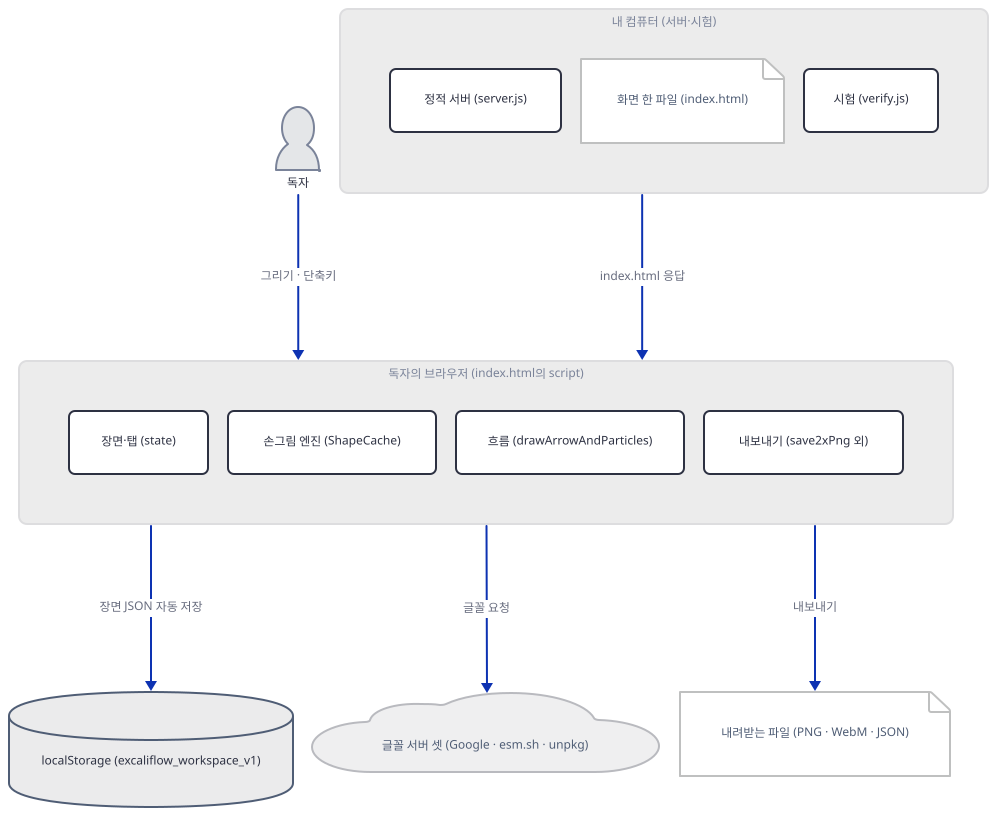
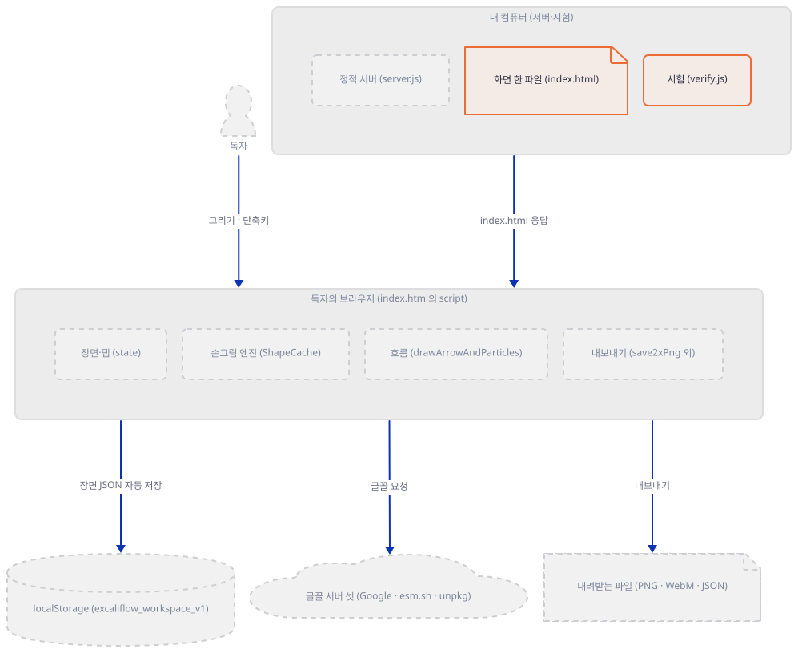
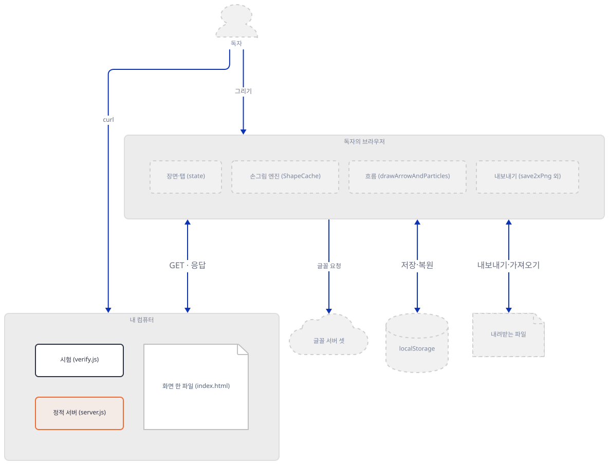
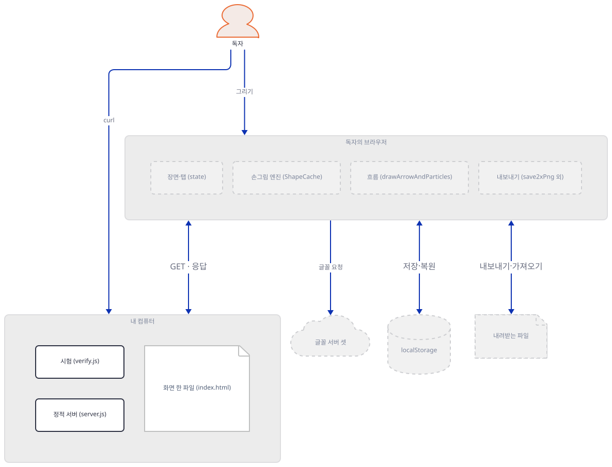
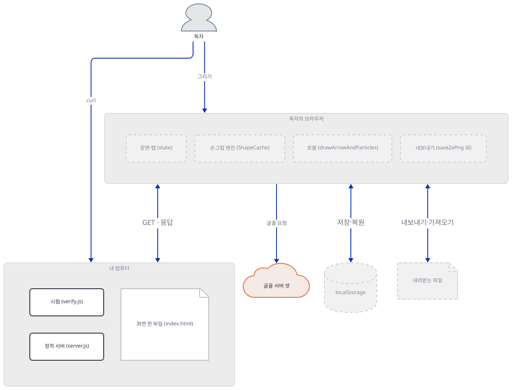
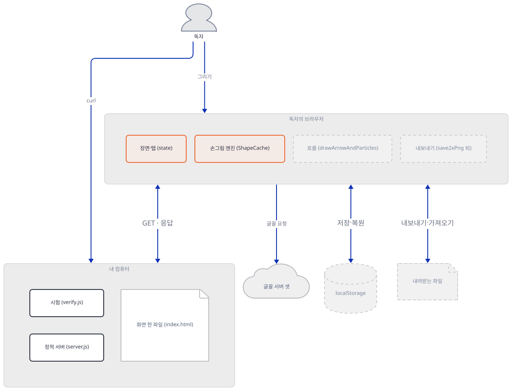
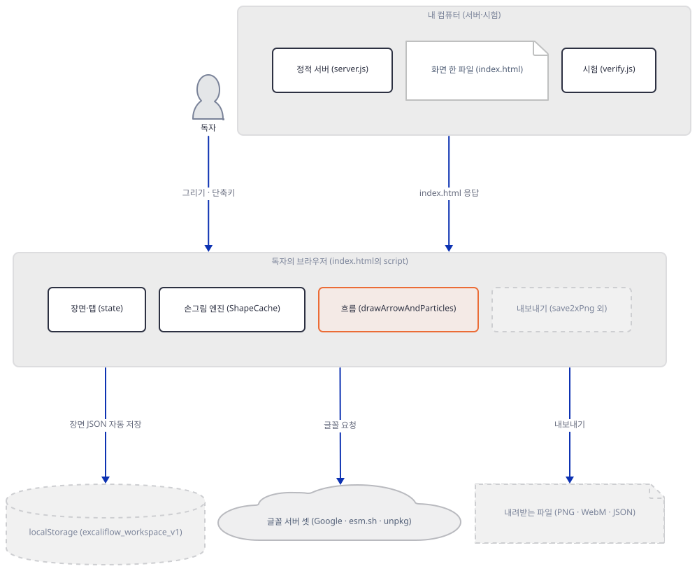
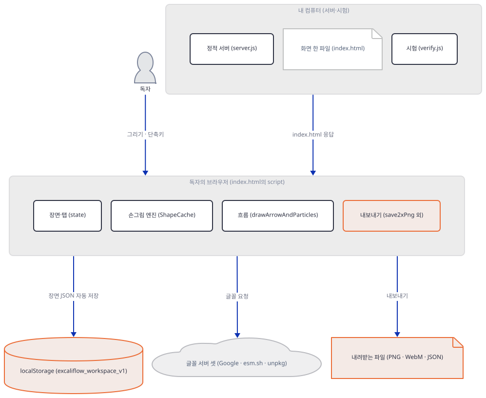
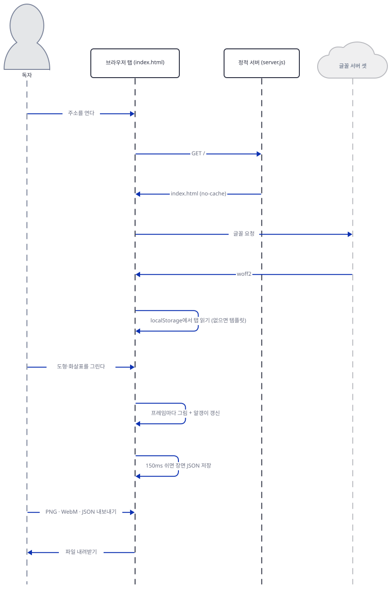

# Day 168 · ✏️ Excaliflow - Hand-Drawn Diagrams with Live Animated Flows

> 볼륨 19 🛠️ 독립 앱·도구 · 난이도 ★☆☆ · 예상 소요 100분(앱은 작고 키도 없지만, 터미널 둘에서 서버를 띄우고 curl로 열세 번 물어보고, 화면 소스 5,800줄에서 그림 그리는 길을 따라 읽는 데 시간이 듭니다) · API 비용 0원(이 앱은 LLM도 외부 API도 부르지 않습니다) · 원본 앱: `advanced_llm_apps/excaliflow`

## 오늘 만들 것

원본 README의 새 절 "🛠️ Standalone Apps & Tools"에 들어 있는 손그림 다이어그램 도구를 따라 봅니다. 같은 절의 Needle과 Ripple은 [볼륨 17](../day162-needle/README.md)에서 이미 다뤘으니, 이 절에서 남은 앱이 Excaliflow입니다. 이 날은 2026-10-22의 upstream 동기화로 계획에 더해졌고, 그래서 볼륨 19는 하루짜리이고 시리즈는 여기서 끝납니다.

먼저 밝힐 것이 있습니다. **이 앱은 LLM을 부르지 않습니다.** 모델도 에이전트도 키도 없는, `awesome-llm-apps` 안의 그림 도구입니다. AI 에이전트나 RAG 파이프라인 같은 구조를 Excalidraw 같은 손그림 캔버스에 그리고, 화살표 위로 알갱이가 흘러가게 하는 것이 전부입니다. 구성은 `index.html` 5,803줄(화면, 그림 엔진, 애니메이션이 한 파일), `server.js` 92줄(Node 내장 모듈만 쓰는 정적 서버), `verify.js` 523줄(`npm test`)입니다. `package.json`에 `dependencies`가 없습니다.

이 문서는 브라우저를 열지 않았고 `npm`도 돌리지 않았습니다. 서버와 시험은 `node`로 직접 돌렸고, 그림이 실제로 어떻게 보이는지, PNG와 영상이 실제로 어떻게 나오는지는 직접 보지 못했습니다. 그 부분은 소스로만 읽었다고 그때마다 적습니다. 알게 된 것은 여섯입니다.

1. 시험 여덟 묶음은 `index.html`의 `<script>`를 정규식으로 뽑아 가짜 브라우저(`node:vm`) 안에서 돌립니다. 통과해도 진짜 브라우저의 동작은 보증되지 않습니다(Step 1).
2. `server.listen(PORT, …)`에 주소가 없어서 `npm start`는 **모든 인터페이스에** 듣습니다. Node 문서가 그렇게 말합니다. 이 문서는 가드로 `127.0.0.1`에만 듣게 했습니다(Step 2).
3. 서버는 폴더의 파일을 가리지 않고 내줍니다. `server.js`와 `package.json`은 물론, 가짜로 만든 `.env`도 나왔습니다. 폴더 밖 요청(`..`)은 403입니다(Step 3).
4. 앱은 서버 쪽에서든 화면 쪽에서든 `fetch`·WebSocket을 쓰지 않습니다. 화면이 바깥에 닿는 곳은 **글꼴 요청뿐**이고, README의 "zero dependencies"는 글꼴을 빼고 하는 말입니다(Step 4).
5. 손그림은 무작위가 아니라 요소마다 가진 씨앗이 정합니다. 같은 씨앗은 같은 윤곽을 그립니다(Step 5).
6. 흐름은 그래프를 넓이 우선으로 훑어 얻은 깊이로 시간차를 둡니다. 4초 영상은 기본 속도에서 처음과 이어지지 않습니다(Step 6·7).



## 사전 준비

| 서비스/도구 | 용도 | 발급·설치 |
|---|---|---|
| Node.js 18 이상 | 서버, 시험, 가드. `package.json`의 `engines`가 18 이상입니다. 이 문서는 24.12.0으로 확인했습니다 | [공통 사전 준비](../README.md#공통-사전-준비-한-번만) 참고 |
| bash(Git Bash), curl | 아래 명령 전부. **이 문서는 bash 전용입니다** | Windows는 Git for Windows |
| git, 이 저장소의 클론 | 원본 폴더를 읽고 사본을 만듭니다 | `git clone https://github.com/Shubhamsaboo/awesome-llm-apps` |
| npm | **필요 없습니다.** 의존성도 설치 스크립트도 없습니다. `npm start`는 `node server.js`, `npm test`는 `node verify.js`일 뿐이라(`package.json:6-7`) 이 문서는 `node`를 바로 불렀습니다 | 없음 |
| 웹 브라우저 | 앱 화면을 진짜로 쓸 때만. **이 문서는 열지 않았습니다.** 열면 브라우저가 Step 4의 글꼴 주소들에 닿습니다 | 아무 최신 브라우저 |
| API 키 | **필요 없습니다.** | 없음 |

터미널은 둘을 씁니다. 터미널 A에서 서버를 띄우고, 나머지 명령은 터미널 B에서 칩니다. 두 터미널 모두 Step 1의 환경 파일을 불러옵니다.

## 아키텍처 한눈에 보기

| 컴포넌트 | 역할 | 코드 위치 |
|---|---|---|
| 정적 서버 | GET·HEAD만 받아 폴더의 파일을 내준다. 경로 밖 요청 403 | `advanced_llm_apps/excaliflow/server.js:26-84` |
| 서버 시작 | `PORT` 환경변수(기본 3000)로 듣는다. 직접 실행했을 때만 | `advanced_llm_apps/excaliflow/server.js:5`, `86-90` |
| 장면 상태 | 요소·선택·확대·흐름 설정·탭을 한 객체에 | `advanced_llm_apps/excaliflow/index.html:1196-1240` |
| 손그림 엔진 | 씨앗 난수(`mulberry32`)로 윤곽·빗금 경로를 만들고 캐시 | `advanced_llm_apps/excaliflow/index.html:1165-1690` |
| 화살표 기하 | 도형 둘레 위 결합, 곡선·꺾임·직선 | `advanced_llm_apps/excaliflow/index.html:1692-2107` |
| 흐름 | 그래프 깊이, 알갱이 그리기, 노드 펄스 | `advanced_llm_apps/excaliflow/index.html:2139-2232`, `2335-2579` |
| 템플릿 | 시작 그림 넷 | `advanced_llm_apps/excaliflow/index.html:3105-3196` |
| 내보내기 | 2배 PNG, 클립보드, 4초 WebM | `advanced_llm_apps/excaliflow/index.html:4412-4572` |
| 탭·자동 저장 | `localStorage`, 탭 만들기·복제·닫기, JSON 가져오기·내보내기 | `advanced_llm_apps/excaliflow/index.html:4601-5163` |
| 그리기 루프 | 매 프레임 정적 층과 상호작용 층을 다시 그린다 | `advanced_llm_apps/excaliflow/index.html:5708-5744` |
| 시험 | 가짜 브라우저 안에서 8묶음 | `advanced_llm_apps/excaliflow/verify.js:1-523` |
| 이 문서의 가드·확인 스크립트 | 루프백 가드, 서버 확인, 장면 확인 | 코드 없음(Step 1~2·5에서 직접 만듦) |

## 단계별 진행

### Step 1. 앱을 사본으로 두고 시험을 돌린다

**목적.** 원본에는 아무것도 쓰지 않고 사본에서 시험이 도는지 봅니다. 이 시험이 무엇을 시험하는지도 봅니다.

**할 일.** 저장소 루트에서 시작합니다. `LAB`은 저장소 밖의 새 폴더로 자기 경로로 바꿉니다. 블록은 `LAB`이 비었거나 자리 표시 값 그대로이거나 절대 경로가 아니거나 `.claude`·`.agents` 같은 에이전트 설정 폴더(또는 `CLAUDE_CONFIG_DIR`) 아래이면 폴더를 하나도 만들지 않고 멈춥니다(대소문자는 가리지 않습니다). 환경 파일은 HOME·USERPROFILE·CLAUDE_CONFIG_DIR·TEMP를 이 폴더로 돌리고, 프록시 변수를 지우고 `NO_PROXY`를 루프백으로 둡니다. Node 24의 `NODE_USE_ENV_PROXY`가 켜져 있으면 루프백 요청도 프록시로 갈 수 있기 때문입니다([Day 163](../day163-ripple/README.md) Step 1). 이후 블록에서 파일을 만드는 줄은 모두 `"${LAB:?}/…"` 절대 경로로 씁니다.

```bash
cd awesome-llm-apps
export REPO="$PWD"
export LAB=/path/to/d168-lab          # 저장소 밖의 새 폴더(자기 절대 경로로 바꾼다)
_ok=1; _n() { { cygpath -m "$1" 2>/dev/null || printf '%s' "$1"; } | tr 'A-Z\\' 'a-z/'; }
case "$LAB" in ""|/path/to/*) echo "LAB을 자기 경로로 바꾸세요"; _ok=0 ;; esac
case "$LAB" in /*|[A-Za-z]:[/\\]*) ;; *) echo "LAB은 절대 경로여야 합니다: $LAB"; _ok=0 ;; esac
case "$(_n "$LAB")/" in
  */.claude/*|*/.agents/*|*/.codex/*|*/.cursor/*|*/.copilot/*|*/.openclaw/*|*/.hermes/*)
    echo "LAB이 에이전트 설정 폴더 아래입니다: $LAB"; _ok=0 ;;
esac
if [ -n "${CLAUDE_CONFIG_DIR:-}" ]; then
  _c=$(_n "$CLAUDE_CONFIG_DIR")
  case "$(_n "$LAB")/" in "${_c%/}"/*) echo "LAB이 CLAUDE_CONFIG_DIR 아래입니다"; _ok=0 ;; esac
fi
[ "$_ok" = 1 ] && mkdir -p "$LAB/home" "$LAB/tmp" "$LAB/work" && cat > "$LAB/env.sh" <<'EOF'
# Day 168 작업 셸의 환경. 이 문서의 모든 명령은 이 파일을 불러온 셸에서 돌린다.
: "${REPO:?REPO를 먼저 정하세요}" "${LAB:?LAB을 먼저 정하세요}"
_n() { { cygpath -m "$1" 2>/dev/null || printf '%s' "$1"; } | tr 'A-Z\\' 'a-z/'; }
_lab=$(cd "$LAB" 2>/dev/null && pwd -P) || { echo "LAB 폴더가 없습니다: $LAB"; return 1; }
_low="$(_n "$_lab")/"
case "$_low" in
  */.claude/*|*/.agents/*|*/.codex/*|*/.cursor/*|*/.copilot/*|*/.openclaw/*|*/.hermes/*)
    echo "LAB이 에이전트 설정 폴더 아래입니다: $_lab"; return 1 ;;
esac
if [ -n "${CLAUDE_CONFIG_DIR:-}" ] && _cfg=$(cd "$CLAUDE_CONFIG_DIR" 2>/dev/null && pwd -P); then
  _cfg="$(_n "$_cfg")/"
  case "$_low" in "$_cfg"*) echo "LAB이 CLAUDE_CONFIG_DIR 아래입니다"; return 1 ;; esac
fi
export HOME="$LAB/home" USERPROFILE="$LAB/home" CLAUDE_CONFIG_DIR="$LAB/home/.claude"
export TEMP="$LAB/tmp" TMP="$LAB/tmp" TMPDIR="$LAB/tmp"
unset HTTP_PROXY HTTPS_PROXY ALL_PROXY http_proxy https_proxy all_proxy NODE_USE_ENV_PROXY
export NO_PROXY=127.0.0.1,localhost,::1 no_proxy=127.0.0.1,localhost,::1
export LABW=$(cygpath -m "$_lab")               # node에 넘기는 Windows 꼴 경로
export APP="$LAB/work/excaliflow" APPW="$LABW/work/excaliflow"
export PORT="${PORT:-48701}"                    # 이미 쓰는 프로그램이 있으면 PORT를 바꿔서 다시 불러온다
EOF
[ "$_ok" = 1 ] && source "$LAB/env.sh" && cd "$LAB/work"
```

앱 폴더를 사본으로 가져오고 시험을 돌립니다. `package.json`의 `test`가 `node verify.js`이므로 같은 명령입니다.

```bash
[ -e "${LAB:?}/work/excaliflow" ] || cp -r "${REPO:?}/advanced_llm_apps/excaliflow" "${LAB:?}/work/excaliflow"
ls -A "${LAB:?}/work/excaliflow"
cd "${LAB:?}/work/excaliflow" && node verify.js | cut -c1-60
```



**확인.** `ls -A`는 `.gitignore index.html package.json README.md server.js verify.js`를 보여 주고, 시험은 다음과 같이 끝납니다.

```text
--- Excaliflow Automated Verification Suite ---
[PASS] 1. Zero syntax or runtime initialization errors (i
[PASS] 2. Zero-bleed analytical interior clipping & doubl
[PASS] 3. 1-click unselected arrow endpoint grabbing, per
[PASS] 4. Direct bound-arrow middle shaft drag + Straight
[PASS] 5. Font families (Hand/Sans/Code), Tool Lock (Q), 
[PASS] 6. Port-wire drag to empty canvas, no-op click und
[PASS] 7. Untrusted JSON import validation, Excalidraw ar
[PASS] 8. Multi-canvas tabs (create, switch, fork/duplica

ALL EXCALIFLOW VERIFICATION CHECKS PASSED SUCCESSFULLY!
```

이 시험이 도는 방식이 이 앱의 구조를 알려 줍니다. `verify.js:7-12`는 `index.html`에서 `<script>…</script>` 한 덩어리를 정규식으로 뽑고, `verify.js:89-135`의 가짜 `window`·`document`·`Path2D`·캔버스 안에서 `vm.runInContext`로 돌립니다. 그래서 시험은 화면 그림을 보지 않고 **함수를 직접 부릅니다**. 예를 들어 타원과 마름모의 빗금 점이 도형 안에 있는지 수식으로 따지고(2번), 화살표 끝점을 끌어 다른 도형에 다시 붙이고(3번), 가져오기 JSON에서 허용되지 않은 요소 종류가 걸러지는지(7번), 탭을 만들고 복제하고 `localStorage`에 저장했다 되살리는지(8번) 봅니다. 가짜로 만든 것이 캔버스와 DOM이어서, 이 시험이 통과해도 **진짜 브라우저에서 그림이 어떻게 보이는지는 보증되지 않습니다**. 7번은 서버도 시험합니다. `server.js`를 `require`해서(`require.main !== module`이라 듣기 시작은 하지 않습니다) 가짜 요청 객체를 `server.emit('request', …)`로 넣고 405·400·403·200을 확인합니다(`verify.js:232-262`). Step 3에서 이것을 진짜 HTTP로 다시 확인합니다.

### Step 2. 서버를 읽고, 가드 아래서 띄운다

**목적.** 서버가 어느 주소에 듣는지 소스로 확인하고, 독자의 컴퓨터를 바깥에 열지 않고 띄웁니다.

**읽기(소스로 확인).** `server.js`는 `http.createServer` 하나가 전부입니다(`26-84`). 순서는 이렇습니다. GET·HEAD가 아니면 405(`27-31`), 주소를 `decodeURIComponent`로 풀고 실패하면 400(`33-40`), `/`는 `index.html`로 바꾸고(`42`), 폴더 `ROOT`를 기준으로 `path.resolve`해서 `ROOT` 밖이면 403(`43-49`), `fs.stat`으로 파일이 아니면 404(`51-56`), 확장자로 콘텐츠 형식을 정해 `Cache-Control: no-cache`와 함께 내줍니다(`58-82`). 형식 표에 없는 확장자는 `application/octet-stream`입니다(`59`). 서버는 `require.main === module`일 때만 듣기 시작합니다(`86`). 이 조건 때문에 시험이 `require`해도 포트를 열지 않습니다.

듣는 줄은 이렇습니다.

```js
// advanced_llm_apps/excaliflow/server.js:5, 87-89
const PORT = Number(process.env.PORT) || 3000;
  server.listen(PORT, () => {
    console.log(`Excaliflow Studio running at http://localhost:${PORT}`);
```

`listen`에 주소가 없습니다. [Node 문서](https://nodejs.org/docs/latest-v24.x/api/net.html)는 `server.listen`의 `host`가 빠지면 "the server will accept connections on the unspecified IPv6 address (`::`) when IPv6 is available, or the unspecified IPv4 address (`0.0.0.0`) otherwise"라고 합니다. 즉 `npm start`는 같은 네트워크의 다른 컴퓨터도 닿을 수 있는 모든 인터페이스에 듭니다. 출력 메시지가 `localhost`를 말해도 그렇습니다. 이 문서는 가드 없이 띄워서 이것을 확인하지는 않았고, 문서와 소스로 읽었습니다. 포트는 `PORT` 환경변수입니다(`5`).

**할 일.** 가드 `guard.mjs`와 실행기 `serve.mjs`를 만듭니다. 가드는 `net.Server.prototype.listen`을 바꿔서 주소가 빠진 호출에 `127.0.0.1`을 끼워 넣고, 루프백이 아닌 주소는 거부합니다. 또 `net.Socket.prototype.connect`를 바꿔 루프백 밖 연결을 소켓을 열기 전에 막고, 예약 주소 `192.0.2.1`로 먼저 단언합니다. 실행기는 가드를 불러온 뒤 `server.js`를 `node server.js`와 똑같이 "처음 실행한 파일"로 돌립니다. 가드를 부르는 줄을 빼면 `armed`가 없어 실행기가 멈추고, 가드 안의 `listen`·`connect` 줄을 빼면 가드가 스스로 멈춥니다.

```bash
cat > "${LAB:?}/guard.mjs" <<'EOF'
// 독자용 가드. 서버가 듣는 주소를 127.0.0.1로 못 박고, 루프백 밖으로 나가는 연결은 모두 막는다.
import net from "node:net";
import { appendFileSync } from "node:fs";

const LOOP = new Set(["127.0.0.1", "localhost", "::1"]);
const note = (s) => appendFileSync(process.env.LABW + "/lab-guard.log", s + "\n");
const block = (what) => Object.assign(new Error("lab guard blocked " + what), { code: "ELABGUARD" });

// 1) listen: 주소가 빠져 있으면 127.0.0.1을 끼워 넣고, 루프백이 아닌 주소는 거부한다.
const realListen = net.Server.prototype.listen;
net.Server.prototype.listen = function (...args) {
  const a0 = args[0];
  const asked = JSON.stringify(args.filter((a) => typeof a !== "function"));
  if (typeof a0 === "number" || (typeof a0 === "string" && /^\d+$/.test(a0))) {
    if (typeof args[1] === "string") {
      if (!LOOP.has(args[1])) throw block("listen " + args[1]);
    } else {
      args.splice(1, 0, "127.0.0.1");
    }
  } else if (a0 && typeof a0 === "object" && "port" in a0) {
    if (a0.host === undefined) args[0] = { ...a0, host: "127.0.0.1" };
    else if (!LOOP.has(a0.host)) throw block("listen " + a0.host);
  } else {
    throw block("listen " + asked);
  }
  note("listen " + asked + " -> 127.0.0.1");
  return realListen.apply(this, args);
};

// 2) connect: 루프백 밖은 소켓을 열기 전에 거부한다.
const realConnect = net.Socket.prototype.connect;
net.Socket.prototype.connect = function (...args) {
  const a0 = args[0];
  const host = a0 && typeof a0 === "object" ? a0.host ?? "localhost" : typeof args[1] === "string" ? args[1] : "localhost";
  if (!LOOP.has(host)) { note("connect " + host + " blocked"); throw block("connect " + host); }
  return realConnect.apply(this, args);
};

// 예약 주소(192.0.2.1)로 먼저 단언한다. 막히지 않으면 여기서 멈춘다.
try { new net.Socket().connect({ host: "192.0.2.1", port: 9 }); throw new Error("가드가 192.0.2.1을 막지 않았습니다"); }
catch (e) { if (e.code !== "ELABGUARD") throw e; }
if (net.Server.prototype.listen === realListen) throw new Error("listen 가드가 걸리지 않았습니다");
export const armed = true;
EOF
cat > "${LAB:?}/serve.mjs" <<'EOF'
// 앱 서버를 가드 아래서 띄운다. 이 줄들을 빼면 armed가 없어 서버가 뜨지 않는다.
// npm start와 같은 길(node server.js)을 그대로 타도록, server.js를 "처음 실행한 파일"로 돌린다.
import Module from "node:module";
import { armed } from "./guard.mjs";
if (armed !== true) throw new Error("가드가 없습니다");
process.argv[1] = process.env.APPW + "/server.js";
Module.runMain();
EOF
ls "${LAB:?}"
```

터미널 A에서 서버를 띄웁니다. 터미널 B에서는 어디에 듣는지 봅니다.

```bash
# 터미널 A
cd awesome-llm-apps && export REPO="$PWD" LAB=/path/to/d168-lab   # Step 1과 같은 경로
source "${LAB:?}/env.sh" && node "${LABW:?}/serve.mjs"
```

```bash
# 터미널 B (REPO·LAB을 같게 정하고 env.sh를 불러온 뒤)
netstat -ano | grep LISTENING | grep ":${PORT:?} "
cat "${LAB:?}/lab-guard.log"
```



**확인.** 터미널 A는 `Excaliflow Studio running at http://localhost:48701`을 찍고 멈추지 않습니다(`Ctrl+C`로 끌 때까지). 터미널 B의 출력은 다음과 같습니다(PID는 환경마다 다릅니다).

```text
  TCP    127.0.0.1:48701        0.0.0.0:0              LISTENING       49820
connect 192.0.2.1 blocked
listen [48701] -> 127.0.0.1
```

`lab-guard.log`는 실행 때마다 줄이 쌓입니다. 첫 줄은 가드가 시작하며 `192.0.2.1` 연결을 막은 단언이고, 둘째 줄은 앱이 **주소 없이** `listen(48701)`을 불렀고 가드가 `127.0.0.1`을 끼웠다는 기록입니다. 앱 소스는 한 글자도 고치지 않았습니다. 이 문서는 줄 하나씩 빼 보는 시험도 했습니다. 실행기에서 가드를 부르는 `import` 줄을 빼면 `ReferenceError: armed is not defined`로, 가드에서 `listen`을 바꾸는 줄을 빼면 "listen 가드가 걸리지 않았습니다"로 멈췄습니다. `connect`를 바꾸는 줄을 빼면 이 문서를 쓴 환경의 다른 안전 장치가 `192.0.2.1` 연결을 먼저 막아 그 장치의 오류로 멈췄습니다(가드의 막음은 오류 이름 `ELABGUARD`로 구분하므로 그 오류를 가드의 성공으로 치지 않습니다). 그런 장치가 없는 환경에서는 "가드가 192.0.2.1을 막지 않았습니다"로 멈추게 짠 것을 소스로 읽었을 뿐 돌려 보지 못했습니다. 어느 경우도 서버는 뜨지 않았습니다.

### Step 3. 서버가 내주는 것을 curl로 묻는다

**목적.** 소스로 읽은 경로 처리를 진짜 HTTP로 확인하고, 폴더 안의 무엇이 밖으로 나가는지 봅니다.

**할 일.** 사본에 가짜 `.env`를 하나 둡니다. 이 앱은 `.env`를 읽지 않지만 `.gitignore`가 `.env`를 적어 두었으니(`.gitignore:4`) 개발자가 둘 법한 파일입니다. 질문 스크립트는 `curl`에 `--noproxy '*'`를 붙이고, 폴더 밖 요청은 `--path-as-is`로 보냅니다(없으면 curl이 `/../`를 먼저 접어 버려 서버까지 오지 않습니다). 터미널 B에서 돌립니다.

```bash
cat > "${LAB:?}/probe.sh" <<'EOF'
U="http://127.0.0.1:${PORT:?}"
show() { # 상태 코드, 콘텐츠 형식, 크기를 한 줄로
  printf '%-30s' "$1"
  shift
  curl -s --noproxy '*' -o /dev/null -w '%{http_code} %{content_type} %{size_download}B\n' "$@"
}
show "GET /"                         "$U/"
show "GET /index.html?x=1"           "$U/index.html?x=1"
show "GET /server.js"                "$U/server.js"
show "GET /package.json"             "$U/package.json"
show "GET /.gitignore"               "$U/.gitignore"
show "GET /.env (fake file)"         "$U/.env"
show "GET /nope.txt"                 "$U/nope.txt"
show "GET /../package.json"          --path-as-is "$U/../package.json"
show "GET /%2e%2e/package.json"      --path-as-is "$U/%2e%2e/package.json"
show "GET /%E0%A4%A"                 --path-as-is "$U/%E0%A4%A"
show "POST /index.html"              -X POST "$U/index.html"
show "HEAD /"                        -I "$U/"
curl -s --noproxy '*' -I "$U/" | tr -d '\r' | grep -iE '^(content-type|cache-control|content-length)'
EOF
echo "OPENAI_API_KEY=fake-not-a-real-key" > "${APP:?}/.env"   # 가짜 값
bash "${LAB:?}/probe.sh"
rm -f "${APP:?}/.env"                                         # 정확한 경로 하나만 지운다
```



**확인.** 출력은 다음과 같습니다.

```text
GET /                         200 text/html; charset=utf-8 213804B
GET /index.html?x=1           200 text/html; charset=utf-8 213804B
GET /server.js                200 application/javascript; charset=utf-8 2572B
GET /package.json             200 application/json; charset=utf-8 316B
GET /.gitignore               200 application/octet-stream 35B
GET /.env (fake file)         200 application/octet-stream 35B
GET /nope.txt                 404 text/plain; charset=utf-8 13B
GET /../package.json          403 text/plain; charset=utf-8 13B
GET /%2e%2e/package.json      403 text/plain; charset=utf-8 13B
GET /%E0%A4%A                 400 text/plain; charset=utf-8 15B
POST /index.html              405 text/plain; charset=utf-8 22B
HEAD /                        200 text/html; charset=utf-8 0B
Content-Type: text/html; charset=utf-8
Content-Length: 213804
Cache-Control: no-cache
```

읽을 것은 셋입니다. 첫째, 쿼리 문자열은 버려지고(`split('?')[0]`, `server.js:35`) `213804B`는 `index.html`의 크기와 같습니다. 둘째, **폴더 안의 파일은 가리지 않고 나갑니다.** `server.js`, `package.json`, 숨김 파일 `.gitignore`, 그리고 가짜 `.env`까지 200입니다. 이 앱의 서버에는 허용 목록이 없습니다. 가드 덕에 이 문서의 서버는 루프백에서만 열렸지만, `npm start`의 모든 인터페이스 바인딩(Step 2)과 겹치면 이 폴더에 둔 파일이 같은 네트워크에 보입니다. 앱 폴더에 비밀 파일을 두지 않는 것으로 막습니다. 셋째, 폴더 밖 요청은 `..`로도 퍼센트 인코딩 `%2e%2e`로도 403입니다. `startsWith(ROOT + path.sep)`로 비교하므로 이름이 `excaliflow`로 시작하는 옆 폴더도 걸러집니다(`server.js:45`). 다만 심볼릭 링크를 따라가는지는 시험하지 않았습니다.

### Step 4. 화면이 부르는 바깥 주소를 소스로 센다

**목적.** 화면이 열릴 때 브라우저가 어디에 닿는지 모두 찾습니다. 이 문서는 브라우저를 열지 않았으므로 소스로만 확인합니다.

**할 일.** 주소가 든 줄과, 네트워크를 쓸 만한 호출을 찾습니다. 터미널 B에서 돌립니다.

```bash
grep -nE 'https?://' "${APP:?}/index.html" | cut -c1-110
grep -cE "fetch\(|XMLHttpRequest|WebSocket|sendBeacon|<script src|import\(" "${APP:?}/index.html"
grep -c "<script" "${APP:?}/index.html"
```



**확인.** 출력은 다음과 같습니다.

```text
7:  <link rel="preconnect" href="https://fonts.googleapis.com" />
8:  <link rel="preconnect" href="https://fonts.gstatic.com" crossorigin />
9:  <link href="https://fonts.googleapis.com/css2?family=Assistant:wght@400;500;600;700&family=Architects+Daug
14:      src: url('https://esm.sh/@excalidraw/excalidraw@0.18.0/dist/prod/fonts/Excalifont/Excalifont-Regular-
21:      src: url('https://unpkg.com/@excalidraw/excalidraw@0.17.6/dist/excalidraw-assets/Virgil.woff2') forma
28:      src: url('https://unpkg.com/@excalidraw/excalidraw@0.17.6/dist/excalidraw-assets/Cascadia.woff2') for
0
1
```

바깥 주소는 전부 **글꼴**입니다. `fonts.googleapis.com`의 CSS가 Assistant·Architects Daughter·Caveat·Geist·Geist Mono·Inter·Nunito·Patrick Hand 여덟 가족을 달라고 하고(`9`), 손글씨 글꼴 Excalifont는 `esm.sh`에서 `@excalidraw/excalidraw@0.18.0`의 woff2로(`14`), Virgil과 Cascadia는 `unpkg.com`에서 `0.17.6`의 woff2로 받습니다(`21`, `28`). 판이 고정되어 있어 바뀌지 않지만 모두 제3자 서버입니다. `fonts.gstatic.com`은 `preconnect`만 있고(`8`), 실제 글꼴 파일 주소는 `fonts.googleapis.com`이 돌려주는 CSS에 들어 있을 것으로 짐작하며 이 문서는 그것을 가져와 보지 않았습니다. 두 번째 숫자가 0이므로 `fetch`·`XMLHttpRequest`·`WebSocket`·`sendBeacon`·외부 `<script src>`가 한 줄도 없고, 세 번째 숫자 1이 말하듯 스크립트는 인라인 하나뿐입니다. 즉 이 앱이 바깥으로 보내는 것은 없고, 독자의 브라우저가 글꼴을 받으러 갈 뿐입니다. 글꼴 요청은 독자의 IP를 이 서버들에 알립니다. 오프라인이어도 앱은 죽지 않습니다. 글꼴 목록이 대체 글꼴로 이어지고(`FONT_MAP`, `index.html:1112-1116`) 로딩 대기는 `Promise.allSettled`입니다(`5690-5697`). README가 말하는 "zero dependencies"는 npm 의존성과 스크립트에 대한 말입니다. 글꼴은 그 바깥입니다.

### Step 5. 장면 모델과 손그림 엔진

**목적.** 화면 소스 5,800줄에서 그림이 나오는 길을 따라가고, 시험이 쓰는 방식으로 장면을 직접 불러 봅니다.

**읽기(소스로 확인).** 장면은 `state.elements` 배열 하나입니다(`index.html:1196`). 요소는 `createElement`가 만들고(`2925-2960`), 종류는 사각형·타원·마름모·화살표·자유 그리기·글·스티커입니다(`4409`). 요소마다 `seed`(1~1,000,000 사이의 무작위, `2926`)와 `versionNonce`가 있습니다. 손그림 엔진은 라이브러리가 아니라 직접 짠 것입니다. `mulberry32`(`1167`)는 씨앗에서 난수열을 만드는 32비트 함수이고, `ShapeCache.generate`가 `seed ^ versionNonce`로 난수를 만들어(`1584`) 윤곽 `strokePath`, 칠 `fillPath`, 빗금 `hachurePath`를 `Path2D`로 짭니다. 캐시 키에 위치·크기·씨앗·거칠기가 들어 있어(`1568-1580`) 요소가 바뀔 때만 다시 만듭니다.

**할 일.** `verify.js`의 앞쪽 가짜 브라우저 부분(`137`째 줄 앞까지)을 잘라 `mocks.js`로 만들고, 장면을 들여다보는 `probe.js`를 만듭니다. 이 스크립트는 Step 6·7에서도 씁니다. 인자 `scene`·`flow`·`save`가 부분을 고릅니다.

```bash
cd "${APP:?}" && head -n "$(( $(grep -n "^console.log('--- Excaliflow" verify.js | cut -d: -f1) - 1 ))" verify.js > mocks.js
echo 'module.exports = { sandbox, scriptCode };' >> mocks.js
cat > "${LAB:?}/probe.js" <<'EOF'
// index.html의 <script>를 verify.js와 같은 가짜 브라우저 안에서 돌려 장면 모델을 들여다본다.
const vm = require("node:vm");
const { sandbox, scriptCode } = require(process.env.APP + "/mocks.js");
vm.createContext(sandbox);
vm.runInContext(scriptCode, sandbox);
sandbox.initStudioDOM();
const app = sandbox.window;

const want = (n) => process.argv[2] === n;
if (want("flow")) {
console.log("== 1. 템플릿 넷: 노드, 화살표, 흐름 차례(BFS 깊이)");
for (const name of ["AI Agent Swarm", "How Browsers Work", "RAG Pipeline", "Microservices"]) {
  app.loadTemplate(name);
  const els = app.state.elements;
  const nodes = els.filter((e) => e.type !== "arrow");
  const arrows = els.filter((e) => e.type === "arrow");
  const { nodeDepths, arrowDepths } = app.computeGraphDepths(els);
  const map = new Map(els.map((e) => [e.id, e]));
  console.log(`${name}: 노드 ${nodes.length}, 화살표 ${arrows.length}, 깊이 ${nodes.map((n) => n.id + "=" + nodeDepths.get(n.id)).join(" ")}`);
  const hops = arrows.map((a) => {
    const len = app.getArrowGeometry(a, map).totalLen;
    return `${a.startBinding.elementId}>${a.endBinding.elementId}:d${arrowDepths.get(a.id)}/알갱이${Math.max(1, Math.min(4, Math.round(len / 150)))}`;
  });
  console.log("  " + hops.join("  "));
}

}
if (want("scene")) {
console.log("== 2. 손그림은 씨앗이 정한다");
const mk = (seed, roughness) => app.createElement("rectangle", { id: "t" + seed, x: 10, y: 10, width: 160, height: 80, seed, roughness });
const pts = (el) => JSON.stringify(app.ShapeCache.generate(el).strokePath.points);
console.log("같은 씨앗 두 번 -> 같은 점:", pts(mk(7, 0.85)) === pts(mk(7, 0.85)));
console.log("다른 씨앗      -> 같은 점:", pts(mk(7, 0.85)) === pts(mk(8, 0.85)));
for (const r of [0, 0.85, 1.75]) console.log(`roughness ${r}: 윤곽 점 ${app.ShapeCache.generate(mk(7, r)).strokePath.points.length}개`);

}
if (want("save")) {
console.log("== 3. 저장 꼴");
app.loadTemplate("RAG Pipeline");
app.saveWorkspaceToStorage();
const raw = sandbox.window.localStorage.getItem(app.WORKSPACE_STORAGE_KEY);
const saved = JSON.parse(raw);
console.log("키:", app.WORKSPACE_STORAGE_KEY, "| 바이트:", Buffer.byteLength(raw));
console.log("최상위 필드:", Object.keys(saved).join(","));
console.log("탭 필드:", Object.keys(saved.tabs[0]).join(","));
console.log("원소 하나의 필드:", Object.keys(saved.elements[0]).join(","));

console.log("== 4. 4초 영상의 앞과 뒤(packet phase = t*0.55*속도 mod 1)");
for (const s of [0.6, 1, 1.8]) {
  const end = (4 * 0.55 * s) % 1;
  console.log(`속도 ${s}x: 4초 뒤 phase ${end.toFixed(2)} (0이면 첫 프레임과 이어짐)`);
}
}
EOF
node "${LABW:?}/probe.js" scene
```



**확인.** 출력은 다음과 같습니다.

```text
== 2. 손그림은 씨앗이 정한다
같은 씨앗 두 번 -> 같은 점: true
다른 씨앗      -> 같은 점: false
roughness 0: 윤곽 점 13개
roughness 0.85: 윤곽 점 34개
roughness 1.75: 윤곽 점 51개
```

같은 씨앗은 같은 윤곽을 그립니다. 그래서 다시 그려도 도형이 떨리지 않고, 저장했다 불러와도 모양이 같습니다(씨앗이 JSON에 들어갑니다. Step 7). 거칠기 설정(`Clean 0`, `Artist 0.85`, `Cartoon 1.75`, `verify.js` 4번이 이름을 씁니다)은 윤곽을 이루는 점의 수를 바꿉니다. 이 숫자는 가짜 `Path2D`가 기록한 점이고 화면에 보이는 모양이 아닙니다.

### Step 6. 움직이는 화살표

**목적.** 알갱이가 어떤 순서로 어디까지 가는지, 소스의 산수와 시작 템플릿 넷에 대고 확인합니다.

**읽기(소스로 확인).** 시작 템플릿은 `loadTemplate`이 만듭니다(`3105`). 이름은 AI Agent Swarm, How Browsers Work, RAG Pipeline, Microservices이고 메뉴에는 5·5·5·6노드로 적혀 있습니다(`844-847`). 흐름의 순서는 `computeGraphDepths`(`2139`)가 정합니다. 화살표의 시작·끝 결합(`startBinding`·`endBinding`)으로 방향 그래프를 만들고, 들어오는 화살표가 없는 노드를 깊이 0으로 두고 큐로 훑으며(`2164-2182`) 노드 깊이와 화살표 깊이(그 화살표가 나오는 노드의 깊이)를 구합니다. 순환만 있어 시작점이 없으면 첫 노드를 깊이 0으로 씁니다(`2169-2172`). 그 깊이는 `drawArrowAndParticles`에서 시간차가 됩니다(`2470-2472`). 화살표 길이를 150으로 나눠 반올림한 수(1~4)만큼 알갱이를 놓고, 속도는 `flowSpeed × 0.55`이며, 위상은 `시간 × 속도 − 깊이 × 0.38 + k/개수`의 소수 부분입니다. 알갱이는 `comets`·`pulses`·`neon`·`dashed` 네 모양 가운데 하나로 그려지고(`drawFlowParticleAt`, `2505-2579`), 위상이 0.82를 넘으면 도착 노드가 빛납니다(`2477-2483`). 노드를 두 번 눌러 펄스를 쏘는 것(`triggerNodePulse`, `2202`)은 별개로 화살표마다 알갱이 셋을 속도 1.35로 보냅니다.

**할 일.** 터미널 B에서 돌립니다.

```bash
node "${LABW:?}/probe.js" flow
```



**확인.** 출력은 다음과 같습니다(`d`는 화살표 깊이).

```text
== 1. 템플릿 넷: 노드, 화살표, 흐름 차례(BFS 깊이)
AI Agent Swarm: 노드 5, 화살표 5, 깊이 a_user=0 a_plan=1 a_code=2 a_res=2 a_ver=3
  a_user>a_plan:d0/알갱이1  a_plan>a_code:d1/알갱이1  a_plan>a_res:d1/알갱이1  a_code>a_ver:d2/알갱이1  a_res>a_ver:d2/알갱이1
How Browsers Work: 노드 5, 화살표 5, 깊이 b_url=0 b_html=1 b_css=1 b_render=2 b_paint=3
  b_url>b_html:d0/알갱이1  b_url>b_css:d0/알갱이1  b_html>b_render:d1/알갱이1  b_css>b_render:d1/알갱이1  b_render>b_paint:d2/알갱이1
RAG Pipeline: 노드 5, 화살표 5, 깊이 r_q=0 r_emb=1 r_vec=2 r_rerank=3 r_llm=2
  r_q>r_emb:d0/알갱이1  r_emb>r_vec:d1/알갱이1  r_vec>r_rerank:d2/알갱이1  r_rerank>r_llm:d3/알갱이1  r_emb>r_llm:d1/알갱이2
Microservices: 노드 6, 화살표 6, 깊이 m_gw=0 m_auth=1 m_ord=1 m_pay=1 m_kafka=2 m_db=3
  m_gw>m_auth:d0/알갱이1  m_gw>m_ord:d0/알갱이1  m_gw>m_pay:d0/알갱이1  m_ord>m_kafka:d1/알갱이1  m_pay>m_kafka:d1/알갱이1  m_kafka>m_db:d2/알갱이1
```

노드 수는 메뉴 글(5·5·5·6)과 같고, 깊이는 "먼저 닿는 길"입니다. RAG 템플릿이 그 보기입니다. `r_llm`은 `r_emb`에서 바로 가는 길이 있어 깊이 2인데, `r_rerank>r_llm` 화살표는 깊이 3입니다(출발 노드의 깊이). 알갱이는 화살표 하나에 하나이고, 가장 긴 `r_emb>r_llm` 곡선만 둘입니다. 한 가지 짚을 것은 시간차의 크기입니다. 다음 깊이의 위상은 앞보다 0.38 늦을 뿐이어서(주기의 38%), 앞 화살표의 알갱이가 도착하는 순간 다음 화살표의 알갱이는 이미 62% 지점에 있습니다. 소스의 산수로는 "줄지어 번지는 물결"이지 "받아서 다시 쏘는 이어달리기"가 아닙니다. 이 문서는 화면을 보지 않았으므로 눈에 어떻게 보이는지는 말하지 않습니다.

### Step 7. 자동 저장과 내보내기

**목적.** 장면이 어떤 꼴로 저장되는지 보고, 내보내기를 소스로 읽습니다. 캔버스·`MediaRecorder`·클립보드는 브라우저에만 있어서 **이 단계의 내보내기는 읽기만 하고 실행하지 않았습니다.**

**읽기(소스로 확인).** 저장 키는 `excaliflow_workspace_v1`이고(`4603`), `serializeWorkspace`가 요소·배경·확대·흐름 설정·탭 전체를 JSON으로 만듭니다(`4697-4728`). 앱이 시작하면 저장된 것이 있을 때 되살리고, 없으면 AI Agent Swarm 템플릿을 불러 저장합니다(`5699-5704`). 저장 시점은 둘로 나뉩니다. 탭을 만들고 바꾸고 닫는 일과 가져오기는 바로 저장하고(`4998`, `5046`, `5061`, `5084`, `5101`, `5112`, `5130`, `5154`), 배경·확대·선택 같은 화면 갱신은 150ms 뒤로 예약하며(`4742-4749`), 창이 닫힐 때도 한 번 저장합니다(`5556`). 되살릴 때와 가져올 때는 값을 걸러냅니다. 허용된 요소 종류만 남기고(`4409`, `4574-4580`), 흐름 모양은 네 가지만 받고, 속도는 0.2~5로 자르고, 확대는 0.25~3으로 자르며, 탭 이름은 48자로 자릅니다(`4751-4783`). 되돌리기는 60단계입니다(`2973`).

내보내기는 현재 장면을 지금 시각의 위상으로 다른 캔버스에 그립니다(`4454-4472`). PNG는 그림 둘레에 48px 여백을 두고 2배로 그려 `excaliflow-2x.png`로 받게 하거나 클립보드에 올립니다(`4494-4516`). 영상은 같은 크기의 캔버스를 `captureStream(60)`으로 `MediaRecorder`에 물려, `setInterval`로 1/60초마다 240프레임(4초)을 그리고 `excaliflow-flow.webm`(VP9가 되면 VP9, 8Mbps)으로 받게 합니다(`4518-4572`). JSON은 `diagram.excaliflow`입니다(`5116-5122`).

**할 일.** 터미널 B에서 돌립니다.

```bash
node "${LABW:?}/probe.js" save
```



**확인.** 출력은 다음과 같습니다.

```text
== 3. 저장 꼴
키: excaliflow_workspace_v1 | 바이트: 9997
최상위 필드: type,version,source,activeTabId,elements,appState,tabs
탭 필드: id,name,elements,scrollX,scrollY,zoom,canvasBg,flowEnabled,flowMode,flowSpeed
원소 하나의 필드: id,type,x,y,width,height,strokeColor,fillStyle,fontFamily,fontSize,roughness,strokeWidth,strokeStyle,curveType,curveOffset,text,seed,versionNonce,flowEnabled,startBinding,endBinding,points
== 4. 4초 영상의 앞과 뒤(packet phase = t*0.55*속도 mod 1)
속도 0.6x: 4초 뒤 phase 0.32 (0이면 첫 프레임과 이어짐)
속도 1x: 4초 뒤 phase 0.20 (0이면 첫 프레임과 이어짐)
속도 1.8x: 4초 뒤 phase 0.96 (0이면 첫 프레임과 이어짐)
```

RAG 템플릿 하나가 `localStorage`에 9,997바이트입니다. 씨앗이 요소 안에 있어서 모양이 저장되고, 같은 내용이 `elements`(현재 탭)와 `tabs[].elements`에 두 번 들어갑니다. 파일(`.excaliflow`)은 같은 JSON을 들여쓰기로 씁니다. 4번은 산수일 뿐 영상을 만들어 본 것이 아닙니다. 화살표 알갱이의 위상은 시간에 비례하고 앱 설정의 속도는 0.6·1·1.8배 셋뿐이어서(`1015-1019`) 4초 뒤에도 위상이 0으로 돌아오는 속도가 없습니다. 기본 1배에서 영상의 끝은 시작보다 주기의 20%만큼 앞서 있으니 이어 붙여 되풀이하면 한 번 튑니다. 영상이 "루프"라고 불리는 곳은 코드의 토스트 문구(`4553`)입니다. 실제 영상이 어떻게 이어 보이는지는 브라우저에서 확인해야 합니다.

## 요청 한 건이 흐르는 과정



서버와 오가는 것은 처음의 GET 한 번(`index.html`)이 사실상 전부입니다. 이후 편집, 알갱이, 저장, 내보내기는 모두 탭 안에서 끝납니다. 글꼴은 탭이 열릴 때 브라우저가 따로 부르고(Step 4), 저장된 장면이 있으면 템플릿 대신 그것을 읽습니다. 매 프레임 `requestAnimationFrame` 루프가 정적 층(도형과 알갱이)과 상호작용 층(선택 핸들, 포트)을 다시 그립니다(`5708-5742`). 이 순서는 소스로 읽은 것이고, 이 문서는 브라우저에서 실행해 보지 않았습니다.

## 실행 체크리스트

- [ ] `LAB`을 저장소 밖 새 폴더로 정하고 Step 1 블록이 `env.sh`를 만들었다.
- [ ] `node verify.js`가 PASS 여덟 줄과 마지막 문구로 끝났다.
- [ ] 서버를 가드 아래서 띄웠고 `netstat`에 `127.0.0.1:48701`만 보인다.
- [ ] `probe.sh`의 출력이 Step 3과 같다. 그리고 가짜 `.env`를 지웠다.
- [ ] Step 4의 `grep` 결과가 글꼴 주소뿐이다.
- [ ] `probe.js`의 `scene`·`flow`·`save`가 Step 5~7의 출력과 같다.
- [ ] 터미널 A의 서버를 `Ctrl+C`로 껐다.

## 문제 해결

| 증상 | 원인 | 해결 |
|---|---|---|
| 서버가 `EADDRINUSE`로 멈춤 | `PORT`를 이미 다른 프로그램이 씀 | `export PORT=48702`처럼 바꾸고 `env.sh`를 다시 불러온다 |
| `npm start`로 띄우면 같은 네트워크의 다른 기기에서 열림 | `listen`에 주소가 없어 모든 인터페이스에 듦(`server.js:87`) | 앱을 쓸 때도 이 문서의 `serve.mjs`로 띄우거나, 방화벽에서 그 포트를 막는다. 앱을 고친다면 `server.listen(PORT, '127.0.0.1', …)` |
| 앱 폴더의 `.env` 같은 파일이 주소로 열림 | 정적 서버에 허용 목록이 없음 | 앱 폴더에 비밀 파일을 두지 않는다 |
| 화면의 글자 모양이 다르고 손글씨가 안 나옴 | 오프라인이거나 글꼴 서버에 못 닿음 | 대체 글꼴로 이어지게 되어 있어 앱은 돈다. 온라인에서 다시 연다 |
| 브라우저를 닫았다 열었더니 다른 주소에서는 그림이 없음 | `localStorage`는 주소(출처)마다 따로임(포트가 다르면 다른 출처) | 같은 주소로 연다. 옮길 때는 `.excaliflow` 파일로 내보낸다 |
| `curl`로 `/../package.json`을 보내도 403이 안 나오고 200 | curl이 `/../`를 먼저 접어서 `/package.json`을 요청함 | `--path-as-is`를 붙인다 |
| `node verify.js`가 `Cannot find …`로 실패 | 사본 폴더가 아닌 곳에서 돌림 | `cd "$APP"`에서 돌린다. `verify.js`는 자기 옆의 `index.html`을 읽는다 |

## 더 해보기

- `server.js`의 `fs.stat` 앞에 허용 확장자 검사를 넣어 `server.js`와 `.env`가 404가 되게 고치고, 사본에서 `probe.sh`로 확인해 보세요. `verify.js` 7번이 그대로 통과하는지도 봅니다.
- 속도 버튼에 `5/11`(약 0.4545)배를 더하고 Step 7의 4번 계산을 다시 해 보세요. 4초가 알갱이 주기의 정수배가 되는 속도에서만 영상이 이어집니다. 영상이 실제로 이어 보이는지는 브라우저에서 만들어 보며 확인합니다.
- 빈 장면이 아니라 템플릿 `RAG Pipeline`을 불러 `.excaliflow` 파일로 내보낸 뒤 `elements`와 `tabs[0].elements`의 중복을 직접 확인하고, 한쪽만 고쳐 가져오면 어느 쪽이 이기는지 `restoreWorkspaceData`(`4751`)와 `importExcalidrawJson`(`5124`)로 따라가 보세요.

## 시리즈 마무리

168일은 19개 볼륨입니다. 일차 범위와 일수는 `docs/tutorials/_tools/days.json`의 `vol`·`volLabel`에서 센 것입니다.

| 볼륨 | 일차 | 일수 |
|---|---|---|
| 1 🌱 Starter AI Agents | 1–13 | 13 |
| 2 🧑‍🏫 Crash Courses | 14–34 | 21 |
| 3 🌱 Starter AI Agents (추가분) | 35–38 | 4 |
| 4 💬 Chat with X | 39–46 | 8 |
| 5 📀 RAG | 47–70 | 24 |
| 6 💾 LLM Apps with Memory | 71–77 | 7 |
| 7 🚀 Advanced AI Agents | 78–111 | 34 |
| 8 🤝 Multi-agent Teams | 112–126 | 15 |
| 9 ♾️ MCP AI Agents | 127–133 | 7 |
| 10 🎮 Autonomous Game-Playing | 134–136 | 3 |
| 11 🗣️ Voice AI Agents | 137–140 | 4 |
| 12 🖼️ Generative UI | 141–147 | 7 |
| 13 🛰️ Always-on Agents | 148–149 | 2 |
| 14 🎯 LLM Optimization | 150–151 | 2 |
| 15 🔧 LLM Fine-tuning | 152–153 | 2 |
| 16 🧩 Agent Skills | 154–161 | 8 |
| 17 🔎 AI 브라우저 도구 | 162–163 | 2 |
| 18 🧪 기타 LLM 앱 | 164–167 | 4 |
| 19 🛠️ 독립 앱·도구 | 168 | 1 |

처음 읽는다면 [공통 사전 준비](../README.md#공통-사전-준비-한-번만)를 한 번 하고 [Day 1 · xAI Finance Agent](../day001-xai-finance-agent/README.md)에서 시작하세요. 코드 한 파일로 에이전트가 무엇인지 보는 날입니다. 처음 계획(스펙)은 볼륨 안을 작은 앱부터 놓는 것이었지만, Day 167을 쓸 때 앱의 줄 수로 세어 보니 18개 볼륨 가운데 12개는 그 순서가 아니었습니다. 그러니 볼륨 안의 순서보다 볼륨 순서(학습 난이도)를 따라가세요. 프레임워크를 체계적으로 배우고 싶다면 볼륨 2의 첫날 [Day 14 · Google ADK Crash Course · 1_starter_agent](../day014-adk-1-starter-agent/README.md)가 입구입니다. 로컬 모델만으로 해 보고 싶다면 볼륨 5의 [Day 47 · 🦙 Local RAG Agent](../day047-local-rag-agent/README.md)가 있습니다.
이 시리즈의 문서는 키가 드는 바깥 서비스를 부르지 않았습니다(Day 100 무렵부터는 많은 날이 가짜 서버로 배선을 확인했습니다). 각 문서가 **실행한 것과 소스로만 읽은 것**을 갈라 적었으니, 따라 하기 전에 그 구분을 먼저 보세요. 볼륨 16~19는 스킬 묶음, 브라우저 확장, 여러 모양의 작은 앱, 그리고 모델 없이 도는 그림 도구를 다룹니다.
